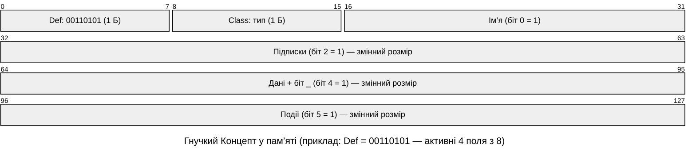
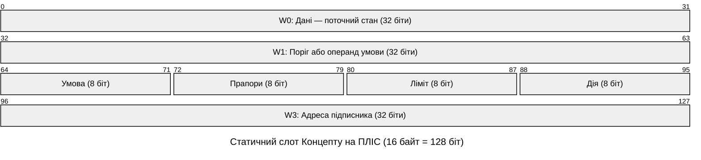
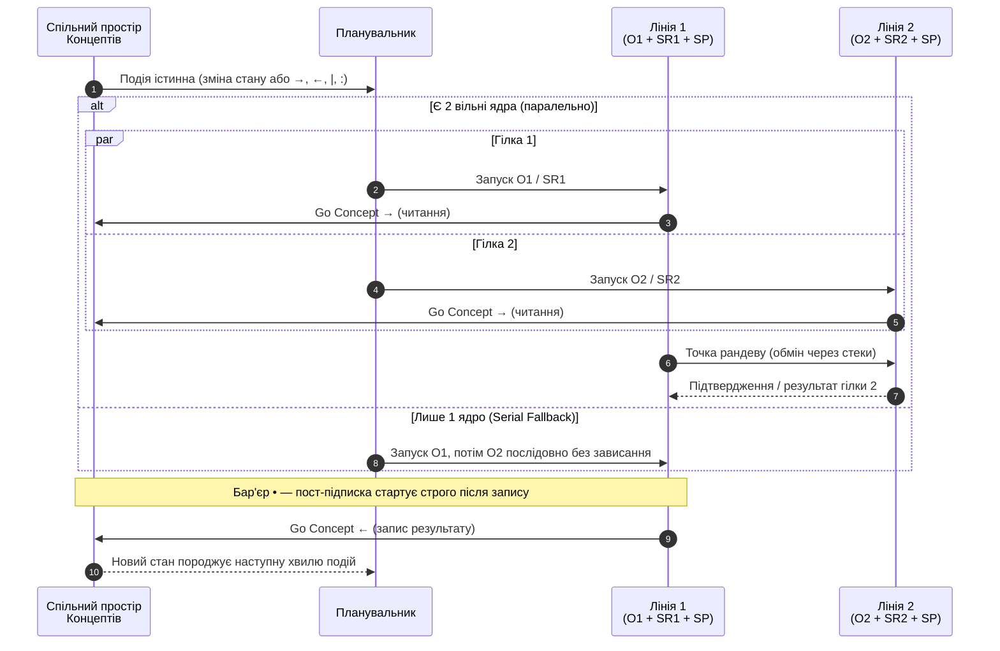
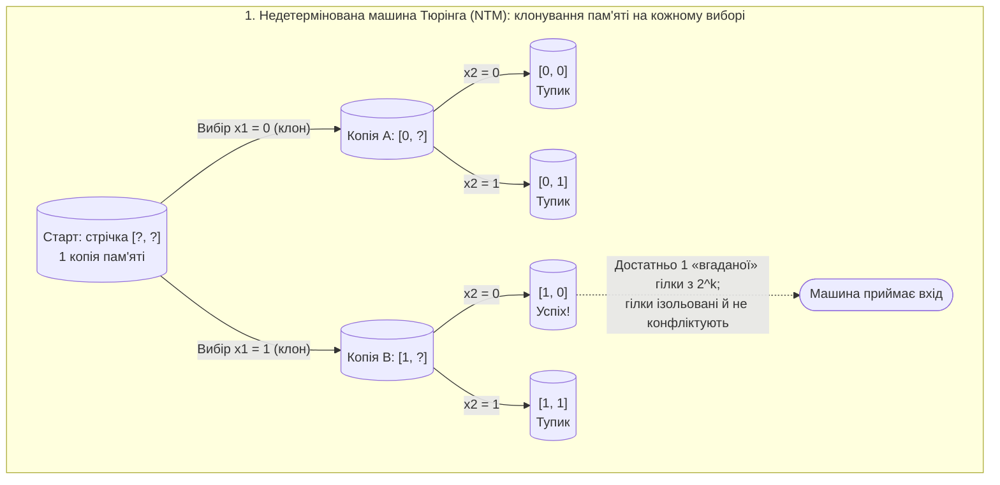
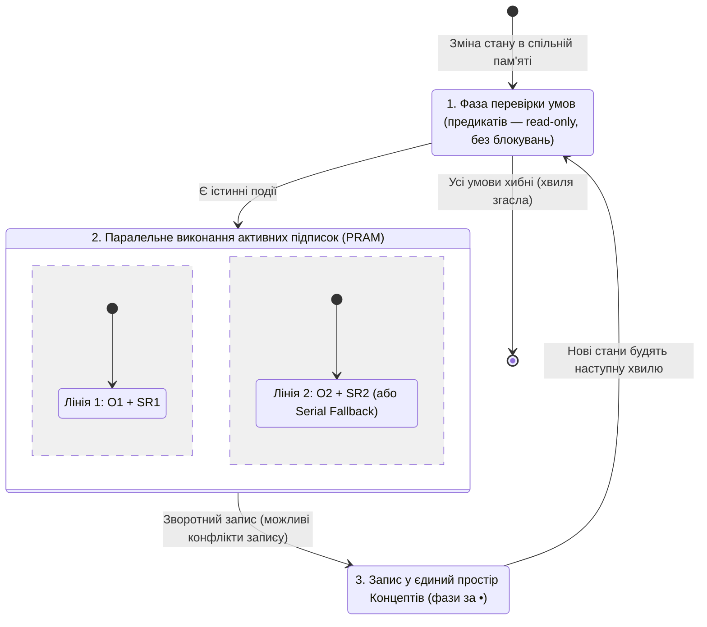
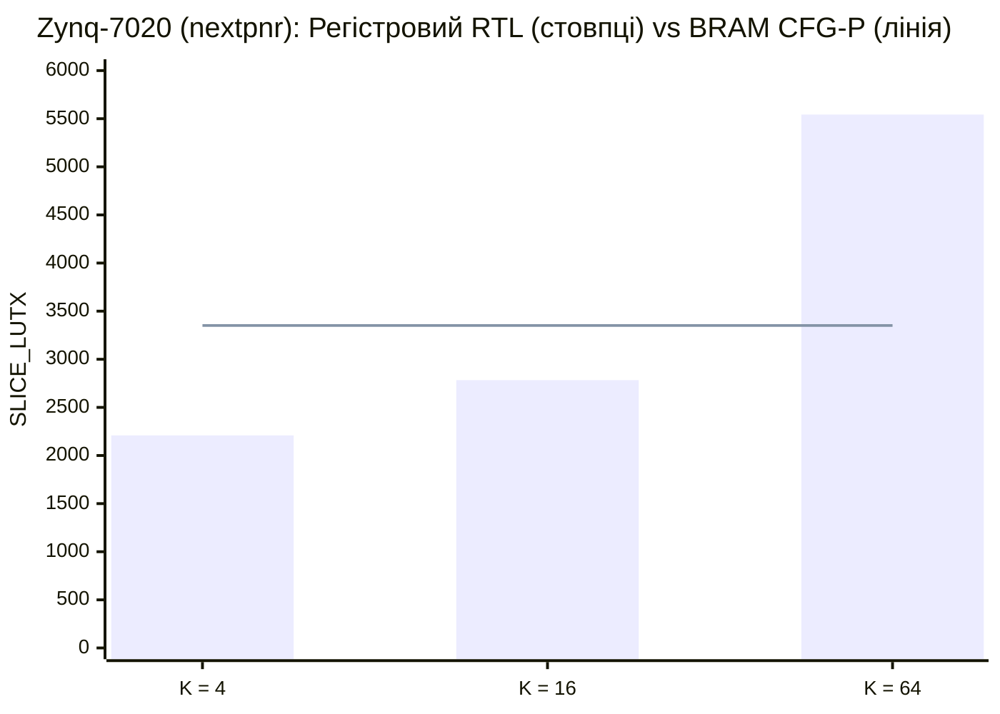

# Машина Кузьміна простою мовою: реактивні концепти, мова KPOL і де це справді працює

Коли програміст уперше чує про **Машину Кузьміна (МК)** — обчислювальну модель Михайла Кузьміна, описану в серії публікацій на [DOU](https://dou.ua/forums/topic/35914/) та технічних матеріалах останніх років, — головне питання звучить просто: *«Як це взагалі працює, як на цьому писати код, у чому суть паралелізму і де воно реально потрібне?»*

Більшість дискусій навколо МК точаться довкола високорівневих метафор, хоча насправді за нею стоїть цілком конкретна **подієво-реактивна модель обчислень зі спільним простором станів і стековим виконавцем**. Автором самої парадигми та первинної нотації є **Михайло Ювеналійович Кузьмін**; у цій статті я — **Микола Мартинович Федчик** — підсумовую формальний аналіз моделі, робочу мову опису **KPOL** і результати власних прототипів на FPGA, GPU та мікроконтролерах (повний розподіл внеску — наприкінці статті).

Далі підемо від простого до складного: спочатку подивимося на ідею концепту й три живі приклади коду на KPOL, потім зазирнемо «під капот», розберемо природу паралелізму й чесні інженерні межі на ПК, MCU та FPGA.

---

## 1. Ідея Машини Кузьміна простими словами: від «потоку інструкцій» до «реактивних концептів»

У класичній архітектурі **фон Неймана** (звичайні ПК, сервери, смартфони, мікроконтролери) програма та дані розділені:
- у пам’яті лежать пасивні байти (змінні, масиви, структури — вони самі по собі нічого не роблять);
- процесор має лічильник команд (`Program Counter, PC`), який крок за кроком вичитує інструкції, тягне дані в регістри, щось рахує і записує результат назад у пам’ять;
- якщо програмі треба зреагувати на зміну якоїсь величини, вона або постійно перевіряє її в циклі опитування (*polling*), або чекає переривання чи колбека.

**Машина Кузьміна пропонує іншу базову одиницю обчислень — Концепт.**

> **Концепт (простими словами)** — це **реактивна комірка пам’яті з вбудованими тригерами на читання й запис**, яка об’єднує три речі одразу:
> 1. **Дані (стан):** поточне значення (число, символ, булевий стан або особливий стан «невідомо / не ініціалізовано» `_`) і тип даних.
> 2. **Події (умови тригера, або предикати):** логічні правила («так / ні»), які перевіряють стан комірки або сам факт звернення до неї (наприклад, «значення стало $> 100$», «значення змінилося», «хтось прочитав цю комірку»).
> 3. **Підписки (дії тригера / вбудовані колбеки):** операції, які автоматично запускаються, щойно відповідна подія стала істинною.

**Що тут означає слово «реактивна» і як вбудовуються тригери?**
- **«Реактивна»** означає, що комірка не чекає, поки її опитає якийсь зовнішній цикл `while`: вона *сама* реагує на зміну свого стану чи звернення до неї й одразу запускає пов’язані дії — подібно до комірки Excel із формулою або `ON UPDATE`-тригера в базі даних.
- **Як вбудовуються тригери:** на відміну від звичайної змінної, де перевірка `if (...)` розкидана по коду програми, умови подій і адреси підписників **зберігаються разом із даними в структурі самої комірки** (і на ПЛІС зчитуються апаратурою одночасно зі значенням). Тож будь-який запис у комірку або читання з неї автоматично проходить через її власні правила без жодного додаткового виклику з боку програми.
- **Як реєструються й викликаються $N$ підписників:** усередині комірки лежить не сам код реакцій, а **список адрес** (покажчиків) на цільові концепти чи блоки коду — вони записуються в комірку-джерело під час компіляції або налаштування, щоб при зміні не сканувати всю пам’ять. Щойно подія спрацювала, виконавець роздає ці адреси обчислювальним лініям. На ПЛІС для периферії це може бути **пряма фізична лінія (дріт)** на реле, ШІМ чи сусідній блок, а для пам’яті слотів — індекс цільового слота, бітова маска підписників або посилання на таблицю розсилки.

**Як концепт лежить у пам’яті — і скільки місця займає?** Тут є два підходи: «гнучкий» і «фіксований»:
- **В авторській моделі М. Ю. Кузьміна (змінний розмір):** концепт влаштований як конструктор із чеклістом. На початку стоять **1 байт-чекліст `Def`** (8 бітів — по біту на кожну можливу частину) і **1 байт типу `Class`**, а далі в пам’яті зберігаються **лише ті частини, біля яких стоїть `1`**. Порожні поля з `0` узагалі не витрачають пам’ять:



- **В апаратній реалізації на ПЛІС (фіксований розмір — рівно 16 байтів):** залізу простіше читати комірки однакового розміру за один фіксований прохід, тому кожен концепт пакується в один стандартний 16-байтний (128-бітний) слот із чотирьох 32-бітних слів (`W0..W3`):



У моделі Машини Кузьміна **немає глобального лічильника команд `PC`** і **немає звичних імперативних циклів (`for`, `while`, `do`)**. Програма описується не як «крок 1, крок 2, крок 3», а як мережа концептів, подій і підписок. Коли змінюється зовнішній сигнал чи стан одного концепту, система сама «будить» підписані на нього обчислення.

---

## 2. Як це виглядає в коді: мова KPOL за 3 кроки

Авторський синтаксис опису концептів, подій та підписок розробив Михайло Ювеналійович Кузьмін; у межах нашої систематизації цей мовний шар отримав робочу назву **KPOL** (*Kuzmin Problem-Oriented Language*).

> **Примітка щодо діалектів:** у цій статті використано синтаксис оригінальної авторської нотації **[KPOL-AUTH](../Engineering/guides/kpol-auth-formal-specification.md)**. Окремо в ході досліджень Машини Кузьміна було розроблено дві формалізовані мови — **[KPOL](../Engineering/guides/kpol-formal-specification.md)** і **[EKPOL](../Engineering/guides/ekpol-formal-specification.md)** — для практичної інженерної розробки, статичної верифікації та компіляції.

У перші хвилини цей синтаксис здається незвичним, але варто зрозуміти **одну закономірність**, і код починає читатися зліва направо, як звичайне речення.

### 2.1. Головна зміна мислення: від «що робити» до «на що реагувати»

У класичній мові ви пишете сценарій для процесора:
```c
if (x != prev_x && x > 10) {
    alarm();
}
```

У **KPOL** ви описуєте паспорт самого концепту за єдиною схемою:

> **`Тип  Ім'я  Початковий_стан   Подія (коли?)   Підписка (що зробити?)`**

Умова (`Подія`) і реакція (`Підписка`) живуть не в окремому `main()` чи `loop()`, а прикріплені безпосередньо до даних.

### 2.2. Міні-курс KPOL за 3 кроки

#### Крок 1. Один рядок без розгалужень: перемикач стану (T-тригер)

Найменша повна програма на KPOL — логічний перемикач, який при кожному спрацюванні змінює свій стан на протилежний:

```text
? If _ ; ! If = ¬ ; ¬ = !
```

Читаємо зліва направо:
1. `? If _` — булевий (`?`) концепт `If` із початковим станом «невідомо» (`_`).
2. `; ! If = ¬` — якщо значення стало Істиною (`!`), записати Хибу (`¬`).
3. `; ¬ = !` — якщо значення стало Хибою (`¬`), записати Істину (`!`).

Замість звичного `if / else` тут у самому описі концепту зашиті дві реакції на два можливі стани. І це не перетворюється на нескінченну рекурсію: зміна атрибута всередині його власної підписки не викликає повторного авто-тригера (детальніше про це — у §3.3).

#### Крок 2. Реакція на запис і читання: суматор із авто-скиданням

Тепер опишемо концепт `Sum`, який накопичує записані числа, а щойно хтось прочитає підсумок — сам обнуляється:

```text
Float Sum 0
    ← @ Float x  += x     '# При записі (←) додаємо x до поточного Sum
    → • Sum = 0           '# При читанні (→) СТРОГО ПІСЛЯ видачі значення (•) обнуляємо Sum
```

Тут з’являються три нові позначення:
- `←` і `→` — події запису в концепт та читання з нього (`@ Float x` означає вхідний параметр `x`);
- **велика крапка `•`** — бар’єр порядку після адресації. Без неї обнулення могло б стерти `Sum` раніше, ніж формула-споживач забере накопичене число. Запис `→ •` гарантує порядок: *спочатку віддати старе значення, і лише потім виконати `Sum = 0`*.

#### Крок 3. Згасання подій замість `while`: алгоритм Евкліда

Як KPOL обходиться без циклів? Подивімося на алгоритм Евкліда (найбільший спільний дільник):

```text
U64 Nod | @ U64 ( a_ > b -=b , b_ > a -=a ) =a
Z = Nod(120, 6)
```

- `U64 Nod |` — концепт `Nod` типу `U64` із точкою виклику `|`.
- `@ U64 ( a_ > b -=b , b_ > a -=a )` — два вхідні параметри `a` і `b`, які до виклику мають стан «невідомо» (на це вказує підкреслення `_` біля імені: `a_`, `b_`). До `a` прив’язана подія `> b` із реакцією `-= b`, а до `b` — подія `> a` із реакцією `-= a`.
- Коли викликаємо `Nod(120, 6)`, подія `120 > 6` зменшує `a` на `6`, доки числа не зрівняються (`6`). У точці `a = b` **обидві умови стають хибними**, реактивна хвиля природно згасає, і повертається `=a` (`6`).

У більших програмах концепти об’єднують у класи (`Class`) із конструктором (`| ...`) і внутрішніми підписками (`: { ... }`), наприклад для тахометра або контролера допусків. На практиці авторський `KPOL-AUTH` залишається прототипною нотацією — для щоденної інженерної роботи та компіляції використовуються формалізовані мови `KPOL` і `EKPOL`, але базові принципи лишаються тими самими.

### 2.3. Короткий довідник синтаксису KPOL

Щоб закріпити всі символи з прикладів вище в одному місці:

| Символ / слово | Як читати українською | Навіщо потрібен у коді |
| :--- | :--- | :--- |
| `_` | «невідомо / не задано» | Початковий стан без числа (окремий біт валідності) |
| `Byte`, `Int32`, `Float`, `U64` | тип даних концепту | Базові числові та символьні типи |
| `@ Тип x` | «приймаю параметр `x`» | Вхідний аргумент методу або запису |
| `←` / `→` | «коли в мене пишуть / читають» | Тригер запису або читання концепту |
| `\|` / `:` | «виклик» / «створити екземпляр» | Метод концепту або ініціалізація за класом |
| `Null`, `Positive`, `~`, `>`, `<` | «подія стану або порівняння» | Спрацьовує при `0`, `>0`, зміні (`~`) чи порівнянні |
| `?`, `!`, `¬` | «булевий тип, True, False» | `!` — Істина, `¬` — Хиба; `?` — булевий концепт |
| `•` | «строго після адресації» | Велика крапка: запуск підписки після завершення читання/запису |
| `( ... )`, `{ ... }`, `[ ... ]` | «група (І) / вибір (АБО)» | Круглі й фігурні вимагають усіх елементів, квадратні — альтернативи |

---

## 3. Як це працює «під капотом»: адресація, стеки та захист від хаосу

Тепер, коли ви бачили живі приклади (`If`, `Sum`, `Nod`), подивімося на операційну будову машини: як адресуються концепти, хто виконує підписки і що захищає систему від хаосу.

### 3.1. Чотири операції адресації (`Go`)

У центрі взаємодії між концептами стоїть оператор **`Go`**, який звертається до цільового концепту. Ви вже бачили три з чотирьох операцій адресації в §2 — і **кожна з них сама по собі є подією**, на яку можна підписатися:

| Операція | Значення | Що відбувається з даними та подіями |
| :--- | :--- | :--- |
| **`→`** | **Читання** | Значення концепту кладеться в стек обчислень; спрацьовують підписки «на читання». |
| **`←`** | **Запис** | Нове значення береться зі стека і записується в концепт; спрацьовують підписки «на зміну / запис». |
| **`\|`** | **Виконання** | Активується виконавчий метод / підписка концепту (аналог виклику процедури або тригера). |
| **`:`** | **Ініціалізація** | Створюється новий екземпляр концепту на основі класу-прототипу. |

### 3.2. Стеково-регістровий виконавець і плавний відкат

Коли подія стає істинною й активує підписку, виконавче ядро розгортає для цієї лінії виконання три сутності:
1. **`O` (послідовність команд):** набір операцій підписки (`Go` для звернень до концептів і `Do` для арифметики чи логіки).
2. **`SR` (стек-регістр обчислень):** робочий стек проміжних значень (наприклад, для `a + b` виконавець кладе `a`, потім `b`, а `Do +` залишає на вершині суму).
3. **`SP` (стек параметрів):** спільний для підписки стек вхідних аргументів (`@`) та локальних екземплярів.



Важлива властивість масштабування — **плавний послідовний відкат (*Serial Fallback*)**: якщо підписка розбивається на дві гілки (`SR1` і `SR2`), за наявності двох вільних ядер вони працюють одночасно й обмінюються результатом у точці рандеву. Якщо вільного другого ядра немає, система не зависає: перше ядро саме підхоплює другу гілку і завершує обчислення послідовно.

### 3.3. Бар’єр `•`, придушення самотригера і стан `_` у пам’яті

Три механізми тримають реактивну мережу передбачуваною:
1. **Велика крапка (`•`):** як ми бачили в суматорі `→ • Sum = 0`, підписка після `•` запускається строго після завершення самої операції читання або запису.
2. **Придушення самотригера:** як у перемикачі `If`, звернення до атрибута всередині підписки, викликаної подією цього самого атрибута, не породжує повторного авто-тригера — це перекриває тривіальну нескінченну саморекурсію на одному концепті.
3. **Явний стан невизначеності `_` у пам’яті:** у дескрипторі концепту стан «не ініціалізовано» кодується **окремим бітом валідності**, а не магічними числами на кшталт `0`, `-1` чи `NaN` (поруч із компактним заголовком `Def` та ідентифікатором класу `Class`, щоб не витрачати пам’ять на порожні поля). Завдяки цьому система завжди відрізняє число `0` від відсутності даних чи обриву датчика.

---

## 4. Логіка паралелізму: спільна пам’ять замість недетермінованої машини Тюрінга

У ранніх обговореннях Машину Кузьміна часто називали «керованою недетермінованою машиною Тюрінга». З погляду теорії обчислень тут важливо провести чітку межу.

Класична *недетермінована машина Тюрінга* (`NTM`) — це математична абстракція, де кожна гілка вибору отримує власну ізольовану копію стрічки. Машина Кузьміна працює інакше: коли подія запускає кілька підписок одночасно, усі вони працюють **фізично паралельно над спільною пам’яттю концептів**. У теорії обчислень це відповідає класу **паралельних машин зі спільною пам’яттю (`PRAM`) та подієво-продукційних систем (`ECA`)**, а не `NTM`. Тобто архітектура не «вгадує» розв’язок $\mathrm{NP}$-повних задач за поліноміальний час, натомість природно використовує багатоядерний паралелізм.





Зіставлення обох схем дає три практичні висновки:
1. **Модель пам’яті:** у `NTM` кожен крок вибору уявно дублює всю стрічку, тоді як у Машині Кузьміна всі лінії виконання працюють над єдиним простором концептів.
2. **Взаємодія між гілками:** фаза перевірки умов (предикатів) нічого не записує в пам’ять, тому всі умови можна безпечно оцінювати паралельно без блокувань. Натомість паралельні *записи* у спільний концепт можуть конфліктувати — тут потрібна або дисципліна програміста, або перевірка компілятора на стадії збірки.
3. **Природа прискорення:** виграш досягається не «магічним вгадуванням шляху», а реальним паралельним виконанням незалежних умов і гілок на доступних ядрах чи в апаратурі ПЛІС (за умови, що каскад подій згасає й не створює нескінченних циклів).

---

## 5. Як і де це запускати — і де підхід реально окупається

Поширений міф: *«Машина Кузьміна потребує якогось неіснуючого екзотичного процесора»*. Насправді одну й ту саму програму на KPOL можна запускати на трьох рівнях платформ — залежно від вимог до часу реакції.

### 5.1. На звичайних комп’ютерах і серверах

На звичайному `x86-64` або `ARM` процесорі Машина Кузьміна працює як структурований реактивний рушій у RAM (інтерпретатор, віртуальна машина або скомпільований код C/Go/Rust). Предикати й підписки утворюють видимий граф, який можна перевірити статично ще до запуску — на відміну від колбеків, розкиданих по десятках класів у ООП.

**Чесна межа на ПК:** у нашому експерименті скомпільований C99-каскад усередині L1-кешу відпрацьовує за пів мікросекунди, але щойно втручається планувальник Linux чи системні переривання, затримки зростають до десятків мікросекунд. Тож на звичайному сервері під ОС це радше зручна дисципліна опису реактивних станів, а не засіб жорсткого реального часу.

### 5.2. На мікроконтролерах (MCU) та в гібридних системах

На мікроконтролерах (`STM32`, `RP2040`, автомобільних `AURIX` чи `ARM Cortex-M/R`) підхід працює значно краще, бо немає важкої ОС:
- **Безцикловий C99 із формальною перевіркою:** статичний компілятор перевіряє граф правил на відсутність циклів і порушень інваріантів (наприклад, через SMT-солвер `Z3`) і генерує простий безцикловий C99-код із фіксованим часом виконання та явною маскою стану `_`. Такий код підходить для ядер безпеки без `RTOS`.
- **Гібрид `FPGA + вбудований GPU`:** якщо потрібно одночасно перераховувати сотні числових контурів (фільтрів, ПІД-регуляторів), події після апаратного фільтра можна передавати на вбудований GPU (на кшталт `NVIDIA Jetson AGX Orin`), де тисяча паралельних підписників обчислюється за **~1.6–2 мкс**. Головна умова — прямий апаратний канал між чипами, бо звичайний мережевий стек Linux/Ethernet миттєво з’їдає виграш сотнями мікросекунд затримки.

### 5.3. Напряму в кремнії FPGA і поріг окупності ($K^{\ast} = 26$ правил)

Найсильніше модель розкривається на серійних ПЛІС (`FPGA`), якщо застосувати **віртуалізацію поблизу блочної пам’яті (`BRAM`)**:
- один компактний апаратний рушій обслуговує десятки дескрипторів концептів у вбудованій пам’яті кристала на частоті понад 100 МГц;
- внутрішній цикл обробки однієї події займає фіксовані **8 тактів (~80 нс)** із нульовим внутрішнім джитером (повний тракт «пін-до-піна» — трохи більше `100 нс`);
- за наявності другого «тіньового» банку пам’яті правила захисту можна оновлювати на льоту під час роботи системи з атомарним перемиканням за 1 такт — без пересинтезу прошивки ПЛІС і без простою.

**Важлива інженерна межа ($K^{\ast} = 26$):** на малій кількості правил (менше ~26 концептів) такий конвеєр на FPGA **не потрібен** — звичайна регістрова логіка простіша, компактніша й швидша. Поріг $K^{\ast} = 26$ отримано лінійною інтерполяцією між трасованими точками $K = 16$ і $K = 64$ на `Zynq-7020` (`nextpnr`) проти регістрового RTL, пороги якого також можна переналаштовувати через AXI без пересинтезу. Коли кількість правил росте до десятків, площа регістрового RTL зростає лінійно, а тактова частота падає; натомість у `BRAM`-конвеєра МК (`CFG-P`) площа логіки залишається **константною** (`3 351 SLICE_LUTX` для $K \le 64$) разом з атомарним оновленням таблиці правил.



---

## 6. П’ять практичних ніш (і де підхід не потрібен)

Концептна модель — значення + явний стан `_` + безпобічні предикати + ациклічні підписки з бар’єром `•` — перетворює логіку керування на математично прозорий скінченний граф переходів. Його можна формально перевірити *до запуску* і скомпілювати під потрібну платформу з §5. Ось п’ять галузей, де це дає реальний інженерний виграш:

1. **Апаратні контури безпеки для БПЛА, НРК і робототехніки з ШІ (*Hardware Safety Cages / AI Guardrails*):**
   Між автопілотом чи ШІ під Linux і силовими приводами ставиться «залізний запобіжник» на ПЛІС, який на рівні сотень наносекунд блокує будь-яку небезпечну команду поза дозволеним конвертом незалежно від зависання ОС, але дозволяє оновлювати параметри місії на льоту через тіньовий банк пам’яті.
2. **Автомобільна електроніка критичної безпеки, системи керування батареями (`BMS`) та силові інвертори:**
   Каскадна діагностика батарей (`Комірка -> Модуль -> Батарея -> Контактор`) на захищених мікроконтролерах. Явний стан `_` унеможливлює маскування обриву датчика нулем, а компілятор видає безцикловий C99-код із доведеними інваріантами.
3. **Цифрова енергетика, Smart Grid, релейний захист підстанцій та промислові інтерлоки АСУ ТП:**
   Десятки взаємопов’язаних порогових правил ($K \ge 26$, типово $26\text{–}64+$) мають спрацьовувати з гарантованою затримкою, але уставки захисту повинні компактно зберігатися в пам’яті й атомарно переналаштовуватися під поточну топологію мережі без зупинки обладнання та розростання логіки ПЛІС.
4. **Наднизьколатентні мережеві шлюзи (*SmartNIC*), біржовий Pre-Trade Risk контроль і тригери фізичних експериментів:**
   Сценарії, де потрібно перевіряти десятки ризик-лімітів або фільтрів за наносекунди, утримувати компактну площу на кристалі й атомарно оновлювати активні набори правил у реальному часі.
5. **Гетерогенні комплекси напівнатурного моделювання (*HIL*) та Sensor Fusion:**
   Зв’язка «ПЛІС для швидкої фільтрації інваріантів + GPU для сотень паралельних обчислювальних каналів», де єдина формальна модель правил слугує джерелом і для математичних доказів, і для апаратури, і для вбудованого C-коду.

*(Натомість для звичайних веб-серверів, реляційних СУБД, навчання великих нейромереж чи простих блокувань на 3–5 правил цей підхід не дає переваг над звичними інструментами.)*

---

## Підсумок: чим насправді є Машина Кузьміна?

1. **Не «заміна CPU» і не «нова заміна Python/C»:** за походженням Машина Кузьміна — це реактивна парадигма класу `PRAM + ECA`, яка об’єднує в одному Концепті дані, стан невизначеності `_`, предикати та підписки без імперативних циклів. На звичайному ПК під ОС вона програє в детермінізмі через планувальник ОС, а класичний синтаксис KPOL незручний як універсальна мова загального призначення.
2. **Сильна вузька ніша — «Safety IR під капотом» та апаратно-програмний ко-дизайн:** коли KPOL використовується як статично верифікована мова правил керування й безпеки, єдиний перевірений граф транслюється в активні таблиці `BRAM` на ПЛІС, паралельні канали GPU або безцикловий C99-код для мікроконтролерів.

> **В одному реченні:** Машина Кузьміна — це не універсальний процесор майбутнього, а перспективна **реактивна модель і проміжне представлення для систем жорсткого реального часу**, де десятки перепрограмованих правил захисту й керування мають виконуватися з наносекундною передбачуваністю та формальними гарантіями безпеки.

---

## 7. Короткий глосарій, розподіл внеску та джерела

### Короткий глосарій

* **Концепт** — базова одиниця пам’яті й логіки МК, що поєднує дані (зі станом невизначеності `_`), предикатні події та перелік підписок.
* **Велика крапка (`•`)** — бар’єр порядку фаз: підписка після `•` запускається строго після завершення операції читання (`→`) або запису (`←`).
* **Стан невизначеності (`_`)** — окремий стан «не ініціалізовано / невідомо», закодований виділеним бітом валідності й відокремлений від числа `0`.
* **Лінія підписки (`O + SR`)** — гілка виконання активованої підписки з власним потоком команд `O`, стеком обчислень `SR` і спільним стеком параметрів `SP`.
* **Плавний послідовний відкат (*Serial Fallback*)** — властивість планувальника МК: за браку вільного ядра активний потік сам виконує сусідню гілку без взаємного блокування.
* **А-ритм (А-схема)** — подієва організація обчислень без лічильника команд, де порядок роботи задають події та ланцюжки підписок.

### Розподіл внеску

- **Михайло Ювеналійович Кузьмін** — автор обчислювальної парадигми Машини Кузьміна: концептів, чотирьох операцій адресації (`Go`), подій та підписок, подієвої організації обчислень (А-ритму), стеково-регістрової моделі (`O`, `SR`, `SP`), оператора черговості `•`, безциклової композиції, а також первинного синтаксису та прикладів коду.
- **Микола Мартинович Федчик (автор цієї статті)** — виконав формальний аналіз та систематизацію матеріалів автора, запропонував робочу назву мови **KPOL** (*Kuzmin Problem-Oriented Language*), дослідив математичні межі моделі, реалізував і виміряв апаратні прототипи на ПЛІС (`FPGA`) та вбудованому GPU, а також розробив трансляцію верифікованих правил у безцикловий C99-код для мікроконтролерів.

### Основоположні праці комп’ютерної науки

1. **Turing, A. M.** (1936). On Computable Numbers, with an Application to the Entscheidungsproblem. *Proceedings of the London Mathematical Society*. — Базова формалізація машини Тюрінга та обчислюваності.
2. **Sipser, M.** (2013). *Introduction to the Theory of Computation* (3rd ed.). Cengage Learning. — Класичний виклад теорії складності та відмінностей між детермінованими і недетермінованими моделями (`NTM`).
3. **Dennis, J. B.** (1980). Data Flow Supercomputers. *Computer*, 13(11), 48–56. [doi:10.1109/MC.1980.1653418](https://doi.org/10.1109/MC.1980.1653418); та **Arvind, & Culler, D. E.** (1986). Dataflow Architectures. *Annual Review of Computer Science*, 1(1), 225–253. [doi:10.1146/annurev.cs.01.010186.001301](https://doi.org/10.1146/annurev.cs.01.010186.001301) — Класичні потокові (*Dataflow*) архітектури без глобального лічильника команд.
4. **Hoare, C. A. R.** (1978). Communicating Sequential Processes. *Communications of the ACM*, 21(8), 666–677. [doi:10.1145/359576.359585](https://doi.org/10.1145/359576.359585) — Теорія взаємодіючих процесів і міжпотокового рандеву.
5. **Hewitt, C., Bishop, P., & Steiger, R.** (1973). A Universal Modular ACTOR Formalism for Artificial Intelligence. *IJCAI*. — Акторна модель конкурентних повідомлень.
6. **Forgy, C. L.** (1982). Rete: A Fast Algorithm for the Many Pattern/Many Object Pattern Match Problem. *Artificial Intelligence*. — Продукційні правила «умова–дія» (*ECA / Pattern Matching*).
7. **Berry, G., & Gonthier, G.** (1992). The Esterel Synchronous Programming Language: Design, Semantics, Implementation. *Science of Computer Programming*. — Детерміноване синхронне реактивне програмування.

### Первинні публікації М. Ю. Кузьміна та розширені технічні матеріали

8. **Кузьмін, М. Ю.** (2021–2026). Серія авторських публікацій і обговорень на DOU:
   - [«Машина Кузьміна. (Керована недетермінована машина Тюрінга.)»](https://dou.ua/forums/topic/35914/);
   - [«Виконання груп у недетермінованій машині»](https://dou.ua/forums/topic/36556/);
   - [«Автоматика та пристрої»](https://dou.ua/forums/topic/38994/);
   - [«Опис недетермінованої машини Кузьміна на пальцях»](https://dou.ua/forums/topic/43177/).
9. **Кузьмін, М. Ю.** [Авторський YouTube-канал (відеоматеріали про Машину Кузьміна)](https://www.youtube.com/watch?v=qKUoCeGvXnA).
10. **Федчик, М. М.** (2026). [Повна технічна версія цієї статті для DOU (`DOU_Article_Kuzmin_Machine_UA.md`)](DOU_Article_Kuzmin_Machine_UA.md) — із розширеними прикладами (`Tachometer`, `Control`, `EKPOL`, TUI-дебагер `VMK`), математичним апаратом (умови Бернштейна, теорема Брента, гіллясті процеси, *Network Calculus*), детальною таблицею придатності та повними стендовими специфікаціями ПЛІС/GPU.
11. **Федчик, М. М.** (2026). Дослідницькі матеріали проєкту: [зведений науково-інженерний огляд Машини Кузьміна](Kuzmin-Machine-Overview.md) та [порівняльний аналіз споріднених машин](Similar_Machines_to_KM.md).

---

Запрошую до конструктивного обговорення в коментарях — особливо щодо практичних задач у робототехніці, енергетиці й embedded-системах, де вам бракує детермінованої реакції та простої формальної верифікації правил!

<!--
* **Версія:** 1.2.1
* **Дата:** 2026-11-19
* **Тип WP:** Article

## Історія версій

| Версія | Дата | Зміни |
|---|---|---|
| 1.2.1 | 2026-11-19 | Прибрано `quadrantChart` із §5 та винесено службову таблицю версій у HTML-коментар. |
| 1.2.0 | 2026-11-19 | Оновлено Mermaid-діаграми статті (`packet-beta` у §1, `sequenceDiagram` у §3.2, NTM + `stateDiagram-v2` у §4, `xychart-beta` у §5.3); прибрано службовий блок метаданих із початку статті. |
| 1.1.2 | 2026-11-19 | Додано UML-діаграму класів для Концепту в §1. |
| 1.1.1 | 2026-11-19 | Додано примітку про діалекти `KPOL-AUTH`, `KPOL` і `EKPOL`. |
| 1.1.0 | 2026-11-19 | Перебудовано порядок викладу за дидактичною та редакторською оцінкою. |
| 1.0.1 | 2026-11-19 | Виправлено MathJax/Markdown-запис порога $K^{\ast} = 26$. |
| 1.0.0 | 2026-11-19 | Перенесено до каталогу `Articles/`. |
-->
