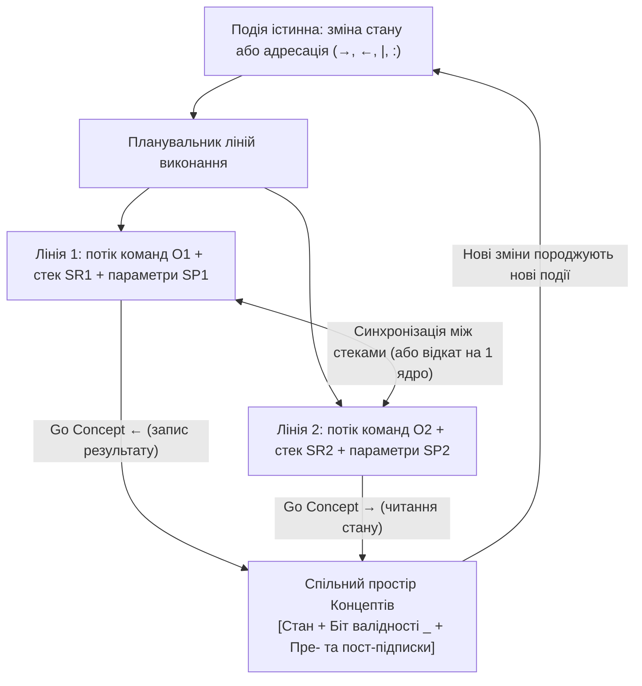
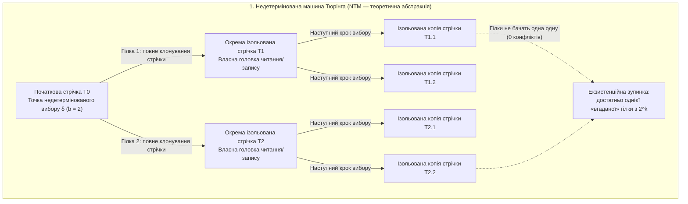
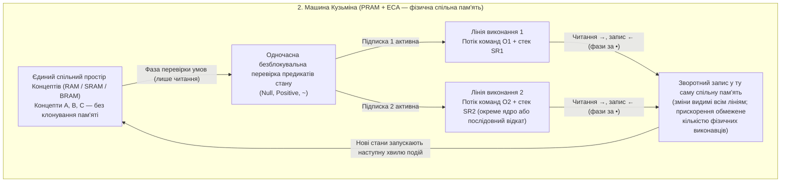
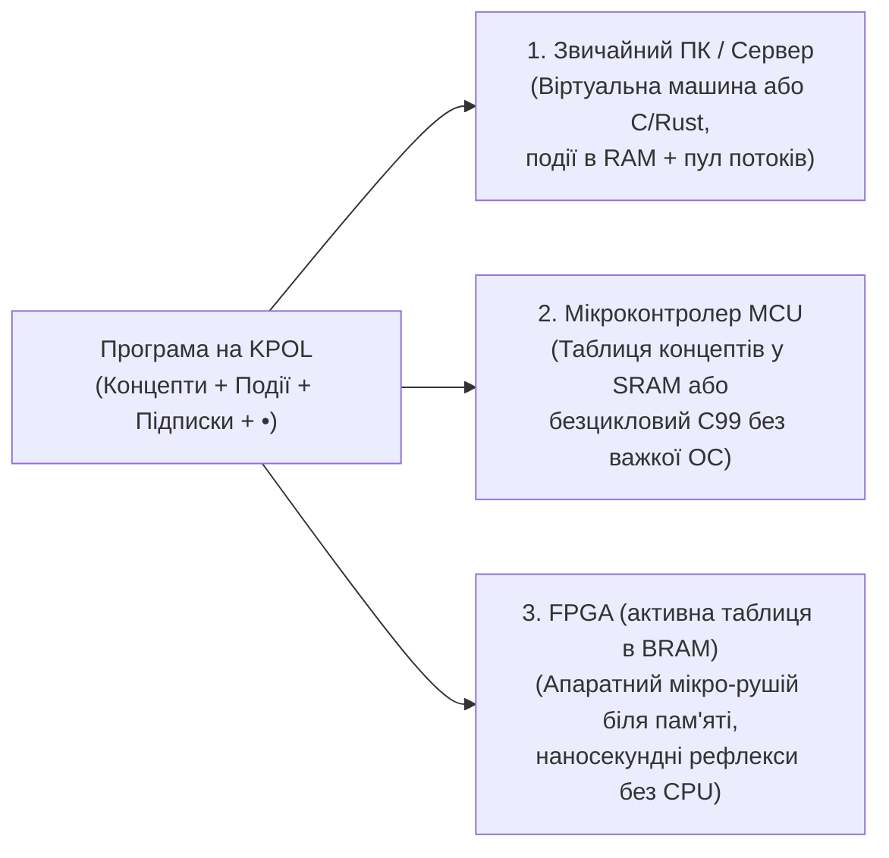

# Машина Кузьміна простою мовою: реактивні концепти, мова KPOL і де це справді працює

Коли програміст уперше чує про **Машину Кузьміна (МК)** — обчислювальну модель Михайла Кузьміна, описану в серії публікацій на [DOU](https://dou.ua/forums/topic/35914/) та технічних матеріалах останніх років, — головне питання звучить просто: *«Як це взагалі працює, як на цьому писати код, у чому суть паралелізму і де воно реально потрібне?»*

Більшість дискусій навколо МК точаться довкола високорівневих метафор, хоча насправді за нею стоїть цілком конкретна **подієво-реактивна модель обчислень зі спільним простором станів і стековим виконавцем**.

> **Об’єктивний розподіл внеску (хто що створив):**
> - **Михайло Ювеналійович Кузьмін** — автор самої обчислювальної парадигми Машини Кузьміна: концептів, чотирьох операцій адресації (`Go`), подій та підписок, А-ритму, стеково-регістрової моделі (`O`, `SR`, `SP`), оператора черговості `•`, безциклової композиції, а також первинного синтаксису та прикладів коду.
> - **Микола Мартинович Федчик (автор цієї статті)** — виконав формальний аналіз та систематизацію матеріалів автора, запропонував робочу назву мови **KPOL** (*Kuzmin Problem-Oriented Language*), дослідив математичні межі моделі, реалізував і виміряв апаратні прототипи на ПЛІС (`FPGA`) та вбудованому GPU, а також розробив трансляцію верифікованих правил у безцикловий C99-код для мікроконтролерів.

У цій статті пройдемо весь шлях послідовно й без зайвої академічної важкості:
1. Як влаштована **Машина Кузьміна** (пам’ять концептів, адресація, стеки та відсутність циклів).
2. **Як читати й писати код на KPOL** — три прості кроки від одного рядка до алгоритму Евкліда.
3. **Логіка паралелізму** — чому це спільна пам’ять (`PRAM`), а не «магічна недетермінована машина Тюрінга».
4. **Де й на чому це запускається** — від ПК і мікроконтролерів до FPGA — і для яких п’яти галузей підхід дає реальний інженерний виграш.

---

## 1. Ідея Машини Кузьміна простими словами: від «потоку інструкцій» до «реактивних концептів»

У класичній архітектурі **фон Неймана** (звичайні ПК, сервери, смартфони, мікроконтролери) програма та дані розділені:
- у пам’яті лежать **пасивні байти** (змінні, масиви, структури — вони самі по собі нічого не роблять);
- процесор має **лічильник команд (`Program Counter, PC`)**, який крок за кроком вичитує інструкції, тягне дані в регістри, щось рахує і записує результат назад у пам’ять;
- якщо програмі треба зреагувати на зміну якоїсь величини, вона або постійно перевіряє її в циклі опитування (*polling*), або чекає переривання чи колбека.

**Машина Кузьміна пропонує іншу базову одиницю обчислень — Концепт.**

> **Концепт (простими словами)** — це сутність у пам’яті, яка об’єднує в собі **три речі одразу**:
> 1. **Дані (стан):** поточне значення (число, символ, булевий стан або особливий стан «невідомо / не ініціалізовано» `_`) і тип даних.
> 2. **Події (умови реакції):** правила, які миттєво перевіряють стан концепту або факт звернення до нього (наприклад, «значення стало $> 100$», «значення змінилося», «хтось прочитав цей концепт»).
> 3. **Підписки (реакції):** дії, які запускаються, щойно відповідна подія стала істинною.

У моделі Машини Кузьміна **немає глобального лічильника команд `PC`** і **немає звичних імперативних циклів (`for`, `while`, `do`)**. Програма описується не як «крок 1, крок 2, крок 3», а як **мережа концептів, подій і підписок**. Коли змінюється зовнішній сигнал чи стан одного концепту, система сама «будить» підписані на нього обчислення.

---

## 2. Внутрішня архітектура: як працює машина «під капотом»

Щоб модель не лишалася абстракцією, подивімося на її операційну будову: як адресуються концепти, хто виконує код і що захищає систему від хаосу.

### 2.1. Чотири види адресації в Машині Кузьміна

У центрі взаємодії між концептами стоїть оператор **`Go`**, який звертається до цільового концепту. Існують **чотири базові операції адресації**, і **кожна з них сама по собі є подією**, на яку можна підписатися:

| Операція | Значення | Що відбувається з даними та подіями |
| :--- | :--- | :--- |
| **`→`** | **Читання** | Значення концепту кладеться в стек обчислень; спрацьовують підписки «на читання». |
| **`←`** | **Запис** | Нове значення береться зі стека і записується в концепт; спрацьовують підписки «на зміну / запис». |
| **`\|`** | **Виконання** | Активується виконавчий метод / підписка концепту (аналог виклику процедури або тригера). |
| **`:`** | **Ініціалізація** | Створюється новий екземпляр концепту на основі класу-прототипу. |

### 2.2. Як виконується код: стеково-регістровий виконавець

Коли подія стає істинною й активує підписку, виконавче ядро розгортає для цієї лінії виконання три сутності:
1. **`O` (послідовність команд):** набір операцій підписки (`Go` для звернень до концептів і `Do` для арифметики чи логіки).
2. **`SR` (стек-регістр обчислень):** робочий стек проміжних значень (наприклад, для `a + b` виконавець кладе `a`, потім `b`, а `Do +` залишає на вершині суму).
3. **`SP` (стек параметрів):** спільний для підписки стек вхідних аргументів (`@`) та локальних екземплярів.



**Важлива властивість масштабування:** якщо підписка розбивається на дві гілки (`SR1` і `SR2`), за наявності двох вільних ядер вони працюють одночасно й обмінюються результатом у **точці рандеву**. Якщо вільного другого ядра немає, система **не зависає**: перше ядро саме підхоплює другу гілку і завершує обчислення послідовно.

### 2.3. Упорядкування фаз великою крапкою та захист від самозациклювання

У реактивній системі одразу виникає питання: *підписка спрацьовує **до** оновлення значення чи **після**? І що буде, якщо підписка на `X` сама змінює `X`?*

У Машині Кузьміна діють два чіткі правила:
1. **Велика крапка (`•`) — бар’єр порядку після адресації:** підписка, записана **після** `•`, гарантовано запускається **строго після завершення самої операції читання або запису**. Наприклад, `→ • Tick = 0` означає: спочатку віддати старе значення `Tick` читачу, і лише потім обнулити його.
2. **Придушення самотригера:** звернення до атрибута всередині підписки, викликаної подією цього самого атрибута, не породжує повторного авто-тригера — це перекриває тривіальну нескінченну саморекурсію на одному концепті.

### 2.4. Внутрішня структура концепту в пам’яті

Кожен концепт у моделі містить:
- **заголовок `Def`** — 8-бітну маску присутності елементів, щоб не витрачати пам’ять на порожні поля;
- **байт класу `Class`** (обов’язковий компонент);
- **значення та стан невизначеності `_`** — стан «не ініціалізовано» кодується **окремим бітом валідності**, а не магічними числами на кшталт `0`, `-1` чи `NaN`. Завдяки цьому система завжди відрізняє число `0` від відсутності даних (`_`).

---

## 3. Мова програмування KPOL: що це і як навчитися на ній писати

Авторський синтаксис і нотацію опису концептів, подій та підписок розробив **Михайло Ювеналійович Кузьмін**; у межах нашої систематизації цей мовний шар отримав робочу назву **KPOL** (*Kuzmin Problem-Oriented Language*).

У перші хвилини цей синтаксис здається незвичним, але варто зрозуміти **одну закономірність**, і код починає читатися зліва направо, як звичайне речення.

### 3.1. Головна зміна мислення: від «що робити» до «на що реагувати»

У класичній мові ви пишете **сценарій для процесора**:
```c
if (x != prev_x && x > 10) {
    alarm();
}
```

У **KPOL** ви описуєте **паспорт самого концепту** за єдиною схемою:

> **`Тип  Ім'я  Початковий_стан   Подія (коли?)   Підписка (що зробити?)`**

Умова (`Подія`) і реакція (`Підписка`) живуть не в окремому `main()` чи `loop()`, а **прикріплені безпосередньо до даних**.

### 3.2. Шпаргалка синтаксису KPOL

| Символ / слово | Як читати українською | Навіщо потрібен у коді |
| :--- | :--- | :--- |
| `_` | «невідомо / не задано» | Початковий стан без числа (окремий біт валідності) |
| `Byte`, `Int32`, `Float`, `U64` | тип даних концепту | Базові числові та символьні типи |
| `@ Тип x` | «приймаю параметр `x`» | Вхідний аргумент методу або запису |
| `←` / `→` | «коли в мене пишуть / читають» | Тригер запису або читання концепту |
| `\|` / `:` | «виклик» / «створити екземпляр» | Метод концепту або ініціалізація за класом |
| `Null`, `Positive`, `~`, `>`, `<` | «подія стану або порівняння» | Спрацьовує при `0`, `>0`, зміні (`~`) чи порівнянні |
| `?`, `!`, `¬` | «булевий тип, True, False» | `!` — Істина, `¬` — Хиба; `?` — булевий концепт |
| `•` | «**суворо після** адресації» | Велика крапка: запуск підписки після завершення читання/запису |
| `( ... )`, `{ ... }`, `[ ... ]` | «колекція (І) / вибір (АБО)» | Групування дій або альтернативних умов |

### 3.3. Міні-курс KPOL за 3 кроки

#### Крок 1. Один рядок без розгалужень: перемикач стану (T-тригер)

Найменша повна програма на KPOL — логічний перемикач, який при кожному записі змінює свій стан на протилежний:

```text
? If _ ; ! If = ¬ ; ¬ = !
```

Читаємо зліва направо:
1. `? If _` — булевий (`?`) концепт `If` із початковим станом «невідомо» (`_`).
2. `; ! If = ¬` — якщо значення стало Істиною (`!`), записати Хибу (`¬`).
3. `; ¬ = !` — якщо значення стало Хибою (`¬`), записати Істину (`!`).

Замість звичного `if / else` тут у самому описі концепту зашиті **дві реакції на два можливі стани**.

#### Крок 2. Реакція на запис і читання: суматор із авто-скиданням

Тепер опишемо концепт `Sum`, який накопичує записані числа, а щойно хтось прочитає підсумок — **сам обнуляється**:

```text
Float Sum 0
    ← @ Float x  += x     '# При записі (←) додаємо x до поточного Sum
    → • Sum = 0           '# При читанні (→) СТРОГО ПІСЛЯ видачі значення (•) обнуляємо Sum
```

Без бар’єра `•` обнулення могло б стерти `Sum` раніше, ніж формула-споживач забере накопичене число. Запис `→ •` гарантує порядок: *спочатку віддати значення, потім виконати `Sum = 0`*.

#### Крок 3. Згасання подій замість `while`: алгоритм Евкліда

Як KPOL обходиться без циклів? Подивімося на алгоритм Евкліда (найбільший спільний дільник):

```text
U64 Nod | @ U64 ( a_ > b -=b , b_ > a -=a ) =a
Z = Nod(120, 6)
```

- `U64 Nod |` — концепт `Nod` типу `U64` із точкою виклику `|`.
- `@ U64 ( a_ > b -=b , b_ > a -=a )` — два параметри `a` і `b`: до `a` прив’язана подія `> b` із реакцією `-= b`, а до `b` — подія `> a` із реакцією `-= a`.
- Коли викликаємо `Nod(120, 6)`, подія `120 > 6` зменшує `a` на `6`, доки числа не зрівняються (`6`). У точці `a = b` **обидві умови стають хибними**, реактивна хвиля природно згасає, і повертається `=a` (`6`).

У більших програмах концепти об’єднують у класи (`Class`) із конструктором (`| ...`) і внутрішніми підписками (`: { ... }`), наприклад для тахометра або контролера допусків. На практиці класичний KPOL залишається прототипною нотацією — для щоденної інженерної роботи над ним існують ергономічніші ASCII-діалекти, але базові принципи лишаються тими самими.

---

## 4. Логіка паралелізму: спільна пам’ять замість недетермінованої машини Тюрінга

У ранніх обговореннях Машину Кузьміна часто називали «керованою недетермінованою машиною Тюрінга». З погляду теорії обчислень тут важливо провести чітку межу.

Класична *недетермінована машина Тюрінга* (`NTM`) — це математична абстракція, де кожна гілка вибору отримує власну ізольовану копію стрічки. Машина Кузьміна працює інакше: коли подія запускає кілька підписок одночасно, усі вони працюють **фізично паралельно над спільною пам’яттю концептів**. У теорії обчислень це відповідає класу **паралельних машин зі спільною пам’яттю (`PRAM`) та подієво-продукційних систем (`ECA`)**, а не `NTM`. Тобто архітектура не «вгадує» розв’язок $\mathrm{NP}$-повних задач за поліноміальний час, натомість природно використовує багатоядерний паралелізм.





Зіставлення обох схем дає три практичні висновки:
1. **Модель пам’яті:** у `NTM` кожен крок вибору уявно дублює всю стрічку, тоді як у Машині Кузьміна всі лінії виконання працюють над **єдиним простором концептів**.
2. **Взаємодія між гілками:** фаза перевірки умов нічого не записує в пам’ять, тому всі предикати можна безпечно оцінювати паралельно без блокувань. Натомість паралельні *записи* у спільний концепт можуть конфліктувати — тут потрібна або дисципліна програміста, або перевірка компілятора на стадії збірки.
3. **Природа прискорення:** виграш досягається не «магічним вгадуванням шляху», а реальним паралельним виконанням незалежних предикатів і гілок на доступних ядрах чи в апаратурі ПЛІС (за умови, що каскад подій згасає й не створює нескінченних циклів).

---

## 5. Як і де це запускати: від звичайних комп’ютерів і MCU до FPGA

Поширений міф: *«Машина Кузьміна потребує якогось неіснуючого екзотичного процесора»*. Насправді одну й ту саму програму на KPOL можна запускати на трьох рівнях платформ — залежно від вимог до часу реакції.



### 5.1. На звичайних комп’ютерах і серверах

На звичайному `x86-64` або `ARM` процесорі Машина Кузьміна працює як **структурований реактивний рушій у RAM** (у вигляді інтерпретатора, віртуальної машини або скомпільованого коду C/Go/Rust):
- концепти лежать у таблиці в пам’яті з явною ознакою валідності `_`;
- предикати й підписки утворюють видимий граф, який можна перевірити статично ще до запуску (на відміну від колбеків, розкиданих по десятках класів у ООП).

**Чесна межа на ПК:** у нашому експерименті скомпільований C99-каскад усередині L1-кешу відпрацьовує за пів мікросекунди, але щойно втручається планувальник Linux чи системні переривання, затримки зростають до **десятків мікросекунд**. Тож на звичайному сервері під ОС це радше зручна дисципліна опису реактивних станів, а не засіб жорсткого реального часу.

### 5.2. На мікроконтролерах (MCU) та в гібридних системах

На мікроконтролерах (`STM32`, `RP2040`, автомобільних `AURIX` чи `ARM Cortex-M/R`) підхід працює значно краще, бо немає важкої ОС:
- **Безцикловий C99 із формальною перевіркою:** статичний компілятор перевіряє граф правил на відсутність циклів і порушень інваріантів (наприклад, через SMT-солвер `Z3`) і генерує простий безцикловий C99-код із **фіксованим часом виконання** та явною маскою стану `_`. Такий код підходить для ядер безпеки мікроконтролерів без `RTOS`.
- **Гібрид `FPGA + вбудований GPU`:** якщо потрібно одночасно перераховувати сотні числових контурів (фільтрів, ПІД-регуляторів), події після апаратного фільтра можна передавати на вбудований GPU (на кшталт `NVIDIA Jetson AGX Orin`), де тисяча паралельних підписників обчислюється за **~1.6–2 мкс**. Головна умова — прямий апаратний канал між чипами, бо звичайний мережевий стек Linux/Ethernet миттєво з’їдає виграш сотнями мікросекунд затримки.

### 5.3. Напряму в кремнії FPGA і поріг окупності ($K^* = 26$ правил)

Найсильніше модель розкривається на серійних ПЛІС (`FPGA`), якщо застосувати **віртуалізацію поблизу блочної пам’яті (`BRAM`)**:
- один компактний апаратний рушій обслуговує десятки дескрипторів концептів у вбудованій пам’яті кристала на частоті понад **100 МГц**;
- обробка однієї події займає фіксовані **8 тактів (~80 нс)** із нульовим внутрішнім джитером (повний тракт «пін-до-піна» — трохи більше `100 нс`);
- за наявності другого «тіньового» банку пам’яті правила захисту можна **оновлювати на льоту під час роботи системи** з атомарним перемиканням за 1 такт — без пересинтезу прошивки ПЛІС і без простою.

**Важлива інженерна межа ($K^* = 26$):** на малій кількості правил (**менше ~26 концептів**) такий конвеєр на FPGA **не потрібен** — звичайна регістрова логіка простіша, компактніша й швидша. Поріг $K^* = 26$ отримано в конкретному порівнянні на `Zynq-7020` (`nextpnr`, до $K = 64$) проти регістрового RTL, пороги якого також можна переналаштовувати через AXI без пересинтезу. Коли кількість правил росте до десятків, площа регістрового RTL зростає лінійно, а тактова частота падає; натомість у `BRAM`-конвеєра МК площа логіки залишається **константною** (для $K \le 64$) разом з атомарним оновленням таблиці правил.

---

## 6. Для яких задач підходить Машина Кузьміна та споріднені гібриди `ECA + Dataflow/Reduction + PRAM`

Щоб не перетворювати архітектуру на «срібну кулю», але й не применшувати її реальної сили, варто розглядати МК як представника ширшого класу **гібридів подієво-продукційних систем (`ECA`), потокових машин (`Dataflow`) і систем зі спільною пам’яттю (`PRAM`)**.

### 6.1. Чому саме цей клас має власну нішу

Класичні процесори (`x86`, `ARM`, `RISC-V`) чудово виконують глибокі послідовні алгоритми, але в задачах реактивного контролю десятків параметрів у жорсткому реальному часі вони втрачають передбачуваність через ОС, переривання та кеш-промахи.

Натомість концептна модель — значення + явний стан `_` + безпобічні предикати + ациклічні підписки з бар’єром `•` без імперативних циклів — перетворює програму керування на **математично прозорий скінченний граф переходів**, який:
1. **До запуску** можна формально перевірити на відсутність циклів, взаємоблокувань і порушень меж безпеки;
2. **Природно компілюється** в активні таблиці `BRAM` на ПЛІС (~`80 нс` на крок, гаряче оновлення правил), у паралельні потоки GPU (`~1.6–2 мкс`) або в безцикловий C99-код із гарантованим часом виконання для мікроконтролерів.

### 6.2. П’ять перспективних галузей застосування

1. **Апаратні контури безпеки для БПЛА, НРК і робототехніки з ШІ (*Hardware Safety Cages / AI Guardrails*):**
   Між автопілотом чи ШІ під Linux і силовими приводами ставиться «залізний запобіжник» на ПЛІС, який за `~80 нс` блокує будь-яку небезпечну команду поза дозволеним конвертом незалежно від зависання ОС, але дозволяє оновлювати параметри місії на льоту через тіньовий банк пам’яті.
2. **Автомобільна електроніка критичної безпеки, системи керування батареями (`BMS`) та силові інвертори:**
   Каскадна діагностика батарей (`Комірка -> Модуль -> Батарея -> Контактор`) на захищених мікроконтролерах. Тут явний стан `_` унеможливлює маскування обриву датчика нулем, а компілятор генерує безцикловий C99-код із математичною перевіркою інваріантів.
3. **Цифрова енергетика, Smart Grid, релейний захист підстанцій та промислові інтерлоки АСУ ТП:**
   Десятки взаємопов’язаних порогових правил ($K \ge 26..64+$) мають спрацьовувати з гарантованою затримкою, але уставки захисту повинні компактно зберігатися в пам’яті й атомарно переналаштовуватися під поточну топологію мережі без зупинки обладнання та розростання логіки ПЛІС.
4. **Наднизьколатентні мережеві шлюзи (*SmartNIC*), біржовий Pre-Trade Risk контроль і тригери фізичних експериментів:**
   Там, де потрібно перевіряти десятки ризик-лімітів або фільтрів за наносекунди, утримувати компактну площу на кристалі й атомарно оновлювати активні набори правил у реальному часі.
5. **Гетерогенні комплекси напівнатурного моделювання (*HIL*) та Sensor Fusion:**
   Зв’язка «ПЛІС для швидкої фільтрації інваріантів + GPU для сотень паралельних обчислювальних каналів», де єдина формальна модель правил слугує джерелом і для математичних доказів, і для апаратури, і для вбудованого C-коду.

*(Натомість для звичайних веб-серверів, реляційних СУБД, навчання великих нейромереж чи простих блокувань на 3–5 правил цей підхід не дає переваг над звичними інструментами.)*

---

## Підсумок: чим насправді є Машина Кузьміна?

Якщо коротко підсумувати результати нашого розбору й експериментів, картина дуже чітка:

1. **Не «заміна CPU» і не «нова заміна Python/C»:** за походженням Машина Кузьміна — це реактивна обчислювальна парадигма класу `PRAM + ECA`, яка об’єднує в одному **Концепті** дані, стан невизначеності `_`, предикати та підписки без імперативних циклів. На звичайному ПК під ОС вона програє в детермінізмі через планувальник ОС, а класичний синтаксис KPOL незручний як універсальна мова загального призначення.
2. **Сильна вузька ніша — «Safety IR під капотом» та апаратно-програмний ко-дизайн:** як тільки KPOL використовується як **статично верифікована мова правил керування й безпеки**, модель розкривається на повну. Вона дозволяє математично довести відсутність циклів і порушень інваріантів *до запуску*, а далі скомпілювати той самий граф у таблиці `BRAM` на ПЛІС (`~80 нс` на крок, атомарне гаряче оновлення, виграш за площею від $K \ge 26$ у виміряному діапазоні до 64 правил на `Zynq-7020`), у паралельні канали GPU (`~1.6–2 мкс`) або у безцикловий C99-код для мікроконтролерів.

> **В одному реченні:** Машина Кузьміна — це не універсальний процесор майбутнього, а перспективна **реактивна модель і проміжне представлення для систем жорсткого реального часу**, де десятки перепрограмованих правил захисту й керування мають виконуватися з наносекундною передбачуваністю та формальними гарантіями безпеки.

Запрошую до конструктивного обговорення в коментарях — особливо щодо практичних задач у робототехніці, енергетиці й embedded-системах, де вам бракує детермінованої реакції та простої формальної верифікації правил!

---

## 7. Глосарій термінів

* **А-ритм (А-схема)** — спосіб організації обчислень у Машині Кузьміна, за якого послідовність виконання визначається не лічильником команд, а виникненням подій і ланцюжками підписок між концептами.
* **Велика крапка (`•`)** — оператор упорядкування фаз: підписка, записана після `•`, запускається строго після завершення поточної операції читання (`→`) або запису (`←`).
* **Групи в KPOL** — круглі й фігурні дужки `( ... )`, `{ ... }` вимагають успіху всіх елементів (логічне «І»), а квадратні `[ ... ]` реалізують вибір/альтернативу (логічне «АБО»).
* **Дескриптор концепту** — компактний запис стану концепту в пам’яті (`RAM`, `SRAM` або `BRAM`), що містить значення, ознаку валідності (`_`), умови предикатів і посилання на підписників.
* **Інваріант (та fail-closed шлюз)** — формально перевірюване правило безпеки, порушення якого блокує зміну стану, зберігаючи попереднє коректне значення.
* **Концепт (Concept)** — базова одиниця пам’яті й логіки Машини Кузьміна, що поєднує дані (зі станом невизначеності `_`), предикатні події та перелік підписок.
* **Лінія підписки (`O + SR`)** — незалежна гілка виконання активованої підписки, що має власний потік команд `O` і власний стек обчислень `SR` зі спільним стеком параметрів `SP`.
* **Плавний послідовний відкат (Serial Fallback)** — властивість планувальника Машини Кузьміна: якщо вільного додаткового ядра немає, активний потік сам виконує сусідню гілку без взаємного блокування.
* **Предикат** — безпобічна умова перевірки стану концепту (`Null`, `Positive`, зміна `~`, порівняння), яка не модифікує пам’ять під час оцінки.
* **Стан невизначеності (`_`)** — окремий стан «не ініціалізовано / невідомо», який кодується виділеним бітом валідності й не змішується з числом `0`.
* **Віртуалізація поблизу пам’яті (Near-Memory у `BRAM`)** — інженерна схема реалізації активної пам’яті на серійних FPGA, де компактний автомат поблизу пасивної `BRAM` почергово обслуговує таблицю дескрипторів концептів за фіксовану кількість тактів.

---

## 8. Посилання на наукові праці та першоджерела

### Основоположні праці комп’ютерної науки

1. **Turing, A. M.** (1936). On Computable Numbers, with an Application to the Entscheidungsproblem. *Proceedings of the London Mathematical Society*. — Базова формалізація машини Тюрінга та обчислюваності.
2. **Sipser, M.** (2013). *Introduction to the Theory of Computation* (3rd ed.). Cengage Learning. — Класичний виклад теорії складності та відмінностей між детермінованими і недетермінованими моделями (`NTM`).
3. **Dennis, J. B.** (1980). Data Flow Supercomputers. *Computer*, 13(11), 48–56. [doi:10.1109/MC.1980.1653418](https://doi.org/10.1109/MC.1980.1653418); та **Arvind, & Culler, D. E.** (1986). Dataflow Architectures. *Annual Review of Computer Science*, 1(1), 225–253. [doi:10.1146/annurev.cs.01.010186.001301](https://doi.org/10.1146/annurev.cs.01.010186.001301) — Класичні потокові (*Dataflow*) архітектури без глобального лічильника команд.
4. **Hoare, C. A. R.** (1978). Communicating Sequential Processes. *Communications of the ACM*, 21(8), 666–677. [doi:10.1145/359576.359585](https://doi.org/10.1145/359576.359585) — Теорія взаємодіючих процесів і міжпотокового рандеву.
5. **Hewitt, C., Bishop, P., & Steiger, R.** (1973). A Universal Modular ACTOR Formalism for Artificial Intelligence. *IJCAI*. — Акторна модель конкурентних повідомлень.
6. **Forgy, C. L.** (1982). Rete: A Fast Algorithm for the Many Pattern/Many Object Pattern Match Problem. *Artificial Intelligence*. — Продукційні правила «умова–дія» (*ECA / Pattern Matching*).
7. **Berry, G., & Gonthier, G.** (1992). The Esterel Synchronous Programming Language: Design, Semantics, Implementation. *Science of Computer Programming*. — Детерміноване синхронне реактивне програмування.

### Первинні публікації М. Ю. Кузьміна та розширені технічні матеріали

8. **Кузьмін, М. Ю.** (2021–2026). Серія авторських публікацій і обговорень на DOU:
   - [«Машина Кузьміна. (Керована недетермінована машина Тюрінга.)»](https://dou.ua/forums/topic/35914/);
   - [«Виконання груп у недетермінованій машині»](https://dou.ua/forums/topic/36556/);
   - [«Автоматика та пристрої»](https://dou.ua/forums/topic/38994/);
   - [«Опис недетермінованої машини Кузьміна на пальцях»](https://dou.ua/forums/topic/43177/).
9. **Кузьмін, М. Ю.** [Авторський YouTube-канал (відеоматеріали про Машину Кузьміна)](https://www.youtube.com/watch?v=qKUoCeGvXnA).
10. **Федчик, М. М.** (2026). [Повна технічна версія цієї статті для DOU (`DOU_Article_Kuzmin_Machine_UA.md`)](DOU_Article_Kuzmin_Machine_UA.md) — із розширеними прикладами (`Tachometer`, `Control`, `EKPOL`, TUI-дебагер `VMK`), математичним апаратом (умови Бернштейна, теорема Брента, гіллясті процеси, *Network Calculus*), детальною таблицею придатності та повними стендовими специфікаціями ПЛІС/GPU.
11. **Федчик, М. М.** (2026). Дослідницькі матеріали проєкту: [формальний аналіз](Kuzmin-Machine-Formal-Analysis-UA.md), [науково-інженерне досьє](Kuzmin-Machine-Scientific-and-Engineering-Dossier-UA.md) та [порівняльний аналіз споріднених машин](Similar_Machines_to_KM.md).
