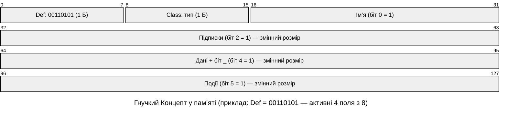
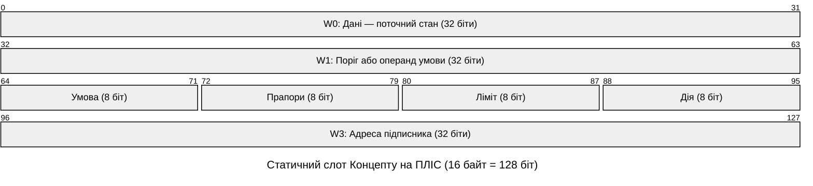
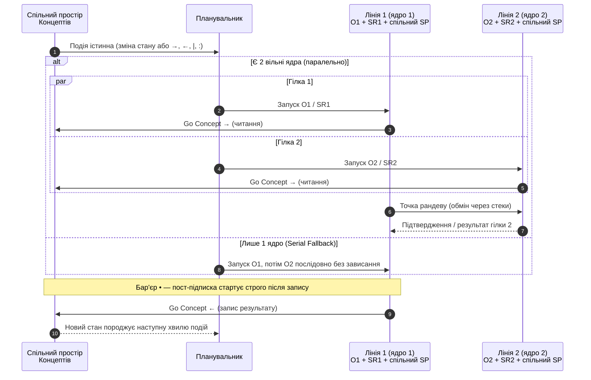
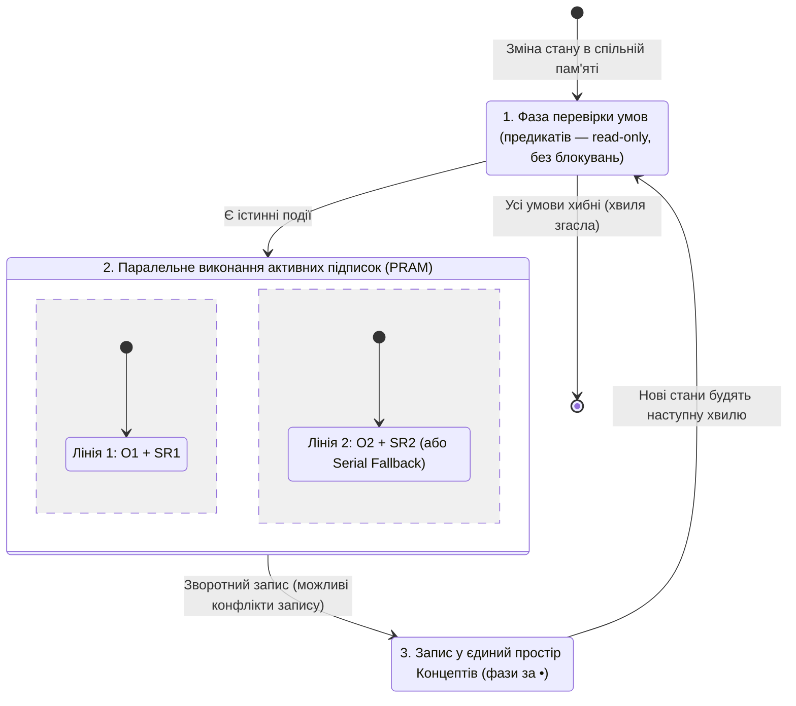
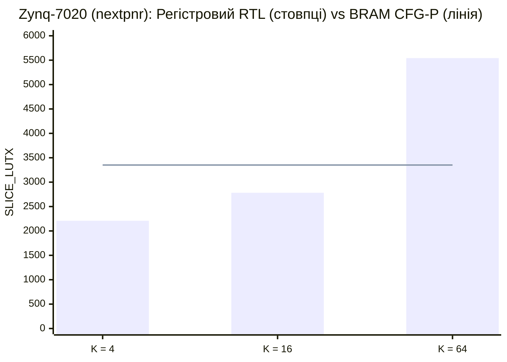

# Машина Кузьміна простою мовою: реактивні концепти, мова KPOL і де це справді працює

Коли програміст уперше чує про **Машину Кузьміна (МК)** — обчислювальну модель Михайла Кузьміна, описану в серії публікацій на [DOU](https://dou.ua/forums/topic/35914/) та технічних матеріалах останніх років, — головне питання звучить просто: *«Як це взагалі працює, як на цьому писати код, у чому суть паралелізму і де воно реально потрібне?»*

Більшість дискусій навколо МК точаться довкола високорівневих метафор, хоча насправді за нею стоїть цілком конкретна **подієво-реактивна модель обчислень зі спільним простором станів і стековим виконавцем**. Автором самої парадигми та первинної нотації є **Михайло Ювеналійович Кузьмін**; у цій статті я — **Микола Мартинович Федчик** — підсумовую формальний аналіз моделі, робочу мову опису **KPOL** і результати власних прототипів на FPGA, GPU та мікроконтролерах (повний розподіл внеску — наприкінці статті).

Далі підемо від простого до складного: спочатку подивимося на ідею концепту й три живі приклади коду на KPOL, потім зазирнемо «під капот», розберемо природу паралелізму й чесні інженерні межі на ПК, MCU та FPGA.

---

## 1. Ідея Машини Кузьміна простими словами: від «потоку інструкцій» до «реактивних концептів»

У класичній архітектурі **фон Неймана** (звичайні ПК, сервери, смартфони, мікроконтролери) програма та дані розділені:
- у пам’яті лежать пасивні байти (змінні, масиви, структури — вони самі по собі нічого не роблять);
- процесор має лічильник команд (`Program Counter, PC`), який крок за кроком вичитує інструкції, тягне дані в регістри, щось рахує і записує результат назад у пам’ять;
- якщо програмі треба зреагувати на зміну якоїсь величини, вона або постійно перевіряє її в циклі опитування (*polling*), або чекає переривання чи колбека.

**Машина Кузьміна пропонує іншу базову одиницю обчислень — Концепт.**

> **Концепт (простими словами)** — це **реактивна комірка пам’яті з вбудованими тригерами на читання й запис**, яка об’єднує три речі одразу:
> 1. **Дані (стан):** поточне значення (число, символ, булевий стан або особливий стан «невідомо / не ініціалізовано» `_`) і тип даних.
> 2. **Події (умови тригера, або предикати):** логічні правила («так / ні»), які перевіряють стан комірки або сам факт звернення до неї (наприклад, «значення стало $> 100$», «значення змінилося», «хтось прочитав цю комірку»).
> 3. **Підписки (дії тригера / вбудовані колбеки):** операції, які автоматично запускаються, щойно відповідна подія стала істинною.

**Що тут означає слово «реактивна» і як вбудовуються тригери?**
- **«Реактивна»** означає, що комірка не чекає, поки її опитає якийсь зовнішній цикл `while`: вона *сама* реагує на зміну свого стану чи звернення до неї й одразу запускає пов’язані дії — подібно до комірки Excel із формулою або `ON UPDATE`-тригера в базі даних.
- **Як вбудовуються тригери:** на відміну від звичайної змінної, де перевірка `if (...)` розкидана по коду програми, умови подій і адреси підписників **зберігаються разом із даними в структурі самої комірки** (і на ПЛІС зчитуються апаратурою одночасно зі значенням). Тож будь-який запис у комірку або читання з неї автоматично проходить через її власні правила без жодного додаткового виклику з боку програми.
- **Як реєструються й викликаються $N$ підписників:** усередині комірки лежить не сам код реакцій, а **список адрес** (покажчиків) на цільові концепти чи блоки коду — вони записуються в комірку-джерело під час компіляції або налаштування, щоб при зміні не сканувати всю пам’ять. Щойно подія спрацювала, виконавець роздає ці адреси обчислювальним лініям. На ПЛІС для периферії це може бути **пряма фізична лінія (дріт)** на реле, ШІМ чи сусідній блок, а для пам’яті слотів — індекс цільового слота, бітова маска підписників або посилання на таблицю розсилки.

**Як концепт лежить у пам’яті — і скільки місця займає?** Тут є два підходи: «гнучкий» і «фіксований»:
- **В авторській моделі М. Ю. Кузьміна (змінний розмір):** концепт влаштований як конструктор із чеклістом. На початку стоять **1 байт-чекліст `Def`** (8 бітів — по біту на кожну можливу частину) і **1 байт типу `Class`**, а далі в пам’яті зберігаються **лише ті частини, біля яких стоїть `1`**. Порожні поля з `0` узагалі не витрачають пам’ять:



- **В апаратній реалізації на ПЛІС (фіксований розмір — рівно 16 байтів):** залізу простіше читати комірки однакового розміру за один фіксований прохід, тому кожен концепт пакується в один стандартний 16-байтний (128-бітний) слот із чотирьох 32-бітних слів (`W0..W3`):



У моделі Машини Кузьміна **немає глобального лічильника команд `PC`** і **немає звичних імперативних циклів (`for`, `while`, `do`)**. Програма описується не як «крок 1, крок 2, крок 3», а як мережа концептів, подій і підписок. Коли змінюється зовнішній сигнал чи стан одного концепту, система сама «будить» підписані на нього обчислення.

---

## 2. Як це виглядає в коді: мова KPOL за 3 кроки

Авторський синтаксис опису концептів, подій та підписок розробив Михайло Ювеналійович Кузьмін; у межах нашої систематизації цей мовний шар отримав робочу назву **KPOL** (*Kuzmin Problem-Oriented Language*).

> Приклади нижче написано в авторській нотації Кузьміна. [Посібник KPOL-AUTH](../Engineering/guides/kpol-auth-programming-guide.md) показує, як її читати й який запис приймає компілятор. Щоб самому подати подію й побачити результат, спробуйте [касу на KPOL](../Engineering/guides/kpol-programming-guide.md) або [лічильник відвідувань на EKPOL](../Engineering/guides/ekpol-programming-guide.md).

У перші хвилини цей синтаксис здається незвичним, але варто зрозуміти **одну закономірність**, і код починає читатися зліва направо, як звичайне речення.

### 2.1. Головна зміна мислення: від «що робити» до «на що реагувати»

У класичній мові ви пишете сценарій для процесора:
```c
if (x != prev_x && x > 10) {
    alarm();
}
```

У **KPOL** ви описуєте паспорт самого концепту за єдиною схемою:

> **`Тип  Ім'я  Початковий_стан   Подія (коли?)   Підписка (що зробити?)`**

Умова (`Подія`) і реакція (`Підписка`) живуть не в окремому `main()` чи `loop()`, а прикріплені безпосередньо до даних.

### 2.2. Міні-курс KPOL за 3 кроки

#### Крок 1. Один рядок без розгалужень: перемикач стану (T-тригер)

Найменша повна програма на KPOL — логічний перемикач, який при кожному спрацюванні змінює свій стан на протилежний:

```text
? If _ ; ! If = ¬ ; ¬ = !
```

Читаємо зліва направо:
1. `? If _` — булевий (`?`) концепт `If` із початковим станом «невідомо» (`_`).
2. `; ! If = ¬` — якщо значення стало Істиною (`!`), записати Хибу (`¬`).
3. `; ¬ = !` — якщо значення стало Хибою (`¬`), записати Істину (`!`).

Замість звичного `if / else` тут у самому описі концепту зашиті дві реакції на два можливі стани. І це не перетворюється на нескінченну рекурсію: зміна атрибута всередині його власної підписки не викликає повторного авто-тригера (детальніше про це — у §3.3).

#### Крок 2. Реакція на запис і читання: суматор із авто-скиданням

Тепер опишемо концепт `Sum`, який накопичує записані числа, а щойно хтось прочитає підсумок — сам обнуляється:

```text
Float Sum 0
    ← @ Float x  += x     '# При записі (←) додаємо x до поточного Sum
    → • Sum = 0           '# При читанні (→) СТРОГО ПІСЛЯ видачі значення (•) обнуляємо Sum
```

Тут з’являються три нові позначення:
- `←` і `→` — події запису в концепт та читання з нього (`@ Float x` означає вхідний параметр `x`);
- **велика крапка `•`** — бар’єр порядку після адресації. Без неї обнулення могло б стерти `Sum` раніше, ніж формула-споживач забере накопичене число. Запис `→ •` гарантує порядок: *спочатку віддати старе значення, і лише потім виконати `Sum = 0`*.

#### Крок 3. Згасання подій замість `while`: алгоритм Евкліда

Як KPOL обходиться без циклів? Подивімося на алгоритм Евкліда (найбільший спільний дільник):

```text
U64 Nod | @ U64 ( a_ > b -=b , b_ > a -=a ) =a
Z = Nod(120, 6)
```

- `U64 Nod |` — концепт `Nod` типу `U64` із точкою виклику `|`.
- `@ U64 ( a_ > b -=b , b_ > a -=a )` — два вхідні параметри `a` і `b`, які до виклику мають стан «невідомо» (на це вказує підкреслення `_` біля імені: `a_`, `b_`). До `a` прив’язана подія `> b` із реакцією `-= b`, а до `b` — подія `> a` із реакцією `-= a`.
- Коли викликаємо `Nod(120, 6)`, подія `120 > 6` зменшує `a` на `6`, доки числа не зрівняються (`6`). У точці `a = b` **обидві умови стають хибними**, реактивна хвиля природно згасає, і повертається `=a` (`6`).

У більших програмах концепти об’єднують у класи (`Class`) із конструктором (`| ...`) і внутрішніми підписками (`: { ... }`), наприклад для тахометра або контролера допусків. На практиці авторський `KPOL-AUTH` залишається прототипною нотацією — для щоденної інженерної роботи та компіляції використовуються формалізовані мови `KPOL` і `EKPOL`, але базові принципи лишаються тими самими.

### 2.3. Шпаргалка синтаксису KPOL: як читати кожен символ

Щоб закріпити всі символи з прикладів вище та легко читати більші програми на KPOL, тримайте компактний словничок — тут немає зайвої «магії», кожен знак відповідає конкретній операції машини:

| Символ / слово | Як читати українською | Навіщо потрібен у коді |
| :--- | :--- | :--- |
| `_` | «невідомо / не задано» | Початковий стан без числа (окремий біт валідності), або параметр без значення |
| `Token`, `Byte`, `U16`, `Int32`, `Float`, `U64`, `Chr` | тип даних концепту | `Token` — 4-бітне значення ($0\dots 15$); решта — звичні числа й символи |
| `@ Тип x` | «приймаю параметр `x`» | Оголошує вхідний аргумент методу, конструктора або запису |
| `←` | «коли в мене **пишуть**» | Тригер запису (або в низькорівневому коді: записати зі стека в комірку) |
| `→` | «коли мене **читають**» | Тригер читання (або в низькорівневому коді: прочитати з комірки в стек) |
| `\|` | «коли мене **викликають**» | Метод / конструктор класу / точка активації виконання |
| `:` | «створити екземпляр» | Ініціалізація об’єкта за класом-шаблоном (`X = MyClass : (1)`) |
| `Null`, `Positive`, `Negative`, `Even`, `Uneven`, `~` | «подія стану» (`::`) | Спрацьовує, коли значення стало `0`, `>0`, `<0`, парним, непарним або **змінилося** (`~`) |
| `>`, `<`, `=`, `[a b]` | «подія порівняння / вибору» | Порівняння з величиною або належність набору значень |
| `?`, `!`, `¬` | «логіка: умова, True, False» | `!` — Істина, `¬` — Хиба; `?` позначає булеву подію або інверсію умови |
| `•` | «**суворо після** адресації» | Велика крапка: підписка праворуч виконується **після** завершення читання чи запису |
| `( ... )` та `{ ... }` | «колекція (логічне **І**)» | Група дій, де мають успішно виконатися всі елементи (або послідовні гілки) |
| `[ ... ]` | «масив / вибір (логічне **АБО**)» | Вибір або порівняння з будь-яким із перелічених значень; межі `Min..Max` задаються індексами |
| `Exit`, `'#` | «вихід із групи» / «коментар» | `Exit` перериває поточну групу; `'#` починає коментар до кінця рядка |

---

## 3. Як це працює «під капотом»: адресація, стеки та захист від хаосу

Тепер, коли ви бачили живі приклади (`If`, `Sum`, `Nod`), подивімося на операційну будову машини: як адресуються концепти, хто виконує підписки і що захищає систему від хаосу.

### 3.1. Чотири операції адресації (`Go`)

У центрі взаємодії між концептами стоїть оператор **`Go`**, який звертається до цільового концепту. Ви вже бачили три з чотирьох операцій адресації в §2 — і **кожна з них сама по собі є подією**, на яку можна підписатися:

| Операція | Значення | Що відбувається з даними та подіями |
| :--- | :--- | :--- |
| **`→`** | **Читання** | Значення концепту кладеться в стек обчислень; спрацьовують підписки «на читання». |
| **`←`** | **Запис** | Нове значення береться зі стека і записується в концепт; спрацьовують підписки «на зміну / запис». |
| **`\|`** | **Виконання** | Активується виконавчий метод / підписка концепту (аналог виклику процедури або тригера). |
| **`:`** | **Ініціалізація** | Створюється новий екземпляр концепту на основі класу-прототипу. |

### 3.2. Стеково-регістровий виконавець і плавний відкат

Коли подія стає істинною й активує підписку, планувальник виділяє для неї **лінію виконання** (умовно — окреме апаратне ядро або потік) із трьома складниками:
1. **`O` (послідовність команд):** список операцій цієї гілки (`Go` для звернень до концептів і `Do` для арифметики чи логіки).
2. **`SR` (стек-регістр обчислень):** власний робочий стек проміжних значень цієї лінії (наприклад, для `a + b` виконавець кладе `a`, потім `b`, а `Do +` залишає на вершині суму).
3. **`SP` (стек параметрів):** спільний для всієї підписки стек вхідних аргументів (`@`) та локальних змінних.

Якщо підписка розгалужується на дві незалежні частини, планувальник запускає **дві паралельні лінії** — **Лінію 1** (`O1 + SR1`) і **Лінію 2** (`O2 + SR2`), які бачать спільний стек параметрів `SP` і синхронізуються в точці обміну (*рандеву*). Якщо ж вільного другого ядра немає, система не зависає — спрацьовує **плавний послідовний відкат (*Serial Fallback*)**: перша лінія сама виконує обидві гілки одну за одною:



### 3.3. Бар’єр Великої Крапки, придушення самотригера і стан невизначеності у пам’яті

Три механізми тримають реактивну мережу передбачуваною:
1. **Велика крапка (`•`):** як ми бачили в суматорі `→ • Sum = 0`, підписка після `•` запускається строго після завершення самої операції читання або запису.
2. **Придушення самотригера:** як у перемикачі `If`, звернення до атрибута всередині підписки, викликаної подією цього самого атрибута, не породжує повторного авто-тригера — це перекриває тривіальну нескінченну саморекурсію на одному концепті.
3. **Явний стан невизначеності `_` у пам’яті:** у дескрипторі концепту стан «не ініціалізовано» кодується **окремим бітом валідності**, а не магічними числами на кшталт `0`, `-1` чи `NaN` (поруч із компактним заголовком `Def` та ідентифікатором класу `Class`, щоб не витрачати пам’ять на порожні поля). Завдяки цьому система завжди відрізняє число `0` від відсутності даних чи обриву датчика.

---

## 4. Логіка паралелізму: спільна пам’ять замість недетермінованої машини Тюрінга

У ранніх обговореннях Машину Кузьміна часто називали «керованою недетермінованою машиною Тюрінга». З погляду теорії обчислень тут важливо провести чітку межу.

Класична *недетермінована машина Тюрінга* (`NTM`) — це математична абстракція, де кожна гілка вибору отримує власну ізольовану копію стрічки. Машина Кузьміна працює інакше: коли подія запускає кілька підписок одночасно, усі вони працюють **фізично паралельно над спільною пам’яттю концептів**. У теорії обчислень це відповідає класу **паралельних машин зі спільною пам’яттю (`PRAM`) та подієво-продукційних систем (`ECA`)**, а не `NTM`. Тобто архітектура не «вгадує» розв’язок $\mathrm{NP}$-повних задач за поліноміальний час, натомість природно використовує багатоядерний паралелізм.




Зіставлення обох схем дає три практичні висновки:
1. **Модель пам’яті:** у `NTM` кожен крок вибору уявно дублює всю стрічку, тоді як у Машині Кузьміна всі лінії виконання працюють над єдиним простором концептів.
2. **Взаємодія між гілками:** фаза перевірки умов (предикатів) нічого не записує в пам’ять, тому всі умови можна безпечно оцінювати паралельно без блокувань. Натомість паралельні *записи* у спільний концепт можуть конфліктувати — тут потрібна або дисципліна програміста, або перевірка компілятора на стадії збірки.
3. **Природа прискорення:** виграш досягається не «магічним вгадуванням шляху», а реальним паралельним виконанням незалежних умов і гілок на доступних ядрах чи в апаратурі ПЛІС (за умови, що каскад подій згасає й не створює нескінченних циклів).

---

## 5. Як і де це запускати

### 5.1. На ПК: спершу перевіримо, що робить правило

Запустімо [лічильник на інженерній мові KPOL](../Engineering/sw/vmk-go/examples/increase.kpol). У ньому спочатку `10`; кожен імпульс із параметром меншим за `20` додає одиницю. Подамо `5`, потім `25`. Для цього потрібні лише копія репозиторію і Go 1.22 або новіший. Команда з кореня репозиторію:

```sh
go run -C Engineering/sw/kpol-go ./cmd/kpolc run ../vmk-go/examples/increase.kpol \
  -e 'Pulse(param=5)' -e 'Pulse(param=25)'
```

Після першого імпульсу в рядку `state` побачите `Counter=11`. Після другого — знову `Counter=11`: число `25` не задовольняє умову, тож запису немає. Ми перевірили **поведінку**, а не швидкодію. Для цього вистачає інтерпретатора `kpolc run`. Компіляція для ПЛІС — окремий крок: `kpolc build` приймає лише ті конструкції KPOL, які підтримує вибраний апаратний профіль.

**Скільки триває реакція?** Це залежить від того, коли запустити секундомір. У [стендовому порівнянні](../Research/studies/comparative-baseline-254/report.md) на ARM Cortex-A9 (650 МГц) прямий виклик обробника мовою C99 займав у середньому **0,534 мкс** на каскад із чотирьох комірок (100 000 викликів, дані в кеші). На тій самій платі інший тест починав відлік **до** повідомлення через Linux: один потік надсилав подію, інший прокидався й виконував той самий каскад (`eventfd` + `poll`). Залежно від розміщення потоків на ядрах медіана становила **30–33 мкс**. Перше число описує роботу обробника; друге охоплює ще й доставку події. Жодне не є гарантією найбільшої затримки.

### 5.2. На мікроконтролері: що відомо до запуску

Якщо запускати інтерпретатор на пристрої незручно, `kpolc build --emit-c99` генерує C99-модуль, який можна зібрати разом із прошивкою. У графі підписок немає циклів, але **в коді є цикл `for`**: обробник один раз проходить таблицю активних комірок у порядку залежностей. Джерело стоїть раніше за підписника, тому повертатися на початок таблиці не потрібно. Наперед відома кількість ітерацій, а не тривалість виконання в мікросекундах.

Що тоді перевіряє Z3? Наприклад, що обробник **не запише** від’ємний результат для стану з вимогою `>= 0` і не прийме результат арифметичного переповнення. Це властивість правила, а не доказ того, що конкретний процесор укладеться у відведений час. STM32 чи AURIX — можливі цілі для такого коду; у [звіті про генератор C99](../Engineering/validation/kpol-cme/c99-emitter-270/report.md) час вимірювали на Cortex-A9, не на цих мікроконтролерах.

### 5.3. На ПЛІС: коли таблиця правил заощаджує логіку

На Zynq-7020 ми порівняли два способи зберігати правила: у регістрах або в одному блоці вбудованої пам’яті (`BRAM`). У другому варіанті (`CFG-P`) один апаратний виконавець по черзі читає потрібні записи з таблиці на 64 комірки. При 100 МГц **один крок займає 8 тактів (80 нс), а каскад із чотирьох кроків — 32 такти (320 нс)** до останнього запису. Це час усередині ядра: зовнішній сигнал ще треба синхронізувати, а якщо попередня подія не завершилася — дочекатися своєї черги. У двобанковому варіанті за один такт між подіями можна **перемкнутися на вже підготовлену таблицю**, а не завантажити всі нові правила.

Графік нижче відповідає на інше питання: **скільки логіки займає кожен варіант?** По горизонталі — кількість правил, по вертикалі — кількість використаних логічних таблиць ПЛІС (`LUT`). При 16 правилах менше LUT займає регістрова схема (2 783 проти 3 351), при 64 — схема з BRAM (3 351 проти 5 543). Для останньої це та сама схема на 64 місця, навіть коли таблицю заповнено частково; окремо вона потребує одного блока BRAM.



Якщо з’єднати результати регістрової схеми для 16 і 64 правил прямою, вона перетне рівень 3 351 LUT приблизно **при 26 правилах**. Це [оцінка за результатами трасування](../Research/studies/comparative-baseline-254/report.md) двох конкретних схем на Zynq-7020. Окремого виміру при 26 не було, і це **не поріг переваги за швидкодією**.

**Коли передавання довше за обчислення.** На GPU плати Jetson AGX Orin обробка події для 1 024 підписників — від отримання даних до підтвердження на самому GPU — займала близько **2 мкс** за медіаною. А скільки чекала плата, що надіслала подію? У [серії з 5 000 подій](../Research/studies/fpga-gpu-symbiosis/data/exp-gpu-01-crossboard/summary_crossboard_226.json) від початку обробки на PYNQ-Z1 до повернення відповіді з Jetson через Ethernet минало **675 мкс** за медіаною. Обидві часові мітки знято на PYNQ-Z1. Час в один бік — близько **345 мкс** за медіаною — [оцінили](../Research/studies/fpga-gpu-symbiosis/experiments/EXP-GPU-01/report-phase1-2-4-crossboard-egress.md), припустивши однакову мережеву затримку в обох напрямках: годинники плат не були синхронізовані. Отже, для цього стенда відповідь «2 мкс» правильна лише тоді, коли запитання стосується самого GPU.

---

## 6. П’ять практичних ніш (і де підхід не потрібен)

Самих 80 нс із §5 недостатньо, щоб обрати ПЛІС для нового пристрою. Почнімо з трьох запитань: **яка подія надходить, яке рішення треба ухвалити і до якого моменту воно ще корисне?** У проєкті перевірено окремі механізми; їхню придатність для конкретної установки треба оцінювати окремо.

1. **Робототехніка: перевірити дозвіл на рух.** Уявімо, що програма керування маніпулятором просить почати рух, але датчик огорожі не підтвердив, що дверцята зачинені. Апаратне правило може не пропустити команду незалежно від того, як її сформувала програма. Це перевірка конкретної умови, а не розпізнавання будь-якої небезпеки: якщо несправний датчик повідомив «зачинено», правило саме не виявить помилки. І відхилити нову команду — не те саме, що зупинити вже розпочатий рух.

2. **Батарея: відрізнити рішення програми від дії контактора.** У [навчальному прикладі системи керування батареєю (BMS)](../Engineering/sw/vmk-go/examples/bms_safety_cascade.ekpol) подаємо різницю напруг 15 мВ: остання комірка `Contactor_Interlock` зберігає значення `10`. Подаємо 120 мВ: сигнал проходить чотири комірки, і в останній з’являється `1`. Це тестові дані, не рекомендовані пороги. [Для згенерованого обробника перевірено](../Engineering/validation/kpol-cme/c99-emitter-270/report.md) й інший випадок: якщо показ позначено як недійсний, запис не відбувається. Але значення в пам’яті не каже, чи фізично розімкнувся контактор: для цього потрібен зворотний сигнал від пристрою.

3. **Енергетика й промислова автоматика: замінити набір порогів між двома подіями.** Коли установка переходить в інший режим, наступний показ треба оцінити або повністю за старими правилами, або повністю за новими. Саме це перевіряли з двома банками пам’яті: на [стенді PYNQ-Z1](../Research/studies/fpga-gpu-symbiosis/data/exp-gpu-02-hil/exp_gpu_02_hil_10k_swaps_summary.json) за 10 003 перемикання і 40 011 подій не зафіксували змішаного читання. Дослід відповідає на питання «який набір застосовано?», але не «чи правильно обрано пороги для цієї підстанції?».

4. **Мережеві шлюзи й тригери експериментів: не загубити подію у сплеску.** Мережева карта може перевіряти біржову заявку за лімітом перед відправленням, а тригер детектора — відбирати виміри для запису. Показовий тест тут — подати МК і звичайному апаратному фільтру однакову серію подій без пауз. Чи збіглися рішення, скільки подій втрачено і як довго чекала остання? У [симуляції черги прототипу](../Engineering/validation/kpol-cme/queue-retention-151/report.md) імпульс від джерела, яке не може чекати, можна втратити, якщо вхід зайнятий. Швидкість однієї перевірки ще не визначає, який потік витримає шлюз.

5. **Напівнатурне моделювання та об’єднання показів датчиків.** На напівнатурному стенді (*hardware-in-the-loop*, HIL) справжній контролер працює з моделлю об’єкта. Можна відтворити той самий запис двічі й у другому прогоні затримати один із показів: чи не об’єднає контролер новий вимір зі старим? У [досліді з 5 000 подіями між ПЛІС і Jetson](../Research/studies/fpga-gpu-symbiosis/data/exp-gpu-01-crossboard/summary_crossboard_226.json) вимірювали час до повернення відповіді: медіана — 0,675 мс, а 99,9-й процентиль — 3,14 мс. Такі дані можна зіставити з допустимою затримкою конкретної установки. Для оцінки **точності** об’єднання показів потрібен інший дослід — із відомим правильним результатом.

**Коли обійтися без МК.** Для кількох незмінних блокувань почніть із простого автомата на мікроконтролері або регістрової схеми на ПЛІС. Для вебзапиту, який переважно чекає на базу даних, швидша перевірка умови не прибере час очікування; для навчання нейромереж основна робота — множення матриць, а не перемикання правил. Підставою обрати МК буде конкретна перевага на **тому самому потоці подій**: наприклад, правила можна замінити без змішування версій, зберігши потрібний час відповіді й не втративши подій.

---

## Підсумок: чим насправді є Машина Кузьміна?

Згадайте суматор `Sum` із §2. Записали в нього `4`, потім `3`. Перше читання поверне `7`, а друге — `0`, бо для цієї комірки задано правило: «Спочатку віддай накопичену суму, потім обнули її». Тому, хто читає підсумок, не треба пам’ятати про окрему команду скидання.

**Машина Кузьміна — це спосіб організувати обчислення навколо таких комірок, а не заміна процесора.** Комірка зберігає значення, а її правила описують, що робити при читанні, записі чи зміні. Якщо зміна однієї комірки має оновити іншу, програміст задає цей зв’язок підпискою. Принцип знайомий усім, хто писав обробники подій: замість раз у раз питати «вже змінилося?», ви вказуєте, на яку подію чекати й що зробити у відповідь.

KPOL — мова для запису правил. Їх можна випробувати на звичайному ПК, як ми зробили з лічильником у §5. Для правил, які підтримує апаратний виконавець, компілятор може натомість підготувати таблицю для ПЛІС або C-код для мікроконтролера. Практична користь — у можливості простежити весь ланцюжок: **яка подія надійшла, чому правило спрацювало і що саме змінилося**. А чи встигне пристрій відреагувати вчасно, перевіряють уже на самому пристрої.

---

## 7. Короткий глосарій, розподіл внеску та джерела

### Короткий глосарій

* **Концепт** — базова одиниця пам’яті й логіки МК, що поєднує дані (зі станом невизначеності `_`), предикатні події та перелік підписок.
* **Велика крапка (`•`)** — бар’єр порядку фаз: підписка після `•` запускається строго після завершення операції читання (`→`) або запису (`←`).
* **Стан невизначеності (`_`)** — окремий стан «не ініціалізовано / невідомо», закодований виділеним бітом валідності й відокремлений від числа `0`.
* **Лінія підписки (`O + SR`)** — гілка виконання активованої підписки з власним потоком команд `O`, стеком обчислень `SR` і спільним стеком параметрів `SP`.
* **Плавний послідовний відкат (*Serial Fallback*)** — властивість планувальника МК: за браку вільного ядра активний потік сам виконує сусідню гілку без взаємного блокування.
* **А-ритм (А-схема)** — подієва організація обчислень без лічильника команд, де порядок роботи задають події та ланцюжки підписок.

### Розподіл внеску

- **Михайло Ювеналійович Кузьмін** — автор обчислювальної парадигми Машини Кузьміна: концептів, чотирьох операцій адресації (`Go`), подій та підписок, подієвої організації обчислень (А-ритму), стеково-регістрової моделі (`O`, `SR`, `SP`), оператора черговості `•`, безциклової композиції, а також первинного синтаксису та прикладів коду.
- **Микола Мартинович Федчик (автор цієї статті)** — виконав формальний аналіз та систематизацію матеріалів автора, запропонував робочу назву мови **KPOL** (*Kuzmin Problem-Oriented Language*), дослідив математичні межі моделі, реалізував і виміряв апаратні прототипи на ПЛІС (`FPGA`) та вбудованому GPU, а також розробив трансляцію верифікованих правил у C99-код для мікроконтролерів.

### Основоположні праці комп’ютерної науки

1. **Turing, A. M.** (1936). On Computable Numbers, with an Application to the Entscheidungsproblem. *Proceedings of the London Mathematical Society*. — Базова формалізація машини Тюрінга та обчислюваності.
2. **Sipser, M.** (2013). *Introduction to the Theory of Computation* (3rd ed.). Cengage Learning. — Класичний виклад теорії складності та відмінностей між детермінованими і недетермінованими моделями (`NTM`).
3. **Dennis, J. B.** (1980). Data Flow Supercomputers. *Computer*, 13(11), 48–56. [doi:10.1109/MC.1980.1653418](https://doi.org/10.1109/MC.1980.1653418); та **Arvind, & Culler, D. E.** (1986). Dataflow Architectures. *Annual Review of Computer Science*, 1(1), 225–253. [doi:10.1146/annurev.cs.01.010186.001301](https://doi.org/10.1146/annurev.cs.01.010186.001301) — Класичні потокові (*Dataflow*) архітектури без глобального лічильника команд.
4. **Hoare, C. A. R.** (1978). Communicating Sequential Processes. *Communications of the ACM*, 21(8), 666–677. [doi:10.1145/359576.359585](https://doi.org/10.1145/359576.359585) — Теорія взаємодіючих процесів і міжпотокового рандеву.
5. **Hewitt, C., Bishop, P., & Steiger, R.** (1973). A Universal Modular ACTOR Formalism for Artificial Intelligence. *IJCAI*. — Акторна модель конкурентних повідомлень.
6. **Forgy, C. L.** (1982). Rete: A Fast Algorithm for the Many Pattern/Many Object Pattern Match Problem. *Artificial Intelligence*. — Продукційні правила «умова–дія» (*ECA / Pattern Matching*).
7. **Berry, G., & Gonthier, G.** (1992). The Esterel Synchronous Programming Language: Design, Semantics, Implementation. *Science of Computer Programming*. — Детерміноване синхронне реактивне програмування.

### Первинні публікації М. Ю. Кузьміна та розширені технічні матеріали

8. **Кузьмін, М. Ю.** (2021–2026). Серія авторських публікацій і обговорень на DOU:
   - [«Машина Кузьміна. (Керована недетермінована машина Тюрінга.)»](https://dou.ua/forums/topic/35914/);
   - [«Виконання груп у недетермінованій машині»](https://dou.ua/forums/topic/36556/);
   - [«Автоматика та пристрої»](https://dou.ua/forums/topic/38994/);
   - [«Опис недетермінованої машини Кузьміна на пальцях»](https://dou.ua/forums/topic/43177/).
9. **Кузьмін, М. Ю.** [Авторське відео про Машину Кузьміна](https://www.youtube.com/watch?v=qKUoCeGvXnA).
10. **Федчик, М. М.** (2026). [Повна технічна версія цієї статті для DOU (`DOU_Article_Kuzmin_Machine_UA.md`)](DOU_Article_Kuzmin_Machine_UA.md) — із розширеними прикладами (`Tachometer`, `Control`, `EKPOL`, TUI-дебагер `VMK`), математичним апаратом (умови Бернштейна, теорема Брента, гіллясті процеси, *Network Calculus*), детальною таблицею придатності та повними стендовими специфікаціями ПЛІС/GPU.
11. **Федчик, М. М.** (2026). Дослідницькі матеріали проєкту: [зведений науково-інженерний огляд Машини Кузьміна](Kuzmin-Machine-Overview.md) та [порівняльний аналіз споріднених машин](Similar_Machines_to_KM.md).

---

Запрошую до конструктивного обговорення в коментарях — особливо щодо практичних задач у робототехніці, енергетиці й embedded-системах, де вам бракує детермінованої реакції та простої формальної верифікації правил!

<!--
* **Версія:** 1.4.1
* **Дата:** 2026-11-20
* **Тип WP:** Article

## Історія версій

| Версія | Дата | Зміни |
|---|---|---|
| 1.4.1 | 2026-11-20 | Підсумок пояснює модель через знайомий суматор, обробники подій і різницю між мовою та виконавцем. |
| 1.4.0 | 2026-11-20 | §6: для п’яти прикладних задач розмежовано стендові результати, критерії придатності та неперевірені галузеві застосування. |
| 1.3.0 | 2026-11-20 | §5: додано запуск лічильника на ПК; розмежовано час обчислень і доставки, перевірки C99 та оцінку площі ПЛІС. |
| 1.2.2 | 2026-11-20 | Розширено §2.3 повною шпаргалкою синтаксису KPOL із §3.2 технічної версії статті. |
| 1.2.1 | 2026-11-19 | Прибрано `quadrantChart` із §5 та винесено службову таблицю версій у HTML-коментар. |
| 1.2.0 | 2026-11-19 | Оновлено Mermaid-діаграми статті (`packet-beta` у §1, `sequenceDiagram` у §3.2, NTM + `stateDiagram-v2` у §4, `xychart-beta` у §5.3); прибрано службовий блок метаданих із початку статті. |
| 1.1.2 | 2026-11-19 | Додано UML-діаграму класів для Концепту в §1. |
| 1.1.1 | 2026-11-19 | Додано примітку про діалекти `KPOL-AUTH`, `KPOL` і `EKPOL`. |
| 1.1.0 | 2026-11-19 | Перебудовано порядок викладу за дидактичною та редакторською оцінкою. |
| 1.0.1 | 2026-11-19 | Виправлено MathJax/Markdown-запис порога $K^{\ast} = 26$. |
| 1.0.0 | 2026-11-19 | Перенесено до каталогу `Articles/`. |
-->
