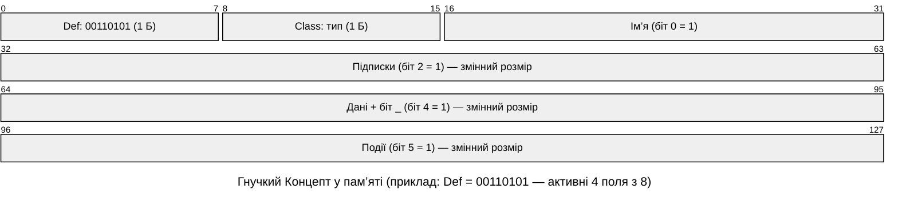
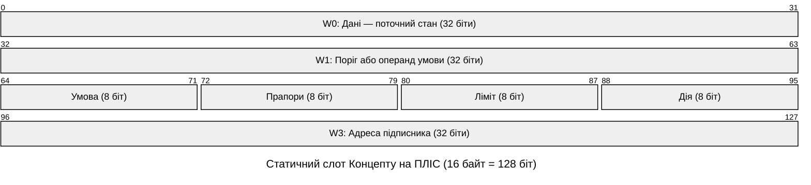
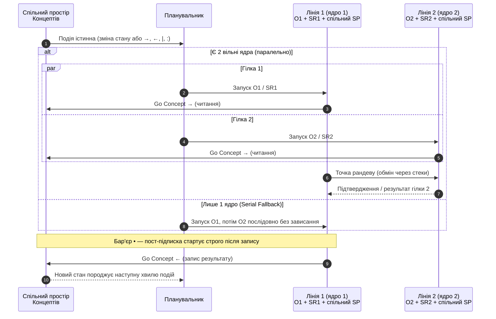
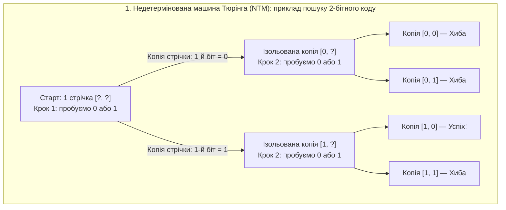
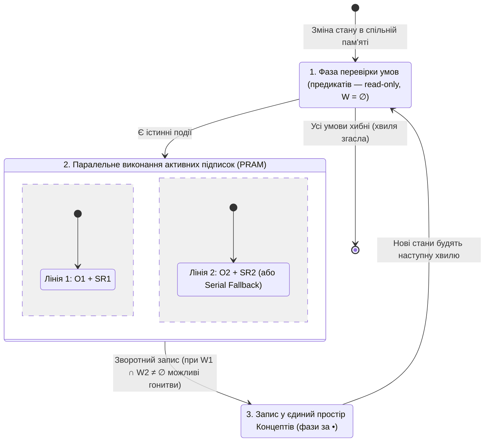
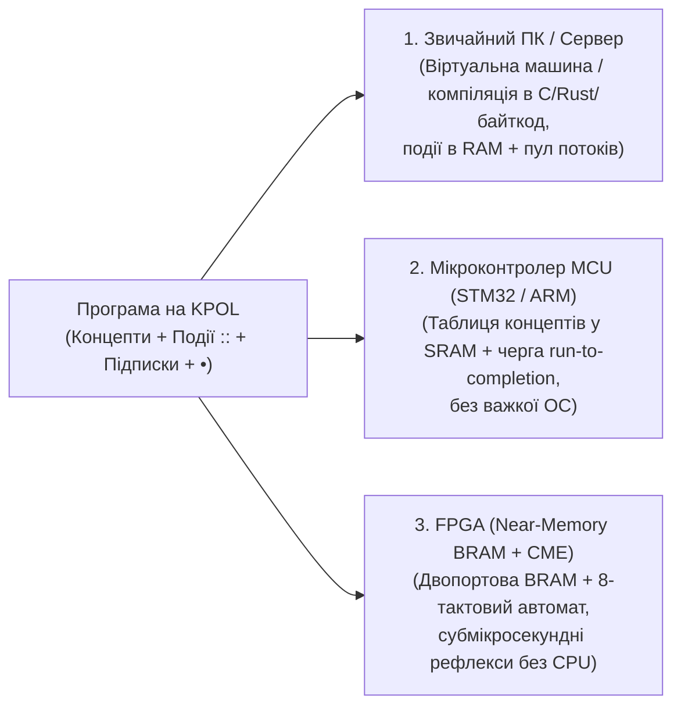
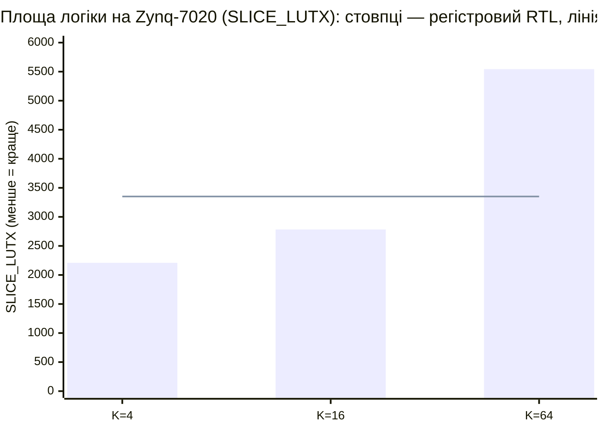

# Машина Кузьміна: архітектура, мова програмування KPOL, математичне обґрунтування та запуск від звичайних ПК до FPGA

Коли програміст уперше чує про **Машину Кузьміна (МК)** — обчислювальну модель Михайла Кузьміна, описану в серії публікацій на [DOU](https://dou.ua/forums/topic/35914/) та технічних матеріалах останніх років, — головне питання звучить просто: *«Як це взагалі працює, як на цьому писати код, чому саме так, і де воно реально потрібне?»*

Більшість дискусій навколо МК точаться довкола високорівневих метафор, хоча насправді за нею стоїть цілком конкретна **подієво-реактивна модель обчислень зі спільним простором станів і стековим виконавцем**.

> **Об’єктивний розподіл внеску (хто що створив):**
> - **Михайло Ювеналійович Кузьмін** — автор самої обчислювальної парадигми Машини Кузьміна: концептів, чотирьох операцій адресації (`Go`), подій та підписок, А-ритму, стеково-регістрової моделі (`O`, `SR`, `SP`), оператора черговості `•`, безциклової композиції, а також первинного синтаксису та прикладів коду (алгоритму Евкліда, факторіала, тахометра, контролера допусків).
> - **Микола Мартинович Федчик (автор цієї статті)** — виконав формальний аналіз та інженерну систематизацію розрізнених матеріалів автора у цілісну технічну специфікацію, запропонував робочу назву мови **KPOL** (*Kuzmin Problem-Oriented Language*) та розробив ергономічний ASCII/ключовий надшар **EKPOL** (*Ergonomic KPOL*, `.ekpol`) із двосторонньою трансляцією `EKPOL <-> KPOL`, створив двомодовий програмний емулятор і повноекранний TUI-дебагер **VMK v0.3.1** на Go, довів і перевірив математичні межі моделі (класифікація паралелізму, умови незалежності, межі прискорення, аналіз лавин подій і пачкових черг), розробив спосіб віртуалізації активної пам’яті в блочній пам’яті (`BRAM`) на серійних ПЛІС, реалізував синтезовані прототипи на кристалі `Zynq-7020` (реактивний транзакційний шлюз, однобанковий та двобанковий дескрипторний конвеєри в `BRAM` і багатобанковий кластер із конвеєрним комутатором), натурно випробував зв’язку з резидентними варпами GPU та реалізував трансляцію верифікованих правил у безцикловий C99-код (`--emit-c99`).

У цій статті ми пройдемо весь шлях послідовно й навчально — від простих понять до реальних програм і схем:
1. Як влаштована **сама Машина Кузьміна** (пам’ять концептів, адресація, стеки, порядок фаз і відсутність циклів).
2. **Якою мовою і як її програмувати** — покроковий міні-курс **KPOL** від одного рядка до систем керування.
3. **Математичне й логічне обґрунтування** — чому обрано саме такий підхід, де він дає виграш, а де має фундаментальні обмеження.
4. **Де й на чому це працює** — як на **звичайних комп’ютерах, серверах та мікроконтролерах**, так і на **програмованих логічних матрицях (FPGA)** — і для яких задач цей підхід підходить, а для яких ні.

---

## 1. Ідея Машини Кузьміна простими словами: від «потоку інструкцій» до «реактивних концептів»

У класичній архітектурі **фон Неймана** (звичайні ПК, сервери, смартфони, мікроконтролери) програма та дані розділені:
- у пам’яті лежать **пасивні байти** (змінні, масиви, структури — вони самі по собі нічого не роблять);
- процесор має **лічильник команд (`Program Counter, PC`)**, який крок за кроком вичитує інструкції, тягне дані через шину в регістри, щось рахує і записує результат назад у пам’ять;
- якщо програмі треба зреагувати на зміну якоїсь величини, вона або постійно перевіряє її в циклі опитування (*polling*), або чекає апаратного переривання (`IRQ`) чи програмного зворотного виклику (колбека).

**Машина Кузьміна пропонує іншу базову одиницю обчислень — Концепт.**

> **Концепт (простими словами)** — це **реактивна комірка пам’яті з вбудованими тригерами на читання й запис**, яка об’єднує в собі **три речі одразу**:
> 1. **Дані (стан):** поточне значення (число, символ, булевий стан або особливий стан «невідомо / не ініціалізовано» `_`) і тип даних.
> 2. **Події (умови тригера, або предикати):** логічні правила («так / ні»), які миттєво перевіряють стан комірки або сам факт звернення до неї (наприклад, «значення стало $> 100$», «значення змінилося», «хтось прочитав цю комірку»).
> 3. **Підписки (дії тригера / вбудовані колбеки):** операції, які автоматично запускаються, щойно відповідна подія стала істинною.

**Що тут означає слово «реактивна» і як вбудовуються тригери?**
- **«Реактивна»** означає, що комірка не чекає, поки її опитає якийсь зовнішній цикл `while`: вона *сама* реагує на зміну свого стану чи звернення до неї й одразу запускає пов’язані дії — подібно до комірки Excel із формулою або `ON UPDATE`-тригера в базі даних.
- **Як вбудовуються тригери:** на відміну від звичайної змінної, де перевірка `if (...)` розкидана по коду програми, умови подій і адреси підписників **зберігаються разом із даними в структурі самої комірки** (і на ПЛІС зчитуються апаратурою одночасно зі значенням). Тож будь-який запис у комірку або читання з неї автоматично проходить через її власні правила без жодного додаткового виклику з боку програми.
- **Як реєструються й викликаються $N$ підписників:** усередині комірки лежить не сам код реакцій, а **список адрес** (покажчиків) на цільові концепти чи блоки коду — вони записуються в комірку-джерело під час компіляції або налаштування, щоб при зміні не сканувати всю пам’ять. Щойно подія спрацювала, виконавець роздає ці адреси обчислювальним лініям. На ПЛІС для периферії це може бути **пряма фізична лінія (дріт)** на реле, ШІМ чи сусідній блок, а для пам’яті слотів — індекс цільового слота, бітова маска підписників або посилання на таблицю розсилки.

**Як концепт лежить у пам’яті — і скільки місця займає?** Тут є два підходи: «гнучкий» і «фіксований»:
- **В авторській моделі М. Ю. Кузьміна (змінний розмір):** концепт влаштований як конструктор із чеклістом. На початку стоять **1 байт-чекліст `Def`** (8 бітів — по біту на кожну можливу частину) і **1 байт типу `Class`**, а далі в пам’яті зберігаються **лише ті частини, біля яких стоїть `1`**. Порожні поля з `0` узагалі не витрачають пам’ять:



- **В апаратній реалізації на ПЛІС (фіксований розмір — рівно 16 байтів):** залізу простіше читати комірки однакового розміру за один фіксований прохід, тому кожен концепт пакується в один стандартний 16-байтний (128-бітний) слот із чотирьох 32-бітних слів (`W0..W3`):



У моделі Машини Кузьміна **немає глобального лічильника команд `PC`**, який керує всією програмою зверху, і **немає звичних імперативних циклів (`for`, `while`, `do`)**. Програма описується не як «що робити крок 1, крок 2, крок 3», а як **мережа концептів, подій і підписок**. Коли змінюється зовнішній сигнал чи стан одного концепту, система сама «будить» підписані на нього обчислення.

---

## 2. Внутрішня архітектура: як працює машина «під капотом»

Щоб модель не лишалася абстракцією, подивімося на її чітку операційну будову: як адресуються концепти, що зберігається в пам’яті та хто виконує обчислення.

### 2.1. Чотири види адресації в Машині Кузьміна

У центрі взаємодії між концептами стоїть оператор **`Go`**, який звертається до цільового концепту (поточний концепт у межах власного контексту позначається символом `¤`). Існують **чотири базові операції адресації**, і **кожна з них сама по собі є подією**, на яку можна підписатися:

| Операція | Значення | Що відбувається з даними та подіями |
| :--- | :--- | :--- |
| **`→`** | **Читання** | Значення концепту кладеться в стек обчислень; спрацьовують підписки «на читання». |
| **`←`** | **Запис** | Нове значення береться зі стека і записується в концепт; спрацьовують підписки «на зміну / запис». |
| **`\|`** | **Виконання** | Активується виконавчий метод / підписка концепту (аналог виклику процедури або тригера). |
| **`:`** | **Ініціалізація** | Створюється новий екземпляр концепту на основі класу-прототипу. |

### 2.2. Як виконується код: стеково-регістровий виконавець

Коли якась подія стає істинною й активує підписку, планувальник виділяє для неї **лінію виконання** (окремий потік у віртуальній машині на ПК або апаратне ядро в ПЛІС) із трьома складниками:
1. **`O` (послідовність команд):** скомпільований набір операцій цієї гілки (`Go` для звернень до концептів і `Do` для арифметики чи логіки).
2. **`SR` (стек-регістр обчислень):** власний робочий стек проміжних значень цієї лінії для операцій `Do +`, `Do -`, `Do *` тощо. Наприклад, щоб обчислити `a + b`, виконавець кладе на `SR` значення `a`, зверху кладе `b`, а команда `Do +` знімає два верхні числа й залишає на вершині стека їхню суму.
3. **`SP` (стек параметрів):** спільний для всієї підписки стек вхідних аргументів (`@`) та локальних екземплярів, створених операцією `:`.

Якщо підписка розгалужується на дві незалежні гілки, планувальник запускає **дві паралельні лінії** — **Лінію 1** (`O1 + SR1`) і **Лінію 2** (`O2 + SR2`), які бачать спільний стек параметрів `SP` і обмінюються результатом у **точці рандеву** (місці, де одна гілка забирає готовий результат іншої). Якщо ж вільного другого ядра немає, система **не зависає** — спрацьовує **плавний послідовний відкат (*Serial Fallback*)**: перша лінія доходить до точки очікування, сама підхоплює другу гілку і завершує обчислення послідовно:



### 2.3. Упорядкування фаз великою крапкою та захист від нескінченного самозациклювання

У будь-якій реактивній системі виникає запитання: *якщо підписка «на запис» спрацьовує при записі, то чи виконається вона **до** оновлення значення (поки там лежить старе число), чи **після**? І що буде, якщо підписка на `X` сама змінює `X`?*

У Машині Кузьміна для цього задані два чіткі правила:
1. **Велика крапка (`•`) — бар’єр порядку після адресації:** підписка, записана **після** символу `•`, гарантовано запускається **строго після завершення самої операції читання або запису**.
   - Наприклад, `→ • Tick = 0` означає: спочатку завершити читання старого значення `Tick` для формули, і **лише потім** обнулити `Tick`.
   - При записі `Distance += x • { Speed = x * 10 }` спочатку фіксується нове значення `Distance`, а вже після цього запускається перерахунок `Speed`.
2. **Інваріант придушення самотригера:** звернення до атрибута всередині підписки, викликаної подією цього самого атрибута, не породжує повторного авто-тригера для того ж звернення — це перекриває тривіальну нескінченну саморекурсію на одному концепті.

### 2.4. Стан невизначеності `_` у пам’яті

Як показано на схемах у §1, гнучкий формат концепту зберігає заголовок `Def` + `Class` і лише активні поля, а на ПЛІС концепт пакується в 16-байтний слот. Принципова спільна риса моделі — **окремий біт валідності для стану невизначеності `_`**: стан «не ініціалізовано» або «обрив датчика» ніколи не маскується магічними числами на кшталт `0`, `-1` чи `NaN`. Завдяки цьому компілятор і рантайм завжди відрізняють реальне число `0` від відсутності даних (`_`).

---

## 3. Мова програмування KPOL: що це і як навчитися на ній писати

Авторський синтаксис і нотацію опису концептів, подій та підписок розробив **Михайло Ювеналійович Кузьмін** у своїх первинних статтях і презентаціях; у межах нашої інженерної систематизації цей мовний шар отримав робочу назву **KPOL** (*Kuzmin Problem-Oriented Language*), а зведені таблиці опкодів, формалізацію трансляції та апаратний профіль компілятора підготовлено **Миколою Мартиновичем Федчиком** (з урахуванням уточнень автора).

> **Примітка щодо діалектів:** у прикладах цього розділу використано синтаксис оригінальної авторської нотації **[KPOL-AUTH](../Engineering/specifications/kpol/kpol-auth-formal-specification.md)**. Окремо в ході досліджень Машини Кузьміна було розроблено дві формалізовані мови — **[KPOL](../Engineering/specifications/kpol/kpol-formal-specification.md)** і **[EKPOL](../Engineering/specifications/kpol/ekpol-formal-specification.md)** (розглянута нижче в §3.4) — для практичної інженерної розробки, статичної верифікації та компіляції.

Ця мова справді не схожа на `C`, `Python` чи `JavaScript` — і саме тому в перші 5 хвилин здається «шифром». Але варто зрозуміти **одну просту закономірність**, і будь-який код на KPOL починає читатися зліва направо, як звичайне речення.

### 3.1. Головна зміна мислення: від «що робити» до «на що реагувати»

У класичній мові ви пишете **сценарій для процесора**:
```c
// Імперативний підхід: ви самі описуєте кожен крок і перевірку
if (x != prev_x && x > 10) {
    alarm();
}
```

У **KPOL** ви описуєте **паспорт самого концепту** за єдиною схемою:

> **`Тип  Ім'я  Початковий_стан   Подія (коли?)   Підписка (що зробити?)`**

Тобто умова (`Подія`) і реакція (`Підписка`) живуть не в окремій функції `main()` чи `loop()`, а **прикріплені безпосередньо до даних**.

---

### 3.2. Шпаргалка синтаксису KPOL: як читати кожен символ

Перш ніж перейти до прикладів, тримайте компактний словничок символів — тут немає зайвої «магії», кожен знак відповідає конкретній операції машини:

| Символ / слово | Як читати українською | Навіщо потрібен у коді |
| :--- | :--- | :--- |
| `_` | «невідомо / не задано» | Початковий стан без числа (окремий біт валідності), або параметр без значення |
| `Token`, `Byte`, `U16`, `Int32`, `Float`, `U64`, `Chr` | тип даних концепту | `Token` — 4-бітне значення ($0\dots 15$); решта — звичні числа й символи |
| `@ Тип x` | «приймаю параметр `x`» | Оголошує вхідний аргумент методу, конструктора або запису |
| `←` | «коли в мене **пишуть**» | Тригер запису (або в низькорівневому коді: записати зі стека в комірку) |
| `→` | «коли мене **читають**» | Тригер читання (або в низькорівневому коді: прочитати з комірки в стек) |
| `\|` | «коли мене **викликають**» | Метод / конструктор класу / точка активації виконання |
| `:` | «створити екземпляр» | Ініціалізація об’єкта за класом-шаблоном (`X = MyClass : (1)`) |
| `Null`, `Positive`, `Negative`, `Even`, `Uneven`, `~` | «подія стану» (`::`) | Спрацьовує, коли значення стало `0`, `>0`, `<0`, парним, непарним або **змінилося** (`~`) |
| `>`, `<`, `=`, `[a b]` | «подія порівняння / вибору» | Порівняння з величиною або належність набору значень |
| `?`, `!`, `¬` | «логіка: умова, True, False» | `!` — Істина, `¬` — Хиба; `?` позначає булеву подію або інверсію умови |
| `•` | «**суворо після** адресації» | Велика крапка: підписка праворуч виконується **після** завершення читання чи запису |
| `( ... )` та `{ ... }` | «колекція (логічне **І**)**» | Група дій, де мають успішно виконатися всі елементи (або послідовні гілки) |
| `[ ... ]` | «масив / вибір (логічне **АБО**)**» | Вибір або порівняння з будь-яким із перелічених значень; межі `Min..Max` задаються індексами |
| `Exit`, `'#` | «вихід із групи» / «коментар» | `Exit` перериває поточну групу; `'#` починає коментар до кінця рядка |

---

### 3.3. Міні-курс KPOL за 5 кроків: від одного рядка до реальних програм

#### Крок 1. Один рядок без розгалужень: перемикач стану (T-тригер)

Почнімо з найменшої повної програми мовою KPOL — логічного перемикача (тригера), який при кожному записі змінює свій стан на протилежний:

```text
? If _ ; ! If = ¬ ; ¬ = !
```

Читаємо по шматочках зліва направо:
1. `? If _` — створюємо булевий (`?`) концепт з ім’ям `If` і початковим станом «невідомо» (`_`).
2. `; ! If = ¬` — якщо значення стало Істиною (`!`), записуємо в `If` Хибу (`¬`).
3. `; ¬ = !` — якщо значення стало Хибою (`¬`), записуємо Істину (`!`).

Замість конструкції `if (state == true) state = false; else state = true;` тут у самому описі концепту зашиті **дві реакції на два можливі стани**.

---

#### Крок 2. Реакція на запис і читання: акумулятор із авто-скиданням

Тепер напишемо концепт-суматор `Sum`, у який можна скільки завгодно разів записувати числа (він їх накопичує), а щойно хтось прочитає підсумкову суму — він **сам обнуляється**:

```text
Float Sum 0
    ← @ Float x  += x     '# При записі (←) приймаємо x і додаємо до поточного Sum
    → • Sum = 0           '# При читанні (→) СТРОГО ПІСЛЯ видачі значення (•) обнуляємо Sum
```

**Навіщо тут крапка `•`?**
Без бар’єра `•` підписка обнулення могла б стерти `Sum` раніше, ніж формула-споживач забере накопичене число. Символ `→ •` гарантує строгий порядок: *спочатку завершити читання старого значення, і лише потім виконати `Sum = 0`*.

---

#### Крок 3. Згасання подій замість циклів і вибір групи: алгоритм Евкліда та факторіал

Коли ви вже бачите структуру `Тип Ім'я  Подія  Підписка`, стає зрозуміло, як KPOL замінює імперативні цикли `while`. Подивімося на алгоритм Евкліда (найбільший спільний дільник):

```text
U64 Nod | @ U64 ( a_ > b -=b , b_ > a -=a ) =a
Z = Nod(120, 6)
```

Розбираємо кожен фрагмент:
- `U64 Nod |` — оголошуємо концепт `Nod` типу `U64` із методом виклику `|`.
- `@ U64 ( a_ > b -=b , b_ > a -=a )` — приймаємо два `U64`-параметри `a` і `b` у колекції `( ... )`:
  - до `a` прикріплено подію `> b` і підписку `-= b` ($a \leftarrow a - b$);
  - до `b` прикріплено подію `> a` і підписку `-= a` ($b \leftarrow b - a$).
- `=a` — фінальне повернення значення `a`.

Коли ми викликаємо `Nod(120, 6)`, спрацьовує подія `120 > 6`, і значення `a` зменшується на `6`, доки `a` і `b` не зрівняються (`6`). У точці `a = b` **обидві умови стають хибними**, реактивна хвиля згасає, і повертається `6`.

А так у KPOL записується рекурсивний **факторіал**, де добре видно різницю між `[ ... ]` («АБО») і `{ ... }` («І»):

```text
U64 Factorial | @ U64 n [ 0 1 ] { Factorial = 1 Exit }
= Factorial(n - 1) * n
```

- `[ 0 1 ]` — це масив-умова («якщо `n = 0` АБО `n = 1`»);
- `{ Factorial = 1 Exit }` — колекція дій, яка виконується при спрацюванні умови: повернути `1` і достроково вийти з групи (`Exit`);
- інакше виконується рядок `= Factorial(n - 1) * n`.

---

#### Крок 4. Класи, конструктори та реальні системи: тахометр і контролер допусків

У великих програмах концепти об’єднують у **класи (`Class`)**. Структура класу завжди складається з двох секцій:
- **`| ...`** — **конструктор** (що запустити при створенні екземпляра);
- **`: { ... }`** — **внутрішні концепти й підписки**, які належать кожному екземпляру.

Подивімося на цифровий тахометр/одометр, який рахує оберти колеса та швидкість за імпульсами геркона:

```text
Class Tachometer
| { "0x128AF" = Tick |   Timer(100, _Tick |) }   '# Конструктор: прив'язуємо пін до Tick і таймер 100 мс до _Tick
: {
    Float {
        Distance 0
            ← @ Float x  Distance += x • { Speed = x * 10 }   '# Після оновлення пробігу рахуємо швидкість
        Speed 0
    }
    Uint32 Revolutions 0
    Byte Tick 0
        | += 1                                    '# Кожен імпульс геркона інкрементує Tick
        → • Revolutions = Tick * 600 ; Tick = 0   '# Після читання Tick рахуємо об/хв і скидаємо лічильник
    _Tick | { Distance = Tick * k }               '# Раз на 100 мс читаємо Tick (це автоматично запускає → •)
}
```

Зверніть увагу на три деталі в цьому прикладі:
- `"0x128AF" = Tick |` та `Timer(100, _Tick |)` у конструкторі прив’язують апаратне переривання піна геркона до методу `Tick |`, а системний таймер раз на `100 мс` — до методу `_Tick |` (`k` — калібрувальний коефіцієнт довжини кола колеса в метрах на один імпульс);
- метод `_Tick |` просто читає `Tick` у виразі `Distance = Tick * k`, і **сам факт цього читання** запускає пост-підписку `→ •`, яка оновлює `Revolutions` та обнуляє `Tick` для наступних `100 мс`.

А ось другий практичний приклад — **контролер виходу параметра за допустимі межі** `[Down, Up]`:

```text
Class Control
| @ Float { PUp_  PDown_  _Boolean E ! }
  { Up = PUp  Down = PDown  E.Subscribe(Value) }
: {
    Float Up ~ Up                  '# Якщо змінили верхню межу Up — перевірити поріг
    Float Down ~ Down              '# Якщо змінили нижню межу Down — перевірити поріг
    Float Value ~ [Up Down]        '# Якщо змінився сам Value — перевірити обидві межі
    > Down (Value, Down) ? ¬ Down  '# Нижня межа: перевірка виходу за Down (з інверсією ?)
    < Up (Value, Up) ? ¬ Up        '# Верхня межа: перевірка виходу за Up
}
MyCtrl = Control : (80.0, 10.0)    '# Створення екземпляра (:) із межами [10.0 .. 80.0]
MyCtrl.Value = 95.0                '# Запис миттєво запускає перевірку діапазону й тривогу
```

Тут не потрібно писати єдиний великий `if` на всі випадки: змінили датчик `Value` чи оператор підкрутив уставку `Up` у пульті — спрацює рівно потрібна гілка підписки (а в цьому прикладі запис `95.0` одразу порушує верхній поріг `80.0` і активує обробник події).

---

#### Крок 5. У що компілятор перетворює код на KPOL «під капотом»

Щоб уміти писати ефективний код на KPOL, корисно бачити, у що транслятор розгортає вирази. Візьмімо паралельний вираз:

```text
Float Z : @ (Float (a 0, b 0)) = sqrt(sin2(a) + sin2(b))
```

Компілятор перетворює його на послідовність низькорівневих команд адресації `Go` та обчислень `Do` на двох стеках (`SR1` і `SR2`), де в канонічній нотації `→` читає концепт у стек, а `←` пише зі стека в концепт:

| Крок | Лінія 1 (стек `SR1`) | Що лежить на `SR1` | Лінія 2 (стек `SR2`) | Що лежить на `SR2` |
| :---: | :--- | :--- | :--- | :--- |
| **1** | `Go a →` | `[ a ]` | `Go b →` | `[ b ]` |
| **2** | `Go Sin \|` | `[ sin(a) ]` | `Go Sin \|` | `[ sin(b) ]` |
| **3** | `2 ; Do ^` | `[ sin²(a) ]` | `2 ; Do ^` | `[ sin²(b) ]` |
| **4** | `Go SR2 →` | `[ sin²(a), sin²(b) ]` *(чекає `SR2`)* | `Go SR1 ←` | перекидає `sin²(b)` у `SR1` і звільняється |
| **5** | `Do + ; Go sqrt \| ; Go Z ←` | `Z ← sqrt(sin²(a) + sin²(b))` | — | — |

Якщо другого ядра немає вільним на кроці 1, Лінія 1 на кроці 4 просто сама виконує кроки 1–3 Лінії 2 і продовжує далі.

**Практичні межі класичного KPOL (що важливо знати перед стартом):**
1. Через вкладені дужки `( ... )`, `[ ... ]`, `{ ... }` граматика KPOL належить до **контекстно-вільних** мов (типу Діка), тому її не можна розбирати регулярними виразами — потрібен повноцінний парсер із деревом розбору (`AST`).
2. На сьогодні KPOL існує у вигляді авторських специфікацій та компіляторних профілів під конкретні середовища (зокрема стекову віртуальну машину й апаратний профіль для FPGA), тоді як повний уніфікований стандарт усієї граматики (включно з усіма деталями бінарного пакування) ще формується.

---

### 3.4. Від авторських слайдів до зручного коду й налагодження: ергономічний EKPOL та повноекранний дебагер VMK на Go

Коли інженер переходить від читання слайдів до щоденного написання й супроводу реальних контурів автоматики, одразу виникають два практичні бар’єри:
1. **Ергономіка набору та читання коду:** класичний слайдовий запис `KPOL` спирається на неклавіатурні символи Unicode (`•`, `¬`, `←`, `→`, `¤`), яких немає на стандартній англійській розкладці, а суворі верифікаційні профілі компілятора вимагають громіздкої трисекційної обгортки `Problem / Solution / Proof`, де один концепт розірваний між трьома віддаленими блоками (інваріанти окремо, стан і подія окремо, тестовий сценарій окремо).
2. **Відсутність лічильника команд (`PC`) при налагодженні:** у Машині Кузьміна немає стека викликів `main() -> foo() -> bar()` і немає адреси поточної інструкції, тому звичні дебагери на кшталт `gdb` чи `lldb` тут безсилі — коли каскад зупиняється або блокує запис, інженерові треба бачити поширення **хвилі подій** між концептами та внутрішні фази перевірки конкретного слота.

Щоб закрити обидві проблеми без жодного спотворення первинної ідеї, класичний авторський `KPOL` (`.kpol`) збережено на 100% без змін, а поверх тієї самої семантики створено **ергономічну мову `EKPOL` (*Ergonomic KPOL 0.1.0*, файли `.ekpol`)** та **самодостатній крос-платформний двомодовий емулятор і повноекранний TUI-дебагер `VMK v0.3.1` (`vmk`) на Go** (`0` зовнішніх залежностей), який підтримується в інженерному репозиторії проєкту та може постачатися як окремий автономний бандл під `Linux`, `macOS` і `Windows` разом із колекцією виконуваних прикладів і посібниками користувача.

#### Дві взаємозамінні нотації `EKPOL` у чистому ASCII (з побітово тотожною компіляцією)

В `EKPOL` увесь паспорт концепту — тип, початкове значення, вбудований інваріант безпеки Великої Крапки `[>= 0]`, потокові анотації `@stdin` / `@stdout` і правила реакцій — зібраний в одній локальній конструкції `concept`, а в кінці модуля додається самоперевірний блок `test { send ...; expect ...; }`. Стан невизначеності записується першокласним літералом `_` або `undef`.

При цьому розробник може обрати будь-яку з **двох еквівалентних 7-бітних ASCII-нотацій** (і вільно перекладати файли між ними та класичним `.kpol` прапорцями `--to-ekpol` / `--to-kpol`):

* **Варіант А — Символьна ASCII-нотація (`symbolic`):** лаконічні оператори `<-` (запис), `~` (підписка на зміну іншого концепту), `->` (читання), `|` (виклик), `::` (предикат), `=>` (дія) та `.` (транзакційний або пост-адресний бар’єр Великої Крапки). Наприклад, 4-рівневий каскад аварійного захисту акумуляторної батареї (`Комірка -> Термозахист модуля -> Защіпка аварії пака -> Силовий контактор`) записується так:

```text
module BmsSafetyCascade;

@stdin @stdout
concept Cell_Delta_mV: i32 = 0 [>= 0] {
    <- x :: x in 50..5000 => Cell_Delta_mV += 1 .
}

@stdout
concept Module_Thermal_Guard: i32 = 0 [>= 0] {
    ~ Cell_Delta_mV :: Cell_Delta_mV >= 1 => Module_Thermal_Guard += 1 .
}

@stdout
concept Pack_Fault_Latch: i32 = 2 [>= 0] {
    ~ Module_Thermal_Guard :: Module_Thermal_Guard >= 1 => Pack_Fault_Latch -= 1 .
}

@stdout
concept Contactor_Interlock: i32 = 10 [>= 0] {
    ~ Pack_Fault_Latch :: !(Pack_Fault_Latch == 2) => Contactor_Interlock = Pack_Fault_Latch .
}
```

* **Варіант Б — Ключова програмістська нотація (`keyword`, у дусі Rust / Go / TypeScript):** той самий каскад (плюс одразу видно, як прозоро записується пост-адресне скидання суматора `Sum` після читання з Кроку 2: `-> => . Sum = 0` або `on read => after Sum = 0;`):

```text
module BmsSafetyCascade;

@stdin @stdout
concept Cell_Delta_mV: int32 = 0 [>= 0] {
    on write(x) when x in 50..5000 => Cell_Delta_mV += 1 commit;
}

@stdout
concept Module_Thermal_Guard: int32 = 0 [>= 0] {
    on change(Cell_Delta_mV) when Cell_Delta_mV >= 1 => Module_Thermal_Guard += 1 commit;
}

@stdout
concept Pack_Fault_Latch: int32 = 2 [>= 0] {
    on change(Module_Thermal_Guard) when Module_Thermal_Guard >= 1 => Pack_Fault_Latch -= 1 commit;
}

@stdout
concept Contactor_Interlock: int32 = 10 [>= 0] {
    on change(Pack_Fault_Latch) when !(Pack_Fault_Latch == 2) => Contactor_Interlock = Pack_Fault_Latch commit;
}

test BmsProtectionLatch {
    send Cell_Delta_mV(15);  expect Contactor_Interlock == 10; // Шум 15 мВ відсічено предикатом
    send Cell_Delta_mV(120); expect Contactor_Interlock == 1;  // 1-й розбаланс: попередження
    send Cell_Delta_mV(180); expect Contactor_Interlock == 0;  // 2-й розбаланс: контактор розімкнено!
    send Cell_Delta_mV(250); expect Pack_Fault_Latch == 0;     // 3-й імпульс: інваріант [>= 0] тримає 0 (не -1)
}
```

Порівняно з трисекційним записом `.kpol`, `EKPOL` скорочує обсяг коду на **`30..47%`**, не містить жодного не-ASCII символу і — що найголовніше — обидві форми (`symbolic` і `keyword`) компілюються **побітово в один і той самий 1024-байтний образ `Block RAM`** (контрольна сума `SHA-256 = de03442454424b5c...` збігається байт-у-байт), той самий безцикловий модуль `MISRA-C99` (`--emit-c99`) і той самий математичний сертифікат `Z3` (`--emit-z3-cert`).

#### Як дебажити та тестувати програму Машини Кузьміна без `Program Counter`: 4 рівні контролю

Оскільки замість лінійного потоку інструкцій у МК рухається хвиля подій, налагодження побудовано як чотирирівневу інженерну воронку — від статичної математики до живої ПЛІС:

1. **Рівень 1. Статичні контрприклади `Z3 SMT` та блоки `test` ще до запуску:** компілятор будує функцію рангу Ляпунова (миттєво ловить будь-який випадковий цикл підписок у дескрипторному профілі) і перевіряє 32-бітну арифметику в солвері `Z3`. Якщо правило здатне переповнити розрядну сітку або порушити `[>= 0]`, розробник отримує точний контрприклад ще на етапі компіляції, а вбудовані блоки `test { send ...; expect ...; }` автоматично проганяють граничні сценарії.
2. **Рівень 2. Потокове UNIX `STDIO` тестування в CI (`./vmk --stdio --fail-on-reject`):** виконуваний бінарник `vmk` працює як класичний UNIX-фільтр для конвеєрів автотестів. Події подаються в `stdin` числами (`120`), маркером обриву датчика (`_`), парами `Cell_Delta_mV 180` або рядками `JSONL`. Усі підтверджені фіксації стану (`COMMIT:`) та читання (`READ:`) ідуть строго у `stdout`, а заблоковані події (`REJECT_GUARD` — не пройдено предикат `::`, `REJECT_INVARIANT` — заблоковано вентилем Великої Крапки `•`, `REJECT_FAULT` — відсічено невалідний сигнал `_`) — строго у `stderr`.
3. **Рівень 3. Самодостатній двомодовий емулятор і повноекранний 4-панельний TUI-дебагер `VMK v0.3.1` на Go (`./vmk --tui`):** єдиний статичний бінарник `vmk`, написаний на чистій стандартній бібліотеці Go (`0` зовнішніх залежностей), поєднує два виконавчі ядра:
   - **`--mode conceptual`** — повна навчально-концептуальна віртуальна машина за авторською моделлю (`?` булевий, `Int32/U64`, `Float64`, біт невизначеності `_`, усі 4 види адресації `←`, `→`, `|`, `:`, пост-адресна Велика Крапка `•`, захист `Busy`, групи `{ ... }` / `[ ... ]` та `Exit`), яка наживо виконує всі алгоритмічні приклади з цієї статті;
   - **`--mode bram64`** — побітово точна 64-слотова 1024-байтна модель таблиці 16-байтних дескрипторів із двобанковим гарячим оновленням правил з `CRC-8`, чергою `FIFO 16` та підтримкою як локальної симуляції, так і прямого підключення до фізичної плати `Digilent PYNQ-Z1`.
   Під час підключення `VMK` проходить прозорий життєвий цикл **`PRE-LOAD -> POST-LOAD -> RUNNING`**: зчитує попередній стан слотів машини до програмування (`Pre-load: 1/64`), записує нову програму з повною зворотною перевіркою (`Readback 256/256 words OK`), класифікує топологію каскаду (`Active 4/64`: `Entry:[0]`, `Internal:[1 2]`, `Leaf:[3]`, `Free: 60`) і будує послотову таблицю змін `Pre-Load vs Post-Load Diff`. А в інтерактивному режимі **`./vmk --tui`** замість крокування по рядках коду інженер крокує **по одному мікро-хопу хвилі подій (`[Space]` або `[n]`)**: бачить у видимій черзі `Pending Queue`, якому підписнику передається естафета, створює події у вбудованому конструкторі `[e]` (з негайним запуском `Enter` або постановкою в чергу `+`), однією клавішею `[f]` інжектує аварію датчика `_` або вручну змінює стан слота у `What-If` редакторі `[m]`.
4. **Рівень 4. Потактова RTL-симуляція та апаратний логічний аналізатор:** верифікований 1024-байтний образ завантажується у Verilog-симулятор (`Icarus Verilog`) та безпосередньо в кристал `Zynq-7020` на платі `PYNQ-Z1`, де логічний аналізатор `LogicTracer Pico` контролює фізичні строби `Commit` / `Reject` з роздільною здатністю `5..10 нс`.

Ось реальний знімок повноекранного 4-панельного TUI-дебагера `VMK v0.3.1` під час трасування 4-рівневого каскаду захисту батареї `BmsSafetyCascade` (де в панелі `[3]` видно проходження хвилі `E3.0 -> E3.3` на глибину `Dp 0..3`, а в `STDERR` — як вентиль Великої Крапки `•` зупинив спробу від’ємного декременту защіпки `Pack_Fault_Latch` у `0`):

```text
 VMK v0.3.1 FULL-SCREEN DEBUGGER | Target: SIM (0x4B504D43 'KPMC') | Mode: bram64 (BmsSafetyCascade) | Phase: PRE-LOAD -> POST-LOAD -> INTERACTIVE
 Concepts: Active 4/64 (Pre-load: 1/64, Changed: 4, Free: 60) | Entry:[0] Internal:[1 2] Leaf:[3] | Queue:0 pending | Events:14 | Commits:10 | Rejects:4 | Faults(_):1
┌─ *FOCUS* [1] CONCEPTS (↑/↓ Select, a:All/Act, w:W…┬─ [2] CONCEPT INSPECTOR (d:Toggle View) ──────────────────────────────┐
│ Sel W CID  Name                State (Δ)   Valid …│ Concept ID & Name : C00 (Cell_Delta_mV) | Type: Int32 | Watch: OFF   │
│ >   C00 Cell_Delta_mV      W0=3(+3)    [CHGD]  ->…│ Topology & Role   : ENTRY (@stdin, @stdout) | Bank: 0                │
│     C01 Module_Thermal_Gu… W0=3(+3)    [CHGD]  ->…│ State Evolution   : Pre-Load W0: 10 -> Post-Load W0: 0 -> Current W0…│
│     C02 Pack_Fault_Latch   W0=0(-2)    [CHGD]  ->…│ Validity Bit (_)  : 1 (VALID)                                        │
│     C03 Contactor_Interlo… W0=0(-10)   [CHGD]  No…│ BRAM Words (Hex)  : W0=0x00000003  W1=0x13880032  W2=0x01001305  W3=…│
│                                                   │ Predicate (::)    : 50 <= param <= 5000 (assump_en=true, op=0x05)    │
│                                                   │ Action (=>)       : W0' := W0 + 1 (act_op=0x01, W1_i32=327680050)    │
│                                                   │ Big Dot Gate (•)  : cand >= 0 && !ovf32 (inv_en=true, hazard=0)      │
│                                                   │ Subscription (W3) : -> C1 (Module_Thermal_Guard)                     │
│                                                   │ Last Activity     : Step #11 (E5.0): param=250, valid=1 => COMMIT (W…│
├───────────────────────────────────────────────────┴─ [3] CASCADE WAVE TRACE & PENDING EVENT QUEUE (n/Space: 1-Hop | s: Fu┤
│ Pending Queue (0): (empty — press [e] to create/queue an event, or [n/Space] to pulse selected concept)                  │
│ Step    │Dp│Concept        │Event     │Pre    │Predicate ::    │Candidate │Gate •       │Verdict         │Post   │Next   │
│ E3.0#3  │0 │C00 Cell_Delta…│p=120,v=1 │W0=0,v…│50 <= param <= …│W0' := W0…│cand >= 0 &&…│COMMIT*         │W0=1,v…│->C01  │
│ E3.1#4  │1 │C01 Module_The…│p=1,v=1   │W0=0,v…│!(param < 1) [>…│W0' := W0…│cand >= 0 &&…│COMMIT*         │W0=1,v…│->C02  │
│ E3.2#5  │2 │C02 Pack_Fault…│p=1,v=1   │W0=2,v…│!(param < 1) [>…│W0' := W0…│cand >= 0 &&…│COMMIT*         │W0=1,v…│->C03  │
│ E3.3#6  │3 │C03 Contactor_…│p=1,v=1   │W0=10,…│!(param == 2) […│W0' := pa…│cand >= 0 &&…│COMMIT*         │W0=1,v…│None   │
├─ [4] STDIO STREAMS (STDIN / STDOUT / STDERR) & INTERACTIVE EVENT CREATOR ────────────────────────────────────────────────┤
│ STDIN  (06) : E2: C00(Cell_Delta_mV) <- param=0, valid=_ ; E3: C00(Cell_Delta_mV) <- param=120, valid=1                  │
│ STDOUT (10) -> COMMIT: Module_Thermal_Guard[cid=1] = 3 (pre=2, depth=1, param=3)                                         │
│ STDERR (04) -> REJECT_INVARIANT: Pack_Fault_Latch[cid=2] kept W0=0 (depth=2, param=3, valid=1)                           │
│ STATUS      : Ready. Use Up/Down to select concept, [e] New Event, [n/Space] 1-Hop, [s] Full Step, [d] Inspector/Source/…│
│ KEYS: [↑/↓] Select Concept │ [e/Enter] New Event │ [n/Space] 1-Hop Wave │ [s] Full Step │ [f] Fault(_) │ [m] Modify W0/_…│
└──────────────────────────────────────────────────────────────────────────────────────────────────────────────────────────┘
```

#### Зведена таблиця живої верифікації всіх прикладів зі статті у `VMK v0.3.1`

Кожен навчальний та інженерний приклад, який ми розібрали вище, реально виконується і автоматично перевіряється в емуляторі `vmk` (командою `./vmk --example all` за вбудованим каталогом прикладів або безпосередньо з відповідних файлів `examples/` автономного бандла `vmk`). При цьому слайдові приклади класичної авторської нотації `KPOL` із Кроків 1–4 (`? If _ ...`, `Float Sum 0 ...`, `U64 Nod | ...`, `U64 Factorial | ...`, `Class Tachometer ...`) у таблиці нижче зіставлені зі своїми виконуваними `.ekpol`-еквівалентами у режимі `--mode conceptual` (перевіряється саме ця еквівалентна виконувана форма `EKPOL`, тоді як каскад `BMS` із §3.4 виконується напряму як із `.ekpol`, так і з класичного `.kpol` у режимі `--mode bram64`):

| Приклад зі статті | Команда `vmk` / файл прикладу | Режим `VMK` | Стимули та хід реактивної хвилі | Фактичний результат і перевірений механізм МК |
| :--- | :--- | :---: | :--- | :--- |
| **1. T-тригер `If`** (Крок 1) | `vmk --example if`<br/>(`if_toggle.ekpol`) | `conceptual` | 3 імпульси запису у початковий стан `_` (`Events=3, Commits=3`) | Траєкторія **`_ -> ! -> ¬ -> !`** (`If = true`); прапорець `Busy` блокує нескінченне самозбудження (`SUPPRESSED_SELF`). |
| **2. Суматор `Sum` із `→ •`** (Крок 2) | `vmk --example sum`<br/>(`sum_autoreset.ekpol`) | `conceptual` | Записи `+10`, `+25`, далі читання `read Sum` (`Events=3, Commits=3`) | Повертає у `STDOUT` накопичене **`35`**, і **строго після читання** за бар’єром Великої Крапки (`-> => . Sum = 0`) обнуляє стан **`Sum = 0`**. |
| **3. НСД Евкліда `Nod(120, 6)`** (Крок 3) | `vmk --example nod`<br/>(`nod_euclid.ekpol`) | `conceptual` + RTL | Виклик `Nod(120, 6)`: взаємне віднімання `a -= b` без циклу `while` | Рівно **`19` реактивних кроків віднімання** (`20` оцінок хвилі до природного згасання `a == b == 6`), результат **`Nod = 6`** (`58` тактів в RTL-ядрі `iverilog`). |
| **4. Рекурсивний `Factorial(5)`** (Крок 3) | `vmk --example factorial`<br/>(`factorial.ekpol`) | `conceptual` | Виклик `Factorial(5)`: 5 кроків спуску + базовий вибір `[ 0 1 ]` + `Exit` | 9 реактивних переходів (`1 * 2 * 3 * 4 * 5`), точний результат **`Factorial = 120`**. |
| **5. Тахометр `Tachometer`** (Крок 4) | `vmk --example tachometer`<br/>(`tachometer.ekpol`) | `conceptual` | 3 імпульси геркона `Tick` + відлік таймера `_Tick(dt=1s)` (`7` подій) | Накопичує **`Distance = 6`**, за пост-адресним читанням обчислює **`Speed = 6`** і автоматично скидає **`Revolutions = 0`**. |
| **6. Захист батареї `BMS`** (§3.4) | `vmk --example bms`<br/>(`bms_safety_cascade.ekpol`, `.kpol`) | `bram64` + C99 + Z3 + ПЛІС | 6 демо-стимулів (`15, 5500, _, 120, 180, 250`; `14` оцінок хвилі) | Демонструє всі 4 вердикти (`REJECT_GUARD`, `REJECT_FAULT`, каскадний `COMMIT` на глибину `0..3` з розмиканням контактора `10 -> 1 -> 0` та `REJECT_INVARIANT` на `0 -> -1`); 100% збіг із C99 та фізичною `PYNQ-Z1`. |

---

## 4. Чому саме такий підхід: математичне та логічне обґрунтування

М. Ю. Кузьмін формулював принципи своєї машини насамперед інтуїтивно й конструктивно (через ідею паралельної перевірки подій, поділу виразів на стеки та відсутності циклів). Щоб зрозуміти, де ця архітектура справді працює, а де впирається у фундаментальні межі, у межах нашого інженерного аналізу було залучено класичний математичний апарат теорії паралельних обчислень і черг.

### 4.1. Логіка паралелізму: спільна пам’ять замість недетермінованої машини Тюрінга

Класична *недетермінована машина Тюрінга* (NTM) у теорії складності — це математична абстракція, де кожна гілка вибору має власну ізольовану копію стрічки. Машина Кузьміна працює інакше: коли подія запускає кілька підписок одночасно, усі вони працюють **фізично паралельно над спільною пам’яттю концептів**. У теорії обчислень це відповідає класу **паралельних машин зі спільною пам’яттю (PRAM) та подієво-продукційних систем (ECA)**, а не NTM (тобто сама по собі архітектура не розв’язує $\mathrm{NP}$-повні задачі за поліноміальний час, проте природно використовує багатоядерний паралелізм).

На двох діаграмах нижче наочно видно фундаментальну різницю між цими двома моделями:





Зіставлення обох схем дає три ключові висновки для інженера:
1. **Модель пам’яті:** у `NTM` кожен крок вибору уявно дублює всю стрічку ($2^k$ ізольованих копій після $k$ кроків), тоді як у Машині Кузьміна обсяг пам’яті визначається кількістю концептів, і всі лінії виконання працюють над **єдиним простором станів**.
2. **Взаємодія між гілками:** гілки `NTM` ніколи не обмінюються даними й не конфліктують; у МК паралельні підписки бачать зміни одна одної через спільні концепти, а отже підпорядковуються правилам безпечного доступу (розділ 4.2).
3. **Природа прискорення:** МК дає не «магічне вгадування шляху за 1 крок», а реальне апаратне чи багатопотокове розпаралелювання незалежних предикатів і гілок на $p$ фізичних виконавцях (розділ 4.3).

### 4.2. Чому перевірку всіх подій можна виконувати одночасно: умови Бернштейна

Чому в Машині Кузьміна постулюється, що аналіз усіх предикатів стану виконується паралельно без блокувань? За **теоремою Бернштейна (1966)** дві операції $L_1$ і $L_2$ можна безпечно виконувати одночасно без гонок даних, якщо їхні множини читання ($\mathcal{R}$) та запису ($\mathcal{W}$) не перетинаються:

$$\mathcal{R}(L_1) \cap \mathcal{W}(L_2) = \emptyset, \quad \mathcal{W}(L_1) \cap \mathcal{R}(L_2) = \emptyset, \quad \mathcal{W}(L_1) \cap \mathcal{W}(L_2) = \emptyset$$

Простими словами, ці три формули забороняють три типові аварії паралельного доступу:
1. $L_1$ читає комірку, а $L_2$ її в ту ж мить перезаписує;
2. $L_1$ пише в комірку, а $L_2$ зчитує неповне або застаріле значення;
3. обидві операції пишуть у ту саму комірку одночасно, і невідомо, яке значення залишиться.

Фаза оцінки подій (`::`, `Null`, `Positive`, `~`) є **строго безпобічною функцією читання**: вона нічого не записує в пам’ять, тобто $\mathcal{W}(\text{pred}) = \emptyset$. Отже, усі три умови Бернштейна для перевірки подій виконуються **автоматично за побудовою**!

Але ось чесна межа: для **тіл підписок** (які вже *пишуть* у концепти) умова $\mathcal{W}_1 \cap \mathcal{W}_2 = \emptyset$ не виконується автоматично. Якщо дві підписки одночасно пишуть у той самий концепт, порядок може впливати на результат — тому відповідальність лежить або на програмісті (комутативні операції або розділені концепти), або на компіляторі з перевіркою конфліктів запису (профіль єдиного записувача, *Single-Writer*).

### 4.3. Коли паралельне розгалуження вигідне, а коли шкідливе: теорема Брента

Не можна розпаралелювати кожен «плюсик» — створення нової лінії виконання та синхронізація стеків `SR1`/`SR2` коштують накладного часу $\tau_{\text{alloc}} + \tau_{\text{sync}}$. За **теоремою Брента (1974)** час виконання $T_p$ на $p$ процесорах для задачі із сумарною роботою $T_1$ і найдовшим залежним ланцюжком (критичним шляхом) $T_\infty$ обмежений нерівністю:

$$\max\left(\frac{T_1}{p},\; T_\infty\right) \le T_p \le \frac{T_1 - T_\infty}{p} + T_\infty + K_{\text{lines}} \cdot \tau_{\text{sync}}$$

Звідси випливає простий практичний критерій: розгалуження виразу на дві паралельні лінії $L_1, L_2$ прискорює програму **тоді й тільки тоді**, коли обчислювальна вага меншої гілки перевищує ціну синхронізації:

$$\min\big(W(L_1),\; W(L_2)\big) > \tau_{\text{alloc}} + \tau_{\text{sync}}$$

**Числовий приклад:** припустімо, запуск і синхронізація додаткової лінії коштують $\tau_{\text{alloc}} + \tau_{\text{sync}} = 10\text{ тактів}$.
- Якщо розпаралелити просте додавання `a + b` (1 такт), накладні витрати перетворять 1 такт на 11 — **збиток у 11 разів**.
- Якщо розпаралелити $\sin(a)$ і $\sin(b)$ (по 40 тактів обчислення кожен), послідовний час становив би $40 + 40 = 80\text{ тактів}$, а паралельний — $40 + 10 = 50\text{ тактів}$ (**реальний виграш**).

### 4.4. Чому каскад подій не перетвориться на вибух: критерій згасання і мережеве числення

Якщо одна подія породжує кілька нових, виникає головний ризик будь-якої реактивної системи — **лавиноподібний шторм подій**. Нехай кожна активація концепту перевіряє $K$ підписників із предикатами $\text{pred}_j \in \lbrace 0, 1\rbrace$. Середня кількість вторинних подій, породжених однією активацією:

$$m = \mathbb{E}\!\left[\sum_{j=1}^{K} \mathbf{1}\lbrace\text{pred}_j = 1\rbrace\right]$$

*(За інтуїцією це повний аналог коефіцієнта відтворення $R_0$ в епідеміології: якщо одна подія в середньому «заражає» $m \ge 1$ сусідів, ланцюгова реакція не затухає.)*

У базовій однорідній моделі при зовнішньому потоці $\lambda_{\text{ext}}$ подій за секунду сумарне навантаження з урахуванням усіх каскадів описується рядом:

$$\lambda_{\text{effective}} = \lambda_{\text{ext}} \sum_{k=0}^{\infty} m^k = \frac{\lambda_{\text{ext}}}{1 - m}, \qquad m < 1$$

Щоб система не захлинулась, мають виконуватися **дві умови**:
1. **Субкритичність каскаду ($m < 1$):** у середньому кожна подія повинна породжувати *менше однієї* нової події (або каскад має бути структурно скінченним / без циклів).
2. **Ненасичення найвужчого виконавця:** навантаження $\rho_i$ на кожен вузол (чи банк пам’яті) з пропускною здатністю $\mu_{\text{node}}$ повинне бути нижчим за 100%, бо перегрів одного «гарячого» концепту зупинить свій банк, навіть коли сусідні банки вільні:

$$\max_{i \in \lbrace 1,\dots,N\rbrace} \rho_i < 1, \qquad \rho_i = \frac{\lambda_i}{\mu_{\text{node}}}$$

Крім того, в реальних системах події приходять **нерівномірними пачками**. Навіть якщо за добу по мосту проїхало лише 2% машин міста, але всі 100 машин приїхали в одну хвилину — міст стане. Так само в контролерах: навіть 98% фільтрації «у середньому» не рятують чергу, якщо релевантні 2% прилетіли однією щільною пачкою.

Тому глибину буфера подій $B_{\text{backlog}}$ розраховують у теорії **мережевого числення (*Network Calculus*)**. Якщо потік після фільтра обмежений моделлю «дірявого відра» $\alpha_{\text{out}}(t) = b_{\text{out}} + r_{\text{out}} t$, а вузол обслуговування гарантує сервіс $\beta_{\text{sys}}(t) = R_{\text{sys}}[t - T_{\text{sys}}]^+$ із $r_{\text{out}} \le R_{\text{sys}}$, то максимальна черга гарантовано не перевищить:

$$B_{\text{backlog}} \le b_{\text{out}} + r_{\text{out}} \cdot T_{\text{sys}}$$

де:
- $b_{\text{out}}$ — найбільша можлива миттєва пачка подій;
- $r_{\text{out}}$ — сталий середній темп надходження подій після фільтра;
- $R_{\text{sys}}$ — мінімальна гарантована швидкість розгрібання черги шиною чи контролером;
- $T_{\text{sys}}$ — найгірша початкова пауза перед початком обслуговування (наприклад, час виходу з переривання чи перемикання шини).

**Числовий приклад:** якщо миттєва пачка становить $b_{\text{out}} = 20$ подій, сталий темп $r_{\text{out}} = 2\,000\text{ подій/с}$, а найгірша затримка старту $T_{\text{sys}} = 0.5\text{ мс}$, то $B_{\text{backlog}} \le 20 + 2\,000 \times 0.0005 = 21\text{ подія}$ — отже, черга глибиною 16 елементів переповниться, навіть якщо в середньому фільтр відкидає 98% шуму! Саме так математика вказує точну межу розміру буфера.

---

## 5. Як і де це запускати: від звичайних комп’ютерів і MCU до FPGA

Поширена помилка — вважати, що Машина Кузьміна потребує якогось фантастичного «спецпроцесора, де кожен біт пам’яті має транзисторний АЛП». Насправді архітектурна модель природно реалізується на **трьох рівнях обчислювальної техніки**.



### 5.1. На звичайних комп’ютерах і серверах (програмне середовище виконання)

На `x86-64` або `ARM` комп’ютерах і серверах Машина Кузьміна працює як **високоструктурований реактивний рушій у оперативній пам’яті** (зокрема у вигляді розглянутого вище двомодового Go-емулятора та TUI-дебагера `VMK v0.3.1` без зовнішніх залежностей або скомпільованих модулів C99):
- концепти розміщуються в масиві/таблиці дескрипторів у `RAM` (з бітовою маскою `Def` або 16-байтними слотами `W0..W3` та явною ознакою валідності `_`);
- події стану (`::` / `when`) компілюються у швидкі таблиці переходів або предикатні фільтри з потоковим UNIX-інтерфейсом `STDIO` (`--stdio`);
- планувальник розкладає незалежні підписки на робочі потоки або кооперативні черги (аналог `SR1`, `SR2`), використовуючи **послідовний відкат** на потік-ініціатор, коли пул зайнятий.

**Чим це краще за звичайні колбеки в ООП — і де межа програмної емуляції?**
У типовому коді на `C++`/`Java`/`JS` підписки розкидані по десятках об’єктів, порядок виконання після запису часто прихований у ланцюжках викликів, а неініціалізовані дані маскуються `null` або магічними константами. У KPOL граф залежностей, предикати спрацьовування, біт `_` і бар’єри `•` є **явними конструкціями мови**, які може перевіряти статичний аналізатор ще до запуску. Водночас наші контрольні заміри на процесорі `ARM Cortex-A9` (`650 МГц`) показують чесну ціну програмної емуляції під ОС: поки скомпільований код `C99 (-O3)` крутиться всередині кешу L1 без звернень до ядра ОС, 4-концептний каскад виконується за `~534 нс` (`~98 нс` на відхилення одного концепту), але щойно втручаються системні події ядра Linux (`29..33 мкс`) або витіснення планувальника (`до 40..77 мкс`), жорсткий часовий детермінізм зникає.

### 5.2. На мікроконтролерах (MCU), у ядрах безпеки (`--emit-c99`) та в гібридному режимі

На мікроконтролерах загального призначення (`STM32`, `RP2040`) та спеціалізованих автомобільних і промислових ядрах безпеки (`Infineon AURIX TC49x CSRM`, `ARM Cortex-M/R`) модель втілюється двома взаємодоповнювальними способами:
- **Компактний C99-рантайм у `SRAM`:** таблиця концептів лежить у пам’яті, а черга обробляє кожну подію до її завершення без витіснення (*run-to-completion*) і без накладних витрат важкої `RTOS`.
- **Пряма кодогенерація безциклового детермінованого C99 (`--emit-c99` + Z3-сертифікат):** статичний компілятор KPOL перевіряє ациклічність графа й інваріанти в солвері `Z3` і транслює таблицю дескрипторів правил у безцикловий MISRA-сумісний C99-код із фіксованим часом виконання (`WCET = const`) та явною бітовою маскою невизначеності `valid_mask` (для стану `_`). Це дозволяє запускати верифіковані контури блокувань безпосередньо на ядрах безпеки мікроконтролерів (`AURIX TC49x CSRM`, `Cortex-M/R`) або використовувати їх як апаратний запобіжник для систем ШІ та Linux у робототехніці й БПЛА (*Hardware Safety Cage*).

А в складних гетерогенних задачах керування використовується **ко-дизайн `MCU + FPGA + вбудований GPU`**: сервісна логіка працює на процесорі, критичні актуатори захищаються апаратним шлюзом інваріантів на FPGA (*fail-closed*), а при потребі одночасного перерахунку сотень числових контурів (ПІД-регуляторів, БІХ-фільтрів, тригерів Шмітта з гістерезисом) відфільтровані події передаються резидентним варпам вбудованого GPU (**NVIDIA Jetson AGX Orin**). Там спеціалізовані за типом оператора варпи обчислюють **1 024 паралельні підписники на 16 мультипроцесорах в ізольованих прогонах на платі з медіаною `p50 = 1.57..1.74 мкс` та хвостом `p99.9 = 1.93..2.04 мкс`** (чиста математика в регістрах SM `164..261 нс`; поріг `p99.9 ≤ 1.50 мкс` обмежується затримкою когерентної тканини `L2/SCF`). Водночас натурні міжплатні вимірювання `PYNQ-Z1 -> GbE -> Jetson AGX Orin J501` ($R = 5 \times 1\,000$ подій, трасований вихідний шлюз подій **`101.67 МГц PASS @ 100.00 MHz`**, `3 630 SLICE_LUTX`, `1 RAMB36E1`) показали, що поки всередині кристалів обробка займає `80 нс` (ПЛІС) та **`p50 = 1.96 мкс` (`1958.40 нс`) і `p99.9 = 2.05 мкс` (`2046.98 нс`)** у `16 SM` GPU, передача через стандартний сокетний стек ОС Linux / GbE додає медіану **`344.78 мкс`** і хвіст **`p99.9 = 2808.53 мкс`** (`σ = 199.17 мкс`) через системну хост-обробку ОС — що експериментально доводить необхідність прямого апаратного тракту (GPIO/GPMC або PCIe GPUDirect RDMA) для суб-15-мкс систем.

### 5.3. Напряму в кремнії FPGA (віртуалізація поблизу пам’яті в `BRAM`) і поріг окупності $K^{\ast} = 26$

Оскільки на серійній FPGA вбудована пам’ять `BRAM` є пасивною, в авторському інженерному прототипі однобанкового та двобанкового дескрипторного конвеєра у блочній пам’яті ПЛІС (розробленому Миколою Мартиновичем Федчиком на платі **Digilent PYNQ-Z1**, `Xilinx Zynq-7000 XC7Z020`, зібраному відкритим набором інструментів **OpenXC7** без пропрієтарного Vivado) застосовано підхід віртуалізації поблизу пам’яті:
- один компактний мікро-рушій `CME` обслуговує **64 дескриптори концептів** у пасивній `BRAM` почергово, нагадуючи програмовані периферійні `MMIO`-регістри;
- обробка однієї прийнятої події в синхронному ядрі займає строго фіксовані **8 тактів (`80 нс` при `100 МГц`, `0` тактів внутрішнього джитера)**, а повний розрахунковий вільний тракт «від вхідної ніжки до вихідної» становить **105–115 нс**;
- ресурси одного синтезованого вузла: до-трасувальна оцінка логіки в `Yosys` — **1 597 умовних комірок (`Estimated LCs`)**, а після фізичного розміщення й трасування (`nextpnr-himbaechel`) повна однобанкова AXI-обгортка займає **`3 351 SLICE_LUTX`**, **`1 399 SLICE_FFX`** та **1 блок `RAMB36E1`** зі збереженням робочої частоти понад `100 МГц` ($F_{\max} = 103.53\text{ МГц}$ для AXI-обгортки та до $145.94\text{ МГц}$ для базового бітстріму);
- у **двобанковому дескрипторному конвеєрі високої готовності з тіньовим банком (`2 × RAMB36E1` = `1.43%` блоків пам’яті)** заміна лінійного пошуку на **8-рівневе бінарне дерево пріоритетного кодера** підняла трасовану частоту на `Zynq-7020` (`OpenXC7`) з `28.86 МГц` до **`100.69 МГц` (`PASS @ 100.00 MHz`, критичний шлях `9.931 нс`)** при **`5 718 SLICE_LUTX`** та **`1 935 SLICE_FFX`**. Правила в тіньовому банку оновлюються **на льоту під час активного потоку подій** з атомарним перемиканням банку за `1 такт` на межі між подіями: коректність формально доведена в `Z3 SMT` (на редукованій моделі `N = 4, Q = 4`, включно з 256-бітним miter-доказом еквівалентності дерева та `6` мутантами), перевірена симуляцією `10 003` перемикань (`N = 64, Q = 16`) і натурно підтверджена на фізичному стенді (`PYNQ-Z1` + логічний аналізатор `LogicTracer Pico 0.5.0` на `100 MS/s` та `200 MS/s` blast із сегментними мітками тригерів) — виконано **`10 003` гарячі перемикання банків під потоком `40 011` подій** за `39.35 мс` із `0` колізій BRAM, `0` розірваних читань (`torn-read`), рівно `8` тактами (`80 нс`, `0` stall-тактів) на подію та миттєвим переходом на новий поріг з першої ж події;
- **точна межа доцільності проти звичайного RTL ($K^{\ast} = 26$ концептів):** пряме порівняння після фізичного трасування `nextpnr` показало, що на малій кількості правил (**$K < 26$ концептів**) дескрипторний конвеєр МК на ПЛІС **не потрібен** — спеціалізований регістрово-конфігурований RTL (де пороги й маршрути лежать у тригерах `FF` і також змінюються через AXI без пересинтезу) при $K = 4$ займає менше логіки (`2 209 SLICE_LUTX`, `919 SLICE_FFX`, `0 BRAM`) і виконує 4-концептний каскад за `4` такти замість `32`. Проте зі зростанням кількості правил регістровий RTL розростається лінійно (до `5 543 SLICE_LUTX` і `6 439 SLICE_FFX` при $K = 64$) й через глибокий комбінаційний мультиплексор втрачає частоту ($F_{\max}$ падає з `72.5` до `59.3 МГц`), тоді як логічна площа BRAM-конвеєра МК залишається **константною $O(1)$** на всьому діапазоні до 64 концептів і стає компактнішою за тригерами вже з **$K^{\ast}_{\text{FF}} = 10$ концептів**, а за таблицями `LUT6` — з **$K^{\ast} = 26$ концептів**.



*(Масштабування багатоядерного кластера в `OpenXC7`: у базовому плоскому комутаторі частота при зростанні числа банків $N = 1, 2, 4, 8$ знижувалася з `113.92` до `95.21 / 78.11 / 50.81 МГц` при площі `3 141..27 025 SLICE_LUTX`. Впровадження **двоступеневого конвеєризованого міжбанкового комутатора** (`Stage 1` локальні групи + `Stage 2` міжгруповий арбітр) скоротило площу кластера на **`33..38% SLICE_LUTX`** і підняло трасовану частоту: для $N = 2$ — з `95.21` до **`133.89 МГц`** (`3 894 SLICE_LUTX`, пік `33.47 млн` концепт-переходів/с), для $N = 4$ — з `78.11` до **`103.73 МГц` (`PASS @ 100.00 MHz`)** (`8 225 SLICE_LUTX`, пік `51.87 млн` концепт-переходів/с), для $N = 8$ — з `50.81` до **`91.89 МГц`** (`+80.85%`, `18 112 SLICE_LUTX`, пік `91.89 млн` концепт-переходів/с).)*

---

## 6. Для яких задач підходить Машина Кузьміна та споріднені гібриди `ECA + Dataflow/Reduction + PRAM` (а де їх НЕ варто застосовувати)

Щоб не перетворювати архітектуру на «срібну кулю», але й не применшувати її реальної сили, подивімося на неї ширше — як на представника цілого класу **гібридів подієво-продукційних систем (`ECA`), потокових/редукційних машин (`Dataflow / Reduction`) і конкурентних систем переписування над спільною пам’яттю (`PRAM`)**.

### 6.1. Чому саме гібридний клас (`ECA + Dataflow/Reduction + PRAM`) має сильну власну нішу

- **Де захлинаються класичні процесори:** традиційні ядра фон Неймана (`x86`, `ARM`, `RISC-V`) блискуче виконують глибокі послідовні алгоритми, але в задачах реактивного контролю стану тисяч параметрів у жорсткому реальному часі вони тонуть у накладних витратах ОС (`29..77 мкс` джитера планувальника), перериваннях, промахах кешу та розгалуженнях.
- **Математично прозорий граф переходів:** гібрид `ECA + Dataflow + PRAM` — ядром якого в МК є **Концепт** із явним станом невизначеності `_`, чистими безпобічними предикатами `::`, ациклічним каскадом підписок і транзакційним бар’єром `•` без імперативних циклів — перетворює програму керування на **математично прозорий скінченний граф переходів**, який:
  1. **До запуску** піддається повному формальному аналізу в SMT-солверах (`Z3`) на відсутність циклів (за функцією рангу Ляпунова), взаємоблокувань (*deadlocks*) і порушень інваріантів безпеки;
  2. **Однакова природно компілюється у три цільові платформи:**
     - в **активні таблиці блочної пам’яті ПЛІС** (`80 нс` на крок, `0` тактів внутрішнього джитера, гаряче оновлення правил за `1` такт через тіньовий банк без пересинтезу бітстріму на `100.69 МГц PASS @ 100.00 MHz` і масштабування у двоступеневому кластері до `133.89 / 103.73 / 91.89 МГц`);
     - у **резидентні варпи GPU** (`1 024` паралельні підписники на `16 SM` за `~1.6..2.0 мкс`);
     - у **безцикловий детермінований код `MISRA-C99`** (`--emit-c99`, `WCET = const`, маска валідності `valid_mask`) для ядер безпеки мікроконтролерів.

### 6.2. П'ять конкретних перспективних галузей застосування, які можна обґрунтовано розвивати на цей час

З поточного обсягу наших теоретичних доказів і апаратних вимірювань вимальовуються **5 високотехнологічних галузей**, де такий гібридний підхід дає вимірюваний інженерний виграш:

1. **Галузь 1. Апаратні контури безпеки для автономних систем, БПЛА, НРК і робототехніки з ШІ (*Hardware Safety Cages / AI Guardrails*):**
   Скрізь, де високорівневі рішення приймає складний ШІ або автопілот під ОС Linux (`Jetson Orin`), між ним і силовими приводами потрібен непідкупний «залізний запобіжник». Дескрипторний конвеєр на ПЛІС відсікає будь-яку небезпечну команду поза дозволеним конвертом (перевищення кута, струму, порушення геозони чи спробу увімкнути навантаження в небезпечному стані) за **`80 нс` у залізі** (*Fail-Closed*) незалежно від зависання ОС, але водночас дозволяє бортовому комп’ютеру легітимно змінювати параметри місії на льоту через тіньовий банк `BRAM` із `CRC-8`.
2. **Галузь 2. Автомобільна електроніка критичної безпеки (`ISO 26262 ASIL-C/D`), системи керування батареями (`BMS`) та силові інвертори:**
   Каскадна діагностика батарейних стеків (`Комірка -> Модуль -> Батарея -> Силовий контактор`) та захист тягових інверторів на багатоядерних мікроконтролерах типу `Infineon AURIX TC49x` (`CSRM` / `PPU`), `NXP S32` чи `ARM Cortex-R`. Тут ключову цінність дає **явний стан невизначеності `_`** (який унеможливлює маскування помилки датчика або обриву шини `isoUART` магічним нулем) у поєднанні з автоматичною кодогенерацією безциклового `MISRA-C99` та машинно-перевірним сертифікатом `Z3`.
3. **Галузь 3. Цифрова енергетика, Smart Grid, релейний захист і автоматика підстанцій (`IEC 61850`) та промислові інтерлоки АСУ ТП:**
   У задачах селективного релейного захисту, протиаварійної автоматики енергосистем і блокувань турбін/реакторів десятки взаємопов’язаних порогових правил ($K \ge 26\text{–}64+$) мають спрацьовувати з жорстко гарантованим часом реакції, але уставки захисту повинні переналаштовуватися під поточну топологію мережі без зупинки обладнання і без перепрошивання ПЛІС.
4. **Галузь 4. Наднизьколатентні мережеві шлюзи (*SmartNIC*), біржовий Pre-Trade Risk контроль і швидкісні тригерні системи фізичних експериментів:**
   При кількості правил $K \ge 26\text{–}64+$ табличний дескрипторний конвеєр у `BRAM` ПЛІС виграє у жорстко зашитого регістрового RTL і за площею кристала (`O(1)` логіки, економія `39.5% LUT` і `78.3% FF` при $K = 64$), і за частотою (`> 100 МГц` проти `59..72 МГц`), і головне — дозволяє змінювати ризик-ліміти чи фільтри пакетів за наносекунди замість годин пересинтезу бітстріму.
5. **Галузь 5. Гетерогенні комплекси напівнатурного моделювання (*HIL*), радарно-оптичного Sensor Fusion та інженерні компілятори «живих специфікацій безпеки» (*Safety IR*):**
   Симбіоз «ПЛІС (`80 нс` вхідний гейтинг інваріантів) + резидентні варпи GPU (`1 024` паралельні канали обробки за `~1.6..2.0 мкс`)» відкриває шлях до компактних систем реального часу для багатокритеріальної телеметрії та активного придушення завад, а сама формальна модель МК виступає проміжним представленням (*Safety Intermediate Representation*), з якого автоматично генеруються і формальні докази `Z3`, і апаратний `RTL`, і вбудований код `C99`.

### 6.3. Зведена таблиця придатності (де застосовувати доцільно, а де — ні)

| Задача / Домен | Наскільки підходить МК | На чому краще реалізувати і чому |
| :--- | :--- | :--- |
| **1. Апаратні контури безпеки БПЛА, НРК і робототехніки з ШІ (*Hardware Safety Cages / AI Guardrails*)** | **Дуже добре** | ПЛІС (двобанковий дескрипторний конвеєр із тіньовим банком і `CRC-8`): відсікання небезпечних команд за `80 нс` у залізі незалежно від ОС Linux/ШІ + гаряче оновлення параметрів місії за `1` такт (`10 003` перемикання без простою на залізі). |
| **2. Автомобільні контури `ISO 26262 ASIL-C/D`, `BMS` та захист силових інверторів** | **Дуже добре** | Кодогенерація безциклового MISRA-сумісного C99 (`--emit-c99` + Z3-сертифікат інваріантів, `WCET = const`, `valid_mask` для стану `_`) на `Infineon AURIX TC49x CSRM/PPU`, `NXP S32`, `ARM Cortex-R`. |
| **3. Цифрова енергетика, релейний захист (`IEC 61850`), Smart Grid та промислові інтерлоки ($K \ge 26\text{–}64+$)** | **Дуже добре** | ПЛІС (дескрипторний конвеєр у `BRAM` або 2-ступеневий кластер `N = 2..8`) + MCU: константна площа логіки `O(1)`, `0` тактів джитера та переналаштування уставок захисту під топологію мережі без перепрошивання ПЛІС. |
| **4. Наднизьколатентні шлюзи (*SmartNIC*), біржовий Pre-Trade Risk контроль і тригери фізичних експериментів ($K \ge 26\text{–}64+$)** | **Дуже добре** | ПЛІС (`BRAM`-конвеєр на частоті `> 100 МГц`): виграш за площею і частотою над однотактовим регістровим RTL та наносекундне оновлення ризик-лімітів і фільтрів без годин пересинтезу бітстріму. |
| **5. Гетерогенні комплекси HIL, радарно-оптичний Sensor Fusion та компілятори *Safety IR*** | **Добре (у ко-дизайні ПЛІС + GPU за прямого апаратного каналу)** | ПЛІС (`80 нс` вхідний гейтинг) + резидентні варпи GPU (`1 024` контури на `16 SM`: `p50 = 1.57..1.74 мкс`, у міжплатному контурі `1.96 мкс`) за умови прямого тракту GPIO/GPMC або PCIe GPUDirect RDMA + єдиний `Safety IR` (`Z3` + `RTL` + `C99`). |
| **Прості апаратні інтерлоки на 2–10 фіксованих правил ($K < 26$)** | **Надлишково для BRAM-конвеєра** | Звичайний регістрово-конфігурований RTL або периферійна матриця подій MCU (`DPPI`/`EVSYS`): менша площа `LUT` і затримка в одиниці тактів без декодера дескрипторів. |
| **Потокова обробка подій (CEP), IoT-шлюзи на звичайних серверах під ОС** | **Помірно (як дисципліна графа станів)** | Звичайний ПК / Сервер (`C`/`Rust`): дає чистий граф правил із бітом `_` та бар’єрами `•`, але під ОС Linux немає наносекундного детермінізму (`29..77 мкс` через планувальник). |
| **Щільна лінійна алгебра, рендеринг, навчання великих нейромереж** | **Погано (нецільова)** | GPU / SIMD: потоки векторного множення матриць не потребують подієвої адресації концептів. |
| **Класичні реляційні СУБД зі складними багатокроковими транзакціями** | **Погано (нецільова)** | Класичні СУБД (MVCC, B-дерева): вимагають розвинених глобальних блокувань, журналів відкату й реляційної алгебри. |

---

## Підсумок: чим насправді є Машина Кузьміна — парадигмою, мовою чи апаратним рішенням?

Якщо спиратися не на декларації, а на всі експерименти, формальні докази й порівняльні виміри, які ми провели, тверезий інженерний висновок складається з чотирьох частин:

### 1. Що таке МК за своєю первинною суттю
За задумом М. Ю. Кузьміна МК — це **не готова апаратура**, а **подієво-концептна обчислювальна модель (парадигма) і спосіб запису програм**, близький до класу `PRAM + ECA` (спільна пам’ять станів + правила «подія–умова–дія»). Її ядро — об’єднання в одному **Концепті** чотирьох речей: значення, окремого стану невизначеності `_`, безпобічних предикатів `::` і підписок із чітким фазовим бар’єром `•` без імперативних циклів. Сам автор перевіряв ідею звичайною C-програмою на `STM32`, залишивши фізичну адресацію та низькорівневе представлення відкритими.

### 2. Чи можна використовувати її просто як парадигму на загальних мовах (`C`, `Rust`, `C++`, `Python`)?
**Технічно — так, але на звичайному CPU під ОС вона втрачає головну перевагу.**
- Як програмний патерн на `C`/`Rust` вона дає корисну **дисципліну моделювання стану**: явний біт `_` замість `null`/магічних нулів, відсутність розмазаних по коду `if`-опитувань і видимий граф реакцій.
- Проте наші порівняльні заміри показали ціну софтверної емуляції: поки C99 (`-O3`) крутиться всередині L1-кешу без ОС, 4-концептний каскад займає `~534 нс`, але щойно втручаються події ядра ОС (`29..33 мкс`) або витіснення планувальника (`до 40..77 мкс`), детермінізм зникає. На серверах чи десктопах вона конкурує зі зрілими акторними моделями, реактивними стрімами, `CEP`/Rete-рушіями та синхронними мовами (`Lustre`/`Esterel`), не даючи радикального прискорення сама по собі.

### 3. Чому окрема мова (підмножина KPOL) все ж потрібна, але не як «заміна Python/C»
Як універсальна мова загального призначення класичний слайдовий KPOL програє звичним мовам за зручністю набору неклавіатурних символів та екосистемою (і його повний авторський стандарт досі перебуває в процесі уточнення). Саме тому для практичної інженерії поверх нього створено 7-бітний ASCII-надшар **`EKPOL`** із двома взаємозамінними нотаціями (символьною `<- / ~ / :: / => / .` та програмістською `on write / on change / when / commit;`) і двосторонньою трансляцією `EKPOL <-> KPOL`. Як **вузька статично верифікована мова правил безпеки (DSL)** зв’язка `KPOL / EKPOL` виконує функцію, якої не дає довільний імперативний код на `C`: компілятор *до запуску* гарантує відсутність циклів (передумова формальної леми Ляпунова про скінченну завершуваність каскадів), перевіряє межі інваріантів `[>= 0]` у `Z3` і побітово тотожно компілює граф у фіксовану 1024-байтну таблицю дескрипторів, модуль `MISRA-C99` та середовище покрокового трасування хвилі у дебагері `VMK v0.3.1`.

### 4. Де МК стає реальним апаратним і вбудованим рішенням зі своєю нішею
Найсильніший результат наших досліджень полягає в тому, що МК розкривається саме як **апаратно-програмний ко-дизайн («статичний компілятор KPOL/EKPOL із Z3-сертифікатом та TUI-дебагером VMK + дескрипторний конвеєр у BRAM ПЛІС + спеціалізовані варпи GPU + кодогенерація безциклового C99 для ядер безпеки MCU»)**:
- На **малій кількості правил ($K < 26$ концептів)** МК на ПЛІС **не потрібна** — звичайний регістрово-конфігурований RTL компактніший за `LUT` і швидший у тактах.
- Але починаючи з **$K \ge 26\text{–}64+$ правил** однобанковий та двобанковий дескрипторний конвеєр у блочній пам’яті ПЛІС перемагає регістровий RTL за площею (`O(1)` логіки + `1–2 RAMB36E1`), тримає частоту `>100 МГц` (**`103.53 МГц`** в однобанковому та **`100.69 МГц PASS @ 100.00 MHz`**, `9.931 нс`, `5 718 SLICE_LUTX`, `1 935 SLICE_FFX`, `2 RAMB36E1` у двобанковому ядрі з 8-рівневим бінарним деревом пріоритетного кодера, тоді як однотактовий регістровий мультиплексор падає до `59..72 МГц`), гарантує `80 нс` на крок із `0` тактів внутрішнього джитера, фізично блокує небезпечні записи софту (*Fail-Closed*) і дозволяє гаряче оновлювати правила на льоту без пересинтезу бітстріму та без простою (`10 003` перемикання банків під потоком `40 011` подій за `39.35 мс` на `PYNQ-Z1` + `LogicTracer Pico 0.5.0`: `0` колізій BRAM, `0` `torn-read`, `0` stall-тактів).
- У багатоядерному кластері з **двоступеневим конвеєризованим міжбанковим комутатором** площа скорочується на `33..38% SLICE_LUTX`, а трасована частота становить **`133.89 МГц`** ($N = 2$, `3 894 SLICE_LUTX`, `33.47 млн` переходів/с), **`103.73 МГц PASS @ 100.00 MHz`** ($N = 4$, `8 225 SLICE_LUTX`, `51.87 млн` переходів/с) та **`91.89 МГц`** ($N = 8$, `+80.85%`, `18 112 SLICE_LUTX`, `91.89 млн` переходів/с).
- У зв’язці зі спеціалізованими варпами GPU система обчислює до `1 024` контурів на `16 SM` в ізольованих прогонах із медіаною **`p50 = 1.57..1.74 мкс` та хвостом `p99.9 = 1.93..2.04 мкс`**, а в натурному міжплатному контурі `PYNQ-Z1 -> GbE -> Jetson AGX Orin J501` на $5\,000$ подій (із трасованим шлюзом `101.67 МГц PASS`) — за **`p50 = 1.96 мкс` (`1958.40 нс`) і `p99.9 = 2.05 мкс` (`2046.98 нс`)** на GPU проти `344.78 мкс` медіани й `2808.53 мкс` на `p99.9`, які додає сокетний стек ОС Linux/GbE, що обґрунтовує вимогу прямого апаратного каналу GPIO/GPMC або PCIe GPUDirect RDMA.
- Крім FPGA+GPU, верифікована таблиця дескрипторів і Z3-доказ інваріантів прямо транслюються компілятором (`--emit-c99`) у **безцикловий MISRA-сумісний C99-код** (`WCET = const`, `valid_mask`) для ядер безпеки автомобільних і промислових мікроконтролерів (`Infineon AURIX TC49x CSRM`, `ARM Cortex-M/R`) та апаратного запобіжника для ШІ/Linux у робототехніці й БПЛА (*Hardware Safety Cage*).

> **Підсумок в одному реченні:**
> **Машина Кузьміна — це не універсальна заміна CPU чи звичайних мов, і не суто «залізна плата»: за походженням це реактивна парадигма спільної пам’яті (яку зручно моделювати, тестувати через `STDIO` і покроково налагоджувати без `PC` мовою `EKPOL` у двомодовому Go-дебагері `VMK`), але справжню вимірювану перевагу над існуючими підходами вона дає саме як спеціалізований ко-дизайн «статичний DSL KPOL/EKPOL із Z3-сертифікатом + активні таблиці BRAM на ПЛІС (із гарячим оновленням без простою та конвеєрним кластером) + резидентні варпи GPU + кодогенерація безциклового C99 (`--emit-c99`) для ядер безпеки MCU» у системах жорсткого реального часу з десятками й сотнями перепрограмованих правил захисту та керування.**

### 5. Наукова цінність та оптимістична інженерна перспектива: де гібрид `ECA + Dataflow/Reduction + PRAM` виграє вже сьогодні

Підсумовуючи весь шлях нашого дослідження — від розбору перших форумних постів на DOU до формальних доказів у `Z3` та фізичних замірів на платах ПЛІС і GPU — сформулюємо конструктивний і науково чесний погляд на майбутнє підходу:

1. **У чому полягає фундаментальна сила цього класу архітектур (`ECA + Dataflow/Reduction + PRAM`):**
   - **Концептуальна та математична прозорість:** об’єднання в єдиному «Концепті» значення даних, явного стану невизначеності `_` на рівні носія (замість `null` або магічних констант), чистих безпобічних предикатів `::` та ациклічних підписок із транзакційним бар’єром `•` перетворює програму керування на **математично прозорий скінченний граф переходів**;
   - **Формальна верифікація + мультиплатформна компіляція:** на відміну від імперативного коду з циклами й перериваннями, такий граф *до запуску* піддається повному формальному аналізу в SMT-солверах (`Z3`) на відсутність циклів, дедлоків і порушень інваріантів, після чого автоматично компілюється і в **активні таблиці `BRAM` ПЛІС** (`80 нс` на крок, `0` тактів джитера, гаряче оновлення правил за `1` такт через тіньовий банк без пересинтезу бітстріму), і в **резидентні варпи GPU** (`1 024` паралельні підписники за `~1.6..2.0 мкс`), і в **безцикловий детермінований код `MISRA-C99`** (`WCET = const`) для ядер безпеки мікроконтролерів;
   - **Еталон наскрізного ко-дизайну (*Reference Case Study*):** проєкт наочно показав, як неформальна авторська ідея проходить шлях через систематичну формалізацію авторських уточнень семантики (листопад 2026), SMT-докази `Z3`, мутаційне тестування та відкритий синтез ПЛІС (`OpenXC7` без пропрієтарних САПР) до працюючих артефактів у кремнії (`Zynq-7020`, `Jetson AGX Orin`, `LogicTracer RP2040`).

2. **Реалістична модель впровадження («Safety IR під капотом») та 5 перспективних галузей застосування:**
   - Ми чесно визнаємо, що просувати синтаксис `KPOL` як заміну `C`, `Rust` чи `Python` для загального програмування або позиціонувати МК як «універсальну заміну CPU» недоцільно. Проте це зовсім не звужує її інженерного майбутнього — навпаки, **найбільшу практичну й інженерну цінність формалізоване ядро МК має як проміжне представлення безпеки (*Safety Intermediate Representation, Safety IR*) та апаратно-програмне ядро реактивного захисту** у п’яти конкретних галузях:
     1. **Апаратні контури безпеки для БПЛА, НРК, автономного транспорту й робототехніки з ШІ (*Hardware Safety Cages / AI Guardrails*):** непідкупний залізний запобіжник на ПЛІС між автопілотом/ШІ під ОС Linux (`Jetson Orin`) і силовими приводами, який блокує небезпечні команди за `80 нс` у залізі, але дозволяє легітимно оновлювати параметри місії на льоту через тіньовий банк `BRAM` із `CRC-8`;
     2. **Автомобільна електроніка критичної безпеки (`ISO 26262 ASIL-C/D`), системи керування батареями (`BMS`) та тягові інвертори:** каскадна діагностика батарейних стеків і захист силової електроніки на мікроконтролерах `Infineon AURIX TC49x` (`CSRM`/`PPU`), `NXP S32` та `ARM Cortex-R`, де стан `_` унеможливлює маскування обриву датчика нулем, а компілятор генерує безцикловий `MISRA-C99` із сертифікатом `Z3`;
     3. **Цифрова енергетика, Smart Grid, релейний захист підстанцій (`IEC 61850`) та промислові інтерлоки АСУ ТП:** селективний захист і протиаварійна автоматика енергомереж та турбін/реакторів ($K \ge 26\text{–}64+$ правил), де уставки захисту переналаштовуються під поточну топологію мережі за `1` такт без зупинки обладнання і без перепрошивання ПЛІС;
     4. **Наднизьколатентні мережеві шлюзи (*SmartNIC*), біржовий Pre-Trade Risk контроль і тригерні системи фізичних експериментів:** апаратна фільтрація пакетів, миттєва перевірка фінансових ризик-лімітів і каскадні тригери детекторів частинок у `BRAM` ПЛІС (`> 100 МГц`), які виграють у регістрового RTL при $K \ge 26\text{–}64+$ і оновлюють правила за наносекунди замість годин пересинтезу бітстріму;
     5. **Гетерогенні комплекси напівнатурного моделювання (*HIL*), радарно-оптичного Sensor Fusion та компілятори «живих специфікацій безпеки»:** ко-дизайн «ПЛІС (`80 нс` гейтинг) + резидентні варпи GPU (`1 024` канали за `~1.6..2.0 мкс`)» для швидкісної багатоканальної телеметрії й активного придушення завад, де єдина модель правил слугує джерелом і для `Z3`-доказів, і для `RTL`, і для `C99`.

Запрошую до конструктивного обговорення в коментарях — особливо щодо архітектури гібридів `ECA + Dataflow + PRAM`, апаратних контурів безпеки для БПЛА/робототехніки та практичних задач, де вам бракує детермінованого часу реакції та формальних гарантій!

---

## 7. Глосарій термінів

* **А-ритм (А-схема)** — спосіб організації обчислень у Машині Кузьміна, за якого послідовність виконання визначається не лічильником команд, а виникненням подій і ланцюжками підписок між концептами.
* **Велика крапка (`•`)** — оператор упорядкування фаз: підписка, записана після `•`, запускається строго після завершення поточної операції читання (`→`) або запису (`←`).
* **Виконувані дужки (`OpenBracket` / `CloseBracket`)** — конструкції групування `( ... )`, `{ ... }`, `[ ... ]` у KPOL, які в оновленій авторській моделі трактуються як виконувані концепти з межами кратності `Min` та `Max`.
* **Гіллястий процес Б’єнайме–Гальтона–Ватсона** — математична модель каскадного розмноження подій, де параметр $m$ визначає середню кількість нащадків від однієї події (за $m < 1$ каскад згасає).
* **Групи в KPOL (`Collection` і `Array`)** — круглі/фігурні дужки `( ... )`, `{ ... }` вимагають успіху всіх елементів (логічне «І»), а квадратні `[ ... ]` реалізують вибір/альтернативу (логічне «АБО»).
* **Дескриптор концепту** — компактний запис стану концепту в пам’яті (`RAM`, `SRAM` або `BRAM`), що містить значення, ознаку валідності (`_`), умови предикатів та вказівники на підписників.
* **Ергономічний KPOL (`EKPOL`)** — надшар мови програмування Машини Кузьміна у чистому 7-бітному ASCII (`.ekpol`), який об’єднує стан, тип, інваріант безпеки `[>= 0]` і правила реакції в одному блоці `concept`, підтримує взаємозамінні символьну (`<-`, `~`, `::`, `=>`, `.`) та програмістську (`on write`, `on change`, `when`, `commit;`) нотації, самоперевірні блоки `test` і побітово тотожну компіляцію з класичним `KPOL`.
* **Інваріант (та fail-closed шлюз)** — формально перевірюване правило безпеки (наприклад, допустимий діапазон), порушення якого апаратно чи програмно блокує зміну стану, зберігаючи попереднє коректне значення.
* **Концепт (Concept)** — базова одиниця пам’яті й логіки Машини Кузьміна, що поєднує дані (зі станом невизначеності `_`), предикатні події (`::`) та перелік підписок.
* **Лінія підписки (`O + SR`)** — незалежна гілка виконання активованої підписки, що має власний потік команд `O` і власний стек обчислень `SR` зі спільним стеком параметрів `SP`.
* **Плавний послідовний відкат (Serial Fallback)** — властивість планувальника Машини Кузьміна: якщо вільного додаткового ядра немає, активний потік сам виконує сусідню гілку без взаємного блокування.
* **Предикат (`::`)** — безпобічна умова перевірки стану концепту (`Null`, `Positive`, `Negative`, `Even`, `Uneven`, зміна `~`, порівняння), яка не модифікує пам’ять під час оцінки.
* **Стан невизначеності (`_`)** — окремий стан «не ініціалізовано / невідомо», який кодується виділеним бітом валідності й не змішується з числом `0`.
* **Віртуальна Машина Кузьміна (`VMK`)** — самодостатній програмний емулятор і 4-панельний повноекранний TUI-дебагер на Go (`vmk`, `0` зовнішніх залежностей), що поєднує навчально-концептуальний режим (`conceptual`) і побітово точний 64-слотовий дескрипторний режим (`bram64`), протокол інспекції `PRE-LOAD -> POST-LOAD -> RUNNING`, потоковий інтерфейс `STDIO` та покрокове налагодження хвилі подій по одному мікро-хопу без `Program Counter`.
* **Near-Memory віртуалізація (в `BRAM`)** — інженерна схема реалізації активної пам’яті на серійних FPGA, де компактний скінченний автомат `CME` поблизу пасивної `BRAM` почергово обслуговує таблицю дескрипторів концептів за детерміновану кількість тактів.

---

## 8. Абревіатури та скорочення

| Абревіатура | Розшифрування | Пояснення |
| :--- | :--- | :--- |
| **ALU / АЛП** | Arithmetic Logic Unit | Арифметико-логічний пристрій процесора |
| **AST** | Abstract Syntax Tree | Абстрактне синтаксичне дерево, яке будує парсер мови KPOL |
| **BRAM** | Block RAM | Вбудована швидка двопортова пам’ять усередині кристала FPGA |
| **CEP** | Complex Event Processing | Системи потокової обробки складних подій |
| **CME** | Concept Micro-Engine | Компактний 8-тактовий апаратний мікро-рушій обслуговування дескрипторів у `BRAM` |
| **CSP** | Communicating Sequential Processes | Формальна модель взаємодіючих послідовних процесів Т. Гоара |
| **ECA** | Event–Condition–Action | Клас реактивних систем і активних баз даних «Подія–Умова–Дія» |
| **EKPOL** | Ergonomic KPOL | Ергономічний ASCII- та ключовий надшар мови KPOL (`.ekpol`) із вбудованими інваріантами та блоками `test` |
| **FIFO** | First In, First Out | Черга подій «перший прийшов — перший вийшов» |
| **FPGA / ПЛІС** | Field-Programmable Gate Array | Програмована користувачем вентильна матриця |
| **FSM** | Finite-State Machine | Детермінований скінченний автомат у цифровій схемотехніці |
| **HIL** | Hardware-in-the-Loop | Напівнатурне тестування апаратури з реальними фізичними сигналами |
| **IRQ / ISR** | Interrupt Request / Interrupt Service Routine | Апаратне переривання та його програмний обробник у процесорі/MCU |
| **KPOL** | Kuzmin Problem-Oriented Language | Робоча назва проблемно-орієнтованої мови опису концептів і підписок |
| **LC / LUT** | Logic Cell / Look-Up Table | Базові програмовані логічні комірки та таблиці істинності в архітектурі FPGA |
| **MCU** | Microcontroller Unit | Однокристальний мікроконтролер (наприклад, `STM32`, `RP2040`) |
| **MMIO** | Memory-Mapped Input/Output | Відображення регістрів периферійних пристроїв у адресний простір пам’яті |
| **MVCC** | Multiversion Concurrency Control | Багатоверсійне керування паралельним доступом у реляційних СУБД |
| **NTM** | Nondeterministic Turing Machine | Недетермінована машина Тюрінга (теоретична модель обчислень) |
| **PC** | Program Counter | Глобальний лічильник команд у класичній архітектурі фон Неймана |
| **PRAM** | Parallel Random-Access Machine | Теоретична модель паралельних обчислень зі спільною пам’яттю |
| **RTL** | Register-Transfer Level | Рівень опису цифрових схем (Verilog / SystemVerilog) для синтезу на FPGA/ASIC |
| **RTOS** | Real-Time Operating System | Операційна система реального часу для мікроконтролерів |
| **SIMD** | Single Instruction, Multiple Data | Векторна модель обчислень («одна інструкція — багато даних») у GPU та розширеннях CPU |
| **SRAM / RAM** | Static / Random-Access Memory | Статична оперативна пам’ять загального призначення |
| **TRL** | Technology Readiness Level | Міжнародна шкала рівня готовності технології (`TRL 1..9`) |
| **TUI** | Terminal User Interface | Повноекранний псевдографічний інтерфейс користувача у вікні термінала |
| **VM** | Virtual Machine | Програмне середовище виконання байткоду або інтерпретованої моделі (віртуальна машина) |
| **VMK** | Virtual Machine of Kuzmin | Самодостатній двомодовий емулятор та інтерактивний TUI-дебагер Машини Кузьміна на Go (`v0.3.1`) |
| **WCET** | Worst-Case Execution Time | Гарантований найгірший (максимальний) час виконання задачі |
| **МК** | Машина Кузьміна | Концептно-подієва архітектура обчислень М. Ю. Кузьміна |

---

## 9. Посилання на наукові праці та першоджерела

### Основоположні праці світової комп’ютерної науки та прикладної математики

1. **Turing, A. M.** (1936). On Computable Numbers, with an Application to the Entscheidungsproblem. *Proceedings of the London Mathematical Society*. — Базова формалізація машини Тюрінга та обчислюваності.
2. **Sipser, M.** (2013). *Introduction to the Theory of Computation* (3rd ed.). Cengage Learning. — Класичний виклад теорії складності та відмінностей між детермінованими і недетермінованими моделями (`NTM`).
3. **Bernstein, A. J.** (1966). Analysis of Programs for Parallel Processing. *IEEE Transactions on Electronic Computers*, EC-15(5), 757–763. [doi:10.1109/PGEC.1966.264565](https://doi.org/10.1109/PGEC.1966.264565) — Фундаментальні умови незалежності паралельних операцій читання/запису.
4. **Brent, R. P.** (1974). The Parallel Evaluation of General Arithmetic Expressions. *Journal of the ACM*, 21(2), 201–206. [doi:10.1145/321812.321815](https://doi.org/10.1145/321812.321815) — Теорема про межі паралельного прискорення арифметичних виразів і накладні витрати.
5. **Bienaymé, I.-J.** (1845). De la loi de multiplication et de la durée des familles. *Société Philomatique de Paris Extraits*, 5, 37–39; та **Watson, H. W., & Galton, F.** (1874). On the Probability of the Extinction of Families. *Journal of the Anthropological Institute of Great Britain and Ireland*, 4, 138–144. [doi:10.2307/2841222](https://doi.org/10.2307/2841222) — Теорія гіллястих процесів та критерій згасання каскадів ($m < 1$).
6. **Cruz, R. L.** (1991). A Calculus for Network Delay, Part I: Network Elements in Isolation. *IEEE Transactions on Information Theory*, 37(1), 114–131. [doi:10.1109/18.61109](https://doi.org/10.1109/18.61109) — Основи детермінованого *Network Calculus* для оцінки затримок і розміру буферів.
7. **Le Boudec, J.-Y., & Thiran, P.** (2001). *Network Calculus: A Theory of Deterministic Queuing Systems for the Internet*. LNCS Vol. 2050, Springer-Verlag. [doi:10.1007/3-540-45318-0](https://doi.org/10.1007/3-540-45318-0) — Огинаючі криві «дірявого відра» та детерміновані межі черг під пачковим навантаженням.
8. **Dennis, J. B.** (1980). Data Flow Supercomputers. *Computer*, 13(11), 48–56. [doi:10.1109/MC.1980.1653418](https://doi.org/10.1109/MC.1980.1653418); та **Arvind, & Culler, D. E.** (1986). Dataflow Architectures. *Annual Review of Computer Science*, 1(1), 225–253. [doi:10.1146/annurev.cs.01.010186.001301](https://doi.org/10.1146/annurev.cs.01.010186.001301) — Класичні потокові (*Dataflow*) архітектури без глобального лічильника команд.
9. **Hoare, C. A. R.** (1978). Communicating Sequential Processes. *Communications of the ACM*, 21(8), 666–677. [doi:10.1145/359576.359585](https://doi.org/10.1145/359576.359585) — Математична теорія взаємодіючих процесів і міжпотокового рандеву.
10. **Hewitt, C., Bishop, P., & Steiger, R.** (1973). A Universal Modular ACTOR Formalism for Artificial Intelligence. *IJCAI*. — Акторна модель конкурентних повідомлень.
11. **Forgy, C. L.** (1982). Rete: A Fast Algorithm for the Many Pattern/Many Object Pattern Match Problem. *Artificial Intelligence*. — Продукційні правила «умова–дія» (*ECA / Pattern Matching*).
12. **Berry, G., & Gonthier, G.** (1992). The Esterel Synchronous Programming Language: Design, Semantics, Implementation. *Science of Computer Programming*. — Детерміноване синхронне реактивне програмування.

### Первинні публікації М. Ю. Кузьміна та інженерний архів проєкту

13. **Кузьмін, М. Ю.** (2021–2026). Серія авторських публікацій і обговорень на DOU:
    - [«Машина Кузьміна. (Керована недетермінована машина Тюрінга.)»](https://dou.ua/forums/topic/35914/);
    - [«Виконання груп у недетермінованій машині»](https://dou.ua/forums/topic/36556/);
    - [«Автоматика та пристрої»](https://dou.ua/forums/topic/38994/);
    - [«Опис недетермінованої машини Кузьміна на пальцях»](https://dou.ua/forums/topic/43177/).
14. **Кузьмін, М. Ю.** [Авторський YouTube-канал (відеоматеріали про Машину Кузьміна)](https://www.youtube.com/watch?v=qKUoCeGvXnA).
15. **Федчик, М. М.** (2026). Формальний аналіз, математичні моделі та апаратна реконструкція Машини Кузьміна на ПЛІС (технічне досьє, інженерна монографія та прототипи на платформі PYNQ-Z1; авторські дослідницькі матеріали).

<!--
* **Версія:** 1.1.0
* **Дата:** 2026-11-19
* **Тип WP:** Article

## Історія версій

| Версія | Дата | Зміни |
|---|---|---|
| 1.1.0 | 2026-11-19 | Застосовано дидактичні й візуальні покращення з популярної версії: оновлено визначення Концепту (реактивна комірка, тригери, реєстрація $N$ підписників, введення терміна «предикат») і додано дві `packet-beta` діаграми в §1; пояснено лінії `O/SR/SP` перед `sequenceDiagram` у §2.2; додано примітку про діалекти `KPOL-AUTH`/`KPOL`/`EKPOL` у §3; оновлено діаграми NTM та `stateDiagram-v2` у §4.1; виправлено MathJax-формули $K^{\ast} = 26$ і додано `xychart-beta` у §5.3; прибрано службову шапку та таблицю версій у HTML-коментар. |
| 1.0.0 | 2026-11-19 | Перенесено до каталогу `Articles/`, оновлено навігацію на зведений огляд та збережено редакційну версію для DOU. |
-->

