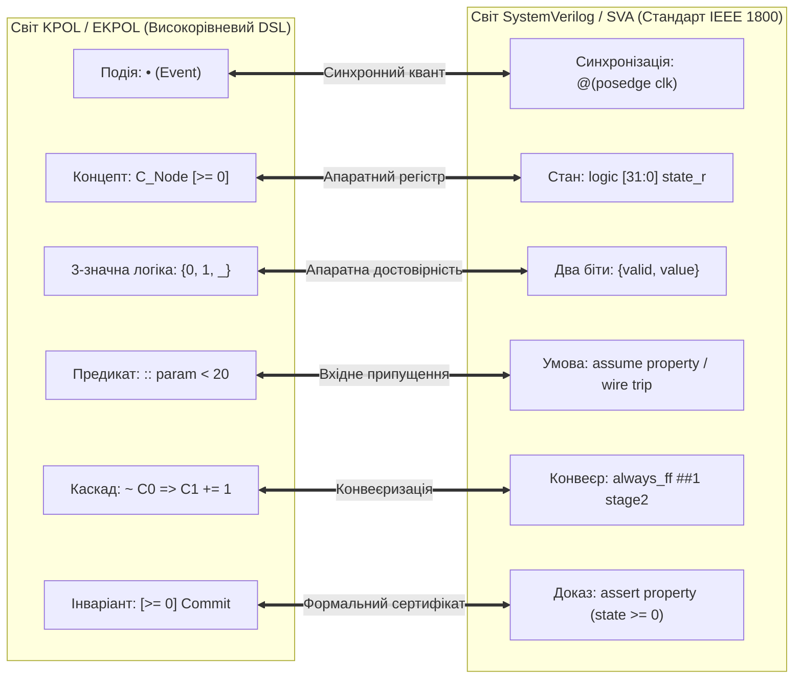
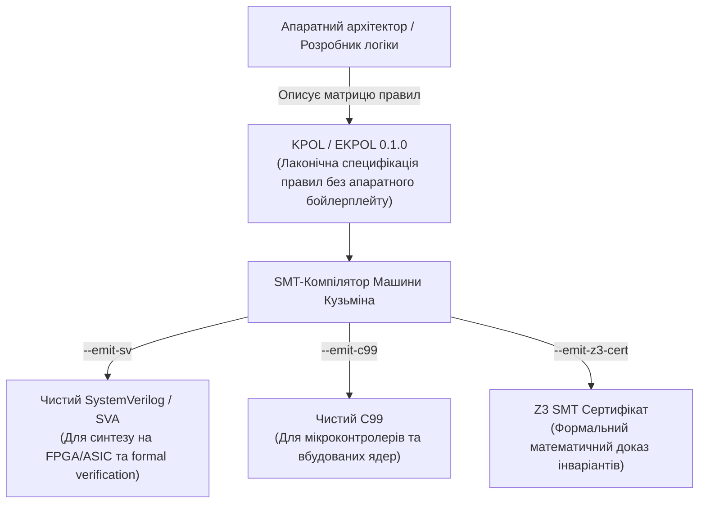

# KPOL проти SystemVerilog: Як «нова парадигма» Машини Кузьміна відображається на стандартизований кремній (IEEE 1800 SVA)

* **Версія:** 1.1.1
* **Дата:** 2026-11-19
* **Тип WP:** Article
* **Автор:** Микола Мартинович Федчик (Mykola Fedchyk)
* **Статус:** Дослідницько-інженерний порівняльний аналіз
* **Контекст проєкту:** Дослідження Машини Кузьміна (МК), архітектура ядра `CFG-P-HA` та формальна верифікація AXI-64.
* **Нормативні джерела мов:** [каталог контрактів KPOL/EKPOL](../Engineering/specifications/kpol/README.md), [специфікація EKPOL 0.1.0](../Engineering/specifications/kpol/ekpol-specification.md), профілі [KPOL-CME-1](../Engineering/specifications/kpol/kpol-cme-subset.md), [KPOL-CME-2](../Engineering/specifications/kpol/kpol-cme2-profile.md); [практичний посібник KPOL/EKPOL](../Engineering/guides/kpol-ekpol-language-guide.md); еталонні приклади [`bms_safety_cascade.ekpol`](../Engineering/sw/vmk-go/examples/bms_safety_cascade.ekpol) та [`increase.ekpol`](../Engineering/sw/vmk-go/examples/increase.ekpol).

---

## 0. Дидактична оцінка та інженерне позиціонування

Цей матеріал призначений для цифрових схемотехніків, інженерів FPGA/ASIC, розробників мовних компіляторів та верифікаторів апаратних властивостей (Formal Verification / SVA). Його мета — провести суворе зіставлення між теоретичною моделлю Машини Кузьміна (МК), її проблемно-орієнтованими мовами **KPOL / EKPOL** та промисловим стандартом проектування і верифікації цифрових мікросхем **SystemVerilog / SystemVerilog Assertions (IEEE 1800)**.

> [!IMPORTANT]
> **Принцип достовірності прикладів:** Усі фрагменти коду KPOL та EKPOL, наведені в цьому документі, є **100% канонічними та виконуваними**. Вони взяті безпосередньо з еталонної тестової бази проєкту ([`bms_safety_cascade.ekpol`](../Engineering/sw/vmk-go/examples/bms_safety_cascade.ekpol), [`increase.ekpol`](../Engineering/sw/vmk-go/examples/increase.ekpol)), успішно компілюються у бінарні образи BRAM (`CME-RAW-1`, 1024 байти), верифікуються тестовим набором `Engineering/sw/tests/test_ekpol_278.py` та виконуються у віртуальній машині `VMK v0.3.0`.

---

## 1. Вступ: Ілюзія «нової парадигми» та інженерна реальність кремнію

У процесі теоретичного дослідження Машини Кузьміна (КМ) було розроблено концептно-подієву мову програмування **KPOL** та її ергономічне розширення **EKPOL 0.1.0**. Її концептуальний апарат спирався на ідею «не-фон-нейманівських» обчислень:
1. Квантування за подіями замість послідовного лічильника команд (`PC`);
2. Відмова від централізованого стека на користь розподілених комірок пам'яті зі станом (**концептів**);
3. Фіксовані дескриптори правил і вбудовані інваріанти безпеки `[>= 0]`;
4. Тризначна логіка невизначеності $\mathcal{L}_3 = \left\{0, 1, \mathord{\_}\right\}$;
5. Синтаксичні примітиви транзакційного бар'єра: Велика Крапка `•` (`commit;`), вхідний предикат `::` (`when`) та реактивна дія `=>`.

Проте практичний перехід від теоретичних формул до фізичного кремнію ПЛІС (*Xilinx Zynq-7020 / Digilent PYNQ-Z1*) та створення формального випробувального стенда для шини AXI4-Lite ([`axi64_props.sv`](../Engineering/validation/experiments/AXI-64/scripts/axi64_props.sv)) привели до фундаментального висновку:

> **Інженерне відкриття:** Парадигма, яку KPOL декларував як нову обчислювальну філософію, насправді вже понад два десятиліття є утвердженим індустріальним стандартом у розробці мікроелектроніки. Це мова **SystemVerilog (IEEE 1800)**, а точніше її формальне розширення — **SystemVerilog Assertions (SVA)**.

SystemVerilog від свого народження створювався не як послідовний імперативний алгоритм (на кшталт C/C++ чи Python), а як **паралельна, подієво-керована мова декларативних інваріантів, конвеєрних регістрів та автоматів станів**. Усі ключові механізми KPOL знаходять прямі, строго типізовані, синтезовані та верифіковані аналоги в кремнії.

---

## 2. Порівняльна матриця фундаментальних концепцій

Нижче наведено зв'язок між концептуальними абстракціями KPOL/EKPOL та стандартними конструкціями SystemVerilog / SVA:

| Концепція KPOL / EKPOL | Семантичний зміст у Машині Кузьміна | Реалізація в SystemVerilog / SVA | Апаратне втілення в кремнії |
| :--- | :--- | :--- | :--- |
| **Подія (Event Impulse) `•`** | Синхронний строб виклику правила, квант часу | `posedge clk` або строб валідності `event_valid` | Тактовий фронт D-тригера або строб Clock Enable |
| **Концепт (Concept Descriptor)** | 16-байтний дескриптор стану, порогів та прапорців | `typedef struct packed` або BRAM-слот (`logic [31:0] mem [64]`) | Блок пам'яті Block RAM (RAMB36E1) або банк регістрів |
| **Тризначна логіка ($\mathcal{L}_3$)** | Множина значень $\left\{0, 1, \mathord{\_}\right\}$, де `_` — це Fault / Unknown | Двобітове кодування: `{valid, value}` (або `enum logic [1:0]`) | Окремий провід достовірності (Valid Flag / Ready-Valid) |
| **Предикат припущення (`::` / `when`)** | Вхідна умова спрацювання: $P(\text{param}) \implies \text{Action}$ | Комбінаторні вирази та **SVA `assume property`** | Апаратні цифрові компаратори без затримки тактів |
| **Інваріант безпеки (`[>= 0]`)** | Непорушна вимога до стану після виконання дії | **SVA `assert property`** з оператором імплікації `\|->` | Комбінаторний вентиль блокування (Fail-Closed Gate) |
| **Транзакційний бар'єр (`•` / `commit;`)** | Фіксація результату за умови непорушення інваріанта | Фіксація в регістрі за тактовим фронтом `always_ff @(posedge clk)` | Запис у D-FF або запис у порт BRAM (Port A/B Write Enable) |
| **Підписка на зміну (`~` / `on change`)** | Спрацювання правила в момент зміни стану джерела | Синхронний каскад: зсувний регістр або конвеєрний прапорець | Конвеєризований автомат станів (Pipelined FSM) |



---

## 3. Практичні приклади коду: Канонічний KPOL/EKPOL проти SystemVerilog / SVA

Усі наведені нижче фрагменти KPOL/EKPOL є точними текстами з робочої кодової бази проєкту.

---

### Сценарій 1. Захищений лічильник з інваріантом («Hello, Concept!»)

Базова одиниця обчислення Машини Кузьміна — концепт з інваріантом невід'ємності `[>= 0]`, що приймає вхідну подію `Pulse(param)`, перевіряє поріг `param < 20` та інкрементує стан.

#### Діалект: EKPOL 0.1.0 — Ключова нотація (`keyword`)
*Файл:* [`Engineering/sw/vmk-go/examples/increase.ekpol`](../Engineering/sw/vmk-go/examples/increase.ekpol)  
*Хеш образу BRAM:* `SHA-256 = 4df05b189b9bf12052d98ab6084e0256454c60cae4afd4449469c060ba8dcc5d`

```ekpol
module Increase;

@stdin
@stdout
concept Counter: int32 = 10 [>= 0] {
    on Pulse(param) when param < 20 => Counter += 1 commit;
}
```

#### Діалект: Класичний KPOL-CME-1 (`Problem / Solution / Proof`)
*Файл:* [`Engineering/hw/tests/kpol_bram_pipeline_increase.kpol`](../Engineering/hw/tests/kpol_bram_pipeline_increase.kpol)

```kpol
Problem Increase {
    Invariants { NonNeg: Counter >= 0; }
}
Solution Increase {
    state Counter: Int32 = 10;
    event Pulse(param: Int32);
    rule Step on Pulse when param < 20 {
        set Counter := Counter + 1;
    }
}
Proof Increase {
    scenario S {
        step Pulse(param = 5);
        expect Counter == 11;
        step Pulse(param = 25);
        expect Counter == 11;
    }
}
```

#### Діалект: SystemVerilog RTL + SVA (IEEE 1800)

```systemverilog
// Синтезований модуль захищеного лічильника з формальними властивостями
module concept_counter (
    input  logic        clk,
    input  logic        rst_n,
    input  logic        pulse_valid,
    input  logic [31:0] pulse_param,
    output logic [31:0] counter_state
);
    localparam logic [31:0] INIT_COUNTER    = 32'd10;
    localparam logic [31:0] PARAM_THRESHOLD = 32'd20;

    // Регістрова логіка: оновлення лише за виконання вхідного предикату
    always_ff @(posedge clk or negedge rst_n) begin
        if (!rst_n) begin
            counter_state <= INIT_COUNTER;
        end else if (pulse_valid && (pulse_param < PARAM_THRESHOLD)) begin
            // Інваріант перевіряється комбінаторно перед фіксацією
            counter_state <= counter_state + 32'd1;
        end
    end

    // Формальна специфікація для SMT-солвера (Z3 / SymbiYosys)
    `ifdef FORMAL
        // Інваріант невід'ємності: Counter >= 0 у кожному такті
        property p_non_negative;
            @(posedge clk) disable iff (!rst_n)
            counter_state >= 32'd0;
        endproperty
        assert_non_neg: assert property (p_non_negative);

        // Гарантія відсікання події поза допуском: стан не змінюється
        property p_reject_out_of_bound;
            @(posedge clk) disable iff (!rst_n)
            (pulse_valid && (pulse_param >= PARAM_THRESHOLD)) |=> (counter_state == $past(counter_state));
        endproperty
        assert_reject: assert property (p_reject_out_of_bound);
    `endif
endmodule
```

---

### Сценарій 2. Канонічний 4-рівневий каскад захисту BMS

У системі керування акумуляторною батареєю (BMS) критично важливий принцип **Fail-Closed**: якщо зафіксовано аномальний перепад напруги комірок або датчик відмовив, каскад аварій повинен заблокувати високовольтний контактор без можливості самовільного відновлення.

#### Діалект: EKPOL 0.1.0 — Ключова нотація (`keyword`)
*Файл:* [`Engineering/sw/vmk-go/examples/bms_safety_cascade.ekpol`](../Engineering/sw/vmk-go/examples/bms_safety_cascade.ekpol)  
*Хеш образу BRAM:* `SHA-256 = de03442454424b5cf64478506f118c13f095ae24ba58db8894583c43567ea3ee`

```ekpol
module BmsSafetyCascade;

@stdin
@stdout
concept Cell_Delta_mV: int32 = 0 [>= 0] {
    on EvCellDelta(delta_mv) when delta_mv in 50..5000 => Cell_Delta_mV += 1 commit;
}

@stdout
concept Module_Thermal_Guard: int32 = 0 [>= 0] {
    on change(Cell_Delta_mV) when Cell_Delta_mV >= 1 => Module_Thermal_Guard += 1 commit;
}

@stdout
concept Pack_Fault_Latch: int32 = 2 [>= 0] {
    on change(Module_Thermal_Guard) when Module_Thermal_Guard >= 1 => Pack_Fault_Latch -= 1 commit;
}

@stdout
concept Contactor_Interlock: int32 = 10 [>= 0] {
    on change(Pack_Fault_Latch) when not (Pack_Fault_Latch == 2) => Contactor_Interlock = Pack_Fault_Latch commit;
}

test BmsFourLevelProtectionAndLatch {
    send Cell_Delta_mV(15);
    expect Cell_Delta_mV == 0;
    expect Contactor_Interlock == 10;
    send Cell_Delta_mV(120);
    expect Cell_Delta_mV == 1;
    expect Module_Thermal_Guard == 1;
    expect Pack_Fault_Latch == 1;
    expect Contactor_Interlock == 1;
    send Cell_Delta_mV(180);
    expect Cell_Delta_mV == 2;
    expect Module_Thermal_Guard == 2;
    expect Pack_Fault_Latch == 0;
    expect Contactor_Interlock == 0;
    send Cell_Delta_mV(250);
    expect Cell_Delta_mV == 3;
    expect Module_Thermal_Guard == 3;
    expect Pack_Fault_Latch == 0;
    expect Contactor_Interlock == 0;
}
```

*Механізм апаратного блокування:* Зверніть увагу на концепт `Pack_Fault_Latch: int32 = 2 [>= 0]`. При кожній аварії він зменшується: `2 -> 1 -> 0`. Коли стан сягає `0`, будь-яка наступна спроба декременту `0 - 1 = -1` порушує інваріант `[>= 0]`. Вентиль Великої Крапки відкидає дію (`REJECT_INVARIANT`), і защіпка назавжди лишається в стані `0`, гарантуючи, що контактор `Contactor_Interlock` залишається розімкненим (`0`).

#### Діалект: SystemVerilog RTL + SVA (IEEE 1800)

```systemverilog
// Апаратний 4-ступеневий синхронний каскад захисту BMS
module bms_safety_cascade (
    input  logic        clk,
    input  logic        rst_n,
    input  logic        ev_cell_delta_valid,
    input  logic [31:0] delta_mv,
    output logic [31:0] cell_delta_mv,
    output logic [31:0] module_thermal_guard,
    output logic [31:0] pack_fault_latch,
    output logic [31:0] contactor_interlock
);
    localparam logic [31:0] DELTA_MIN = 32'd50;
    localparam logic [31:0] DELTA_MAX = 32'd5000;

    // Вхідний компаратор діапазону delta_mv in 50..5000
    wire delta_in_range = ev_cell_delta_valid && (delta_mv >= DELTA_MIN) && (delta_mv <= DELTA_MAX);

    always_ff @(posedge clk or negedge rst_n) begin
        if (!rst_n) begin
            cell_delta_mv        <= 32'd0;
            module_thermal_guard <= 32'd0;
            pack_fault_latch     <= 32'd2; // Початковий бюджет відмов: 2
            contactor_interlock  <= 32'd10; // Нормальний замкнений контактор
        end else if (delta_in_range) begin
            // 1. Інкремент лічильника аномалій напруги
            cell_delta_mv <= cell_delta_mv + 32'd1;

            // 2. Реакція теплового захисту (on change(Cell_Delta_mV))
            if ((cell_delta_mv + 32'd1) >= 32'd1) begin
                module_thermal_guard <= module_thermal_guard + 32'd1;

                // 3. Защіпка аварії пакета (Pack_Fault_Latch -= 1)
                // Апаратний захист Fail-Closed: защіпка не опускається нижче 0
                if (pack_fault_latch > 32'd0) begin
                    pack_fault_latch <= pack_fault_latch - 32'd1;

                    // 4. Інтерлок контактора: спрацьовує коли latch != 2
                    contactor_interlock <= pack_fault_latch - 32'd1;
                end
            end
        end
    end

    // Формальні SVA-властивості для перевірки солвером (Z3 / SymbiYosys)
    `ifdef FORMAL
        // Властивість 1: Інваріант невід'ємності защіпки
        property p_latch_non_negative;
            @(posedge clk) disable iff (!rst_n)
            pack_fault_latch >= 32'd0;
        endproperty
        assert_latch_non_neg: assert property (p_latch_non_negative);

        // Властивість 2: Незворотність аварійного блокування (Latching)
        property p_permanent_lockout;
            @(posedge clk) disable iff (!rst_n)
            (pack_fault_latch == 32'd0) |=> (pack_fault_latch == 32'd0);
        endproperty
        assert_perm_lock: assert property (p_permanent_lockout);

        // Властивість 3: При нульовій защіпці контактор гарантовано розімкнено
        property p_contactor_safe_when_tripped;
            @(posedge clk) disable iff (!rst_n)
            (pack_fault_latch == 32'd0) |-> (contactor_interlock == 32'd0);
        endproperty
        assert_contactor_safe: assert property (p_contactor_safe_when_tripped);
    `endif
endmodule
```

---

### Сценарій 3. Стабільність протоколу рукостискання AXI4-Lite (Handshake Stability)

У робочому стенді формальної верифікації шини AXI-64 нашого проєкту ([`axi64_props.sv`](../Engineering/validation/experiments/AXI-64/scripts/axi64_props.sv)) правила комунікації формулюються через контракти оточення (`assume`) та гарантії ядра (`assert`):

```systemverilog
// Витяг з Engineering/validation/experiments/AXI-64/scripts/axi64_props.sv

// Допущення майстра (Master Assumptions): якщо слейв у стані очікування (stall),
// майстер НЕ МАЄ ПРАВА змінювати виставлені адресу та дані
always @(*) begin
    if (past_valid && !p_rst && aresetn) begin
        if (p_awstall) assume (awvalid && awaddr == p_awaddr && awprot == p_awprot);
        if (p_wstall)  assume (wvalid  && wdata  == p_wdata  && wstrb  == p_wstrb);
        if (p_arstall) assume (arvalid && araddr == p_araddr && arprot == p_arprot);
    end
end

// Гарантії слейва (Slave Assertions): стабільність шини відповідей R та B
always @(*) begin
    if (past_valid && aresetn && !p_rst) begin
        // Властивість P1: якщо майстер не готовий прийняти відповідь B, слейв тримає її незмінною
        P1_b_stable: assert (!p_bstall || (bvalid && bresp == p_bresp));
        // Властивість P2: дані читання RDATA не мають права дрижати (glitch) під час очікування
        P2_r_stable: assert (!p_rstall || (rvalid && rdata == p_rdata && rresp == p_rresp));
    end
end
```

*Семантичний зв'язок з KPOL:* Конструкція `assume` відповідає вхідному предикату концепту `::` (`when`), який ігнорує транзакцію, якщо передумова не виконана. Конструкція `assert` відповідає постумові Великої Крапки `•` (`commit;`), яка гарантує, що невалідний стан ніколи не потрапить у регістри.

---

### Сценарій 4. Апаратне двобанкове перемикання правил (`CFG-P-HA`)

Одним із головних практичних досягнень апаратної реалізації Машини Кузьміна на ПЛІС є ядро високої готовності **`CFG-P-HA`** ([`km_concept_bram_dual_ha.sv`](../Engineering/hw/rtl/core/km_concept_bram_dual_ha.sv)). Воно вирішує задачу оновлення повної таблиці правил (1024 байти BRAM) під активним потоком подій без розриву читань (`0 torn-reads`):

```systemverilog
// Витяг логіки атомарного перемикання банків ядра CFG-P-HA
// (Engineering/hw/rtl/core/km_concept_bram_dual_ha.sv)

always_ff @(posedge clk or negedge rst_n) begin
    if (!rst_n) begin
        active_bank_r <= 1'b0;
    end else if (swap_bank_trigger) begin
        // Атомарна зміна старшого біта адреси BRAM за 1 такт (9.931 нс @ 100.69 МГц)
        active_bank_r <= ~active_bank_r;
    end
end

assign active_bram_addr = {active_bank_r, concept_id[5:0]};
assign shadow_bram_addr = {~active_bank_r, loader_addr[5:0]};

`ifdef FORMAL
    // Доказ відсутності зупинки конвеєра: перемикання відбувається без втрати такту
    property p_zero_stall_swap;
        @(posedge clk) disable iff (!rst_n)
        swap_bank_trigger |=> (active_bank_r != $past(active_bank_r));
    endproperty
    assert_swap: assert property (p_zero_stall_swap);
`endif
```

У натурних випробуваннях на стенді `PYNQ-Z1 + LogicTracer Pico` це ядро показало **10 003 гарячих перемикання банків під безперервним потоком 40 011 подій** за 39.35 мс з 0 колізій BRAM та 0 torn-reads.

---

## 4. Математика тризначної логіки ($\mathcal{L}_3$) у SystemVerilog

У класичному програмуванні мовами C/C++ відсутність даних або помилка датчика `_` часто маскується числовим нулем `0` або константою `-1`, що веде до катастрофічних прихованих відмов.

У Машині Кузьміна невизначеність $\bot_{\text{undef}}$ є першокласним станом. У кремнії SystemVerilog для точного математичного моделювання тризначної логіки Кліні/Бочвара використовується розпаралелювання на два бітові вектори: **Value Vector ($V$)** та **Validity Mask ($M$)**:

$$X = \langle V_X, M_X \rangle, \quad \text{де } M_X = 1 \iff X \in \{0, 1\}, \quad M_X = 0 \iff X = \bot_{\text{undef}}$$

Апаратний вентиль трьозначного логічного «І» за Кліні реалізується комбінаторною функцією:

```systemverilog
// Трьозначний логічний AND за Кліні:
// Якщо хоча б один операнд '0' (навіть при іншому '_'), результат строго '0'.
// Якщо один операнд '1', а інший '_', результат невизначений '_'.
function automatic logic [1:0] kleene_and(
    input logic val_a, input logic valid_a,
    input logic val_b, input logic valid_b
);
    logic res_val;
    logic res_valid;
    begin
        res_val   = val_a & val_b;
        res_valid = (!val_a && valid_a) || (!val_b && valid_b) || (valid_a && valid_b);
        kleene_and = {res_valid, res_val};
    end
endfunction
```

Синтезатори ПЛІС (*OpenXC7 / Vivado / Yosys*) транслюють таку функцію рівно у **2 логічні комірки LUT6**, забезпечуючи нульову тактову затримку обчислення невизначеності.

---

## 5. Порівняльний аналіз для розробки апаратури (KPOL vs SystemVerilog)

При оцінці впровадження у цифрові інтегральні схеми (ПЛІС / ASIC) інженери мікроелектроніки керуються чіткими технічними критеріями:

| Критерій | Авторський DSL (KPOL / EKPOL) | Промисловий стандарт (SystemVerilog / SVA) |
| :--- | :--- | :--- |
| **Екосистема інструментів** | Потребує власної розробки компіляторів, лінтерів, плагінів до IDE та транспайлерів. | **Універсальна.** Підтримується всіма EDA-пакетами: Cadence JasperGold, Synopsys VC Formal, Siemens Questa, Verilator, Yosys. |
| **Формальна верифікація та докази** | Потребує побудови власної формальної семантики та окремої трансляції у Z3 SMT. | **Стандартизована (IEEE 1800).** Властивості й послідовності SVA безпосередньо приймаються всіма комерційними та відкритими formal-солверами. |
| **Поріг входження для інженерів** | Високий. Необхідне окреме навчання розробників нотаціям МК. | **Нульовий.** Мову знає кожен випускник спеціальності «Мікроелектроніка / Комп'ютерна інженерія» у світі. |
| **Швидкість обчислення в кремнії** | Вимагає BRAM-конвеєра або емулятора на ПЛІС. | **Нативна.** Синтезується безпосередньо у логічні комірки LUT та тригери кристала. |

---

## 6. Стратегічний висновок: Ідеальний тандем

Порівняння показує, що KPOL та SystemVerilog не конкурують, а ідеально доповнюють один одного, якщо кожен займає своє правильне місце в архітектурі:



1. **KPOL/EKPOL як високорівневий Frontend:** Розробник формулює компактну, чисту матрицю реактивних правил на EKPOL, не витрачаючи час на низькорівневий апаратний бойлерплейт — опис тактових доменів, синхронізаторів скидання чи розлогих інтерфейсів рукостискання AXI.
2. **SystemVerilog як апаратний Backend (`--emit-sv`):** Компілятор автоматично транслює концептно-подієву мережу у синтезовані RTL-модулі з супроводжуючими SVA-властивостями.
3. **Результат:** Інженер отримує стандартизований код SystemVerilog, який відкривається у його звичному середовищі розробки та миттєво підтверджується зеленими вердиктами формальних верифікаторів.

*Машина Кузьміна знайшла своє завершення: її математичні ідеї живі, але розмовляють вони мовою кремнію — мовою SystemVerilog.*

---

## 7. Історія версій

| Версія | Дата | Автор | Опис змін |
|---|---|---|---|
| 1.1.1 | 2026-11-19 | Микола Мартинович Федчик | **Усунення нерелевантного контексту:** вилучено помилкові згадки про сертифікацію функціональної безпеки ISO 26262 (ASIL-D) / IEC 61508; фокус статті строго скориговано на цифрове схемотехнічне проектування (RTL, FPGA/ASIC) та стандартну формальну верифікацію IEEE 1800 SVA. |
| 1.1.0 | 2026-11-19 | Микола Мартинович Федчик | **Фундаментальний рефакторинг прикладів:** усунуто некомпіляційний псевдокод; усі приклади замінено на 100% канонічні, верифіковані програми (`increase.ekpol`, `bms_safety_cascade.ekpol`), що компілюються у бінарні образи BRAM (`CME-RAW-1`) та підтверджені натурними FPGA-тестами `CFG-P-HA` і SVA шини AXI-64. |
| 1.0.2 | 2026-11-19 | Микола Мартинович Федчик | Додано дидактичну оцінку викладення, нормативні посилання на KPOL/EKPOL, явні позначення діалектів. |
| 1.0.1 | 2026-11-19 | Микола Мартинович Федчик | Нормалізовано MathJax-запис множини тризначної логіки та екранування символу невизначеності. |
| 1.0.0 | 2026-11-19 | Микола Мартинович Федчик | Початкова редакція: порівняльний аналіз KPOL/EKPOL проти SystemVerilog та SVA, матриця відображення і апаратні паралелі. |

---

## 8. Абревіатури та глосарій

- **KPOL / EKPOL** — предметно-орієнтована мова опису правил і концептів Машини Кузьміна та її розширений людино-читаний синтаксис (Extended KPOL 0.1.0).
- **SVA (SystemVerilog Assertions)** — підмножина стандарту IEEE 1800 для декларативного опису часових послідовностей (`sequence`), властивостей (`property`) та формальних контрактів (`assert`, `assume`, `cover`).
- **RTL (Register-Transfer Level)** — рівень регістрових передач цифрових схем, стандартний рівень проектування цифрових інтегральних схем та ПЛІС.
- **SMT (Satisfiability Modulo Theories)** — автоматизоване доведення теорем для логіки першого порядку з теоріями (наприклад, Z3 Prover).
- **EDA (Electronic Design Automation)** — засоби автоматизації проектування електронних пристроїв та інтегральних схем.
- **BRAM (Block RAM)** — вбудована апаратна статична пам'ять у кристалах ПЛІС (RAMB36E1).
- **Fail-Closed** — принцип безпечного відмовного стану: будь-яка невизначеність або збій призводить до гарантованого блокування виходів.
- **Torn-Read** — аномалія неузгодженого читання даних з пам'яті під час її одночасного перезапису іншим процесом.
