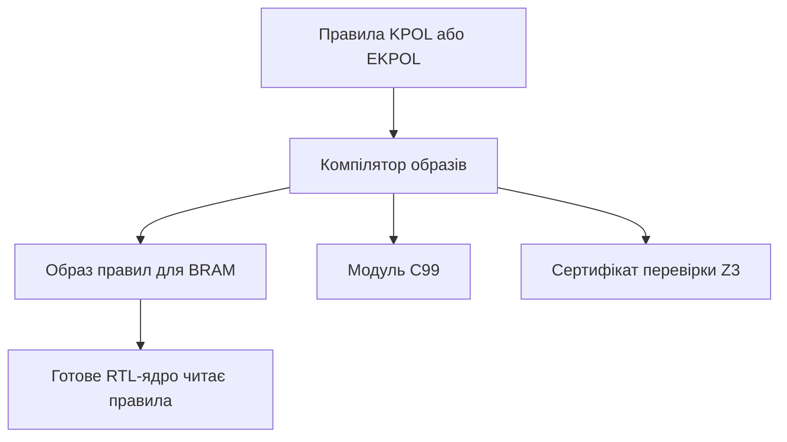

# KPOL і SystemVerilog: як описати правило, реалізувати його в схемі й перевірити

* **Версія:** 1.4.0
* **Дата:** 2026-11-20
* **Тип WP:** Article
* **Автор:** Микола Мартинович Федчик (Mykola Fedchyk)

Цей матеріал призначений для цифрових схемотехніків, інженерів FPGA/ASIC, розробників мовних компіляторів та верифікаторів апаратних властивостей (Formal Verification / SVA). Його мета — провести суворе зіставлення між теоретичною моделлю Машини Кузьміна (МК), її проблемно-орієнтованими мовами **KPOL / EKPOL** та промисловим стандартом проектування і верифікації цифрових мікросхем **SystemVerilog / SystemVerilog Assertions (IEEE 1800)**.

## 1. Три події для одного лічильника

Лічильник показує `10`. Він рахує не суму показів датчика, а **кількість прийнятих подій**: додає одиницю, якщо показ достовірний і менший за `20`. Подамо три події поспіль:

| Що надійшло | Що вирішує виконавець VMK | Стан після події |
|---|---|---:|
| `5` | Показ достовірний, `5 < 20`. Записати нове значення (`COMMIT`). | `11` |
| `25` | Показ достовірний, але умова хибна (`REJECT_GUARD`). | `11` |
| `_` | Подія надійшла, але показу немає. Порівнювати з порогом нічого (`REJECT_FAULT`). | `11` |

Два останні результати на табло однакові, але причини різні. На цьому прикладі зручно розділити три завдання: **EKPOL описує, коли змінити значення; RTL визначає, як схема його змінює; SVA перевіряє, чи поводиться схема так, як домовилися.**

### Правило: що має відбутися

*Дослівно з файлу [`increase.ekpol`](../Engineering/sw/vmk-go/examples/increase.ekpol):*

```ekpol
module Increase;

@stdin
@stdout
concept Counter: i32 = 10 [>= 0] {
    <- Pulse(param) :: param < 20 => Counter += 1 .
}
```

`Counter` — **концепт**, тобто реактивна комірка пам’яті: разом зі значенням описано, на яку подію вона реагує. Читайте останній рядок зліва направо: на запис `Pulse(param)` перевір умову `param < 20`; якщо відповідь «так», збільш лічильник на одиницю. Така перевірка «так чи ні» називається **предикатом**. Обмеження `[>= 0]` стосується не датчика, а самого лічильника: новий стан має бути невід’ємним. Це його **інваріант**.

*Еквівалентний запис того самого правила ключовими словами EKPOL, не окрема програма:*

```ekpol
on Pulse(param) when param < 20 => Counter += 1 commit;
```

Це інженерна нотація [EKPOL](../Engineering/specifications/kpol/ekpol-specification.md), а не цитата зі слайдів М. Ю. Кузьміна. [Той самий лічильник у профілі KPOL-CME-1](../Engineering/hw/tests/kpol_bram_pipeline_increase.kpol) розділяє оголошення інваріанта (`Problem`) і правило переходу (`Solution`). [Тести компілятора](../Engineering/sw/tests/test_ekpol_278.py) порівнюють образи пам’яті для еталонних програм; [тести VMK](../Engineering/sw/vmk-go/internal/vmk/vmk_test.go) перевіряють, зокрема, три наведені вище рішення. Це не тест еквівалентності довільного модуля SystemVerilog.

### Реалізація: хто дозволяє запис у регістр

*Навчальна схема, написана вручну.* Тут `pulse` означає «подія надійшла», а `param_valid` — «значенню можна довіряти». Без першого сигналу схема не відрізняла б відсутність події від події без показу. Для стислості модуль виводить лише стан, а не діагностичний код VMK.

```systemverilog
module concept_counter (
    input  logic clk, rst_n, pulse, param_valid,
    input  logic signed [31:0] param,
    output logic signed [31:0] counter
);
    localparam logic signed [31:0] MAX_I32 = 32'sh7fff_ffff;
    wire accept = pulse && param_valid && param < 32'sd20 && counter < MAX_I32;

    always_ff @(posedge clk or negedge rst_n) begin
        if (!rst_n)      counter <= 32'sd10;
        else if (accept) counter <= counter + 32'sd1;
    end

`ifdef FORMAL
    // Якщо запису не дозволено, на наступному фронті стан той самий.
    assert property (@(posedge clk) disable iff (!rst_n)
                     !accept |=> $stable(counter));
    assert property (@(posedge clk) disable iff (!rst_n)
                     accept |=> counter == $past(counter) + 32'sd1);
    assert property (@(posedge clk) disable iff (!rst_n) counter >= 32'sd0);
`endif
endmodule
```

Дві деталі тут змінюють поведінку, а не лише синтаксис. По-перше, `param` **знаковий**: достовірне `−1` задовольняє `param < 20`, а з тими самими бітами у беззнаковому регістрі порівняння дало б «ні». По-друге, на найбільшому `Int32` схема не записує результат додавання: він уже не поміщається у 32-бітне знакове число. Якби `counter` був беззнаковим, твердження `counter >= 0` нічого б не перевіряло.

### Перевірка: хто помітить помилку

У модулі вище `if (accept)` керує фізичним записом. Рядок `assert property` не керує ним: він задає твердження, порушення якого може виявити симулятор або формальний інструмент. Наприклад, `|=>` пропонує подивитися на **наступний** фронт такту, а `$stable(counter)` — перевірити, що значення не змінилося.

Чому ж не написати `assume (param < 20)` замість компаратора? Бо у формальній перевірці `assume` обмежує набір входів, які розглядає інструмент. Якщо заздалегідь виключити `25`, ми вже не перевіримо, що схема його відхиляє. Навіть правильна перевірка «без `accept` регістр не змінюється» не доводить, що сам `accept` обчислений правильно.

## 2. Довідка: що саме ми зіставляємо

М. Ю. Кузьмін запропонував модель і [авторську нотацію KPOL-AUTH](../Engineering/specifications/kpol/kpol-auth-formal-specification.md). KPOL-CME та EKPOL — інженерні профілі й мова проєкту. Наприклад, у записі Кузьміна `→ • Sum = 0` читаємо **стару** суму і лише потім скидаємо її. Крапка `•` визначає порядок цих дій. Вона не вказує, скільки між ними тактів.

| Поняття | У правилі | Як це можна реалізувати або перевірити |
|---|---|---|
| Концепт | Значення та реакції на звернення до нього | Регістр `counter` у простій схемі; запис у пам’яті правил у табличному виконавці |
| Запис / виклик | `←` / `\|` в авторській нотації | Строб або передача запиту за протоколом; сам фронт такту ще не означає подію |
| Читання з дією після нього | `→ • Sum = 0` | Видати попереднє значення; дозвіл скидання прив’язати до завершення читання |
| Невідоме значення | `_` | Значення плюс ознака достовірності; це не `0` і не симуляційний `X` |
| Умова допуску | `::` / `when` в EKPOL | Компаратор обчислює дозвіл на дію; SVA може перевіряти наслідки дозволу чи відмови |
| Інваріант | `[>= 0]` | Схема має не допустити недозволеного переходу; `assert` окремо перевіряє властивість |
| Порядок / фіксація | Авторське `•` впорядковує дії; `commit;` в EKPOL фіксує дію правила | Запис на дозволеному тактовому фронті — один зі способів реалізації, не визначення символу `•` |
| Підписка на зміну | `~ Cell_Delta_mV` / `on change(Cell_Delta_mV)` | Виконавець передає подію наступному правилу. `##1` у SVA описує інтервал в один такт, але не запускає підписника |

## 3. Три приклади, де аналогія має межу

### Каскад батареї: відхилити подію — не те саме, що розімкнути контактор

У [виконуваному прикладі BMS](../Engineering/sw/vmk-go/examples/bms_safety_cascade.ekpol) перше правило рахує покази перепаду напруги в діапазоні `50..5000` мВ. Зміна лічильника активує наступне правило. Ланцюжок доходить до `Pack_Fault_Latch` — лічильника із початковим запасом `2` — та до модельного виходу `Contactor_Interlock`. Простежмо саме ті входи, які подає тест у кінці файлу:

| Показ, мВ | `Cell_Delta_mV` | `Module_Thermal_Guard` | `Pack_Fault_Latch` | `Contactor_Interlock` |
|---:|---:|---:|---:|---:|
| Початковий стан | 0 | 0 | 2 | 10 |
| 15 | 0 | 0 | 2 | 10 |
| 120 | 1 | 1 | 1 | 1 |
| 180 | 2 | 2 | 0 | 0 |
| 250 | 3 | 3 | 0 | 0 |

На останньому рядку перші два лічильники зросли. Третій мав би перейти з `0` у `−1`, але його інваріант забороняє запис. Тому немає **зміни**, на яку підписаний останній концепт. Нуль утримується до скидання або повторної ініціалізації.

*Навчальна властивість SVA для реалізації з такими виходами:*

```systemverilog
assert property (@(posedge clk) disable iff (!rst_n)
                 (pack_fault_latch == 0) |-> (contactor_interlock == 0));
```

Це твердження пов’язує два стани на одному фронті такту. Воно не каже, **чому** защіпка дійшла до нуля. Якщо вхідний шлюз просто відхиляє недостовірний показ, попередній стан зберігається: відмова датчика сама по собі не розмикає контактор. Для такої вимоги потрібні окреме правило реакції на відмову й окрема перевірка. Назва `Interlock` їх не замінює.

### AXI4-Lite: хто обіцяє тримати дані стабільними

На шині передача відбувається на фронті такту, коли для **того самого каналу** одночасно істинні `VALID` і `READY`. Припустімо, пристрій уже виставив результат читання (`RVALID`), але отримувач ще не готовий (`RREADY = 0`). На наступному фронті отримувач має побачити ту саму відповідь: виставити нові дані зарано.

*Дослівно зі [стенда `axi64_props.sv`](../Engineering/validation/experiments/AXI-64/scripts/axi64_props.sv), окремі рядки всередині перевірок після скидання:*

```systemverilog
if (p_arstall) assume (arvalid && araddr == p_araddr && arprot == p_arprot);
```

```systemverilog
P2_r_stable:  assert (!p_rstall || (rvalid && rdata == p_rdata && rresp == p_rresp));
```

Перший рядок — **припущення про оточення**: якщо запит адреси чекав, ініціатор тримає його стабільним. Другий — **вимога до модуля**, який ми перевіряємо: якщо відповідь чекала, модуль зберігає і дані, і код відповіді. `p_` позначає збережені на попередньому фронті сигнали. Це дві сторони контракту, а не два способи ввімкнути регістр.

### Два банки пам’яті: коли нові правила стають активними

У ядрі `CFG-P-HA` один банк містить активні правила, інший можна готувати до заміни. Якщо переключити банк посеред читання чотирислівного дескриптора, початок правила може виявитися старим, а кінець — новим. Тому **запит** на заміну й **момент заміни** — різні події.

*Дослівно з [RTL двобанкової пам’яті](../Engineering/hw/rtl/core/km_concept_bram_dual_ha.sv):*

```systemverilog
wire swap_commit_w     = (swap_pending_q || swap_req_accept) && seq_at_idle_boundary_i;
```

Прийнятий запит може чекати. У стані `SYNC_IDLE` вибір банку змінюється на тактовому фронті, коли секвенсер дійшов до межі між подіями. Перевірити лише те, що біт банку змінився, недостатньо: треба окремо перевірити, що всі чотири слова однієї події прочитані узгоджено.

[Звіт експерименту на PYNQ-Z1](../Research/studies/fpga-gpu-symbiosis/experiments/EXP-GPU-02/report-stage1-2-cfg-p-ha.md) розрізняє формальну перевірку на зменшеній моделі та вимірювання на платі. У стендовій серії з **10 003 перемиканнями і 40 011 подіями** не зафіксовано жодного змішаного читання. Це результат конкретного прогону, а не доказ для всіх можливих послідовностей.

## 4. Чому «невідомо» — не те саме, що «ні»

Візьмімо логічне «І» двох показів. Перший достовірно хибний, другий невідомий. За **сильною тризначною логікою Кліні** результат уже відомий: `0 AND _ = 0`. Якби перший був істинний, відповідь залежала б від другого: `1 AND _ = _`. У строгій логіці Бочвара невідомість поширюється в обох випадках. Наявність літерала `_` сама по собі не визначає, яку таблицю істинності обрала мова для кожної операції.

*Навчальна комбінаційна функція SystemVerilog для булевого «І» за Кліні.* Кожен операнд має біт значення та біт достовірності; коли результат недостовірний, його біт значення не інтерпретуємо.

```systemverilog
function automatic logic [1:0] kleene_and(
    input logic val_a, valid_a, val_b, valid_b
);
    logic known_zero, both_known;
    known_zero = (valid_a && !val_a) || (valid_b && !val_b);
    both_known = valid_a && valid_b;
    return {known_zero || both_known, val_a && val_b};
endfunction
```

Окремий біт `valid` можна передавати й вимірювати в реальній схемі. Натомість `X` у симуляції SystemVerilog означає, що симулятор не знає рівня сигналу. Функція вище не додає конвеєрного регістра; це не означає нульову фізичну затримку. Кількість LUT і затримку шляху визначають для конкретної ПЛІС після синтезу й трасування.

## 5. Що насправді видає компілятор

Коли змінюється поріг правила, не обов’язково змінювати саму схему. Для підтримуваних профілів [компілятор образів](../Engineering/hw/scripts/compile_kpol_bram_image.py) кодує правило як **дані** для вже спроєктованого RTL-виконавця. У цих двох прикладах вихід — образ `CME-RAW-1` на 1024 байти: лічильник відповідає [профілю CME-1](../Engineering/specifications/kpol/kpol-cme-subset.md), каскад — [CME-2](../Engineering/specifications/kpol/kpol-cme2-profile.md).



Утиліта також має виходи `--emit-c99` та `--emit-z3-cert`. Загальної команди `--emit-sv`, яка б перетворювала ці програми на довільні RTL-модулі разом із SVA, у цьому CLI немає. Тому модуль лічильника в §1 позначено як навчальний, а не як результат трансляції. Сертифікат для правил не доводить коректності іншої, написаної вручну схеми.

## 6. Що обрати для власної задачі

Якщо потрібно змінити **правило** — наприклад, приймати покази нижче `30` замість `20`, — його зручніше читати й переглядати в EKPOL. Якщо важливо, **на якому фронті** приймається подія або **який банк** віддає слово, відповідь шукайте в RTL. Якщо вимога звучить як **«цього ніколи не має статися»**, сформулюйте її як перевірну властивість і назвіть припущення про вхід. Обсяг підтримки SVA залежить від інструмента; сам запис властивості ще не означає, що її доведено.

Повернімося до показу `25`. Добре сформульована вимога не забороняє датчику його надіслати. Вона вимагає, щоб схема **прийняла подію до розгляду й залишила лічильник незмінним**. Саме це розрізнення й робить порівняння мов корисним.

## Абревіатури та глосарій

- **KPOL / EKPOL** — проєктні мови опису правил Машини Кузьміна; EKPOL розшифровується як *Ergonomic KPOL*. [Каталог контрактів](../Engineering/specifications/kpol/README.md) і [посібник із прикладами](../Engineering/guides/kpol-ekpol-language-guide.md).
- **RTL** (*Register-Transfer Level*) — опис регістрів, обчислень між ними й умов запису.
- **SVA** (*SystemVerilog Assertions*) — засоби SystemVerilog для опису та перевірки властивостей, зокрема в часі.
- **BRAM** (*Block RAM*) — вбудована блокова пам’ять ПЛІС.
- **BMS** (*Battery Management System*) — система керування акумуляторною батареєю.
- **SMT** (*Satisfiability Modulo Theories*) — перевірка здійсненності логічних формул із використанням теорій, наприклад бітових векторів; Z3 — один із таких розв’язувачів.
- **Torn read** — читання, що змішує частини різних версій одного запису.

<!--
## Історія версій
Зміни статті збережено в історії Git.
-->
