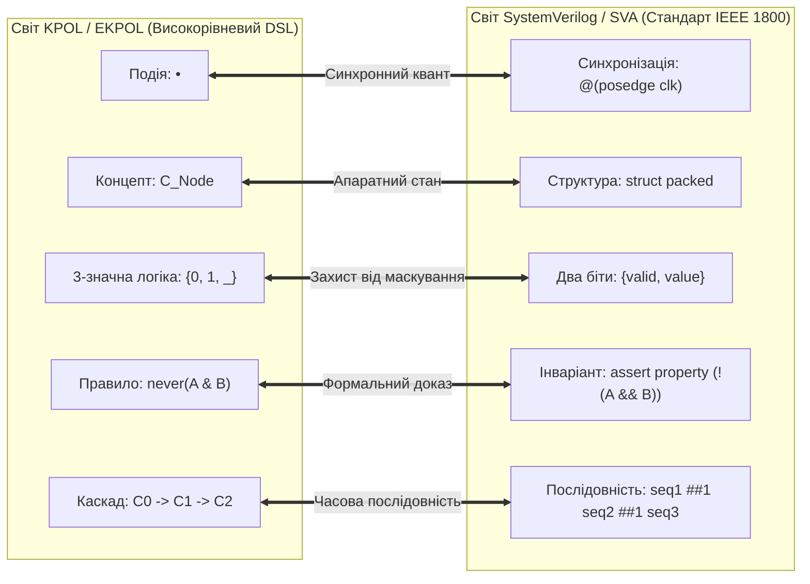
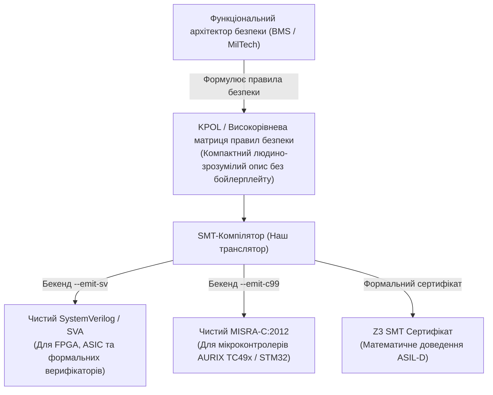

# KPOL проти SystemVerilog: Як «нова парадигма» Машини Кузьміна відображається на стандартизований кремній (IEEE 1800 SVA)

* **Автор:** Микола Мартинович Федчик (Mykola Fedchyk)
* **Дата:** 2026-11-19
* **Статус:** Дослідницько-інженерний порівняльний аналіз
* **Контекст проєкту:** Дослідження Машини Кузьміна (КМ), архітектура ядра `CFG-P-HA`, формальна верифікація AXI-64 та автоматизований конвеєр сертифікації за стандартами ISO 26262 (ASIL-D) / IEC 61508.

---

## 1. Вступ: Ілюзія «нової парадигми» та інженерна реальність кремнію

У процесі теоретичного дослідження Машини Кузьміна (КМ) було розроблено спеціалізовану мову програмування **KPOL** (та її розширення **EKPOL**). Її концептуальний апарат спирався на ідею «не-фон-нейманівських» обчислень: квантування за подіями замість лічильника команд (`PC`), відмова від централізованого стека, фіксовані таблиці концептів-дескрипторів, тризначна логіка невизначеності ($\mathcal{L}_3 = \{0, 1, \_\}$) та езотеричні синтаксичні оператори (крапка `•` як строб події, `::` як зв'язок між концептами).

Проте практичний вихід на кремній ПЛІС (*Xilinx Zynq-7020 / PYNQ-Z1*) та створення формального випробувального стенда для шини AXI4-Lite ([`axi64_props.sv`](../Engineering/validation/experiments/AXI-64/scripts/axi64_props.sv)) привели до фундаментального висновку:

> **Інженерне відкриття:** Парадигма, яку KPOL намагався позиціонувати як абсолютно нову світову архітектуру, насправді вже понад два десятиліття є індустріальним стандартом у розробці мікроелектроніки. Це мова **SystemVerilog (IEEE 1800)**, а точніше її формальне розширення — **SystemVerilog Assertions (SVA)**.

SystemVerilog від свого народження був створений не як послідовний імперативний алгоритм (на кшталт C/C++ чи Python), а як **паралельна, подієво-керована мова декларативних інваріантів та автоматів станів**. Усі ключові механізми KPOL — кванти подій, автомати безпеки Fail-Closed, поширення невизначеності та пріоритетні каскади — знаходять прямі, строго типізовані та синтезовані аналоги в мові SystemVerilog.

---

## 2. Порівняльна матриця фундаментальних концепцій

Нижче наведено концептуальний міст між абстракціями KPOL/EKPOL та стандартними конструкціями SystemVerilog / SVA:

| Концепція KPOL / EKPOL | Семантичний зміст у Машині Кузьміна | Реалізація в SystemVerilog / SVA | Апаратне втілення в кремнії |
| :--- | :--- | :--- | :--- |
| **Подія (Event Impulse) `•`** | Асинхронний або синхронний строб виклику правила, квант часу | `posedge clk` або строб валідності `event_valid_i` | Тактовий фронт тригера D-FF або лінія Clock Enable |
| **Концепт (Concept Descriptor)** | 1024-байтний дескриптор стану, порогів та прапорців | `typedef struct packed` або BRAM-масив (`logic [31:0] bram [256]`) | Блок пам'яті Block RAM (RAMB36E1) або банк регістрів |
| **Тризначна логіка ($\mathcal{L}_3$)** | Множина значень $\{0, 1, \_\}$, де `_` — це Fault / Unknown | Двобітове кодування: `valid` та `value` (або `enum logic [1:0]`) | Окремий апаратний провід достовірності (Valid Flag) |
| **Зв'язок концептів (`::`)** | Ієрархічне зв'язування правил і контекстів | Інтерфейси `interface`, `modport` та області видимості `package::` | Топологічна шина комутації між вузлами |
| **Предикат безпеки** | Формула переходу: $(P \ge \text{Threshold}) \implies \text{Action}$ | Комбінаторні вирази: `assign trip = (val >= THRESHOLD);` | Апаратні цифрові компаратори без затримки тактів |
| **Інваріант безпеки (`never`)** | Заборонений аварійний стан системи | **SVA `assert property`** з оператором імплікації `\|->` | Схема блокування на логічних елементах AND-OR |
| **Контракт середовища (`assume`)** | Допущення про поведінку датчиків чи майстра шини | **SVA `assume property`** | Обмеження простору пошуку в солверах formal verification |
| **Каскад переходів ($C_0 \to C_1$)** | Послідовний ланцюг обробки події за такт | **SVA `sequence`** з операторами тактової затримки `##1` | Конвеєрні регістри синхронного автомата станів (FSM) |



---

## 3. Практичні приклади коду: KPOL проти SystemVerilog / SVA

Розглянемо чотири показові сценарії, що демонструють пряму трансляцію синтаксису.

---

### Приклад 1. Аварійний монітор перенапруги BMS (Fail-Closed Gate)

Задача: якщо напруга комірки акумулятора перевищує $4200\text{ мВ}$ АБО датчик перейшов у стан невизначеності `_` (обрив проводу Open-Wire чи помилка CRC), система повинна миттєво знеструмити контактор батареї.

#### Варіант на KPOL:
```kpol
concept BMS_Cell_Monitor {
    state voltage : uint16;
    state contactor_open : bool;

    // Квант обробки за подією вибірки АЦП (•)
    rule SafeTrip on • {
        condition: (voltage >= 4200) or (voltage == _);
        action: {
            contactor_open := true;
        }
    }

    invariant FailClosed:
        never (voltage == _ and contactor_open == false);
}
```

#### Еквівалент на SystemVerilog + SVA:
```systemverilog
// 1. Апаратний синтезований RTL-блок
module bms_cell_monitor (
    input  logic        clk,
    input  logic        rst_n,
    input  logic [15:0] cell_voltage,
    input  logic        cell_voltage_valid, // 1 = дані достовірні, 0 = стан '_'
    output logic        contactor_open
);
    localparam logic [15:0] V_MAX_THRESHOLD = 16'd4200;

    // Асинхронна комбінаторна оцінка аварії (0 тактів затримки)
    wire trip_condition = (!cell_voltage_valid) || (cell_voltage >= V_MAX_THRESHOLD);

    always_ff @(posedge clk or negedge rst_n) begin
        if (!rst_n) begin
            contactor_open <= 1'b1; // Безпечний стан за замовчуванням (Fail-Closed)
        end else begin
            if (trip_condition) begin
                contactor_open <= 1'b1;
            end else begin
                contactor_open <= 1'b0;
            end
        end
    end

    // 2. Формальні властивості для SMT-солвера (Z3 / SymbiYosys)
    `ifdef FORMAL
        // Інваріант: Якщо дані невалідні (_), контактор ЗОБОВ'ЯЗАНИЙ розімкнутися
        property p_fail_closed_on_invalid;
            @(posedge clk) disable iff (!rst_n)
            (!cell_voltage_valid) |-> (contactor_open == 1'b1);
        endproperty
        assert_fail_closed: assert property (p_fail_closed_on_invalid);

        // Інваріант: При перевищенні порогу відключення негайне
        property p_overvoltage_trip;
            @(posedge clk) disable iff (!rst_n)
            (cell_voltage >= V_MAX_THRESHOLD) |-> (contactor_open == 1'b1);
        endproperty
        assert_overvoltage: assert property (p_overvoltage_trip);
    `endif
endmodule
```

*Висновок:* У SystemVerilog логіка KPOL стає прозорою: комбінаторна частина формує захист за $0\text{ тактів}$, тригер фіксує його за 1 такт, а блок `assert property` дає математичний сертифікат для аудиторів.

---

### Приклад 2. Каскадні ланцюжки подій у часі (Temporal Sequences)

У KPOL перехід подій описується зв'язками між концептами ($C_0 \xrightarrow{\text{event}} C_1 \xrightarrow{\text{event}} C_2$). У SystemVerilog для цього існує потужний формальний апарат часових послідовностей — **SVA Sequences**.

#### Варіант на KPOL:
```kpol
cascade PowerUpSequence {
    step C0_Precharge   -> (Precharge_Done == true) after 10ms;
    step C1_MainContact -> (Current_Nominal == true) after 5ms;
    step C2_InverterOn  -> System_Ready;
}
```

#### Еквівалент на SystemVerilog SVA:
```systemverilog
// Визначення часових інтервалів у тактах системного генератора
sequence seq_precharge;
    precharge_enable ##[1:1000] precharge_done;
endsequence

sequence seq_main_contact;
    seq_precharge ##1 main_contactor_close ##[1:500] current_nominal;
endsequence

property p_safe_power_up;
    @(posedge clk) disable iff (!rst_n)
    start_powerup |-> seq_main_contact ##1 inverter_enable;
endproperty

assert_power_up: assert property (p_safe_power_up);
```
Оператори `##1` (рівно наступний такт) та `##[min:max]` (діапазон тактів очікування) повністю покривають будь-які темпоральні відношення, які в KPOL доводилося емулювати складними таблицями переходів.

---

### Приклад 3. Стабільність протоколу рукостискання (Handshake Stability)

Звернемося до реального файлу нашого проєкту — [`axi64_props.sv`](../Engineering/validation/experiments/AXI-64/scripts/axi64_props.sv). Він демонструє, як на SystemVerilog формулюються правила протоколу AXI4-Lite:

```systemverilog
// Витяг з Engineering/validation/experiments/AXI-64/scripts/axi64_props.sv

// Допущення майстра (Master Assumptions): якщо слейв у стані очікування (stall), 
// майстер НЕ МАЄ ПРАВА змінювати виставлені адресу та дані
always @(*) begin
    if (past_valid && !p_rst && aresetn) begin
        if (p_awstall) assume (awvalid && awaddr == p_awaddr && awprot == p_awprot);
        if (p_wstall)  assume (wvalid  && wdata  == p_wdata  && wstrb  == p_wstrb);
        if (p_arstall) assume (arvalid && araddr == p_araddr && arprot == p_arprot);
    end
end

// Гарантії слейва (Slave Assertions): стабільність шини відповідей R та B
always @(*) begin
    if (past_valid && aresetn && !p_rst) begin
        // Властивість P1: якщо майстер не готовий прийняти відповідь B, слейв тримає її незмінною
        P1_b_stable: assert (!p_bstall || (bvalid && bresp == p_bresp));
        // Властивість P2: дані читання RDATA не мають права дрижати (glitch) під час очікування
        P2_r_stable: assert (!p_rstall || (rvalid && rdata == p_rdata && rresp == p_rresp));
    end
end
```

Ці кілька рядків SVA коду вирішують завдання, яке в KPOL формулювалося б як «інваріант монотонності транзакційного шлюзу».

---

### Приклад 4. Двобанкове гаряче перемикання правил (Atomic Bank Swap)

Одним із головних досягнень ядра `CFG-P-HA` ([`km_concept_bram_dual_ha.sv`](../Engineering/hw/rtl/core/km_concept_bram_dual_ha.sv)) є можливість оновити всю таблицю правил на льоту за 1 такт без розриву читань (`0 torn-reads`).

У KPOL це декларувалося як мета-операція `commit_image(Image_B)`. У SystemVerilog це реалізовано елегантною апаратною схемою з адресним мультиплексуванням:

```systemverilog
// Апаратна реалізація атомарного перемикання банків пам'яті BRAM
module km_bank_swap_controller (
    input  logic clk,
    input  logic rst_n,
    input  logic swap_trigger_strobe, // 1 такт імпульс commit
    output logic active_bank_id,      // 0 або 1 (старший біт адреси BRAM)
    output logic shadow_bank_id
);
    // Стан активного банку
    always_ff @(posedge clk or negedge rst_n) begin
        if (!rst_n) begin
            active_bank_id <= 1'b0;
        end else if (swap_trigger_strobe) begin
            active_bank_id <= ~active_bank_id; // Миттєва атомарна зміна банку
        end
    end

    assign shadow_bank_id = ~active_bank_id;

    // SVA Інваріант: відсутність torn-read (розірваного читання)
    // У момент перемикання банку конвеєр виконання правил не має права зупинятися
    `ifdef FORMAL
        property p_seamless_swap;
            @(posedge clk) swap_trigger_strobe |=> (active_bank_id != $past(active_bank_id));
        endproperty
        assert_swap: assert property (p_seamless_swap);
    `endif
endmodule
```

---

## 4. Математика тризначної логіки ($\mathcal{L}_3$) у SystemVerilog

У мові C значення `_` (Undefined / Error) найчастіше кодують нулем `0`, через що виникає небезпечне арифметичне маскування. 

У SystemVerilog для точного математичного відображення алгебри Кліні/Бочвара використовується розпаралелювання на два бітові вектори: **Value Vector ($V$)** та **Validity Mask ($M$)**:

```math
X = \langle V_X, M_X \rangle, \quad \text{де } M_X = 1 \iff X \in \{0, 1\}, \quad M_X = 0 \iff X = \_
```

Тоді логічні вентилі розширюються на тризначну логіку суто комбінаторними операціями над стандартними типами SystemVerilog:

```systemverilog
// Трьозначний логічний AND за Кліні:
// Якщо хоча б один операнд '0' (навіть при іншому '_'), результат строго '0'.
// Якщо один '1', а інший '_', результат строго '_'.
function automatic logic [1:0] kleene_and(
    input logic val_a, input logic valid_a,
    input logic val_b, input logic valid_b
);
    logic res_val;
    logic res_valid;
    begin
        res_val   = val_a & val_b;
        res_valid = (!val_a && valid_a) || (!val_b && valid_b) || (valid_a && valid_b);
        kleene_and = {res_valid, res_val};
    end
endfunction
```

Це дозволяє уникнути будь-якої невизначеності на рівні апаратури: синтезатор Yosys або Vivado перетворює таку функцію в рівно **2 таблиці LUT**, що дає нульову затримку виконання.

---

## 5. Чому індустрія віддає перевагу SystemVerilog перед KPOL

Коли ми оцінюємо комерційну життєздатність технології для таких замовників, як *Infineon, Bosch, NXP, STMicroelectronics або оборонні інтегратори*, вибір між KPOL і SystemVerilog очевидний:

| Критерій | Авторський DSL (KPOL / EKPOL) | Промисловий стандарт (SystemVerilog / SVA) |
| :--- | :--- | :--- |
| **Екосистема інструментів** | Відсутня. Потрібно власноруч писати парсери, компілятори, плагіни до IDE та лінтери. | **Універсальна.** Підтримується всіма комерційними (Cadence, Synopsys, Siemens) та відкритими (Verilator, Yosys) інструментами. |
| **Сертифікація ISO 26262 / DO-254** | Неможлива без аудиту самого компілятора KPOL (інструментальна кваліфікація Tool Qualification Level TCL 1–3 коштує сотні тисяч євро). | **Стандартна.** Усі сертифікаційні органи (TÜV SÜD, Exida, FAA) мають готові регламенти прийому SVA-трас та коду RTL. |
| **Поріг входження для інженерів** | Високий. Програмістів і схемотехніків треба вчити авторському синтаксису з нуля. | **Нульовий.** Мову знає кожен випускник інженерного факультету мікроелектроніки у світі. |
| **Швидкість обчислення в кремнії** | Вимагає інтерпретатора або емулятора на ПЛІС. | **Нативна.** Транслюється безпосередньо в транзистори та логічні комірки LUT кристала. |

---

## 6. Стратегічний висновок: Ідеальний тандем

Це порівняння не означає, що ідеї KPOL марні. Навпаки, воно вказує на їхнє **правильне місце в комерційній архітектурі**:



1. **KPOL як високорівневий Frontend:** Інженер з функціональної безпеки не повинен вручну розписувати сотні сигналів рукостискання AXI-Lite чи тактових доменів. Він формулює лаконічну матрицю правил на KPOL.
2. **SystemVerilog як апаратний Backend (`--emit-sv`):** Наш транслятор перетворює цю матрицю на чистий, стандартизований код SystemVerilog та SVA-інваріанти.
3. **Результат:** Замовник (наприклад, Infineon) отримує не «дивакувату нову мову», а бездоганний, стандартний SystemVerilog-файл, який він відкриває у своїх звичних середовищах і бачить зелені вердикти формального доказу.

*Машина Кузьміна знайшла своє справжнє завершення: її математичні ідеї живі, але розмовляють вони мовою кремнію — мовою SystemVerilog.*
