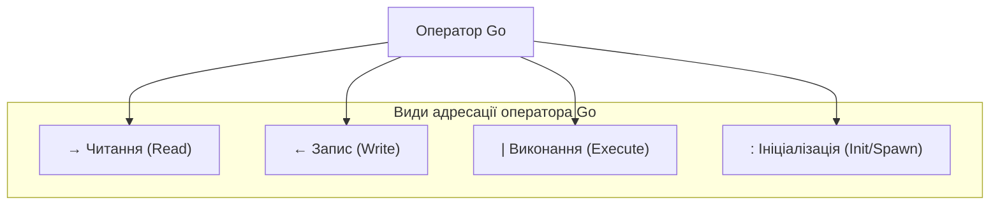
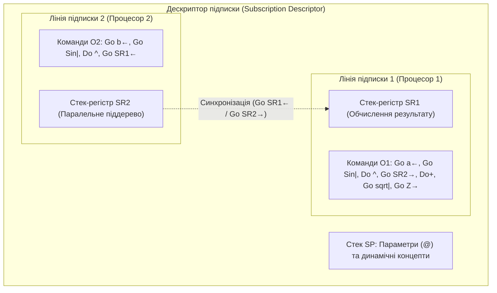
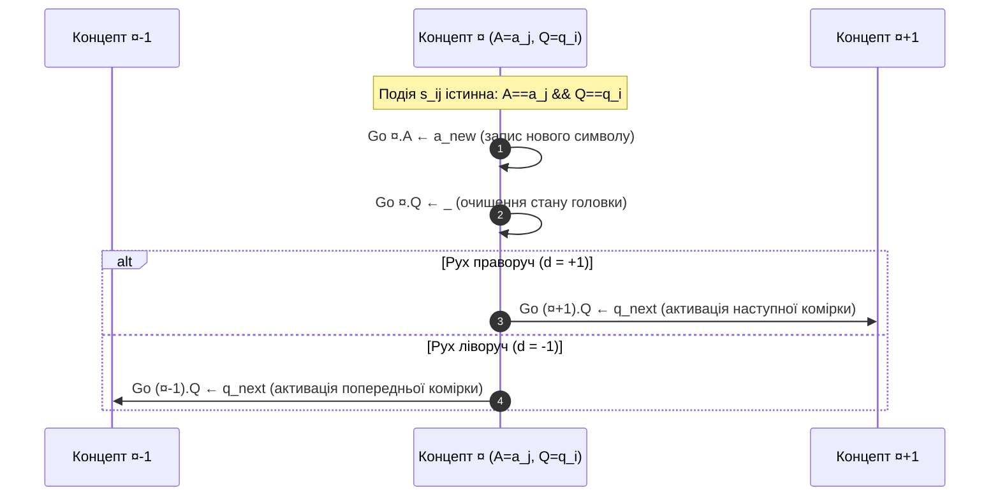
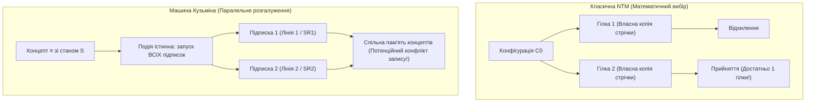

# Машина Кузьміна під формальним розбором: події, підписки, архітектура виконання й критична верифікація
> **Автор аналізу та реконструкції:** Микола Федчик (Mykola Fedchyk)<br/>
> **Дата ревізії:** 2026-11-17<br/>
> **Предмет дослідження:** публічний опис Машини Кузьміна у збережених топіках автора на DOU (2021–2023), дискусійні уточнення листопада 2026 року, презентація «Пример для АН» (16 слайдів), три нові авторські презентації понять, груп і синтаксису від 13.11.2026, письмові авторські роз'яснення семантики М. Ю. Кузьміна (11–15.11.2026) та похідна інженерна реконструкція М. Федчика (2026).<br/>
> **Мета:** реконструювати формальну та апаратно-програмну модель Машини Кузьміна, зіставити еволюцію авторських правил із відомими моделями обчислень, відокремити первинні твердження автора від інженерних гіпотез і перевірених артефактів проєкту (рівень TRL 3 за самооцінкою), сформулювати відкриті теоретичні й схемотехнічні задачі та надати збалансований висновок про науково-академічну цінність і прикладні межі підходу.

---

## Анотація

У працях і робочих матеріалах Михайла Ювеналійовича Кузьміна (2020–2026) розвивається обчислювальна модель, у якій програма подається не як послідовний потік інструкцій центрального процесора фон Неймана, а як простір структурованих **концептів** зі станами, **подій** (предикатів стану й операцій адресації) та **підписок**, що породжують каскадні або паралельні звернення. Автор позиціонує **Машину Кузьміна (МК)** як безадресну за потоком керування подієво-реактивну архітектуру без імперативних циклів (`For/Each/Do`), орієнтовану на природний паралелізм і малу затримку реакції в задачах автоматики.

Систематизація першоджерел (корпус DOU 2021–2023, презентація «Пример для АН», нові презентації понять і груп від 13.11.2026 та письмові авторські роз'яснення семантики листопада 2026 року) разом із похідною реконструкцією (М. Федчик, 2026) окреслює два шари моделі: (1) **оновлену структурно-мовну модель концептів** (4-бітний `Token`, байт `Class`, 8-бітна спарсова маска присутності компонентів `Def`, безіменний атрибут за замовчуванням замість скасованого поля `Size`, виконувані дужки `OpenBracket`/`CloseBracket`, типізовані межі виконання груп `Min`/`Max`, контекстно-вільне вкладення дужок і пост-адресний бар'єр `•`) та (2) **стеково-регістрову схему виконання підписок** ($`SR`$, $`SP`$, коди $`O`$, міжстекове рандеву з послідовним відкатом при дефіциті ядер і ескіз кодування машини Тюрінга на ланцюгу концептів $`\text{¤}-1, \text{¤}, \text{¤}+1`$).

Критичний науково-інженерний розбір показує, що за таксономією теорії обчислень МК належить до гібриду **подієво-продукційних систем (ECA)**, **потокових/редукційних машин** і **конкурентних систем переписування над спільною пам'яттю (PRAM)**, а не до недетермінованих машин Тюрінга (що сам автор підтвердив у роз'ясненні щодо області застосування моделі в листопаді 2026 року). Нові роз'яснення автора (щодо перевірки умов підписки під час адресації й утримання подій у черзі на час зайнятості концепту, відсутності імперативних циклів, пост-адресного бар'єра `•`, меж виконання груп, виконуваних дужок і порядку бітів 8-бітної маски `Def`) зняли ранню видиму колізію між правилом анти-зациклення та реактивною ітерацією, проте в самій абстрактній моделі залишаються відкритими строге доведення повноти за Тюрінгом, окремі відкриті питання формальної семантики (оновлена таблиця роздільників після `#`, точний момент зняття зайнятості в конструкції `A • B`, булева інтерпретація `•` на слайді 6, доля виразу при читанні концепту у стані `_`, розрізнення відсутнього елемента й стану `_` у масці `Def` та індексація нетокенних елементів у групах), а також відсутність вбудованого арбітражу конкурентних записів у спільний концепт (*data races*). В інженерній площині проєкту верифіковано критичні функції рівня **TRL 3 (за самооцінкою)**: формально перевірений транзакційний вентиль `kpol_txn_gate_v2`, автономний реактивний шлюз `CFG-R` ($`10\dots 20\text{ нс}`$), однобанковий програмований конвеєр дескрипторів у `Block RAM` `CFG-P` ($`80\text{ нс}`$ у ядрі, $`103.53\text{ МГц}`$ AXI / $`145.94\text{ МГц}`$ базовий, ациклічні каскади `KPOL-CME-2` з формальним доказом `Z3` на $N=16$), двобанковий конвеєр високої готовності `CFG-P-HA` (**$`100.69\text{ МГц}`$**, `10 003` гарячі перемикання на залізі `PYNQ-Z1 + LogicTracer Pico 0.5.0`), багатоядерний кластер $N = 2, 4, 8$ із 2-ступеневим конвеєризованим комутатором (**$`133.89 / 103.73 / 91.89\text{ МГц}`$**), резидентний GPU-рій на `1 024` підписники (`Jetson AGX Orin`), кодогенератор безциклового C99 (`--emit-c99` + сертифікат `Z3`), а також ергономічний ASCII/ключовий мовний надшар **`EKPOL 0.1.0`** (`.ekpol`, побітово тотожний класичному `KPOL`) і крос-платформний двомодовий емулятор та 4-панельний TUI-дебагер **`VMK v0.3.1`** (`vmk`) на Go (`conceptual` + `bram64`; підтримується в інженерному репозиторії проєкту та може постачатися як окремий автономний бандл під `Linux / macOS / Windows`), тоді як повна авторська граматика й спарсове пакування за маскою `Def`, динамічні стеки `SR/SP` і безвтратне блокування некерованих зовнішніх імпульсів за авторською цільовою політикою зворотного тиску (*backpressure*) становлять предмет відкритих теоретичних робіт (§10).

---

## 1. Джерельна база та межі дослідження

Аналіз спирається на строге розмежування первинних матеріалів М. Ю. Кузьміна та похідної інженерної реконструкції:

1. **Корпус публікацій на DOU (2020–2023):** збережені топіки Михайла Кузьміна (зокрема 35914, 36556, 38994, 43177), присвячені подієвому опису, концептам, груповим операціям («А-ритм») та прикладній автоматиці.
2. **Дискусія листопада 2026 року на DOU:** відповіді автора щодо терміна «недетермінізм», ескізу симуляції МТ, природи пам'яті та конкурентних записів у топіку [«Машина Кузьміна» (35914)](https://dou.ua/forums/topic/35914/).
3. **Авторська презентація «Пример для АН» (2024/2026):** 16 слайдів (`.pptx` / `.pdf`), що містять ранню таблицю типів і операцій (с. 4), приклади `Nod` (с. 3) та лічильника (с. 6–8), опис стеків $`O, SR, SP`$ (с. 9–10), оператора `•` і правила анти-зациклення (с. 11), ескіз симуляції МТ (с. 14) та міркування щодо NTM (с. 15).
4. **Нові авторські презентації понять, груп і синтаксису (13.11.2026):**
   - *«Введение. Понятия. Группы. Синтаксис.pptx»* (8 слайдів): визначення 4-бітного `Token`, структури `Concept` (`Def`, обов'язковий `Class`, опційні компоненти), груп (`Collection`, `Array`, `Text`, `Name`), перелічуваних концептів `Boolean`/`Compare`, `@`-параметрів, 4-бітних видів адреси та таблиці лексем `Lexeme` (`Type/First/Length`);
   - *«Введение_1. Понятия. Группы. Синтаксис.pptx»* (8 слайдів) із дослівним авторським коментарем *«Отредактировал. OpenBracket  и CloseBracked должны быть выполняемые»*: уточнення `Define Static` на с. 5 (непорожні дужки формують статичний концепт, порожні — визначають групу; відкривальна й закривальна дужки є виконуваними концептами, а не суто пунктуацією);
   - *«Презентация1.pptx»* (1 слайд): правило залежності виконання груп від типу надрядкових і підрядкових індексів після закривальної дужки (для типу `Token` підрядкове значення задає `Min`, надрядкове — `Max`; відокремлення успіху вмісту `Collection` за логічним «І» від кратності успіху самої групи).
5. **Серія письмових авторських роз'яснень М. Ю. Кузьміна (11–15.11.2026):** зафіксовані дослівні відповіді автора щодо перевірки умов підписки під час адресації та утримання подій у черзі на час зайнятості концепту, конкурентних записів без неявних блокувань, ескізу симуляції машини Тюрінга, явного неініціалізованого стану `_`, напрямку стрілок `→`/`←` і маркера `@`, цільової політики очікування черги (*backpressure*) й послідовного fallback, історичного прототипу на 2–3 платах `STM32` як C-програми без віртуальної машини й окремої мови, вилучення поля `Size` і ролі 8-бітної маски присутності `Def` (`0..7`), контекстно-вільних та виконуваних дужок `OpenBracket`/`CloseBracket`, відсутності імперативних циклів, пост-адресного бар'єра `•` (уточнення від 13.11.2026), меж виконання груп `Min`/`Max` та відкладення двійкового формату адреси до побудови повної ВМ (разом із відкритими питаннями оновленої таблиці роздільників після `#`, булевої ролі `•`, читання стану `_`, розрізнення порожнього значення й `_` та індексації нетокенних елементів).
6. **Похідна реконструкція та апаратні прототипи проєкту (М. Федчик, 2026):** операційна формалізація, SMT-верифікація вентиля безпеки та FPGA-конфігурації `CFG-R`/`CFG-P`. Єдиної завершеної авторської монографії чи повного стандарту EBNF/ABI від М. Ю. Кузьміна станом на листопад 2026 року немає — наявні матеріали становлять серію авторських презентацій і точкових роз'яснень.

Розрізняємо чотири рівні наукової верифікації фактів:
- **Опис / Декларація:** авторське твердження або мотиваційний виклад задуму без формального чи експериментального підтвердження;
- **Формальна специфікація:** математично та операційно несуперечливе правило виконання переходів;
- **Конструктивний доказ:** повний алгоритм трансляції або машинний доказ збереження обчислювальної еквівалентності чи інваріантів безпеки;
- **Фізичний експеримент:** відтворюваний протокол вимірювань затримок, конфліктів і ресурсів на цільовому залізі.

---

## 2. Систематизація еволюції концепції (2020–2026)

| Джерело / Дата | Пам'ять і структура | Визначення події | Модель паралелізму й виконання |
|---|---|---|---|
| **DOU топік 35914** (28.12.2021) | «Стрічка скінченна»; комірки замінено концептами. | Зміна стану концепту; окремі події адресацій. | Кілька головок; паралельний запуск кількох підписок. Заявлено «недетермінізм». |
| **Коментар у 38994** (09.07.2022) | «Зліченна множина комірок»; множина станів $S$ «можливо нескінченна». | Скінченна підмножина станів; перевірка належності стану підмножині. | Активація запускає одночасний аналіз усіх подій концепту та паралельний запуск усіх підписок. |
| **DOU топік 43177** (24.04.2023) | Множина поточних значень змінних концепту. | «Логічна функція від змінних». | Зміна значення змінної запускає перевірку формули. Згадано макет із 20 плат на STM32 (без опублікованих даних). |
| **Дискусія на DOU** (04–05.11.2026) | Зліченна множина концептів; нескінченність стрічки названо філософським питанням. | Для симуляції МТ: пара $`(a_i, q_j)`$ «символ стрічки — стан». | «Недетермінізм — це рекламне слово, у мене паралелізм». «Дослідного зразка немає». Конфлікти записів покладаються на програміста. |
| **Презентація «Пример для АН» та реконструкція** (2024–2026) | Зліченний простір типізованих концептів (`_`, `Token`, `Byte`, `Int32`, `Float`...). Адреси концептів. | Множина станів $U$, події $`s_i \subseteq U`$, функція-висловлювання $`w_i(U) \in \{0, 1\}`$. Нульовий порядок логіки. | Стекова VM: лінії підписки ($O + SR$), стек параметрів $SP$, команди рандеву між стеками (`Go SR2 →`, `Go SR ←`), оператор фаз `•`, придушення авто-тригерів. |
| **Авторські роз'яснення семантики подій, пам'яті та черг** (11–13.11.2026) | Невизначений стан `_` має окремий біт валідності (не тотожний `0`); читання кладе значення в стек (`→`), запис бере зі стека (`←`); `@` — маркер параметрів транслятора. | Аналіз подій при кожній адресації; порівняння й факт зміни `~` — різні події; приклади на кшталт `SumA` знято як неавторські. | При переповненні черги — очікування звільнення без втрати подій (*backpressure*); при зайнятості пулу — послідовний відкат на поточне ядро; ранній прототип на 2–3 платах STM32 був C-програмою перевірки подій-підписок без VM і окремої мови. |
| **Нові презентації та авторські уточнення структури й синтаксису** (13–15.11.2026) | Властивість `Size` вилучено (замінено безіменним атрибутом `""`, розмір пов'язаний із `Token`); `Def` — 8-бітна маска наявності 8 елементів концепту (`0..7`); формат бінарної адреси відкладено до цільової платформи й побудови ВМ (сумнів щодо потреби прямого звернення до пінів/портів у синтаксисі). | `•` — строгий пост-адресний бар'єр: підписка за нею виконується після читання або після запису (уточнення від 13.11.2026); успіх вмісту `Collection` («І») відділено від кратності успіху групи. | **Цикли (`For/Each/Do`) повністю відсутні**; `OpenBracket` і `CloseBracket` (`CloseBracked`) є виконуваними концептами при побудові груп у `Static`; для типу `Token` підрядковий/надрядковий індекси задають `Min`/`Max`; парні дужки з комами — контекстно-вільні, символ `#` у новій редакції звільняється. |

---

## 3. Технічна та формальна архітектура Машини Кузьміна

### 3.1. Базові сутності та система адресацій

Машина Кузьміна складається зі зліченної множини концептів та множини незалежних керуючих пристроїв (головок адресації).
Поточний концепт позначається символом **$\text{¤}$**.

Адресація здійснюється оператором **`Go`** за шаблоном:

$$\text{Go } \langle\text{Адреса / Ідентифікатор концепту}\rangle \enspace \langle\text{Вид адресації}\rangle$$

Визначено чотири фундаментальні види адресації, кожен з яких сам по собі породжує однойменну подію активації:
1. **`→` (Читання):** запит значення з концепту. При наявності підписок виконує асоційовану дію перед або після зчитування.
2. **`←` (Запис):** внесення нового значення в концепт.
3. **`|` (Виконання):** активація обчислювального методу/підписки концепту (еквівалент виклику підпрограми / переходу).
4. **`:` (Ініціалізація):** інстанціювання нового екземпляра концепту з використанням цільового концепту як класу/прототипу.



> [!NOTE]
> **Зауваження Автора щодо формату адрес (13.11.2026):**<br/>
> На слайді 6 нової презентації вид адреси позначено 4-бітним токеном (відносний, експрес, об'єктний, зовнішній режими), однак у зауваженні від 13.11.2026 М. Ю. Кузьмін зазначив, що двійковий формат адреси є питанням реалізації й відкладений до етапу побудови повної ВМ на цільовій платформі, та висловив сумнів щодо доцільності прямого звернення до фізичних пінів чи портів у мові. *Інженерний висновок проєкту (не пряма цитата Автора):* такий підхід добре узгоджується з відображенням зовнішньої периферії через віртуальні концепти в пам'яті (за аналогією до MMIO), але сам по собі ще не затверджує конкретного двійкового адресного ABI (`Q-AUTH-06`).

### 3.2. Система типів та інструкцій (ISA)

Авторська технічна специфікація містить чітку таблицю вбудованих типів пам'яті та примітивних операцій:

#### Типи даних (`Type`):
- `_` : Відсутність значення або будь-яке значення (Size 0);
- `Token` : 4-бітний дискретний токен значень від 0 до 15 (Size 0);
- `Byte` / `Int8` : 8-бітні беззнакові (0..255) та знакові (-128..127) значення (Size 1);
- `U16` / `Int16` : 16-бітні цілі (Size 3 у внутрішньому кодуванні розмірів автора);
- `U32` / `Int32` / `Float` : 32-бітні цілі та числа з рухомою комою IEEE-754 (Size 7);
- `U64` / `Int64` / `Double` : 64-бітні цілі та дійсні числа подвійної точності (Size 15);
- `Chr` : 1-байтний ASCII символ;
- `Uni` : 4-байтний Unicode символ.

> [!NOTE]
> **Структура концепту в пам'яті, байт `Def` та вилучення поля `Size` (авторське уточнення від 13.11.2026):**<br/>
> На запитання про попередню таблицю типів із полем `Size` М. Ю. Кузьмін відповів: *«Свойство Size я убрал на последних версиях. Теперь это пустое имя. Размер — Token. Байт Def определяет соответствующего битом наличие соответствующего элемента концепта (в частности наличие подписок или значение атрибута). Всего их 8 и имеет значение 1 при наличии элемента концепта»*.<br/>
> **Що цим підтверджено, а що залишається відкритим (`Q-AUTH-02`):** підтверджено скасування виділеного ключового поля `Size`, роль атрибута з порожнім ім'ям (`""`), прив'язку розміру до `Token` (4 біти) та призначення байта `Def` як 8-бітної ознаки присутності восьми компонентів концепту (`Name`, `Help`, `Subscribe`, організація, `Attributes/Property`, `Event`, `Method`, `Child`). Водночас ця коротка відповідь **ще не задає повної двійкової специфікації пам'яті**: не зафіксовано точну відповідність номерів бітів `0..7` конкретним компонентам, правила вирівнювання непарного числа 4-бітних токенів до байтових меж, точне розрізнення «розмір має тип `Token`» проти «розмір вимірюється в одиницях `Token`» та початкове кодування базових класів `Token` і `Byte`.

#### Система операцій (`Operation`):
1. **Булеві стани (`?`):** `!` (True / Істина, код 0), `¬` (False / Хиба, код 1).
2. **Класи подій даних (`::`):**
   - `_` (Відсутнє значення / 0)
   - `Null` (Нульове значення / 1)
   - `Positive` (Додатне, $> 0$ / 2)
   - `Negative` (Від'ємне, $< 0$ / 3)
   - `Even` (Парне / 4)
   - `Uneven` (Непарне / 5)
   - `~` (Факт зміни значення / 6)
3. **Події порівняння (`~`):** `=` (код 0), `>` (код 1), `<` (код 2).
4. **Арифметично-логічні оператори (`Do`):**
   - `+`, `-`, `*`, `/`, `^` (піднесення до степеня);
   - `'` (інкремент $+1$);
   - `&` (побітове AND), `Or` (побітове OR);
   - `¬` (логічна інверсія), `#` (арифметична зміна знака / унарний мінус);
   - `<`, `>` (побітові зсуви вліво та вправо);
   - `~` (оператор порівняння).
5. **Службові мета-інструкції:** `Define` (оголошення типів), `Convert` (приведення типів), `Exit` (вихід із групи виконання), `Processor` (запит на виділення додаткового фізичного/віртуального ядра).

---

### 3.3. Низькорівнева модель стеків і виконання ліній підписок

Специфікація 2026 року детально описує трансляцію та виконання підписок на багатопроцесорному рівні. Кожна складна підписка або паралельний вираз декомпонується на **дескриптор підписки**, що складається з однієї або кількох **ліній підписки**.

```text
Лінія підписки = (Послідовність команд O) + (Стек-регістр SR)
Дескриптор підписки = { Лінії підписки } ∪ (Стек параметрів та динамічних концептів SP)
```



#### Алгоритм життєвого циклу активації на виконання:
1. **Виділення процесора:** із пулу вільних ядер призначається вільний процесор.
2. **Передача коду:** завантажується послідовність команд $O$ (розмір якої та необхідна пам'ять відомі на етапі трансляції).
3. **Виділення пам'яті стек-регістра $SR$:** саме тут зберігаються проміжні операнди арифметичних інструкцій `Do`.
4. **Виділення стек-регістра $SP$:** стек призначається для параметрів виклику концепту (`@`) та динамічних змінних, породжених операцією `:`.
5. **Виконання:** команди $O$ виконуються за внутрішнім лічильником команд.
6. **Звільнення процесора:** ядро звільняється після останньої команди (яка може бути командою синхронізації).
7. **Очищення пам'яті:** стек знищується після вичитування кінцевого результату.

#### Механізм міжстекової синхронізації та детермінований відкат (Fallback)
При паралельному обчисленні виразу на кшталт $Z = \sqrt{\sin^2(a) + \sin^2(b)}$ компілятор розбиває дерево виразу на два стеки:
- **Процесор 1 (Лінія 1):** `Go a ←; Go Sin |; 2; Do ^;` $\to$ точка очікування $\to$ `Do +; Go sqrt |; Go Z →`
- **Процесор 2 (Лінія 2):** `Go b ←; Go Sin |; 2; Do ^;` $\to$ передача результату.

> **Уточнення щодо прикладу з презентації «Пример для АН» (слайд 10):** у цьому рядку автор вжив ранню конвенцію відносно стека (`Go a ←` — у стек, `Go Z →` — зі стека). В авторському уточненні граматики KPOL (листопад 2026) канонічним визначено запис відносно комірки пам'яті: `Concept →` — читання з комірки в стек, `Concept ←` — запис зі стека в комірку.

Для зв'язування ліній використовуються симетричні команди рандеву (у нотації слайда 10):
- У лінії 1 генерується читання зі стека 2: `Go SR2 →`
- У лінії 2 генерується запис у стек 1: `Go SR1 ←`

> **Критичне правило планування Кузьміна:**  
> Якщо в момент запуску **немає вільного другого процесора**, затримки або блокування черги не виникає. Процесор 1 послідовно виконує свою гілку до команди `Go SR2 →`, після чого **перемикається і самостійно виконує інструкції лінії 2**, гарантуючи завершення обчислення на єдиному ядрі! Це забезпечує природну адаптацію коду під довільну кількість фізичних ядер (від 1 до $N$).

---

### 3.4. Оператор послідовності `•` (Big Dot), усунення автоколізій та відсутність циклів

У дописі на ДОУ залишалося відкритим питання: що відбувається при зверненні на читання чи запис до концепту, який сам має підписки на читання/запис? В авторській технічній специфікації та письмових роз'ясненнях семантики (листопад 2026) Кузьмін пропонує розв'язання класичних проблем подієвих моделей:

#### 1. Впорядкування дій через оператор-бар'єр Великої Крапки `•`
Згідно з прямим уточненням Автора від 13.11.2026:
> *«Наявність точки означає, що підписка за нею виконується після виконання адресації. Для читання — після читання, для запису — після запису.»*

Таким чином, в авторській моделі Велика Крапка `•` виступає **строгим бар'єром послідовності завершення адресації (Post-Addressing Execution Barrier)**:

$$w_1 \bullet w_2$$

- **При читанні (`→ • w_2`):** спочатку завершується операція читання значення концепту, а підписка $`w_2`$ за крапкою запускається строго **після читання** (*Post-Read Trigger*), отримуючи вже зчитаний стан:
  ```text
  → • Revolutions = Tick * 600; Tick = 0
  ```
- **При записі (`w_1 • w_2`):** після підготовчої частини $`w_1`$ (якщо вона присутня) виконується запис у концепт, а підписка $`w_2`$ за крапкою запускається строго **після завершення запису** (*Post-Write Trigger*).

*(Методологічне розмежування: інтерпретація цього бар'єра через скидання апаратного біта `BUSY = 0` у двопортовій `BRAM` є нашою похідною інженерною реконструкцією; у самому поточному компіляторі профілю `KPOL-CME-1` символ `•` наразі ще трактується за старим діалектом як логічне заперечення `NOT`, що зафіксовано як відома діалектна розбіжність `KPOL-AUTH-05`).*

#### 2. Інваріант анти-зациклення (Cycle Prevention Invariant)
> *«Адресація до атрибута в підписці до події цього ж атрибута не генерує подію для уникнення зациклювання.»*

Це правило є семантичним захистом від нескінченної прямої саморекурсії: якщо підписка на зміну змінної `Distance` сама записує в `Distance`, повторна активація події `~ Distance` для цього самого звернення пригнічується.

#### 3. Відсутність імперативних циклів у декларативно-подієвій моделі та межа авторського твердження
Як пояснив М. Ю. Кузьмін щодо декларативно-подієвої моделі (13.11.2026):
> *«Таблицю на слайді 8 можна пропустити — реалізується транслятором, а цикли взагалі відсутні.»*

Це роз'яснення підтверджує, що у мові та виконавчій моделі МК **немає імперативних операторів циклу (`for`/`while`, `For/Each/Do`)**, а лексична таблиця слайда 8 належить рівню транслятора. Водночас, дотримуючись наукової точності, не слід приписувати цій короткій фразі автора конкретну мікроархітектурну реалізацію: з неї прямо не випливають ані конкретний спосіб рекурентного перезапуску каскадів, ані однотактовий апаратний `Spatial Fan-Out` через матричний комутатор ПЛІС, ані заборона службових апаратних лічильників усередині секвенсера (останні є елементами похідної інженерної архітектури ПЛІС).

---

### 3.5. Оновлена структурна модель концептів, груп і синтаксису (матеріали 13.11.2026)

Три нові авторські презентації від 13.11.2026 та супутні авторські роз'яснення (13–15.11.2026) суттєво конкретизують фронтенд-рівень і структуру даних авторської мови порівняно з ранніми дописами на DOU:

1. **Розділення лексеми тексту (`Lexeme`) та токена пам'яті (`Token`):**<br/>
   У синтаксичному шарі транслятора лексема описується трійкою полів `Type / First / Length` над вхідним текстом, тоді як `Token` (4 біти) є базовою одиницею внутрішнього представлення в пам'яті (`KPOL-AUTH-07`). У новій версії мови автор також відмовляється від старого вживання символу `#` (звільняючи його), а конструкції парних дужок із роздільниками-комами явно визнано контекстно-вільними (мова типу Діка), які не зводяться до регулярних виразів (авторське уточнення лексичних роздільників від 13.11.2026).
2. **Виконувані дужки та розрізнення статичного концепту й групи:**<br/>
   За редакцією слайда 5 (*«Введение_1»*) і прямим уточненням автора (*«Отредактировал. OpenBracket  и CloseBracked должны быть выполняемые»*), непорожні дужки у `Define Static` формують статичний концепт, а порожні — визначають групу. При цьому відкривальний і закривальний елементи (`OpenBracket` та `CloseBracket` у слайді / `CloseBracked` у повідомленні) при побудові вкладених груп у `Static` трактуються як **виконувані концепти**, а не пасивні роздільники пунктуації (`KPOL-AUTH-08`; у трансляторі вони представлені функціями-заглушками, а канонічні побічні ефекти залишаються відкритим питанням `Q-AUTH-07`).
3. **Типізовані індекси кратності груп (`Min` / `Max`) та двовимірний запис:**<br/>
   В авторській нотації степені ($`x^2`$) та індекси записуються двовимірними надрядковими й підрядковими виразами (уточнення автора від листопада 2026 року). Новий фрагмент від 13.11.2026 (*«Презентация1.pptx»*) встановлює, що поведінка групи після закривальної дужки визначається **типом** підрядкового та надрядкового значень: **якщо їхній тип — `Token`**, підрядкове значення задає `Min`, а надрядкове — `Max` (`KPOL-AUTH-03`). При цьому:
   - успіх **вмісту** `Collection` визначається успіхом усіх елементів (логічне «І»), а `Array` обирає `Min` успішних елементів (логічне «АБО») до `Max` разів;
   - успіх **самої групи** відділено від успіху вмісту й вимагає виконання вмісту в межах від `Min` до `Max` разів (`Min = 0` дозволяє успіх групи без жодного успішного елемента);
   - значення за замовчуванням `Min = 1, Max = 0` означає одне обов'язкове виконання (а `Min = 1, Max = 15` за тимчасовим уточненням від 15.11.2026 задає `1..16` запусків як «на 1 більше»), проте єдине формальне правило декодування `Max = 0` разом із межею `15` та семантика індексації нетокенних елементів у групах ще залишаються відкритими питаннями формальної семантики (`Q-AUTH-01`).

---

## 4. Конструктивний аналіз симуляції Машини Тюрінга

У ранніх матеріалах 2021–2026 рр. твердження про те, що Машина Кузьміна моделює будь-яку класичну МТ, спиралося лише на кодування таблиці станів. Технічна специфікація МК розкриває авторську конструкцію симуляції стрічки й головки.

### 4.1. Авторська конструкція трансляції МТ $\to$ МК

Класична детермінована машина Тюрінга задається як $`M = \langle A, Q, q_0, q_{halt}, \delta \rangle`$, де правила переходу мають вигляд:

$$q_i, a_j \to q_{next}, a_{new}, d_k \quad (d_k \in \lbrace L(-1), N(0), R(+1) \rbrace)$$

Кузьмін будує відображення наступним чином:
1. **Стрічка:** подається як ланцюжок пронумерованих концептів. Поточна комірка стрічки позначається як $\text{¤}$. Сусідні комірки адресовані як $\text{¤} - 1$ та $\text{¤} + 1$.
2. **Вміст комірки:** кожен концепт має атрибут `A` (символ алфавіту) та атрибут `Q` (стан головки, або `_` якщо головка відсутня над цією коміркою).
3. **Ліва частина правила (Подія):**

$$s_{ij} \equiv (A = a_j \land Q = q_i)$$

   Це кон'юнкція поточного значення комірки та стану головки, що знаходиться в ній.
4. **Права частина правила (Підписка):**
   При істинності події $`s_{ij}`$ активується підписка $`w_{ij}`$:

$$w_{ij} = s_{ij} \left( \text{Go } \text{¤}.A \leftarrow a_{new} \quad \text{Do } \text{¤} + d.Q \leftarrow q_{next} \right)$$

   де:
   - $`\text{Go } \text{¤}.A \leftarrow a_{new}`$ — запис нового символу в поточний концепт;
   - $`\text{Do } \text{¤} + d.Q \leftarrow q_{next}`$ — перенесення маркера стану головки у сусідній концепт ($\text{¤} - 1$ при русі вліво або $\text{¤} + 1$ при русі вправо).



### 4.2. Формальна оцінка повноти за Тюрінгом

Запропонована схема розв'язує задачу передачі керування вздовж стрічки за допомогою відносної адресації $\text{¤} + d$.
- **Зупинка:** досягається відсутністю підписок для стану $`q_{halt}`$ або записом термінального стану `_`.
- **Необмеженість пам'яті:** оскільки адресація концепту здійснюється за цілочисловим індексом (зліченна множина концептів), а оператор `:` дозволяє динамічно створювати нові концепти при виході за поточні межі індексу, простір пам'яті задовольняє вимогу потенційної нескінченності.

**Межа висновку:** Наведена схема є лише концептуальним ескізом можливого кодування, а **не завершеним доведенням повноти за Тюрінгом**. В оригінальній формулі автора (с. 14 презентації) відсутнє очищення попереднього стану головки `Go ¤.Q ← _` (цей крок дописано виключно в похідній реконструкції на діаграмі вище), а також не визначено атомарність переходу, випадок $d = 0$ та сумісність із правилом пригнічення повторної події (див. §9.1).

---

## 5. Співвідношення з Недетермінованою Машиною Тюрінга (NTM)

Автор аналізує власне бачення кризи поняття NTM:
> *«Якщо існує 2 і більше команд для пари (символ стрічки — стан)... якщо перша команда змінює стан або комірку, решта команд уже не відповідають цьому стану. Як вони мають виконуватися? Одночасно? Не змінюючи стану і залишаючись над тією ж коміркою? А сенс? Тому я запропонував кілька незалежних головок, розділивши правила на події та підписки.»*

Тут виникає фундаментальне розходження між **математичною теорією обчислень** та **інженерно-фізичною інтуїцією автора**:

1. **У класичній теорії складності (Sipser, Rabin-Scott):**
   Недетермінізм — це теоретико-множинне відношення переходу $`\delta \subseteq (Q \times \Gamma) \times (Q \times \Gamma \times \{L, R\})`$. NTM не «виконує всі гілки фізично в одному процесорі»; дерево конфігурацій є абстракцією, де слово приймається, якщо **існує хоча б одна успішна гілка**.
2. **У Машині Кузьміна:**
   Якщо на подію підписано кілька дій, машина фізично генерує окремі лінії виконання (головки) для **всіх** підписок, і всі вони намагаються виконатися над **спільною пам'яттю концептів**.



Отже, твердження автора 2026 року: *«Недетермінована МТ — це міф. Я у себе бачу паралельні обчислення. Для реклами назвав недетермінізмом»* — є математично строгим визнанням. Машина Кузьміна належить до класу **паралельних асинхронних/синхронних систем зі спільною пам'яттю (PRAM / Concurrent Rewriting Systems)**, а не до NTM.

---

## 6. Порівняльний аналіз із відомими паралельними парадигмами

| Модель / Архітектура | Спільні риси з Машиною Кузьміна | Ключові відмінності |
|---|---|---|
| **Dataflow-архітектури (Dennis, Arvind)** | Обчислення активується готовністю даних/подій, а не лічильником команд програми. | У Dataflow токени рухаються графом зв'язків. У МК концепти статично адресовані (`Go`), а підписки самі читають/пишуть операнди. |
| **Стекові машини (Forth, Transputer, Java VM)** | Використання стека ($SR$) для арифметичних операцій `Do` та передачі параметрів. | Стекові операції в МК динамічно створюються лініями підписок і мають примітиви міжстекової синхронізації (`Go SR2 →`). |
| **Акторна модель (Hewitt, Agha, Erlang)** | Концепт є автономною сутністю, адресація подібна до надсилання повідомлення. | Актори мають приватний ізольований стан і чергу вхідних повідомлень (mailbox). У МК концепти мають відкриту спільну пам'ять атрибутів. |
| **ECA-системи та Active DB** | Парадигма Event-Condition-Action (Подія — Перевірка умови — Дія). | МК вводить поняття пре/пост-фаз (`•`), лінії синхронізації та апаратно орієнтований набір операцій `Do`. |
| **Синхронні мови (Esterel, Lustre)** | Реакція системи на події зовнішнього середовища в логічному часі. | Esterel має сувору детерміновану семантику логічного такту (Synchronous Hypothesis). У МК паралельні лінії можуть виконуватися з довільною тривалістю, якщо не застосовано бар'єр рандеву. |

---

## 7. Практичні приклади реалізації мовою Машини Кузьміна

### 7.1. Алгоритм Евкліда (НСД) в один рядок
```text
U64 Nod | @ U64 ( a_ > b -=b , b_ > a -=a ) =a
Z = Nod(120, 6)
```
**Семантика виконання:**
Два параметри `a` і `b` оголошені з взаємними подіями-підписками:
- Якщо $a > b$, спрацьовує дія зменшення $a \leftarrow a - b$;
- Якщо $b > a$, спрацьовує дія $b \leftarrow b - a$;
- Коли жодна з умов не виконується ($a = b$), спрацьовує повернення `= a`.
Обчислення є чисто подієвим циклом над спільними змінними.

### 7.2. Електронний лічильник електроенергії з інтегруванням
```text
Class Example
| @ Byte Interval 1 Timer(Interval, Tick |)
: { 
    Float { 
        Voltage ← @ Float x +=x 
        → Voltage =0
        Electricity ← @ Float x +=x 
        → Electricity =0
        Value 0
        ← @ Float x +=x
        ~ Change | 
    }
    Byte Tick 0
    = 10 Value = Voltage * Electricity / Tick^2
    ← Tick +=1
    → Tick = 0
    Void Tick | [Tick = 0 Voltage = "0p1" Electricity = "0p0"] Go Tick → 0 Go Tick ← ;
    ? Change
}
```
**Семантика виконання:**
Концепт поєднує реакцію на переривання таймера, накопичення інтегральних сум струму й напруги при подіях запису (`←`), обнулення накопичувачів при зчитуванні (`→`) та перерахунок потужності за настанням дискретного інтервалу (подія `= 10`).

---

## 8. Підсумкова оцінка та статус формальної моделі

### 8.1. Об’єкт оцінки та теоретичний статус

При комплексному аналізі Машини Кузьміна методологічно необхідно чітко розрізняти три окремі рівні розгляду:
1. **Первинний авторський задум:** евристична концепція подієво-правилової обчислювальної моделі зі спільним простором концептів та стеково-регістровим виконавцем.
2. **Формальна реконструкція семантики:** математичний апарат станів, операторів фазових переходів, транзакційних бар'єрів та алгебри предикатів.
3. **Фізичні та програмні реалізації:** апаратні цифрові вузли, транзакційні шлюзи, BRAM-пам'ять концептів, інтерпретатори та компілятори мови KPOL.

Висновки та докази, отримані для одного рівня, не можуть бути автоматично екстрапольовані на інші без суворого обґрунтування збереження семантичної еквівалентності.

**Аналіз обчислювальної повноти за Тюрінгом:**
Запропонований автором ескіз симуляції класичної машини Тюрінга (МТ) за допомогою ланцюжка концептів має характер конструктивної ілюстрації, а не вичерпного математичного доведення. Для формального встановлення Тюрінг-повноти модель потребує явної аксіоматизації правил атомарності кроку, очищення стану маркера голівки в попередній комірці та нескінченної пам'яті абстрактної машини. Успішне моделювання скінченного набору прикладів у кремнії демонструє практичну працездатність конкретних автоматів, але не замінює загального доведення повноти. Разом із тим, відсутність формального доказу Тюрінг-повноти не свідчить про неповноту системи, а лише окреслює межу поточного теоретичного апарату. Так само паралелізм активації підписок не робить модель еквівалентною недетермінованій машині Тюрінга (NTM) у сенсі складності обчислень.

**Семантика подій та відкриті питання повторної активації:**
Початковий аналіз виявив потенційну колізію між авторським евристичним правилом пригнічення повторних подій (для захисту від зациклювання) та виконанням ітеративних алгоритмів (на кшталт віднімання в алгоритмі Евкліда). Авторські роз'яснення листопада 2026 року щодо перевірки умов підписки під час адресації, відсутності імперативних циклів і пост-адресного бар'єра `•` прояснили намір моделі, але **ще не утворюють повної формальної семантики**:
1. За авторським роз'ясненням щодо перевірки умов підписки під час адресації, мутація або читання ініціює аналіз подій, а підписка запускається, лише якщо подія істинна і концепт не перебуває в стані зайнятості до метаподії «велика крапка» (`•`); нові події утримуються в черзі на час зайнятості концепту.
2. За поясненням М. Ю. Кузьміна щодо декларативно-подієвої моделі мовні цикли (`for`/`while`, `For/Each/Do`) відсутні, а за уточненням від 13.11.2026 символ `•` означає пост-адресний бар'єр порядку (підписка стартує після завершення читання або запису).
3. Водночас ці стислі авторські роз'яснення **не задають** гранулярності блокування `Busy`, правила збереження або коалесценції очікуваних тригерів, наявності знімка (snapshot) для відкладеної підписки, точного моменту зняття зайнятості в конструкції `A • B` та того, що саме запускає наступний крок алгоритму Евкліда `(15,6) → (9,6) → (3,6)` після завершення `.` за відсутності нової зовнішньої адресації. Показати повну узгоджену трасу без неявних допущень у поточній моделі ще не вдалося (§10).

---

### 8.2. Заявлені інженерні властивості та межі перевірки

У супутньому інженерному репозиторії проєкту заявлено низку лабораторних і формальних перевірок *(сирий RTL, конфігурації формальної верифікації, звіти STA та журнали вимірювань не входять до цього публічного каталогу `drafts`, тому наведені цифри є переказом результатів проєкту)*:

| Досліджуваний аспект | Заявлений результат у проєкті | Умови та межі перенесення |
| :--- | :--- | :--- |
| **Локальний шлюз інваріантів (`kpol_txn_gate_v2`) та секвенсер каскадів (`KPOL-CME-2`)** | Доведено методом BMC та композиційної $k$-індукції (SymbiYosys/Z3) взаємовиключення `Commit`/`Reject`, захист стану при порушенні інваріанта (*Fail-Closed*), збереження каскаду в 1-слотовому буфері та умовну лему завершення каскадів за функцією рангу Ляпунова на $N = 16$. | Доведення стосується ациклічних таблиць підписок, попередньо перевірених статичним компілятором поза RTL; воно **не доводить** відсутності гонитв чи дедлоків у довільних циклічних графах. |
| **Мутаційний тест шлюзу, двобанкового ядра та комутатора** | Заявлено 100% виявлення нееквівалентних мутантів у заданих наборах формальних і симуляційних перевірок (`kpol_txn_gate_v2`, `6` мутантів двобанкового ядра `CFG-P-HA` з 256-бітним miter-доказом, `5` мутантів 2-ступеневого комутатора). | Свідчить про чутливість конкретних формальних властивостей і тестбенчів до внесених мутацій, а не про повну сертифікаційну відповідність стандартам безпеки. |
| **Багатоядерний кластер `N = 2, 4, 8` із 2-ступеневим комутатором (`OpenXC7` P&R)** | Після фізичного трасування `nextpnr-himbaechel` на `XC7Z020` 2-ступеневий конвеєризований комутатор скоротив площу на `33..38% SLICE_LUTX` і підняв частоту до **`133.89 МГц`** ($N=2$), **`103.73 МГц PASS @ 100.00 MHz`** ($N=4$) та **`91.89 МГц`** ($N=8$, `18 112 SLICE_LUTX`). | Для закриття порога `>= 100 МГц` при $N \ge 8$ потрібна ієрархічна (квадрантна) або 3-ступенева комутація; апаратний `Graceful Serial Fallback` для стеків `SR/SP` не входить у дескрипторний кластер. |
| **Швидкодія однобанкового `CFG-P`, двобанкового `CFG-P-HA`, GPU та `--emit-c99`** | `CFG-P`: `80 нс` у ядрі (`103.53 МГц` AXI, поріг окупності площі $K^* = 26$ проти регістрового RTL); `CFG-P-HA`: **`100.69 МГц PASS`**, `10 003` гарячі перемикання на `PYNQ-Z1 + LogicTracer Pico 0.5.0` без `torn-read`; GPU (`Jetson AGX Orin`): `1 024` підписники на `16 SM` за `p50 = 1.57..1.74 мкс` (`1.96 мкс` у міжплатному контурі); компілятор генерує безцикловий C99 (`--emit-c99` + Z3-сертифікат). | На малій кількості правил ($K < 26$) спеціалізований регістровий RTL компактніший і швидший; сокетний стек Linux/GbE між платами додає `344.78 мкс` медіани й `2808.53 мкс` на `p99.9`, вимагаючи прямого апаратного каналу GPIO/GPMC або PCIe GPUDirect RDMA. |
| **Програмованість без пересинтезу (`CFG-P` / `CFG-P-HA`), мова `EKPOL` та емулятор `VMK v0.3.1`** | Вузол `CME` + `Block RAM` виконує скомпільовані програми підмножин `KPOL-CME-1`, `KPOL-CME-2` (ациклічні каскади до 64 концептів), першої ітерації `KPOL-AUTH` та ергономічного 7-бітного ASCII-надшару **`EKPOL 0.1.0`** (`.ekpol`, символьна й ключова нотації з двосторонньою трансляцією `EKPOL <-> KPOL` і 100% збігом `SHA-256` 1024-байтного образу BRAM, `5/5` вбитих мутантів) без пересинтезу бітстріму; самодостатній Go-бінарник **`VMK v0.3.1`** (`0` зовнішніх залежностей, `7/7` вбитих мутантів) забезпечує двомодове виконання (`conceptual` за уточненою авторською моделлю листопада 2026 року + `bram64` включно з живою сесією на `PYNQ-Z1`), інспекцію `PRE-LOAD -> POST-LOAD -> RUNNING`, потоковий `STDIO` і повноекранний 4-панельний TUI-дебагер (рівень **TRL 3 за самооцінкою**). | Апаратний режим `bram64` використовує фіксований дескриптор `64 × 16` Б (`Int32`); спарсове пакування за маскою присутності `Def`/`Token` (разом із відкритими питаннями оновлених роздільників, читання `_` та розрізнення порожнього значення й `_`), перенесення циклічних/рекурсивних конструкцій режиму `conceptual` у кремній, поконцептний біт `BUSY` у BRAM і безвтратне блокування некерованих зовнішніх імпульсів поза `valid && ready` лишаються відкритими (§10.2). |

---

### 9. Критична наукова верифікація та демаркація

Дотримання наукового методу вимагає проведення чіткої демаркаційної лінії між декларативними очікуваннями, формально невизначеними ділянками та перевіреними інженерними фактами.

### 9.1. Системний аналіз викликів: критичний розбір обмежень

Критичний перегляд першоджерел та результатів формалізації виявляє **чотири суттєві відкриті теоретико-архітектурні проблеми** (поряд із вторинними термінологічними або прикладними похибками):

1. **Консистентність спільної пам'яті, видимість та порядок-залежні записи (авторське правило конкурентних записів без неявних блокувань):**
   В авторському роз'ясненні щодо спільної пам'яті М. Ю. Кузьмін прямо допускає порядок-залежні конкурентні записи в спільний атрибут як штатний авторський задум (*«Конфликта нет. Это вполне может быть задумкой»*), покладаючи уникнення логічних гонитв на програміста. Такий підхід є допустимим для змагальних/статистичних сценаріїв, проте в самій моделі відсутні формально задані ширина атомарності, модель видимості записів між ядрами та дисципліна отримання детермінованих результатів. Для детермінованих застосувань потрібен окремий обмежений профіль (наприклад, статичне володіння записом, що звужує можливості відкритої спільної пам'яті авторської моделі).
2. **Неповнота операційної семантики `Busy`, `•` і повторних тригерів:**
   Уточнення Автора від 13.11.2026 фіксує лише запуск підписки за `•` після завершення читання або запису й утримання подій у черзі на час зайнятості концепту, не визначаючи snapshot значення, гранулярності й точного моменту зняття зайнятості в конструкції `A • B`, черговості очікування та механізму повторної активації ітерацій без нової зовнішньої адресації.
3. **Відсутність формального доказу повноти за Тюрінгом:**
   Авторський ескіз симуляції машини Тюрінга через перенесення маркера стану між сусідніми концептами є ілюстративним начерком і не містить аксіоматизованого кроку очищення `Q`, правила `d = 0` і динамічної алокації стрічки.
4. **Ризик взаємних блокувань і livelock у мережі черг із backpressure:**
   Цільова авторська політика блокувального очікування при повній черзі подій (*backpressure* без втрати подій) на циклічних підписках ($`A \to B \to A`$) без формальних умов ациклічності або віртуальних каналів здатна призвести до deadlock.

#### Вторинні аспекти (термінологія, приклади, prior art)
* **Термінологія («недетермінована МТ»):** В авторському роз'ясненні щодо області застосування моделі Автор зняв претензію на фізичну реалізацію класу складності NTM, уточнивши, що йдеться про паралельні обчислення зі спільним доступом.
* **Прикладні ілюстрації (розрахунок потужності/енергії):** Похибка в авторському прикладі `Class Example` (`Voltage * Electricity / Tick^2` — добуток середніх замість середнього від миттєвих добутків, із розмірністю потужності, а не енергії) є помилкою прикладного скрипту, а не архітектури виконання.
* **Науковий контекст (Prior Art):** Спорідненість рішень МК із Dataflow, ECA, Rete, Triggered Instructions і HTM показує історичний контекст; саме авторське позиціонування моделі не доводить наукової новизни — це потребує порівняльних досліджень.

---

### 9.2. Базис поточного інженерного прототипу (рівень TRL 3 за самооцінкою)

Коли з аналізу відокремлюються ще нереалізовані елементи повної авторської мови (відкриті семантичні деталі роздільників і пакування `Def`, динамічні стеки `SR/SP`), верифіковане інженерне ядро проєкту (`TRL 3 за самооцінкою`, без заяв про відповідність стандартам безпеки й без публічної доступності RTL/логів у цьому репозиторії) охоплює п'ять компонентів:

1. **Ізольований вентиль інваріантів (`kpol_txn_gate_v2`, `Fail-Closed`):** локальна перевірка передумови, інваріанта та сигналу небезпеки (`Hazard`) *(відмінний від пост-адресного бар'єра порядку `•` з уточнення Автора від 13.11.2026)*.
2. **Комбінаційний обчислювач предикатів нульового порядку:** розрахунок базових предикатів без побічної мутації пам'яті ($`W(\text{pred}) = \emptyset`$).
3. **Однобанковий (`CFG-P`) та двобанковий (`CFG-P-HA`) дескрипторний конвеєр у `Block RAM`:** 8-тактова обробка фіксованого 16-байтного дескриптора (`80 нс` у синхронному домені `100 МГц`, ациклічні каскади `KPOL-CME-2` з формальним доказом `Z3` на $N=16$, поріг окупності площі $K^* = 26$ проти регістрового RTL) та двобанкове гаряче оновлення правил без простою (**`100.69 МГц PASS @ 100.00 MHz`**, `10 003` гарячі перемикання під потоком `40 011` подій на `PYNQ-Z1 + LogicTracer Pico 0.5.0` з `0` `torn-read`).
4. **Багатоядерний кластер `N = 2, 4, 8` із 2-ступеневим конвеєризованим комутатором та GPU-рій підписників:** фізичний P&R в `OpenXC7` на **`133.89 / 103.73 / 91.89 МГц`** (скорочення площі на `33..38% SLICE_LUTX`) та резидентні варпи на `Jetson AGX Orin` (`1 024` підписники на `16 SM` за `p50 = 1.57..1.74 мкс` ізольовано та `1.96 мкс` у міжплатному контурі з вихідним шлюзом `101.67 МГц PASS`).
5. **Статичний компілятор `KPOL / EKPOL` із Z3-сертифікатом, генератором безциклового C99 (`--emit-c99`) та двомодовим Go-дебагером `VMK v0.3.1`:** автоматична перевірка ациклічності й інваріантів у `Z3`, побітово тотожна компіляція класичного `.kpol` та ергономічного 7-бітного ASCII/ключового надшару `EKPOL 0.1.0` (`.ekpol`, двостороння трансляція `--to-ekpol` / `--to-kpol`), генерація детермінованого MISRA-сумісного C99-коду (`WCET = const`, бітова маска невизначеності `valid_mask`) для ядер безпеки мікроконтролерів (`AURIX TC49x CSRM`, `ARM Cortex-M/R`) та самодостатній крос-платформний Go-емулятор і повноекранний 4-панельний TUI-дебагер `VMK v0.3.1` (`vmk`: `conceptual` + `bram64`, життєвий цикл `PRE-LOAD -> POST-LOAD -> RUNNING`, потоковий `STDIO`, покроковий мікро-хоп хвилі; підтримується в інженерному репозиторії проєкту та може постачатися як окремий автономний бандл під `Linux / macOS / Windows`).

---

### 9.3. Підсумкова формула демаркації та перспективні галузі застосування гібриду `ECA + Dataflow/Reduction + PRAM`

> **Формула демаркації (наукова цінність, сильна ніша гібриду `ECA + Dataflow/Reduction + PRAM` та 5 перспективних доменів впровадження):**<br/>
> 1. **Чому гібридний клас (`ECA + Dataflow/Reduction + PRAM`) має сильну власну нішу:** класичні фон-нейманівські процесори сильні в глибоких послідовних алгоритмах, але в задачах реактивного контролю стану тисяч параметрів вони тонуть у накладних витратах ОС (`29..77 мкс`), перериваннях і розгалуженнях. Гібрид `ECA + Dataflow + PRAM` (ядром якого в МК є **Концепт** із явним станом невизначеності `_`, чистими предикатами `::`, ациклічним каскадом підписок і транзакційним бар'єром `•` без імперативних циклів) перетворює програму керування на **математично прозорий скінченний граф переходів**, який: (а) *до запуску* піддається повному формальному аналізу в SMT-солверах (`Z3`) на відсутність циклів (за функцією рангу Ляпунова), взаємоблокувань і порушень інваріантів; (б) однаково природно компілюється і в **активні таблиці блочної пам'яті ПЛІС** (`80 нс` на крок, `0` тактів внутрішнього джитера, гаряче оновлення правил за `1` такт через тіньовий банк `CFG-P-HA` на `100.69 МГц PASS` без пересинтезу бітстріму та 2-ступеневий кластер `133.89 / 103.73 / 91.89 МГц`), і в **резидентні варпи GPU** (`1 024` паралельні підписники за `~1.6..2.0 мкс`), і в **безцикловий детермінований код `MISRA-C99`** (`--emit-c99`, `WCET = const`) для ядер безпеки мікроконтролерів; (в) на методологічному рівні утворює еталонний *Reference Case Study* наскрізного ко-дизайну від систематичної формалізації авторських уточнень семантики (листопад 2026) і SMT-доказів `Z3` через відкритий синтез `OpenXC7` до натурної метрології у кремнії (`Zynq-7020`, `Jetson AGX Orin`, `LogicTracer RP2040`).<br/>
> 2. **Конструктивна модель впровадження («Safety IR під капотом») та 5 перспективних галузей застосування:** хоча мова `KPOL` не призначена замінити `C`, `Rust` чи `Python` як мова ручного програмування загального призначення, а на ПЛІС при малій кількості правил ($K < 26$) поступається простим регістровим автоматам RTL, формалізоване ядро МК відкриває сильну практичну перспективу як внутрішнє **проміжне представлення безпеки (*Safety Intermediate Representation, Safety IR*) та апаратно-програмний рушій реактивного контролю** у п'яти високотехнологічних галузях:<br/>
>    - **Галузь 1. Апаратні контури безпеки для автономних систем, БПЛА, НРК і робототехніки з ШІ (*Hardware Safety Cages / AI Guardrails*):** непідкупний залізний запобіжник на ПЛІС між ШІ/автопілотом під ОС Linux (`Jetson Orin`) і силовими приводами, що відсікає будь-яку небезпечну команду поза дозволеним конвертом (кут, струм, геозона, небезпечне увімкнення навантаження) за `80 нс` у залізі (*Fail-Closed*) незалежно від зависання ОС, дозволяючи бортовому комп'ютеру легітимно оновлювати параметри місії на льоту через тіньовий банк `BRAM` із `CRC-8`;<br/>
>    - **Галузь 2. Автомобільна електроніка критичної безпеки (`ISO 26262 ASIL-C/D`), системи керування батареями (`BMS`) та силові інвертори:** каскадна діагностика батарейних стеків (`Комірка -> Модуль -> Батарея -> Силовий контактор`) та захист інверторів на багатоядерних мікроконтролерах `Infineon AURIX TC49x` (`CSRM` / `PPU`), `NXP S32` чи `ARM Cortex-R`, де явний стан невизначеності `_` унеможливлює маскування помилки датчика або обриву шини `isoUART` магічним нулем у поєднанні з автоматичною кодогенерацією безциклового `MISRA-C99` та сертифікатом `Z3`;<br/>
>    - **Галузь 3. Цифрова енергетика, Smart Grid, релейний захист і автоматика підстанцій (`IEC 61850`) та промислові інтерлоки АСУ ТП:** селективний релейний захист, протиаварійна автоматика енергосистем і блокування турбін/реакторів ($K \ge 26..64+$ правил) із жорстко гарантованим часом реакції та переналаштуванням уставок захисту під поточну топологію мережі без зупинки обладнання і без перепрошивання ПЛІС;<br/>
>    - **Галузь 4. Наднизьколатентні мережеві шлюзи (*SmartNIC*), біржовий Pre-Trade Risk контроль і швидкісні тригерні системи фізичних експериментів:** табличний дескрипторний конвеєр у `BRAM` ПЛІС (`> 100 МГц`), який при $K \ge 26..64+$ виграє у жорстко зашитого регістрового RTL і за площею кристала (`-39.5% LUT`, `-78.3% FF` при $K = 64$), і за частотою, дозволяючи змінювати ризик-ліміти чи фільтри пакетів за наносекунди замість годин пересинтезу бітстріму;<br/>
>    - **Галузь 5. Гетерогенні комплекси напівнатурного моделювання (*HIL*), радарно-оптичного Sensor Fusion та інженерні компілятори «живих специфікацій безпеки» (*Safety IR*):** симбіоз «ПЛІС (`80 нс` вхідний гейтинг інваріантів) + резидентні варпи GPU (`1 024` паралельні канали обробки за `~1.6..2.0 мкс`)» для багатокритеріальної телеметрії та активного придушення завад, де сама формальна модель МК виступає єдиним *Safety IR*, з якого автоматично генеруються і формальні докази `Z3`, і апаратний `RTL`, і вбудований код `C99`.

---

## 10. Обмеження поточної моделі, відомі розбіжності та відкриті науково-інженерні задачі

### 10.1. Методологічні засади наукового захисту

Науковий розгляд Машини Кузьміна полягає не в догматичному відстоюванні первинних тез, а в систематичній фальсифікації та перевірці кожного твердження за принципами доказової комп'ютерної інженерії:
* Будь-яка властивість безпеки чи часова характеристика вважається встановленою лише за наявності формального математичного доказу (SMT / $`k`$-індукція / PDR) або відтворюваного протоколу фізичних випробувань із негативними контролями.
* Виявлення меж (наприклад, деградації плоского комутатора понад $`N = 32`$, фазового джитера CDC на асинхронному вході або неповноти бітового контракту `Def`) фіксується як точне знання про межі чинності моделі.

---

### 10.2. Відомі обмеження та розбіжності поточного зрізу (листопад 2026)

Між оновленим авторським описом МК (презентації від 13.11.2026 та письмові роз'яснення М. Ю. Кузьміна 11–15.11.2026) та верифікованою інженерною реалізацією (`KPOL-CME-1/2`, `CFG-P`, `CFG-P-HA`, 2-ступеневий кластер $N = 2, 4, 8$, `--emit-c99`) зафіксовано такі явні межі між реалізованим у кремнії/коді та теоретичними елементами авторської моделі:

1. **Незавершеність двійкового контракту спарсового авторського концепту (`Def` / `Token` та адресний формат):** в авторських уточненнях 13–15.11.2026 зафіксовано вилучення поля `Size` на користь безіменного атрибута, 8-бітну маску присутності компонентів `Def` (`0..7`) і порядок бітів від молодшого зліва до старшого справа (із позначенням `Child` як службового елемента для транслятора), проте різниця між відсутнім компонентом (`Def[i] = 0`) та присутнім компонентом із порожнім значенням або у стані `_`, оновлена таблиця роздільників після звільнення `#` і платформний двійковий формат адреси (відкладений автором до побудови повної ВМ) ще відкриті. Реалізований апаратний формат `CME-RAW-1` (`64 × 16` байтів, чотири 32-бітні слова `W0..W3`) є фіксованим інженерним ABI для забезпечення $O(1)$-доступу в `BRAM` (а явна бітова маска невизначеності `valid_mask` реалізована у генераторі `--emit-c99`).
2. **Часткова визначеність семантики груп і виконуваних дужок:** за авторськими уточненнями від 13–15.11.2026 у фронтенді підтримано правило `Min = 1, Max = 0` за замовчуванням як одне обов'язкове виконання та тимчасове рішення `Min = 1, Max = 15` як діапазон `1..16` запусків («на 1 більше»), семантичне `І` для `Collection` та `АБО` для `Array`, а виконувані дужки `OpenBracket` і `CloseBracket` при побудові вкладених груп у `Static` реалізовано двома функціями-заглушками в трансляторі. Теоретично відкритими лишаються узгодження єдиного правила декодування `Max = 0` і `15` та індексація нетокенних елементів у групах.
3. **Семантика оператора `•` та читання `_`:** в авторських уточненнях 13–15.11.2026 пояснено пост-адресний порядок дій на прикладі читання поточних значень `A` і `B`, визначення події та старту підписки після читання, проте точний момент зняття зайнятості в конструкції `A • B`, булева інтерпретація `•` на слайді 6 та доля арифметичного виразу при читанні концепту у стані `_` іще відкриті, а в апаратному дескрипторі `CME` ролі унарного `NOT`, передзаписного вентиля `kpol_txn_gate_v2` і пост-адресного бар'єра `•` потребують фізичного розведення по окремих бітах.
4. **Верифіковане утримання внутрішнього каскаду проти некерованих зовнішніх імпульсів (цільова політика зворотного тиску):** у секвенсері реалізовано й формально доведено $k$-індукцією `Z3` (на редукованій моделі $N = 16$) однослотовий буфер утримання внутрішнього каскаду `cascade_pending` та рукостискання `valid && ready`, що повністю виключає втрату прийнятих подій; водночас для некерованих зовнішніх фізичних ліній без зворотного тиску сигнал `ready = 0` не може зупинити зовнішній процес, тому такі імпульси при заповненій черзі обліковуються лічильником `events_dropped_count_o`.
5. **Межа між реалізованим багатобанковим кластером та теоретичною стековою VM:** у проєкті вже синтезовано, розтрасовано і верифіковано однобанкове ядро `CFG-P`, двобанкове ядро високої готовності `CFG-P-HA` (`100.69 МГц`, `10 003` гарячі перемикання без простою), багатобанковий кластер $N = 2, 4, 8$ із 2-ступеневим конвеєризованим комутатором (`133.89 / 103.73 / 91.89 МГц`), резидентний GPU-рій на `1 024` підписники та генератор `--emit-c99` (рівень **TRL 3 за самооцінкою**). Теоретичними залишаються динамічні стеки `SR/SP` з апаратним рандеву `Go SR2 →` та `Graceful Serial Fallback`, ієрархічне закриття `>= 100 МГц` при $N \ge 8$, прямий апаратний міжплатний міст ПЛІС↔GPU без участі ОС і незалежний аудит рівня TRL 4.

---

### 10.3. Відкриті науково-інженерні задачі та матриця необхідних доказів

| Напрям досліджень | Формулювання відкритої задачі | Необхідне науково-інженерне розв'язання | Межа очікуваного висновку |
| :--- | :--- | :--- | :--- |
| **Нативна мова й граматика KPOL** | Відсутність повної контекстно-вільної граматики (EBNF) та правил для нетокенної індексації груп, виконуваних дужок і спарсового `Def`. | Узгодження відкритих питань семантики `Q-AUTH-01..07` (зокрема оновлених роздільників і нетокенних індексів у групах), побудова однозначного парсера зі збереженням спанів `Lexeme` та корпусу позитивних/негативних тестів. | Однозначна трансляція авторського запису без мовчазного звуження семантики. |
| **Операційна семантика та обчислюваність** | Незавершеність аксіоматики симуляції МТ (очищення $`Q`$, атомарність кроку, випадок $`d = 0`$) і правил взаємодії `•` із зайнятістю. | Побудова повної структурної операційної семантики (SOS) та строге конструктивне зведення класичної МТ або машин регістрів до МК. | Встановлення формального класу обчислювальної потужності моделі. |
| **Консистентність спільної пам'яті** | Відсутність у базовій моделі захисту від перегонів запису (*CRCW data races*) між паралельними лініями підписок. | Визначення моделі консистентності пам'яті, детермінованого протоколу арбітражу записів та індивідуальних ознак стану `_` (`VALID`) і `BUSY`. | Відсутність втрачених оновлень для дозволеного класу паралельних програм. |
| **Безвтратна черга та свобода від дедлоків** | Усунення колізії `ready`/каскад у `FIFO` відповідно до авторської політики зворотного тиску (*backpressure*) та ризик кругового очікування при циклічних підписках ($`A \to B \to A`$). | Проєктування буфера утримання неприйнятого каскаду без повторного коміту, перевірка SVA/SymbiYosys на відсутність втрат і взаємних блокувань. | Гарантія lossless backpressure для керованих джерел у межах заданої топології каскадів. |
| **Багатоядерний синтез і HIL-метрологія** | Перевірка масштабованості кросбара понад 1 ядро та вимірювання затримок `CFG-P` під пачковим навантаженням. | Синтез і Place & Route багатоядерного кластера на `XC7Z020` (STA) та натурні HIL-вимірювання розподілу латентності разом із часом очікування в черзі. | Емпірична межа частоти $`F_{\max}(N)`$, площі комутатора та наскрізного WCET. |

---

### 10.4. Регламент верифікації та фальсифікації

Для забезпечення академічної доброчесності та наукової строгості встановлено такі обов'язкові правила для подальших досліджень:
1. **Принцип негативного контролю:** Будь-який тест, бенчмарк чи формальна властивість повинні супроводжуватися негативними контролями (інжекцією помилок або мутаціями), що доводять здатність тесту виявляти порушення умов.
2. **Розмежування авторського тексту та реконструкції:** Будь-які нові математичні правила, доповнення до семантики чи апаратні блоки повинні явно маркуватися як елементи похідної інженерної реконструкції без приписування їх М. Ю. Кузьміну.
3. **Відтворюваність результатів:** Усі експериментальні дані мають фіксуватися у незмінних сирих логах разом із точним комітом, тактовою частотою, характеристиками приладів і похибками квантування.

---

## Словник термінів

- **А-ритм:** авторська назва порядку обчислень, що виникає внаслідок реактивного спрацьовування зв'язків «подія-підписка» без імперативних циклів.
- **А-схема:** динамічний граф взаємодії концептів, у якому зв'язки відображаються контекстно.
- **Байт `Def`:** 8-бітна маска присутності восьми компонентів концепту (`0..7`) в оновленій авторській моделі пам'яті (біт `1` позначає наявність компонента).
- **Велика точка (`•`):** в авторській моделі (уточнення від 13.11.2026) — пост-адресний бар'єр черговості, за яким підписка виконується строго після читання або запису; у похідній реконструкції — також точка транзакційної перевірки перед комітом.
- **Виконувані дужки (`OpenBracket` / `CloseBracket`):** елементи групування та формування статичного концепту, які за уточненням автора від 13.11.2026 мають виконувану роль, а не є суто синтаксичною пунктуацією.
- **Дескриптор підписки:** сукупність структурних ресурсів виконання (стек параметрів $`SP`$ і множина ліній підписок).
- **Лексема (`Lexeme`) проти Токена (`Token`):** `Lexeme` (`Type/First/Length`) описує фрагмент вихідного тексту у трансляторі, тоді як `Token` — базова 4-бітна одиниця значень і кодів у пам'яті.
- **Лінія підписки:** потік інструкцій $`O`$, що виконується на одному фізичному чи віртуальному процесорі за допомогою власного стек-регістра $`SR`$.
- **Поточний концепт ($`\text{¤}`$):** базовий елемент пам'яті, що адресується в даний момент оператором `Go`.
- **`EKPOL` (*Ergonomic KPOL*):** похідний ергономічний надшар мови МК у чистому 7-бітному ASCII (`.ekpol`) із взаємозамінними символьною та ключовою нотаціями, вбудованими інваріантами `[>= 0]`, блоками `test`, двосторонньою трансляцією `EKPOL <-> KPOL` і побітово тотожною компіляцією у 1024-байтний образ `Block RAM` та `MISRA-C99`.
- **`VMK` (*Virtual Machine of Kuzmin*):** самодостатній двомодовий емулятор (`conceptual` за уточненою авторською моделлю листопада 2026 року + `bram64` за `CME-RAW-1`) та повноекранний 4-панельний TUI-дебагер на чистій стандартній бібліотеці Go (`v0.3.1`), що забезпечує інспекцію `PRE-LOAD -> POST-LOAD -> RUNNING`, потокову верифікацію `STDIO` і покрокове налагодження хвилі подій по одному мікро-хопу без лічильника команд.
- **Fail-Closed інтерлок:** апаратний або програмний шлюз безпеки, який за будь-якої невизначеності, помилки або порушення передумов гарантовано блокує мутацію стану.

---

## Джерела

1. М. Ю. Кузьмін. Публікації на порталі DOU (2020–2023):
   - [«Машина Кузьміна. (Керована недетермінована машина Тюрінга.)»](https://dou.ua/forums/topic/35914/) (28.12.2021, включно з відповідями автора від 04–05.11.2026: [#3137526](https://dou.ua/forums/topic/35914/#3137526), [#3137527](https://dou.ua/forums/topic/35914/#3137527), [#3137565](https://dou.ua/forums/topic/35914/#3137565), [#3137748](https://dou.ua/forums/topic/35914/#3137748));
   - [«Виконання груп у недетермінованій машині»](https://dou.ua/forums/topic/36556/) (17.02.2022);
   - [«Автоматика та пристрої»](https://dou.ua/forums/topic/38994/) (07.07.2022);
   - [«Опис недетермінованої машини Кузьміна на пальцях»](https://dou.ua/forums/topic/43177/) (24.04.2023).
2. М. Ю. Кузьмін. Презентація *«Пример для АН»* (`Пример для АН.pptx` / `.pdf`, 16 слайдів; створено 2024-05-21, змінено 2026-11-06).
3. М. Ю. Кузьмін. Авторські презентації понять, груп і синтаксису від 13.11.2026: *«Введение. Понятия. Группы. Синтаксис.pptx»* (8 слайдів), *«Введение_1. Понятия. Группы. Синтаксис.pptx»* (8 слайдів, із авторським уточненням щодо виконуваних дужок) та *«Презентация1.pptx»* (1 слайд, типізовані межі груп `Min`/`Max`).
4. М. Ю. Кузьмін. Письмові авторські роз'яснення семантики подій, явного неініціалізованого стану `_`, пост-адресного бар'єра `•`, керування чергами подій, виконуваних дужок і структури концепту `Def` (11–15.11.2026; систематизовано в [огляді проєкту, §4](README.md#4-авторські-уточнення-семантики-та-відкриті-питання-моделі)).
5. М. Федчик. Похідні аналітичні та інженерні матеріали проєкту (2026):
   - [«Машина Кузьміна: Інженерна реконструкція, активна пам'ять та математичні моделі подієвої логіки» (`Kuzmin_Machine_by_Fedchik.md`)](Kuzmin_Machine_by_Fedchik.md);
   - [«Науково-інженерне досьє Машини Кузьміна» (`Kuzmin-Machine-Scientific-and-Engineering-Dossier-UA.md`)](Kuzmin-Machine-Scientific-and-Engineering-Dossier-UA.md);
   - [«Огляд споріднених концептуальних обчислювальних машин та архітектурних попередників МК» (`Similar_Machines_to_KM.md`)](Similar_Machines_to_KM.md).
6. Alan M. Turing. *“On Computable Numbers, with an Application to the Entscheidungsproblem.”* Proc. London Math. Soc., 1936.
7. Michael Sipser. *Introduction to the Theory of Computation*. 3rd ed., Cengage Learning, 2013.
8. Charles L. Forgy. *“Rete: A Fast Algorithm for the Many Pattern/Many Object Pattern Match Problem.”* Artificial Intelligence, 1982.
9. Gérard Berry, Georges Gonthier. *“The Esterel Synchronous Programming Language: Design, Semantics, Implementation.”* Science of Computer Programming, 1992.
