# Машина Кузьміна: зведений науково-інженерний огляд (концепція, візуальна модель, формальний аналіз та апаратна реконструкція)

* **Версія:** 1.0.4
* **Дата:** 2026-11-19
* **Тип WP:** Report / Analysis

> **Автор концепції:** Михайло Ювеналійович Кузьмін (2020–2026)  
> **Автор формального аналізу, візуальної моделі та інженерної реконструкції:** Микола Федчик (Mykola Fedchyk, 2026)  
> **Дата редакції:** 2026-11-19  
> **Призначення документа:** Єдине зведене науково-інженерне видання, що об’єднує візуальний гід, формальний аналіз, науково-інженерне досьє та інженерну монографію з апаратної реконструкції Машини Кузьміна (МК) на ПЛІС, мікроконтролерах і в гетерогенному контурі ПЛІС + GPU.

> [!IMPORTANT]
> **Епістемологічне застереження (межі реконструкції та рівень доказовості):**  
> У цьому огляді строго розмежовано **первинні матеріали М. Ю. Кузьміна** (топіки DOU 2020–2023 і дискусія листопада 2026 року, презентація «Пример для АН», три презентації понять, груп і синтаксису від 13.11.2026, письмові роз’яснення семантики 11–15.11.2026) та **похідну інженерну реконструкцію М. Федчика (2026)** (Near-Memory BRAM-конвеєр, транзакційний шлюз, багатоядерний комутатор, GPU-рій і `--emit-c99`).  
> Синтезовані й перевірені артефакти відповідають рівню **TRL 3 (за самооцінкою за ISO 16290:2013)**:
> - **На стенді:** для `CFG-R` зафіксовано `10..20 нс` між фронтами на виводах. Однобанковий `CFG-P` змінював реакцію після завантаження іншої таблиці правил без пересинтезу (§5.5); для `CFG-P-HA` у серії з `40 011` подій зафіксовано `10 003` перемикання без простою. Для `1 024` підписників медіана локального циклу GPU становила близько `2 мкс` під час міжплатного експерименту, а медіана повного шляху `PYNQ → Jetson → PYNQ` через Linux/GbE — `675.38 мкс` (§5.4).
> - **RTL, формальні моделі й P&R:** `80 нс` у `CFG-P` — це 8 тактів обслуговування за `100 МГц`, а не затримка від зовнішнього стимулу. Після трасування отримано `103.53 МГц` для однобанкової AXI-збірки, `100.69 МГц` для двобанкової та `133.89 / 103.73 / 91.89 МГц` для кластерів на 2, 4 і 8 ядер. Формальні перевірки стосуються окремих властивостей вентиля `kpol_txn_gate_v2`, каскадів `KPOL-CME-2` та пріоритетного кодера, а не всієї МК. `EKPOL`, `VMK` і генератор C99 — програмні інструменти проєкту.
> - **Теоретичними / проєктними елементами** залишаються повнорозмірні динамічні стеки `SR/SP` з апаратним *Graceful Serial Fallback*, спарсове пакування за 8-бітною маскою `Def`, кластери $N \ge 8$ на частоті $\ge 100\text{ МГц}$, прямий апаратний міст ПЛІС↔GPU без ОС і завершений формальний доказ повноти за Тюрінгом (§7.2).

---

## Зміст

1. [Концепція, візуальна ментальна модель та еволюція Машини Кузьміна (2020–2026)](#1-концепція-візуальна-ментальна-модель-та-еволюція-машини-кузьміна-20202026)
2. [Гіпотези автора та їхня науково-експериментальна верифікація](#2-гіпотези-автора-та-їхня-науково-експериментальна-верифікація)
3. [Математична теорія, формальна семантика та таксономія паралелізму](#3-математична-теорія-формальна-семантика-та-таксономія-паралелізму)
4. [Архітектура виконання: ISA, двостекове рандеву, відображення на платформи та EKPOL/VMK](#4-архітектура-виконання-isa-двостекове-рандеву-відображення-на-платформи-та-ekpolvmk)
5. [Інженерна реконструкція на ПЛІС, дискретна оптимізація та гетерогенний контур ПЛІС + GPU](#5-інженерна-реконструкція-на-пліс-дискретна-оптимізація-та-гетерогенний-контур-пліс--gpu)
6. [Раціональність рішень та розбір еталонних програм автора](#6-раціональність-рішень-та-розбір-еталонних-програм-автора)
7. [Перспективні галузі застосування, матриця розбіжностей та відкриті задачі](#7-перспективні-галузі-застосування-матриця-розбіжностей-та-відкриті-задачі)
8. [Глосарій, абревіатури та список джерел](#8-глосарій-абревіатури-та-список-джерел)
9. [Додаток А. Практичний інженерний розрахунок параметрів для PYNQ-Z1 (`XC7Z020`)](#додаток-а-практичний-інженерний-розрахунок-параметрів-для-pynq-z1-xc7z020)

---

## 1. Концепція, візуальна ментальна модель та еволюція Машини Кузьміна (2020–2026)

### 1.1. Від фон-нейманівської парадигми до реактивних концептів

У класичній архітектурі фон Неймана центральний процесор послідовно вибирає інструкції з пасивної пам’яті за **глобальним лічильником команд ($PC$)**. У Машині Кузьміна (МК) глобальний $PC$ відсутній: програма подається як простір структурованих **концептів**, які поєднують значення (включно з явним станом невизначеності `_`), безпобічні предикатні умови (**події**) та реакції (**підписки**). Послідовність обчислень задається не порядком рядків коду, а графом подій і підписок — **А-схемою (А-ритмом)**.

**Звернення, перевірка умови й виконання підписки — різні кроки.** `Go` адресує концепт для читання, запису, виконання або ініціалізації. При зверненні перевіряються умови подій; дії виконуються для істинних умов, а `~` окремо позначає фактичну зміну значення. На [слайді 5 «Пример для АН»](../Research/sources/author/kuzmin-2024-example-for-AN.pdf) два виклики збільшують лічильник від 0 до 2, а запис скидає його в 0. Читання також може мати підписку, навіть якщо прочитане значення не змінилося.

У реконструкції на ПЛІС реакції обчислює **спільний мікро-рушій (`CME`) біля пасивної `BRAM`**. На відміну від периферійного регістра з фіксованою поведінкою (`MMIO`), відповідь тут визначає завантажена таблиця дескрипторів.

| Класична архітектура (Фон Нейман / Harvard) | Еквівалент у моделі Машини Кузьміна | Втілення на серійній ПЛІС (`CFG-P` / проєктна схема) |
| :--- | :--- | :--- |
| **Глобальний лічильник команд ($PC$)** | **Відсутній** (локальні кроки всередині вузла) | Замінений на чергу подій `FIFO` і таблицю підписок (у кластері — комутатор) |
| **Регістровий файл ($GPR$)** | **Таблиця дескрипторів концептів** | Пасивна `BRAM` (`64 × 16 Б` у `CFG-P`), яку обслуговує 8-тактовий автомат `CME` |
| **Прапорці стану ($Flags:\ Z, C, N, V$)** | **Ознаки стану концепту** | Цільові: `VALID` (стан `_`), `BUSY`; у `CFG-P` діє локальний інтерлок `kpol_txn_gate_v2` |
| **АЛП ($ALU$)** | **Предикатори + стекові вузли** | Комбінаційний предикатор `::` у `CME` (`Int32`-переходи; стеки `SR/SP` — у цільовій VM) |
| **Переривання ($IRQ / ISR$)** | **Події й підписки на звернення** | Стимул стає заявкою на обслуговування; чи буде реакція, визначає правило дескриптора |
| **Імперативна програма ($ASM / C$)** | **А-схема (топологічний граф)** | Статично або динамічно сконфігурована матриця підписок і реакцій |


> *Примітка до ілюстрації:* це **концептуальна схема-метафора**, а не топологія синтезованого кристала `CFG-P` (на серійній ПЛІС логіка розміщена в мікро-рушії `CME` біля пасивної `BRAM`).

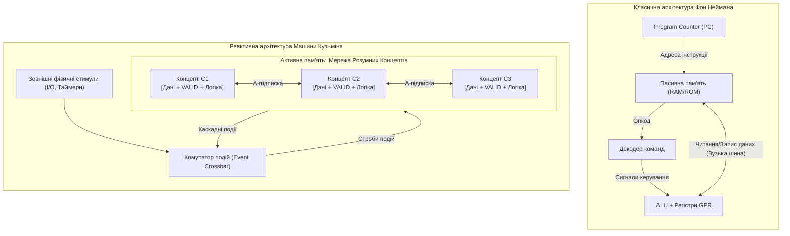

---

### 1.2. Анатомія концепту як «розумного регістра» (*Smart Register*)

У цільовій апаратній моделі розширений дескриптор концепту поєднує шість компонентів (у поточному `CFG-P` реалізовано компактний 16-байтний формат `CME-RAW-1` — див. §7.2):
1. **Поле даних (`DATA [31:0]`):** корисне числове або символьне значення.
2. **Біт валідності (`VALID`):** кодує авторський неініціалізований стан `_` (*Top / Unknown*), запобігаючи магічним псевдоконстантам на кшталт `0` чи `0xFFFFFFFF`.
3. **Прапорець блокування (`BUSY`):** сигналізує про захоплення концепту під час активної фази обробки.
4. **Прапорець фіксації (`COMMIT`):** ознака прийнятого запису в цій апаратній схемі; не тотожна авторському позначенню `•`.
5. **Комбінаційні компаратори предикатів (`PRED_MASK`):** порівняння нового значення з порогами (`=`, `≠`, `<`, `>`, `~`) без побічних ефектів.
6. **Поле підписників (`SUBSCRIBERS`):** маска або індекси цільових ліній/вузлів (параметричне кодування див. у §5.2).

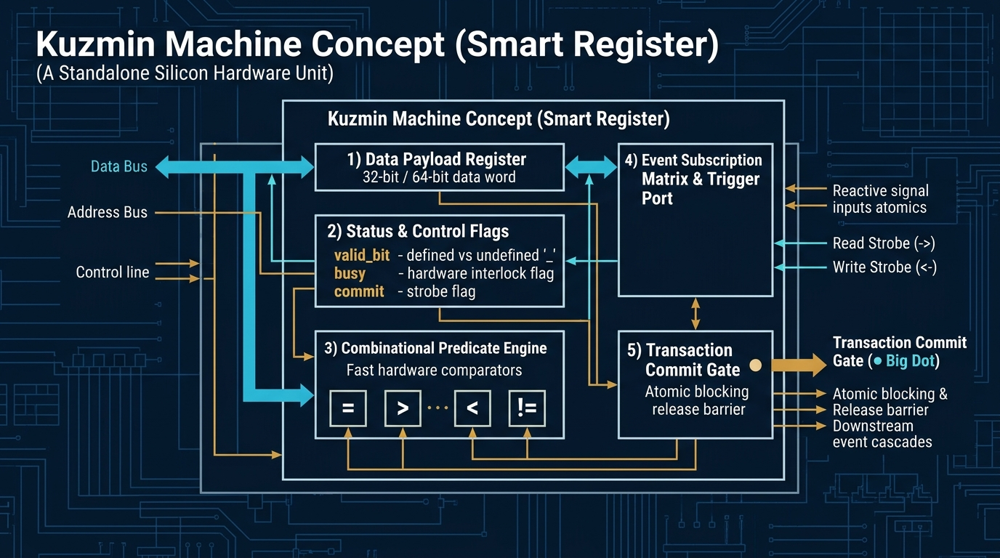

```text
+-------------------+-------+------+--------+-------------------+--------------------+
| DATA WORD [31:0]  | VALID | BUSY | COMMIT | PRED_MASK [3:0]   | SUBSCRIBERS [15:0] |
+-------------------+-------+------+--------+-------------------+--------------------+
       32 біти        1 біт  1 біт   1 біт         4 біти               16 бітів
```

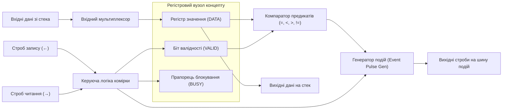

---

### 1.3. Чотири джерела подій та топологія А-схеми

У цій **інженерній схемі** розрізняємо чотири джерела заявок: зовнішній стимул, запис, читання й нове звернення з підписки. Це спосіб зобразити маршрутизацію, а не авторський перелік подій чи вимога однакового пріоритету. Наприклад, повторний запис того самого значення є зверненням, але не зміною `~`.

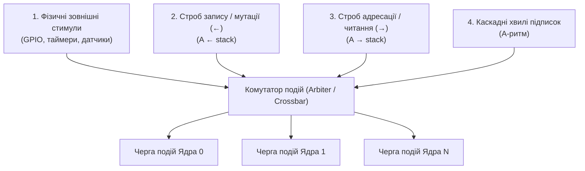

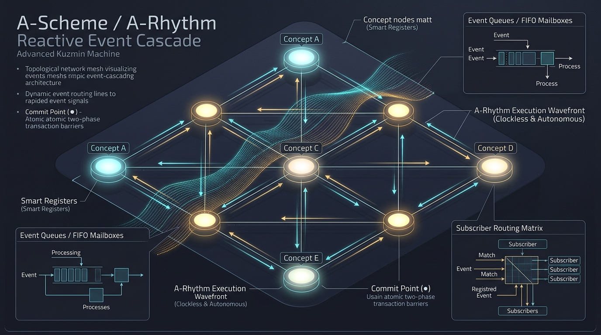

> *Примітка до ілюстрації:* візуалізація потоку подій та черг FIFO. Підпис *“(Clockless & Autonomous)”* відображає відмову від глобального `PC`; фізична реалізація `CFG-P` на ПЛІС є **синхронною** (`100 МГц`).

**Приклад А-схеми регулятора тиску:** датчик оновлює `P_Sensor`; перевищення порога активує клапан `V_Release`, а читання оператором (`P_Sensor →`) фіксує подію в `Audit_Log` без жодного циклу опитування:

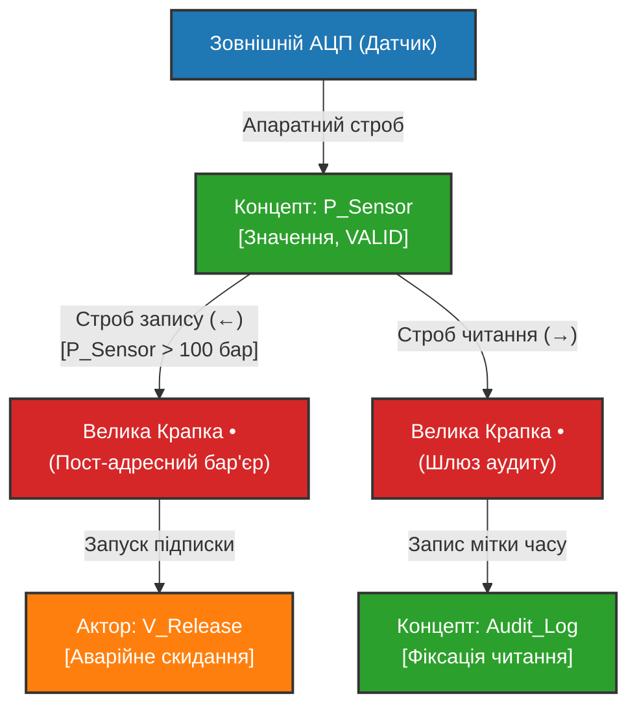

За поясненням М. Ю. Кузьміна (13.11.2026), у мові МК немає імперативних конструкцій `for`/`while`. Повторна робота можлива через підписки, тому відсутність циклу в тексті не доводить завершення всього каскаду.

---

### 1.4. Систематизація еволюції концепції (2020–2026)

| Джерело / Дата | Пам’ять і структура | Визначення події | Модель паралелізму й виконання |
| :--- | :--- | :--- | :--- |
| **DOU #35914** (28.12.2021) | «Стрічка скінченна»; комірки замінено концептами. | Зміна стану концепту; окремі події адресацій. | Кілька головок; паралельний запуск усіх підписок. Заявлено «недетермінізм». |
| **DOU #38994** (09.07.2022) | Зліченна множина комірок; множина станів $S$. | Скінченна підмножина станів; перевірка належності. | Одночасний аналіз усіх подій концепту й паралельний запуск підписок. |
| **DOU #43177** (24.04.2023) | Множина поточних значень змінних концепту. | Логічна функція від змінних. | Зміна значення запускає перевірку формули. Згадано ранній макет на `STM32`. |
| **Презентація «Пример для АН»** (2024–2026) | Типізовані концепти (`_`, `Token`, `Byte`, `Int32`, `Float`). | Множина станів $U$, події $s_i \subseteq U$, предикати $w_i(U) \in \{0,1\}$. | Стекова VM: лінії ($O+SR$), стек параметрів $SP$, рандеву (`Go SR2 →`), `•`, придушення самотригера. |
| **Дискусія DOU та роз’яснення** (04–15.11.2026) + 3 презентації (13.11.2026) | Маска присутності `Def`, `Class`, безіменний атрибут замість `Size`, 4-бітний `Token`, окрема ознака валідності, `→` у стек / `←` зі стека, `@`-параметри. | Перевірка при адресації; порівняння й зміна `~` розрізняються; `•` задає порядок фаз; `Min`/`Max` стосуються груп. | [Кузьмін назвав обчислення паралельними](../Research/sources/author/dou/dou-35914.md). Описано очікування при заповненій черзі й послідовний fallback; ранній макет `STM32` був C-програмою без VM і окремої мови. |

---

## 2. Гіпотези автора та їхня науково-експериментальна верифікація

### 2.1. Матриця верифікації шести гіпотез ($`\mathcal{H}_1 \dots \mathcal{H}_6`$)

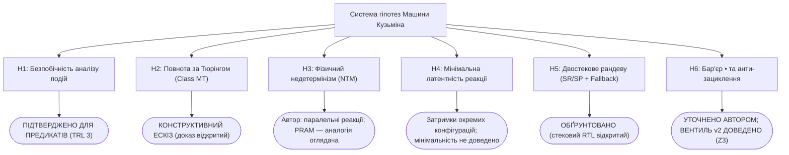

| Код | Гіпотеза автора | Науково-технічна оцінка та межі істинності | Статус |
| :--- | :--- | :--- | :--- |
| $`\mathcal{H}_1`$ | **Паралельність перевірки подій:** оцінка $w_i(U)$ не змінює стану пам’яті. | Комбінаційний предикатор `::` у `CME` обчислює умови без мутації пам’яті ($W(\mathrm{pred}) = \emptyset$), що задовольняє умови Бернштейна для фази оцінки *(не усуває гонитв у тілах підписок)*. | **Підтверджено для предикатів (TRL 3)** |
| $`\mathcal{H}_2`$ | **Тюрінг-повнота:** моделювання МТ ланцюгом концептів. | Авторський `Class MT` — концептуальний ескіз: строгий доказ вимагає очищення `¤.Q ← _`, атомарності кроку, правила для $d=0$ та необмеженої адресації `:`. | **Конструктивний ескіз (доказ відкритий)** |
| $`\mathcal{H}_3`$ | **«Недетермінована МТ»** — рання назва автора. | У [відповіді на DOU](../Research/sources/author/dou/dou-35914.md) Кузьмін уточнив, що йдеться про паралелізм. Порівняння з PRAM через спільну пам’ять — інтерпретація оглядача, не авторська класифікація. Поліноміального алгоритму для NP-повної задачі тут не наведено. | **Паралелізм не є критерієм прийняття NTM** |
| $`\mathcal{H}_4`$ | **Мінімальна латентність:** чи швидша подієва адресація за виконання на CPU? | `CFG-R`: `10..20 нс` між виводами; `CFG-P`: 8 тактів від початку обслуговування до рішення (`80 нс` за `100 МГц`). Час обміну через MMIO й час обробки в Linux виміряні між іншими точками (§2.2). | **Затримки визначено для цих конфігурацій; мінімальність не доведено** |
| $`\mathcal{H}_5`$ | **Адаптивне розпаралелювання виразів:** `SR/SP` + відкат на 1 ядро. | *Work-First Serial Fallback* запобігає голодуванню пулу для ациклічних виразів; повнорозмірна стекова RTL-фабрика ще не синтезована. | **Інженерно обґрунтовано (RTL відкритий)** |
| $`\mathcal{H}_6`$ | **Черговість фаз (`•`) та анти-зациклення.** | Автор (13.11.2026) зафіксував `•` як пост-адресний бар’єр; в апаратному ядрі формально доведено *Fail-Closed* вентиль `kpol_txn_gate_v2` (`Z3`). | **Уточнено; вентиль v2 доведено (TRL 3)** |

---

### 2.2. Лабораторний бенчмарк латентності на `Zynq-7000` (`FCLK0 = 100 МГц`)

| Рівень виконання | Механізм обробки події | Латентність | Джитер ($\sigma$) | Пропускна здатність / примітка |
| :--- | :--- | :---: | :---: | :--- |
| **0а. Автономний шлюз `CFG-R` (HIL)** | Від фронту стимулу `JA1` до фронту реакції на виводі PMOD, без читання BRAM | **`10..20 нс`** (медіана `20 нс`) | `2.39 нс` | [AV-10](../Engineering/validation/experiments/AV-10/report.md): 100 подій, дискретність аналізатора `10 нс`. |
| **0б. Програмований BRAM-конвеєр `CFG-P`** | Від початку обслуговування до строба рішення, без черги й CDC | **8 тактів = `80 нс`**; від входу до виходу за вільного ядра — **розрахункові** `105..115 нс` | `0` тактів усередині ядра | Ідеальний темп `12.5 MCPS` за інтервалу 8 тактів; очікування залежить від черги та арбітражу (§5.3). |
| **1. Апаратне ядро вентиля (PL STA)** | 1 такт оцінки в RTL (`100 МГц`) | `10 нс` (критичний шлях `4.514 нс`) | — | $f_{\max} = 221.53\text{ МГц}$ (ізольований вентиль). |
| **2. Шинний обмін MMIO (PS–PL)** | 5 операцій MMIO на транзакцію ($N=10\,000$) | **mean `84.941 мкс`** (p99 `95.749`, max `204.180`) | `4.109 мкс` | `10 588` транзакцій/с (вузьке місце — шина PS–PL). |
| **3. Linux userspace (ARM Cortex-A9)** | Перевірка предикатів у ОС ($N=10\,000$) | **mean `6.953 мкс`** (p99 `7.366`, max `52.696`) | `0.942 мкс` | `70 470` ітерацій/с (хвости планувальника ОС). |

---

## 3. Математична теорія, формальна семантика та таксономія паралелізму

### 3.1. Алгебраїчна модель та логіка подій нульового порядку

Для аналізу М. Федчик подає модель кортежем:

$$
\mathcal{M}_K = \langle \mathcal{V}, \mathcal{T}, \Sigma, \mathcal{E}, \mathcal{D}, \mathcal{R}, \mathcal{P}, \Omega \rangle
$$

де $\mathcal{V} = \{v_0, v_1, \dots\}$ — зліченна множина концептів ($\text{¤} \in \mathcal{V}$ — поточний концепт); $\mathcal{T}$ — система типів з областю станів $U_{\tau(v)}$ включно з неініціалізованим станом $\underline{\hspace{0.4em}} \notin U_{\mathrm{def}}$; $\Sigma : \mathcal{V} \to \bigcup_v (U_{\tau(v)} \times \{0,1\})$ — глобальний стан пам’яті $(\mathrm{val}(v), \bullet(v))$; $\mathcal{E}$ — події як підмножини станів $s_i \subseteq U$ із характеристичними предикатами $w_i : U \to \{0,1\}$ (підмножини можуть перетинатися: $s_i \cap s_j \neq \emptyset$, що дозволяє одній зміні активувати кілька подій); $\mathcal{D}$ — лінії підписок $O = \langle o_1, \dots, o_l \rangle$; $\mathcal{R} \subseteq \mathcal{E} \times \mathcal{D}$ — відношення підписок; $\mathcal{P}$ — пул виконавців; $\Omega$ — операційна семантика.

---

### 3.2. Похідна операційна схематизація (SOS) та межі «Великої Крапки» (`•`)

> За [переданим роз’ясненням RFC-013](../Research/sources/author/clarifications-2026-11-13.md), підписка праворуч від `•` виконується після базової адресації: для читання — після читання, для успішного запису — після запису. На [слайді 11](../Research/sources/author/kuzmin-2024-example-for-AN.pdf) `•` описано також як булеву ознаку успіху. Це не ознака наявності значення: його відсутність позначено `_`.

**Припущення реконструкції:** $\mathcal{Q}$ — мультимножина готових заявок, а не розклад їх виконання. Для одного доступу до $v$ схема моделює успіх бітом $\Sigma_{\bullet}(v)$ і ставить постдію в $\mathcal{Q}$. У правилі нижче $S_v$ охоплює інші події цього запису з предикатом від нового значення; для події зміни `~` треба порівняти попереднє й нове значення. Ця схема не визначає повної семантики авторської мови.

1. **Запис із пре- та пост-підпискою** ($\text{Go}\; v \leftarrow x$ при $w_1 \mathbin{\bullet} w_2$, $\Sigma'_{\bullet}(v)=1$):
   $$
   \frac{
   \left\langle w_1,\ \Sigma\left[v \mapsto \left(\Sigma_{\mathrm{val}}(v), 1\right)\right],\ x \right\rangle
   \Downarrow
   \left\langle \Sigma', x' \right\rangle
   \quad
   \Sigma'_{\bullet}(v)=1
   \quad
   \Sigma''=\Sigma'\left[v \mapsto \left(x', 1\right)\right]
   }{
   \left\langle
     \text{Go}\; v \leftarrow x,\ \Sigma,\ \mathcal{Q}
   \right\rangle
   \longrightarrow
   \left\langle
     \Sigma'',\
     \mathcal{Q}
     \uplus
     \{w_2\}
     \uplus
     \biguplus_{\substack{
       s_i \in S_v\\
       w_i\left(\Sigma''_{\mathrm{val}}(v)\right)=1
     }}
     \mathcal{R}(s_i)
   \right\rangle
   }
   $$
2. **Відхилення запису пре-підпискою ($\Sigma'_{\bullet}(v) = 0$):** схема не виконує цільового запису $x'$ і не ставить його постдій у чергу. Це не означає відкату побічних ефектів, які вже могла виконати $w_1$.
3. **Читання з пре- та пост-підпискою ($\text{Go } v \to$):** пре-підписка $w_1$ може оновити значення перед читанням, значення кладеться на стек $SR$, а $w_2$ ставиться в $\mathcal{Q}$ після читання.
4. **Пригнічення самотригера:** звернення з лінії $L$ до $v \in \mathrm{LockCtx}(L)$ виконує базову операцію без породження нових подій із $S_v$ *(повна траса узгодження з ітеративним `Nod` потребує формалізації моменту зняття `Busy` у конструкції `A • B`)*.

**Порядок не дорівнює атомарності.** Нехай читання повертає 7 і ставить у чергу скидання в 0. До виконання скидання другий читач теж може отримати 7. Щоб гарантувати результати 7, потім 0, потрібне окреме правило взаємного виключення або неподільного кроку. Ні порядок фаз `•`, ні доказ для окремого апаратного вентиля такого правила не дають.

---

### 3.3. Конструктивний ескіз симуляції машини Тюрінга та співвідношення з NTM

У спрощеному записі авторського ескізу (слайд 14) комірці $k \in \mathbb{Z}$ відповідає концепт $\mathrm{C}_{k}$ класу `MT`: $\mathrm{C}_{k}.\mathrm{A} \in A$ — символ, $\mathrm{C}_{k}.\mathrm{Q} \in Q \cup \{\text{\_}\}$ — стан головки або ознака її відсутності. Для умови $s_{ij} \iff \left(\mathrm{C}.\mathrm{A}=a_i\right)\land\left(\mathrm{C}.\mathrm{Q}=q_j\right)$ та переходу $\delta(q_j,a_i)=(q',a',d)$ у підписці записано дві дії:

$$
w_{ij}=s_{ij}\left(
  \text{Go}\; \mathrm{C}.A\leftarrow a'
  \quad
  \text{Do}\; (\mathrm{C}+d).Q\leftarrow q'
\right)
$$

**Перевірка одного кроку.** Для `δ(q₀,0) = (qH,1,R)` початкові комірки `(0,q₀), (□,_)` мають стати `(1,_), (□,qH)`; `□` — порожній символ стрічки. Натомість формула дає `(1,q₀), (□,qH)`: старий маркер лишився, тож тепер головок дві. [Ручна траса](../Research/studies/turing-construction/report.md) спростовує саме це кодування, а не можливість симуляції МТ на МК. Діаграма нижче показує, де **в реконструкції**, а не на слайді автора, додано очищення.

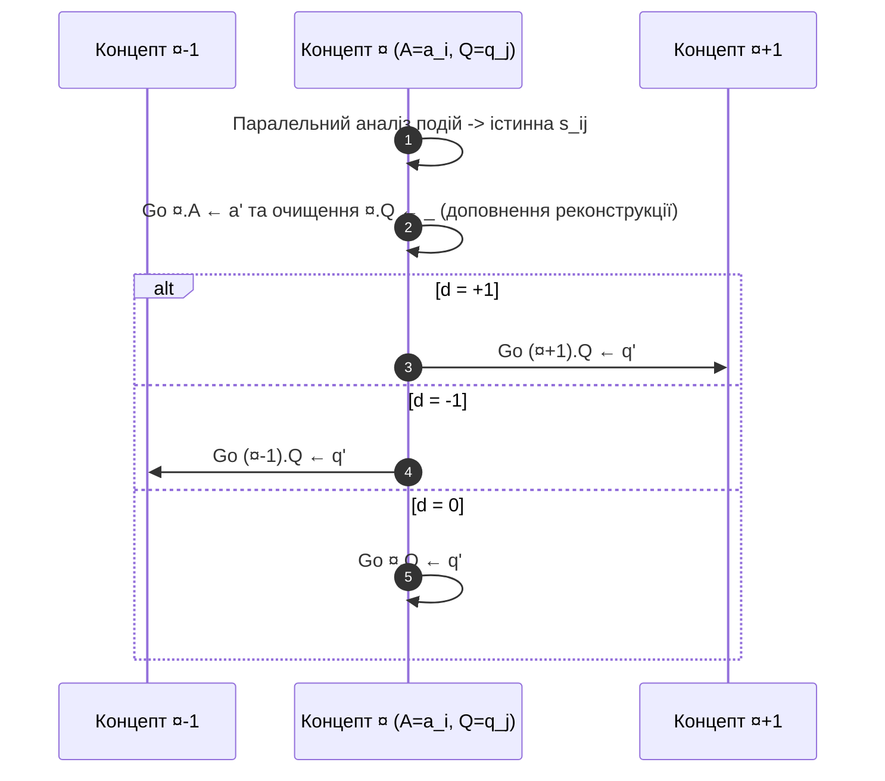

**Межа висновку:** навіть з очищенням потрібен протокол логічного кроку: проміжні записи не активують зайвих переходів, завершений крок активує наступний рівно один раз, а термінальний стан зупиняє симуляцію. Потрібні також правило для $d=0$ і необмежено нарощувана абстрактна стрічка. Це умови доказу, а не властивості скінченного прототипу.

**Чому паралельні підписки не реалізують семантику NTM.** Недетермінована МТ приймає вхід, якщо існує хоча б одна приймальна гілка; це математичний критерій, а не вимога фізично запускати всі гілки. У МК істинна подія активує **всі** свої підписки, які бачать **спільний стан**. Це нагадує PRAM, але без контракту на одночасні читання й записи не визначає конкретної моделі PRAM. Дві підписки можуть записати різні значення за однією адресою.

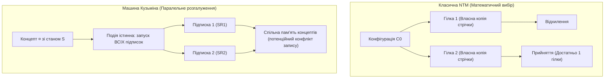

---

### 3.4. Теорія паралелізму та порівняння з відомими парадигмами

Для конфлюентного одночасного виконання двох ліній підписок $L_1 \parallel L_2$ достатніми є **умови незалежності Бернштейна (1966)** — відсутність конфліктів `WAR`, `RAW` і `WAW`:

$$
\mathcal{R}_{\mathrm{read}}(L_1) \cap \mathcal{W}_{\mathrm{write}}(L_2) = \emptyset, \quad
\mathcal{W}_{\mathrm{write}}(L_1) \cap \mathcal{R}_{\mathrm{read}}(L_2) = \emptyset, \quad
\mathcal{W}_{\mathrm{write}}(L_1) \cap \mathcal{W}_{\mathrm{write}}(L_2) = \emptyset
$$

За **теоремою Брента (1974)** при сумарній роботі $W$ і критичному шляху $D$ час виконання на $p$ ядрах обмежений $T_p \le \frac{W - D}{p} + D + \tau_{\text{sync}}$, що визначає межу доцільності дрібнозернистого паралелізму.

| Модель / Архітектура | Спільні риси з Машиною Кузьміна | Ключові відмінності |
| :--- | :--- | :--- |
| **Dataflow (Dennis, Arvind)** | Обчислення активується готовністю даних/подій, без глобального `PC`. | У Dataflow токени рухаються графом; у МК концепти адресовані (`Go`), а підписки самі читають/пишуть операнди. |
| **Стекові машини (Forth, Transputer, JVM)** | Арифметичний стек ($SR$) для операцій `Do` та передачі параметрів. | У МК лінії підписок створюються динамічно подіями й мають примітиви міжстекового рандеву (`Go SR2 →`). |
| **Акторна модель (Hewitt, Erlang)** | Концепт як автономна одиниця; адресація подібна до повідомлення. | Актори мають ізольований стан і mailbox; у МК — відкрита спільна пам’ять атрибутів. |
| **ECA / Active DB / Rete** | Парадигма *Event–Condition–Action* (Подія–Умова–Дія). | МК додає пост-адресний бар’єр `•`, біт невизначеності `_` та апаратну орієнтацію на `BRAM`. |
| **Синхронні мови (Esterel, Lustre)** | Реакція на зовнішні події в логічному часі. | Esterel гарантує сувору *Synchronous Hypothesis* такту; у МК паралельні лінії асинхронні без явного бар’єра. |

*(Детальне таксономічне порівняння з попередниками див. у [`Similar_Machines_to_KM.md`](Similar_Machines_to_KM.md).)*

---

## 4. Архітектура виконання: ISA, двостекове рандеву, відображення на платформи та `EKPOL`/`VMK`

### 4.1. Система опкодів віртуальної машини та оновлення синтаксису (13.11.2026)

1. **Логічний тип (`?`):** `0` $\to$ `!` (`True`), `1` $\to$ `¬` (`False`).
2. **Вбудовані події стану даних (`::`):** `0` (`_`), `1` (`Null`), `2` (`Positive`), `3` (`Negative`), `4` (`Even`), `5` (`Uneven`), `6` (`~` — зміна значення).
3. **Порівняння (`~`):** `0` (`=`), `1` (`>`), `2` (`<`) плюс інверсія `?` (`<>`, `<=`, `>=`).
4. **Оператор адресації (`Go`):** `0` (`|` виконання), `1` (`←` запис зі стека в комірку), `2` (`→` читання з комірки в стек), `3` (`:` ініціалізація).
5. **Оператор обчислень (`Do`):** `+`, `-`, `*`, `/`, `^`, `'` (`+1`), `&`, `Or`, `¬`, `#`, `<`, `>`, `~`.
6. **Системні директиви:** `Define`, `Convert`, `Exit`, `Processor`.

**Оновлення за авторськими презентаціями 13.11.2026:** символ `#` звільнено від ролі унарного мінуса; розмежовано лексему тексту `Lexeme` (`Type/First/Length`) і 4-бітний `Token` у пам’яті; поле `Size` скасовано на користь 8-бітної маски присутності компонентів `Def` (`0..7`, молодший біт зліва) та обов’язкового `Class`; парні дужки утворюють контекстно-вільну структуру, де `OpenBracket` і `CloseBracket` є виконуваними сутностями у `Define Static`; для `Token` підрядковий/надрядковий індекси задають межі виконання груп `Min`/`Max` (за правилом «на 1 більше»).

---

### 4.2. Двостековий дескриптор (`SP` / `SR`), міжстекове рандеву та *Graceful Serial Fallback*

При активації події цільова VM формує **дескриптор підписки**: спільний **стек параметрів ($SP$)** для `@`-аргументів і локальних концептів та одну або кілька **ліній підписки** $L_m = (O_m, SR_m)$ із власним потоком команд $O_m$ і приватним арифметичним стеком $SR_m$.

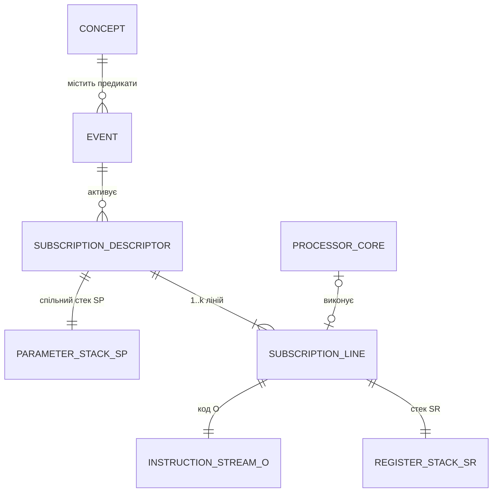

Для виразу $Z = \sqrt{\sin^2(a) + \sin^2(b)}$ транслятор розщеплює обчислення на Лінію 1 (`SR1`) і Лінію 2 (`SR2`) із точкою рандеву `Go SR2 →`. За авторськими правилами листопада 2026 року:
- **Переповнення черги подій (*Backpressure*):** *«Если очередь переполнилась, то стоим ждем когда освободится»* (`ready = 0` для керованих джерел; у поточному RTL також верифіковано 1-слотовий буфер `cascade_pending` у `Z3`).
- **Дефіцит вільних ядер (*Graceful Serial Fallback*):** *«Значит все заняты и сама берется выполнять»* — поточне ядро без блокування самостійно виконує `SR2` (інженерна аналогія з оператором `ALT` у моделі `CSP` Тоні Гоара, із застереженням, що в CSP пам’ять не є спільною):

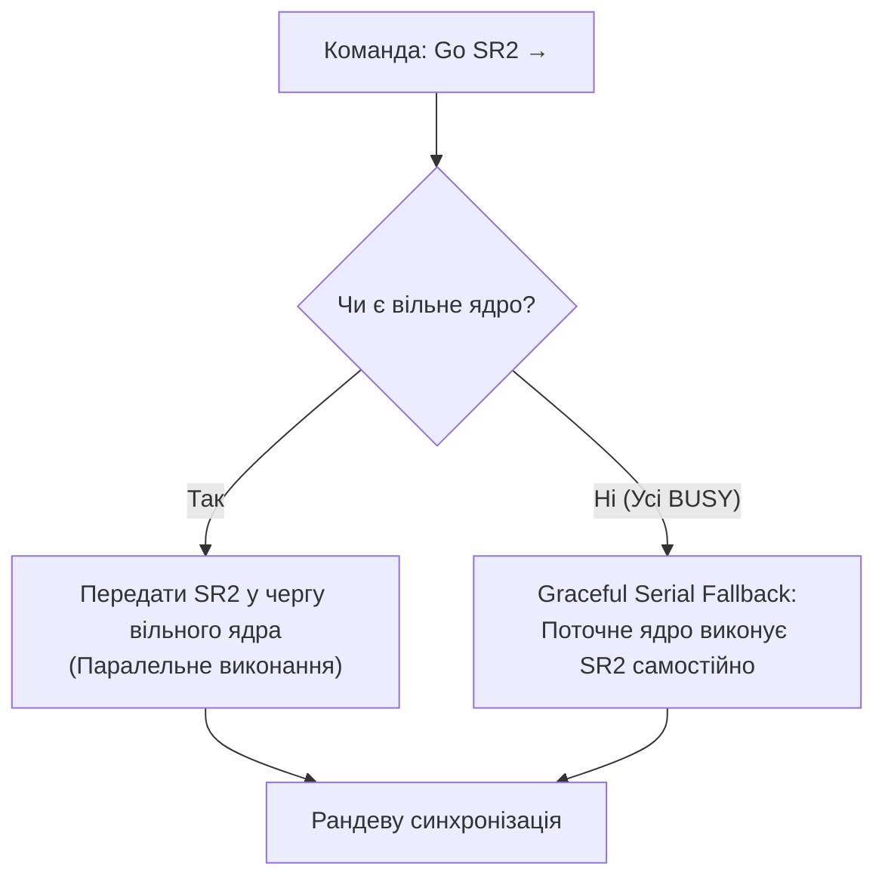

---

### 4.3. Відображення на платформи: Гарвардські MCU, ПЛІС `Dual-Port BRAM` та стек `EKPOL` / `VMK`

1. **Мікроконтролери:** у програмній реконструкції статичну А-схему можна зберігати у `Flash`, стани концептів і чергу — у `SRAM`. Варіанти виконання — диспетчер подій або безцикловий C99, згенерований `--emit-c99`, з явною маскою `valid_mask`. Відсутність циклів не визначає числового WCET без цільового процесора й умов вимірювання. За історичним уточненням М. Ю. Кузьміна (11.2026), його ранній макет на 2–3 платах `STM32` був прямою C-програмою перевірки принципу подій-підписок без VM і окремої мови.
2. **ПЛІС `Dual-Port BRAM` (`Xilinx Zynq-7000 XC7Z020` / `PYNQ-Z1`, відкритий стек `OpenXC7`):** Порт A обслуговує конфігурування й телеметрію через `AXI4-Lite` без пересинтезу бітстріму; Порт B обслуговує автономний 8-тактовий мікро-рушій `CME` (`80 нс` при `100 МГц`, `0` тактів внутрішнього джитера).

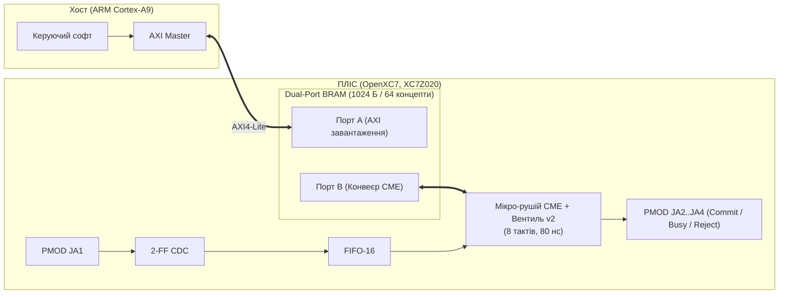

3. **Мови й інструменти проєкту.** [`KPOL`](../Engineering/specifications/kpol/kpol-formal-specification.md) і його ASCII-нотація [`EKPOL 0.1.0`](../Engineering/specifications/kpol/ekpol-formal-specification.md) — не дослівна транскрипція слайдів Кузьміна. Для першої програми оберіть [практичний посібник за мовою](../Engineering/guides/README.md#призначення). [`VMK v0.3.1`](../Engineering/guides/vmk-users-guide.md) — емулятор і налагоджувач на Go з режимами `conceptual` та `bram64`.

   **Межа перекладу.** Текстовий експорт `EKPOL-B64 → KPOL` зберігає зміст лише в окресленій підмножині: зокрема, для `bitmask` [експортер](../Engineering/sw/kpol-ref/ekpol_frontend.py) підставляє `x != 0`. Перевірка молодшого біта відхиляє `x=2`, а підставлена умова його приймає. У зворотному напрямку є обмеження на ініціалізатори, `step`, `expect` та `assert` (специфікація EKPOL, §10). Побітовий збіг прямих образів BRAM на перевірених прикладах — інша властивість, не гарантія безвтратного перекладу довільного тексту.

---

## 5. Інженерна реконструкція на ПЛІС, дискретна оптимізація та гетерогенний контур ПЛІС + GPU

### 5.1. Просторова багатоядерність на ПЛІС (*Spatial Many-Core*)

У кластерній реконструкції кожен `CME` обслуговує власний банк `BRAM`; банки з’єднує конвеєризований комутатор подій. Звернення до різних банків можуть обслуговуватися паралельно, але кілька заявок до одного «гарячого» банку конкурують за ту саму чергу.

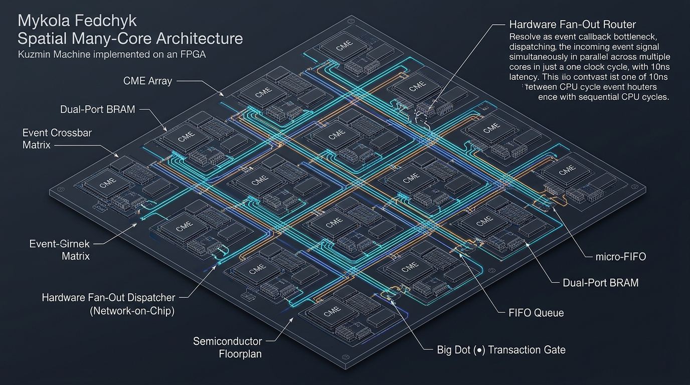

> *Примітка до ілюстрації:* художня візуалізація матриці; у відкритому P&R (`OpenXC7`, `XC7Z020`) фізично розтрасовано кластер $N = 1, 2, 4, 8$ із 2-ступеневим конвеєризованим комутатором: **`133.89 МГц`** ($N=2$, `3 894 SLICE_LUTX`), **`103.73 МГц PASS @ 100.00 MHz`** ($N=4$, `8 225 SLICE_LUTX`) та **`91.89 МГц`** ($N=8$, `18 112 SLICE_LUTX`, скорочення площі на `33..38%` проти плоского 1-тактового комутатора).

---

### 5.2. Подолання *Callback Bottleneck* та параметричне кодування `SUBSCRIBERS`

Щоб каскадні підписки не душили систему, інженерна реконструкція спирається на чотири механізми:
1. **Предикатне відсікання (*Predicate Gating*):** комбінаційний предикатор `::` у `CME` блокує хибні підписки до потрапляння у комутатор або `Bus_out`.
2. **Просторове розгалуження:** у загальній схемі підписки можна рознести по банках. [Перевірений профіль `KPOL-CME-2`](../Engineering/specifications/kpol/kpol-cme2-profile.md) вужчий: стан має щонайбільше одного безпосереднього підписника `on change`.
3. **Апаратний зворотний тиск (*Backpressure*) + `cascade_pending`:** рукостискання `valid && ready` для керованих джерел і формально доведений 1-слотовий буфер утримання внутрішнього каскаду *(для некерованих фізичних пінів без каналу `ready` діє діагностичний лічильник `events_dropped_count_o`)*.
4. **Відхилення запису:** апаратний вентиль перевіряє інваріанти; це не реалізація всіх фаз `•` або запропонованого стекового *fallback*.

**Параметричне кодування поля підписників** (замість жорстко зашитих 16 бітів): для бюджету $W_{\text{sub-budget}} = W_{\text{word}} - W_{\text{data}} - W_{\text{flags}}$ обирається одна з трьох стратегій:
- *Direct Multi-Hot Bitmap* ($W_{\text{sub}} = M_{\text{targets}}$), коли $M_{\text{targets}} \le \min(W_{\text{sub-budget}}, K_{\text{fanout-max}})$;
- *k-Slot Sparse Indexing* ($W_{\text{sub}} = W_{\text{count}} + k_{\text{slots}} \lceil \log_2 M_{\text{targets}} \rceil \le W_{\text{sub-budget}}$);
- *Indirect Hub Trees* глибини $H = \lceil \log_{K_{\text{fanout-max}}} M_{\text{targets}} \rceil$ (де кожен рівень у `BRAM` додає $L_{\text{exec}}$ тактів).

---

### 5.3. Математична модель дискретної оптимізації та розкладання латентності

1. **Пікова пропускна здатність:** $\Phi_{\text{peak}} = N_{\text{cores}} F_{\text{clk}} / II$, де $II$ — інтервал між початками послідовних обробок у тактах. За $II=8$ і `100 МГц` верхня оцінка — `12.5 MCPS` на вузол без простоїв. Вона не задає темп приймання зовнішніх подій під навантаженням.
2. **Гіллястий процес Б’єнайме–Гальтона–Ватсона та субкритичність:** при середньому коефіцієнті розмноження
   $m=\mathbb{E}\left[\sum_{j=1}^{K}\mathbf{1}_{\{\mathrm{pred}_j=1\}}\right]$
   у нескінченній однорідній моделі середня сумарна робота на один зовнішній стимул дорівнює $1+m+m^2+\dots$ і скінченна лише за **$m < 1$**. Очікуваний попит на обробку становить:
   $$\lambda_{\text{effective}} = \frac{\lambda_{\text{ext}}}{1-m},\qquad m<1.$$
   Це умова скінченного **середнього обсягу роботи**, не гарантія часу завершення окремого каскаду. Наприклад, невироджений критичний процес ($m=1$) згасає з імовірністю 1, але має нескінченне математичне сподівання сумарної роботи. Для матриці $B$ середніх чисел породжених заявок за типами за умови $\rho_{\mathrm{spec}}(B)<1$ маємо баланс $\boldsymbol{\lambda}=\boldsymbol{\alpha}(I-B)^{-1}$. У скінченному DAG зі скінченним розгалуженням число нащадків однієї заявки скінченне; навіть такий граф може перевантажити банк або заповнити FIFO.
3. **Вибір $N_{\text{cores}}$ (Ділворт, Брент, черги та ресурси):**
   - Ширина антиланцюга $w(G)$ за теоремою Ділворта обмежує паралелізм **лише однієї ізольованої заявки**, але не потоку незалежних заявок.
   - $N_{\text{min-stable}} = \lfloor \lambda_{\text{effective}} / \mu_{\text{core}} \rfloor + 1$ — лише нижня межа для строгої нерівності «сумарний попит < сумарна потужність». Потрібно також $\rho_i=\lambda_i/\mu_i<1$ у **кожному** банку. За пуассонівських надходжень саме до банку, сталого часу обслуговування й необмеженої черги $M/D/1$ середнє очікування до обслуговування дорівнює $\mathbb{E}[T_{\text{wait},i}] = \frac{T_{\text{exec}}\,\rho_i}{2(1-\rho_i)}$. Породжені разом заявки не зобов’язані надходити за пуассонівським законом.
4. **Розкладання латентності на ПЛІС:**
   $$
   T_{\text{total}} = T_{\text{cdc}} + T_{\text{xbar}} + T_{\text{wait}} + \frac{L_{\text{pipe}}}{F_{\text{clk}}} + T_{\text{pad}}
   $$
   Усередині синхронного автомата $\sigma_{\text{exec-cycles}} = 0$ тактів, а на асинхронному вході `100 МГц` RMS фазового квантування становить $\sigma_{\text{cdc}} = \frac{T_{\text{clk}}}{\sqrt{12}} \approx 2.89\text{ нс}$.

---

### 5.4. Двошинна модель гетерогенного середовища та симбіоз ПЛІС + GPU (`Jetson AGX Orin`)

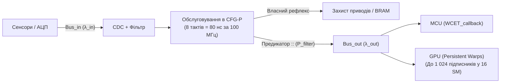

**Умова балансу та *Network Calculus*:** для ненасичення вихідної шини й зовнішнього MCU необхідно
$$
\lambda_{\mathrm{in}}
\cdot
P_{\mathrm{filter}}
\cdot
P_{\mathrm{route-ext}}
<
\min\left(
  \lambda_{\mathrm{out-cap}},
  \frac{F_{\text{mcu}}}{\text{WCET}_{\text{callback}}}
\right).
$$
Тут $\text{WCET}_{\text{callback}}$ вимірюється в тактах MCU на виклик; добуток імовірностей описує частку зовнішніх заявок після відбору та маршрутизації (не більше одного виклику на відібрану заявку). Баланс середніх не гарантує відсутності втрат. Якщо $\alpha_{\mathrm{out}}(t)=b_{\mathrm{out}}+r_{\mathrm{out}}t$ є гарантованою верхньою огинаючою надходжень, а $\beta_{\mathrm{sys}}(t)=R_{\mathrm{sys}}[t-T_{\mathrm{sys}}]^{+}$ — нижньою огинаючою сервісу і $r_{\mathrm{out}}\le R_{\mathrm{sys}}$, то максимальне накопичення не перевищує $b_{\mathrm{out}}+r_{\mathrm{out}}T_{\mathrm{sys}}$. Буфер має вміщувати цей обсяг; середнє значення з пуассонівської моделі такої межі не задає.

**Експериментальна верифікація резидентних варпів GPU (`NVIDIA Jetson AGX Orin 64GB`, Ampere `SM 8.7`):**
- **Предикатні резидентні варпи (`SEL` / `@P STG.E`):** `0.00%` дивергенції на розріджених масках; `32` паралельні ПІД-регулятори `Q8` обчислюються за рівно `37.00 ± 0.00` тактів (`45.34 нс` при `816.0 МГц`), у межах 1 SM для `32..512` підписників — `44.1..83.6 нс`.
- **Локальний цикл GPU на `1 024` підписниках (`16 SM × 64`):** після переходу від спільної 128-байтної скриньки до поблокових слотів в ізольованих прогонах отримано `p50 = 1.57..1.74 мкс`, `p99.9 = 1.93..2.04 мкс`. Під час міжплатного експерименту медіани від прийняття даних у L2 до підтвердження на GPU становили `1.952..2.048 мкс` за п’ятьма прогонами; у першому локальний `p99.9` сягнув `1.153 мс`. Це не час доставки події між платами.
- **Спеціалізація варпів для 4 гетерогенних операторів (`PID`, `Biquad`, `Schmitt`, `EWMA`):** групування однотипних операторів по варпах прискорило математику у `2.03×` — до `261.03 нс` (`816 МГц`) та **`163.78 нс`** у режимі `MAXN` (`1 300.5 МГц`).
- **Міжплатний шлях через Linux/GbE:** у [EXP-GPU-01, §3.3](../Research/studies/fpga-gpu-symbiosis/experiments/EXP-GPU-01/report-phase1-2-4-crossboard-egress.md) виміряли час від запуску через MMIO на PYNQ до повернення підтвердження на **ту саму плату**: за `5 000` подій `RTT p50 = 675.38 мкс`, `p99.9 = 3 143.41 мкс`. `344.78 мкс` (медіана) та `2 808.53 мкс` (`p99.9`) — **оцінки шляху в один бік** за припущення симетрії мережі, не окремий внесок сокета. Контур не вклався в ціль `15 мкс` на `p99.9`; прямий апаратний канал лишається гіпотезою.

---

### 5.5. Порівняльний бенчмарк і оцінка точки перетину за площею (`XC7Z020`)

У [дослідженні №254](../Research/studies/comparative-baseline-254/report.md) на чотирьох реалізаціях звірили стани й лічильники одного каскаду $C_0 \to C_1 \to C_2 \to C_3$. Межі часу різні: пакет прямих викликів C99 на ARM, пробудження потоку **разом з обчисленням** у Linux і такти обслуговування за RTL-симуляцією для ПЛІС. Площу та граничну частоту обох апаратних варіантів отримано після P&R; `CFG-P-HA` наведено окремо для довідки.

| Критерій | 1. `ARM Cortex-A9 @ 650 МГц`, C99 (`-O3`, L1) | 2. Linux `eventfd + poll` (`ARM Cortex-A9`) | 3. Регістровий RTL у ПЛІС (`K = 4 / 16 / 64`) | 4. BRAM-конвеєр МК (`CFG-P` / `CFG-P-HA`, `K = 1..64`) |
| :--- | :--- | :--- | :--- | :--- |
| **Затримка (1 крок / 4-крок. каскад)** | `97.96 нс` / **`534.12 нс`** | — / **`28.84..33.33 мкс`** | `1` / `4` такти (`13.8` / `55.2 нс` @ `72.47 МГц`) | `8` (`80 нс`) / **`32` такти (`320 нс` @ `100 МГц`)** |
| **Розкид затримки** | Поодинокі виміри з таймером: `p99.9 = 1.77 мкс`, `max = 40.20 мкс` для каскаду (`76.76 мкс` на відхиленні) | `p99.9 = 55.5..55.7 мкс`, `max = 65.8..68.4 мкс` | Сталий час у тактах PL | Сталий час у тактах PL, без очікування |
| **Ресурси після `nextpnr` (`LUT / FF / BRAM`)** | `0` ПЛІС (CPU PS) | `0` ПЛІС (CPU PS) | Лінійне $\mathcal{O}(K)$:<br/>`K=4`: `2 209 / 919 / 0`<br/>`K=16`: `2 783 / 2 023 / 0`<br/>`K=64`: `5 543 / 6 439 / 0` | Константне $\mathcal{O}(1)$:<br/>`CFG-P`: **`3 351 / 1 399 / 1`**<br/>`CFG-P-HA`: **`5 718 / 1 935 / 2`** |
| **Частота після P&R ($F_{\max}$)** | `650 МГц` | `650 МГц` | **`72.47 / 63.52 / 59.29 МГц`** (`FAIL @ 100 МГц`) | **`103.53 МГц`** (`CFG-P`) / **`100.69 МГц PASS`** (`CFG-P-HA`) / `145.94 МГц` (ядро) |
| **Оновлення правил** | У RAM (`63..482 нс`) | У RAM із синхронізацією | `24` такти AXI при `!busy` | `48` тактів (`CFG-P`) / **онлайн без простою (`0` stall, `10 003` перемикання на залізі)** у `CFG-P-HA` |

**Що відомо про площу.** Для регістрового RTL трасували $K=4,16,64$, для однобанкового `CFG-P` — фіксовану таблицю на 64 слоти. Лінійна інтерполяція за `SLICE_LUTX` між регістровими точками 16 і 64 дає $16+(3351-2783)(64-16)/(5543-2783)\approx25.88$, тобто **близько 26 слотів**. Збірки на 26 не трасували. Для `SLICE_FFX` оцінка перетину — 9.22 слота. У **реально трасованій точці $K=64$** однобанкова збірка використовує на `39.5%` менше `SLICE_LUTX` та на `78.3%` менше `SLICE_FFX`, але на один `RAMB36E1` більше. Це не поріг швидкодії або окупності `CFG-P-HA` чи системи з GPU.

**Що показав стенд.** Обидва порівнювані RTL-варіанти мають записувані правила. Для однобанкового `CFG-P` [серія S4-07](../Engineering/validation/experiments/S4-07/report.md) показала це на платі: з незмінним бітстримом і тими самими стимулами `5, 25` правила `Increase` дали стани `[11, 11]`, а `Decrease` — `[9, 9]`. Окремий результат `CFG-P-HA` — перемикання підготовлених банків без зареєстрованого простою, а не перевага, що з’являється при $K=26$.

---

## 6. Раціональність рішень та розбір еталонних програм автора

### 6.1. Сильні інженерні рішення та уразливості (*Trade-off Analysis*)

- **Сильні сторони:** прикладній програмі не потрібен цикл опитування; читання може запустити скидання, а запис — подальшу дію. Це не гарантія атомарного *read-and-clear* або нульового споживання у спокої. У прототипі окремо показано зміну правил без пересинтезу; `SP/SR` і послідовний *fallback* належать до цільової VM.
- **Уразливості й компроміси:** накладні витрати дрібнозернистого паралелізму на програмних CPU (графік Брента нижче); відсутність вбудованого протоколу арбітражу конфліктних записів (`CRCW data races`); ризик лавиноподібного каскаду без статичної перевірки ациклічності.

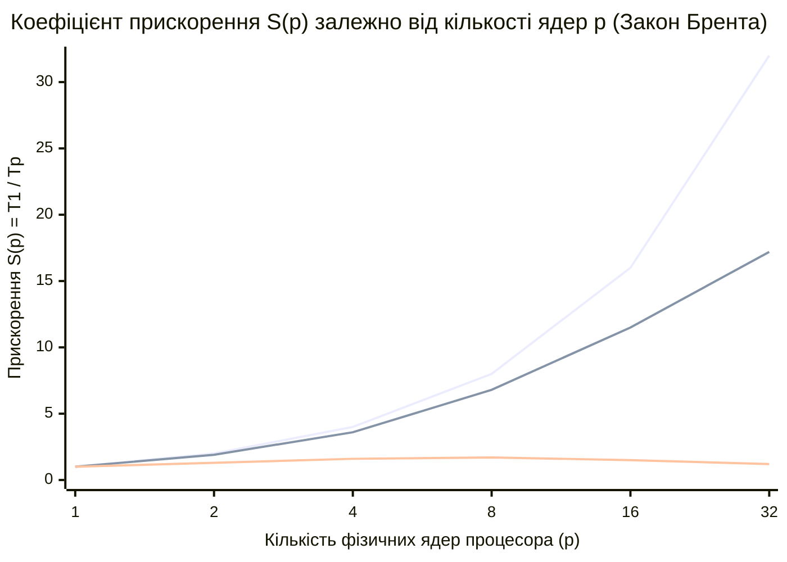

---

### 6.2. Еталонні програми М. Ю. Кузьміна

1. **Алгоритм Евкліда (`Nod`) і Факторіал:**
   ```text
   U64 Nod | @ U64 ( a_ > b -=b , b_ > a -=a ) =a
   Z = Nod(120, 6)

   U64 Factorial | @ U64 n [ 0 1 ] { Factorial = 1 Exit }
   = Factorial(n - 1) * n
   ```
   Взаємні подієві підписки зменшують більше число до досягнення $a = b$; у `Factorial` маска `[ 0 1 ]` задає базовий випадок.

2. **Інтегруючий лічильник (`Class Example`):**
   ```text
   Class Example
   | @ Byte Interval 1 Timer(Interval, Tick |)
   : {
       Float {
           Voltage ← @ Float x +=x
                   → Voltage = 0
           Electricity ← @ Float x +=x
                       → Electricity = 0
           Value 0 ← @ Float x +=x ~ Change |
       }
       Byte Tick 0
           = 10 Value = Voltage * Electricity / Tick^2
           ← Tick += 1
           → Tick = _0
       Void Tick | [Tick = 0 Voltage = "0p1" Electricity = "0p0"] Go Tick → 0 Go Tick ← ;
       ? Change
   }
   ```
   Ілюструє авто-скидання накопичувачів при читанні (`→`). *Фізико-математичне зауваження:* формула $\mathrm{Voltage}\cdot\mathrm{Electricity}/\mathrm{Tick}^2$ обчислює добуток середніх (потужність, а не енергію $\Delta t \sum U_k I_k$) і за змінних $U(t), I(t)$ не дорівнює середній миттєвій потужності — приклад ілюструє мовну ідіому, а не метрологічний алгоритм.

3. **Цифровий тахометр, одометр і акселерометр** ([«Пример для АН», слайд 11](../Research/sources/author/kuzmin-2024-example-for-AN.pdf); скорочений фрагмент авторської нотації):
   ```text
   Float {
       Distance 0 ← @ Float x 0 Distance += x • { Speed = x * 10 }
       Speed 0    ← @ Float x Accelleration =( x- Speed ) Speed =x
       Accelleration 0
   }
   Byte Tick 0
       | +=1
       → • Revolutions = Tick*600 Tick =_0
   ```
   У `Distance` крапка стоїть після `Distance += x`: `Speed` оновлюється у постфазі. У `Tick` крапка після `→` відносить обчислення обертів і скидання до дій після читання. **У рядку `Speed` крапки немає:** різницю `x - Speed` записано перед `Speed = x`, без явного роздільника фаз.

4. **Контролер діапазону (`Class Control`) та групи (`Array` / `Collection`):**
   `Float Value ~ [Up Down]` автоматично реагує як на зміну технологічного параметра `Value`, так і на динамічну зміну уставок `Up`/`Down`. Квадратні дужки `[ ]` задають вибір («АБО») із межами `Min`/`Max`, а круглі/фігурні `( )`, `{ }` — послідовне/повне виконання («І»).

---

## 7. Перспективні галузі застосування, матриця розбіжностей та відкриті задачі

### 7.1. П’ять перспективних галузей застосування гібриду `ECA + Dataflow/Reduction + PRAM`

Це можливі застосування, а не стендові результати у відповідних галузях. Нижче окремо наведено, яку властивість прототипу можна взяти за основу та що ще треба перевірити.

| Галузь і клас систем | Для чого перевіряти підхід | Що відомо про прототип | Що не перевірено |
| :--- | :--- | :--- | :--- |
| **1. Апаратні інтерлоки в робототехніці** | Перевірка дозволу на дію окремо від програми під ОС. | `80 нс` до рішення **всередині** `CFG-P` за `100 МГц`, не повний час реакції пристрою. | Наскрізна затримка й поведінка при відмові компонентів конкретної системи. |
| **2. Автомобільна електроніка, BMS та силові інвертори** | Каскадна діагностика з розрізненням нульового й відсутнього показів. | Генератор `--emit-c99` подає стан через значення та `valid_mask`; це дозволяє явно позначити відсутність показу, але не виявляє фізичний обрив саме по собі. | WCET на цільовому MCU, діагностика датчика й оцінка безпеки системи. |
| **3. Цифрова енергетика (`IEC 61850`) та промислові інтерлоки** | Оновлювані порогові правила. | Сталий час обслуговування всередині `CFG-P`; у `CFG-P-HA` перевірено перемикання **вже завантажених** банків. | Затримка від надходження повідомлення до рішення під пачковим навантаженням. |
| **4. Мережеві шлюзи (*SmartNIC*), Pre-Trade Risk і тригери фізичних експериментів** | Перевірка потоків за правилами, які часто змінюються. | При 64 слотах `CFG-P` використав на `39.5%` менше `SLICE_LUTX`, ніж порівнюваний регістровий RTL (§5.5). | Пропускна здатність із реальним мережевим інтерфейсом та його чергами. |
| **5. Гетерогенні комплекси HIL і Sensor Fusion** | Винесення групи незалежних обчислень на GPU. | Локальна медіана GPU — близько `2 мкс` для `1 024` підписників; виміряна міжплатна медіана RTT — `675.38 мкс` (§5.4). | Затримка прямого апаратного каналу без ОС. |

---

### 7.2. Статус TRL, матриця розбіжностей та відкриті науково-інженерні задачі

- **Статус готовності:** **TRL 3 за самооцінкою** (`ISO 16290:2013`); відповідність стандартам сертифікації (`ISO 26262`, `IEC 61508`, `DO-178C`) на поточному етапі **не заявляється**.

| Аспект моделі | Авторська модель М. Ю. Кузьміна (до 13–15.11.2026) | Поточний інженерний профіль (`KPOL-CME-1` / `CFG-P`) | Статус |
| :--- | :--- | :--- | :--- |
| **Структура концепту** | Спарсова змінної довжини: 8-бітна маска `Def` (`0..7`), `Class`, безіменний атрибут замість `Size`, 4-бітний `Token`. | Фіксована таблиця `CME-RAW-1`: 64 слоти по 16 Б (`Int32`, без `Def` і без окремого біта `_` у BRAM). | Кандидати вимог `KPOL-AUTH-01..02` (*Proposed*). |
| **Оператор `•`** | Ліва дія передує зверненню; права виконується після читання або успішного запису. | У класичному парсері KPOL префікс `•` — історичний синонім `not`; апаратний вентиль `kpol_txn_gate_v2` перевіряє запис, а не інтерпретує цей символ. | Відома діалектна розбіжність (`KPOL-AUTH-05`). |
| **Групи, дужки, індекси** | Контекстно-вільні дужки; виконувані `OpenBracket`/`CloseBracket`; `Min`/`Max` для `Token`. | Скалярний профіль `state / event / rule` без груп і виконуваних дужок. | Кандидати `KPOL-AUTH-03, 07, 08` (*Proposed*). |
| **Черга подій** | Блокувальне очікування (*backpressure*) без втрати подій. | `valid && ready` + 1-слотовий `cascade_pending` (доведено `Z3`); некеровані піни обліковуються в `events_dropped_count_o`. | Реалізовано для керованих джерел і каскадів. |
| **Багатоядерність** | Динамічні стеки `SR/SP`, рандеву `Go SR2 →` і *Graceful Serial Fallback*. | Багатобанковий дескрипторний кластер `N=2, 4, 8` у P&R (`133.89 / 103.73 / 91.89 МГц`), без стекової VM. | Стекова фабрика — аналітична модель. |

**Відкриті задачі:**
1. **Завершення специфікації авторського фронтенду (`Q-AUTH-01..07`):** оновлена таблиця роздільників після звільнення `#`, одиниця довжини `Name <= 16`, точний момент зняття `BUSY` у `A • B`, булева роль `•`, арифметика над `_`, розрізнення `Def[i]=0` проти `_`, єдине декодування `Max=0` із `15`, індексація нетокенних елементів у групах.
2. **Ієрархічна комутація для $N \ge 8$ на $\ge 100\text{ МГц}$** та захист від міжбанкових циклічних дедлоків при заповнених чергах.
3. **Прямий апаратний міст ПЛІС ↔ GPU без ОС** (`SN74AVC8T245` або `PCIe GPUDirect RDMA`) та дослідження зручності `KPOL`/`EKPOL` за участі розробників-людей.

---

### 7.3. Підсумкова інженерна ідентифікація

1. **Задум Кузьміна:** звернення до концепту дає привід перевірити умову над його станом і запустити підписки істинної події. Підписки можуть виконуватися паралельно; автор не задає універсального арбітражу конкурентних записів. ECA описує схожість із правилами «подія–умова–дія», PRAM — аналогію зі спільною пам’яттю. Обидва порівняння належать оглядачеві.
2. **Програмне виконання:** у тесті на `Cortex-A9` той самий чотирикроковий каскад коштував у середньому `534 нс` при пакетному виклику C99 і `29..33 мкс` разом із пробудженням потоку через `eventfd` (§5.5). Це різні шляхи на одному стенді, не універсальне порівняння МК з CPU.
3. **Мови проєкту:** `KPOL` та `EKPOL` виражають правила перевірених профілів. Доказ завершення обмеженого ациклічного каскаду `KPOL-CME-2` не поширюється на довільну авторську програму; межі взаємної трансляції наведено в §4.3.
4. **Апаратний результат Федчика:** та сама збірка `CFG-P` змінює реакцію після завантаження нових правил. Для двох порівняних RTL-реалізацій на `XC7Z020` перетин за `SLICE_LUTX` **оцінено** приблизно у 26 слотів; за 64 слотів виграш однобанкового `CFG-P` за цим лічильником **підтверджено P&R**. Для системи з GPU визначальним виявився час міжплатного обміну, не цей поріг.

---

## 8. Глосарій, абревіатури та список джерел

### Ключові терміни та абревіатури

| Термін / Скорочення | Значення |
| :--- | :--- |
| **А-ритм / А-схема** | Подієво-орієнтована організація обчислень і граф підписок між концептами без глобального `PC`. |
| **Велика Крапка (`•`)** | Пост-адресний бар’єр порядку (уточнення автора 13.11.2026: підписка стартує після завершення читання/запису). |
| **Концепт** | Базова одиниця пам’яті й логіки МК: значення, біт невизначеності `_`, предикати та підписки. |
| **BRAM / CME** | *Block RAM* у ПЛІС та компактний 8-тактовий мікро-рушій (*Concept Micro-Engine*), що обслуговує дескриптори концептів. |
| **CFG-R / CFG-P / CFG-P-HA** | Автономний реактивний шлюз (`10..20 нс`), однобанковий програмований BRAM-конвеєр (`80 нс`, `103.53 МГц`) та двобанковий конвеєр високої готовності (`100.69 МГц`, гаряче оновлення без простою). |
| **CPS / MCPS** | *Concepts Per Second* / мільйонів концепт-переходів на секунду. |
| **ECA / PRAM / NTM** | *Event–Condition–Action*; *Parallel Random-Access Machine*; *Nondeterministic Turing Machine*. |
| **EKPOL / KPOL / VMK** | Ергономічний ASCII-надшар (`0.1.0`), проблемно-орієнтована мова МК та двомодовий емулятор/TUI-дебагер на Go (`v0.3.1`). |
| **Fail-Closed (`kpol_txn_gate_v2`)** | Формально доведений шлюз інваріантів, що блокує небезпечний запис зі збереженням попереднього стану. |
| **HIL / OpenXC7 / STA** | *Hardware-in-the-Loop*; відкритий маршрут синтезу ПЛІС (`Yosys + nextpnr-himbaechel`); *Static Timing Analysis*. |
| **Safety IR / TRL / WCET** | Проміжне представлення правил безпеки; *Technology Readiness Level*; *Worst-Case Execution Time*. |

### Первинні матеріали автора концепції (М. Ю. Кузьмін)

1. **Кузьмін М. Ю.** Публікації та технічні топіки на DOU (2020–2023) і дискусія листопада 2026 р.:
   - [«Обіцяв викласти свій проєкт. Роблю»](https://dou.ua/forums/topic/31011/) (10.07.2020);
   - [«Недетермінована машина Тюрінга. Архітектура. Мова. Система. Програмування»](https://dou.ua/forums/topic/35601/) (26.11.2021);
   - [«Машина Кузьміна. (Керована недетермінована машина Тюрінга.)»](https://dou.ua/forums/topic/35914/) (28.12.2021; відповіді автора 04–05.11.2026);
   - [«За недетерміновану машину і за не-алгоритми»](https://dou.ua/forums/topic/36255/) (22.01.2022);
   - [«Виконання груп у недетермінованій машині»](https://dou.ua/forums/topic/36556/) (13.02.2022);
   - [«Як завжди про події»](https://dou.ua/forums/topic/38502/) (14.06.2022);
   - [«Автоматика та пристрої. Є проєкт, допоможіть розібратися, як знайти інвестора»](https://dou.ua/forums/topic/38994/) (08–11.07.2022);
   - [«Опис недетермінованої машини Кузьміна на пальцях»](https://dou.ua/forums/topic/43177/) (24.04.2023);
   - [«Зробив канал, на якому розповідаю за нову архітектуру комп’ютера, мову та приклади»](https://dou.ua/forums/topic/44552/) (30.07.2023).
2. **Кузьмін М. Ю.** [Авторське відео про Машину Кузьміна](https://www.youtube.com/watch?v=qKUoCeGvXnA).
3. **Кузьмін М. Ю.** Презентація *«Пример для АН»* (16 слайдів, 2024–2026), серія презентацій понять, груп і синтаксису від 13.11.2026 (*«Введение»*, *«Введение_1»*, *«Презентация1»*) та письмові роз’яснення семантики (11–15.11.2026).

### Класична наукова література та супутні матеріали проєкту

4. **Turing A. M.** (1936). *On Computable Numbers, with an Application to the Entscheidungsproblem.* Proc. LMS, s2-42(1), 230–265. [DOI](https://doi.org/10.1112/plms/s2-42.1.230).
5. **Dilworth R. P.** (1950). *A Decomposition Theorem for Partially Ordered Sets.* Annals of Mathematics, 51(1), 161–166.
6. **Rabin M. O., Scott D.** (1959). *Finite Automata and Their Decision Problems.* IBM J. Res. Dev., 3(2), 114–125. [DOI](https://doi.org/10.1147/rd.32.0114).
7. **Bernstein A. J.** (1966). *Analysis of Programs for Parallel Processing.* IEEE Trans. Electron. Comput., EC-15(5), 757–763. [DOI](https://doi.org/10.1109/PGEC.1966.264565).
8. **Hewitt C., Bishop P., Steiger R.** (1973). *A Universal Modular ACTOR Formalism for Artificial Intelligence.* IJCAI, 235–245.
9. **Brent R. P.** (1974). *The Parallel Evaluation of General Arithmetic Expressions.* JACM, 21(2), 201–206. [DOI](https://doi.org/10.1145/321812.321815).
10. **Dennis J. B., Misunas D. P.** (1975). *A Preliminary Architecture for a Basic Data-Flow Processor.* ISCA, 126–132.
11. **Hoare C. A. R.** (1978). *Communicating Sequential Processes.* CACM, 21(8), 666–677. [DOI](https://doi.org/10.1145/359576.359585).
12. **Forgy C. L.** (1982). *Rete: A Fast Algorithm for the Many Pattern/Many Object Pattern Match Problem.* Artificial Intelligence, 19(1), 17–37. [DOI](https://doi.org/10.1016/0004-3702(82)90020-0).
13. **Cruz R. L.** (1991). *A Calculus for Network Delay, Part I.* IEEE Trans. Inf. Theory, 37(1), 114–131. [DOI](https://doi.org/10.1109/18.61109); **Le Boudec J.-Y., Thiran P.** (2001). *Network Calculus.* Springer LNCS 2050. [DOI](https://doi.org/10.1007/3-540-45318-0).
14. **Berry G., Gonthier G.** (1992). *The Esterel Synchronous Programming Language.* Sci. Comput. Program., 19(2), 87–152. [DOI](https://doi.org/10.1016/0167-6423(92)90005-v).
15. **Bienaymé I.-J.** (1845); **Watson H. W., Galton F.** (1874). *On the Probability of the Extinction of Families.* [DOI](https://doi.org/10.2307/2841222).
16. **Sipser M.** (2013). *Introduction to the Theory of Computation* (3rd ed.). Cengage Learning.
17. **Федчик М.** Супутні публікації каталогу: [порівняльний огляд споріднених машин (`Similar_Machines_to_KM.md`)](Similar_Machines_to_KM.md), [повна стаття DOU (`DOU_Article_Kuzmin_Machine_UA.md`)](DOU_Article_Kuzmin_Machine_UA.md) та [популярна стаття DOU (`DOU_Article_Kuzmin_Machine_Popular_UA.md`)](DOU_Article_Kuzmin_Machine_Popular_UA.md).

---

## Додаток А. Практичний інженерний розрахунок параметрів для PYNQ-Z1 (`XC7Z020`)

Нижче наведено наскрізний параметричний розрахунок для лабораторної платформи **Digilent PYNQ-Z1** (`Xilinx Zynq-7000 XC7Z020-1CLG400C`) із чітким розмежуванням паспортних констант (`DS190`), синтезованих параметрів 1-ядерного вузла (`Yosys`) та модельних сценарних припущень (до-трасувальних оцінок для $N = 8..23$).

### А.1. Паспортні ресурси кристала `XC7Z020-1CLG400C`
- **Логіка PL:** $\mathrm{LUT}_{\mathrm{total}} = 53\,200$ (`LUT6`), $\mathrm{FF}_{\mathrm{total}} = 106\,400$ *(до-трасувальна оцінка `Estimated number of LCs` у `Yosys` не тотожна фізичним слотам `LUT6` після P&R у `nextpnr`)*.
- **Блокова пам’ять:** $\mathrm{BRAM}_{\mathrm{total}} = 140$ блоків `RAMB36E1` ($4.9\text{ Мбіт}$, 280 портів).
- **DSP:** 220 блоків `DSP48E1`; **цифровий ввід-вивід плати:** 16 ліній `PMODA/B` + 26 ліній `Arduino/ChipKIT` = **42 прямі лінії** (`LVCMOS33`).
- **Частота PL:** ціль $F_{\text{clk}} = 100\text{ МГц}$ ($T_{\text{clk}} = 10\text{ нс}$); для базового 1-ядерного ядра досягнуто $F_{\max} = 145.94\text{ МГц}$.

### А.2. Синтезований 1-ядерний вузол та пропускна здатність
- **Оцінка `Yosys`:** автономний секвенсер — `1 277 Estimated LCs`, повний топ із AXI4-Lite — `1 597 Estimated LCs`, 64-бітний модуль емісії додає `145 Estimated LCs`. Це не підрахунок зайнятих після трасування фізичних LUT6 (див. §5.5).
- **Пам’ять:** 64 концепти $\times$ 16 Б = 1 024 Б розміщуються в **1 блоці `RAMB36E1`** (22.2% ємності).
- **Пропускна здатність:** за інтервалу 8 тактів між обробками верхня межа одного вузла — $\mu_{\text{core}} = \frac{100\text{ МГц}}{8} = 12.5\text{ MCPS}$. Це розрахунок за відсутності затримок, не гарантована швидкість приймання зовнішнього потоку. Варіант $II=1$ у поточному RTL не реалізований.

### А.3. Сценарний розрахунок стабільності черг ($\rho < 1$)
Припустімо, що ззовні надходять 10 млн подій/с за пуассонівським законом; у моделі кожна активація має в середньому двох потенційних підписників та ймовірність спрацювання 0.1 для кожного. Це сценарій загальної мережі, не конфігурація `KPOL-CME-2`, де дозволено щонайбільше одного безпосереднього наступника `on change`.
1. Субкритичність: $m = 2 \times 0.1 = 0.2 < 1$.
2. На одну зовнішню подію припадає в середньому $1/(1-0.2)=1.25$ обробки разом із початковою. Попит становить **12.5 млн обробок/с**; це не виміряна продуктивність.
3. За одного банку $\rho=1$. Якщо поділити **всі** обробки порівну між двома однаковими банками, $\rho_1=\rho_2=0.5$. Лише за додаткових припущень $M/D/1$ для кожного банку (пуассонівські надходження, сталий час `80 нс`, необмежена черга) середнє очікування **до** початку обслуговування дорівнює $80 \times 0.5/[2(1-0.5)]=40\text{ нс}$.
4. Пуассонівські зовнішні події не роблять породжені каскади пуассонівськими. Якщо всі заявки потраплять в один із двох банків, отримаємо завантаження `(1; 0)`, а не `(0.5; 0.5)`. Тому розрахунок не гарантує достатності двох ядер чи відсутності втрат: при повній FIFO кероване джерело може чекати, а імпульс на некерованому вході — загубитися ([аналіз утримання заявок](../Engineering/validation/kpol-cme/queue-retention-151/report.md)).

### А.4. До-трасувальна межа ресурсної моделі та чутливість вибору $N$
Якщо **для оцінки** взяти `1 597 Estimated LCs` за умовну вартість вузла, додати умовну вартість комутатора $R_{\mathrm{xbar}}(N) \approx 12.5N^2$ і виділити $0.85 \times 53\,200 = 45\,220$ таких одиниць, при $N=23$ маємо $43\,344$ (`81.5%`), при $N=24$ — $45\,528$ (`85.6%`). Отже, $N_{\mathrm{model-max}}=23$ — максимум формули, не виміряна місткість кристала: `Estimated LCs`, паспортні `LUT6` та `SLICE_LUTX` після трасування — різні лічильники.

Для 16-канального сценарію $\lambda_{\text{ext}} = 120\text{ МГц}$ ($\lambda_{\text{effective}} = 150\text{ МГц}$, $N_{\text{min-stable}} = 13$) і цільової функції $J(N) = \frac{N \cdot 1\,597 + 12.5 N^2}{53\,200} + 0.008 \cdot \mathbb{E}[T_{\text{wait}}(N)]$:
- зі штучним обмеженням $N_{\text{eff}} = \min(N, 16)$ мінімум досягається при **$N = 16$** ($J(16) = 1.5005$, $\rho = 0.75$, $\mathbb{E}[T_{\text{wait}}] = 120\text{ нс}$);
- для потоку незалежних заявок без глобальної стелі Ділворта ($N_{\text{eff}} = N$) мінімум зміщується до **$N = 22$** ($J(22) = 1.1581$, $\rho = 0.545$, $\mathbb{E}[T_{\text{wait}}] = 48\text{ нс}$).

**Висновок додатка:** конкретне число ядер не є константою архітектури — воно визначається профілем залежностей задач і реальним фізичним P&R та STA (`OpenXC7` підтвердив $N=2$ на `133.89 МГц`, $N=4$ на `103.73 МГц PASS` і $N=8$ на `91.89 МГц`).

## Історія версій

| Версія | Дата | Зміни |
|---|---|---|
| 1.0.4 | 2026-11-19 | Прибрано посилання на окремий файл рецензії; змістові зауваження й виправлення залишено в огляді. |
| 1.0.3 | 2026-11-19 | Виправлено MathJax-нотацію SOS, дій `Go`/`Do`, індексованого стану комірки МТ, формул галуження та Network Calculus. |
| 1.0.2 | 2026-11-19 | Виправлено атрибуцію та фрагмент `Speed`, уточнено межі SOS, ескізу МТ й перекладу мов. Розділено стендові виміри, дані P&R та модельні оцінки площі й черг. |
| 1.0.1 | 2026-11-19 | Нормалізовано MathJax-формули для стабільного відтворення індексів, множин, SOS-переходу, гіллястого процесу та порогу $K^{*}$. |
| 1.0.0 | 2026-11-19 | Зведено унікальний зміст чотирьох попередніх документів без дублювання; попередні файли вилучено з чинного дерева, перехресні посилання оновлено. |
