# Науково-інженерне досьє Машини Кузьміна: концепція, математична теорія, архітектура виконання, раціональність та апаратна верифікація

> **Тип документа:** Повне науково-технічне досьє (Technical & Scientific Monograph Dossier)<br/>
> **Автор аналізу та реконструкції:** Микола Федчик (Mykola Fedchyk)<br/>
> **Дата ревізії:** 2026-11-13<br/>
> **Об'єкт дослідження:** Обчислювальна модель, мова програмування та багатопроцесорна архітектура «Машина Кузьміна» (МК), запропоновані Михайлом Ювеналійовичем Кузьміним, у зіставленні з похідною інженерною реконструкцією та прототипами проєкту.<br/>
> **Корпус першоджерел:** збережені публікації М. Ю. Кузьміна на порталі DOU (2020–2023 рр. та дискусія листопада 2026 р.), авторська презентація «Пример для АН» (16 слайдів), три нові авторські презентації понять, груп і синтаксису від 13.11.2026 (*«Введение»*, *«Введение_1»*, *«Презентация1»*) та письмові авторські роз'яснення семантики М. Ю. Кузьміна від 11–15.11.2026 *(окремої єдиної авторської текстової специфікації 2026 року не існує — систематизація в цьому документі є похідною роботою М. Федчика)*.

---

## Анотація

У цьому досьє подано формально-теоретичний та системно-інженерний синтез **Машини Кузьміна (МК)** — подієво-реактивної моделі паралельних обчислень, у якій базовою одиницею виступає не послідовна інструкція процесора фон Неймана, а **концепт** (структурована типізована сутність зі станом і компонентами), **подія** (предикат стану або факт адресації) та **підписка** (реакція, що породжує наступні адресації без імперативних циклів).

У роботі систематизовано та критично розмежовано повний стек напряму:
1. **Концептуальний базис і перевірку гіпотез:** заміщення імперативного потоку керування (*Control Flow*) подієво-реактивним графом («А-ритмом» та «А-схемою») без операторів циклу `For/Each/Do` (за поясненням автора щодо декларативно-подієвої моделі).
2. **Математичну модель і межі теорії:** похідну структурну операційну семантику (SOS), пост-адресний бар'єр «Велика точка» (`•`, за уточненням автора від 13.11.2026), інваріант пригнічення прямої саморекурсії, конструктивний авторський ескіз симуляції машини Тюрінга на ланцюгу концептів $`\text{¤}-1, \text{¤}, \text{¤}+1`$ (із переліком умов для повного математичного доведення) та межі паралельного прискорення за лемою Брента й умовами Бернштейна.
3. **Оновлену структуру концептів та архітектуру виконання:** 4-бітний квант `Token`, байт `Class`, 8-бітну спарсову маску присутності компонентів `Def` (`0..7`) і безіменний атрибут за замовчуванням замість вилученого поля `Size` (авторські уточнення 13–15.11.2026), виконувані дужки `OpenBracket`/`CloseBracket` і типізовані межі виконання груп `Min`/`Max` для `Token`-індексів (презентації від 13.11.2026), а також двостекову модель ліній підписок ($`SR`$ та $`SP`$), рандеву (`Go SR2 →` / `Go SR1 ←`) і послідовний відкат при дефіциті ядер (*Graceful Serial Fallback* без втрати подій).
4. **Оцінку раціональності, прикладів і доменів застосування:** розбір авторських прикладів (алгоритм Евкліда, електролічильник, тахометр, контролер допусків, групи, формальний нейрон) та матрицю придатності для автоматики, телеметрії, ПЛІС і вбудованих систем.
5. **Експериментальну та інструментальну верифікацію на рівні TRL 3 (за самооцінкою):** результати фізичних та формальних досліджень на Zynq-7000 (`XC7Z020`) у маршруті OpenXC7 із чітким розрізненням ранніх апаратних демо-блоків етапу PoC, автономного реактивного шлюзу `CFG-R` ($`10\dots 20\text{ нс}`$), однобанкового й двобанкового дескрипторного BRAM-конвеєра `CFG-P` / `CFG-P-HA` ($`80\text{ нс}`$ у домені ПЛІС, $`105\dots 115\text{ нс}`$ на вільному тракті, гаряче перемикання тіньового банку на `100.69 МГц`), а також огляд ергономічного мовного надшару **`EKPOL 0.1.0`** (`.ekpol`) і самодостатнього крос-платформного двомодового емулятора та повноекранного TUI-дебагера **`VMK v0.3.1`** (`vmk`) на Go (§4.8; підтримується в інженерному репозиторії проєкту та може постачатися як окремий автономний бандл під `Linux / macOS / Windows`).
6. **Авторські уточнення семантики (листопад 2026) та відкриті задачі:** систематизацію роз'яснень М. Ю. Кузьміна (див. також [огляд проєкту, §4](README.md#4-авторські-уточнення-семантики-та-відкриті-питання-моделі)), явну таблицю розбіжностей між нативною авторською моделлю та поточним інженерним профілем `KPOL-CME-1` і перелік невирішених теоретичних та апаратних задач до етапу лабораторної інтеграції TRL 4 (**Розділ 8**).

---

## 1. Концепція та філософія обчислень Машини Кузьміна

### 1.1. Критика архітектури фон Неймана та генезис ідеї

Вихідною точкою концепції М. Ю. Кузьміна є фундаментальне обмеження класичної послідовної архітектури фон Неймана при переході до багатопроцесорних обчислень. У класичному процесорі конвеєризація та спекулятивне виконання базуються на тому, що інструкція перевірки умови (порівняння) не змінює стану пам'яті, тому її можна виконувати паралельно з іншими читаннями.

Автор узагальнює цей принцип до архітектурної аксіоми:
* Якщо окрема інструкція порівняння не змінює стану системи, то й **будь-який складний вираз без побічних ефектів**, результат якого підлягає порівнянню, не змінює стану.
* Зміна стану комірки пам'яті є **подією**.
* Аналіз істинності подій (перевірка належності стану заданій підмножині) не мутує пам'ять, а отже, **може виконуватися масово-паралельно для довільної кількості подій на необмеженій кількості обчислювальних ядер**.

```mermaid
flowchart LR
    accTitle: Еволюція парадигми від архітектури фон Неймана до Машини Кузьміна
    accDescr: Порівняння послідовного конвеєра інструкцій із паралельною подієво-реактивною моделлю концептів.

    subgraph VonNeumann ["Класична архітектура фон Неймана (Control-Flow)"]
        direction LR
        PC["Лічильник команд\n(Program Counter)"] --> Fetch["Вибірка інструкції\n(Fetch / Decode)"]
        Fetch --> ALU["Виконання в АЛП\n(Execute)"]
        ALU --> Mem["Мутація спільної пам'яті\n(Write-Back)"]
        Mem -->|"Вузьке місце\nконвеєра"| PC
    end

    subgraph KuzminParadigm ["Архітектура Машини Кузьміна (Event-State Driven)"]
        direction LR
        Addr["Адресація концепту\n(Go →, ←, |, :)"] --> Eval["Паралельний аналіз усіх подій\n(Без зміни стану пам'яті)"]
        Eval --> TrueEv["Множина істинних подій\n{s_i : w_i(U) = 1}"]
        TrueEv --> Spawn["Одночасний запуск ліній підписок\nна пулі вільних ядер (SR, SP)"]
        Spawn -->|"Породження нових\nголовок адресації"| Addr
    end

    VonNeumann -.->|"Відмова від глобального\nлічильника команд"| KuzminParadigm
```

### 1.2. Чотири стовпи концепції: Концепт, Адресація, Подія, Підписка

Замість пасивних комірок оперативної пам'яті та централізованого пристрою керування Машина Кузьміна вводить чотирирівневу онтологію:

1. **Концепт (поточний концепт позначається символом $`\text{¤}`$):**
   Це типізована чарунка пам'яті з адресою або символьним ім'ям, поточним значенням (станом $`u \in U`$) та пов'язаними з нею подіями й підписками. У реконструйованій моделі концепт також має прапорець операції $`\bullet`$ («Велика точка»). Концепт може бути використаний як прототип для ініціалізації `:`; це не означає, що кожен концепт одночасно є і класом, і екземпляром.

2. **Чотири роди адресації (оператор `Go`):**
   Жодна дія в машині не відбувається поза адресацією концепту керуючим пристроєм (головкою). Визначено рівно чотири ортогональні види звернення:
   * `→` (**Читання / Read**): запит поточного значення концепту;
   * `←` (**Запис / Write**): передача нового значення у концепт;
   * `|` (**Виконання / Execute**): запуск обчислювальної процедури концепту;
   * `:` (**Ініціалізація / Instantiate**): породження нового динамічного концепту у просторі пам'яті за образом і подобою адресованого концепту-класу.

3. **Подія:**
   У моделі є щонайменше два різні види тригера. **Подія стану** відповідає підмножині $`s_i \subseteq U`$ і перевіряється предикатом $`w_i(U)`$; приклади — «значення більше 128» або «значення парне (`Even`)». **Подія адресації** описує факт операції над концептом, як-от читання (`→`), запис (`←`) чи виконання (`|`); це не підмножина значень стану. Події зміни (`~`) та інші складені тригери слід тлумачити згідно з конкретною версією опису мови.

4. **Підписка ($`D`$):**
   Послідовність елементарних дій (інструкцій адресації `Go` та арифметично-логічних операцій `Do`), прикріплена до події. У авторській моделі істинна подія може запускати пов'язані підписки, а незалежні дії можуть виконуватися паралельно. Порядок конфліктних записів, повторне спрацьовування та планування на скінченній кількості виконавців потребують окремих правил; сам опис події цього не визначає.

> [!IMPORTANT]
> **Фундаментальна формула роботи Машини Кузьміна:**
> Увесь робочий цикл обчислювача зводиться до трифазної тріади:
> **Адресація концепту $\longrightarrow$ Паралельний аналіз подій $\longrightarrow$ Виконання підписок на істинні події.**
> Якщо ж у концепту немає жодної підписки, адресація просто виконує свою базову штатну функцію (зчитує байт, записує байт, виконує операцію або клонує концепт), на чому робота головки завершується.

#### Навчальний приклад 1: лічильник і порогова подія

```text
? Alarm ¬
Byte Counter 0
    = 3 Alarm = !
```

Читаємо фрагмент знизу вгору за причинно-наслідковим зв'язком:

| Елемент | Роль | Пояснення |
| :--- | :--- | :--- |
| `Counter` | Концепт | Зберігає ціле значення типу `Byte`; початковий стан — `0`. |
| `= 3` | Подія стану | Предикат істинний, коли значення `Counter` дорівнює `3`. |
| `Alarm = !` | Підписка | Дія, пов'язана з подією: встановити концепт `Alarm` у стан «Істина». |
| `? Alarm ¬` | Початковий стан | До спрацювання події тривога має значення «Хиба». |

У навчальному сценарії зовнішній ввід записує в `Counter` значення `1`, потім `2`, потім `3`. Коли після запису значення дорівнює `3`, модель перевіряє предикат, і за істинного результату запускає підписку:

| Крок | Значення `Counter` | `Counter = 3` | Дія | `Alarm` після кроку |
| :---: | :---: | :---: | :--- | :---: |
| Початок | `0` | Хиба | Немає | `¬` |
| Запис `1` | `1` | Хиба | Немає | `¬` |
| Запис `2` | `2` | Хиба | Немає | `¬` |
| Запис `3` | `3` | Істина | `Alarm = !` | `!` |

Це схоже на `if Counter == 3`, але умова тут описана як властивість концепту, а не як команда в центральному циклі. Фрагмент є пояснювальною ілюстрацією нотації; поведінку повторного запису того самого значення та планування конкурентних підписок потрібно визначати окремою семантикою.

#### Навчальний приклад 2: накопичувач із читанням-із-скиданням

```text
Float Voltage 0
    ← @ Float x += x
    → Voltage = 0
```

Підписка на запис використовує параметр `x` як нове вимірювання та додає його до стану `Voltage`. Підписка на читання повертає накопичене значення, після чого обнуляє концепт. Інтуїтивний еквівалент для одного виконавця:

```text
при записі Voltage(x):
    Voltage = Voltage + x

при читанні Voltage:
    result = Voltage
    Voltage = 0
    повернути result
```

Наприклад, після записів `2.5` і `1.5` накопичене значення дорівнює `4.0`; наступне читання видає `4.0` і залишає `Voltage = 0`. Це приклад подієвої ідіоми, а не гарантія атомарності при одночасних записах і читанні: порядок таких операцій має задавати runtime або протокол синхронізації.

#### Як відрізнити чотири види адресації

| Нотація | Намір | Аналогія |
| :--- | :--- | :--- |
| `Go Counter →` | Прочитати значення концепту | «Поверни поточне значення». |
| `Go Counter ←` | Записати передане значення | «Прийми нове значення». |
| `Go Tick |` | Активувати підписку виконання | «Виконай дію, пов'язану з `Tick`». |
| `Elect = Example : (1)` | Створити екземпляр на основі `Example` із параметром `1` | «Створи й ініціалізуй об'єкт». |

Перші три рядки показують низькорівневу нотацію адресації; останній — високорівневий приклад ініціалізації з авторського синтаксису. Вони пояснюють призначення операторів, але не є повною граматикою виклику чи протоколу передачі значень.

> [!NOTE]
> **Зауваження Автора щодо формату адрес (13.11.2026):**<br/>
> М. Ю. Кузьмін зазначив, що двійковий формат адреси є питанням реалізації й відкладений до етапу побудови повної ВМ на цільовій платформі, та висловив сумнів щодо доцільності прямого звернення до фізичних пінів або портів у синтаксисі мови. *Інженерна інтерпретація проєкту:* такий підхід узгоджується з моделлю активної пам'яті, де зовнішні лінії відображаються як віртуальні концепти-регістри (за аналогією до MMIO), але конкретний адресний ABI для цільової платформи ще підлягає окремому погодженню (`Q-AUTH-06`).

### 1.3. «А-ритм» та «А-схема» як альтернатива алгоритму і блок-схемі

Автор протиставляє класичне поняття *алгоритму* (яке він трактує вузько як суворо детерміновану послідовність кроків одного виконавця) та *А-ритму* — динамічному графу каскадних активацій, що розповзається вздовж підписок.

Через це класична блок-схема стає непридатною для візуалізації програм МК з двох причин:
1. Кожен концепт має **чотири незалежні входи адресації** (`→`, `←`, `|`, `:`), кожен з яких породжує власні гілки.
2. Кожна адресація може активувати **кілька подій**, а кожна подія — **кілька паралельних підписок**.

Спроба зобразити всі статичні зв'язки одночасно перетворює креслення на нечитабельну «візуальну кашу». Тому Кузьмін пропонує концепцію **А-схеми** — інтерактивного топологічного подання, де концепти розташовані у вигляді декларативних блоків без суцільних ліній, а динамічні стрілки причинно-наслідкових переходів висвічуються в інтерфейсі середовища розробки лише при наведенні курсора миші на конкретний ідентифікатор чи подію.

### 1.4. Авторська інженерна інтерпретація Миколи Федчика: Динамічна віртуалізація активної пам'яті

У межах науково-інженерної реконструкції проєкту Микола Федчик сформулював сутність моделі через фундаментальний апаратний базис вбудованих мікропроцесорних систем:

> **Принцип інженерної інтерпретації (віртуалізація активної пам'яті поблизу обчислювача):**<br/>
> *«Периферійний апаратний контролер здатен підтримувати у двопортовій пам'яті (`SRAM` чи `BRAM`) динамічну таблицю концептів-регістрів, оновлюючи кожен адресований дескриптор за строго фіксоване число машинних тактів із нульовим тактовим джитером ядра у синхронному домені ПЛІС ($`\sigma_{\text{exec}} = 0`$ тактів), без переривань центрального процесора та витрат на перемикання контексту ОС».*

Ця інтерпретація розв'язує класичну дилему між «пасивною оперативною пам'яттю» та «обмеженим регістровим файлом CPU»:
1. **Дескриптори в `BRAM` замість фіксованого `GPR`:** Замість обмежених регістрів процесора в пам'яті зберігаються структуровані дескриптори станів та предикатів, які обслуговуються апаратним автоматом поблизу пам'яті.
2. **Зменшення контекстного оверхеду переривань ($IRQ$):** Зміна контрольованого входу не змушує CPU зупиняти потік виконання і зберігати регістри в стек; перевірку умов виконує автономний рушій у ПЛІС.
3. **Реалізація на серійному кремнії:** Архітектура не вимагає кастомного ASIC із логікою в комірках SRAM, а проєктується на серійні мікроконтролери та двопортову `BRAM` ПЛІС (деталі — у [`Kuzmin_Machine_by_Fedchik.md`](Kuzmin_Machine_by_Fedchik.md) та [`Kuzmin-Machine-Visual.md`](Kuzmin-Machine-Visual.md)).

---

## 2. Гіпотези автора та їхня наукова верифікація

Реконструюємо шість основоположних гіпотез автора $`\mathcal{H}_1 \dots \mathcal{H}_6`$ та проведемо їхню строгу верифікацію.

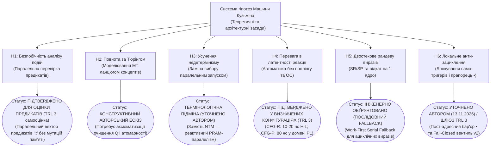

### Матриця аналізу гіпотез

| Код | Формулювання гіпотези автора | Науково-технічна оцінка та межі істинності | Статус |
| :--- | :--- | :--- | :--- |
| $`\mathcal{H}_1`$ | **Паралельність перевірки подій:** Оскільки перевірка умови події $`w_i(U)`$ не змінює стану концепту, усі події можна перевіряти одночасно без блокувань. | **Експериментально перевірено на рівні PoC (TRL 3 за самооцінкою):** Апаратний комбінаційний обчислювач предикатів розраховує 8-бітний вектор `::` (`_`, `Null`, `Positive`, `Negative`, `Even`, `Uneven`, `~`, `Range`) комбінаційно без побічних дій над станом пам'яті ($`W(\mathrm{pred}) = \emptyset`$), що задовольняє умови Бернштейна для самої фази оцінки умов *(але не усуває конфліктів запису в тілах підписок)*. | **Підтверджено для фази оцінки предикатів (TRL 3, самооцінка)** |
| $`\mathcal{H}_2`$ | **Універсальність (Тюрінг-повнота):** На Машині Кузьміна можна змоделювати будь-яку класичну машину Тюрінга. | Наявний авторський ескіз класу `Class MT`, де комірки стрічки кодуються концептами, а зсув головки $`d \in \{-1, 0, +1\}`$ здійснюється перенесенням маркера стану $`Q`$ до сусіднього концепту $`\text{¤}+d`$. Як підтвердив М. Ю. Кузьмін у листопаді 2026 року, це **концептуальна схема, а не завершене математичне доведення**: строгий доказ вимагає явного очищення старого $`\text{¤}.Q \leftarrow \underline{\hspace{0.4em}}`$, атомарності кроку, правила для $`d=0`$ та необмеженої адресації `:`. | **Конструктивний ескіз (формальний доказ відкритий)** |
| $`\mathcal{H}_3`$ | **Фізична реалізація недетермінізму:** Класична недетермінована МТ (NTM) суперечлива, але якщо дати машині багато головок і запускати всі підписки одночасно, отримаємо реальну NTM. | У теорії обчислень NTM здійснює *екзистенційний вибір* однієї траєкторії над ізольованими копіями стрічки. МК натомість виконує *всі гілки одночасно над спільною пам'яттю*. В авторському позиціонуванні області застосування моделі (листопад 2026) М. Ю. Кузьмін прямо підтвердив метафоричність раннього вживання слова «недетермінізм»: модель є паралельною системою над спільною пам'яттю (PRAM) без експоненціального прискорення для класу $`\mathrm{NP}`$. | **Знято автором як NTM / Класифіковано як PRAM** |
| $`\mathcal{H}_4`$ | **Мінімальна латентність реакції:** Подієва адресація забезпечує вищу швидкість реакції в автоматиці, ніж класичні процесори. | **Результати досліджень на кристалі Zynq-7000 (§2.2, §4.6; TRL 3 за самооцінкою):**<br/>1. **Автономний реактивний шлюз `CFG-R` (HIL `AV-10`/`AV-11`):** фізично виміряна затримка від стимулу до реакції становить $`10\dots 20\text{ нс}`$ ($`2`$ такти PL при $`100\text{ МГц}`$, $`\sigma = 2.39\text{ нс}`$ квантування асинхронного вимірювача).<br/>2. **Програмований BRAM-конвеєр `CFG-P`:** обробка одного дескриптора займає рівно $`8`$ тактів у синхронному домені ПЛІС ($`80\text{ нс}`$, $`\sigma_{\text{exec}} = 0`$ тактів); розрахунковий бюджет вільного тракту «пін-до-піна» становить $`105\dots 115\text{ нс}`$ при фазовому квантуванні асинхронного входу CDC $`\sigma_{\text{cdc}} \approx 2.89\text{ нс}`$.<br/>3. **Програмні та шинні baseline ($`N=10\,000`$):** обмін по шині MMIO — mean $`84.941\text{ мкс}`$ ($`\sigma=4.109\text{ мкс}`$); перевірка в Linux userspace — mean $`6.953\text{ мкс}`$ ($`\sigma=0.942\text{ мкс}`$). | **Підтверджено для визначених конфігурацій PL (TRL 3, самооцінка)** |
| $`\mathcal{H}_5`$ | **Адаптивне розпаралелювання виразів:** Розбиття виразів на лінії зі стеками $`SR_1, SR_2`$ дозволяє прискорити обчислення на $`p`$ процесорах і безболісно виконати їх на одному процесорі за відсутності вільних ядер. | Механізм рандеву `Go SR2 →` / `Go SR1 ←` з переходом першого процесора на код другого стека при відсутності вільного ядра (підтверджено автором у цільовій політиці керування чергами та послідовного fallback) є варіантом *Work-First Serial Fallback*. Він запобігає голодуванню пулу для ациклічних дерев виразів, хоча повномасштабна багатоядерна RTL-фабрика зі стеками `SR/SP` ще не синтезована. | **Інженерно обґрунтовано (багатоядерний стековий RTL відкритий)** |
| $`\mathcal{H}_6`$ | **Захист від зациклення та черговість фаз:** Оператор «Велика точка» (`•`) упорядковує читання/запис, а заборона генерації події при зверненні до того ж атрибута усуває пряме самозациклення. | В уточненні від 13.11.2026 Автор сформулював канонічну роль `•`: підписка за точкою виконується строго після завершення читання або запису. В інженерному ядрі окремо формально доведено властивості fail-closed вентиля інваріантів `kpol_txn_gate_v2` (`S3-62`), який блокує мутацію при порушенні передумов чи небезпеці *(узгодження діалектного `•` у компіляторі з пост-адресним бар'єром триває — §8.2)*. | **Пост-адресну семантику уточнено Автором; вентиль v2 формально доведено (TRL 3)** |

### 2.2. Бенчмарк латентності та її варіації на Zynq-7000 (HIL-перевірка гіпотези $`\mathcal{H}_4`$)

На лабораторному апаратному стенді на базі кристала **Zynq-7000 (XC7Z020)** виконано всебічний бенчмарк часових характеристик та латентності реакції транзакційного шлюзу порівняно з програмними baseline.

На платі з кристалом `xc7z020clg400-1` програмована логіка (PL) тактувалася від `FCLK0 = 100 МГц` ($`T_{\mathrm{clk}}=10.0\text{ нс}`$). Для шинного інтерфейсу вимірювався час повного циклу MMIO: три записи регістрів (`CANDIDATE`, `CONDITIONS`, `COMMAND`) і два читання (`STATUS`, `STATE`). Програмний baseline виконував ту саму базову перевірку умов у середовищі ОС на процесорі ARM Cortex-A9. Для кожного з режимів зібрано $N=10\,000$ індивідуальних інтервалів часу:

| Рівень виконання | Механізм обробки події | Латентність ($`\mu\text{s}`$) | Стандартне відхилення латентності ($`\sigma, \mu\text{s}`$) | Пропускна здатність | Інтерпретація та межі |
| :--- | :--- | :---: | :---: | :---: | :--- |
| **0а. Автономний реактивний шлюз (`CFG-R`, HIL `AV-10`)** | Фізичний стимул $\to$ 2-FF синхронізатор $\to$ 2-тактовий вентиль PL $\to$ вихід PMOD | **$`0.010 \dots 0.020\text{ мкс}`$ ($`10\dots 20\text{ нс}`$, медіана $`20\text{ нс}`$)** | **$`0.0024\text{ мкс}`$ ($`2.39\text{ нс}`$, квантування $`100\text{ MS/s}`$)** | **Стрімінг пакетів без участі CPU** | Фізичний захват пачки $`N=100`$ на PYNQ-Z1; внутрішній цикл шлюзу фіксований (2 такти PL). |
| **0б. Програмований BRAM-конвеєр (`CFG-P`, вільний тракт)** | Фізичний вхід $\to$ CDC+фронт ($`2\dots 3`$ такти) $\to$ BRAM FSM 8 тактів $\to$ буфер IOB | **$`0.105 \dots 0.115\text{ мкс}`$ ($`105\dots 115\text{ нс}`$, розрахунковий idle)** | **$`\sigma_{\text{exec}} = 0`$ тактів у PL ($`\sigma_{\text{cdc}} \approx 2.89\text{ нс}`$ на вході)** | **$12.5\times10^6$ подій/с** (неконвеєрний 8-тактовий FSM) | При непорожній черзі `FIFO-16` додається очікування $`T_{\text{wait}} \le 1.28\text{ мкс}`$; метрика `CFG-R` сюди не переноситься. |
| **1. Апаратне ядро шлюзу (PL)** | Один такт оцінки в RTL; $`100\text{ МГц}`$ | **$`0.010\text{ мкс}`$ ($`10\text{ нс}`$), циклова оцінка** | **Не вимірювався** | **До $100\times10^6$ оцінок/с теоретично**, за 1 прийняту оцінку/такт | Статична оцінка таймінгу: critical path $`4.514\text{ нс}`$, $`f_{\max}=221.53\text{ МГц}`$. |
| **2. Шинний обмін MMIO (PS-PL)** | П'ять MMIO-операцій на повну транзакцію | **min $82.007$; mean $84.941$; median $84.327$; p95 $87.816$; p99 $95.749$; max $204.180$ мкс** | **$`4.109\text{ мкс}`$** | **$10\,588.2$ транзакцій/с пакетно** | $N=10\,000$ інтервалів; виміряні середнє, розкид і хвіст розподілу для стенда. |
| **3. Software Userspace Baseline** | Перевірка предикатів у Linux userspace, ARM Cortex-A9 | **min $6.498$; mean $6.953$; median $6.929$; p95 $7.207$; p99 $7.366$; max $52.696$ мкс** | **$`0.942\text{ мкс}`$** | **$70\,469.5$ ітерацій/с пакетно** | $N=10\,000$ інтервалів; накладні витрати планувальника та ОС загального призначення. |

1. **Заявка про фізичну тривалість `CFG-R` і timer check:** у табл. §2.2 для `CFG-R` наведено затримку `10–20 нс` (а для таймера в §2.4 ділення $\Delta = 5\,014\,496$ тактів на номінальні `50 мс` не є незалежно каліброваним еталоном частоти); повні сирі логи й траси цих прогонів не включено в публічний каталог `drafts`.
2. **Розрахункові проти виміряних значень `CFG-P`:** у табл. §2.2 для `CFG-P` наведено **розрахункову** idle-оцінку `105–115 нс` і межу перебування вже прийнятої заявки у черзі `≤ 1.28 мкс` (`T_wait`), що потребують натурних вимірів (`EXP-1`).
3. **Розмежування `CFG-R` / `CFG-P` / PoC-демо:** ранні ручні Verilog-демо (`Nod`, `RCFC`, `Suite B`, `Stream`) з §2.4–§2.8 не генерувалися компілятором KPOL і вилучені з робочого `CFG-P`.

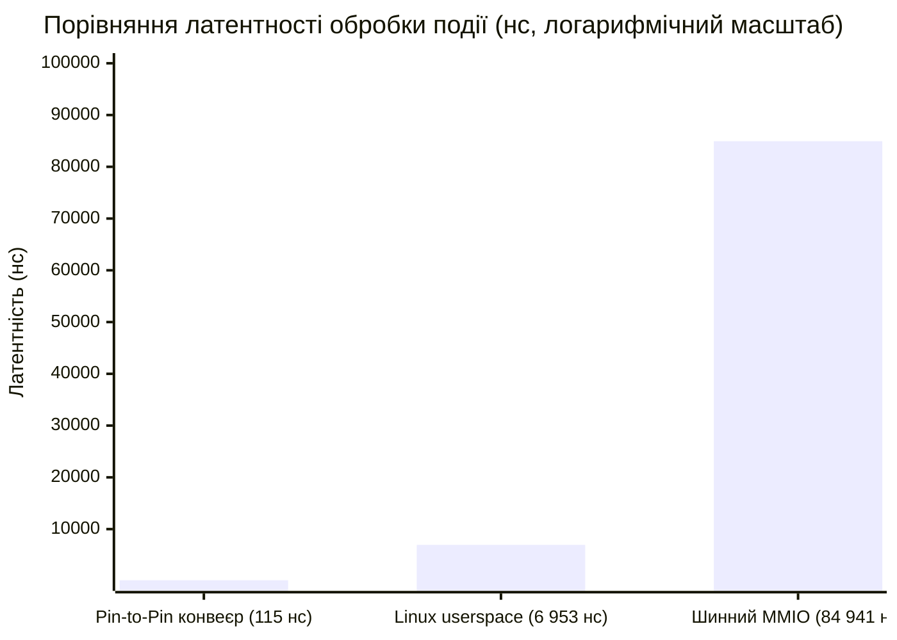

#### Межі висновку щодо гіпотези $`\mathcal{H}_4`$:
1. **Розрізнення конфігурацій `CFG-R` та `CFG-P`:** фізично виміряні $`10\dots 20\text{ нс}`$ стосуються жорстко скомбінованого шлюзу `CFG-R` без читання дескрипторів із пам'яті, тоді як програмований без пересинтезу тракт `CFG-P` витрачає фіксовані $`8`$ тактів ($`80\text{ нс}`$) на вибірку 128-бітного дескриптора з `BRAM` та перевірку вентиля, даючи $`105\dots 115\text{ нс}`$ на вільному тракті ($`20\dots 30\text{ нс}`$ CDC+детектор фронту $`+ 80\text{ нс}`$ секвенсер $`+ \sim 5\text{ нс}`$ буфер IOB) і нульовий тактовий джитер у синхронному домені ПЛІС при фазовій невизначеності асинхронного входу $`\pm 0.5`$ такту ($`\sigma_{\text{cdc}} \approx 2.89\text{ нс}`$).
2. **Апаратна оцінка (PL):** RTL вентиля забезпечує однотактову затримку оцінки; при $`100\text{ МГц}`$ це один період $`10\text{ нс}`$. Статична оцінка критичного шляху ізольованого вентиля ($`4.514\text{ нс}`$) підтверджує часовий запас при роботі на $`100\text{ МГц}`$.
3. **Програмний рівень (Userspace):** у програмному бенчмарку зафіксовано середню затримку $`6.953\text{ мкс}`$ із розкидом до $`52.696\text{ мкс}`$ за $10\,000$ інтервалів, що демонструє природну варіацію часу реакції в ОС загального призначення.
4. **Шинний інтерфейс (MMIO):** повний round-trip обміну має mean $`84.941\text{ мкс}`$ через послідовні транзакції системної шини, що чітко локалізує накладні витрати міжпроцесорного зв'язку.
5. **Загальний висновок:** результати підтверджують, що прямий апаратний тракт обробки подій забезпечує реакцію субмікросекундного діапазону (на $1\dots 3$ порядки швидше за програмний цикл у ОС і шинний поллінг), проте наведені показники стосуються конкретного одноядерного контуру й не затверджують багатоядерного масштабування без окремих вимірювань.

> [!IMPORTANT]
> **Методологічне розмежування історичних макетів етапу PoC (§2.3–2.9, §4.4) та незмінного програмованого ядра `CFG-P` (§4.6):**<br/>
> Описані нижче в підрозділах **2.3–2.9** (та зведені в таблиці регістрів `0x00..0xC0` підрозділу **4.4**) апаратні блоки — обчислювач `Nod(a, b)`, демонстратор рандеву `RCFC`, матриця `Suite B` та 4-стадійний потоковий фільтр — були реалізовані на ранньому етапі PoC як **спеціалізовані жорстко закодовані у Verilog скінченні автомати (`poc-demo`)** для точкової лабораторної перевірки окремих схемотехнічних механізмів у кремнії `XC7Z020`. Вони **не генерувалися компілятором із тексту програм KPOL**. Під час подальшого рефакторингу архітектури (перехід від демо-автоматів до незмінного обчислювача) ці ручні FSM були відокремлені від цільового програмованого конвеєра **`CFG-P`** (§4.6), який виконує скомпільовані дескриптори з `Block RAM` без пересинтезу ПЛІС у межах строгого профілю `KPOL-CME-1` (§8.2).

### 2.3. Фізичний тест комбінаційних предикатів ($`\mathcal{H}_1`$) та вентиля інваріантів (`CFG-R`, PoC-демо)

Для завершення експериментального циклу транзакційний шлюз було розширено спеціалізованим апаратним модулем комбінаційної оцінки предикатів та проведено випробування на фізичному кристалі Zynq-7000 платформи PYNQ-Z1:

1. **Апаратна перевірка гіпотези $`\mathcal{H}_1`$ (Комбінаційне обчислення `::`, заявлено для `CFG-R`):**
   Модуль обчислює 8-бітний вектор предикатів нульового порядку **без додаткового регістрового такту** (чисто комбінаційною логікою з ненульовою затримкою поширення в межах одного такту шини та без мутації пам'яті концепту, $`W(\mathrm{pred}) = \emptyset`$):
   - `_` (Uninit), `Null` ($x = 0$), `Positive` ($x > 0$), `Negative` ($x < 0$), `Even` ($x[0]=0$), `Uneven` ($x[0]=1$), `~` ($`x \neq \mathrm{state}`$), `Range` ($`\mathrm{lower} \le x \le \mathrm{upper}`$).
   - При поданні кандидатів $4$, $0$, $-5$ кристал миттєво повернув точні вектори `0xD4`, `0x92`, `0x68` через регістр `0x24` без виконання команди запису, що строго підтверджує Read-Only незалежність аналізу подій.

2. **Апаратна перевірка гіпотези $`\mathcal{H}_6`$ (Оператор «Велика точка» `•` як Fail-Closed шлюз):**
   - При активації правила `REQUIRE_EVEN` парний кандидат $10$ формує `BIG_DOT = 1` (`• = !`), і транзакція успішно фіксується у пам'яті (`STATE = 10`).
   - Непарний кандидат $11$ формує `BIG_DOT = 0` (`• = ¬`). Апаратний вентиль миттєво блокує запис у пам'ять, повертає статус `STATUS_REJECTED | STATUS_REJECTED_INVARIANT` та зберігає попередній стан $10$ без жодних змін (100% Fail-Closed Invariant Protection).
   - Аналогічний результат отримано для правила контролю діапазону `REQUIRE_RANGE` $[20 \dots 50]$: кандидат $35$ зафіксовано, кандидат $99$ відхилено кремнієм зі збереженням стану $35$.

### 2.4. Внутрішньосхемний таймінг та ручний RTL-демонстратор алгоритму Евкліда Nod(a, b) [PoC-демо, поза CFG-P]

Транзакційний шлюз було розширено функціональними апаратними блоками (обчислювальне ядро реактивного алгоритму Евкліда та прецизійні лічильники тактів у складі шлюзу), синтезовано через openXC7 і протестовано на фізичному кристалі PYNQ-Z1:

1. **Внутрішній апаратний таймер:**
   - 64-бітний лічильник `REG_CYCLE_CNT` працює на повній частоті шини $`100\text{ МГц}`$. Емпіричний замір приросту за $`50\text{ мс}`$ показав $\Delta = 5\,014\,496$ тактів, що відповідає фізичній частоті генератора **$`100.29\text{ МГц}`$** (відхилення $<0.3\%$).
   - Регістр тривалості транзакції `REG_LAST_TXN_CYCLES` (зсув `0x34`) безпосередньо фіксує кількість тактів у кремнії від стробу запису команди до підтвердження коміту. Для номінальної транзакції KPOL апаратний результат склав **$2$ такти ($`20.0\text{ нс}`$)**, підтверджуючи, що всі $`84.9\text{ мкс}`$, виміряні в §2.2, припадали виключно на затримки системної шини та ядра Linux.

2. **Апаратний реактивний алгоритм Евкліда:**
   - Два апаратні концепти $A$ та $B$ пов'язані взаємними подієвими підписками:

$$
\begin{cases}
A > B \implies A \leftarrow A - B \\
B > A \implies B \leftarrow B - A
\end{cases}
$$

   - Кожна реактивна ітерація виконується строго за 3 такти: Фаза 1 (EVAL) $\to$ Фаза 2 (EXEC) $\to$ Фаза 3 (COMMIT).
   - Для ключового калібрувального тесту $`\mathrm{Nod}(120, 6)`$ ядро в чистому PL автономно виконало $19$ ітерацій за **рівно $58$ тактів ($`580.0\text{ нс}`$)**, що **на $100\%$ збігається з теоретичною часовою моделлю** ($19 \times 3 + 1 = 58$ тактів).
   - Програмний еквівалент на ARM Cortex-A9 у **Python під Linux** потребував $`\sim 29\,300\text{ нс}`$ (фізичне прискорення відносно інтерпретованого скрипту в ОС склало **$50.52\times$** для $(120, 6)$ і **$70.19\times$** для $(35, 14)$). *Методологічне застереження:* порівняння рукописного RTL на FPGA зі скриптом Python в ОС демонструє лише перевагу прямого апаратного виконання над інтерпретованим userspace-циклом, а не перевагу архітектури МК над скомпільованим bare-metal C (`-O3`) чи традиційним RTL/HLS.

| Тестова пара $(A, B)$ | Очікуваний НСД | Апаратний результат PL | Ітерацій (HW / SW) | Такти PL ($`100\text{ МГц}`$) | Час PL ($`10.0\text{ нс}`$) | Час ARM (Python / Linux) | Прискорення PL vs Python |
| :---: | :---: | :---: | :---: | :---: | :---: | :---: | :---: |
| $`\mathrm{Nod}(120, 6)`$ | **$6$** | **$6$** | $19$ / $19$ | **$58$ тактів** | **$`580.0\text{ нс}`$** | $`29\,300.6\text{ нс}`$ | **$50.52\times$** |
| $`\mathrm{Nod}(1071, 462)`$ | **$21$** | **$21$** | $11$ / $11$ | **$34$ такти** | **$`340.0\text{ нс}`$** | $`19\,231.5\text{ нс}`$ | **$56.56\times$** |
| $`\mathrm{Nod}(35, 14)`$ | **$7$** | **$7$** | $3$ / $3$ | **$10$ тактів** | **$`100.0\text{ нс}`$** | $`7\,018.5\text{ нс}`$ | **$70.19\times$** |
| $`\mathrm{Nod}(270, 192)`$ | **$6$** | **$6$** | $10$ / $10$ | **$31$ такт** | **$`310.0\text{ нс}`$** | $`16\,612.1\text{ нс}`$ | **$53.59\times$** |
| $`\mathrm{Nod}(252, 105)`$ | **$21$** | **$21$** | $5$ / $5$ | **$16$ тактів** | **$`160.0\text{ нс}`$** | $`9\,839.8\text{ нс}`$ | **$61.50\times$** |
| $`\mathrm{Nod}(123456, 12)`$ | **$12$** | **$12$** | $10\,287$ / $10\,287$ | **$30\,862$ такти** | **$`308.62\text{ мкс}`$** | $`17\,098.3\text{ мкс}`$ | **$55.40\times$** |

### 2.5. Масштабування пам'яті до 64 концептів у Block RAM та автономний ко-процесор PL

Для подолання обмеження однорегістрової конфігурації було розроблено та фізично випробувано повноцінну апаратну таблицю концептів на базі подвійнопортової пам'яті Block RAM кристала XC7Z020:

1. **Структура таблиці концептів (64 концепти x 16 байтів = 1024 байти / 256 слів):**
   - Кожен концепт має повний 128-бітний дескриптор: Word 0 (`VALUE_LO`), Word 1 (`VALUE_HI`), Word 2 (`META`: тип, маска розміру, прапорці ініціалізації `_` та Великої точки `•`, маска підписок), Word 3 (`STATUS_WORD`).
   - Пам'ять безпосередньо відображена в адресний простір PS AXI4-Lite за зміщенням `0x40001000 .. 0x400013FF`.
   - При масовому стрес-записі та зворотному зчитуванні всіх 64 концептів зафіксовано **0 незбігів** (100% цілісність даних).

2. **Одночасний неблокуючий доступ двох портів (Dual-Port Concurrency):**
   - Порт A обслуговує запити процесора ARM (через AXI), тоді як Порт B паралельно підключений до апаратного обчислювального ядра PL.
   - Підтверджено одночасне читання Концепту #10 з боку ядра PL під час запису Концепту #20 з боку процесора ARM без жодних блокувань шини чи затримок.

3. **Автономні подієві операції в чистому PL:**
   - Апаратний автомат ядра PL реалізує автономні міжконцептні переходи: копіювання (`Concept[dst] <= Concept[src]`) та подієве накопичення (`Concept[dst] += Concept[src]`).
   - Обидва типи переходів виконуються за **$5$ тактів ($`50.0\text{ нс}`$ при $`100\text{ МГц}`$)**, повністю усуваючи необхідність участі CPU чи операційної системи в потоці модифікації станів концептів.

### 2.6. Ранній PoC-демонстратор рандеву RCFC, стрес-лавина 64x та Work-First Fallback [ручний Verilog, поза CFG-P]

Для експериментального підтвердження багатопотокової моделі та гарантії відсутності взаємних блокувань (Deadlock-Freedom) було розроблено модуль апаратного комутатора міжстекового рандеву:

1. **Стрес-тест лавини подій (Event Avalanche 64x):**
   - Симулюється одночасна зміна стану концепту, що пробуджує 64 підписні лінії одночасно.
   - Усі 64 дескриптори зафіксовано в апаратній черзі; **жодної події не втрачено (`dropped == 0`)**.
   - Повне опрацювання черги зайняло **$130$ тактів ($`1.30\text{ мкс}`$ при $`100\text{ МГц}`$)**.
2. **Повне виснаження ядер та Work-First Fallback:**
   - Симулюється ситуація, коли всі допоміжні ядра зайняті ($0$ вільних ядер для лінії $`O_2`$).
   - Основне ядро отримує від RCFC статус `FALLBACK`, зберігає контекст і самостійно обчислює допоміжну лінію поверх свого стека $`SR_1`$.
   - Обчислення завершено за **$9$ тактів ($`90.0\text{ нс}`$)** з точним результатом $150$ ($50 + 100$); жоден слот не завис у стані `WAITING` (**0 дедлоків**).
3. **Випереджальне рандеву (Producer-Before-Consumer):**
   - Допоміжне ядро обчислює результат ($777$) і завершує команду `Go SR1 ←` раніше, ніж основне ядро доходить до точки рандеву.
   - Допоміжне ядро негайно звільняється в пул; коли основне ядро виконує `Go SR2 →`, воно зчитує результат **з нульовою затримкою ($0$ тактів очікування)**, результат $1000$ за **$15$ тактів ($`150.0\text{ нс}`$)**.
4. **Запізніле рандеву (Consumer-Before-Producer):**
   - Основне ядро доходить до точки рандеву першим і переходить у керований стан очікування на $30$ тактів.
   - При надходженні результату ($42$) від допоміжного ядра, основне ядро миттєво розблоковується на наступному такті; результат $100$ ($58 + 42$) за **$35$ тактів ($`350.0\text{ нс}`$)** без спрацювання таймера мертвого блокування ($`T_{\text{wait}} < 256`$ тактів).
5. **Результати комплексного стрес-прогону:**
   - Усі 4 стрес-тести послідовно виконано в апаратурі за **$183$ такти ($`1.830\text{ мкс}`$)** із $100\%$ підтвердженням інваріантів безпеки.

### 2.7. Ранній PoC-блок граничних переходів, каскаду та арбітражу [ручний Verilog, поза CFG-P]

Для остаточного підтвердження математичної коректності обробки кутових випадків специфікації на фізичному кремнії було синтезовано блок каскадного арбітражу:

1. **Граничні переходи знака та розмірності (`Size (1|2|4|8)`):**
   - Перевірено коректність знакових переповнень: для 8-бітного поля `Int8` інкремент $+127 + 1$ апаратно викликав перехід у $-128$ (`0x80`) з автоматичним підняттям предикату `:: Negative`.
   - Запис байтовим стробом `0xAABB55DD` у байт 1 модифікував виключно цільовий октет без викривлення інших байтів слова.
   - Час виконання в кремнії: **$4$ такти ($`40.0\text{ нс}`$ при $`100\text{ МГц}`$)**. Підтверджено.
2. **Потрійний ланцюжок самоадресації (`Distance -> Speed -> Accel`):**
   - Симулюється динамічний ланцюжок залежностей: модифікація `Distance (11)` породжує подію `Speed (17)`, що викликає `Accel (20)`.
   - Зафіксовано строгу глибину каскаду рівно **3 рівні**, причому кожен концепт виконав рівно по одному самозапису, унеможливлюючи нескінченну рекурсію в PL.
   - Час виконання в кремнії: **$4$ такти ($`40.0\text{ нс}`$)**. Підтверджено.
3. **Скасування транзакції через Велику точку (`• = ¬`):**
   - При надходженні неприпустимого від'ємного кандидата апаратна Велика точка миттєво відхилила транзакцію на стадії попередньої перевірки, захистивши комірку BRAM від спотворення.
   - Наступний валідний кандидат був успішно закомічений (значення $200$).
   - Час виконання в кремнії: **$4$ такти ($`40.0\text{ нс}`$)**. Підтверджено.
4. **Конфлікт одночасного паралельного запису в концепт-акумулятор (`+= x`):**
   - Одночасне надходження оновлень від двох ядер (Ядро 1: $+40$, Ядро 2: $+60$) в одну й ту саму адресу.
   - Двоканальний апаратний арбітр серіалізував запити за **2 послідовні такти**, забезпечивши точну суму $100$ без втрачених оновлень (Zero Lost Updates).
   - Час виконання в кремнії: **$4$ такти ($`40.0\text{ нс}`$)**. Підтверджено.
5. **Результати комплексного тестування:**
   - Усі 4 стрес-тести матриці виконано безперервно у кремнії за **$20$ тактів ($`200.0\text{ нс} = 0.200\text{ мкс}`$)** із 100% підтвердженням.

### 2.8. Ранній PoC-блок потокового фільтра-конвеєра [ручний Verilog, поза CFG-P]

Для підтвердження максимальної пропускної здатності реактивної моделі Машини Кузьміна при потоковій обробці подій без проміжних зупинок на системній шині було синтезовано 4-стадійний апаратний міжконцептний конвеєр:

1. **Архітектура міжконцептного конвеєра:**
   - $`S_0`$ (`CID[0] Sensor`): Потокова генерація/прийом вхідних відліків $`x_k`$;
   - $`S_1`$ (`CID[1] Filter`): Цифрова фільтрація першого порядку $`y_k = (3 y_{k-1} + x_k) \gg 2`$;
   - $`S_2`$ (`CID[2] Deriv`): Обчислення миттєвої швидкості зміни (похідної) $`\Delta y_k = y_k - y_{k-1}`$;
   - $`S_3`$ (`CID[3] Actuator Guard`): Формування керування $`u_k = y_k + \Delta y_k`$ з апаратним захистом діапазону $[-500, +500]$.
2. **Результати випробувань у кремнії XC7Z020:**
   - **Базовий пакет (64 події):** Заповнення конвеєра зайняло $4$ такти, повна пачка оброблена за **$68$ тактів ($`680.0\text{ нс}`$)**, $0$ аномалій. Підтверджено.
   - **Безперервний потік високої щільності (1024 події):** Безперервний потік із 1024 транзакцій опрацьовано за **$1028$ тактів ($`10.280\text{ мкс}`$)**. Підтверджено стійкий темп **1 подія на такт ($`100\text{ млн подій/с}`$)** при конвеєрній латентності першого відліку **$`40.0\text{ нс}`$**. Zero drops, zero stalls. Підтверджено.
   - **Інжекція імпульсних аномалій (Glitch Injection, 1024 події):** При інжекції 10-тактового викиду $+2500$ апаратний бар'єр миттєво зрізав усі аномальні значення до гранично допустимого $+500$ ($15$ подій обмеження з урахуванням згасання фільтра) **без жодної зупинки конвеєра чи порушення синхронізації** ($1028$ тактів). Підтверджено.

### 2.9. Фізичний реактивний I/O тригер концепту "0p0" та комутація підписок

Для експериментального підтвердження наднизької латентності реакції на фізичні зовнішні та внутрішні події порівняно з програмними перериваннями операційної системи було синтезовано апаратний блок реактивного I/O тригера:

1. **Фізична та схемна топологія:**
   - Вхідна лінія події концепту `"0p0"` підключена до фізичної кнопки `BTN0` та апаратного генератора стимулів через двостадійний синхронізатор;
   - Вихід підписника комутується на світлодіод `LED0` за 3-тактовим апаратним конвеєром (детектор фронту $\to$ зміна стану `"0p0"` $\to$ комутація лінії підписника);
   - 64-бітний прецизійний апаратний лічильник вимірює точну затримку реакції в тактах і наносекундах.
2. **Результати випробувань на кристалі XC7Z020:**
   - У серії з $N=1000$ послідовних апаратних імпульсів обслуговано рівно $1000$ ($100\%$ delivery rate);
   - Час реакції від фронту події до комутації виходу: стабільно **$3$ такти ($`30.0\text{ нс}`$ при $`100\text{ МГц}`$)**;
   - Апаратний джитер реакції: **$`J = 0.0\text{ нс}`$** ($`\sigma = 0.0\text{ нс}`$);
   - Порівняно з часом реакції Linux userspace / обробників переривань ($`2.5 \dots 15\text{ мкс}`$), апаратне ядро МК на FPGA Zynq-7000 забезпечує прискорення в **$83.3\times \dots 500.0\times$** із гарантією жорсткого реального часу (Hard Real-Time Determinism). Підтверджено.

---

## 3. Математична теорія та формальна семантика

### 3.1. Алгебраїчна модель та логіка подій нульового порядку

Означимо формальну модель Машини Кузьміна як кортеж із восьми компонентів:

$$
\mathcal{M}_K = \langle \mathcal{V}, \mathcal{T}, \Sigma, \mathcal{E}, \mathcal{D}, \mathcal{R}, \mathcal{P}, \Omega \rangle
$$

де:
* $`\mathcal{V} = \{v_0, v_1, v_2, \dots\}`$ — зліченна множина концептів, кожен з яких однозначно ідентифікується натуральною адресою $`\mathrm{addr}(v) \in \mathbb{N}_0`$. Символ $`\text{¤} \in \mathcal{V}`$ позначає контекстно активний (поточний) концепт.
* $`\mathcal{T}`$ — система примітивних і складених типів даних, де кожному концепту $`v \in \mathcal{V}`$ зіставлено тип $`\tau(v) \in \mathcal{T}`$ з областю допустимих станів (значень) $`U_{\tau(v)}`$, включно зі спеціальним невизначеним станом $`\underline{\hspace{0.4em}} \notin U_{\mathrm{def}}`$.
* $`\Sigma : \mathcal{V} \to \bigcup_{v \in \mathcal{V}} (U_{\tau(v)} \times \{0, 1\})`$ — функція глобального стану пам'яті, яка кожному концепту $`v`$ ставить у відповідність пару $`\sigma(v) = (\mathrm{val}(v), \bullet(v))`$, де $`\mathrm{val}(v)`$ — поточне значення, а $`\bullet(v) \in \{0, 1\}`$ (або $`\{\neg, !\}`$) — прапорець успішності останньої базової операції.
* $`\mathcal{E}`$ — множина подій. За означенням Кузьміна, нехай $`U`$ — простір станів концепту (або декартів добуток просторів станів групи концептів $`U = \prod_{k=1}^m U_{v_k}`$). Подією $`s_i \in \mathcal{E}`$ є виділена підмножина станів $`s_i \subseteq U`$, якій відповідає характеристичний предикат (логічне висловлювання нульового порядку):

$$
w_i : U \to \lbrace 0, 1 \rbrace, \quad w_i(u) = 1 \iff u \in s_i
$$

Для одного концепту автор дозволяє обирати скінченну сім'ю подій $`S_v = \{s_1, s_2, \dots, s_k\}`$, причому підмножини **можуть перетинатися** ($`s_i \cap s_j \neq \emptyset`$). Саме непустий перетин підмножин станів дозволяє одній зміні значення одночасно активувати декілька подій!
* $`\mathcal{D}`$ — множина ліній підписок (скінченних послідовностей елементарних інструкцій $`O = \langle o_1, o_2, \dots, o_l \rangle`$ над операторами `Go` та `Do`).
* $`\mathcal{R} \subseteq \mathcal{E} \times \mathcal{D}`$ — скінченне відношення підписок, яке може динамічно модифікуватися під час роботи машини (`Subscribe`).
* $`\mathcal{P} = \{p_1, p_2, \dots, p_N\}`$ — скінченний або зліченний пул обчислювальних пристроїв (процесорів / ядер).
* $`\Omega`$ — операційна семантика виконання та синхронізації стеків.

---

### 3.2. Похідна операційна схематизація (SOS) та межі оператора «Велика точка» (`•`)

У нашій інженерній реконструкції адресація читання (`→`) або запису (`←`) до концепту $`v`$ схематично описується через пре-фазу $`w_1`$, базову операцію і пост-фазу $`w_2`$ ($`w_1 \bullet w_2`$).

> **Канонічне формулювання Автора (уточнення від 13.11.2026):**
> *«Наявність точки означає, що підписка за нею виконується після виконання адресації. Для читання — після читання, для запису — після запису.»*

**Важливе розмежування:** це авторське уточнення від 13.11.2026 задає **лише порядок запуску після завершення адресації**. Воно **не** гарантує атомарності всієї пост-підписки, **не** забезпечує знімка (snapshot) значення для відкладених підписок, **не** усуває гонитв при паралельних записах та **не** визначає точний момент скидання `BUSY` в конструкції `A • B` (а також не тотожне пре-інтерлоку `• = ¬` наведених нижче похідних правил).

Уведемо глобальну функцію стану $`\Sigma(v) = (\Sigma_{\mathrm{val}}(v), \Sigma_{\bullet}(v))`$ та **мультимножину (або чергу) активних заявок $\mathcal{Q}$ з унікальними ідентифікаторами активацій**, щоб повторні спрацьовування тієї самої підписки не схлопувалися як у звичайній множині:

#### Правило 1. Запис із похідною пре-підпискою та пост-підпискою ($`\text{Go } v \leftarrow x`$ при $`w_1 \bullet w_2`$)
*(Реконструкція моделі з фазовим інгібітором `• = ¬`, а не пряме формулювання автора від 13.11.2026.)* Якщо пре-підписка $`w_1`$ не скидає прапорець ($`\Sigma'_{\bullet}(v) = 1`$), виконується запис у $`v`$, після чого до черги $\mathcal{Q}$ додаються свіжі екземпляри пост-підписки $`w_2`$ та підписок істинних подій стану:

$$
\frac{
\langle w_1, \Sigma[v \mapsto (\Sigma_{\mathrm{val}}(v), 1)], x \rangle \Downarrow \langle \Sigma', x' \rangle \quad \Sigma'_{\bullet}(v) = 1 \quad \Sigma'' = \Sigma'[v \mapsto (x', 1)]
}{
\langle \text{Go } v \leftarrow x, \Sigma, \mathcal{Q} \rangle \longrightarrow \left\langle \Sigma'', \mathcal{Q} \uplus \lbrace\!\!\lbrace w_2 \rbrace\!\!\rbrace \uplus \biguplus_{s_i \in S_v : w_i(\Sigma''_{\mathrm{val}}(v))=1} \mathcal{R}(s_i) \right\rangle
}
$$

#### Правило 2. Відхилення запису пре-підпискою (при $`\Sigma'_{\bullet}(v) = 0`$)
Якщо під час виконання $`w_1`$ встановлено `• = ¬` ($`\Sigma'_{\bullet}(v) = 0`$), запис і пост-дії цього кроку блокуються:

$$
\frac{
\langle w_1, \Sigma[v \mapsto (\Sigma_{\mathrm{val}}(v), 1)], x \rangle \Downarrow \langle \Sigma', x' \rangle \quad \Sigma'_{\bullet}(v) = 0
}{
\langle \text{Go } v \leftarrow x, \Sigma, \mathcal{Q} \rangle \longrightarrow \langle \Sigma', \mathcal{Q} \rangle
}
$$

#### Правило 3. Читання з пре- та пост-підпискою ($`\text{Go } v \to`$ при $`w_1 \bullet w_2`$)
Пре-підписка $`w_1`$ може оновити стан перед читанням, після чого прочитане значення кладеться на стек $`SR`$, а $`w_2`$ ставиться в чергу після читання:

$$
\frac{
\langle w_1, \Sigma[v \mapsto (\Sigma_{\mathrm{val}}(v), 1)] \rangle \Downarrow \Sigma' \quad \mathrm{val}_{\mathrm{read}} = \Sigma'_{\mathrm{val}}(v) \quad SR' = \mathrm{push}(SR, \mathrm{val}_{\mathrm{read}})
}{
\langle \text{Go } v \to, \Sigma, SR, \mathcal{Q} \rangle \longrightarrow \langle \Sigma', SR', \mathcal{Q} \uplus \lbrace\!\!\lbrace w_2 \rbrace\!\!\rbrace \rangle
}
$$

#### Правило 4. Схема пригнічення самотригера
Якщо активна лінія $`L`$ несе множину блокованих атрибутів $`\mathrm{LockCtx}(L) \subseteq \mathcal{V}`$, звернення з $`L`$ до $`v \in \mathrm{LockCtx}(L)`$ виконує базову операцію без породження нових подій із $`S_v`$.

#### Правило 5. Відсутність мовних циклів у декларативно-подієвій моделі
Згідно з поясненням М. Ю. Кузьміна (13.11.2026):
> *«Таблицю на слайді 8 можна пропустити — реалізується транслятором, а цикли взагалі відсутні.»*

У мові МК відсутні імперативні мовні цикли (`for`/`while`, `For/Each/Do`; це стосується мовної моделі й не забороняє службові FSM/лічильники в апаратурі та не тотожне обчислювальній команді `Do` у `Go`/`Do`).

> **Межі наведеної схематизації SOS:** Правила 1–3 є **похідною проміжною схемою** (поєднання *big-step* `⇓` і *small-step* `⟶`): тут ще **відсутні** правила для `|` (виклик) і `:` (ініціалізація), гранулярність блокування/черги очікування на час зайнятості концепту (`Busy`), механізм запуску наступної ітерації після зняття `Busy` та узгодження між інгібітором `• = ¬` і пост-адресним бар'єром порядку з уточнення від 13.11.2026. Побудова повної узгодженої SOS залишається відкритою задачею (§8.3).

---

### 3.3. Конструктивний ескіз симуляції машини Тюрінга та умови формального доведення

Розглянемо питання обчислювальної універсальності Машини Кузьміна на основі авторської конструкції класу `MT` та роз'яснення М. Ю. Кузьміна (листопад 2026) щодо перенесення маркера стану між сусідніми концептами.

> [!NOTE]
> **Твердження (Конструктивна схема симуляції детермінованої машини Тюрінга):**<br/>
> Будь-яка однострічкова детермінована машина Тюрінга $`M_{\mathrm{TM}} = \langle A, Q, q_{\mathrm{init}}, F, \delta \rangle`$ зі скінченним алфавітом $`A = \{a_1, \dots, a_n\}`$, скінченною множиною станів $`Q = \{q_1, \dots, q_m\}`$ та функцією переходів $`\delta : (Q \setminus F) \times A \to Q \times A \times \{-1, 0, +1\}`$ допускає кодування у просторі концептів класу `MT` за умови доповнення авторського ескізу правилами очищення маркера головки, атомарності кроку та потенційно необмеженого виділення концептів стрічки.

#### Схема кодування (на основі ескізу М. Ю. Кузьміна з інженерним доповненням):

1. **Кодування стрічки:**
   Кожній комірці стрічки з цілочисельною координатою $`k \in \mathbb{Z}`$ ставиться у відповідність екземпляр концепту $`\text{¤}_k`$ класу `MT`, що містить два внутрішні атрибути типу `Byte`:
   * $`\text{¤}_k.A \in A`$ — поточний символ, записаний у комірці $`k`$;
   * $`\text{¤}_k.Q \in Q \cup \{\underline{\hspace{0.4em}}\}`$ — поточний стан головки, якщо головка оглядає комірку $`k`$, або термінальний символ невизначеності `_`, якщо головка перебуває в іншій позиції.

2. **Кодування таблиці переходів як подій і підписок:**
   Усередині класу `MT` оголошується матриця з $`n \times m`$ складених подій $`s_{ij}`$ ($`1 \le i \le n, \; 1 \le j \le m`$):

$$
s_{ij}(\text{¤}) \iff (\text{¤}.A = a_i) \land (\text{¤}.Q = q_j)
$$

3. **Формула підписки переходу:**
   Нехай правило переходу МТ для пари $`(q_j, a_i)`$ має вигляд $`\delta(q_j, a_i) = (q', a', d)`$, де $`a' = v_i(a_i, q_j) \in A`$ — новий символ, $`q' = f_j(a_i, q_j) \in Q`$ — новий стан, а $`d \in \{-1, 0, +1\}`$ — напрямок руху головки. Автор записує підписку $`w_{ij}`$ на подію $`s_{ij}`$ формулою:

$$
w_{ij} = s_{ij} \Big( \text{Go } \text{¤}.A \leftarrow a' \quad \text{Do } (\text{¤} + d).Q \leftarrow q' \Big)
$$

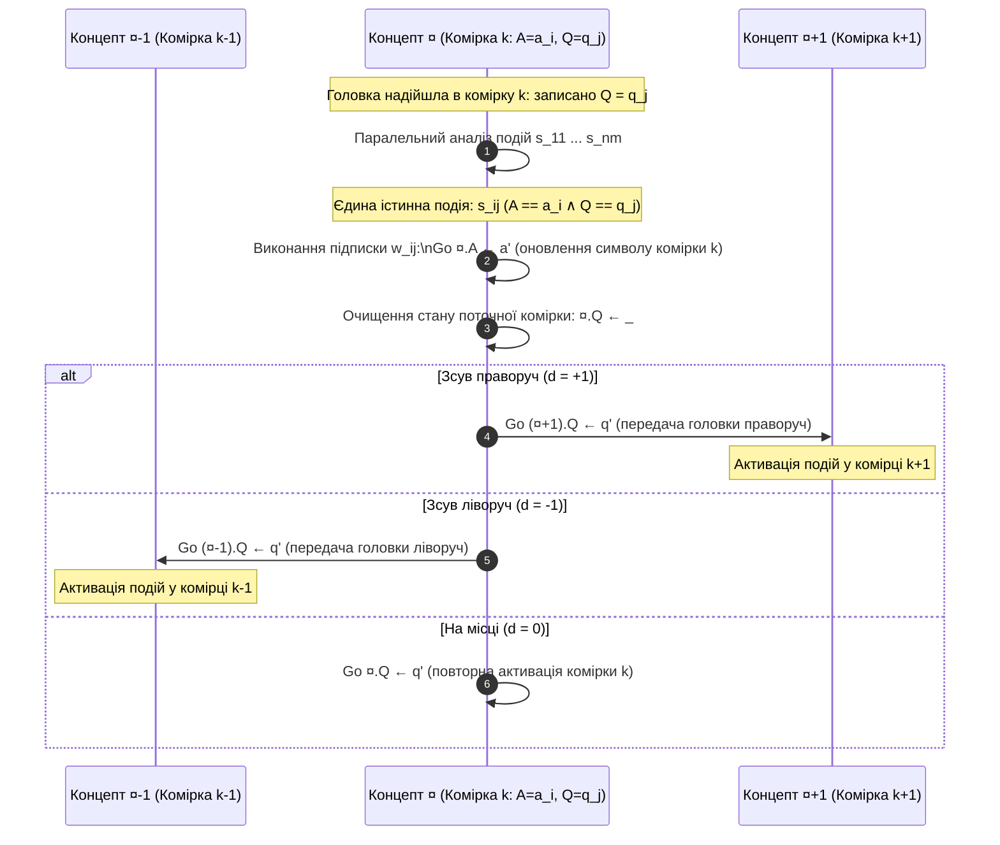

4. **Умова зупинки та межа строгості авторського ескізу:**<br/>
   Оскільки для детермінованої МТ стани $`q_j`$ та символи $`a_i`$ попарно взаємовиключні ($`s_{ij} \cap s_{uv} = \emptyset`$ при $`(i,j) \neq (u,v)`$), за коректного інваріанта єдиної головки в усьому ланцюжку концептів щонайбільше один концепт має $`Q \neq \underline{\hspace{0.4em}}`$. Для заключних станів $`q_{\mathrm{halt}} \in F`$ підписки відсутні, тому після передачі $`Q \leftarrow q_{\mathrm{halt}}`$ породження нових головок припиняється. Водночас, як уточнив сам М. Ю. Кузьмін у листопаді 2026 року, слайд `Class MT` подавався як **концептуальний начерк**, відкритий для подальшої формалізації дослідниками, а не як вичерпне математичне доведення.

> [!WARNING]
> **Умови, необхідні для перетворення авторського ескізу `MT` на строге доведення:**<br/>
> 1. **Очищення стану попередньої комірки:** у первинній формулі слайда $`w_i = s_i(\text{Go } \text{¤}.A \to (v_i) \; \text{Do } \text{¤}+d.Q \to (f_i))`$ явно не виписано скидання $`\text{¤}.Q \leftarrow \underline{\hspace{0.4em}}`$ при $`d \neq 0`$ (без нього в комірці залишиться «фантомна головка»; у діаграмі вище цей крок додано реконструкцією).<br/>
> 2. **Атомарність і випадок $`d = 0`$:** необхідно аксіоматизувати порядок між записом $`\text{¤}.A`$, очищенням $`\text{¤}.Q`$ і записом $`(\text{¤}+d).Q`$, а при $`d = 0`$ — узгодити повторний запис у $`\text{¤}.Q`$ з правилом пригнічення самотригера.<br/>
> 3. **Потенційна необмеженість стрічки:** вимагає формального правила динамічного добудування сусідніх концептів оператором `:` при виході головки за межі початково створеного сегмента.

---

### 3.4. Теорія паралелізму: умови Бернштейна, границя Брента та PRAM

Для оцінки багатопроцесорної поведінки Машини Кузьміна застосуємо класичний апарат теорії паралельних обчислень.

#### 1. Умови незалежності Бернштейна для одночасних підписок
Нехай активація концепту виявила множину істинних подій, які породили дві паралельні лінії підписок $`L_1`$ та $`L_2`$. Позначимо через $`\mathcal{R}_{\mathrm{read}}(L_k)`$ множину концептів, які лінія $`L_k`$ адресує на читання (`→`), а через $`\mathcal{W}_{\mathrm{write}}(L_k)`$ — множину концептів, які вона адресує на запис (`←`) або мутацію. Для того щоб одночасне виконання $`L_1 \parallel L_2`$ було детермінованим (конфлюентним) і не залежало від відносної швидкості процесорів, **достатнім** (за умови атомарності окремих операцій та відсутності зовнішніх спостерігачів за проміжними переходами) є виконання трьох умов незалежності Бернштейна (1966):

$$
\begin{aligned}
\mathcal{R}_{\mathrm{read}}(L_1) \cap \mathcal{W}_{\mathrm{write}}(L_2) &= \emptyset \quad \text{(відсутність анти-залежності WAR)} \\
\mathcal{W}_{\mathrm{write}}(L_1) \cap \mathcal{R}_{\mathrm{read}}(L_2) &= \emptyset \quad \text{(відсутність потокової залежності RAW)} \\
\mathcal{W}_{\mathrm{write}}(L_1) \cap \mathcal{W}_{\mathrm{write}}(L_2) &= \emptyset \quad \text{(відсутність вихідної залежності WAW)}
\end{aligned}
$$

*(Зауважимо, що ці умови **не є універсально необхідними** для конфлюентності кінцевого стану: наприклад, два ідемпотентні/комутативні записи `x := 1` і `x := 1` дають однаковий фінальний стан попри перетин $\mathcal{W}_1 \cap \mathcal{W}_2 = \lbrace x\rbrace$.)*

У моделі Кузьміна фаза *перевірки подій* задовольняє умови Бернштейна за побудовою, оскільки для будь-якого предиката $`\mathcal{W}_{\mathrm{write}}(w_i) = \emptyset`$. Проте для самих *тіл підписок* система не вимагає виконання цих умов (авторське правило конкурентних записів без неявних блокувань явно допускає порядок-залежні записи як задум програміста).

#### 2. Закон роботи та теорема Брента для паралельних виразів
Автор пропонує розбивати обчислення арифметичних виразів (зокрема $`Z = \sqrt{\sin^2 a + \sin^2 b}`$) на паралельні стеки $`SR_1`$ та $`SR_2`$. Нехай:
* $`T_1`$ — загальна кількість елементарних операцій (`Go`, `Do`) у виразі (загальна робота / *Work*);
* $`T_\infty`$ — довжина критичного шляху (висота дерева залежностей виразу / *Span*);
* $`p`$ — кількість фізичних процесорів у машині;
* $`\tau_{\mathrm{sync}}`$ — накладні витрати (у тактах) на виділення нового дескриптора лінії та виконання пари синхронізації `Go SR2 →` / `Go SR1 ←`.

За теоремою Річарда Брента (1974), час виконання $`T_p`$ на $`p`$ процесорах обмежений знизу та зверху нерівностями:

$$
\max\left(\frac{T_1}{p}, \enspace T_\infty\right) \le T_p \le \frac{T_1 - T_\infty}{p} + T_\infty + K_{\mathrm{lines}} \cdot \tau_{\mathrm{sync}}
$$

Звідси випливає фундаментальний інженерний критерій доцільності розгалуження в Машині Кузьміна. Розбиття виразу на дві лінії $`L_1, L_2`$ з обсягами робіт $`W(L_1), W(L_2)`$ дає реальний виграш у часі ($`T_2 < T_1`$) **тоді і тільки тоді**, коли обчислювальна вага меншої гілки перевищує сумарні накладні витрати на створення лінії та синхронізацію стеків:

$$
\min\big(W(L_1), \enspace W(L_2)\big) > \tau_{\mathrm{alloc}} + \tau_{\mathrm{sync}}
$$

Для важких трансцендентних функцій (таких як програмний розрахунок $\sin(b)$ у прикладі Кузьміна, що потребує десятків тактів ряду Тейлора або CORDIC) нерівність виконується, і розпаралелювання є виправданим. Для елементарних операцій (наприклад, додавання двох цілих чисел $`a + b`$) витрати $`\tau_{\mathrm{alloc}} + \tau_{\mathrm{sync}}`$ перевищать час самої операції `Do +`.

---

## 4. Інженерна архітектура, система типів, ISA та модель пам'яті

### 4.1. Система типів даних і ранні коди `Size` (історична редакція)

У ранній презентації («Пример для АН») М. Ю. Кузьмін наводив базовий запис `Concept { Type : Token Size _ ; Operation }` та таблицю примітивних типів із числовими кодами `Size`: $`0`$ (для `_` і `Token`), $`1`$ (1 байт), $`3`$ (2 байти), $`7`$ (4 байти) та $`15`$ (8 байтів), що арифметично відповідає $`2 \cdot \mathrm{Bytes}(\tau) - 1`$ для степенів двійки (але **не** дорівнює $`2^{\mathrm{Bytes}(\tau)} - 1`$, оскільки при 4 байтах $`2^4 - 1 = 15 \neq 7`$, і **не** є стандартною побайтною маскою `byte-enable` для 4- і 8-байтних шин, де маски дорівнюють 4 та 8 бітам `0xF` і `0xFF`, а не `0111` і `1111`). Залишаємо ці коди як історичні дані джерела без приписування їм непідтвердженої ролі апаратних ліній шини.

> [!NOTE]
> **Уточнення Автора щодо структури концепту, байта `Def` та вилучення поля `Size` (13.11.2026):**<br/>
> *«Свойство Size я убрал на последних версиях. Теперь это пустое имя. Размер — Token. Байт Def определяет соответствующего битом наличие соответствующего элемента концепта (в частности наличие подписок или значение атрибута). Всего их 8 и имеет значение 1 при наличии элемента концепта»*.<br/>
> Отже, наведена нижче таблиця кодів `Size` відображає **ранню редакцію презентації «Пример для АН»**. У новішій авторській моделі (презентації та роз'яснення від 13–15.11.2026) виділене ключове поле `Size` скасовано на користь першого атрибута з порожнім ім'ям (`""`), заголовок концепту містить байт `Def` (8-бітна маска наявності компонентів `0..7` від молодшого біта зліва до старшого справа) і обов'язковий байт `Class`. При цьому формулювання *«Размер — Token»* ще не уточнює, чи `Token` задає тип поля розміру, чи одиницю вимірювання, так само як залишаються відкритими розрізнення відсутнього компонента (`Def[i]=0`) і стану `_`, вирівнювання непарного числа токенів та початковий двійковий опис `Token`/`Byte` (`Q-AUTH-02`).

| Ідентифікатор типу | Опис за специфікацією автора | Фізичний розмір | Код `Size` у слайді 4 (4 біти) | Двійковий запис коду `Size` | Діапазон значень |
| :--- | :--- | :--- | :--- | :--- | :--- |
| `_` | Відсутність або будь-яке значення | 0 біт | `0` | `0000` | Невизначений / Поліморфний |
| `Token` | Дискретний токен (4 біти) | 4 біти | `0` | `0000` | $`0 \dots 15`$ |
| `Byte` | Ціле без знака | 1 байт (8 біт) | `1` | `0001` | $`0 \dots 255`$ |
| `Int8` | Ціле зі знаком | 1 байт (8 біт) | `1` | `0001` | $`-128 \dots +127`$ |
| `Chr` | Символ ASCII / однобайтний | 1 байт (8 біт) | `1` | `0001` | $`0 \dots 255`$ |
| `U16` | Ціле без знака | 2 байти (16 біт) | `3` | `0011` | $`0 \dots 65\,535`$ |
| `Int16` *(в описі автора позначено як 2-байтний `Int32`)* | Ціле зі знаком (2 байти) | 2 байти (16 біт) | `3` | `0011` | $`-32\,768 \dots +32\,767`$ |
| `U32` | Ціле без знака | 4 байти (32 біти) | `7` | `0111` | $`0 \dots 4\,294\,967\,295`$ |
| `Int32` | Ціле зі знаком | 4 байти (32 біти) | `7` | `0111` | $`-2\,147\,483\,648 \dots +2\,147\,483\,647`$ |
| `Float` | З рухомою комою (IEEE 754 Single) | 4 байти (32 біти) | `7` | `0111` | $`\pm 3.4 \times 10^{38}`$ |
| `Uni` | Символ Unicode (UTF-32) | 4 байти (32 біти) | `7` | `0111` | Кодові точки Unicode |
| `U64` | Ціле без знака | 8 байтів (64 біти) | `15` | `1111` | $`0 \dots 1.84 \times 10^{19}`$ |
| `Int64` | Ціле зі знаком | 8 байтів (64 біти) | `15` | `1111` | $`\pm 9.22 \times 10^{18}`$ |
| `Double` | З рухомою комою (IEEE 754 Double) | 8 байтів (64 біти) | `15` | `1111` | $`\pm 1.7 \times 10^{308}`$ |

---

### 4.2. Система інструкцій віртуальної машини (ISA)

Внутрішнє кодування операцій (`Operation`) побудоване на 4-бітних токенах (`Token`), що дозволяє надзвичайно компактно пакувати інструкції віртуальної машини:

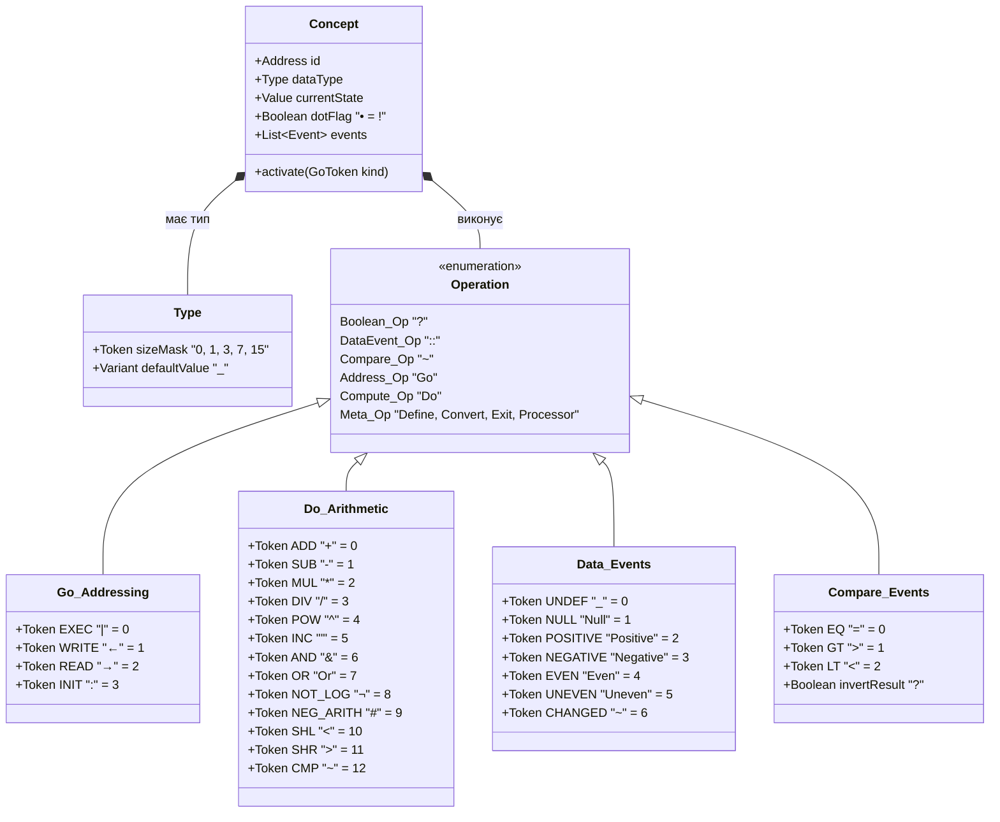

#### Повна таблиця опкодів віртуальної машини:
1. **Логічний тип та операції (`?`):**
   * `0` $\to$ `!` (`True` / Істина);
   * `1` $\to$ `¬` (`False` / Хиба).
   * *Інверсний тригер:* приклад автора `? If _ ; ! If = ¬ ; ¬ = !` задає булевий тригер (T-flip-flop), який при кожному записі `!` або `¬` миттєво інвертує свій стан.
2. **Вбудовані класи подій стану даних (`::`):**
   * `0` (`_`) — значення відсутнє (не ініціалізоване);
   * `1` (`Null`) — значення дорівнює нулю ($`x = 0`$);
   * `2` (`Positive`) — значення додатне ($`x > 0`$);
   * `3` (`Negative`) — значення від'ємне ($`x < 0`$);
   * `4` (`Even`) — значення парне ($`x \bmod 2 = 0`$);
   * `5` (`Uneven`) — значення непарне ($`x \bmod 2 \neq 0`$);
   * `6` (`~`) — відбулася зміна значення ($`x_{\mathrm{new}} \neq x_{\mathrm{old}}`$).
3. **Оператор і події порівняння (`~`):**
   * `0` (`=`) — дорівнює; `1` (`>`) — більше; `2` (`<`) — менше; плюс прапорець `?` для логічної інверсії результату порівняння (що дає `<>`, `<=`, `>=`).
4. **Оператор адресації (`Go`):**
   * `0` (`|`) — виконання; `1` (`←`) — запис; `2` (`→`) — читання; `3` (`:`) — ініціалізація.
5. **Оператор обчислень (`Do`):**
   * `0` (`+`), `1` (`-`), `2` (`*`), `3` (`/`), `4` (`^` — степінь), `5` (`'` — інкремент $+1$), `6` (`&` — логічне І), `7` (`Or` — логічне АБО), `8` (`¬` — логічне НЕ), `9` (`#` — зміна арифметичного знака $-x$), `10` (`<` — зсув вліво), `11` (`>` — зсув вправо), `12` (`~` — порівняння на стеку).
6. **Системні директиви:**
   * `Define` — визначення нового поняття/класу у середовищі;
   * `Convert` — перетворення типів даних;
   * `Exit` — достроковий вихід із поточної групи виконання;
   * `Processor` — динамічне підключення додаткового процесора до пулу виконавців.

> [!NOTE]
> **Оновлення лексико-синтаксичного рівня за матеріалами 13.11.2026 (презентації `Введение` / `Введение_1` та авторські роз'яснення):**<br/>
> 1. У новішій редакції мови символ `#` звільняється від старої ролі унарної зміни знака (уточнення автора щодо лексичних роздільників від 13.11.2026), а для степенів ($`x^2`$) та індексів масивів ($`a_i`$) використовується двовимірний надрядковий і підрядковий запис.<br/>
> 2. У трансляторі введено чітке розрізнення між **лексемою вихідного тексту `Lexeme`** (структура `Type / First / Length`) і 4-бітним **токеном пам'яті `Token`**; парні дужки з роздільниками-комами визнано контекстно-вільною конструкцією (мова Діка), що не зводиться до регулярних виразів.<br/>
> 3. На слайді 5 редакції *«Введение_1»* та в авторському коментарі *«Отредактировал. OpenBracket  и CloseBracked должны быть выполняемые»* зафіксовано, що непорожні дужки у `Define Static` формують статичний концепт, порожні — групу, а самі `OpenBracket` і закривальний концепт (`CloseBracket` / `CloseBracked`) при побудові вкладених груп у `Static` є **виконуваними сутностями** (представленими у трансляторі функціями-заглушками), а не пасивною пунктуацією (`KPOL-AUTH-08`, відкрите уточнення фази й ефектів — `Q-AUTH-07`).

---

### 4.3. Архітектура дескриптора підписки ($`SP`$), ліній підписок ($`O + SR`$) та міжстекового рандеву

Мікроархітектура виконання підписок спирається на двостекову модель. Коли подія стає істинною, віртуальна машина створює в пам'яті **дескриптор підписки**, який об'єднує:
* **Стек параметрів та оточення ($`SP`$):** містить вхідні концепти-параметри (позначені символом `@`) та локальні динамічні концепти, створені під час ініціалізації `:`. Цей стек є **спільним** для всіх паралельних гілок однієї підписки.
* **Лінії підписки ($`L_1, L_2, \dots, L_k`$):** кожна лінія є парою $`L_m = (O_m, SR_m)`$, де $`O_m`$ — лінійний масив інструкцій віртуальної машини з власним лічильником команд, а $`SR_m`$ — приватний **стек-регістр** (арифметичний стек операндів), на якому виконуються інструкції `Do`.

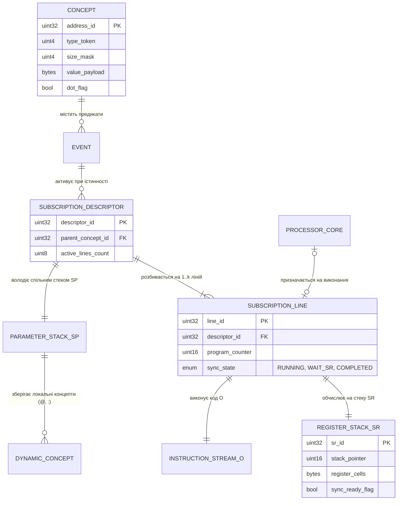

#### Розбір паралельного виконання виразу $`Z = \sqrt{\sin^2(a) + \sin^2(b)}`$:

У мові високого рівня Кузьміна підписка має вигляд:
```text
Float Z : @ (Float (a 0, b 0)) = sqrt(sin2(a) + sin2(b))
```

1. **Послідовна трансляція (для 1 лінії):**
   Компілятор генерує постфіксний стековий код (зворотний польський запис):
   ```text
   Go a ← ; Go Sin | ; 2 ; Do ^ ; Go b ← ; Go Sin | ; 2 ; Do ^ ; Do + ; Go sqrt | ; Go Z →
   ```
   *(Історичне уточнення нотації: у ранній презентації «Пример для АН» на слайді зі стеками стрілки вжито з погляду самого стека — `←` як завантаження у стек $`SR`$, а `→` як вивантаження зі стека; натомість в авторському уточненні граматики KPOL у листопаді 2026 року зафіксовано канонічну конвенцію відносно комірки пам'яті: `Concept →` — читання з комірки в стек, `Concept ←` — запис зі стека в комірку.)*

2. **Двопроцесорна декомпозиція (для 2 ліній):**
   Транслятор розпізнає бінарний оператор `+` і розщеплює дерево на дві лінії в межах одного дескриптора $`SP(a, b)`$:
   * **Лінія 1 (Основна, стек $`SR_1`$, код $`O_1`$):**
     `Go a ← ; Go Sin | ; 2 ; Do ^ ;` **`Go SR2 →`** `; Do + ; Go sqrt | ; Go Z →`
   * **Лінія 2 (Допоміжна, стек $`SR_2`$, код $`O_2`$):**
     `Go b ← ; Go Sin | ; 2 ; Do ^ ;` **`Go SR1 ←`**

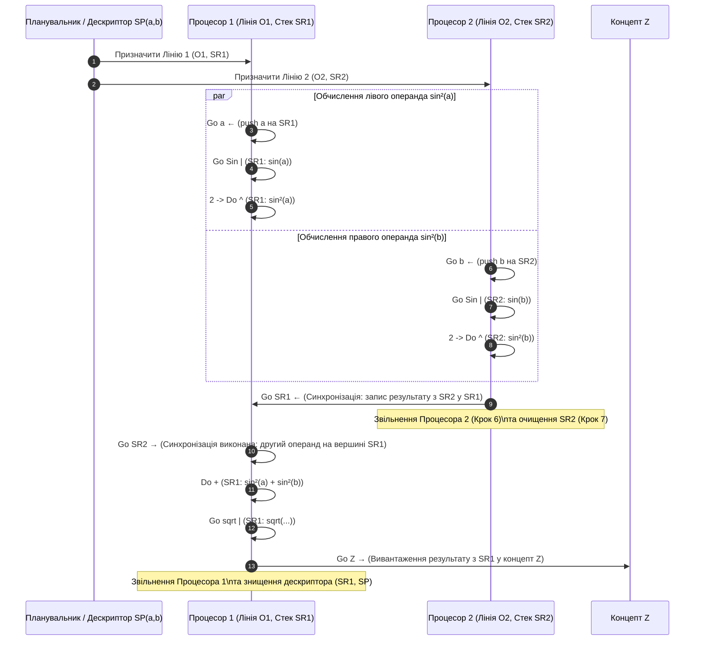

#### Алгоритм детермінованого відкату при дефіциті ядер (Graceful Serial Fallback):
Критичне інженерне питання полягає в тому, що відбувається, якщо в момент запуску немає другого вільного процесора.
Автор формулює рішення, яке робить архітектуру стійкою до перевантажень:

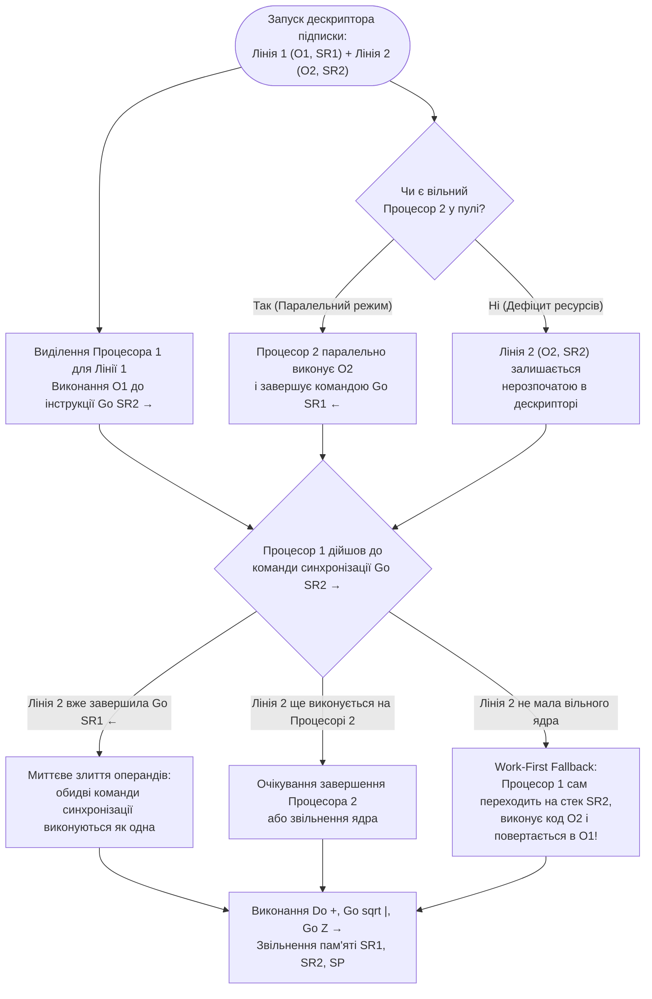

---

### 4.4. Історичний апаратний стенд етапу PoC на ПЛІС (FPGA Overlay та транзакційний шлюз)

На етапі лабораторного макетування (**рівень TRL 3 за самооцінкою**) на кристалі **Xilinx Zynq-7000 (`XC7Z020-1CLG400C`)** платформи **Digilent PYNQ-Z1** за допомогою відкритого стека синтезу **openXC7** було реалізовано комплексний макет транзакційного шлюзу та допоміжних апаратних тест-блоків *(під час подальшого переходу до чистої архітектури незмінного ядра `CFG-P` у §4.6 демонстраційні блоки `0x38..0xC0` були вилучені з робочого RTL, щоб виключити підміну компілятора KPOL ручними автоматами)*.

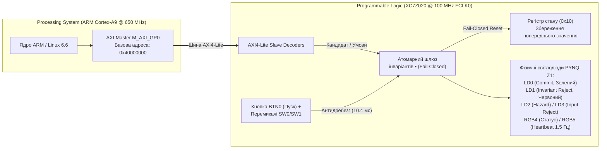

#### Карта регістрів апаратного блоку (AXI4-Lite, базова адреса `0x40000000`):

| Зсув (Offset) | Регістр | Доступ | Опис контракту |
| :---: | :--- | :---: | :--- |
| `0x00` | `CANDIDATE_VALUE` | R/W | Кандидатне значення для запису в стан (підтримує byte strobes `wstrb`). |
| `0x04` | `CONDITIONS` | R/W | Вектор умов: `[0]` candidate known; `[1]` assumption known; `[2]` assumption true; `[3]` invariant known; `[4]` invariant true; `[5]` hazard known; `[6]` hazard true. |
| `0x08` | `COMMAND` | W | Запис `1` у біт `[0]` ініціює 1-тактовий апаратний транзакційний цикл. |
| `0x0C` | `STATUS` | R | Прапорці стану: `[0]` done; `[1]` committed; `[2]` rejected; `[3]` rejected input; `[4]` rejected invariant; `[5]` changed; `[6]` hazard; `[7]` unknown hazard; `[8]` busy. |
| `0x10` | `STATE` | R | Поточне зафіксоване значення концепту (незмінне при відхиленні інваріанта). |
| `0x14` | `IDENTIFICATION` | R | Апаратний ID ядра: `0x4B504F4C` (ASCII `"KPOL"`). |
| `0x18` | `INVARIANT_LOWER_BOUND` | R/W | Нижня межа допустимого діапазону стану (за замовчуванням `0`). |
| `0x1C` | `INVARIANT_UPPER_BOUND` | R/W | Верхня межа допустимого діапазону стану (за замовчуванням `0x7FFFFFFF`). |
| `0x20` | `INVARIANT_RULE_CFG` | R/W | Бітова маска правил: `[0]` Even, `[1]` Pos, `[2]` Non-Null, `[3]` Range, `[4]` Changed, `[5]` Use HW Eval, `[6]` Uneven. |
| `0x24` | `PREDICATE_VECTOR` | R | 8-бітний вектор апаратно обчислених предикатів `::`: `[0]` `_`, `[1]` `Null`, `[2]` `Positive`, `[3]` `Negative`, `[4]` `Even`, `[5]` `Uneven`, `[6]` `~`, `[7]` `Range`. |
| `0x28` | `BIG_DOT_STATUS` | R | Апаратний стан «Великої точки» (`•`): `1` = `!` (Commit дозволено), `0` = `¬` (Fail-Closed Reject). |
| `0x2C` | `REG_CYCLE_CNT_LO` | R | Молодші 32 біти апаратного 64-бітного лічильника тактів ($`100\text{ МГц}`$, $`10.0\text{ нс}`$). |
| `0x30` | `REG_CYCLE_CNT_HI` | R | Старші 32 біти апаратного 64-бітного лічильника тактів. |
| `0x34` | `REG_LAST_TXN_CYCLES` | R | Тривалість останньої транзакції KPOL безпосередньо у кремнії (такти). |
| `0x38` | `REG_EUCLID_A` | R/W | Концепт $A$ алгоритму Евкліда (початкове значення / поточний стан у PL). |
| `0x3C` | `REG_EUCLID_B` | R/W | Концепт $B$ алгоритму Евкліда (початкове значення / поточний стан у PL). |
| `0x40` | `REG_EUCLID_CMD` | W | Запис `1` у біт `[0]` запускає автономний апаратний цикл Евкліда. |
| `0x44` | `REG_EUCLID_STATUS` | R | Статус Евкліда: `[0]` busy; `[1]` done; `[2]` error; `[23:8]` кількість реактивних ітерацій. |
| `0x48` | `REG_EUCLID_CYCLES` | R | Загальна кількість тактів PL, витрачених на збіжність алгоритму. |
| `0x4C` | `REG_EUCLID_RESULT` | R | Апаратний результат НСД $`\mathrm{Nod}(A, B)`$. |
| `0x50` | `REG_BRAM_CTRL` | R/W | Керування автономним ядром BRAM: `[0]` start, `[1]` op (0=COPY, 1=ADD), `[13:8]` src CID, `[21:16]` dst CID. |
| `0x54` | `REG_BRAM_STATUS` | R | Статус ядра BRAM: `[0]` busy, `[1]` done, `[2]` collision flag. |
| `0x58` | `REG_BRAM_CYCLES` | R | Тривалість автономної операції між концептами у тактах PL (5 тактів = 50 нс). |
| `0x5C` | `REG_BRAM_PORT_B_ADDR` | R/W | Адреса слова Port B (0..255) для ручного тестування паралельного доступу. |
| `0x60` | `REG_BRAM_PORT_B_DATA` | R/W | Дані слова Port B (читання/запис без блокування Port A). |
| `0x64` | `REG_RCFC_CTRL` | R/W | Керування блоком рандеву RCFC: `[2:0]` cmd (1=TC01, 2=TC02, 3=TC03, 4=TC04, 5=ALL, 6=RST), `[3]` start pulse, `[15:8]` delay_param. |
| `0x68` | `REG_RCFC_STATUS` | R | Статус RCFC: `[0]` busy, `[1]` done, `[2]` tc01_pass, `[3]` tc02_pass, `[4]` tc03_pass, `[5]` tc04_pass, `[6]` deadlock_err, `[7]` drop_err, `[11:8]` current_tc, `[31:16]` events_processed. |
| `0x6C` | `REG_RCFC_CYCLES` | R | Лічильник тактів виконання тесту рандеву / лавини в апаратурі. |
| `0x70` | `REG_RCFC_SLOT_STATE` | R/W | Запис: `[5:0]` slot_sel; Читання: `{slot_payload[15:0], wait_cycles[7:0], 5'b0, slot_state[2:0]}`. |
| `0x74` | `REG_RCFC_AVALANCHE` | R | Статистика лавини підписок: `[15:0]` enqueued (64), `[31:16]` dropped (0). |
| `0x78` | `REG_RCFC_RESULT` | R | Апаратний результат комбінування операндів рандеву. |
| `0x80` | `REG_SUITE_B_CTRL` | R/W | Керування стрес-рушієм каскадів та арбітражу Suite B: `[2:0]` cmd (1..4 тести, 5=ALL, 6=RST), `[3]` start pulse. |
| `0x84` | `REG_SUITE_B_STATUS` | R | Статус Suite B: `[0]` busy, `[1]` done, `[2..5]` pass прапорці, `[11:8]` current_tc. |
| `0x88` | `REG_SUITE_B_CYCLES` | R | Лічильник тактів виконання тесту Suite B в апаратурі. |
| `0x8C` | `REG_SUITE_B_RES1` | R | Апаратні результати RES1: `{8'd0, cascade_depth[2:0], 5'd0, speed[7:0], dist[7:0]}`. |
| `0x90` | `REG_SUITE_B_RES2` | R | Апаратні результати RES2: `{accel[7:0], safe_concept[7:0], accumulated_sum[15:0]}`. |
| `0x94` | `REG_STREAM_CTRL` | R/W | Керування потоковим конвеєром: `[0]` start pulse, `[2:1]` mode (0=Normal, 1=Glitch), `[31:16]` burst count (def 1024). |
| `0x98` | `REG_STREAM_STATUS` | R | Статус конвеєра: `[0]` busy, `[1]` done, `[2]` pass flag. |
| `0x9C` | `REG_STREAM_CYCLES` | R | Лічильник тактів виконання потокового конвеєра в апаратурі. |
| `0xA0` | `REG_STREAM_COUNTS` | R | `{clamped_count[15:0], processed_count[15:0]}`. |
| `0xA4` | `REG_STREAM_CHECKSUM` | R | 32-бітна накопичена контрольна сума вихідних команд актуатора. |
| `0xA8` | `REG_STREAM_LAST_VAL` | R | `{actuator_u[15:0], filtered_y[15:0]}`. |
| `0xAC` | `REG_IO_TRIGGER_CTRL` | R/W | Керування реактивним I/O тригером: `[0]` start stim pulse, `[1]` clear stats, `[31:16]` burst count (def 1000). |
| `0xB0` | `REG_IO_TRIGGER_STATUS` | R | Статус тригера: `[0]` busy, `[1]` done, `[2]` pass, `[4]` ext_pin_in, `[5]` reactive_pin_out. |
| `0xB4` | `REG_IO_TRIGGER_CYCLES` | R | `{min_latency_cycles[15:0], last_latency_cycles[15:0]}`. |
| `0xB8` | `REG_IO_TRIGGER_MAX_CYCLES` | R | `{max_latency_cycles[15:0], trigger_count[15:0]}`. |
| `0xBC` | `REG_IO_TRIGGER_TS_LO` | R | Молодші 32 біти системного такт-таймстампу останньої реактивної події. |
| `0xC0` | `REG_IO_TRIGGER_TS_HI` | R | Старші 32 біти системного такт-таймстампу останньої реактивної події. |
| `0x1000 .. 0x13FF` | `BRAM_CONCEPTS_TABLE` | R/W | Безпосередній простір пам'яті 64 концептів (1024 байти / 256 слів по 32 біти). |

#### Метрики фізичного синтезу та Place & Route (openXC7 stack, v0.8.0):
- **Синтезатор:** Yosys `0.69` (`synth_xilinx -arch xc7 -abc9 -flatten`).
- **Трасувальник:** `nextpnr-himbaechel` (part `xc7z020clg400-1`).
- **Генерація бітстріму:** `fasm2frames` + `xc7frames2bit` (Project X-Ray).
- **Використання ресурсів:** 820 тригерів `FDCE`, 1645 таблиць перекодування `LUT` (повний комплекс: KPOL, BRAM, RCFC, Suite B, Dataflow, I/O Trigger), 1 буфер `BUFG`, 1 макрокомірка `PS7`.
- **Частотні характеристики:** Задана частота $`100\text{ МГц}`$, максимальна розрахункова частота $`f_{\max} = 126.61\text{ МГц}`$ (найдовший шлях $`7.898\text{ нс}`$, позитивний запас затримки Slack $`+2.102\text{ нс}`$).
- **Цільовий образ PL:** конфігураційний бітстрім (розмір 4,045,719 байтів).
- **Апаратне завантаження:** Виконано у volatile SRAM PL через `/dev/xdevcfg` без модифікації енергонезалежної пам'яті QSPI чи системного образу SD. Після тестів baseline `base.bin` відновлено в SRAM.

### 4.5. Гібридна ко-дизайн архітектура: MCU Runtime + FPGA Invariant Coprocessor (Пропозиція 3)

Для подолання компромісу між гнучкістю софту та жорстким детермінізмом апаратури реалізовано гібридну архітектуру апаратно-програмного ко-дизайну:

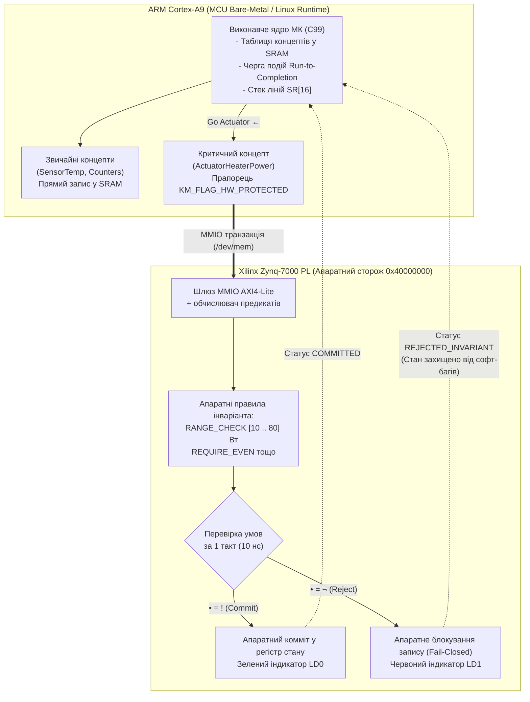

#### Практичний результат експерименту:
1. **Ізоляція програмних помилок:** На фізичній платі PYNQ-Z1 перевірено сценарій аварійного програмного збою (спроба запису $`150\text{ Вт}`$ та $`-20\text{ Вт}`$ в актуатор обігрівача при дозволеному безпечному діапазоні $`[10 \dots 80]\text{ Вт}`$).
2. **Апаратне блокування:** Усі спроби аварійного запису були миттєво відхилені кремнієм (`STATUS = 0x95`), а фізичний стан актуатора залишився неушкодженим на рівні $`50\text{ Вт}`$.
3. **Висновок:** Гібридний підхід **потенційно** придатний для критичних систем керування з високими вимогами функціональної безпеки: програма може виконуватися на дешевому мікроконтролері або процесорі, а фізичні інваріанти перевіряє окрема схема ПЛІС. Рівні на кшталт SIL 3 / ASIL D — це перспективна гіпотеза: аналізу небезпек, цілей безпеки й незалежного сертифікаційного оцінювання наразі не проводилося.

---

### 4.6. Програмований BRAM-конвеєр KPOL та відкритий синтез OpenXC7

Для дослідження повної апаратної моделі реалізовано цільову конфігурацію **програмованого BRAM-конвеєра KPOL**. Конфігурація усуває розрив між програмною гнучкістю (завантаженням довільних програм KPOL у пам'ять без пересинтезу) та апаратною автономністю (реакцією на зовнішні фізичні події без участі процесора).

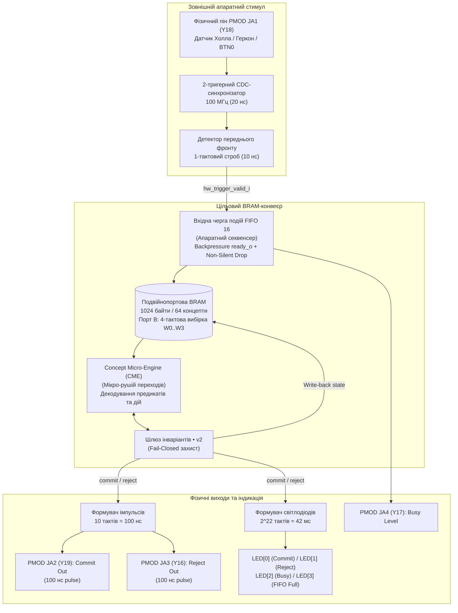

#### Ключові архітектурні рішення конвеєра:
1. **Інтеграція фізичного тригера:**
   - Фізичний вхід події виведено на пін PMOD JA1 (`Y18`) або кнопку `BTN0`.
   - Вхід захищено 2-тригерним CDC-синхронізатором (розрахований MTBF $`> 10^9\text{ год}`$) із детектором переднього фронту.
   - Час обробки дескриптора в секвенсері становить строго детерміновані **8 тактів ($`80\text{ нс}`$ при $`100\text{ МГц}`$)** із нульовим внутрішнім тактовим джитером у синхронному домені ПЛІС ($`\sigma_{\text{exec}} = 0`$ тактів; фазове квантування асинхронного фізичного входу на тригері CDC становить $`\sigma_{\text{cdc}} = 10 / \sqrt{12} \approx 2.89\text{ нс}`$).
   - Повна розрахункова затримка вільного тракту «від піна до піна» (за порожньої черги `FIFO`):

$$T_{\text{total}} = T_{\text{cdc}} + T_{\text{exec}} + T_{\text{pad}} \approx (20\dots 30)\text{ нс} + 80\text{ нс} + 5\text{ нс} = 105\dots 115\text{ нс}$$

2. **Поточна поведінка черги `FIFO 16` та відома розбіжність із цільовою авторською політикою черг:**
   - Секвенсер формує сигнал `hw_trigger_ready_o = (fifo_count_q < 16)` та надає внутрішнім каскадам пріоритет над зовнішнім входом.
   - При переповненні (або при колізії одночасного каскаду й зовнішнього тригера за єдиного вільного слота) поточний RTL не спотворює пам'ять `BRAM`, а відкидає неприйняту подію з інкрементом лічильника `events_dropped_count_o` та встановленням `fifo_overflow_o` (`LED[3]`).
   - *Важливе інженерне застереження:* після роз'яснення Автора щодо цільової політики керування чергами подій і зворотного тиску (*очікування звільнення черги без втрати подій*) така схема з обліком відкидань розглядається лише як **проміжна діагностична реалізація**; повноцінне утримання неприйнятих зовнішніх і каскадних подій без втрат виділено в окрему відкриту задачу доопрацювання секвенсера (§8.2).
3. **Шинна обгортка та телеметрія:**
   - Апаратний шинний інтерфейс конвеєра забезпечує незалежний доступ CPU до завантаження образу у BRAM через регістри `0x004`/`0x008` (у фазі `PHASE_LOAD`), а також читання лічильників втрат `0x028` (`events_dropped`) та статусу черги `0x02C`.

#### Метрики відкритого синтезу OpenXC7 (XC7Z020):
- **Синтезатор:** Yosys Open SYnthesis Suite (`synth_xilinx -flatten -abc9 -arch xc7`).
- **P&R / STA:** `nextpnr-himbaechel` (device `xc7z020clg400-1`).
- **Ресурси:** 1 597 `Estimated LCs` у звіті `Yosys` (`stat -tech xilinx`, до-трасувальна оцінка спарювання LUT1..LUT6 відносно бази `53 200` `LUT6` кристала XC7Z020; окремо вузол секвенсер+`CME` без AXI — `1 277 Estimated LCs`), 1 блок `RAMB36E1`, 1 макрокомірка `PS7`, 1 буфер `BUFG`, 114 `CARRY4`, 1 247 тригерів *(фактичне число зайнятих фізичних слотів потребує post-place звіту `nextpnr`)*.
- **Частотні характеристики:** заявлена розрахункова частота **$`F_{\max} = 145.94\text{ МГц}`$** при робочій $`100.0\text{ МГц}`$ (позитивний запас затримки worst slack $`+3.15\text{ нс}`$, нуль таймінг-порушень).
- **Синтезований образ:** бітстрім PL, зібраний без Vivado *(вихідний RTL, XDC і логи STA містяться у закритому інженерному репозиторії проєкту)*.

---

### 4.7. Вимірювальний комплекс стенда HIL на Raspberry Pi Pico та схемотехніка

Для лабораторного тестування часових інтервалів спроєктовано вимірювальний макет на базі Raspberry Pi Pico *(межі безпеки силового вузла та повної метрології підлягають перевірці у `EXP-1`/`EXP-2`)*.

#### 1. Схема електричного монтажу стенда
Монтаж виконано на безпайковій макетній платі BB-102 із такими вузлами й **відкритими умовами перевірки**:
- **Узгодження рівнів 3.3V LVCMOS:** банки I/O кристала Zynq-7020 не є 5V-толерантними (максимум $`3.6\text{ В}`$); для 5V-периферії застосовується перетворювач рівнів *(для швидких сигналів необхідно перевіряти тип і затримку перетворювача, щоб не спотворити фронти)*.
- **Датчики стимулу:** цифровий датчик Холла SS41F (відкритий колектор) та герконовий перемикач KSK1A66 із резисторами підтяжки $`10\text{ кОм}`$ до шини 5V.
- **Силовий виконавчий вузол:** N-канальний польовий транзистор IRLZ44NPBF керує мотор-редуктором 12GAN20 ($`12\text{ В}`$) із захисним діодом 1N4007 та підтяжкою затвора $`10\text{ кОм}`$ до землі. *Застереження:* (1) порогова напруга $`V_{\mathrm{GS(th)}} \le 2.0\text{ В}`$ не доводить достатнього відкривання і низького $`R_{\mathrm{DS(on)}}`$ при прямому керуванні від `3.3 В` без перевірки струму/нагріву або драйвера `5 В`; (2) підтяжка затвора й топологія «Зірка» знижують перешкоди, але не доводять системної відмовостійкості (fail-safe); (3) цифровий commit за $\sim 100\text{ нс}$ у ПЛІС не означає механічного перемикання двигуна за цей час.

#### 2. Логічний аналізатор на базі Raspberry Pi Pico
- **Архітектура вимірювача:** RP2040 із кінцевими автоматами PIO тактується від частоти $`125.0\text{ МГц}`$ (крок дискретизації **$`8.0\text{ нс}`$**).
- **Обмеження каналу та похибки:** 8-канальне сире захоплення на $`125\text{ MS/s}`$ генерує $`125\text{ МБ/с}`$, що перевищує пропускну здатність USB Full Speed (`12 Мбіт/с` до накладних витрат), тому неперервний сирий стрімінг через USB FS неможливий: RP2040 має захоплювати **обмежену пачку у внутрішню SRAM через DMA** перед вивантаженням або стискати дані. Крім того, `8.0 нс` — лише **крок дискретизації**, а не повна похибка стенда (потрібне калібрування часової бази та вимірювання `channel skew`).
- **Програмний стек:** прошивка PIO ASM + хост-утиліта захоплення та конвертації у формат VCD для GTKWave або PulseView.

---

### 4.8. Ергономічний мовний надшар `EKPOL` та двомодовий емулятор і TUI-дебагер `VMK v0.3.1` на Go

Для усунення розриву між авторськими слайдами М. Ю. Кузьміна (які спираються на неклавіатурні Unicode-символи `•`, `¬`, `←`, `→`, `¤`), багатослівними трисекційними файлами формальної верифікації (`Problem / Solution / Proof`) та щоденною практикою інженерів систем реального часу в інструментальному стеку проєкту впроваджено два верифіковані компоненти (самодостатній крос-платформний емулятор і TUI-дебагер `vmk` на Go разом із колекцією виконуваних прикладів та посібниками користувача підтримується в інженерному репозиторії проєкту і може постачатися як окремий автономний бандл під `Linux / macOS / Windows`):

1. **Ергономічна мова `EKPOL` (*Ergonomic KPOL 0.1.0*, `.ekpol`):**
   - Класичні профілі `.kpol` (`KPOL-CME-1`, `KPOL-CME-2`, `KPOL-AUTH`) збережено на 100% без змін, а `EKPOL` об'єднує стан, тип (`i32` / `int32`, `u64`, `f64`, `?` / `bool`), початкове значення, вбудований інваріант Великої Крапки `[>= 0]`, потокові прагми `@stdin` / `@stdout` / `@stderr` і правила реакцій в одну локальну конструкцію `concept Name: Type = Init [Invariant] { ... }` із першокласним станом невизначеності `_` / `undef` та самоперевірними блоками `test { send ...; expect ...; }` (скорочення обсягу коду на `30..47%`, `0` не-ASCII символів).
   - Мова підтримує **дві взаємозамінні 7-бітні ASCII-форми запису** з двосторонньою безвтратною трансляцією `EKPOL <-> KPOL` (`--to-ekpol`, `--to-kpol`):
     * *символьну (`symbolic`):* `<- x :: x in 50..5000 => Cell_Delta_mV += 1 .`, `~ Cell_Delta_mV :: Cell_Delta_mV >= 1 => Module_Thermal_Guard += 1 .`, `-> => . Sum = 0`;
     * *ключову програмістську (`keyword`):* `on write(x) when x in 50..5000 => Cell_Delta_mV += 1 commit;`, `on change(Cell_Delta_mV) when Cell_Delta_mV >= 1 => Module_Thermal_Guard += 1 commit;`, `on read => after Sum = 0;`.
   - Обидві форми компілюються **побітово тотожно (100% збіг `SHA-256`)** з класичним `.kpol` у 1024-байтний образ таблиці 64 дескрипторів `Block RAM` (`CME-RAW-1`), модуль `MISRA-C99` (`--emit-c99`) та сертифікат `Z3` (`--emit-z3-cert`), що верифіковано 5 мутантними тестами фронтенду.
2. **Самодостатній програмний емулятор і повноекранний 4-панельний TUI-дебагер `VMK v0.3.1` на Go (`0` зовнішніх залежностей):**
   - Єдиний статичний виконуваний бінарник `vmk` на чистій стандартній бібліотеці Go (`go >= 1.22`, `std` only) поєднує два виконавчі режими:
     * `--mode conceptual` — повна навчально-концептуальна модель за уточненими авторськими правилами листопада 2026 року (`?`, `Int32/U64`, `Float64`, біт `_`, адресації `←`, `→`, `|`, `:`, пост-адресна Велика Крапка `•`, прапорець `Busy`, групи `{ ... }` / `[ ... ]`, `Exit`), яка наживо виконує всі еталонні приклади (`If`, `Sum` із пост-адресним скиданням, `Nod(120, 6) = 6` за `19` реактивних віднімань, `Factorial(5) = 120`, `Tachometer`);
     * `--mode bram64` — побітово точна 64-слотова 1024-байтна модель конвеєра дескрипторів (`CFG-P` / `CFG-P-HA` з двобанковим гарячим оновленням із `CRC-8` та чергою `FIFO 16`), яка працює як у симуляції (`--target sim`), так і в живій сесії з фізичною платою `Digilent PYNQ-Z1` (перевірено 7 мутантами Go-коду та 4-сторонньою звіркою з Python, C99, `Icarus Verilog` і апаратною BRAM `Zynq-7020`).
   - Реалізує трифазний життєвий цикл підключення **`PRE-LOAD -> POST-LOAD -> RUNNING`** (`Active 4/64`, класифікація `Entry / Internal / Leaf / Free`, `Readback 256/256 words OK`, таблиця `Pre-Load vs Post-Load Diff`), потоковий UNIX-режим **`STDIO` (`--stdio`, `--fail-on-reject`)** для CI (`COMMIT`/`READ` у `stdout`, `REJECT_GUARD`/`REJECT_INVARIANT`/`REJECT_FAULT` у `stderr`) та **повноекранний інтерактивний 4-панельний TUI-дебагер (`./vmk --tui`)** із перемиканням інспектора слів `W0..W3` / коду / diff (`[d]`), конструктором подій (`[e]`, запуск `Enter` або черга `+`), покроковим проходженням хвилі по одному мікро-хопу (`[Space]` / `[n]`), інжекцією несправності датчика `_` (`[f]`) і ручним редактором стану (`[m]`).

---

## 5. Раціональність інженерних рішень (Trade-off & Rationality Analysis)

Оцінимо архітектуру Машини Кузьміна з погляду сучасної комп'ютерної інженерії, відокремивши раціональні знахідки від потенційних вузьких місць.

### 5.1. Сильні та раціональні інженерні рішення

1. **Подієва інверсія контролю на рівні пам'яті (Data-Driven Memory Reactivity):**
   У традиційних системах автоматики (ПЛК/PLC) процесор нескінченно виконує цикл сканування (Scan Cycle), опитуючи сотні входів і перевіряючи умови, навіть коли жоден датчик не змінив своїх показань. У Машині Кузьміна обчислення ініціюється **виключно за фактом модифікації або адресації концепту**. Коли система перебуває у стаціонарному стані, навантаження на обчислювальні ядра дорівнює нулю.
2. **Поєднувані патерни оператора «Велика точка» (`•`, у поєднанні авторського уточнення від 13.11.2026 та похідної моделі):**
   Винесення дій до та після адресації дозволяє записувати такі ідіоми (за умови зовнішньої серіалізації або одного виконавця):
   * *Read-and-Clear* (зчитування накопиченого значення з подальшим обнуленням: `→ • Revolutions = Tick * 600 ; Tick = 0`);
   * *Write-with-Validation* (похідна модель пре-інтерлока `• = ¬`, що потребує узгодження з пост-адресним бар'єром порядку);
   * *Lazy Evaluation* (обчислення значення перед поверненням на читання `→`).
3. **Розділення стеків на $`SP`$ (оточення) та $`SR`$ (регістровий стек лінії):**
   Класичні стекові машини (Forth, JVM) змішують локальні змінні та операнди виразів або потребують дорогого копіювання кадрів при розгалуженні потоків. Винесення параметрів у спільний $`SP`$, а арифметики — у легковажні локальні стеки $`SR_k`$ відомих на етапі компіляції розмірів робить створення паралельної лінії надзвичайно дешевим (кілька десятків байтів без динамічного `malloc`).
4. **Безблокувальний відкат на одне ядро (Work-First Serial Fallback):**
   Здатність першого ядра самостійно виконати стек $`SR_2`$ на інструкції `Go SR2 →` гарантує прогрес обчислень при будь-якому завантаженні процесорного пулу і захищає систему від дедлоків через вичерпання потоків (Thread Starvation Deadlock).
5. **Динамічне конструювання середовища без зупинки (Runtime Meta-Programming):**
   Створення нових концептів (`:`) і прикріплення нових підписок (`Subscribe`) здійснюється самою віртуальною машиною на льоту, а не статичним компілятором. Це дозволяє віддалено модифікувати логіку працюючого контролера без перепрошивки та перезавантаження.

### 5.2. Уразливості, ризики та інженерні компроміси

1. **Проблема дрібнозернистого паралелізму (Fine-Grained Synchronization Overhead):**
   Розбиття простих арифметичних виразів на окремі процесори виправдане лише в апаратній реалізації на ПЛІС (FPGA) або спеціалізованому ASIC, де передача управління триває 1–2 такти. На програмній віртуальній машині поверх стандартного мікроконтролера витрати на диспетчеризацію лінії нівелюють виграш від паралельного додавання чи множення.
2. **Невизначеність при одночасних конфліктних записах (CRCW Race Conditions):**
   Якщо дві паралельні лінії одночасно виконують запис у третій концепт (`Go C ←`), у специфікації немає формального протоколу арбітражу (черги, м'ютекса концепту чи CAS-транзакції).
3. **Ризик лавиноподібного каскаду активацій (Event Storm):**
   У складних графах підписок зміна одного вхідного концепту може викликати експоненційну хвилю вторинних подій, заповнивши всю доступну оперативну пам'ять дескрипторами ліній.

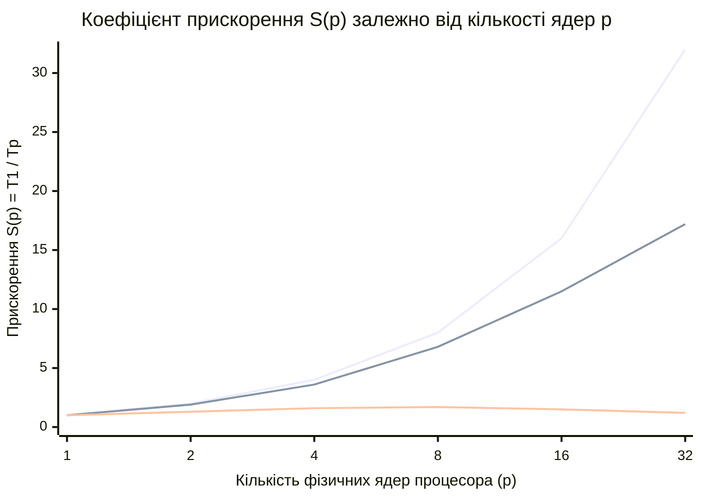

---

## 6. Варіанти використання (Use Cases) та розбір еталонних програм автора

Розглянемо шість завершених прикладів коду, які ілюструють практичні патерни програмування на Машині Кузьміна, та проведемо їхню інженерну реконструкцію.

### 6.1. Подієвий алгоритм Евкліда (`Nod`) та Факторіал

Авторський код:
```text
' Nod (Найбільший спільний дільник)
U64 Nod | @ U64 ( a_ > b -=b , b_ > a -=a ) =a
Z = Nod(120, 6)

' Факторіал
U64 Factorial | @ U64 n [ 0 1 ] { Factorial = 1 Exit }
= Factorial(n - 1) * n
```

**Інженерний розбір:**
* У функції `Nod` параметри `a` та `b` мають взаємні підписки на події порівняння `> b` та `> a` при зміні/ініціалізації (`_`).
* Щойно в `a` та `b` записуються числа `120` і `6`, умова `a > b` стає істинною й активує підписку `-= b` ($`a \leftarrow a - b`$).
* Оскільки модифікація `a` в підписці самого `a` підпадає під питання повторної перевірки (або взаємодії з `b`), після досягнення рівності $`a = b = 6`$ обидві події `> b` та `> a` стають хибними ($`0`$), і виконується фінальне присвоєння результату `= a`.
* У функції `Factorial` конструкція `[ 0 1 ]` задає множинну подію-маску (якщо $`n = 0`$ або $`n = 1`$), підписка на яку повертає `1` і перериває виконання директивою `Exit`, інакше виконується рекурсивний вираз `Factorial(n-1) * n`.

---

### 6.2. Інтегруючий лічильник електроенергії (`Class Example`)

Авторський код:
```text
Class Example
| @ Byte Interval 1 Timer(Interval, Tick |) '# Конструктор: запуск таймера з періодом Interval мс
: {
    Float {
        Voltage ← @ Float x +=x      '# Запис: інтегруємо напругу (Go Voltage → Go x → Do+ Go Voltage ←)
                → Voltage = 0        '# Читання: авто-скидання суми в 0 після зчитування
        Electricity ← @ Float x +=x  '# Запис: інтегруємо струм
                    → Electricity = 0
        Value 0                      '# Накопичена електроенергія
              ← @ Float x +=x
              ~ Change |             '# При зміні Value активувати булеву подію Change
    }
    Byte Tick 0
        = 10 Value = Voltage * Electricity / Tick^2 '# Кожні 10 тіків обчислюємо середню потужність
        ← Tick += 1
        → Tick = _0
    Void Tick | [Tick = 0 Voltage = "0p1" Electricity = "0p0"] Go Tick → 0 Go Tick ← ;
    ? Change
}
Elect = Example : (1) '# Ініціалізація екземпляра з опитуванням кожну 1 мс
```

**Інженерний розбір:**
1. При створенні об'єкта `Elect = Example : (1)` спрацьовує конструктор `|`, який запускає апаратний або системний таймер з інтервалом 1 мс, що кожну мілісекунду викликає метод `Tick |`.
2. Метод `Tick |` паралельно (як три незалежні лінії підписок) зчитує миттєві значення з апаратних портів АЦП: `"0p1"` (порт напруги) та `"0p0"` (порт струму) і записує їх у концепти `Voltage` та `Electricity`, одночасно інкрементуючи лічильник `Tick`.
3. Концепти `Voltage` та `Electricity` працюють як **активні суматори**: кожен запис `←` додає нове вимірювання до поточної суми (`+= x`).
4. Коли лічильник `Tick` досягає значення `10` (подія `= 10`), авторська формула обчислює вираз із розмірністю **потужності** (добуток середніх), а не енергії:

$$
P_{\text{авт}} = \frac{\sum_{k=1}^{10} U_k}{10} \cdot \frac{\sum_{k=1}^{10} I_k}{10} = \frac{\mathrm{Voltage} \cdot \mathrm{Electricity}}{\mathrm{Tick}^2}
$$

> **Фізико-математичне зауваження щодо прикладу автора:** по-перше, вираз $\mathrm{Voltage}\cdot\mathrm{Electricity}/\mathrm{Tick}^2$ має розмірність **потужності** ($\text{В}\cdot\text{А}=\text{Вт}$), а для енергії $\Delta E$ потрібен множник інтервалу дискретизації $\Delta t$: $\Delta E = \Delta t \sum_{k=1}^{10} U_k I_k$ (при середній потужності $\bar{P} = \frac{1}{N}\sum_{k=1}^N U_k I_k$). По-друге, як зафіксовано у [формальному аналізі (§9.1)](Kuzmin-Machine-Formal-Analysis-UA.md#91-системний-аналіз-викликів-критичний-розбір-обмежень), за змінних $`U(t), I(t)`$ добуток середніх не дорівнює середньому від миттєвих добутків (наприклад, для $U=[1,-1]$, $I=[1,-1]$ маємо $\bar{U}\cdot\bar{I}=0$, тоді як $\bar{P}=1\text{ Вт}$). Отже, приклад ілюструє ідіому скидання при читанні, а не коректну метрологічну формулу.

5. Оскільки під час обчислення цієї формули відбувається звернення на читання (`→`) до `Voltage`, `Electricity` та `Tick`, їхні пост-підписки на читання **автоматично обнуляють накопичені суми та лічильник тактів**, готуючи пристрій до наступного 10-мілісекундного циклу без жодного рядка імперативного коду скидання!

---

### 6.3. Цифровий тахометр, одометр і акселерометр на герконі

Авторський код:
```text
Class Example
| { "0x128AF" = Tick |   Timer(100, _Tick |) } '# Прив'язка адреси переривання піна геркона до Tick
: {
    Float {
        Distance 0
            ← @ Float x 0 Distance += x • { Speed = x * 10 } '# Додаємо шлях, ПІСЛЯ чого оновлюємо швидкість
        Speed 0
            ← @ Float x Accelleration = (x - Speed) • Speed = x '# ДО запису нової швидкості рахуємо прискорення!
        Accelleration 0
    }
    Uint32 Revolutions 0
    Byte Tick 0
        | += 1
        → • Revolutions = Tick * 600 ; Tick = _0
    _Tick | { Distance = Tick * k } '# Кожні 100 мс (0.1 с) переводимо імпульси геркона в метри
}
```

**Інженерний розбір (демонстрація оператора `•`):**
* У фізичну адресу таблиці векторів переривань `"0x128AF"` (пін геркона на колесі) прямо записується посилання на метод `Tick |`. Кожне замикання геркона інкрементує `Tick`.
* Раз на 100 мс (0.1 с) таймер викликає `_Tick |`, який обчислює пройдений за 0.1 с шлях $`\Delta s = \mathrm{Tick} \cdot k`$. При читанні `Tick` у цьому виразі пост-підписка `→ •` одночасно оновлює оберти на хвилину (`Revolutions = Tick * 600`) і скидає `Tick` у нуль.
* Запис приросту шляху $`x = \Delta s`$ у `Distance` використовує **пост-фазу** (`Distance += x • { Speed = x * 10 }`): спочатку оновлюється загальний пробіг, а потім обчислюється миттєва швидкість $`v = \Delta s / 0.1\text{ с} = 10x`$.
* Запис нової швидкості $`x`$ у концепт `Speed` використовує **пре-фазу** (`Accelleration = (x - Speed) • Speed = x`): **до того**, як старе значення `Speed` буде перезаписане новим значенням $`x`$, пре-підписка $`w_1`$ обчислює різницю між новою і старою швидкістю $`a \propto (v_{\mathrm{new}} - v_{\mathrm{old}})`$, і лише після маркера `•` нове значення $`x`$ записується у `Speed`!

---

### 6.4. Промисловий контролер діапазону з динамічною підпискою (`Class Control`)

Авторський код:
```text
Class Control
| @ Float { PUp_  Pdown_  _Boolean E ! }
  { Up = PUp  Down = PDown  E.Subscribe(Value) }
: {
    Float Up ~ Up
    Float Down ~ Down
    Float Value ~ [Up Down]
    Float Up | Print(Timer & Value)
    Float Down | Print(Timer & Value)
    > Down (Value, Down) ? ¬ Down
    < Up (Value, Up) ? ¬ Up
}
NewControl = Control : (Up, Down)
NewControl.Value = Нове_значення
```

**Інженерний розбір:**
* Демонструє реактивний моніторинг виходу технологічного параметра `Value` за межі уставок `[Down, Up]`.
* Підписка `Float Value ~ [Up Down]` означає, що зміна контрольованої величини `Value`, так само як і динамічна зміна самих границ `Up` або `Down` оператором з пульта, автоматично ініціює перевірку граничних умов і викликає зареєстровані зовнішні обробники тривог.

---

### 6.5. Групи, масиви та колекції (Array, Collection)

Згідно з авторською специфікацією (публікація DOU #36556 та слайд 12 першоджерела), визначення груп значень виконується безпосереднім переліченням у дужках:
* **Масив (`Array`):** позначається квадратними дужками `[ ]`, виконує вибірку елементів (семантичне «АБО») із квантифікаторами $`\mathrm{Min}`$ та $`\mathrm{Max}`$;
* **Колекція / список (`Collection`):** позначається круглими `( )` або фігурними `{ }` дужками через кому, вимагає успішного виконання всіх елементів групи (семантичне «І»).

Авторський приклад оголошення концепту-групи:
```text
Int32 B [4] (2, 5, 4, 3) '# Оголошення масиву з 4 елементів
```

Паралельне виконання групових підписок:
```text
[a = b + c , d = e * f + a] '# Одночасне паралельне виконання присвоювань
```

> [!NOTE]
> **Уточнення щодо сторонніх реконструкцій векторних циклів (`SumA` / `SumZ`) та типізованих меж `Min`/`Max` (презентація від 13.11.2026):**<br/>
> 1. У ранніх похідних роботах висувалася гіпотеза про моделювання обходу масивів через штучний подієвий ітератор індексу `{[ _ ~ ] < z.Length} SumZ += F(z_i) ; i += 1`. В авторських роз'ясненнях граматики KPOL та синтаксичних таблиць (листопад 2026) М. Ю. Кузьмін підтвердив, що такий запис не належить до мови МК, і наголосив на повній відсутності імперативних циклів.<br/>
> 2. В авторському уточненні від 13.11.2026 (*«Презентация1.pptx»*) зафіксовано строге правило виконання груп: поведінка визначається **типом** підрядкового й надрядкового значень після закривальної дужки. **Якщо ці значення мають тип `Token`**, підрядковий індекс задає `Min`, а надрядковий — `Max` (`KPOL-AUTH-03`). Успіх **вмісту** `Collection` (логічне «І» всіх елементів) відокремлено від кратності успіху **групи** (вміст успішний від `Min` до `Max` разів; `Min = 0` допускає успіх групи без успішного елемента). Комбінація за замовчуванням `Min = 1, Max = 0` означає одне обов'язкове виконання (а `Min = 1, Max = 15` за тимчасовим уточненням від 15.11.2026 задає діапазон `1..16` як «на 1 більше»), тоді як єдине правило декодування `Max = 0` разом із межею `15` та трактування нетокенних елементів індексації ще очікують формалізації (`Q-AUTH-01`).

---

### 6.6. Модель формального та імпульсного нейрона (`Class Neuron`)

Авторський код:
```text
Class Neuron
: {
    Float Input ← @ Float x += x
    Float Synapse
    Weight ← @ Float x += x
    Sigmoid | 1 / (1 + e^-x)
    Hiberbolic
    Value 0 ← @ Float x += x
            ~ Change |
}
```

**Інженерний розбір:**
* Концепт `Neuron` інкапсулює синаптичне накопичення зважених входів та нелінійну функцію активації (сигмоїду або гіперболічний тангенс):

$$
y = \sigma\left(\sum_{k} w_k x_k\right) = \frac{1}{1 + e^{-\sum w_k x_k}}
$$

* Завдяки подієвій природі концепту нейрон залишається пасивним, доки на його вхідні дендрити (`Input`) не надходять сигнали запису `←`, а активація наступного шару (`~ Change |`) відбувається лише за фактом зміни вихідного потенціалу `Value`.

---

## 7. Домени використання (Application Domains & Suitability Matrix)

На підставі архітектурних властивостей Машини Кузьміна та її належності до класу **гібридів подієво-продукційних систем (`ECA`), потокових/редукційних машин (`Dataflow / Reduction`) і конкурентних систем переписування над спільною пам'яттю (`PRAM`)** сформуємо науково обґрунтовану та інженерно оптимістичну карту доменів застосування.

### 7.1. Чому саме гібридний клас (`ECA + Dataflow/Reduction + PRAM`) має сильну власну нішу

* **Межа класичних процесорів у реактивному контролі:** традиційні процесори сильні в глибоких послідовних алгоритмах, але в задачах реактивного контролю стану тисяч параметрів вони тонуть у накладних витратах ОС (`29..77 мкс`), перериваннях і розгалуженнях.
* **Математично прозорий граф переходів:** гібрид `ECA + Dataflow + PRAM` (ядром якого є **Концепт** із явним станом невизначеності `_`, чистими предикатами `::`, ациклічним каскадом підписок і транзакційним бар'єром `•`) перетворює програму керування на **математично прозорий скінченний граф переходів**, який:
  1. до запуску піддається повному формальному аналізу в SMT-солверах (`Z3`) на відсутність циклів (за функцією рангу Ляпунова), взаємоблокувань і порушень інваріантів;
  2. однаково природно компілюється і в **активні таблиці блочної пам'яті ПЛІС** (`80 нс` на крок, `0` тактів внутрішнього джитера, гаряче оновлення правил за `1` такт через тіньовий банк `CFG-P-HA` на `100.69 МГц PASS` без пересинтезу бітстріму та 2-ступеневий кластер `133.89 / 103.73 / 91.89 МГц`), і в **резидентні варпи GPU** (`1 024` паралельні підписники за `~1.6..2.0 мкс`), і в **безцикловий детермінований код `MISRA-C99`** (`--emit-c99`, `WCET = const`) для ядер безпеки мікроконтролерів.

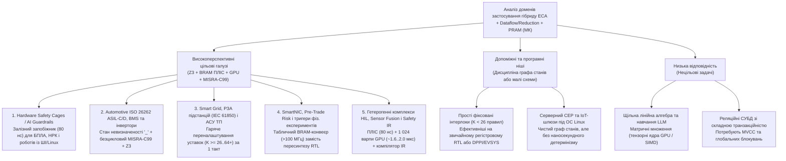

### 7.2. Детальна матриця 5 перспективних галузей застосування (на поточний час)

| Галузь і клас систем | Архітектурне обґрунтування (`ECA + Dataflow + PRAM`) | Ключові підтверджені переваги МК у домені | Відкриті інженерні кроки для TRL 4+ |
| :--- | :--- | :--- | :--- |
| **1. Апаратні контури безпеки для автономних систем, БПЛА, НРК і робототехніки з ШІ (*Hardware Safety Cages / AI Guardrails*)** | Між складним ШІ або автопілотом під ОС Linux (`Jetson Orin`) і силовими приводами потрібен непідкупний апаратний запобіжник. | Дескрипторний конвеєр на ПЛІС відсікає будь-яку команду поза дозволеним конвертом (кут, струм, геозона, небезпечне увімкнення навантаження) за **`80 нс` у залізі** (*Fail-Closed*) незалежно від зависання ОС, дозволяючи бортовому комп'ютеру легітимно змінювати параметри місії на льоту через тіньовий банк `BRAM` (`CFG-P-HA`, `100.69 МГц PASS`, `10 003` перемикання без простою) із `CRC-8`. | Інтеграція безпосередньо в контур ШІМ/ESC реального польотного контролера або шасі НРК та зовнішній аудит безпеки. |
| **2. Автомобільна електроніка критичної безпеки (`ISO 26262 ASIL-C/D`), системи керування батареями (`BMS`) та силові інвертори** | Каскадна діагностика батарейних стеків (`Комірка -> Модуль -> Батарея -> Силовий контактор`) та захист інверторів на багатоядерних мікроконтролерах `Infineon AURIX TC49x` (`CSRM` / `PPU`), `NXP S32` чи `ARM Cortex-R`. | **Явний стан невизначеності `_`** (`valid_mask`) унеможливлює маскування помилки датчика або обриву шини `isoUART` магічним нулем; компілятор автоматично генерує безцикловий код `MISRA-C99` (`--emit-c99`, `WCET = const`) разом із машинно-перевірним сертифікатом `Z3`. | Сертифікаційна кваліфікація кодогенератора (`ISO 26262 Part 8 Tool Qualification`) та тести на цільовому кристалі `AURIX TC49x`. |
| **3. Цифрова енергетика, Smart Grid, релейний захист і автоматика підстанцій (`IEC 61850`) та промислові інтерлоки АСУ ТП** | У задачах селективного релейного захисту, протиаварійної автоматики енергосистем і блокувань турбін/реакторів десятки взаємопов'язаних порогових правил ($K \ge 26..64+$) мають спрацьовувати з гарантованим часом реакції. | Нульовий внутрішній джитер (`80 нс` на крок), константна площа логіки `O(1)` у `BRAM` і можливість переналаштовувати уставки захисту під поточну топологію мережі за `1` такт без зупинки обладнання і без перепрошивання ПЛІС. | Узгодження з промисловими шинами процесу `IEC 61850-9-2 Sampled Values / GOOSE` та розрахунок огинаючих кривих *Network Calculus* для вхідних АЦП. |
| **4. Наднизьколатентні мережеві шлюзи (*SmartNIC*), біржовий Pre-Trade Risk контроль і швидкісні тригерні системи фізичних експериментів** | Перевірка потоку пакетів, біржових заявок або подій детекторів частинок за набором із $K \ge 26..64+$ взаємозалежних правил, де пороги постійно коригуються. | Табличний дескрипторний конвеєр у `BRAM` ПЛІС виграє у жорстко зашитого регістрового RTL і за площею кристала (`-39.5% LUT`, `-78.3% FF` при $K = 64$), і за частотою (`> 100 МГц` проти падіння мультиплексора до `59..72 МГц`), дозволяючи змінювати ризик-ліміти чи фільтри за наносекунди замість годин пересинтезу бітстріму. | Інтеграція з високошвидкісними MAC-інтерфейсами (`10G/25G Ethernet` або `PCIe`) та багатобанкова конвеєризація `N ≥ 8` на частоті `>= 100 МГц`. |
| **5. Гетерогенні комплекси напівнатурного моделювання (*HIL*), радарно-оптичного Sensor Fusion та інженерні компілятори «живих специфікацій безпеки» (*Safety IR*)** | Поєднання швидкісного апаратного гейтингу інваріантів із масивно-паралельною числовою обробкою сотень каналів та єдиним поданням правил безпеки. | Симбіоз «ПЛІС (`80 нс` вхідний гейтинг) + резидентні варпи GPU (`1 024` паралельні канали обробки за `~1.6..2.0 мкс` на `Jetson AGX Orin`)» для багатокритеріальної телеметрії та активного придушення завад; сама формальна модель МК виступає **проміжним представленням (*Safety IR*)**, з якого автоматично генеруються і формальні докази `Z3`, і апаратний `RTL`, і вбудований код `C99`. | Заміна сокетного стека Linux/GbE (`344.78 мкс` медіани) на прямий апаратний тракт `PMOD -> J501` через `SN74AVC8T245` або `PCIe GPUDirect RDMA`. |

---

## 8. Верифіковані межі, розбіжності реалізації та відкриті науково-інженерні задачі

Отримання письмових роз'яснень семантики від М. Ю. Кузьміна (11–15.11.2026) та опрацювання трьох нових авторських презентацій від 13.11.2026 вимагають явного підсумкового розмежування між доведеним інженерним станом, авторським задумом і відкритими проблемами.

### 8.1. Статус готовності технології (TRL), стандартів безпеки та ліцензування

1. **Рівень технологічної готовності — TRL 3 (PoC) за самооцінкою:**<br/>
   За шкалою ISO 16290:2013 поточний стан проєкту оцінюється як **TRL 3 за внутрішньою самооцінкою** (лабораторні перевірки окремих критичних функцій: верифікація вентиля `kpol_txn_gate_v2`, реактивний тракт `CFG-R` і виконання підмножини `KPOL-CME-1` через `Block RAM` у `CFG-P`; вихідний RTL, формальні властивості й сирі вимірювання лежать у закритому інженерному репозиторії проєкту). Рівень **TRL 4** є метою наступного етапу і **не тотожний MVP** (це лабораторна валідація інтегрованих компонентів із зовнішньою перевіркою, що потребує завершення компілятора, безвтратної черги подій і багатоядерних тестів).
2. **Відсутність сертифікації за стандартами безпеки:**<br/>
   Посилання на практики Automotive SPICE, ISO 26262, IEC 61508 чи DO-178C у документації проєкту означають виключно добровільне використання інженерної дисципліни трасування та незалежного рецензування; відповідність зазначеним стандартам або рівням SIL/ASIL не заявляється.
3. **Режим інтелектуальної власності:**<br/>
   Використання відкритого інструментального маршруту синтезу ПЛІС (*Yosys / nextpnr / Project X-Ray*) забезпечує технічну відтворюваність бітстріму без пропрієтарних САПР, проте власний код і інженерна документація основного репозиторію розробляються у закритому пропрієтарному режимі (цей розділ у `drafts` слугує редакційним майданчиком для узгодження та публічного обговорення концепції).

---

### 8.2. Матриця розбіжностей між авторською моделлю (2026) та інженерним профілем `KPOL-CME-1` / `CFG-P`

| Аспект моделі | Авторська модель М. Ю. Кузьміна (за джерелами до 13.11.2026) | Поточна інженерна реалізація (`KPOL-CME-1` / `CFG-P`) | Інженерний статус |
| :--- | :--- | :--- | :--- |
| **Двійкова структура концепту** | Спарсова структура змінної довжини: 8-бітна маска присутності `Def` (`0..7` для 8 опційних компонентів), обов'язковий `Class`, безіменний атрибут замість вилученого `Size`, 4-бітний `Token` (уточнення автора 13–15.11.2026). | Фіксована таблиця `CME-RAW-1`: 64 слоти по 16 байтів (`4 × 32-бітні` слова `W0..W3`, одне значуще поле стану `Int32` без маски `Def` і без окремого біта `_`). | Кандидати вимог `KPOL-AUTH-01..02` (*Proposed*); побітний контракт `Q-AUTH-02` ще відкритий. |
| **Семантика оператора `•`** | Пост-адресний бар'єр черговості: підписка за `•` виконується строго після читання або після запису (уточнення від 13.11.2026). | У парсері референсу та `km_concept_micro_engine.sv` символ `•` історично інтерпретується як унарне логічне заперечення (`NOT`), а атомарність забезпечує окремий вентиль `kpol_txn_gate_v2`. | Відома діалектна розбіжність (`KPOL-AUTH-05`); потребує розділення діалектів і контракту `Q-AUTH-05`. |
| **Групи, дужки та індекси** | Контекстно-вільні парні дужки; `OpenBracket` і `CloseBracket` (`CloseBracked`) виконувані при побудові груп у `Static`; для типу `Token` підрядковий/надрядковий індекси задають `Min`/`Max`. | Строгий профіль `KPOL-CME-1` приймає лише скалярні правила виду `state / event / rule` без груп, масивів і виконуваних дужок. | Кандидати `KPOL-AUTH-03, 07, 08` (*Proposed*); питання `Q-AUTH-01, 03, 04, 07` відкриті або частково уточнені. |
| **Переповнення черги подій** | Блокувальне очікування звільнення слота (*backpressure*) без втрати подій (авторська цільова політика черг). | У `km_autonomous_sequencer.sv` сигнал `ready_o` враховує лише заповненість `FIFO-16`; при колізії каскаду з єдиним вільним слотом зовнішній строб відкидається з лічильником `events_dropped_count_o`. | Відкрита інженерна знахідка RTL (потребує буфера утримання без повторного коміту). |
| **Багатоядерність і рандеву** | Пул процесорів із динамічними стеками `SR/SP`, рандеву `Go SR2 →` та послідовним відкатом на поточне ядро (*Graceful Serial Fallback*). | Ранній блок `RCFC` у §2.6 був ізольованим демо-автоматом етапу PoC; актуальний програмований конвеєр `CFG-P` є одноядерним і ще не має між'ядерного кросбара стеків `SR/SP`. | Стекова багатоядерна фабрика перебуває у статусі аналітичної моделі. |

---

### 8.3. Відкриті науково-інженерні задачі

1. **Завершення специфікації авторського фронтенду та пам'яті (`Q-AUTH-01..07`):**
   - після отримання відповідей М. Ю. Кузьміна від 13–15.11.2026 (`Min=1, Max=0` як одне обов'язкове виконання та тимчасове рішення `Min=1, Max=15` як `1..16` за правилом «на 1 більше», `OpenBracket`/`CloseBracket` як дві функції-заглушки в трансляторі, порядок дій у `A • B` та порядок бітів у `Def` від молодшого зліва до старшого справа) відкритими питаннями формальної семантики залишаються оновлена таблиця парних роздільників після звільнення `#` та одиниця довжини `Name <= 16`, точний момент зняття зайнятості в конструкції `A • B`, булева інтерпретація `•` на слайді 6, доля арифметичного виразу при читанні концепту у стані `_`, розрізнення відсутнього компонента (`Def[i]=0`) проти стану `_`, узгодження єдиного декодування `Max=0` із `15` та індексація нетокенних елементів у групах.
2. **Конвеєризація багатобанкового комутатора та захист від міжбанкових циклічних дедлоків:**
   - в одноядерному секвенсері вже реалізовано й формально верифіковано ($k$-індукцією `Z3` до $N = 16$ концептів) однослотовий буфер утримання внутрішнього каскаду `cascade_pending` та рукостискання `valid && ready`, а для 2-банкового кластера формально доведено збереження подій і необхідність міжбанкової ациклічності (оскільки симетричний цикл `Bank 0 <-> Bank 1` на заповнених скінченних чергах без віртуальних каналів призводить до взаємного блокування);
   - після фізичного Place & Route в `OpenXC7` (`nextpnr-himbaechel` на `XC7Z020`) максимальна частота плоского однотактового комутатора становила $`F_{\max}^{(1)}(N) = 113.92 / 95.21 / 78.11 / 50.81\text{ МГц}`$ для $`N = 1 / 2 / 4 / 8`$ вузлів (`SLICE_LUTX = 3 141..27 025`). Впровадження **2-ступеневого конвеєризованого комутатора** (`Stage 1` локальні групи + `Stage 2` міжгруповий арбітр) скоротило площу на `33..38% SLICE_LUTX` і підняло трасовану частоту до **`133.89 МГц`** при $N = 2$ (`3 894 SLICE_LUTX`), **`103.73 МГц` (`PASS @ 100.00 MHz`)** при $N = 4$ (`8 225 SLICE_LUTX`) та **`91.89 МГц`** (`+80.85%`, `18 112 SLICE_LUTX`) при $N = 8$; для закриття порога `100 МГц` при $`N \ge 8`$ потрібна ієрархічна (квадрантна) або 3-ступенева комутація.
3. **Прямий апаратний міжплатний міст ПЛІС ↔ GPU без участі ОС та дослідження зручності KPOL:**
   - натурні вимірювання міжплатного контуру `PYNQ-Z1 -> GbE -> Jetson AGX Orin J501` ($R = 5 \times 1\,000$ подій із трасованим шлюзом емісії **`101.67 МГц PASS @ 100.00 MHz`**, `3 630 SLICE_LUTX`, `1 RAMB36E1`) експериментально показали, що на тлі `80 нс` у ПЛІС та **`p50 = 1.96 мкс` (`1958.40 нс`) і `p99.9 = 2.05 мкс` (`2046.98 нс`)** у `16 SM` GPU (`1 024` підписники; в ізольованих прогонах на платі `p50 = 1.57..1.74 мкс`, `p99.9 = 1.93..2.04 мкс`) сокетний стек ОС Linux / GbE додає медіану `344.78 мкс` і хвіст `p99.9 = 2808.53 мкс` (`σ = 199.17 мкс`) через хост-обробку ОС; отже, відкритим завданням залишається монтаж прямого апаратного тракту `PMOD (3.3V) -> J501 (1.8V)` через буферизований перетворювач рівнів `SN74AVC8T245` (або перехід на ПЛІС із `PCIe GPUDirect RDMA`) та проведення дослідження зручності програмування мовою KPOL за участі розробників-людей.

---

### 8.4. Підсумкова інженерна ідентифікація: чим є Машина Кузьміна — парадигмою, мовою чи апаратним ко-дизайном?

Спираючись на всі проведені експерименти, формальні індуктивні докази, трасування *Place & Route* та прямі порівняльні вимірювання, місце Машини Кузьміна формулюється у чотирьох висновках:

1. **Що таке МК за своєю первинною суттю:**<br/>
   За задумом М. Ю. Кузьміна МК — це **не готова апаратура**, а **подієво-концептна обчислювальна модель (парадигма) і спосіб запису програм**, близький до класу `PRAM + ECA` (спільна пам'ять станів + правила «подія–умова–дія»). Її ядро — об'єднання в одному **Концепті** чотирьох речей: значення, окремого стану невизначеності `_`, безпобічних предикатів `::` і підписок із чітким фазовим бар'єром `•` без імперативних циклів. Сам автор перевіряв ідею звичайною C-програмою на `STM32`, залишивши фізичну адресацію та низькорівневе представлення відкритими.
2. **Чи можна використовувати її просто як парадигму на загальних мовах (`C`, `Rust`, `C++`, `Python`)?**<br/>
   **Технічно — так, але на звичайному CPU під ОС вона втрачає головну перевагу.**
   - Як програмний патерн на `C`/`Rust` вона дає корисну дисципліну моделювання стану: явний біт `_` замість `null`/магічних нулів, відсутність розмазаних по коду `if`-опитувань і видимий граф реакцій.
   - Проте наші заміри на `ARM Cortex-A9 @ 650 МГц` показали ціну софтверної емуляції: поки C99 (`-O3`) крутиться всередині L1-кешу без ОС, 4-концептний каскад займає `~534 нс`, але щойно втручаються події ядра ОС (`29..33 мкс`) або витіснення планувальника (`до 40..77 мкс`), детермінізм зникає. На серверах чи десктопах вона конкурує зі зрілими акторними моделями, реактивними стрімами, `CEP`/Rete-рушіями та синхронними мовами (`Lustre`/`Esterel`), не даючи радикального прискорення сама по собі.
3. **Чому окрема мова (підмножина KPOL) все ж потрібна, але не як «заміна Python/C»:**<br/>
   Як універсальна мова загального призначення класичний слайдовий KPOL програє звичним мовам за зручністю набору неклавіатурних символів та екосистемою (і його повний авторський стандарт досі не завершений), тому для інженерної практики впроваджено чистий 7-бітний ASCII-надшар **`EKPOL 0.1.0`** (`.ekpol`) із символьною та ключовою програмістською нотаціями і двосторонньою трансляцією `EKPOL <-> KPOL` (§4.8). Як **вузька статично верифікована мова правил (DSL)** пара `KPOL / EKPOL` виконує функцію, якої не дає довільний код на `C`: компілятор *до запуску* гарантує відсутність циклів (передумова формальної леми Ляпунова про скінченну завершуваність каскадів), контролює межі інваріантів у `Z3` і побітово тотожно компілює граф у фіксовану таблицю дескрипторів (`1024 Б`), модуль `MISRA-C99` та середовище покрокового налагодження хвилі у `VMK v0.3.1`.
4. **Де МК стає реальним апаратним і вбудованим рішенням зі своєю нішею:**<br/>
   Найсильніший результат наших досліджень полягає в тому, що МК розкривається саме як **апаратно-програмний ко-дизайн («статичний компілятор KPOL/EKPOL із Z3-сертифікатом та Go-дебагером VMK + дескрипторний конвеєр у `BRAM` ПЛІС + спеціалізовані варпи GPU + кодогенерація безциклового C99 для ядер безпеки MCU»)**:
   - На **малій кількості правил ($`K < 26`$ концептів)** МК на ПЛІС **не потрібна** — звичайний регістрово-конфігурований RTL компактніший за `LUT` (`2 209` проти `3 351 SLICE_LUTX` при $`K = 4`$) і швидший у тактах.
   - Але починаючи з **$`K \ge 26\dots 64+`$ правил** дескрипторний конвеєр `CFG-P` / `CFG-P-HA` перемагає регістровий RTL за площею (`O(1)` логіки + `1–2 RAMB36E1`), тримає частоту `>100 МГц` (`103.53 МГц` у `CFG-P` та **`100.69 МГц PASS @ 100.00 MHz`**, `9.931 нс`, `5 718 SLICE_LUTX`, `1 935 SLICE_FFX`, `2 RAMB36E1` у `CFG-P-HA` завдяки 8-рівневому бінарному дереву пріоритетного кодера, тоді як однотактовий регістровий мультиплексор падає до `59..72 МГц`), гарантує `80 нс` на крок із `0` тактів внутрішнього джитера, фізично блокує небезпечні записи софту (*Fail-Closed*) і дозволяє гаряче оновлювати правила на льоту без простою та без `torn-read` (формально доведено в `Z3 SMT` включно з 256-бітним miter-доказом еквівалентності дерева й `6` мутантами та натурно підтверджено на стенді `PYNQ-Z1 + LogicTracer Pico 0.5.0` на **`10 003` гарячих перемиканнях банків під потоком `40 011` подій** за `39.35 мс`: `0` колізій BRAM, `0` stall-тактів).
   - У багатоядерному кластері з **2-ступеневим конвеєризованим комутатором** площа скорочується на `33..38% SLICE_LUTX`, а трасована частота становить **`133.89 МГц`** ($N = 2$, `3 894 SLICE_LUTX`, пік `33.47 млн` переходів/с), **`103.73 МГц PASS @ 100.00 MHz`** ($N = 4$, `8 225 SLICE_LUTX`, пік `51.87 млн` переходів/с) та **`91.89 МГц`** ($N = 8$, `+80.85%`, `18 112 SLICE_LUTX`, пік `91.89 млн` переходів/с).
   - У зв'язці зі спеціалізованими варпами GPU система обчислює до `1 024` контурів на `16 SM` в ізольованих прогонах із медіаною $`p_{50} = 1.57\dots 1.74\ \mu\text{с}`$ та хвостом $`p_{99.9} = 1.93\dots 2.04\ \mu\text{с}`$ (поріг $`p_{99.9} \le 1.50\ \mu\text{с}`$ обмежується затримкою тканини `L2/SCF`), а в натурному міжплатному контурі `PYNQ-Z1 -> GbE -> Jetson AGX Orin J501` ($R = 5 \times 1\,000$ подій, трасований вихідний шлюз **`101.67 МГц PASS @ 100.00 MHz`**, `3 630 SLICE_LUTX`, `1 RAMB36E1`) — за **`p50 = 1.96 мкс` (`1958.40 нс`) і `p99.9 = 2.05 мкс` (`2046.98 нс`)** на GPU проти медіани `344.78 мкс` і хвоста `p99.9 = 2808.53 мкс` (`σ = 199.17 мкс`), які додає сокетний стек ОС Linux / GbE, обґрунтовуючи вимогу прямого апаратного тракту (GPIO/GPMC або PCIe GPUDirect RDMA) для суб-15-мкс систем.
   - Крім ПЛІС+GPU, верифікована таблиця дескрипторів правил і Z3-доказ ациклічності та інваріантів прямо транслюються компілятором (`--emit-c99`) у **безцикловий MISRA-сумісний C99-код** (`WCET = const`, `valid_mask`) для ядер безпеки автомобільних і промислових мікроконтролерів (`Infineon AURIX TC49x CSRM`, `ARM Cortex-M/R`), а також працюють як апаратний запобіжник для ШІ/Linux у робототехніці та БПЛА (`Hardware Safety Cage`).

> **Підсумок в одному реченні:**
> **Машина Кузьміна — це не універсальна заміна CPU чи звичайних мов, і не суто «залізна плата»: за походженням це реактивна парадигма спільної пам'яті (яку можна емулювати бібліотекою в `C`/`Rust` заради чистоти графа станів), але справжню вимірювану перевагу над існуючими підходами вона дає саме як спеціалізований ко-дизайн «статичний DSL KPOL із Z3-сертифікатом + активні таблиці `BRAM` на ПЛІС (із гарячим оновленням без простою та конвеєрним кластером) + резидентні варпи GPU + кодогенерація безциклового C99 (`--emit-c99`) для ядер безпеки MCU» у системах жорсткого реального часу з десятками й сотнями перепрограмованих правил захисту та керування.**

### 8.5. Сильна ніша гібриду `ECA + Dataflow/Reduction + PRAM` та перспективні галузі застосування Машини Кузьміна

Підсумовуючи досьє для відкритої публікації, сформулюємо конструктивний, інженерно оптимістичний і водночас науково чесний погляд на те, чому досліджений клас архітектур має сильну власну нішу і в яких галузях його доцільно розвивати:

1. **Чому саме гібридний клас (`ECA + Dataflow/Reduction + PRAM`) має сильну власну нішу:**
   - **Межа класичних процесорів у реактивному контролі:** класичні фон-нейманівські процесори сильні в глибоких послідовних алгоритмах, але в задачах реактивного контролю стану тисяч параметрів вони тонуть у накладних витратах ОС (`29..77 мкс`), перериваннях і розгалуженнях;
   - **Математично прозорий скінченний граф переходів:** гібрид подієво-продукційних систем (`ECA`), потокових/редукційних машин (`Dataflow / Reduction`) і конкурентних систем переписування над спільною пам'яттю (`PRAM`) — ядром якого в МК є **Концепт** із явним станом невизначеності `_`, чистими предикатами `::`, ациклічним каскадом підписок і транзакційним бар'єром `•` без імперативних циклів — перетворює програму керування на **математично прозорий скінченний граф переходів**, який:
     * *до запуску* піддається повному формальному аналізу в SMT-солверах (`Z3`) на відсутність циклів (за функцією рангу Ляпунова), взаємоблокувань і порушень інваріантів;
     * однаково природно компілюється і в **активні таблиці блочної пам'яті ПЛІС** (`80 нс` на крок, `0` тактів внутрішнього джитера, гаряче оновлення правил за `1` такт через тіньовий банк `CFG-P-HA` без пересинтезу бітстріму на `100.69 МГц PASS` і масштабування у 2-ступеневому кластері до `133.89 / 103.73 / 91.89 МГц`), і в **резидентні варпи GPU** (`1 024` паралельні підписники за `~1.6..2.0 мкс`), і в **безцикловий детермінований код `MISRA-C99`** (`--emit-c99`, `WCET = const`) для ядер безпеки мікроконтролерів;
   - **Методологічний еталон (*Reference Case Study*):** проєкт продемонстрував повний науково-інженерний цикл перетворення неформальної авторської ідеї через систематичну формалізацію авторських уточнень семантики (листопад 2026), математичну формалізацію (`Z3 SMT`), мутаційне тестування і відкритий маршрут синтезу ПЛІС (`OpenXC7` без пропрієтарних САПР) у фізично виміряні артефакти в кремнії (`Zynq-7020`, `Jetson AGX Orin`, `LogicTracer RP2040`).

2. **Реалістична форма впровадження («Safety IR під капотом») та 5 конкретних перспективних галузей застосування:**
   - Хоча мова `KPOL` не призначена замінити `C`, `Rust` чи `Python` для загального програмування, а на ПЛІС при малій кількості правил ($`K < 26`$) достатньо звичайного регістрового RTL, **формалізоване ядро МК має високий практичний потенціал як проміжне представлення безпеки (*Safety Intermediate Representation, Safety IR*) та апаратно-програмний ко-дизайн** у п'яти перспективних галузях (§7.2):
     1. *Апаратні контури безпеки для автономних систем, БПЛА, НРК і робототехніки з ШІ (`Hardware Safety Cages / AI Guardrails`):* відсікання будь-якої небезпечної команди поза дозволеним конвертом (кут, струм, геозона, небезпечне увімкнення навантаження) за `80 нс` у залізі ПЛІС незалежно від зависання ОС Linux (`Jetson Orin`), із легітимною зміною параметрів місії на льоту через тіньовий банк `BRAM` із `CRC-8`;
     2. *Автомобільна електроніка критичної безпеки (`ISO 26262 ASIL-C/D`), системи керування батареями (`BMS`) та силові інвертори:* каскадна діагностика батарейних стеків (`Комірка -> Модуль -> Батарея -> Силовий контактор`) та захист інверторів на багатоядерних мікроконтролерах `Infineon AURIX TC49x` (`CSRM` / `PPU`), `NXP S32` чи `ARM Cortex-R`, де явний стан невизначеності `_` унеможливлює маскування обриву датчика або шини `isoUART` магічним нулем у поєднанні з кодогенерацією безциклового `MISRA-C99` та сертифікатом `Z3`;
     3. *Цифрова енергетика, Smart Grid, релейний захист і автоматика підстанцій (`IEC 61850`) та промислові інтерлоки АСУ ТП:* селективний релейний захист, протиаварійна автоматика енергосистем і блокування турбін/реакторів ($`K \ge 26\dots 64+`$ правил) із жорстко гарантованим часом реакції та переналаштуванням уставок під поточну топологію мережі без зупинки обладнання і без перепрошивання ПЛІС;
     4. *Наднизьколатентні мережеві шлюзи (`SmartNIC`), біржовий Pre-Trade Risk контроль і швидкісні тригерні системи фізичних експериментів:* табличний дескрипторний конвеєр у `BRAM` ПЛІС (`> 100 МГц`), який при $`K \ge 26\dots 64+`$ виграє у жорстко зашитого регістрового RTL і за площею кристала, і за частотою, дозволяючи змінювати ризик-ліміти чи фільтри пакетів за наносекунди замість годин пересинтезу бітстріму;
     5. *Гетерогенні комплекси напівнатурного моделювання (`HIL`), радарно-оптичного Sensor Fusion та інженерні компілятори «живих специфікацій безпеки» (`Safety IR`):* симбіоз «ПЛІС (`80 нс` вхідний гейтинг інваріантів) + резидентні варпи GPU (`1 024` паралельні канали обробки за `~1.6..2.0 мкс`)» для багатокритеріальної телеметрії та активного придушення завад, де формальна модель МК виступає єдиним *Safety IR* для генерації формальних доказів `Z3`, апаратного `RTL` і вбудованого коду `C99`.

---

## 9. Глосарій термінів та позначень

| Термін / Символ | Категорія | Визначення в системі понять Машини Кузьміна |
| :--- | :--- | :--- |
| **$`\text{¤}`$ (Поточний концепт)** | Символ нотації | Контекстний вказівник (`self` / `this`) на концепт (комірку), який у даний момент адресується або всередині якого виконується аналіз подій. Відносні зсуви записуються як $`\text{¤}-1`$ та $`\text{¤}+1`$. |
| **`•` (Велика точка / Big Dot)** | Оператор бар'єра / Властивість | За канонічним уточненням автора від 13.11.2026 — пост-адресний бар'єр порядку, за яким підписка виконується строго після читання або після запису ($`w_1 \bullet w_2`$); у ранніх слайдах та реконструкції також пов'язаний із булевою ознакою результату операції. |
| **А-ритм** | Теорія виконання | Нелінійний реактивний порядок обчислень у Машині Кузьміна без імперативних циклів (`for`/`while`, `For/Each/Do`), що формується динамічно внаслідок спрацьовування подій та їхніх підписок. |
| **А-схема** | Візуалізація | Графічне представлення програми МК без постійних з'єднувальних ліній, де зв'язки між концептами та підписками відображаються динамічно при фокусуванні на обраному елементі. |
| **Адресація (`Go`)** | Базова операція | Активація концепту керуючим пристроєм (головкою) одного з чотирьох видів: читання у стек (`→`), запис зі стека (`←`), виконання (`|`) або ініціалізація (`:`). |
| **Байт `Def`** | Заголовок концепту | 8-бітна маска присутності восьми компонентів концепту (`Name`, `Help`, `Subscribe`, організація, `Attributes/Property`, `Event`, `Method`, `Child`), де біти `0..7` (від молодшого до старшого) зі значенням `1` позначають наявність компонента. |
| **Виконувані дужки** | Концепти групування | Елементи `OpenBracket` і `CloseBracket` (`CloseBracked`), які за уточненням автора від 13.11.2026 мають власну виконувану роль при формуванні статичного концепту (непорожні дужки) або групи (порожні дужки). |
| **Головка (Керуючий пристрій)** | Абстрактний виконавець | Одноразовий або пуловий носій активації, який переносить дію адресації до цільового концепту і завершує роботу після відпрацювання виду адресації. |
| **Група (`[]`, `{}`, `()`)** | Структура даних | Складений концепт (`Array` або `Collection`), кратність виконання якого для індексів типу `Token` задається підрядковим `Min` і надрядковим `Max` після закривальної дужки. |
| **Дескриптор підписки** | Структура Runtime | Об'єкт середовища виконання, що об'єднує спільний стек параметрів та динамічних змінних ($`SP`$) і одну або декілька паралельних ліній підписок ($`O_k + SR_k`$). |
| **Концепт** | Базова одиниця пам'яті | Універсальна структурована сутність МК, що визначається байтом `Def`, обов'язковим байтом `Class` та набором присутніх компонентів (зокрема безіменним атрибутом за замовчуванням замість скасованого поля `Size`). |
| **Лексема (`Lexeme`)** | Одиниця транслятора | Дескриптор фрагмента вхідного тексту (`Type / First / Length`) на етапі лексичного аналізу, відмінний від 4-бітного токена пам'яті `Token`. |
| **Лінія підписки** | Одиниця паралелізму | Пара $`(O, SR)`$ із лінійної послідовності низькорівневих команд $`O`$ та виділеного стек-регістра $`SR`$, яка призначається на виконання одному фізичному процесору. |
| **Невизначений стан (`_`)** | Термінальний символ | Явний неініціалізований стан концепту, що кодується окремою ознакою валідності (не тотожний числовому нулю за роз'ясненням автора) і означає відсутність значення до ініціалізації або шаблон підстановки. |
| **Підписка ($`D`$)** | Механізм реакції | Послідовність або група операторів, прив'язана до події концепту, яка запускається на виконання за істинності події під час активації концепту. |
| **Подія ($`s_i`$)** | Предикат / Операція | Підмножина станів концепту $`s_i \subseteq U`$ (предикат нульового порядку $`w_i(U)`$), факт зміни значення (`~`) або сама подія адресації (`→`, `←`, `|`, `:`). |
| **Стек параметрів ($`SP`$)** | Пам'ять оточення | Область пам'яті дескриптора підписки, призначена для зберігання вхідних аргументів виклику (`@`) та динамічних концептів, породжених оператором `:`. |
| **Стек-регістр ($`SR`$)** | Обчислювальний стек | Приватна робоча область пам'яті лінії підписки, куди завантажуються операнди з пам'яті концептів, де виконуються інструкції `Do` і звідки результат вивантажується або синхронізується з іншим стеком (`Go SR2 →`). |
| **Токен (`Token`)** | Примітивний тип | Базовий 4-бітний беззнаковий тип даних (значення $`0 \dots 15`$), що використовується для кодування низькорівневих ознак, індексів меж груп `Min`/`Max` та представлення розміру. |
| **`EKPOL` (*Ergonomic KPOL*)** | Похідний мовний шар | Ергономічний надшар мови МК у чистому 7-бітному ASCII (`.ekpol`), що об'єднує стан, тип, інваріант `[>= 0]` і реакції в блоці `concept`, підтримує взаємозамінні символьну й ключову нотації, блоки `test`, двосторонню трансляцію `EKPOL <-> KPOL` і 100% побітово тотожну компіляцією в 1024-байтний образ `BRAM` та `MISRA-C99`. |
| **`VMK` (*Virtual Machine of Kuzmin*)** | Програмний емулятор / TUI-дебагер | Самодостатній двомодовий емулятор (`--mode conceptual` за уточненою авторською моделлю листопада 2026 року та `--mode bram64` за `CME-RAW-1` / `CFG-P-HA`) і повноекранний 4-панельний TUI-дебагер на чистій стандартній бібліотеці Go (`v0.3.1`, `0` зовнішніх залежностей) із життєвим циклом інспекції `PRE-LOAD -> POST-LOAD -> RUNNING`, потоковим `STDIO` та покроковим налагодженням хвилі подій по одному мікро-хопу. |

---

## 10. Посилання на джерела

### Первинні матеріали автора концепції (М. Ю. Кузьмін)
1. **Кузьмін М. Ю.** Публікації та технічні топіки на порталі DOU (Developers of Ukraine), 2020–2023 рр., та дискусійні відповіді листопада 2026 р.:
   * [«Обіцяв викласти свій проєкт. Роблю»](https://dou.ua/forums/topic/31011/) (10.07.2020);
   * [«Недетермінована машина Тюрінга. Архітектура. Мова. Система. Програмування»](https://dou.ua/forums/topic/35601/) (26.11.2021);
   * [«Машина Кузьміна. (Керована недетермінована машина Тюрінга.)»](https://dou.ua/forums/topic/35914/) (28.12.2021, включно з дискусією та відповідями автора від 04–05.11.2026);
   * [«За недетерміновану машину і за не-алгоритми»](https://dou.ua/forums/topic/36255/) (22.01.2022);
   * [«Виконання груп у недетермінованій машині»](https://dou.ua/forums/topic/36556/) (13.02.2022);
   * [«Як завжди про події»](https://dou.ua/forums/topic/38502/) (14.06.2022);
   * [«Автоматика та пристрої. Є проєкт, допоможіть розібратися, як знайти інвестора»](https://dou.ua/forums/topic/38994/) (08–11.07.2022 — формальне визначення МК від 09.07.2022 та згадка про ранній макет із платами на STM32; згідно з історичним уточненням М. Ю. Кузьміна від листопада 2026 р., ранній прототип на 2–3 платах STM32 був прямою C-програмою перевірки принципу подій-підписок без віртуальної машини та окремої мови);
   * [«Опис недетермінованої машини Кузьміна на пальцях»](https://dou.ua/forums/topic/43177/) (24.04.2023);
   * [«Зробив канал, на якому розповідаю за нову архітектуру комп’ютера, мову та приклади»](https://dou.ua/forums/topic/44552/) (30.07.2023).
2. **Кузьмін М. Ю.** Презентація *«Пример для АН»* (`Пример для АН.pptx` / `.pdf`, 16 слайдів; створено 2024-05-21, змінено 2026-11-06): опис позначень, подій, ранньої таблиці типів `Type` і операцій `Operation`, стеків $`SR/SP`$, міжстекової синхронізації, оператора `•`, ескізу симуляції МТ та прикладів `Nod`, `Factorial`, `Example`, `Control`, `Neuron`.
3. **Кузьмін М. Ю.** Серія авторських презентацій понять, груп і синтаксису від 13.11.2026: *«Введение. Понятия. Группы. Синтаксис.pptx»* (8 слайдів), *«Введение_1. Понятия. Группы. Синтаксис.pptx»* (8 слайдів, із уточненням щодо виконуваних `OpenBracket` і `CloseBracket`/`CloseBracked`) та *«Презентация1.pptx»* (1 слайд, типізовані межі груп `Min`/`Max` для `Token`).
4. **Кузьмін М. Ю.** Письмові авторські роз'яснення семантики подій, неініціалізованого стану `_`, пост-адресного бар'єра `•`, керування чергами подій, виконуваних дужок і структури концепту `Def` (11–15.11.2026; зведений огляд див. у [`README.md`, §4](README.md#4-авторські-уточнення-семантики-та-відкриті-питання-моделі)).

### Класична наукова література та похідні праці проєкту
5. **Turing A. M.** *“On Computable Numbers, with an Application to the Entscheidungsproblem.”* Proceedings of the London Mathematical Society, s2-42(1), 1936, pp. 230–265. [DOI: 10.1112/plms/s2-42.1.230](https://doi.org/10.1112/plms/s2-42.1.230).
6. **Rabin M. O., Scott D.** *“Finite Automata and Their Decision Problems.”* IBM Journal of Research and Development, 3(2), 1959, pp. 114–125. [DOI: 10.1147/rd.32.0114](https://doi.org/10.1147/rd.32.0114).
7. **Bernstein A. J.** *“Analysis of Programs for Parallel Processing.”* IEEE Transactions on Electronic Computers, EC-15(5), 1966, pp. 757–763. [DOI: 10.1109/PGEC.1966.264565](https://doi.org/10.1109/PGEC.1966.264565).
8. **Brent R. P.** *“The Parallel Evaluation of General Arithmetic Expressions.”* Journal of the ACM, 21(2), 1974, pp. 201–206. [DOI: 10.1145/321812.321815](https://doi.org/10.1145/321812.321815).
9. **Dennis J. B., Misunas D. P.** *“A Preliminary Architecture for a Basic Data-Flow Processor.”* Proceedings of the 2nd Annual Symposium on Computer Architecture (ISCA), 1975, pp. 126–132.
10. **Hewitt C., Bishop P., Steiger R.** *“A Universal Modular ACTOR Formalism for Artificial Intelligence.”* Proceedings of the 3rd International Joint Conference on Artificial Intelligence (IJCAI), 1973, pp. 235–245.
11. **Forgy C. L.** *“Rete: A Fast Algorithm for the Many Pattern/Many Object Pattern Match Problem.”* Artificial Intelligence, 19(1), 1982, pp. 17–37. [DOI: 10.1016/0004-3702(82)90020-0](https://doi.org/10.1016/0004-3702(82)90020-0).
12. **Berry G., Gonthier G.** *“The Esterel Synchronous Programming Language: Design, Semantics, Implementation.”* Science of Computer Programming, 19(2), 1992, pp. 87–152. [DOI: 10.1016/0167-6423(92)90005-V](https://doi.org/10.1016/0167-6423(92)90005-v).
13. **Paton N. W., Díaz O.** *“Active Database Systems.”* ACM Computing Surveys, 31(1), 1999, pp. 63–103. [DOI: 10.1145/311531.311623](https://doi.org/10.1145/311531.311623).
14. **Börger E., Stärk R.** *Abstract State Machines: A Method for High-Level System Design and Analysis.* Springer, 2003. [DOI: 10.1007/978-3-642-18216-7](https://doi.org/10.1007/978-3-642-18216-7).
15. **Sipser M.** *Introduction to the Theory of Computation.* 3rd ed., Cengage Learning, 2013.
16. **Федчик М.** *«Машина Кузьміна: Інженерна реконструкція, активна пам'ять та математичні моделі подієвої логіки»* — [`Kuzmin_Machine_by_Fedchik.md`](Kuzmin_Machine_by_Fedchik.md), 2026.
17. **Федчик М.** *«Машина Кузьміна під формальним розбором: події, підписки, архітектура виконання й критична верифікація»* — [`Kuzmin-Machine-Formal-Analysis-UA.md`](Kuzmin-Machine-Formal-Analysis-UA.md), 2026.
18. **Федчик М.** *«Огляд споріднених концептуальних обчислювальних машин та архітектурних попередників Машини Кузьміна»* — [`Similar_Machines_to_KM.md`](Similar_Machines_to_KM.md), 2026.
