# Візуальний гід з архітектури Машини Кузьміна: Ментальна модель, розумні регістри та А-схеми

> **Автор інженерної реконструкції та концептуальної інтерпретації:** Микола Федчик (Mykola Fedchyk)  
> **Призначення документа:** Сформувати наочну інженерну та апаратну модель Машини Кузьміна для спеціалістів, які звикли до класичної архітектури фон Неймана (регістрові файли, прапорці, лічильник команд $PC$, переривання $IRQ$), розкривши концептуальну модель активної пам'яті, семантику транзакційних точок і чотири фундаментальні джерела подій.
>
> **Епістемологічне застереження (межі реконструкції, актуалізовано 2026-11-17):** цей гід поєднує первинні правила та авторські роз'яснення М. Ю. Кузьміна (листопад 2026) із похідною інженерною інтерпретацією М. Федчика (аналогії з MMIO, 2-фазний шлюз із `BUSY`, CSP/Occam `ALT`, багатоядерний кросбар). Синтезовані у ПЛІС та верифіковані прототипи відповідають рівню **TRL 3 (за самооцінкою)** і охоплюють: однобанковий дескрипторний конвеєр `CFG-P` (`103.53 МГц` AXI / `145.94 МГц` базовий, ациклічні каскади `KPOL-CME-2` з формальним доказом `Z3` на $N=16$), двобанковий конвеєр високої готовності `CFG-P-HA` (**`100.69 МГц`**, `10 003` гарячі перемикання на `PYNQ-Z1 + LogicTracer Pico 0.5.0`), багатоядерний кластер $N = 2, 4, 8$ із 2-ступеневим конвеєризованим комутатором (**`133.89 / 103.73 / 91.89 МГц`**), резидентні варпи GPU на `1 024` підписники (`Jetson AGX Orin`) та кодогенератор безциклового C99 (`--emit-c99`). Водночас повнорозмірні динамічні стеки `SR/SP` з апаратним `Graceful Serial Fallback`, спарсовий формат маски присутності `Def`/`Token` (разом із відкритими питаннями оновлених роздільників та читання стану `_`) і безвтратне блокування некерованих зовнішніх імпульсів поза `valid && ready` за авторською політикою зворотного тиску залишаються елементами **цільової теоретичної моделі** (детальну матрицю розбіжностей див. у [формальному аналізі, §10.2](Kuzmin-Machine-Formal-Analysis-UA.md#102-відомі-обмеження-та-розбіжності-поточного-зрізу-листопад-2026)).

---

## 1. Вступ: Ментальний перехід від фон-нейманівської парадигми

Для інженера, вихованого на класичних мікропроцесорних архітектурах ($x86$, $ARM$, $RISC\text{-}V$), архітектурний опис Машини Кузьміна (МК) на перший погляд видається незвичним: у ній немає **глобального** лічильника команд ($Program\ Counter,\ PC$), хоча кожен виконавчий вузол (стек-лінія $O+SR$ або 8-тактовий автомат `CFG-P` на ПЛІС) зберігає власну локальну послідовність кроків.

На рівні ментальної моделі Машина Кузьміна трактує пам'ять як **віртуалізовану реактивну систему**, де кожен концепт поєднує дані, умови подій і перелік підписників. На серійних мікросхемах пам'яті (`SRAM`, `BRAM`) ця модель втілюється не логікою в кожній комірці пам'яті, а **мультиплексованим у часі мікро-рушієм (`CME`)**, який послідовно обслуговує дескриптори поблизу пасивної пам'яті.

Нижче наведено порівняльну таблицю звичних апаратних концепцій та їхніх відповідників у моделі (та цільовій багатоядерній схемі) Машини Кузьміна:

| Класична архітектура (Фон Нейман / Harvard) | Еквівалент у моделі Машини Кузьміна | Втілення на серійній ПЛІС (`CFG-P` / проєктна схема) |
| :--- | :--- | :--- |
| **Глобальний лічильник команд ($PC$)** | **Відсутній** (локальні кроки всередині вузла) | Замінений на чергу подій `FIFO` і таблицю підписок (у багатоядерній схемі — комутатор) |
| **Регістровий файл ($GPR$)** | **Таблиця дескрипторів концептів** | Пасивна `BRAM` (`64 × 16` Б у `CFG-P`), яку обслуговує 8-тактовий автомат `CME` |
| **Прапорці стану ($Flags:\ Z, C, N, V$)** | **Ознаки стану концепту** | Цільові: `VALID` (неініціалізований стан `_`), `BUSY` (зайнятість під час активації); у `CFG-P` діє локальний інтерлок `kpol_txn_gate_v2` |
| **АЛП ($ALU$)** | **Предикатори + стекові вузли** | Комбінаційний предикатор `::` у `CME` (у `CFG-P` — `Int32`-переходи; стеки $SR/SP$ — у цільовій VM) |
| **Шина адреси / даних** | **Шина подій та транзакційний кросбар** | Лінії адресних стробів (`→`), стробів запису (`←`) та семафорів |
| **Переривання ($IRQ / ISR$)** | **Уніфікована підсистема Подій ($Events$)** | Будь-яка зміна або адресація розглядається як апаратна подія однакового рангу |
| **Імперативна програма ($ASM / C$)** | **А-схема (Топологічний граф)** | Статично або динамічно сконфігурована матриця підписок і реакцій |

> [!TIP]
> **Інженерна аналогія: Концепт як віртуалізований периферійний регістр (аналог MMIO)**
> У прошивках для мікроконтролерів ($STM32$, $AVR$, $RP2040$, $PIC$) уже використовується апаратна реактивність у **регістрах периферії (Memory-Mapped I/O, MMIO)**:
> 1. Запис у них має миттєвий побічний ефект (*Side-effect on Write*): запис біта в регістр керування запускає таймер або ключ.
> 2. Читання може змінювати стан (*Side-effect on Read*): зчитування регістра даних `DR` очищує прапорець або зсуває апаратну чергу FIFO.
> 3. Регістри мають біти статусу: `BUSY`, `READY`, `VALID`, `ERROR`.
>
> **Проєктне узагальнення для ПЛІС:**
> У серійному MCU периферійні регістри жорстко зафіксовані в кремнії. У моделі Машини Кузьміна **уся область пам'яті концептів трактується як таблиця програмованих дескрипторів**, зв'язки яких задаються правилами $KPOL$ і обслуговуються автономним мікро-рушієм `CME` біля двопортової `BRAM` за фіксовані 8 тактів без переривань центрального процесора (ціною послідовної черговості звернень до одного банку BRAM).

### 1.1. Межі інженерної інтерпретації (Near-Memory BRAM)

> **Проєктна модель віртуалізації дескрипторів:**  
> *«Компактний мікро-рушій `CME` поблизу двопортової пам'яті (`SRAM` чи `BRAM`) обслуговує програмовану таблицю дескрипторів-концептів, виконуючи кожну прийняту подію за фіксований 8-тактовий цикл синхронного автомата ($\sigma_{\text{exec-cycles}} = 0$ тактів у домені ПЛІС, без участі CPU та ISR-переривань; фізичний джитер «пін-до-піна» додатково включає квантування входу CDC $\sigma_{\text{cdc}} \approx 2.89\text{ нс}$ і апаратні затримки IOB)».*

Таке відображення усуває потребу у вигаданому «кастомному ASIC із логікою в кожній комірці SRAM»: система проєктується поверх серійних блоків `BRAM` або пам'яті мікроконтролера.

---

## 2. Порівняння моделей: Фон Нейман проти концептуальної реактивності

У фон-нейманівській машині процесор послідовно вибирає інструкції з пасивної пам'яті через спільну шину. У моделі Машини Кузьміна дані в пам'яті поєднані з описами умов і реакцій (А-ритмом).

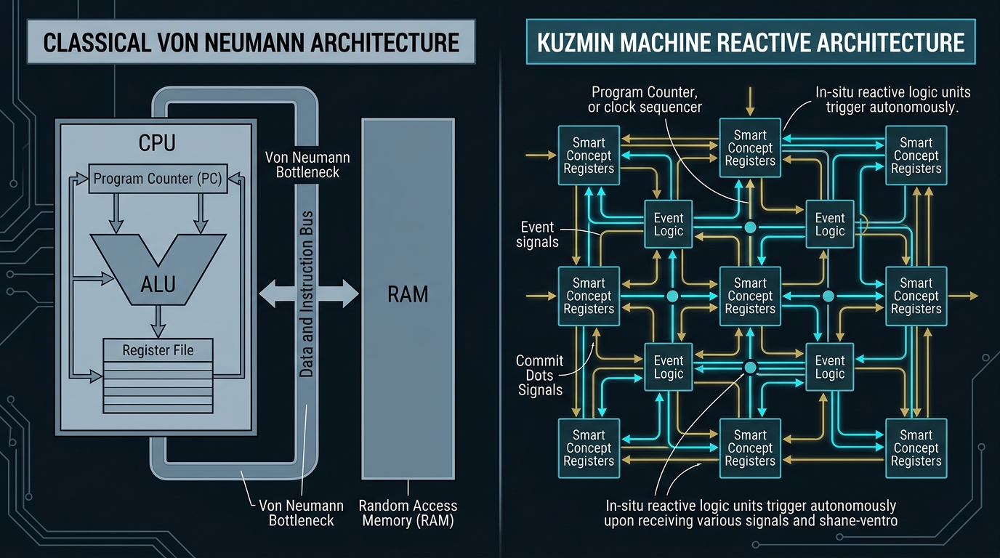

> *Примітка до ілюстрації:* це **концептуальна схема-метафора**, а не схема синтезованого кристала `CFG-P`. Напис усередині зображення *“Program Counter, or clock sequencer”* і *“In-situ reactive logic units”* відображають загальну ідею реактивної мережі (на серійній ПЛІС логіка розміщена в одному мікро-рушії `CME` біля пасивної `BRAM`, а фрагмент *“shane-ventro”* є артефактом генерації зображення).

### Векторна схема взаємодії

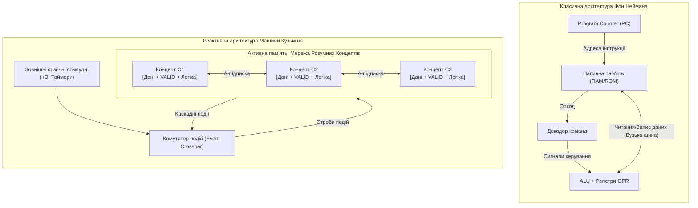

---

## 3. Анатомія Концепту як «Розумного Регістра» (Smart Register)

Щоб зрозуміти, як функціонує розширений дескриптор концепту в **цільовій апаратній моделі** (у поточному одноядерному `CFG-P` рівня `TRL 3 за самооцінкою` реалізовано фіксований 16-байтний формат `CME-RAW-1` без окремих бітів `VALID`/`BUSY` у BRAM — див. [досьє, §8.2](Kuzmin-Machine-Scientific-and-Engineering-Dossier-UA.md#82-матриця-розбіжностей-між-авторською-моделлю-2026-та-інженерним-профілем-kpol-cme-1--cfg-p)), розглянемо його порозрядну будову.

Концепт — це не просто 32- або 64-бітне машинне слово. Це апаратна комірка, що містить:
1. **Поле даних ($Data\ Payload$):** корисне числове або символьне значення.
2. **Біт валідності ($VALID\ bit$):** згідно з авторським роз'ясненням М. Ю. Кузьміна (листопад 2026), явний неініціалізований стан `_` (прочерк / Top) кодується окремим валідним бітом. Якщо $VALID = 0$, значення вважається невизначеним (це запобігає магічним псевдоконстантам на кшталт `0xFFFFFFFF` чи `NaN`).
3. **Прапорець блокування ($BUSY\ lock$):** апаратний семафор, що сигналізує про захоплення концепту конкретним обчислювальним ядром для виконання атомарної операції.
4. **Прапорець фіксації ($COMMIT\ flag$):** статус завершення транзакції Великої Крапки.
5. **Вбудовані предикатні компаратори ($Predicate\ Logic$):** апаратні компаратори, які «на льоту» порівнюють нове значення із заданими порогами ($=, \neq, <, >$).
6. **Маска ліній підписників ($Subscriber\ Mask$):** вектор бітів, що вказує, які ядра або лінії А-схеми мають отримати сигнал тригера у разі зміни чи адресації цієї комірки.

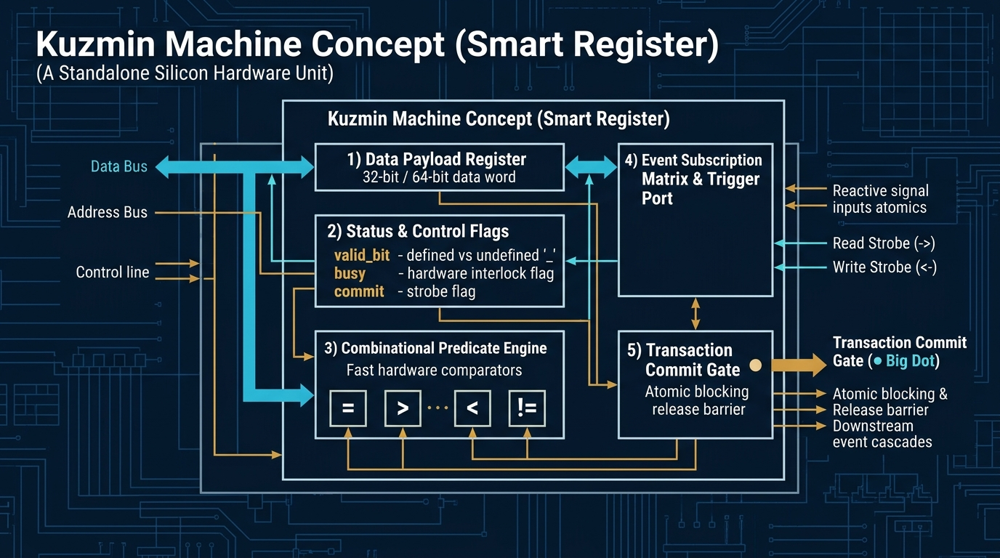

> *Примітка до ілюстрації:* це **концептуальна схема цільового розширеного концепту** (*не* поточний 16-байтний формат `CME-RAW-1` у `CFG-P`, де біти `VALID`/`BUSY`/`SUBSCRIBERS[15:0]` у BRAM ще не реалізовані). Написи на зображенні на кшталт *“A Standalone Silicon Hardware Unit”* і *“atomics”* є елементами концептуального макета.

### Порозрядна розкладка апаратного регістра концепту

```
+-------------------+-------+------+--------+-------------------+--------------------+
| DATA WORD [31:0]  | VALID | BUSY | COMMIT | PRED_MASK [3:0]   | SUBSCRIBERS [15:0] |
+-------------------+-------+------+--------+-------------------+--------------------+
       32 біти        1 біт  1 біт   1 біт         4 біти               16 бітів
```

### Логічна схема внутрішнього пристрою концепту

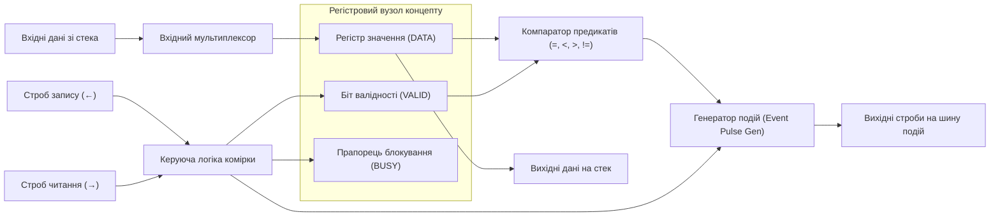

---

## 4. Джерела надходження подій: Звідки береться «іскра»?

У класичній ОС події створюються перериваннями або програмними викликами ($syscall$). У Машині Кузьміна існує **чотири рівноправні джерела подій**:

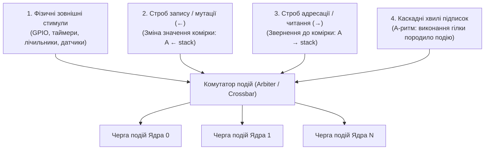

### Деталізація чотирьох джерел

1. **Фізичні апаратні стимули (External Physical Events):**
   - Сигнали від зовнішнього світу: таймер досяг заданого ліміту, лінія GPIO змінила рівень (0 $\to$ 1), АЦП завершив оцифрування. Ці сигнали надходять безпосередньо на вхід комутатора без програмних драйверів.

2. **Строб запису / мутації ($Write\ Event\ Strobe\ \leftarrow$):**
   - Виникає, коли команда $KPOL$ скидає результат зі стека в комірку концепту: `Concept ←`.
   - Авторська семантика (роз'яснення М. Ю. Кузьміна, листопад 2026): «Сравнение и изменение это разные события. Выбор за программистом» (підписки на зміну спрацьовують лише при фактичній зміні стану). Якщо встановлено фільтр на зміну значення, апаратний компаратор зіставляє старе значення з новим. Якщо значення змінилося — виставляється строб події.

3. **Строб адресації / читання ($Address / Read\ Event\ Strobe\ \rightarrow$):**
   - Виникає при простому читанні вмісту концепту на стек: `Concept →`.
   - Авторське роз'яснення М. Ю. Кузьміна (листопад 2026): **«Активация по адресации. Сколько раз адресуемся столько и проверяем на событие»**. Це фундаментальна відмінність: навіть звичайне звернення за даними може бути апаратним тригером аудиту або реакції!

4. **Каскадні хвилі підписок (Cascade Subscription Waves / А-ритм):**
   - Коли ядро виконує праву частину правила А-схеми, результат обчислень змінює інший концепт або активує лінію зв'язку. Це породжує вторинні події, які поширюються мережею подібно до хвиль у нейронній мережі або клітинному автоматі.

---

## 5. Семантика «Великої Крапки» (`•`) і проєктований двофазний транзакційний шлюз

У класичній мові програмування крапка з комою (`;`) є звичайним синтаксичним роздільником операторів, який не має апаратного втілення.

> [!IMPORTANT]
> **Канонічне формулювання Автора (уточнення від 13.11.2026):**<br/>
> *«Наличие точки означает что подписка за ней выполняется после выполнения адресации. Для чтения — после чтения, для записи — после записи.»*  
>
> У моделі М. Ю. Кузьміна `•` — це **пост-адресний бар’єр послідовності (Post-Addressing Barrier)**: підписка за точкою запускається строго після завершення операції читання або запису, а прапорець зайнятості `BUSY` (за авторським роз'ясненням щодо утримання подій у черзі на час зайнятості концепту) блокує повторну активацію до цієї точки.
>
> *Стан реалізації:* у поточному прототипі `CFG-P` захист інваріантів запису виконує окремий формально перевірений вентиль `kpol_txn_gate_v2`, тоді як у самому парсері/модулі `CME-1` символ `•` наразі ще позначає логічне заперечення `NOT`, а поконцептний біт `BUSY` у BRAM не реалізовано. Діаграма нижче ілюструє **цільовий двофазний життєвий цикл** після уніфікації цих механізмів:

### Проєктований двофазний життєвий цикл (Pre-Guard + `•` Commit Barrier)

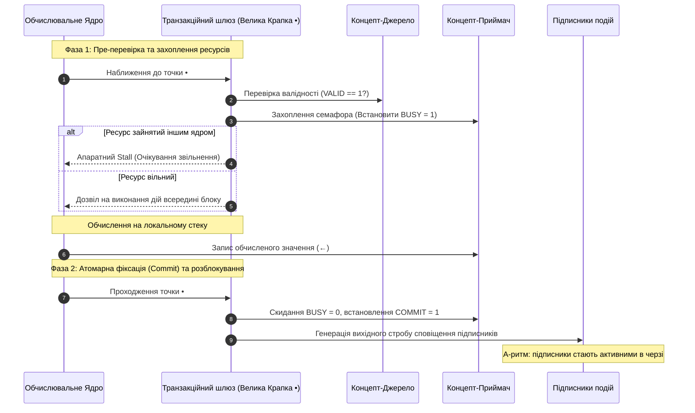

---

## 6. А-схема: Візуалізація топології активної пам'яті

А-схема (Апаратна схема Кузьміна) — це графічний і логічний опис того, як поєднані між собою розумні регістри концептів. Замість лінійного списку асемблерних інструкцій інженер проектує **орієнтований граф інформаційних та подієвих залежностей**.

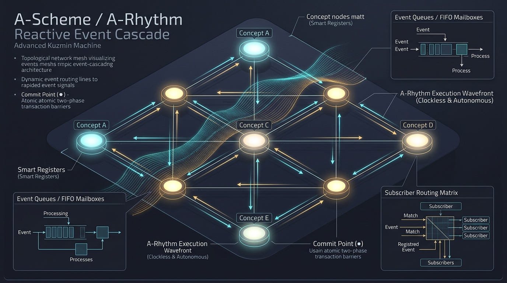

> *Примітка до ілюстрації:* зображення є **концептуальною візуалізацією** потоку подій та черг FIFO. Підпис *“(Clockless & Autonomous)”* усередині картинки відображає лише абстрактну відмову від глобального `PC` — фізична реалізація `CFG-P` на FPGA є **синхронною** (`100 МГц`), а описові фрагменти тексту на растрі містять артефакти генерації.

### Приклад: реактивний конвеєр безпечного регулятора

Розглянемо приклад А-схеми регулятора тиску:
- Датчик тиску оновлює концепт `P_Sensor`.
- При перевищенні ліміту (`> Limit`) автоматично активується клапан `V_Release`.
- Будь-яке читання поточного тиску оператором (`P_Sensor →`) ініціює запис у журнал аудиту `Log`.

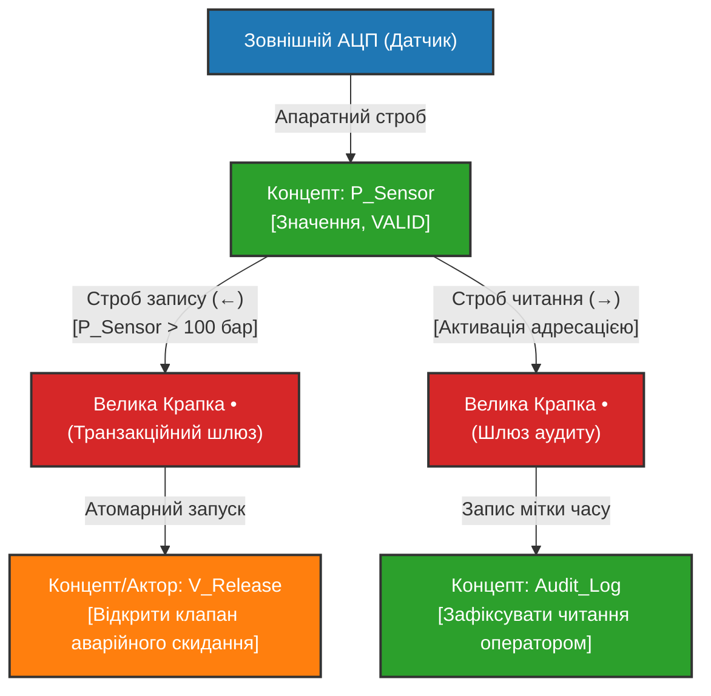

Коли тиск у межах норми, шлях до `V_Release` апаратно заблокований компаратором предикату. Щойно тиск перевищує поріг, подія спалахує на апаратному рівні без опитування ($polling$) у нескінченному циклі.

> [!TIP]
> **Чому в А-схемі відсутні імперативні цикли For/Each/Do (пояснення М. Ю. Кузьміна від 13.11.2026 щодо декларативно-подієвої моделі):**<br/>
> У класичних архітектурах обробка структур даних ведеться через лічильники в циклі (`for i = 0 to N`). В апаратній А-схемі **імперативні цикли повністю відсутні** (*«...а цикли взагалі відсутні»*). Їх замінюють два нативні механізми:
> 1. **Просторовий паралелізм (Spatial Fan-Out):** коли потрібно обробити множину елементів, строб події збуджує паралельні лінії або декілька мікро-ядер одночасно за 1 такт;
> 2. **Подієва рекурентність:** завершення операції над одним концептом через точку `•` породжує строб запису/читання наступного кроку.

---

## 7. Багатоядерне виконання, черги та протокол рандеву

У практичній реалізації на одному кристалі можуть працювати кілька обчислювальних ядер, які спільно обробляють події з черги.

На основі авторських роз'яснень М. Ю. Кузьміна щодо цільової політики керування чергами подій, зворотного тиску (*backpressure*) та послідовного fallback без втрати подій (листопад 2026) розкрито два ключові критичні механізми:

### 1. Переповнення черги подій (Queue Overflow — авторська цільова політика зворотного тиску)
- **Правило Кузьміна:** *«Если очередь переполнилась, то стоим ждем когда освободится. Если это происходит часто, то надо менять либо машину, либо программиста»*.
- **Цільовий апаратний механізм:** апаратний сигнал зворотного тиску ($Backpressure / Ready\text{-}Valid\ Stall$). Джерело події призупиняється апаратним сигналом `ready = 0`, доки черга FIFO не звільнить слот, щоб не втрачати події. *(Примітка про поточний RTL: у секвенсері вже реалізовано й формально верифіковано в `Z3` на $N=16$ однослотовий буфер утримання внутрішнього каскаду `cascade_pending` та рукостискання `valid && ready` без втрат серед прийнятих подій; для некерованих зовнішніх фізичних ліній без рукостискання застосовується діагностичний облік відхилень `events_dropped_count_o`.)*

### 2. Протокол паралельного запуску та Graceful Serial Fallback (проєктна багатоядерна модель)
- Коли одне ядро виконує інструкцію розгалуження `Go SR2 →` (передати виконання Лінії 2 вільному ядру), але всі інші ядра зайняті:
- **Правило Кузьміна:** *«Значит все заняты и сама берется выполнять»*.
- **Цільовий апаратний механізм:** динамічний послідовний відкат ($Graceful\ Serial\ Fallback$). Ядро не блокується і не падає в паніку — воно самостійно виконує Лінію 2 у своєму стеку після завершення поточної фази *(у поточному проєкті вже синтезовано й розтрасовано багатобанковий кластер $N = 2, 4, 8$ із 2-ступеневим конвеєризованим міжбанковим комутатором на `133.89 / 103.73 / 91.89 МГц`, тоді як стекове рандеву `Go SR2 →` та апаратний `Graceful Serial Fallback` залишаються теоретичними елементами стекової VM)*.

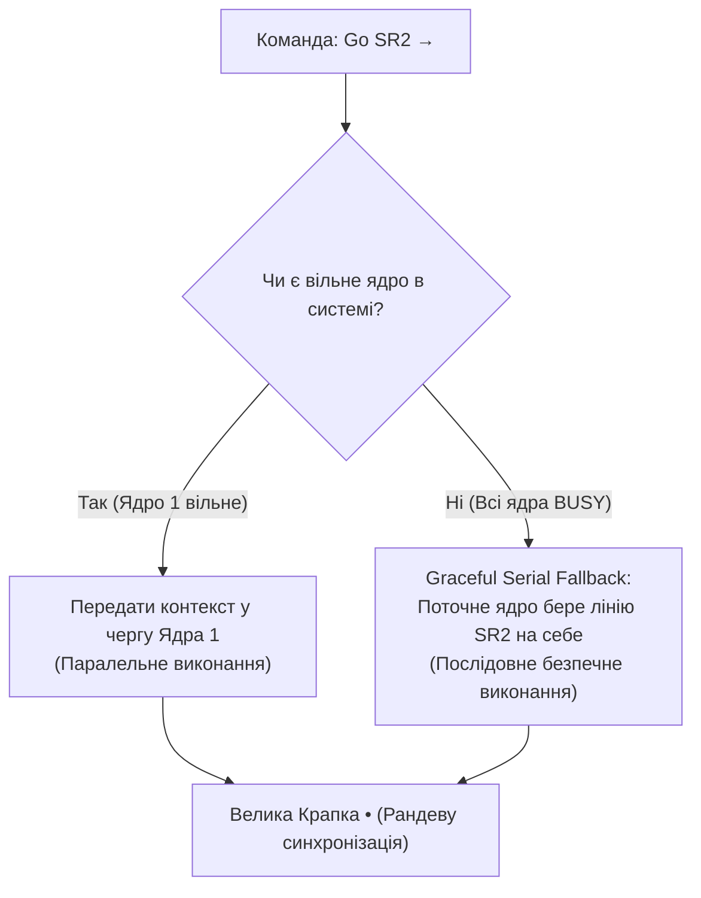

---

## 8. Фізичне втілення: Гарвардські процесори, аналогія з CSP та FPGA BRAM

Принципове інженерне питання, яке часто виникає при знайомстві з концепцією:  
*«Якщо в Машині Кузьміна немає глобального Program Counter, а пам'ять трактується як активна — чи потрібен для неї особливий кастомний кремній (ASIC)?»*

**Коротка інженерна відповідь: Ні. Модель Машини Кузьміна може проєктуватися на класичні Гарвардські мікроконтролери, стандартні блоки пам'яті `BRAM` у ПЛІС, а синхронізація її паралельних гілок зручно пояснюється через аналогію з процесною моделлю `CSP` *(що є моделлю взаємодії, а не фізичною архітектурою пам’яті)*.**

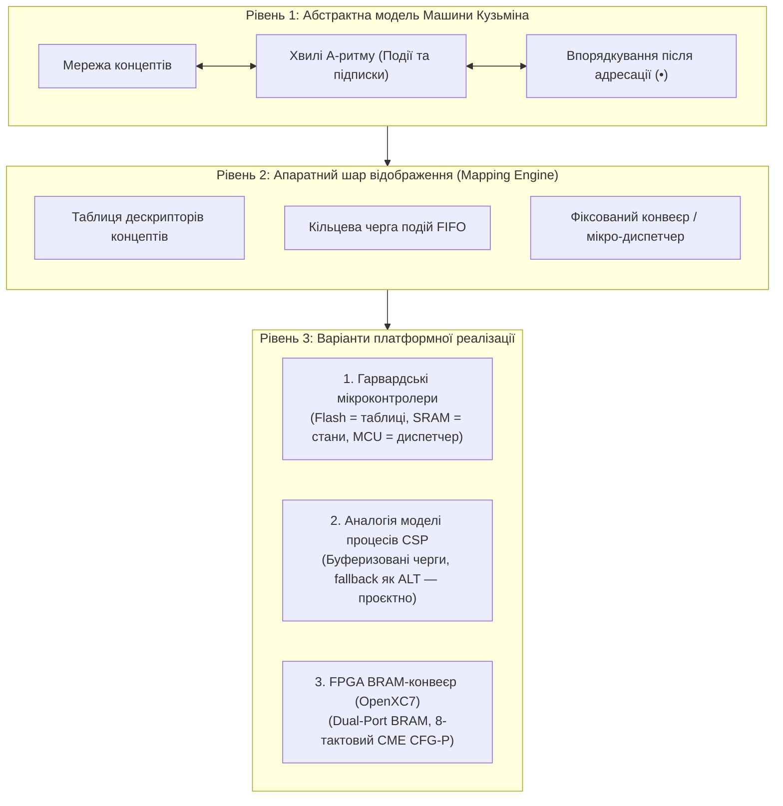

---

### 8.1. Відображення на Гарвардську архітектуру (Harvard MCU)

Більшість сучасних мікроконтролерів (від простих $AVR / PIC$ до потужних $ARM\ Cortex\text{-}M$ та $RP2040$) мають **Гарвардську архітектуру** — тобто фізично розділені адресні простори та шини для пам'яті програм ($Flash$) та пам'яті даних ($SRAM$).

Машина Кузьміна мапиться на гарвардський мікроконтролер за чіткими правилами:

1. **Пам'ять коду / конфігурації ($Flash$):**
   - Тут зберігається статична топологія А-схеми: таблиця підписок, маски подій, конфігурація предикатів та вихідні правила реакції. Ці структури незмінні в процесі виконання, тому захищені від випадкового перезапису.
2. **Пам'ять даних ($SRAM$):**
   - Тут зберігаються поточні дані: змінні концептів (`DATA`), масив бітів валідності (`VALID`), статус зайнятості (`BUSY`), кільцевий буфер черги подій ($FIFO$) та локальні стеки обчислень.
3. **Фізичний процесор ($Core$ з власним $PC$):**
   - Процесор мікроконтролера крутить надкороткий, строго детермінований **цикл мікро-диспетчера**:

$$\text{Подія з FIFO} \longrightarrow \text{Вибірка дескриптора} \longrightarrow \text{Оцінка предикату} \longrightarrow \text{Запис результату / Каскад}$$

   - Для розробника програм $KPOL$ цей внутрішній $PC$ мікроконтролера є **повністю невидимим**. Програма сприймається як реактивний граф, де інструкції виконуються не "послідовно рядок за рядком", а лише тоді, коли виникає строб події.
4. **Історичне уточнення Автора щодо раннього прототипу на STM32:**
   - М. Ю. Кузьмін уточнив (листопад 2026), що ранній прототип на двох–трьох платах мікроконтролерів `STM32` був прямою C-програмою перевірки базового принципу подій-підписок без віртуальної машини та окремої мови:
     > *«Это было очень давно, когда у меня были деньги. Я пригласил одного электронщика разработать плату и его знакомого программиста. Тогда было все примитивно. Формат событий и подписок я разрисовал побитно... две или три платы подключили для демонстрации... На тот момент не было ни теории, ни языка, ни идеи виртуальной машины. Это была просто программа на C. И проверялся сам принцип события-подписки»*.

---

### 8.2. Інженерна аналогія з моделлю процесів CSP Тоні Хоара та Велика Крапка

Чому багатоядерне розширення Машини Кузьміна в проєктній моделі орієнтоване на виконання паралельних гілок без взаємних блокувань ($deadlocks$)?

У **похідній інженерній інтерпретації М. Федчика** керування потоком виконання (fallback) зручно пояснювати через аналогію з **моделлю послідовних взаємодіючих процесів ($CSP\ —\ Communicating\ Sequential\ Processes$)** Чарльза Ентоні Річарда Хоара ($C.A.R.\ Hoare$):

1. **Межа аналогії (пам’ять):** у CSP Хоара процеси **не мають спільної пам’яті**, що математично усуває перегони запису. У Машині Кузьміна (за авторським правилом конкурентних записів без неявних блокувань) пам’ять концептів є **спільною та відкритою**, тому посилання на CSP стосується лише синхронізації керування й вибору гілок, а не гарантій консистентності спільної пам’яті без статичного володіння чи арбітражу.
2. **Велика Крапка (`•`) як бар’єр завершення адресації (уточнення Автора від 13.11.2026):** у цільовій моделі точка `•` гарантує, що підписники активуються лише після повної фіксації читання або запису *(у поточному профілі `KPOL-CME-1` символ `•` наразі ще позначає `NOT`, а інваріанти запису захищає вентиль `kpol_txn_gate_v2`)*.
3. **Подієві черги як буферизовані канали:** черги `FIFO` між вузлами в проєктній фабриці функціонують як типізовані буфери і потребують окремого доведення відсутності дедлоків при циклічних підписках.
4. **Graceful Serial Fallback як аналог оператора `ALT`:** коли ядро виконує `Go SR2 →` і бачить зайнятість сусідніх ядер, воно самостійно виконує задачу, що структурно перегукується з альтернативним вибором $ALT$ у мові $Occam$.

---

### 8.3. Апаратний конвеєр на ПЛІС (FPGA Dual-Port BRAM)

У поточній кремнієвій реалізації рівня **TRL 3 (за самооцінкою)** на кристалі $Xilinx\ Zynq\text{-}7000$ (плата $Digilent\ PYNQ\text{-}Z1$, відкритий тулчейн $OpenXC7$) архітектура реалізована як одноядерний апаратний прискорювач `CFG-P`:

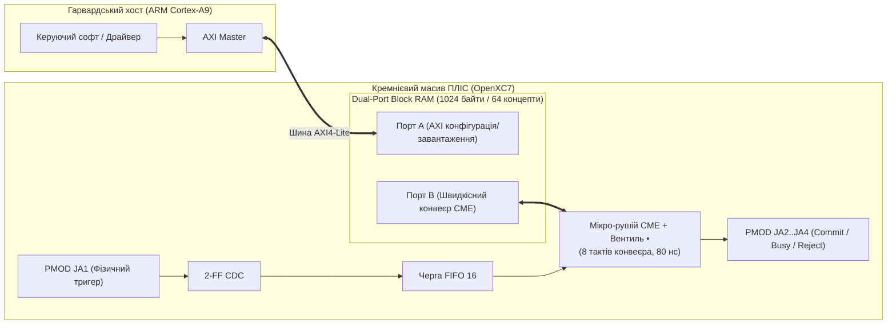

- **Двопортовий BRAM (Dual-Port Block RAM)** забезпечує фізичне розділення шин *(узгоджено з таблицею ресурсів `CFG-P` у досьє та монографії)*:
  - **Порт A (порт хоста):** використовується зовнішнім хостом (через AXI4-Lite) для завантаження образу `KPOL` та читання стану без пересинтезу ПЛІС.
  - **Порт B (порт секвенсера):** обслуговує автономний апаратний конвеєр $CME$, який обробляє прийняті події за строго фіксовані **8 тактів ($80\text{ нс}$ при $100\text{ МГц}$)** у синхронному домені ПЛІС ($\sigma_{\text{exec-cycles}} = 0$ тактів; фазове квантування асинхронного входу CDC $`\sigma_{\text{cdc}} \approx 2.89\text{ нс}`$).

Це пояснює, чому Машина Кузьміна не потребує окремого кастомного кремнію: вона проєктується на серійні ПЛІС і мікроконтролери, поєднуючи фізичну ізоляцію портів пам'яті та подієву диспетчеризацію.

---

## 9. Підсумок для інженера-схемотехніка

Перехід від звичного мікроконтролера або процесора до моделі Машини Кузьміна можна сформулювати у вигляді короткого чек-листа:

1. **Глобального $Program\ Counter$ немає,** але окремі виконавчі вузли (лінія підписки чи автомат `CME`) мають локальну послідовність кроків.
2. **Концепт — дескриптор у пам'яті:** у повній цільовій моделі він поєднує дані, біт валідності (`VALID`), статус блокування (`BUSY`) та умови подій *(у поточному `CFG-P` реалізовано фіксований 16-байтний формат `CME-RAW-1` без `VALID`/`BUSY` у BRAM)*.
3. **Неініціалізованість має окремий біт:** явний неініціалізований стан `_` в авторській моделі відокремлюється від числового нуля валідним бітом.
4. **Адресація запускає перевірку:** і читання (`→`), і запис (`←`) перевіряють прив'язані події.
5. **Велика Крапка задає порядок після адресації (уточнення від 13.11.2026):** сама собою вона забезпечує запуск підписки після завершення читання або запису, але **не усуває** гонитв чи перекриття конкурентних записів без додаткового протоколу блокування, snapshot чи арбітражу (авторське правило покладає уникнення логічних гонитв на програміста).
6. **Верифікована саморегуляція проти теоретичних розширень:** однослотовий буфер утримання внутрішнього каскаду з `valid && ready` (`Z3` до $N=16$), двобанкове гаряче оновлення `CFG-P-HA` (`100.69 МГц`, `10 003` перемикання), 2-ступеневий міжбанковий комутатор $N=2,4,8$ (`133.89 / 103.73 / 91.89 МГц`) та кодогенератор `--emit-c99` уже реалізовані й верифіковані, тоді як стековий послідовний відкат (`Graceful Serial Fallback`) і спарсове пакування за маскою присутності `Def` (разом із відкритими питаннями оновлених роздільників, читання стану `_` та розрізнення відсутнього й порожнього елементів) залишаються теоретичними елементами повної авторської моделі.

---

## Пов'язані документи та посилання
- [Науково-інженерне досьє Машини Кузьміна (UA)](Kuzmin-Machine-Scientific-and-Engineering-Dossier-UA.md)
- [Формальний аналіз обчислювальної моделі МК](Kuzmin-Machine-Formal-Analysis-UA.md)
- [Авторська інженерна монографія М. Федчика](Kuzmin_Machine_by_Fedchik.md)
- [Порівняльний аналіз із відомими обчислювальними моделями](Similar_Machines_to_KM.md)
- [Авторські уточнення семантики та відкриті питання моделі в огляді проєкту](README.md#4-авторські-уточнення-семантики-та-відкриті-питання-моделі)
