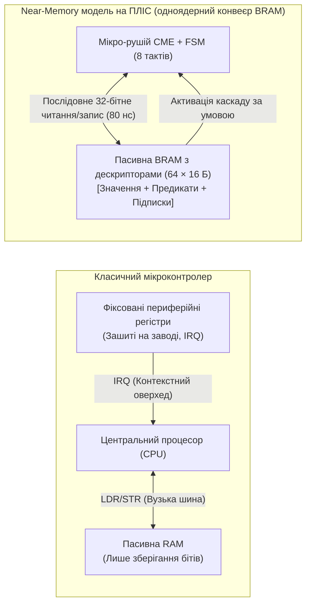
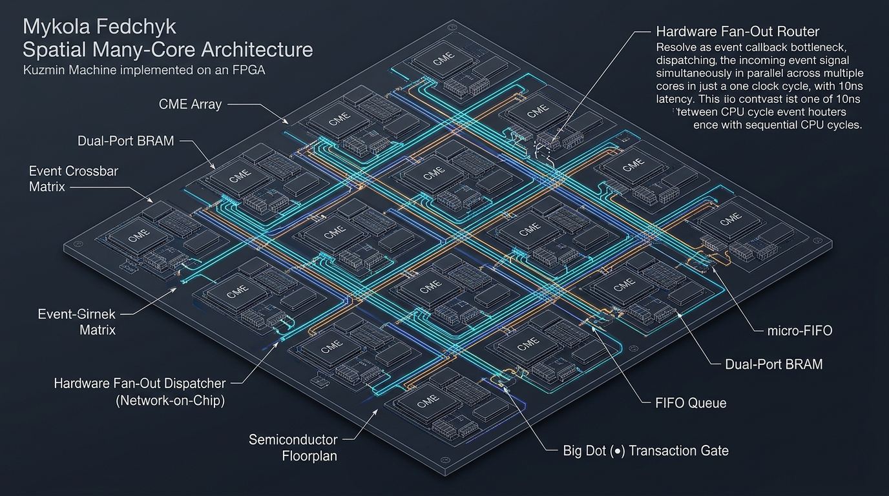
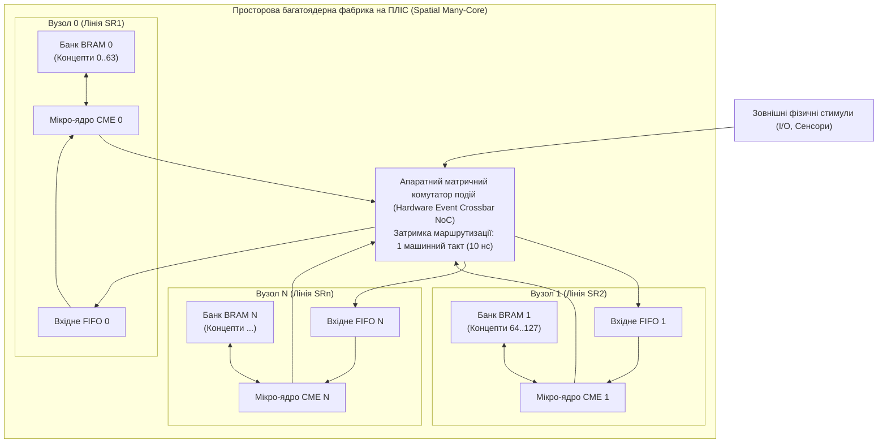
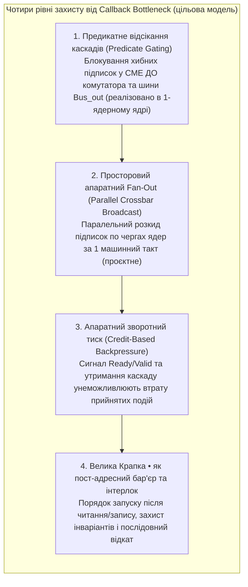
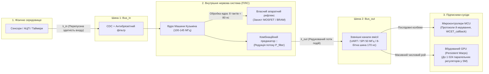

# Машина Кузьміна: Інженерна реконструкція, активна пам'ять та математичні моделі подієвої логіки

> **Автор інженерної реконструкції та концептуальної інтерпретації:** Микола Федчик (Mykola Fedchyk)
> **Дата:** Листопад 2026 року
> **Статус документа:** Авторська інженерно-теоретична монографія
> **Предмет дослідження:** Архітектура Машини Кузьміна (МК), мова KPOL, фізичне втілення на ПЛІС (FPGA), аналіз вузьких місць подієвої логіки (Event Logic Bottleneck) та математичне виведення характеристик системи методами дискретної оптимізації.

> [!IMPORTANT]
> **Епістемологічне застереження щодо інженерного статусу положень:**
> Наведені в цьому документі архітектурні рішення, математичні моделі, схеми подолання вузького місця зворотних викликів (*Callback Bottleneck*), просторової багатоядерності на ПЛІС, гетерогенного прискорення підписників на GPU та кодогенерації детермінованого C99 для мікроконтролерів є **авторськими інженерними моделями та схемотехнічними реконструкціями Миколи Федчика** (із чітким відокремленням від первинної концептуальної моделі М. Ю. Кузьміна в розділі 8.1). У розділі 8.3 результати строго розділено за способом їхнього підтвердження: (а) **на фізичних кристалах та у натурному міжплатному стенді HIL** підтверджено однобанковий та двобанковий (із тіньовим банком і гарячим оновленням правил без простою на `10 003` перемиканнях під потоком `40 011` подій) конвеєри дескрипторів у `Block RAM` на ПЛІС **Xilinx Zynq-7000 `XC7Z020`** (`PYNQ-Z1` + логічний аналізатор `LogicTracer Pico 0.5.0`), масивно-паралельне виконання до `1 024` підписників на **NVIDIA Jetson AGX Orin** та наскрізний міжплатний контур `PYNQ-Z1 -> GbE -> Jetson AGX Orin J501` ($R = 5 \times 1\,000$ подій); (б) **формальними методами (`Z3 SMT`), RTL-симуляцією та повним фізичним синтезом і трасуванням *Place & Route* (`OpenXC7`)** підтверджено багатоядерний кластер на `N = 1, 2, 4, 8` вузлів із двоступеневим конвеєризованим міжбанковим комутатором (`133.89 МГц` при `N = 2`, `103.73 МГц PASS @ 100.00 MHz` при `N = 4`, `91.89 МГц` при `N = 8`), 256-бітну еквівалентність бінарного дерева пріоритетного кодера та кодогенерацію безциклового MISRA-сумісного C99 (`--emit-c99` із Z3-сертифікатом інваріантів); (в) **проєктними моделями**, що підлягають подальшому масштабуванню або апаратному монтажу, залишаються кластери `N > 8` (або ієрархічне закриття `100 МГц` при `N = 8`) та прямий апаратний міст без участі ОС (через буферизований узгоджувач рівнів `3.3 В -> 1.8 В` або `PCIe GPUDirect RDMA`). Числові константи (зокрема 16 вузлів або 16-бітна маска) є прикладами розрахунку для конкретних кристалів і в загальній теорії описуються параметричними формулами дискретної оптимізації.

---

## 1. Вступ: Від філософської метафори до інженерної реалізаційності

Оригінальний авторський виклад Машини Кузьміна (М. Ю. Кузьмін, 2020–2026 рр.) сформульовано мовою високорівневих абстракцій: «концепти як знання», «події як сенси», «А-ритм замість алгоритму», «робота без глобального лічильника команд». На серійних мікросхемах пам’яті (SRAM, BRAM) буквально розмістити АЛП і компаратори в кожній комірці неможливо без спеціалізованого кастомного ASIC.

Головна мета цієї монографії — здійснити строгий інженерний переклад Машини Кузьміна на мову **цифрової схемотехніки серійних ПЛІС, теорії масового обслуговування та методів дискретної оптимізації**, чітко відокремивши практичну інженерну доцільність від декларативних метафор.

Запропонована інженерна реконструкція спирається на три конструктивні принципи:
1. **Мультиплексований обчислювач поблизу пам’яті (Near-Memory Time-Multiplexed Micro-Engine):** модель реалізації віртуальних «розумних регістрів» поверх пасивної двопортової `BRAM` за допомогою компактного 8-тактового автомата `CME` (аналогія з периферійними MMIO-регістрами, але з дескрипторною таблицею замість фіксованого заліза).
2. **Секціонована багатоядерна модель на ПЛІС (проєктна Spatial Many-Core):** масив автономних мікро-рушіїв із приватними банками `BRAM` без спільної шини даних і протоколу кеш-когерентності, параметризований шириною антиланцюгів графа подій та ресурсами кристала.
3. **Аналіз подієвої логіки (Event Logic & Callback Bottleneck):** обмеження каскадних штормів за допомогою комбінаційної пре-фільтрації у `CME`, протоколів зворотного тиску та параметризованого кодування підписок.

---

## 2. Архітектурна модель: Віртуалізація реактивних регістрів поблизу пам'яті (Near-Memory MMIO)

### 2.1. Чому класичні регістри GPR є вузьким місцем
У традиційній архітектурі фон Неймана процесор має жорстко обмежений набір регістрів загального призначення ($GPR$): 16 регістрів в $ARM$ ($R0\dots R15$) або 16 в $`x86\text{-}64`$ ($RAX\dots R15$). Коли програма оперує сотнями параметрів, процесор змушений невпинно пересилати змінні між регістрами та пасивною пам'яттю ($SRAM/DRAM$) за допомогою команд `LDR / STR`, `MOV`.

### 2.2. Аналогія з периферійними регістрами (MMIO)
У будь-якому сучасному мікроконтролері вже існують регістри з побічними ефектами — **регістри периферійних модулів (Memory-Mapped I/O, MMIO)**:
- Запис за адресою периферійного регістра має миттєвий апаратний побічний ефект (*Side-effect on Write*): запис біта в регістр таймера запускає апаратний ШІМ або перемикає вихід транзистора.
- Читання регістра має апаратний побічний ефект (*Side-effect on Read*): зчитування байта з регістра приймача $UART$ апаратно очищує прапорець `RXNE` і зсуває чергу FIFO.
- Кожен периферійний регістр має прапорці стану (`BUSY`, `READY`, `VALID`).

Але в класичних чіпах такі регістри мають два обмеження:
1. Їхня логіка **жорстко зафіксована в кремнії на заводі** і не перепрограмовується без зовнішнього коду CPU.
2. При події периферійний регістр змушує центральний процесор виконувати обробник переривання ($IRQ\ Context\ Switch$), витрачаючи десятки–сотні тактів на збереження контексту в стек.

### 2.3. Інженерний компроміс Near-Memory у Машині Кузьміна
Замість фізичної логіки всередині кожної комірки пам’яті інженерна модель реалізує **програмований контролер дескрипторів поблизу пасивної BRAM**:

> **Принцип Near-Memory віртуалізації:**
> *«Компактний мікро-рушій `CME` поблизу двопортової пам'яті `BRAM` обслуговує до 64 віртуальних дескрипторів-концептів у банку, виконуючи кожне звернення за строго детермінований 8-тактовий цикл FSM ($`80\text{ нс}`$ при $`100\text{ МГц}`$, $`\sigma_{\text{exec}} = 0`$ тактів у синхронному домені ПЛІС) без участі центрального процесора і без переривань IRQ — ціною відсутності одночасного паралелізму всередині одного банку».*



---

## 3. Концептуальна модель №2: Просторова багатоядерність на ПЛІС (Spatial Many-Core)

### 3.1. Обмеження класичної багатоядерності
Чому додавання ядер у класичних процесорах ($x86$, $ARM$) не дає лінійного приросту швидкодії в реактивних задачах?
1. **Проблема кеш-когерентності (Cache Contention & MESI):** коли кілька ядер одночасно читають і пишуть спільні змінні, шина процесора забивається службовими сигналами валідації кеш-ліній.
2. **Блокування та м'ютекси (Spinlocks & Deadlocks):** програми змушені використовувати блокуючі примітиви синхронізації, що призводить до простою ядер та недетермінованого часу реакції.
3. **Єдина шина до пам'яті:** усі ядра стоять у черзі до спільного контролера DDR RAM.

### 3.2. Матриця багатьох мікро-ядер (Spatial Many-Core) на ПЛІС
В інженерній моделі обчислювальний елемент є гранично мінімізованим:
- Це не універсальний процесор фон Неймана, а **автономний мікро-рушій конвеєра концептів ($`CME\ —\ Concept\ Micro\text{-}Engine`$)**.
- Одне автономне мікро-ядро конвеєра має гранично компактний схемотехнічний слід ($`\text{LUT}_{\text{CME}} \ll \text{LUT}_{\text{total}}`$, зазвичай лічені відсотки логіки ПЛІС), що дозволяє масштабувати обчислювальний простір у просторову матрицю багатьох мікро-ядер.
- Кількість обчислювальних ядер $`N_{\text{cores}}`$ визначається не емпіричним вибором, а точним балансом між шириною графа подій та ресурсами умовної ПЛІС (див. розділ 5).

### 3.3. Незалежні банки пам'яті: Відсутність колізій шини (Zero Bus Contention)
Сучасна ПЛІС містить не одну спільну шину, а масив фізично ізольованих двопортових блоків пам'яті ($Block\ RAM$):
- Кожне мікро-ядро $CME$ володіє власним виділеним банком BRAM для своєї групи концептів.
- Звернення до пам'яті відбувається абсолютно одночасно й незалежно. Конфлікт за шину пам'яті фізично неможливий ($Zero\ Memory\ Contention$).



> *Примітка до ілюстрації:* це **концептуальне зображення просторової багатоядерної матриці**, а не знімок трасувальника. У відкритому маршруті *Place & Route* (`OpenXC7` на кристалі `XC7Z020`) фізично синтезовано й розтрасовано багатобанковий кластер на `N = 1, 2, 4, 8` вузлів із двоступеневим конвеєризованим міжбанковим комутатором (`133.89 МГц` при `N = 2`, `103.73 МГц PASS @ 100.00 MHz` при `N = 4`, `91.89 МГц` при `N = 8`), тоді як написи на растрі на кшталт *“Semiconductor Floorplan”* та *“10ns latency”* є художньою візуалізацією.



---

## 4. Критичний інженерний аналіз: Проблема Event Logic та «Callback Bottleneck»

### 4.1. У чому полягає «вузьке місце» подієвої логіки?
Якщо розумні регістри концептів вирішують проблему зберігання даних, то **подієва логіка (Event Logic & Callbacks)** є головною ахіллесовою п'ятою всієї парадигми подієво-орієнтованих систем.

У софтверних системах ($JavaScript$, $Node.js$, $C++\ Boost.Asio$, $GUI\ frameworks$) добре відомі такі патології:
1. **Лавиноподібний шторм подій (Event Storm):** одна подія породжує три нові, кожна з яких породжує ще три. Черга подій лавиноподібно розростається експоненційно, вичерпуючи пам'ять за лічені мілісекунди.
2. **Проблема великого розгалуження (Fan-Out Bottleneck):** коли в одного концепту є 10 або 50 підписників, класичний диспетчер змушений послідовно викликати 50 функцій-колбеків одна за одною. Реактивність системи колапсує.
3. **Каскадне блокування та дедлоки:** якщо підписка на подію $A$ намагається записати в концепт $B$, а підписка на подію $B$ вже очікує $A$, виникає взаємне блокування.
4. **Недетермінізм часу реакції:** якщо в черзі перед критичною подією безпеки стоїть 500 другорядних повідомлень логування, система аварійного захисту запізнюється.

Кузьмін у своїх первинних працях постулював: *«Аналіз подій відбувається паралельно»*. Але як саме забезпечити цей паралелізм фізично у кремнії, щоб Event Callbacks не задушили систему?

---

### 4.2. Схемотехнічні механізми подолання Callback Bottleneck

Щоб подієва логіка не перетворилася на «пляшкове горло», у **цільовій багатоядерній архітектурі** проєктуються чотири взаємоузгоджені схемотехнічні механізми *(розмежування того, що вже верифіковано в одноядерному прототипі на ПЛІС, та проєктних багатоядерних розширень зафіксовано в табл. §8.3)*:



#### Механізм 1: Предикатне відсікання каскадів та зовнішніх повідомлень (Predicate Gating)
* **Проблема:** У програмних диспетчерах подію передають у всі підписки безумовно, а колбек потім розбирається: `if (value > 100) { ... }`. Це засмічує комутаційні черги та зовнішні шини фіктивними подіями.
* **Схемотехнічне рішення (реалізовано в `CME`):** Комбінаційний предикатор `::` інтегровано безпосередньо у мікро-рушій `CME` біля банку дескрипторів `BRAM`. Якщо поточний перехід не задовольняє умову предикату чи інваріанта, вторинний строб підписки фізично **не генерується**, і подія не потрапляє ані до між'ядерного комутатора, ані у вихідну шину `Bus_out` *(при цьому первинний захист самого вхідного буфера `FIFO` першого вузла від високочастотного брязкоту чи наведень на фізичних пінах `Bus_in` забезпечується окремим апаратним фільтром на вході до запису в чергу, оскільки поріг предикату концепту зчитується вже з `BRAM`)*.

#### Механізм 2: Просторовий апаратний Fan-Out (проєктне багатоядерне розширення)
* **Проблема:** Концепт має $k$ підписників. Софтверний процесор змушений $k$ разів послідовно викликати функцію або крутити цикл `for`.
* **Проєктне схемотехнічне рішення:** В авторській мовній концепції окремі оператори циклів `For/Each/Do` відсутні (що стосується мовного синтаксису і не забороняє службові скінченні автомати або лічильники в апаратурі). У цільовому багатоядерному розширенні (§8.3) поле підписників у дескрипторі концепту транслюється комутатором ($Crossbar$) у запити постановки в черги $FIFO$ відповідних мікро-рушіїв $`CME`$ без програмного циклу *(у поточному одноядерному прототипі дескриптор зберігає один 6-бітний індекс локального підписника, на якому в `Block RAM` ПЛІС верифіковано автономні багатоступеневі ациклічні каскади; фізична затримка багатоядерного комутатора та колізії запису в один цільовий банк підлягають перевірці синтезом і STA)*.

#### Механізм 3: Апаратний зворотний тиск (Backpressure для керованих джерел та утримання каскаду)
* **Проблема:** Переповнення черги подій ядра при пікових навантаженнях або одночасному надходженні зовнішнього стимулу й внутрішнього каскаду.
* **Схемотехнічне рішення та фізичні межі:** Модель спирається на правило зупинки при переповненні черги до звільнення слота. Для **керованих цифрових джерел із рукостисканням (`valid && ready`)** сигнал `ready = 0` призупиняє передачу до звільнення місця, а для внутрішнього каскаду в одноядерному секвенсері реалізовано й формально верифіковано індуктивним солвером **однослотовий буфер утримання каскадної події**, що виключає її втрату при заповненій черзі `FIFO-16`. *Важливі межі:* (1) на некерований фізичний датчик без зворотного каналу (геркон, датчик Холла, вільний GPIO-імпульс) сигнал `ready = 0` фізично не впливає — такий імпульс може бути втрачений **до** входу в чергу і фіксується діагностичним лічильником відхилень; (2) між'ядерний зворотний тиск через багатопортовий комутатор залишається проєктним розширенням (§8.3).

#### Механізм 4: Пост-адресне впорядкування (`•`), транзакційний шлюз інваріантів та Graceful Serial Fallback
* **Проблема:** Порушення безпечних меж стану при програмних збоях, нескінченна рекурсія, втрата порядку запуску підписників або простоювання при зайнятих ядрах.
* **Схемотехнічне рішення:** Згідно з канонічним роз'ясненням автора концепції М. Ю. Кузьміна (*підписка за точкою `•` виконується строго після завершення адресації: для читання — після читання поточного значення, для запису — після запису*), символ `•` задає **пост-адресний бар'єр черговості** *(при цьому саме авторське визначення не фіксує структури `BRAM`, знімка значення для відкладених підписок чи протоколу зняття прапорця зайнятості)*. В апаратному прототипі на ПЛІС захист цілісності стану виконує формально верифікований **транзакційний шлюз інваріантів** (*Fail-Closed Gate*): при спробі записати недопустиме значення мутація `BRAM` апаратно блокується зі збереженням попереднього безпечного стану та генерацією сигналу відмови для аварійної гілки керування, тоді як поконцептний біт `BUSY` у `BRAM` і повне відокремлення пост-адресного бар'єра `•` від булевої інверсії в дескрипторі винесено в наступну ревізію (§8.3).
* Якщо ж у багатоядерній фабриці команда переходу бачить зайнятість сусідніх ядер, проєктно передбачається механізм послідовного відкату (у нашій термінології — **Graceful Serial Fallback**, за аналогією до вибору альтернатив у моделі CSP Гоара [Hoare 1978]): поточне ядро береться виконувати лінію обчислень самостійно.

---

### 4.3. Параметричний розрахунок розрядності поля SUBSCRIBERS: Математичний вивід замість хардкоду

У ранніх чорнових специфікаціях дескриптора концепту фігурувало фіксоване поле `SUBSCRIBERS [15:0]`. Проте в інженерній реальності розрядність цього поля не є довільною константою — вона повинна строго виводитися з фізичних обмежень кристала, тактової частоти та характеристик графа реактивної мережі.

#### А. Фізичні та схемотехнічні обмеження кремнію

Нехай:
- $`W_{\text{word}}`$ — фізична розрядність порту пам'яті (для Block RAM типово $`32, 64, 128\text{ бітів}`$);
- $`W_{\text{data}}`$ — розрядність числового значення концепту ($`16, 32\text{ біти}`$);
- $`W_{\text{flags}}`$ — біти статусу, валідності та коду предикату ($`8\dots 16\text{ бітів}`$);
- $`M_{\text{targets}}`$ — загальна кількість потенційних приймачів подій у системі (локальні ядра $CME$, периферійні контролери, вихідні шинні мости);
- $`F_{\text{target}}`$ — цільова тактова частота комутатора ($`1/T_{\text{clk}}`$).

Для збереження дескриптора в одному рядку пам'яті без багатотактового зчитування максимальний бюджет бітів під поле підписників становить:

$$W_{\text{sub-budget}} = W_{\text{word}} - W_{\text{data}} - W_{\text{flags}}$$

Одночасно діє фізичне обмеження на електричний коефіцієнт розгалуження (Fan-Out) за один машинний такт без додаткових регістрових каскадів. Для лінії зв'язку з опором вихідного драйвера $`R_{\text{drv}}`$, погонною ємністю провідника $`c_{\text{wire}}`$, середньою довжиною траси $`L_{\text{avg}}`$ та вхідною ємністю логічного вентиля $`C_{\text{gate}}`$ затримка поширення фронту за критерієм Елмора повинна задовольняти таймінг такту:

$$\tau_{\text{prop}} \approx R_{\text{drv}} \left( c_{\text{wire}} L_{\text{avg}} + K_{\text{fanout}} C_{\text{gate}} \right) \ln 2 \le T_{\text{clk}} - T_{\text{co}} - T_{\text{setup}}$$

Звідси для небуферизованих провідників (на рівні замовних СБІС / ASIC) верхня фізична оцінка однотактового розгалуження має вигляд:

$$K_{\text{fanout-max}} = \left\lfloor \frac{\frac{1}{F_{\text{target}}} - T_{\text{co}} - T_{\text{setup}} - R_{\text{drv}} c_{\text{wire}} L_{\text{avg}} \ln 2}{R_{\text{drv}} C_{\text{gate}} \ln 2} \right\rfloor$$

*Інженерне застереження для ПЛІС:* у серійних FPGA (зокрема Xilinx 7-Series) трасувальні ресурси побудовані з активно буферизованих перемикальних матриць (*Switch Matrices*), а внутрішні RC-параметри закриті виробником. Тому наведена формула Елмора відіграє роль якісної фізичної асимптотики, тоді як практичне значення $`K_{\text{fanout-max}}`$ для конкретного кристала визначається безпосередньо **статичним аналізом таймінгу (STA) після трасування Place & Route**.

#### Б. Вибір стратегії кодування маски підписників

Залежно від співвідношення між кількістю споживачів $`M_{\text{targets}}`$, бюджетом розрядності $`W_{\text{sub-budget}}`$ та топологією графа зв'язків обирається одна з трьох стратегій дискретного кодування:

1. **Пряма бітова маска (Direct Multi-Hot Bitmap):**
   Застосовується, коли загальна кількість приймачів не перевищує бюджету слова та фізичного електричного розгалуження:

$$M_{\text{targets}} \le \min \left( W_{\text{sub-budget}}, K_{\text{fanout-max}} \right)$$

   У цьому випадку розрядність поля дорівнює:

$$W_{\text{sub}} = M_{\text{targets}}$$

   Кожен біт $i$ маски керує запитом до $i$-го приймача (довільна підмножина із $`2^{M_{\text{targets}}}`$ комбінацій — це **multi-hot** маска, а не one-hot). При цьому необхідно розрізняти три окремі етапи: (а) однотактове **формування** набору запитів джерелом, (б) **прийняття** запитів чергами приймачів (якщо кілька вибраних концептів розміщені в одному банку BRAM з одним портом запису в FIFO, вони все одно конкурують за цей порт), і (в) **виконання** підписок на цільових вузлах.
   *(Наприклад, для прямої multi-hot маски на 16 приймачів у 64-розрядному машинному слові: $`32_{\text{data}} + 16_{\text{flags}} + 16_{\text{sub}} = 64`$).*

2. **Розріджене індексне кодування (k-Slot Sparse Indexing):**
   Якщо кількість цілей перевищує бітовий бюджет ($`M_{\text{targets}} > W_{\text{sub-budget}}`$), але граф переходів є розрідженим із максимальним степенем напіввиходу $`\Delta_{\text{out}}(G) \le k_{\text{slots}}`$, поле розбивається на $`k_{\text{slots}}`$ двійкових індексів:

$$W_{\text{sub}} = W_{\text{count}} + k_{\text{slots}} \times \left\lceil \log_2 M_{\text{targets}} \right\rceil \le W_{\text{sub-budget}}$$

   Тут обов’язково треба задати спосіб кодування порожніх слотів і дедуплікації: або явним лічильником активних слотів $`W_{\text{count}} = \lceil \log_2(k_{\text{slots}} + 1) \rceil`$, або резервуванням одного індексу (наприклад, `0` = порожній слот, що зменшує число доступних цілей до $`M_{\text{targets}} - 1`$) із забороною повторів на етапі компіляції.
   Наприклад, при $`W_{\text{sub-budget}} = 32`$ та $`M_{\text{targets}} = 64`$ ($`\lceil \log_2 64 \rceil = 6`$ бітів) **п’ять 6-бітних адрес займають 30 бітів**, тому для явного 3-бітного лічильника `0..5` потрібно 33 біти (не вміщується в 32 біти); у 32-бітному бюджеті без втрати 64-ї адреси вміщується **`4` явні слоти** ($`3 + 4 \times 6 = 27`$ бітів), або **`5` слотів із sentinel-кодом `0`** (для 63 адресатів, $`5 \times 6 = 30`$ бітів).

3. **Ієрархічні концепт-хаби (Indirect Hub Trees):**
   Якщо для окремих концептів розгалуження перевищує $`k_{\text{slots}}`$ і $`K_{\text{fanout-max}}`$, поле зберігає адресу вторинного концепту-концентратора (Multicast Hub). За умови збалансованого $`K`$-арного дерева з $`K = K_{\text{fanout-max}} > 1`$ мінімальна глибина дерева становить:

$$H = \left\lceil \log_{K_{\text{fanout-max}}} M_{\text{targets}} \right\rceil$$

   Проте затримка розмноження залежить від фізичної реалізації хаба: вона дорівнює $`H`$ тактів лише для **виділеної регістрової мережі розмноження поза циклом BRAM**; якщо ж кожен хаб є програмним концептом у `BRAM`, що обслуговується $`L_{\text{exec}}`$-тактовим автоматом (у реалізованому одноядерному прототипі — 8 тактів = `80 нс`), то кожен рівень дерева додає не 1 такт, а $`L_{\text{exec}}`$ тактів (плюс затримку комутатора й черги, як показано в Додатку А.7).

---

## 5. Математична модель та виведення параметрів системи методами дискретної оптимізації

У класичних процесорах продуктивність оцінюють у $MIPS$ або $FLOPS$, які нічого не говорять про реактивність системи через затримки кешів та переривань. Для Машини Кузьміна вводиться апаратна метрика: **$CPS$ (Concepts Per Second)** та **$GCPS$ (Giga-Concepts Per Second)** — кількість гарантовано обчислених розумних регістрів за секунду.

### 5.1. Пікова операційна потужність ($`\Phi_{\text{peak}}`$) як теоретична межа

Пікова пропускна здатність паралельної апаратної матриці $CME$ визначається формулою:

$$\Phi_{\text{peak}} = N_{\text{cores}} \times \frac{F_{\text{clk}}}{T_{\text{cycle}}}$$

де:
- $`N_{\text{cores}}`$ — кількість незалежних апаратних мікро-рушіїв $CME$;
- $`F_{\text{clk}}`$ — тактова частота ядра;
- $`T_{\text{cycle}}`$ — інтервал ініціації обробки наступного концепту в тактах ($`T_{\text{cycle}} = 8`$ тактів для базового неконвеєрного автомата послідовної 32-бітної вибірки дескриптора з BRAM у реалізованому одноядерному прототипі, або теоретична межа $`T_{\text{cycle}} = 1`$ такт лише за умови окремої конвеєрної реалізації зі 128-бітним двопортовим доступом і трактом пересилання даних при конфліктах запису).

Сама по собі формула $`\Phi_{\text{peak}}`$ є лише ідеалізованою апаратною «верхньою стелею» (пропускною спроможністю кремнію). Щоб вона набула інженерного змісту, параметр $`N_{\text{cores}}`$ не може призначатися довільно (наприклад, чому саме 16?), а повинен строго виводитися через методи теорії графів, теорії черг та оптимізації ресурсів ПЛІС.

---

### 5.2. Модель розмноження подій першого моменту та критерій субкритичності

Нехай зовнішнє середовище подає потік подій із середньою інтенсивністю $`\lambda_{\text{ext}}`$. При опрацюванні однієї події концепт має $`K`$ прив’язаних підписок, кожна з яких активується залежно від істинності свого предиката $`\mathbf{1}\{\text{pred}_j = 1\}`$. Позначимо середню кількість вторинних подій, породжених однією активацією, як:

$$m = \mathbb{E}\!\left[\sum_{j=1}^{K} \mathbf{1}\lbrace\text{pred}_j = 1\rbrace\right]$$

Лише за припущення однорідності та умовної незалежності кількості підписок $`K`$ від імовірності спрацювання предиката $`P_{\text{pred}}`$ це зводиться до добутку:

$$m = \mathbb{E}[K] \cdot P_{\text{pred}} = \bar{K}_{\text{fanout}} \cdot P_{\text{pred}}$$

В **ідеалізованому однорідному безмежному гіллястому процесі Б'єнайме–Гальтона–Ватсона з імміграцією** [Bienaymé 1845; Galton & Watson 1874] (де кожна подія породжує нащадків із тим самим розподілом і відсутні ефекти станів чи блокувань) очікувана сумарна інтенсивність потоку описується геометричним рядом:

$$\lambda_{\text{effective}} = \lambda_{\text{ext}} \sum_{k=0}^{\infty} m^k$$

Ряд збігається лише за **строгої субкритичності** ($`m < 1`$):

$$\lambda_{\text{effective}} = \frac{\lambda_{\text{ext}}}{1 - m} \qquad (m < 1)$$

Випадок **$m = 1$** є **критичним** (середня сумарна кількість нащадків одного кореня розходиться, хоча процес із кінцевою дисперсією без імміграції вироджується з імовірністю 1), а **$m > 1$** — **суперкритичним**.

> **Межі застосовності скалярної формули (неоднорідні графи та скінченні DAG):**
> 1. **Скінченний ациклічний каскад (DAG) не підпорядковується нескінченній однорідній межі $m < 1$:** якщо концепт `A` з $K=4$ безумовно ($P_{\text{pred}}=1$, тобто локально $m=4$) породжує термінальні підписки `B, C, D, E`, які не мають подальших нащадків, каскад завжди завершується за 1 крок і жодного «нескінченного шторму» не утворює.
> 2. **Неоднорідна мережа описується матрицею переходів $`B`$:** якщо $`\boldsymbol{\alpha}`$ — вектор зовнішніх інтенсивностей по вузлах/типах подій, а $`B_{ij}`$ — середня кількість подій типу $j$, породжених подією типу $i$, то стаціонарний баланс перших моментів задовольняє систему:
>
> $$\boldsymbol{\lambda} = \boldsymbol{\alpha} + \boldsymbol{\lambda} B$$
>
> яка має скінченний невід’ємний розв’язок $`\boldsymbol{\lambda} = \boldsymbol{\alpha}(I - B)^{-1}`$, коли спектральний радіус $`\rho_{\text{spec}}(B) < 1`$. Це лінійний баланс **середніх** інтенсивностей (перших моментів), який сам собою **не доводить** стійкості скінченних буферів чи відсутності дедлоків у фізичній мережі черг із блокуваннями.
> 3. **Пачковість каскадів ($c_a^2 > 1$):** при просторовому fan-out події одного кроку надходять **пачками (корельовано)**, а стани `Busy`/зворотний тиск змінюють сам розподіл породження. Тому для розміру буферів `FIFO` перших моментів недостатньо.

---

### 5.3. Параметрична модель вибору кількості ядер ($`N_{\text{cores}}`$)

Кількість обчислювальних ядер $`N_{\text{cores}}`$ у **проєктованій** матриці оцінюється на перетині теорії графів (для однієї заявки), балансу черг (для потоку заявок) та до-трасувальних оцінок площі ПЛІС.

#### 1. Граничний паралелізм однієї заявки: Теорема Ділворта та лема Брента

Розгляньмо **окрему ізольовану активацію (одне дерево/DAG завдань)** як ідеалізований орієнтований ациклічний граф (або посет) $G = (V, \prec)$ з одиничними часами операцій (за виключенням витрат на алокацію, комутатор, блокування `Busy` та черги) під ідеалізованим жадібним планувальником PRAM:

* **Теорема Ділворта про декомпозицію ланцюгів (Dilworth's Theorem, 1950):**
  Мінімальна кількість ланцюгів, що покривають скінченний посет, дорівнює максимальній потужності **антиланцюга** (множини попарно непорівнюваних операцій усередині *цієї* заявки):


```math
w(G) = \text{Width}(G) = \max \left\{ |A| : A \subseteq V,\ \forall u, v \in A\ (u \not\prec v \land v \not\prec u) \right\}
```


* **Лема Брента (Brent's Scheduling Lemma, 1974):**
  За загальної роботи $`W = |V|`$ та глибини критичного шляху $`D = \text{Height}(G)`$ (в ідеалізованій моделі без урахування накладних витрат $`\tau_{\text{sync}}`$ і конфліктів пам’яті) час виконання *цієї однієї* заявки на $N$ виконавцях обмежений:

$$T(N) \le \frac{W - D}{N} + D$$

> **Критична межа застосовності Ділворта (одна заявка проти потоку заявок):**
> Ширина $`w(G)`$ обмежує кількість корисних ядер **тільки для однієї ізольованої заявки** за відсутності накладних витрат. Вона **не встановлює** верхньої межі для потоку незалежних заявок: навіть якщо кожна подія породжує суто послідовний ланцюг ($`w(G) = 1`$), $N$ різних заявок від різних каналів можуть паралельно виконуватися на $N$ ядрах за умови розміщення їхніх станів у різних банках BRAM! Стеля $`N \le w(G)`$ виникає лише тоді, коли в системі одночасно активна щонайбільше одна заявка (або коли всі вхідні канали жорстко замкнені в межах одного спільного часткового порядку).

#### 2. Орієнтовне нижнє обмеження за балансом черг і повузлова межа

Кожен автономний вузол $CME$ має пропускну здатність обслуговування (за неконвеєрного 8-тактового циклу $`L_{\text{pipe}} = 8`$):

$$\mu_{\text{core}} = \frac{F_{\text{clk}}}{L_{\text{pipe}}}$$

За ідеального балансування потоку між $N$ вузлами середнє завантаження становить $`\bar{\rho} = \frac{\lambda_{\text{effective}}}{N \cdot \mu_{\text{core}}}`$, що дає необхідну умову ненасичення середньої інтенсивності ($`\bar{\rho} < 1`$):

$$N \ge N_{\text{min-stable}} = \left\lfloor \frac{\lambda_{\text{effective}}}{\mu_{\text{core}}} \right\rfloor + 1$$

Однак для **реальної секціонованої архітектури з приватними банками BRAM** ця глобальна оцінка є недостатньою:
1. **Повузлова умова балансування («гарячі концепти»):** Оскільки концепти статично прив’язані до банків $`\text{Node}_0 \dots \text{Node}_{N-1}`$, необхідна умова для кожного вузла:

$$\max_{i \in \lbrace 1,\dots,N\rbrace} \rho_i < 1, \qquad \rho_i = \frac{\lambda_i}{\mu_{\text{core}}}$$

   Якщо один «гарячий концепт» приймає $`\lambda_i \ge \mu_{\text{core}}`$, додавання інших вузлів без реплікації або декомпозиції цього концепту не розвантажить банк $i$.
2. **Еталонні черги ($M/D/1$) та апроксимація Кінгмана ($G/D/1$):** Формула Поллачека–Хінчина для $M/D/1$ ($`\mathbb{E}[T_{\text{wait}}^{M/D/1}] = \frac{T_{\text{exec}} \cdot \bar{\rho}}{2(1-\bar{\rho})}`$) є **лише еталонним розрахунком для незалежного пуассонівського потоку ($c_a^2 = 1$)**, а не універсальною нижньою межею (наприклад, регулярний потік $D/D/1$ з періодом $160\text{ нс}$ і сервісом $80\text{ нс}$ дає $\bar{\rho} = 0.5$ і $T_{\text{wait}} = 0\text{ нс}$, тоді як $M/D/1$ дає $40\text{ нс}$). Для потоків із пачковими каскадами двомоментна апроксимація Кінгмана ($`\mathbb{E}[T_{\text{wait}}^{G/D/1}] \approx c_a^2 \cdot \frac{T_{\text{exec}} \cdot \bar{\rho}}{2(1-\bar{\rho})}`$) дає грубий порядок зростання за великого завантаження, але одного параметра $`c_a^2`$ недостатньо за наявності автокореляції, backpressure та залежності між вузлами.

#### 3. До-трасувальна параметрична оцінка ресурсів ПЛІС

Кристал ПЛІС обмежує простір пошуку ресурсами логіки, блокової пам’яті `BRAM` і трасуванням комутатора $`R_{\text{xbar}}(N)`$. Умовна модель пакування на етапі проєктування до Place & Route має вигляд:


```math
N_{\text{model-max}} = \max \left\{ N \in \mathbb{N} \;\middle|\; \begin{aligned} N \cdot \text{LUT}_{\text{node}} + R_{\text{xbar}}(N) &\le \eta \cdot \text{LUT}_{\text{total}} \\ N \cdot \text{BRAM}_{\text{node}} &\le \text{BRAM}_{\text{total}} \end{aligned} \right\}
```


*Межа достовірності:* до реального синтезу й трасування багатоядерного RTL ані коефіцієнт у $`R_{\text{xbar}}(N)`$, ані поріг щільності трасування $`\eta`$ (напр., `0.85`), ані збереження частоти $`F_{\text{clk}} = 100\text{ МГц}`$ не доведені — тому $`N_{\text{model-max}}`$ є **максимумом умовної ресурсної моделі**, а не фізичною межею кристала.

#### 4. Постановка умовної оптимізації ($`N_{\text{opt}}`$)

Умовна одновимірна оптимізація суми нормованої площі та штрафу за оцінене очікування має вигляд:


```math
N_{\text{opt}} = \arg \min_{N \in \mathbb{N}} \left\{ \mathcal{C}_{\text{silicon}}(N) + \gamma \cdot \mathbb{E}[T_{\text{wait}}(N)] \right\}
```


у допустимій області $`N_{\text{min-stable}} \le N \le N_{\text{model-max}}`$, доповненій профілем розміщення та обмеженнями одночасності заявок. **Число `16` у Додатку А не є універсальним законом архітектури** — як показано там у контрольному перерахунку, воно критично залежить від сценарного обмеження кількості одночасних активних потоків.

---

### 5.4. Розкладання латентності тракту на ПЛІС: час у ядрі, очікування в черзі та квантування фази

Складові наскрізного проходження однієї ізольованої події через ПЛІС:

$$T_{\text{total}} = T_{\text{cdc}} + T_{\text{xbar}} + T_{\text{wait}} + L_{\text{pipe}} \cdot \frac{1}{F_{\text{clk}}} + T_{\text{pad}}$$

де:
- $`T_{\text{cdc}}`$ — час синхронізації асинхронного входу та детектора фронту (2-FF CDC + edge detector, $`2\dots 3`$ такти плюс невизначеність фази в межах $`T_{\text{clk}}`$);
- $`T_{\text{xbar}}`$ — час маршрутизації в комутаторі (`0` в одноядерному прототипі; проєктно $`\ge 1 / F_{\text{clk}}`$ у багатоядерній матриці);
- $`T_{\text{wait}}`$ — час перебування **вже прийнятої** заявки у суворій черзі FIFO глибини $`D_{\text{FIFO}}`$ (за фіксованого сервісу $`L_{\text{pipe}} / F_{\text{clk}}`$ без зовнішнього блокування або реконфігурації — не плутати з часом допуску *admission delay* перед FIFO або часом завершення всього багатоходового каскаду!);
- $`L_{\text{pipe}}`$ — фіксована кількість тактів обробки одного дескриптора концепту в BRAM (8 тактів в одноядерному прототипі);
- $`T_{\text{pad}}`$ — затримка буферів вводу/виводу IOB (з урахуванням розкиду PVT).

Важливо розрізняти три нетотожні величини:
1. **Тактова тривалість усередині синхронного автомата на ПЛІС:** обробка однієї прийнятої події без блокувань займає рівно $`8`$ тактів ($\sigma_{\text{exec-cycles}} = 0$ тактів). Це **не** означає нульового фізичного джитера всієї системи!
2. **RMS квантування фази на асинхронному вході CDC:** за рівномірного зсуву фази між несинхронним стимулом і тактом `100 МГц` на інтервалі $`[0, T_{\text{clk}})`$ теоретичне стандартне відхилення самого квантування фази становить:

$$\sigma_{\text{cdc}} = \frac{T_{\text{clk}}}{\sqrt{12}} \approx 2.89\text{ нс}\quad (\text{при } F_{\text{clk}} = 100\text{ МГц})$$

   Реальний фізичний джитер «пін-до-піна» додатково включає джитер PLL/генератора, розкид ліній, асиметрію фронтів і квантування вимірювача.
3. **Час перебування вже прийнятої заявки у FIFO проти системного WCET:** верхня межа $`D_{\text{FIFO}} \cdot L_{\text{pipe}} / F_{\text{clk}}`$ обмежує очікування *прийнятого* запису в ізольованій черзі без блокувань, але не охоплює очікування під зворотним тиском до прийняття, тривалість багатоходових каскадів чи мережеві затримки (див. Додаток А.9).

---

### 5.5. Операційна математика гетерогенної системи (HW/SW Co-Design): Врахування найповільнішого обробника ($`\text{WCET}_{\max}`$)

Коли Машина Кузьміна працює у складі реальної гетерогенної обчислювальної системи (де ПЛІС виконує детекцію та первинну роздачу подій, а зовнішні мікроконтролери або софтверні процеси виступають підписниками-обробниками), у загальну операційну математику входить **максимальний час виконання (Worst-Case Execution Time, WCET) у тактах (тіках) для найповільнішого активного консьюмера**.

Залежно від режиму синхронізації, системна продуктивність розраховується за двома сценаріями:

#### А. Замкнений синхронний контур (Closed-Loop Synchronous Cycle)
Якщо системний алгоритм вимагає суворого рандеву (наприклад, перед наступним глобальним кроком необхідно обов'язково дочекатися завершення обробки події всіма зовнішніми підписниками), повний наскрізний період циклу системи ($`T_{\text{e2e-cycle}}`$) визначається найповільнішим виконавцем у критичному ланцюгу:

$$T_{\text{e2e-cycle}} = T_{\text{fabric}} + T_{\text{bus}} + \max_{k \in \mathcal{S}} \left( \frac{\text{WCET}_k}{F_{\text{mcu},k}} \right)$$

де:
- $`T_{\text{fabric}} = L_{\text{pipe}} \cdot \frac{1}{F_{\text{clk}}}`$ — апаратний час детекції, предикатної фільтрації та фіксації в кремнії ПЛІС ($`80\text{ нс}`$ при $`100\text{ МГц}`$);
- $`T_{\text{bus}}`$ — час передачі пакету події через шинний інтерфейс (SPI, FMC, QSPI) до мікроконтролера ($`0.1\dots 0.8\ \mu\text{с}`$);
- $`\text{WCET}_k`$ — найгірший час виконання колбека $k$-м мікроконтролером у його машинних тактах (тіках);
- $`F_{\text{mcu},k}`$ — тактова частота $k$-го мікроконтролера;
- $`\mathcal{S}`$ — множина активних підписників, викликаних даною подією.

Відповідно, максимальна гарантована операційна частота замкненої системи ($`\Phi_{\text{system-closed}}`$) становить:

$$\Phi_{\text{system-closed}} = \frac{1}{T_{\text{fabric}} + T_{\text{bus}} + \frac{\text{WCET}_{\max}}{F_{\text{mcu}}}}$$

> **Практичний приклад:** Якщо $`T_{\text{fabric}} = 0.08\ \mu\text{с}`$, передача по шині $`T_{\text{bus}} = 0.5\ \mu\text{с}`$, а найповільніший колбек на мікроконтролері займає $`\text{WCET} = 500\text{ тактів}`$ при частоті MCU $`100\text{ МГц}`$ ($`5.0\ \mu\text{с}`$):

$$T_{\text{e2e-cycle}} = 0.08 + 0.5 + 5.0 = 5.58\ \mu\text{с} \implies \Phi_{\text{system-closed}} \approx 179\ \text{тис. циклів/с}\ (179\ \text{kCPS})$$

---

#### Б. Асинхронний розв'язаний конвеєр (Decoupled Stream із FIFO)
Якщо мікроконтролери підключені як асинхронні підписники через індивідуальні черги FIFO, швидка ПЛІС **не чекає** завершення повільного колбека. Необхідна умова ненасичення **середньої інтенсивності** черги $k$-го мікроконтролера має вигляд:

$$\lambda_k = \lambda_{\text{ext}} \cdot P(\text{Event} \to k) \cdot P_{\text{pred}} < \frac{F_{\text{mcu},k}}{\text{WCET}_k}$$

(за умови незалежного потоку та постійної швидкості обслуговування; для поглинання детермінованої пачки з $`B_{\max}`$ подій, що надходять із піковою частотою $`R_{\text{in-max}} = F_{\text{clk}} / L_{\text{pipe}}`$, за умови незмінного мінімального темпу обслуговування MCU $`\mu_k = F_{\text{mcu},k} / \text{WCET}_k \le R_{\text{in-max}}`$ без інших затримок) мінімальна глибина буфера $`D_{\text{FIFO},k}`$ оцінюється як:

$$D_{\text{FIFO},k} \ge \left\lceil B_{\max} \cdot \left( 1 - \frac{\mu_k}{R_{\text{in-max}}} \right) \right\rceil = \left\lceil B_{\max} \cdot \left( 1 - \frac{F_{\text{mcu},k}}{\text{WCET}_k \cdot F_{\text{clk}}} \cdot L_{\text{pipe}} \right) \right\rceil$$

*(Зверніть увагу: формула для $`D_{\text{FIFO},k}`$ справедлива лише для однієї ізольованої пачки розміру $`B_{\max}`$ із подальшим простоєм до спорожнення буфера; вона не гарантує безвтратності при періодичних пачках без аналізу огинаючих кривих).*

---

#### В. Трирівнева проєктна ієрархія часового детермінізму (Fast FPGA Reflex / Persistent GPU Swarm / Analytic MCU & CPU Loop)

У результаті проєктована гетерогенна система $HW/SW$ структурується за трьома взаємодоповнюючими ешелонами реакції *(на поточному етапі ешелони 1 та 2 виміряні кожен ізольовано на своїй платі, а наскрізний міжплатний тракт і ешелон 3 оцінені розрахунково — див. розділи 6.5 і 8.3)*:
1. **Контур апаратного рефлексу на ПЛІС ($`80\text{ нс}`$ на один перехід у `BRAM`, $`T_{\text{idle}} \approx 105\dots 125\text{ нс}`$ розрахункові на вільному тракті, $`\sigma_{\text{exec}} = 0\text{ тактів}`$ у синхронному домені ПЛІС, $`\sigma_{\text{cdc}} \approx 2.9\text{ нс}`$ на асинхронному вході):**<br/>
   Захисні блокування інваріантів (*Fail-Closed*), аварійне відключення, комбінаційна пре-фільтрація та автономні каскади концептів у `Block RAM` виконуються безпосередньо в логіці ПЛІС без очікування програмних процесорів.
2. **Контур масивно-паралельних числових підписників на вбудованому GPU ($`45\dots 84\text{ нс}`$ чисте обчислення в регістрах одного мультипроцесора; середнє $`\mu \approx 1.69\ \mu\text{с}`$, $`p_{99.9} \approx 2.02\ \mu\text{с}`$ на стороні SM для `1 024` однорідних підписників на 16 SM в ізольованій підсистемі GPU):**<br/>
   Коли одна відфільтрована подія вимагає одночасного перерахунку сотень однотипних контурів регулювання або фільтрації, резидентні варпи (*Persistent Mega-Kernel*) виконують їх без накладних витрат запуску драйвера GPU та з нульовим розходженням ниток (детально розглянуто в розділі 6.5).
3. **Розрахунковий контур послідовної протокольної та сервісної обробки на MCU / CPU ($`T_{\text{e2e}} \approx 5\dots 50\ \mu\text{с}`$ за сценарними моделями розділу 6.3–6.4):**<br/>
   Складна гілляста логіка верхнього рівня, мережевий обмін, діагностика та керування режимами покладаються на мікроконтролери або хост-процесори в темпі їхнього $`\text{WCET}_{\max}`$ без загрози для апаратного контуру безпеки.

---

## 6. Двошинна модель гетерогенного середовища: Баланс вхідного потоку, нервової системи ПЛІС та шини сусідів

Для системного аналізу кіберфізичної системи застосовується **двошинна модель потоків подій**, яка розділяє обчислювальний простір на три послідовні фізичні ланки:



---

### 6.1. Шина вхідних подій ($`Bus_{\text{in}}`$ — Сенсорна шина середовища)
Навколишнє середовище не може породити нескінченну кількість подій — воно обмежене фізичною пропускною здатністю вхідного сенсорного тракту ($`\lambda_{\text{in}}^{\max}`$):

$$\lambda_{\text{in}} \le \lambda_{\text{in}}^{\max} = \min \left( F_{\text{sample}}, \frac{1}{\tau_{\text{filter}}}, \frac{\text{Baud}_{\text{in}}}{\text{Bits}_{\text{packet}}} \right)$$

де:
- $`F_{\text{sample}}`$ — гранична частота дискретизації датчиків або АЦП;
- $`\tau_{\text{filter}}`$ — постійна часу вхідного фізичного фільтра брязкоту контактів (Debounce) або аналогового RC-фільтра;
- $`\text{Baud}_{\text{in}}`$ — швидкість цифрового сенсорного інтерфейсу (якщо датчики підключені цифровою лінією).

Вхідний стимул проходить апаратний 2-ступеневий CDC-синхронізатор ($`20\dots 30\text{ нс}`$) і потрапляє у вхідне FIFO ядра МК.

---

### 6.2. Внутрішня нервова система кристала (ПЛІС): Дихотомія вибору реакції
Подія, потрапивши в конвеєр МК, опрацьовується за фіксовані **$`80\text{ нс}`$**. У точці Великої Крапки (`•`) апаратна архітектура конвеєра реалізує біфуркацію:
1. **Обробка в межах кристала («Власна нервова система»):**
   Якщо для події визначено внутрішню підписку або аварійний захист, ПЛІС реагує **безпосередньо в кремнії**: перемикає стани внутрішніх концептів, оновлює дескриптори BRAM або виставляє фізичний строб на вихідні піни (драйвери силових ключів, апаратні лінії рефлексу) з фіксованою тривалістю виконання ядра ($`8`$ тактів, $`\sigma_{\text{exec}} = 0`$ тактів) та обмеженою зверху латентністю тракту $`T_{\text{total}}`$.
2. **Експорт реакції назовні («Штовхнути сусідів»):**
   Якщо подія потребує софтверного аналізу або взаємодії з розподіленими вузлами, вона передається у вихідну шину до зовнішніх процесорів.

---

### 6.3. Шина вихідних реакцій ($`Bus_{\text{out}}`$ — Комунікаційна шина сусідів)
Вихідна шина (наприклад, гальванічно ізольований UART, RS-485 або SPI) є вузьким фізичним каналом. Її пропускна спроможність обмежена швидкістю трансівера:

$$\lambda_{\text{out-cap}} = \frac{\text{Baud}_{\text{out}}}{\text{Bits}_{\text{event}}}$$

Наприклад:
- Для ізольованого UART $`115\,200\text{ бод}`$ (80 бітів на пакет події): $`\lambda_{\text{out-cap}} \approx 1\,440\text{ подій/с}`$;
- Для швидкісного ізольованого UART $`2\text{ Мбод}`$: $`\lambda_{\text{out-cap}} \approx 25\,000\text{ подій/с}`$;
- Для ізольованого SPI $`20\text{ МГц}`$: $`\lambda_{\text{out-cap}} \approx 312\,500\text{ подій/с}`$.

Кожен процесор-сусід, прийнявши подію, витрачає час на її обслуговування:

$$T_{\text{neighbor}} = T_{\text{bus-tx}} + \frac{\text{WCET}_{\text{callback}}}{F_{\text{mcu}}}$$

---

### 6.4. Баланс середніх інтенсивностей і умови детермінованого Network Calculus

Реальна середня інтенсивність потоку подій, що надходить у шину сусідів ($`\lambda_{\text{out}}`$), за стаціонарної редукції апаратним фільтром ПЛІС становить:

$$\lambda_{\text{out}} = \lambda_{\text{in}} \cdot P_{\text{filter}} \cdot P_{\text{route-ext}}$$

де:
- $`P_{\text{filter}}`$ — селективність комбінаційного предикату `::` (частка подій, що задовольнили умову компаратора, $`0 \le P_{\text{filter}} \le 1`$);
- $`P_{\text{route-ext}}`$ — частка подій, що потребують передачі зовнішнім сусідам ($`0 \le P_{\text{route-ext}} \le 1`$).

1. **Умова балансу середніх інтенсивностей (необхідна умова ненасичення обох ланок):**
   Щоб жодна з послідовних ланок (вихідна шина або зовнішній MCU) не була перевантажена в середньому, вихідний потік має бути меншим за **мінімум** із їхніх пропускних спроможностей:

$$\lambda_{\text{in}} \cdot P_{\text{filter}} \cdot P_{\text{route-ext}} < \min\!\left(\lambda_{\text{out-cap}},\; \frac{F_{\text{mcu}}}{\text{WCET}_{\text{callback}}}\right)$$

   *(Зауважимо, що вимагати $`\lambda_{\text{out-cap}} \le F_{\text{mcu}} / \text{WCET}_{\text{callback}}`$ **не потрібно**: наприклад, за $`\lambda_{\text{out}} = 1\,000\text{ подій/с}`$, шини SPI $`312\,500\text{ подій/с}`$ та MCU $`200\,000\text{ подій/с}`$ обидві ланки мають величезний запас стабільності, хоча $`\lambda_{\text{out-cap}} > \mu_{\text{MCU}}`$).*

   Звідси для середнього навантаження випливає необхідна межа середньої редукції:

$$P_{\text{filter}} < \frac{\min\!\left(\lambda_{\text{out-cap}},\; F_{\text{mcu}} / \text{WCET}_{\text{callback}}\right)}{\lambda_{\text{in}} \cdot P_{\text{route-ext}}}$$

   > **Приклад середнього балансу:** якщо $`\lambda_{\text{in}} = 100\,000\text{ подій/с}`$, ізольований UART має $`\lambda_{\text{out-cap}} = 2\,000\text{ подій/с}`$, а MCU встигає обробляти $`\ge 2\,000\text{ колбеків/с}`$ ($`P_{\text{route-ext}} = 1`$), то $`P_{\text{filter}} \le 2\,000 / 100\,000 = 0.02`$ (**98%** середнього відсікання). **Критичне застереження:** виконання цього середнього відсотка **не є доказом безвтратності** (*lossless*) за скінченного буфера, якщо релевантні 2% подій приходять щільною пачкою!

2. **Перехід до детермінованого Network Calculus (огинаючі пачковості й сервісу):**
   Для строгої детермінованої гарантії відсутності переповнення буфера недостатньо середніх частот [Cruz 1991; Le Boudec & Thiran 2001]: необхідно задати **криву надходження** (leaky-bucket) на виході фільтра $`\alpha_{\text{out}}(t) = b_{\text{out}} + r_{\text{out}} t`$ (для $`t > 0`$) та **криву сервісу** повільнішого каскаду $`\beta_{\text{sys}}(t) = R_{\text{sys}} [t - T_{\text{sys}}]^+`$ (де $`R_{\text{sys}} = \min(\lambda_{\text{out-cap}}, F_{\text{mcu}} / \text{WCET}_{\text{callback}})`$, а $`T_{\text{sys}}`$ — максимальна початкова затримка шини й перемикання). Лише за умови $`r_{\text{out}} \le R_{\text{sys}}`$ максимальне заповнення буфера (backlog) обмежене зверху:

$$B_{\text{backlog}} \le b_{\text{out}} + r_{\text{out}} \cdot T_{\text{sys}}$$

   а вимога до глибини буфера $`D_{\text{out}} \ge B_{\text{backlog}}`$ дозволяє перевірити реальну стійкість під пачковим навантаженням.

---

### 6.5. Масивно-паралельні зовнішні підписники: симбіоз ПЛІС та резидентних варпів вбудованого GPU

Коли одна значуща подія вимагає одночасного перерахунку десятків або сотень числових підписників (багатоканальних фільтрів, оцінювачів стану, ПІД-регуляторів), ані послідовний обхід на мікроконтролері, ані класична модель виклику графічного прискорювача з центрального процесора не забезпечують субмікросекундної реакції: кожен програмний запуск обчислювального ядра через драйвер ОС (*kernel launch overhead*) вносить $`3\dots 10\ \mu\text{с}`$ затримки та значний стохастичний джитер ще до початку корисної арифметики.

Для усунення цього бар'єра в гетерогенному контурі досліджено й експериментально верифіковано на промисловому модулі **NVIDIA Jetson AGX Orin 64GB** (архітектура **Ampere `SM 8.7`**, об'єднана пам'ять LPDDR5, фіксований енергетичний профіль із тактовою частотою графічного домену **$`816.0\text{ МГц}`$**) модель **персистентного мега-ядра підписників (*Persistent Subscriber Mega-Kernel*)**:

1. **Утримання стану в регістрах мультипроцесора та предикатне виконання без розходження варпа:**
   - Обчислювальні блоки постійно резидентні на потокових мультипроцесорах (*Streaming Multiprocessors, SM*) без повторних викликів планувальника ОС; змінні стану кожного підписника (зокрема інтегратори й попередні похибки однорідних дискретних ПІД-контурів 2-го порядку у форматі фіксованої коми `Q8`) розміщені безпосередньо в регістровому файлі SM, без звернень до зовнішньої DRAM під час арифметичної фази.
   - Вибіркове спрацьовування підмножини підписників за бітовою маскою події реалізовано без умовних переходів — через апаратні предикатні інструкції вибору (`SEL`) та предикатований запис (`@P STG.E`). Експериментальна перевірка на розріджених масках активності (одиночна лінія, шахова та випадкові маски на серії по $`N = 2\,000`$ подій при зафіксованій частоті $`816.0\text{ МГц}`$; подвійна метрологія за внутрішнім лічильником тактів SM та незалежним фізичним системним таймером узгоджується з похибкою менш ніж $`0.1\%`$ у режимі фіксованих частот) підтвердила **нульове розходження ниток варпа ($`0.00\%`$ дивергенції)**: чистий апаратний час обчислення 32 паралельних регуляторів становить рівно **$`37.00 \pm 0.00\text{ тактів}`$ ($`45.34\text{ нс}`$ при $`816.0\text{ МГц}`$)** незалежно від щільності маски. У межах одного мультипроцесора (серії по $`N = 10\,000`$ подій із 95% довірчими інтервалами bootstrap) чистий середній час арифметичної фази становить **$`44.1\dots 83.6\text{ нс}`$** при масштабуванні від $`32`$ до $`512`$ підписників.

2. **Ефект когерентної конкуренції читання L2 (*L2 Read Snoop Contention*) та його декуплінг на 1 024 підписниках:**
   - При масштабуванні резидентного рою з одного мультипроцесора на **$16$ незалежних SM ($`16 \times 64 = 1\,024`$ паралельні підписники)** виявлено нелінійне вузьке місце підсистеми пам'яті: коли всі 16 блоків одночасно опитують одну спільну 128-байтну поштову скриньку подій із системним семантичним бар'єром придбання (`ld.global.acquire.sys`), фабрика когерентності кешу L2 перевантажується перехресними запитами інвалідації (*read snoop*), розтягуючи середній час реакції на стороні SM до **$`\mu = 16.23 \pm 0.34\ \mu\text{с}`$**.
   - Двофакторний контрольний експеримент ($`2 \times 2`$: спільний вхід проти індивідуальних вхідних слотів $\times$ увімкнений запис результатів проти вимкненого запису, $`R = 5 \times 10\,000`$ ітерацій у кожній комірці) довів, що деградація спричинена саме конкуренцією читання вхідної лінії, а не записом виходів. Перехід до **поблоково секціонованих вхідних та підтверджувальних слотів, вирівняних по межі однієї лінії кешу L2 ($`128\text{ байтів}`$ на кожен SM)**, прискорив середній час циклу на стороні SM для **$`1\,024`$ однорідних паралельних підписників у $`9.63\dots 10.05`$ раза** — до **$`\mu = 1.69\dots 1.74\ \mu\text{с}`$** (медіана $`p_{50} = 1.57\dots 1.74\ \mu\text{с}`$ між частотними профілями) із хвостовим квантилем **$`p_{99.9} = 1.93\dots 2.04\ \mu\text{с}`$** (при чистому часі математики $`41.67\dots 44.12\text{ нс}`$), а середній зворотний цикл обміну з процесором ARM скоротився у **$`4.61`$ раза** ($`38.20 \to 8.29\dots 9.07\ \mu\text{с}`$) при стовідсотковому побітовому збігу з еталонною моделлю.
   - **Гетерогенні оператори підписників, спеціалізація варпів та частотний профіль `MAXN` ($`1\,300.5\text{ МГц}`$):** при розміщенні 4 різнорідних stateful-операторів (ПІД-регулятор 2-го порядку `Q8` з anti-windup, БІХ-фільтр 2-го порядку Biquad `Q12`, двопороговий тригер Шмітта з гістерезисом і вікном утримання, експоненційне згладжування `EWMA` з обмеженням швидкості наростання) усередині кожного варпа (`mixed_warp`) внутрішньоварпова серіалізація гілок збільшує медіану математики до $`529.41\text{ нс}`$ ($`p_{99.9}(T_{\text{e2e-sm}}) = 2.82 \pm 0.04\ \mu\text{с}`$ при $`816.0\text{ МГц}`$). Групування однотипних операторів на рівні цілих варпів (*warp-level operator specialization*, по $`256`$ підписників кожного з 4 класів = $`1\,024`$ сумарно) скорочує час регістрової математики у **$`2.03`$ раза** — до $`261.03\text{ нс}`$ при $`816.0\text{ МГц}`$ та до **$`163.78\text{ нс}`$** ($`p_{99.9} = 192.23\text{ нс}`$) у профілі максимальної частоти `MAXN` ($`1\,300.5\text{ МГц}`$, лінійне масштабування у $`1.594`$ раза). При цьому в ізольованих прогонах на платі синхронний по 16 SM час ітерації становить $`p_{50} = 1.57\dots 1.74\ \mu\text{с}`$ та $`p_{99.9} = 1.93\dots 2.04\ \mu\text{с}`$ ($`p_{50} = 1.57 \pm 0.01\ \mu\text{с}`$, $`p_{99.9} = 1.93\dots 2.01\ \mu\text{с}`$ у профілі `MAXN` та до $`2.04\ \mu\text{с}`$ при $`816.0\text{ МГц}`$, перевищуючи поріг $`1.50\ \mu\text{с}`$ через незмінну частоту когерентної тканини `L2/SCF` $`3\,199\text{ МГц}`$), а прив'язка хост-нитки до виділеного ядра `CPU 11` із політикою `SCHED_FIFO` удвічі зменшує міжпрогонний розкид `Host RT` ($`164.1 \to 75.2\text{ нс}`$), проте не вимикає апаратні runlist-квантування драйвера `nvgpu` TSG ($`\sim 2.17\text{ мс}`$).

3. **Узгодження з вихідним трактом ПЛІС і натурне вимірювання міжплатного транспортного бар'єру `PYNQ-Z1 -> GbE -> Jetson AGX Orin J501`:**
   - З боку ПЛІС **Xilinx Zynq-7000 (`XC7Z020`)** розроблено, верифіковано мутантними тестами, проведено повний цикл фізичного розміщення й трасування *Place & Route* у відкритому маршруті *OpenXC7 (`Yosys + nextpnr-himbaechel`)* та перевірено на фізичному кристалі `PYNQ-Z1` з логічним аналізатором `LogicTracer Pico 0.5.0` (`100 MS/s`, `200` каскадних імпульсів шириною рівно `340 нс`, `0` глітчів) бітстрім вихідного шлюзу 64-бітних кадрів подій із контрольною сумою `CRC-8`: досягнуто трасовану частоту **`101.67 МГц` (`PASS @ 100.00 MHz`, критичний шлях `9.84 нс`)** при **`3 630 SLICE_LUTX`**, **`1 524 SLICE_FFX`** та **`1 RAMB36E1`** (режим SPI `50 МГц` / `1.29 мкс` на кадр та 8-бітна джерельно-синхронна шина роз'єму PMOD — `17 тактів = 170 нс` на кадр при `100 МГц`).
   - **Натурний міжплатний експеримент ($R = 5 \times 1\,000 = 5\,000$ наскрізних подій між фізичними платами `PYNQ-Z1` та `Jetson AGX Orin J501`):** прямі вимірювання підтвердили, що поки всередині кристалів корисна обробка займає **`80 нс`** на один концепт (`320 нс` на 4-концептний каскад у ПЛІС) та **`p50 = 1.96 мкс` (`1958.40 нс`) і `p99.9 = 2.05 мкс` (`2046.98 нс`)** у міжплатному прогоні на `16 SM` GPU для `1 024` підписників через поблоково секціонований кеш L2 (`64 нс` чистої регістрової математики; в ізольованих прогонах на платі — медіана `p50 = 1.57..1.74 мкс`, хвіст `p99.9 = 1.93..2.04 мкс`; `0` розбіжностей на `5 120 000` оновленнях станів), передача кадрів між платами через стандартний мережевий стек ОС Linux (`UDP / GbE`) додає розрахункову односторонню медіану **`p50 = 344.78 мкс`** (круговий цикл `RTT p50 = 675.38 мкс`) і важкий хвіст **`p99.9 = 2808.53 мкс`** (`RTT p99.9 = 3143.41 мкс`, стандартне відхилення **`σ = 199.17 мкс`**). При цьому на медіані домінує мережевий переліт (`p50 = 330.61 мкс`), а у хвості розподілу головний внесок дає системна хост-обробка ОС Linux на боці приймача (`p99.9 = 2471.49 мкс`). Це експериментально спростовує придатність стандартного сокетного тракту ОС для суб-15-мкс систем і строго обґрунтовує вимогу **прямого апаратного тракту без участі ОС** — через виділені цифрові лінії GPIO/GPMC із буферизованим узгоджувачем рівнів `3.3 В -> 1.8 В` або через апаратний міст **PCIe GPUDirect RDMA** (на ПЛІС із трансиверами PCIe, таких як *Xilinx Artix-7* або *Zynq UltraScale+*).

---

## 7. Порівняльний інженерний бенчмарк підходів

Нижче наведено порівняння класичних програмних підходів до обробки подій та гетерогенної апаратної моделі МК *(із чітким розмежуванням того, що вже підтверджено в кремнії одноядерного конвеєра ПЛІС і резидентних варпів GPU, та проєктних багатоядерних розширень за §8.3)*:

| Параметр | Програмні Event Callbacks (NodeJS / C++ Boost) | Класичний процесор / MCU (IRQ) | Машина Кузьміна: ПЛІС + резидентний GPU-рій (верифіковані вузли + проєктна матриця) |
| :--- | :--- | :--- | :--- |
| **Одиниця виконання** | Потік ОС / Event Loop | Переривання $ISR$ із збереженням стека | Автономні мікро-рушії $CME$ на ПЛІС (**однобанкове й двобанкове ядра у кремнії; кластер `N = 1..8` у P&R**) + резидентні варпи SM на GPU |
| **Латентність реакції (по ізольованих вузлах)** | $`10\dots 100\ \mu\text{с}`$ (недетермінована) | $`12\dots 100`$ тактів ($`100\dots 1000\text{ нс}`$) | **ПЛІС: 8 тактів ядра ($`80\text{ нс}`$ @ $`100\text{ МГц}`$, каскади в BRAM); GPU SM (1 024 підписники на 16 SM): $`45\dots 84\text{ нс}`$ чиста арифметика (ізольовано на платі: медіана $`p_{50} = 1.57\dots 1.74\ \mu\text{с}`$, хвіст $`p_{99.9} = 1.93\dots 2.04\ \mu\text{с}`$; у міжплатному контурі: $`p_{50} = 1.96\ \mu\text{с}`$, $`p_{99.9} = 2.05\ \mu\text{с}`$)** |
| **Джитер виконання ($`\sigma`$)** | Величезний ($`\sigma \gt 10\ \mu\text{с}`$) | Значний ($`\sigma \approx 20\dots 50\text{ нс}`$) | **$`\sigma_{\text{exec}} = 0`$ тактів усередині синхронного автомата ПЛІС і предикатного варпа GPU; $`\sigma_{\text{cdc}} \approx 2.9\text{ нс}`$ квантування асинхронного входу** |
| **Витрати на Fan-Out** | Послідовні виклики функцій у циклі | Послідовні програмні цикли або черги | **ПЛІС: 1–2 такти через конвеєризований міжбанковий комутатор (`N = 2..8`, до `91.89..133.89 МГц`)**; **GPU: до 1 024 підписників паралельно на 16 SM** |
| **Захист інваріантів і переповнення** | Падіння OOM / некоректна мутація пам'яті | Некероване зависання / HardFault | **Апаратний шлюз інваріантів (*Fail-Closed*) + утримання каскаду при повному `FIFO-16`** *(формально доведено $k$-індукцією `Z3` для редукованих моделей ядра та кластера за умови статичної ациклічності)* |
| **Поведінка при дефіциті ядер** | Блокування потоків, дедлоки | Інверсія пріоритетів переривань | **Проєктно: Graceful Serial Fallback** *(аналог оператора ALT у багатоядерній матриці)* |

### 7.2. Інженерна доцільність, прямий порівняльний Baseline та поріг окупності площі $`K^* = 26`$ (Area–Power–Cost Trade-off)

Для об’єктивної оцінки дескрипторного BRAM-конвеєра на кристалі `Xilinx Zynq-7000 XC7Z020` проведено пряме експериментальне зіставлення чотирьох реалізацій **абсолютно тотожної еталонної задачі** (4-концептний ациклічний реактивний каскад $`C_0 \to C_1 \to C_2 \to C_3`$ з інваріантами невід'ємності та 4-сторонньою побітовою еквівалентністю результатів) із фізичним розміщенням і трасуванням обох апаратних варіантів у відкритому маршруті *OpenXC7 (`Yosys + nextpnr-himbaechel`)*:

| Критерій / Реалізація | 1. Процесор `ARM Cortex-A9 @ 650 МГц`, C99 (`-O3`, кеш L1, `mlockall`) | 2. Диспетчеризація подій ядра Linux (`eventfd + poll`, `ARM Cortex-A9`) | 3. Спеціалізований регістрово-конфігурований RTL у ПЛІС (`K = 4 / 16 / 64` концепти в тригерах `FF`) | 4. Дескрипторний BRAM-конвеєр МК у ПЛІС (`K = 1..64` концепти в `Block RAM`) |
| :--- | :--- | :--- | :--- | :--- |
| **Затримка: 1 концепт (відхилення) / 4-концептний каскад** | `97.96 нс` / **`534.12 нс`** амортизоване середнє в L1 (`1.28 / 1.73 мкс` з читанням системного таймера) | — / **`28.84..33.33 мкс` середнє (`p50 = 29.77..33.21 мкс`)** (перемикання контексту та пробудження нитки) | `1 такт` / **`4 такти`** (`13.8 / 55.2 нс` при фактичній $`F_{\max} = 72.47\text{ МГц}`$ для $`K=4`$) | `8 тактів` (`80 нс`) / **`32 такти` (`320 нс` при `100 МГц`)** |
| **Джитер ($`p_{99.9}`$ / `max`)** | `1.77 мкс` / **`40.20..76.76 мкс`** (хвости переривань таймера ОС) | `55.47..55.73 мкс` / **`65.80..68.39 мкс`** | **`0 тактів`** у синхронному домені ПЛІС | **`0 тактів`** у синхронному домені ПЛІС |
| **Фізичні ресурси кристала після `nextpnr` (`SLICE_LUTX / SLICE_FFX / RAMB36E1`)** | Використовує ядро процесора PS (`0` ресурсів ПЛІС) | Використовує ядро процесора PS + планувальник ОС | Лінійне зростання $`\mathcal{O}(K)`$:<br/>$`K=4`$: **`2 209 / 919 / 0`**<br/>$`K=16`$: **`2 783 / 2 023 / 0`**<br/>$`K=64`$: **`5 543 / 6 439 / 0`** | Константна площа $`\mathcal{O}(1)`$ для $`K \in [1, 64]`$:<br/>**`3 351 / 1 399 / 1`** у базовому однобанковому ядрі; **`5 718 / 1 935 / 2`** (`1.43%` блоків BRAM) у двобанковому ядрі високої готовності |
| **Максимальна частота після P&R ($`F_{\max}`$, ціль `100 МГц`)** | `650.00 МГц` (тактова частота CPU PS) | `650.00 МГц` (CPU PS) | **`72.47 / 63.52 / 59.29 МГц`** (`FAIL @ 100 МГц` через однотактовий мультиплексор $`K:1 \to \text{АЛП}`$) | **`103.53 МГц`** для однобанкової AXI-обгортки та **`100.69 МГц` (`PASS @ 100.00 MHz`, `9.931 нс`)** для двобанкового ядра з 8-рівневим бінарним деревом пріоритетного кодера (`145.94 МГц` для базового ядра) |
| **Оновлення правил без пересинтезу бітстріму** | `63.12 нс` (`4` концепти) / `481.92 нс` (`64` концепти) у RAM | У RAM із зупинкою/синхронізацією потоку | `24 такти` шини AXI при `!busy` (`12` прямих записів у регістри) | `48 тактів` шини AXI у базовому ядрі; **онлайн без зупинки конвеєра (`0` stall-тактів, `0` torn-read, `10 003` гарячі перемикання на залізі за `39.35 мс`)** у двобанковому ядрі з тіньовим банком |

**Точний кількісний критерій доцільності (емпіричний поріг окупності $`K^* = 26`$ концептів):**
- **При малому числі правил ($`K < 26`$ концептів) BRAM-конвеєр МК на ПЛІС не потрібний:** спеціалізований регістрово-конфігурований RTL при $`K = 4`$ споживає на `34.1%` менше таблиць `SLICE_LUTX` (`2 209` проти `3 351`), не займає блокової пам'яті `RAMB36E1` і виконує каскад за `1` такт на крок замість `8` (а для простих незмінних зчеплень подій достатньо апаратної периферії серійних MCU типу `DPPI`/`EVSYS`).
- **Починаючи з порога $`K^* = 26`$ концептів за фізичними таблицями `SLICE_LUTX` (та вже з $`K^*_{\text{FF}} = 10`$ концептів за тригерами `SLICE_FFX`) дескрипторний BRAM-конвеєр виграє за площею і частотою:** при $`K = 64`$ він заощаджує **`39.5%` логічних таблиць `LUT`** (`3 351` проти `5 543`) та **`78.3%` тригерів `FF`** (`1 399` проти `6 439`), утримує робочу частоту `> 100 МГц` (тоді як неконвеєризований регістровий мультиплексор деградує до `59.29 МГц`) і дозволяє гаряче оновлювати правила через тіньовий банк `BRAM` за мікросекунди без пересинтезу бітстріму.

---

## 8. Висновки: інженерна інтерпретація, верифікована межа та відкриті задачі

Підсумовуючи проведене дослідження за критеріями цифрової схемотехніки ПЛІС і вбудованих систем реального часу, зафіксуємо розподіл концептуальних і схемотехнічних результатів, місце запропонованої архітектури серед відомих промислових рішень, межу між уже синтезованим прототипом і проєктними моделями, а також перелік невирішених науково-інженерних задач.

### 8.1. Співвідношення первинної авторської моделі, програмної емуляції та апаратно-програмного ко-дизайну

Якщо спиратися не на декларації, а на сукупність проведених формальних доказів, синтезу *Place & Route* та порівняльних вимірювань на кристалах ПЛІС, процесора ARM і вбудованого GPU, інженерна ідентифікація Машини Кузьміна зводиться до чотирьох положень:

1. **Що таке МК за своєю первинною суттю (М. Ю. Кузьмін):**<br/>
   За задумом автора концепції МК — це **не готова апаратура**, а **подієво-концептна обчислювальна модель (парадигма) і спосіб запису програм**, що належить до класу `PRAM + ECA` (спільна пам'ять станів + правила «подія–умова–дія»). Її ядро становить об'єднання в одному **Концепті** чотирьох складових: значення, окремого стану невизначеності `_`, безпобічних предикатів `::` і підписок із чітким пост-адресним фазовим бар'єром `•` без імперативних циклів (`For/Each/Do`). Сам автор перевіряв принцип звичайною C-програмою на мікроконтролерах `STM32`, сформулювавши структурні елементи концепту (`Token`, обов'язковий байт `Class`, бітову маску присутності `Def` із порядком бітів від молодшого зліва до старшого справа, межі виконання груп `Min`/`Max` за правилом «на 1 більше», програмні заглушки `OpenBracket`/`CloseBracket` і старт підписки за `•` після читання поточного значення), але залишивши фізичну адресацію та апаратне втілення відкритими.
2. **Чи можна використовувати МК просто як парадигму на загальних мовах програмування (`C`, `Rust`, `C++`, `Python`)?**<br/>
   **Технічно — так, але на звичайному процесорі під керуванням ОС вона втрачає свою головну перевагу.** Як програмний патерн у `C` чи `Rust` вона дає корисну дисципліну моделювання стану: явний біт валідності `_` замість `null` або магічних констант, відсутність розкиданих по коду `if`-опитувань і наочний граф реакцій. Проте прямі заміри на `ARM Cortex-A9 @ 650 МГц` (§7.2) показали ціну програмної емуляції: поки скомпільований код `C99 (-O3)` виконується в кеші L1 без звернень до ОС, 4-концептний каскад займає `~534 нс`, але щойно втручаються події ядра ОС (`29..33 мкс`) або витіснення планувальника (`до 40..77 мкс`), детермінізм зникає. На універсальних серверах чи десктопах така програмна бібліотека конкурує зі зрілими акторними фреймворками, реактивними стрімами, `CEP`/Rete-рушіями та синхронними мовами (`Lustre`/`Esterel`), не даючи радикального прискорення сама по собі.
3. **Чому окрема мова (підмножина KPOL) все ж потрібна, але не як «заміна Python або C»:**<br/>
   Як універсальна мова загального призначення класичний слайдовий KPOL поступається поширеним мовам за ергономікою набору неклавіатурних Unicode-символів (`•`, `¬`, `←`, `→`, `¤`) та інфраструктурою (а ряд низькорівневих питань авторського синтаксису — нові роздільники після звільнення `#`, операції над `_` у виразах та булевий зміст `•` — ще очікують авторського уточнення). Саме для подолання цього бар'єра без модифікації первинних джерел створено ергономічний надшар **`EKPOL` (*Ergonomic KPOL 0.1.0*, `.ekpol`)** у чистому 7-бітному ASCII з двома взаємозамінними нотаціями (символьною та ключовою програмістською) і двосторонньою безвтратною трансляцією `EKPOL <-> KPOL` (§8.1.2). Як **вузька статично верифікована предметно-орієнтована мова правил (DSL)** пара `KPOL / EKPOL` виконує функцію, якої не гарантує довільний імперативний код на `C`: компілятор *до завантаження в кристал* статично доводить ациклічність і монотонність рангу графа підписок (обов'язкова передумова формальної леми Ляпунова про скінченну завершуваність каскадів), перевіряє межі інваріантів у `Z3` і побітово тотожно транслює граф у фіксовану 1024-байтну таблицю 16-байтних дескрипторів `BRAM`, детермінований код `MISRA-C99` та середовище покрокового налагодження хвилі у `VMK v0.3.1`.
4. **Де МК стає реальним апаратним і програмним рішенням зі своєю вимірюваною нішею (ко-дизайн М. Федчика):**<br/>
   Експерименти й синтез доводять, що МК розкривається саме як **апаратно-програмний ко-дизайн («статичний компілятор KPOL/EKPOL із Z3-сертифікатом інваріантів і двомодовим дебагером VMK + дескрипторний конвеєр у `Block RAM` ПЛІС + спеціалізовані резидентні варпи GPU + кодогенерація безциклового C99 для ядер безпеки MCU»)**:
   - На **малій кількості правил ($`K < 26`$ концептів)** МК на ПЛІС **не потрібна** — спеціалізований регістрово-конфігурований RTL компактніший за `LUT` і швидший у тактах (§7.2).
   - Але починаючи з **$`K \ge 26\dots 64+`$ правил** однобанковий та двобанковий дескрипторний конвеєр у блочній пам'яті ПЛІС перемагає регістровий RTL за площею ($`\mathcal{O}(1)`$ логіки + `1–2` блоки `RAMB36E1`), утримує трасовану частоту `> 100 МГц` (**`103.53 МГц`** в однобанковому ядрі та **`100.69 МГц PASS @ 100.00 MHz`**, критичний шлях `9.931 нс`, `5 718 SLICE_LUTX`, `1 935 SLICE_FFX`, `2 RAMB36E1` у двобанковому ядрі після заміни лінійного пошуку на 8-рівневе бінарне дерево пріоритетного кодера, тоді як однотактовий регістровий мультиплексор падає до `59..72 МГц`), гарантує `80 нс` на крок із `0` тактів внутрішнього джитера, фізично блокує небезпечні записи софту (*Fail-Closed*) і дозволяє гаряче оновлювати правила на льоту без простою (що формально доведено в `Z3 SMT` включно з 256-бітним miter-доказом еквівалентності дерева й `6` мутантами та натурно підтверджено на фізичному стенді `PYNQ-Z1` + `LogicTracer Pico 0.5.0` на `100 MS/s` і `200 MS/s` blast: **`10 003` гарячі перемикання банків під потоком `40 011` подій** за `39.35 мс`, `0` колізій BRAM, `0` розірваних читань `torn-read`, `0` stall-тактів і миттєвий перехід на новий поріг з першої ж події).
   - У багатоядерному кластері з **двоступеневим конвеєризованим міжбанковим комутатором** (`Stage 1` локальні групи + `Stage 2` міжгруповий арбітр) площа скоротилася на `33..38% SLICE_LUTX`, а трасована частота піднялася з `95.21` до **`133.89 МГц`** при $N = 2$ (`3 894 SLICE_LUTX`, пік `33.47 млн` концепт-переходів/с), з `78.11` до **`103.73 МГц` (`PASS @ 100.00 MHz`)** при $N = 4$ (`8 225 SLICE_LUTX`, пік `51.87 млн` концепт-переходів/с) та з `50.81` до **`91.89 МГц`** (`+80.85%`, `18 112 SLICE_LUTX`, пік `91.89 млн` концепт-переходів/с) при $N = 8$.
   - У зв'язці зі спеціалізованими за типом оператора варпами вбудованого GPU система обчислює до `1 024` контурів керування на `16 SM` в ізольованих прогонах із медіаною $`p_{50} = 1.57\dots 1.74\ \mu\text{с}`$ та хвостом $`p_{99.9} = 1.93\dots 2.04\ \mu\text{с}`$ (поріг $`p_{99.9} \le 1.50\ \mu\text{с}`$ обмежується затримкою когерентної тканини `L2/SCF`), а в натурному міжплатному контурі `PYNQ-Z1 -> GbE -> Jetson AGX Orin J501` ($R = 5 \times 1\,000$ подій, трасований вихідний шлюз **`101.67 МГц PASS @ 100.00 MHz`**, `3 630 SLICE_LUTX`, `1 RAMB36E1`) — за **`p50 = 1.96 мкс` (`1958.40 нс`) та `p99.9 = 2.05 мкс` (`2046.98 нс`)** на GPU проти медіани `344.78 мкс` і хвоста `p99.9 = 2808.53 мкс` (`σ = 199.17 мкс`), які додає стандартний сокетний стек ОС Linux / GbE, що експериментально обґрунтовує необхідність прямого апаратного тракту (GPIO/GPMC або PCIe GPUDirect RDMA) для суб-15-мкс контурів.
   - **Прикладна інженерна ніша та кодогенерація детермінованого C99 (`--emit-c99` + Z3-сертифікат):** крім зв'язки ПЛІС+GPU, та сама верифікована таблиця дескрипторів правил і Z3-доказ ациклічності та інваріантів прямо транслюються компілятором (`--emit-c99`) у **безцикловий MISRA-сумісний C99-код** (`WCET = const`, явна бітова маска невизначеності `valid_mask`) для ядер безпеки автомобільних і промислових мікроконтролерів (`Infineon AURIX TC49x CSRM`, `ARM Cortex-M/R`), а також працюють як апаратний запобіжник для ШІ та ОС Linux у робототехніці й БПЛА (*Hardware Safety Cage*).

> **Підсумок в одному реченні:**
> **Машина Кузьміна — це не універсальна заміна центрального процесора чи звичайних мов програмування, і не суто «залізна плата»: за походженням це реактивна парадигма спільної пам'яті (яку зручно конструювати мовою `EKPOL`, перевіряти у потоковому режимі `STDIO` та покроково налагоджувати за хвилею подій у двомодовому Go-дебагері `VMK v0.3.1`), але справжню вимірювану перевагу над існуючими підходами вона дає саме як спеціалізований ко-дизайн «статичний DSL KPOL/EKPOL із Z3-сертифікатом + активні таблиці `BRAM` на ПЛІС (із гарячим оновленням без простою та конвеєрним кластером) + резидентні варпи GPU + кодогенерація безциклового C99 (`--emit-c99`) для ядер безпеки MCU» у системах жорсткого реального часу з десятками й сотнями перепрограмованих правил захисту та керування.**

#### 8.1.1. Де доцільно застосовувати Машину Кузьміна та споріднені гібриди `ECA + Dataflow/Reduction + PRAM`: інженерно оптимістичний і науково чесний синтез

Підсумовуючи всі теоретичні, формальні та експериментальні результати проєкту, важливо зняти зайвий скепсис (який виникає, якщо оцінювати Машину Кузьміна як «заміну процесора загального призначення» або як «ще одну мову програмування на заміну C/Python») і сформулювати **конструктивну, інженерно оптимістичну та водночас науково чесну картину** її реального потенціалу.

##### 1. Чому саме гібридний клас (`ECA + Dataflow/Reduction + PRAM`) має сильну власну нішу

* **Об'єктивна слабкість класичних процесорів у реактивному контролі станів:** класичні фон-нейманівські процесори ($x86$, $ARM$, $RISC\text{-}V$) неперевершені в глибоких послідовних алгоритмах і складних структурах даних, проте в задачах реактивного контролю стану сотень і тисяч параметрів у жорсткому реальному часі вони тонуть у накладних витратах операційної системи (`29..77 мкс` джитера планувальника), лавинах переривань, промахах кешу та непередбачуваних розгалуженнях конвеєра.
* **Трансформація програми керування на математично прозорий граф переходів:** гібрид подієво-продукційних систем (`ECA`), потокових/редукційних машин (`Dataflow / Reduction`) і конкурентних систем переписування над спільною пам'яттю (`PRAM`) — ядром якого в Машині Кузьміна є **Концепт** із явним станом невизначеності `_` на рівні носія, чистими безпобічними предикатами `::`, ациклічним каскадом підписок і транзакційним бар'єром `•` без імперативних циклів — перетворює програму керування на **математично прозорий скінченний граф переходів**.
* **Тріада практичних переваг такого графа:**
  1. *Повний формальний аналіз до запуску:* завдяки відсутності необмежених циклів і побічних ефектів у предикатах граф правил до завантаження в апаратуру піддається вичерпній статичній верифікації в SMT-солверах (`Z3`) на відсутність циклів (за функцією рангу Ляпунова), взаємоблокувань (*deadlocks*) і порушень інваріантів безпеки;
  2. *Багатоцільова компіляція з єдиної верифікованої моделі:* один і той самий формально доведений граф правил однаково природно компілюється у три фізичні середовища:
     - в **активні таблиці блочної пам'яті ПЛІС** (`80 нс` на крок, `0` тактів внутрішнього джитера, гаряче оновлення правил за `1` такт через тіньовий банк без пересинтезу бітстріму на частоті `100.69 МГц PASS @ 100.00 MHz` і масштабування у двоступеневому кластері до `133.89 / 103.73 / 91.89 МГц` при $N = 2, 4, 8$);
     - у **резидентні варпи вбудованого GPU** (`1 024` паралельні підписники на `16 SM` за медіанний час `~1.6..2.0 мкс` через поблоково секціонований кеш L2);
     - у **безцикловий детермінований код `MISRA-C99`** (`--emit-c99`, `WCET = const`, явна бітова маска невизначеності `valid_mask`) для ядер безпеки мікроконтролерів;
  3. *Науково-методологічна та освітня цінність:* проєкт став повноцінним еталоном (*Reference Case Study*) наскрізного апаратно-програмного ко-дизайну — від формалізації концептуальної ідеї в SMT-солвері `Z3` і мутаційного тестування до фізичної реалізації у відкритому маршруті синтезу ПЛІС (`OpenXC7` без пропрієтарних САПР) і натурної метрології на `Zynq-7020`, `Jetson AGX Orin` та `LogicTracer RP2040`.

##### 2. П'ять конкретних перспективних галузей і класів застосувань, які можна обґрунтовано розвивати на цей час

Спираючись на отримані експериментальні межі (зокрема точний поріг окупності $`K^* = 26`$ правил на ПЛІС та виміряні характеристики `Z3 + BRAM + GPU + MISRA-C99`), ми можемо обґрунтовано виділити **5 практичних високотехнологічних доменів**, де Машина Кузьміна та споріднені гібриди `ECA + Dataflow/Reduction + PRAM` мають сильну конкурентну перевагу вже сьогодні:

1. **Галузь 1. Апаратні контури безпеки для автономних систем, БПЛА, НРК і робототехніки з ШІ (*Hardware Safety Cages / AI Guardrails*):**<br/>
   Скрізь, де високорівневі навігаційні чи тактичні рішення приймає складний ШІ або автопілот під керуванням ОС Linux (наприклад, на платформі `NVIDIA Jetson Orin`), між бортовим комп'ютером і силовими приводами потрібен непідкупний «залізний запобіжник» (*Run-Time Assurance / Simplex Architecture*). Дескрипторний конвеєр у блочній пам'яті ПЛІС відсікає будь-яку небезпечну команду поза дозволеним конвертом (перевищення кута крену/тангажу, струму, темпу прискорення, порушення геозони чи спробу увімкнути корисне навантаження в небезпечному стані) за **`80 нс` у залізі** (*Fail-Closed*) абсолютно незалежно від зависання ОС або галюцинацій нейромережі. Водночас двобанкова архітектура з тіньовим банком дозволяє бортовому комп'ютеру легітимно змінювати параметри місії та порогові конверти на льоту за `1` такт із апаратним контролем цілісності `CRC-8` без зупинки конвеєра захисних правил.
2. **Галузь 2. Автомобільна електроніка критичної безпеки (`ISO 26262 ASIL-C/D`), системи керування батареями (`BMS`) та силові інвертори:**<br/>
   Каскадна діагностика високовольтних батарейних стеків (`Комірка -> Модуль -> Батарейний пак -> Піропатрон / Силовий контактор`) та швидкісний захист тягових інверторів на багатоядерних автомобільних мікроконтролерах класу `Infineon AURIX TC49x` (ядро безпеки `CSRM` або паралельний обчислювач `PPU`), `NXP S32` чи `ARM Cortex-R`. Тут вирішальну інженерну цінність дає **явний стан невизначеності `_`** (реалізований через апаратний біт валідності або маску `valid_mask`), який на рівні семантики унеможливлює типову помилку вбудованого ПЗ — маскування відмови датчика температури/напруги або обриву ізольованої шини `isoUART` «магічним нулем» — у поєднанні з автоматичною кодогенерацією безциклового коду `MISRA-C99` (`WCET = const`) та машинно-перевірним сертифікатом інваріантів `Z3`.
3. **Галузь 3. Цифрова енергетика, Smart Grid, релейний захист і автоматика підстанцій (`IEC 61850`) та промислові інтерлоки АСУ ТП:**<br/>
   У задачах селективного релейного захисту і автоматики (РЗА), швидкісного вводу резерву, інверторів мікромереж та аварійних блокувань турбін, компресорів і хімічних реакторів десятки взаємопов'язаних порогових правил ($`K \ge 26\dots 64+`$) повинні спрацьовувати з жорстко гарантованим часом реакції та нульовим джитером, але уставки захисту мають оперативно переналаштовуватися під поточну конфігурацію енергомережі без зупинки обладнання і без багатогодинного перепрошивання бітстріму ПЛІС. Саме тут двобанковий BRAM-конвеєр МК демонструє пряму перевагу над класичним ПЛК-скануванням і над жорстко зашитим RTL.
4. **Галузь 4. Наднизьколатентні мережеві шлюзи (*SmartNIC*), біржовий Pre-Trade Risk контроль і швидкісні тригерні системи фізичних експериментів:**<br/>
   При кількості правил $`K \ge 26\dots 64+`$ табличний дескрипторний конвеєр у блочній пам'яті ПЛІС виграє у жорстко зашитого регістрового RTL і за площею кристала (константна логіка $`\mathcal{O}(1)`$, економія `39.5% LUT` і `78.3% FF` при $`K = 64`$), і за максимальною тактовою частотою (`> 100 МГц` проти падіння однотактового мультиплексора до `59..72 МГц`), а головне — дозволяє змінювати фінансові ризик-ліміти (*Pre-Trade Risk Checks*), правила апаратної міжмережевої фільтрації пакетів або каскадні умови відбору подій детекторів елементарних частинок та лазерно-оптичної діагностики за наносекунди замість годин пересинтезу бітстріму.
5. **Галузь 5. Гетерогенні комплекси напівнатурного моделювання (*HIL*), радарно-оптичного Sensor Fusion та інженерні компілятори «живих специфікацій безпеки» (*Safety IR*):**<br/>
   Експериментально перевірений симбіоз «ПЛІС (`80 нс` вхідний гейтинг інваріантів і пре-фільтрація) + резидентні варпи вбудованого GPU (`1 024` паралельні канали ПІД-регулювання, БІХ-фільтрації та тригерів Шмітта за `~1.6..2.0 мкс`)» за умови прямого апаратного каналу доставки подій відкриває шлях до компактних систем реального часу для багатоканального напівнатурного моделювання (*HIL*), адаптивної оптики та активного придушення завад.    Водночас сама формальна модель МК виступає ідеальним **проміжним представленням безпеки (*Safety Intermediate Representation, Safety IR*)**: інженер не зобов'язаний набирати неклавіатурні символи слайдового синтаксису KPOL — достатньо записати контур в ергономічному ASCII/ключовому надшарі `EKPOL` (`.ekpol`), з якого компілятор автоматично генерує і формальний доказ `Z3`, і побітово тотожний 1024-байтний апаратний образ `BRAM / RTL`, і детермінований код `MISRA-C99`.

#### 8.1.2. Ергономічний мовний надшар `EKPOL` та двомодовий TUI-дебагер `VMK v0.3.1` на Go: чистий концептний код і діагностика каскадів без лічильника команд

Для перетворення дослідницького прототипу на продуктивне середовище системної розробки вирішено дві фундаментальні інженерні проблеми експлуатації Машини Кузьміна — ергономіку вихідного коду та спостережуваність безлічильникового виконання (самодостатній крос-платформний емулятор і TUI-дебагер `vmk` на Go разом із виконуваними прикладами та посібниками мов `KPOL` / `EKPOL` підтримується в інженерному репозиторії проєкту і може постачатися як окремий автономний бандл під `Linux / macOS / Windows`):

1. **Ергономічний мовний надшар `EKPOL` (*Ergonomic KPOL 0.1.0*, розширення `.ekpol`):**
   * **Збереження канону та локалізація концепту:** усі існуючі файли класичного `.kpol` збережено без жодних змін, проте в `EKPOL` оголошення стану, типу (`i32` / `int32`, `u64`, `f64`, `?` / `bool`), початкового значення, інваріанта безпеки Великої Крапки (`[>= 0]`), потокових анотацій (`@stdin`, `@stdout`, `@stderr`) та правил реакції об'єднано в єдину локальну конструкцію `concept Name: Type = Init [Invariant] { ... }` замість рознесення між трьома віддаленими секціями `Problem / Solution / Proof` (що скорочує обсяг коду на **`30..47%`** при нульовій кількості не-ASCII символів). Стан невизначеності подано першокласним літералом `_` або `undef`, а верифікаційні сценарії вбудовано безпосередньо в модуль конструкцією `test Name { send ...; expect ...; }`.
   * **Дві ортогональні взаємозамінні нотації у чистому 7-бітному ASCII:**
     - *Символьна ASCII-нотація (`symbolic`):* лаконічні оператори `<-` (зовнішній запис), `->` (читання з пост-адресним бар'єром `-> => . Sum = 0`), `~` (підписка на зміну іншого концепту), `|` (реактивний виклик), `::` (предикат стану, включно з інтервалами `in 50..5000` та іменованими умовами `is undef`, `is null`, `is positive`, `is even`), `=>` (дія трансформації) і `.` (бар'єр фіксації Великої Крапки);
     - *Ключова програмістська нотація (`keyword`):* самодокументований запис у стилі сучасних системних мов (`on write(x)`, `on change(Src)`, `on read => after Sum = 0;`, `on call(a, b)`, `when`, `=>`, `commit;`).
   * **Двостороння безвтратна трансляція та побітова тотожність артефактів:** транспайлер забезпечує зворотне перетворення `EKPOL <-> KPOL` (`--to-ekpol` зі стилем `symbolic|keyword` та `--to-kpol`), а скомпільовані з класичного `.kpol`, символьного `.ekpol` і ключового `.ekpol` 1024-байтні образи таблиці 64 дескрипторів `Block RAM` (`64 × 16 Б`, слова `W0..W3`), модулі `MISRA-C99` (`--emit-c99`) та сертифікати `Z3` (`--emit-z3-cert`) мають **100% побітовий збіг контрольних сум `SHA-256`**.
   * **Дисципліна «чистого концептно-орієнтованого коду»:** для проєктування фізичних контурів безпеки (BMS, силова електроніка, апаратні запобіжники) сформульовано сім правил чистого коду за принципами Б. Кернігана — Д. Рітчі та Р. Мартіна: (1) промовисті імена концептів із фізичними одиницями виміру (`Cell_Delta_mV`, а не `c0`); (2) єдина відповідальність кожного концепту (*SRP*); (3) категорична заборона маскування невизначеності датчика `_` магічними числами (`0`, `-1`); (4) побудова ациклічного графа підписок строго згори донизу за монотонним рангом Ляпунова (*ADP*); (5) однорідність обраної нотації в межах модуля; (6) явні інваріанти безпеки *Fail-Closed* у заголовку кожного концепту (`[>= 0]`); (7) обов'язковий самоперевірний блок `test`, що покриває номінальний перехід `COMMIT`, відсікання за предикатом/інваріантом `REJECT_GUARD`/`REJECT_INVARIANT` та інжекцію невалідного входу `_` (`REJECT_FAULT`).

2. **Самодостатній двомодовий емулятор та повноекранний TUI-дебагер `VMK v0.3.1` на Go (`0` зовнішніх залежностей):**
   Оскільки у Машині Кузьміна немає глобального лічильника команд (`PC`) і стека викликів, класичні покрокові відлагоджувачі інструкцій непридатні для аналізу реактивних хвиль. Статичний виконуваний бінарник `vmk`, реалізований виключно на стандартній бібліотеці мови Go (`go >= 1.22`, `std` only), вирішує цю задачу поєднанням двох виконавчих ядер та багатопанельної інспекції станів:
   * **Режим `--mode conceptual`:** повна навчально-концептуальна віртуальна машина за первинними джерелами та уточненнями М. Ю. Кузьміна (типізовані слоти `?` булевий, `Int32`, `U64`, `Float64`, стан невизначеності `_`, 4 види адресації `←`, `→`, `|`, `:`, пост-адресна Велика Крапка `•` після читання `→ •`, одноразовий прапорець захисту від самозбудження `Busy`, колекції `{ ... }` «І», масиви вибору `[ ... ]` «АБО» та `Exit`), що наживо виконує еталонні алгоритми (`If`, `Sum` із пост-адресним скиданням, реактивний алгоритм Евкліда `Nod(120, 6) = 6` за `19` кроків віднімання, `Factorial(5) = 120`, `Tachometer`).
   * **Режим `--mode bram64`:** побітово точна 64-слотова модель 1024-байтної таблиці 16-байтних бінарних дескрипторів концептів (`W0..W3`), сумісна такт-у-такт з апаратним конвеєром у блочній пам'яті ПЛІС (включно з двобанковим гарячим оновленням `Bank 0 / Bank 1` із контрольною сумою `CRC-8-CCITT`, чергою `FIFO 16`, локальною симуляцією `--target sim` та живим підключенням по SSH/MMIO до плати `Digilent PYNQ-Z1`).
   * **Трифазний життєвий цикл підключення до машини (`PRE-LOAD -> POST-LOAD -> RUNNING`):** перед записом програми `VMK` знімає повний зліпок стану 64 слотів і апаратних лічильників (`PRE-LOAD`), після завантаження виконує побітову зворотну перевірку `Readback 256/256 words OK`, автоматично класифікує активні концепти за топологією графа (`Entry` — вхідні корені, `Internal` — проміжні вузли каскаду, `Leaf` — термінальні виходи, `Free` — вільні слоти) і будує послотову таблицю різниці `Pre-Load vs Post-Load Diff`.
   * **Потоковий інтерфейс UNIX `STDIO` (`--stdio`, `--fail-on-reject`) та 4-панельний повноекранний TUI-дебагер (`./vmk --tui`):** у пакетному режимі CI `vmk` розділяє підтверджені переходи `COMMIT`/`READ` у `stdout` і відмови `REJECT_GUARD`/`REJECT_INVARIANT`/`REJECT_FAULT` у `stderr`. В інтерактивному повноекранному TUI (`alternate screen` і `raw mode` термінала через системні виклики ОС без сторонніх бібліотек) 4 синхронні панелі відображають: `[1] CONCEPTS` (навігація курсором `↑/↓`, індикатори змін і `Watchpoints *`), `[2] CONCEPT INSPECTOR / SOURCE / PRE-POST DIFF` (перемикання клавішею `d` між карткою слів `W0..W3`, вихідним кодом `.ekpol`/`.kpol` і таблицею завантаження), `[3] CASCADE WAVE TRACE & PENDING EVENT QUEUE` (жива черга запланованих переходів і 10-фазна таблиця хвилі) та `[4] STDIO STREAMS & INTERACTIVE EVENT CREATOR` (ручний конструктор подій `[e]` з негайним запуском `Enter` або постановкою в чергу `+`, покроковий мікро-хоп хвилі по одному концепту `[Space]` / `[n]`, миттєва інжекція обриву датчика `_` `[f]` та `What-If` редактор стану `[m]`).

### 8.2. Позиціонування відносно відомого рівня техніки (Embedded & FPGA State-of-the-Art)

Щоб уникнути приписування архітектурі загальновідомих властивостей цифрової апаратури, необхідно чітко окреслити її інженерний компроміс відносно наявних класів пристроїв:
* **Апаратні периферійні матриці подій у мікроконтролерах** (*Nordic PPI/DPPI*, *Microchip Event System / EVSYS*, *STM32 EXTI + DMAMUX + HRTIM*, *TI C2000 CLB*): забезпечують однотактове зчеплення апаратних подій без участі CPU та переривань з істинною одночасністю всіх каналів, але жорстко обмежені кількома десятками апаратних ліній та фіксованим набором периферії. Віртуалізація дескрипторів у `Block RAM` ПЛІС свідомо поступається їм одночасністю всередині одного банку — оскільки фізичний блок `RAMB36E1` є пасивною синхронною SRAM без логіки в комірках, один мікро-рушій `CME` почергово прокачує дескриптори за $`8`$ тактів — проте натомість дозволяє масштабувати систему до сотень і тисяч програмованих вузлів стану з транзакційними інваріантами без пересинтезу бітстріму.
* **Гетерогенний патерн багаторівневої реакції (*Fast FPGA Interlock + Persistent GPU Swarm + MCU/CPU Loop*):** проєктований поділ на швидкий апаратний контур захисту й автономних каскадів у ПЛІС ($`\sim 80\dots 115\text{ нс}`$ у межах вузла ПЛІС), масивно-паралельний числовий контур резидентних варпів на вбудованому GPU ($`\approx 45\dots 84\text{ нс}`$ чиста арифметика та середнє $`\mu \approx 1.69\ \mu\text{с}`$ з синхронізацією L2 для тисячі однорідних регуляторів за ізольованими вимірюваннями підсистеми GPU) і розрахунковий асинхронний контур на мікроконтролері ($`5\dots 50\ \mu\text{с}`$ за моделями розділу 6.3–6.4; наскрізна міжплатна латентність ще підлягає вимірюванню) розвиває класичну практику силової електроніки й автоматики можливістю оновлювати таблиці предикатів, порогів небезпеки та маршрутів у `BRAM` без пересинтезу. При цьому предикатор у `CME` фільтрує вторинні каскади й потік у вихідну шину `Bus_out` *після* вибірки дескриптора з `BRAM`, а захист первинного вхідного `FIFO` від високочастотних завад на фізичних лініях `Bus_in` потребує окремого вхідного цифрового фільтра.
* **Межі аналітичних оцінок трасування на ПЛІС:** на відміну від небуферизованих ліній у замовних ASIC (де працює RC-оцінка Елмора), у серійних ПЛІС реальна пропускна здатність кросбара, допустимий коефіцієнт однотактового розгалуження та робоча частота матриці верифікуються виключно статичним аналізом таймінгу (**STA**) після фізичного розміщення і трасування (*Place & Route*).

### 8.3. Межа між верифікованими результатами (із зазначенням методу перевірки) та проєктними моделями

Відповідно до епістемологічного застереження на початку роботи, для кожної підсистеми нижче явно вказано спосіб отримання доказу (фізична плата, формальний індуктивний солвер або симуляція й логічний синтез без плати) та неперевірену проєктну межу:

| Підсистема / механізм | Підтверджений результат і точний метод перевірки | Статус проєктної моделі (потребує окремої реалізації, міжплатного монтажу або P&R/STA) |
| :--- | :--- | :--- |
| **Обчислювальний вузол ПЛІС, тіньовий банк і пам'ять концептів** | **Фізична плата Digilent PYNQ-Z1 (`XC7Z020`) + відкритий маршрут синтезу та P&R (`OpenXC7`) + логічний аналізатор `LogicTracer Pico 0.5.0`:** в однобанковому конвеєрі `3 351 SLICE_LUTX / 1 399 SLICE_FFX / 1 RAMB36E1` після `nextpnr-himbaechel` ($`F_{\max} = 103.53\text{ МГц}`$ для повної AXI-обгортки; `1 277 / 1 597 Estimated LCs` до P&R, $`F_{\max} = 145.94\text{ МГц}`$ для базового бітстріму); на платі підтверджено автономний 4-ступеневий каскад у `BRAM` (`80 нс` на перехід без участі CPU), гібридний контур із C99-рантаймом на **ARM Cortex-A9** та емпіричний поріг окупності площі $`K^* = 26`$ концептів відносно регістрово-конфігурованого RTL. **Двобанковий дескрипторний конвеєр високої готовності (`2 × RAMB36E1` = `1.43%` пам'яті, `5 718 SLICE_LUTX`, `1 935 SLICE_FFX`, трасована частота **`100.69 МГц PASS @ 100.00 MHz`**, критичний шлях `9.931 нс` завдяки 8-рівневому бінарному дереву пріоритетного кодера замість лінійного пошуку `28.86 МГц`):** формально доведено в `Z3 SMT` (на редукованій моделі `N = 4, Q = 4`, плюс 256-бітний miter-доказ еквівалентності дерева й `6` мутантів), перевірено симуляцією `10 003` перемикань (`N = 64, Q = 16`) і натурно верифіковано на фізичному стенді (`PYNQ-Z1` + `LogicTracer Pico 0.5.0` на `100 MS/s` і `200 MS/s` blast із сегментними мітками тригерів) на **`10 003` гарячих перемиканнях банків під потоком `40 011` подій** за `39.35 мс`: `0` колізій BRAM, `0` `torn-read`, рівно `8` тактів (`80 нс`, `0` stall-тактів) на подію та миттєвий перехід на новий поріг з першої ж події. | Спарсовий дескриптор змінної довжини за маскою `Def` і `Token`; конвеєрна 128-бітна вибірка дескриптора за 1 такт (`II = 1`); пряме багатоканальне підключення шлейфа аналізатора до однотактових ліній роз'єму `PMOD JB`. |
| **Захист інваріантів, черга `FIFO-16` та формальні докази** | **Формальний математичний доказ (`Yosys` + SMT-солвер `Z3`, без апаратного прогону на платі)** необмеженою композиційною $k$-індукцією для редукованої моделі на **`16` концептів і чергу глибини `16`** (не повної таблиці на 64 концепти): доведено взаємовиключність сигналів фіксації та відмови, незмінність слів стану й конфігурації при порушенні інваріанта (*Fail-Closed*), утримання внутрішнього каскаду в 1-слотовому буфері та **умовну лему** завершення каскадів за функцією Ляпунова **за умови ациклічності таблиці підписок, перевіреної зовнішнім статичним аналізатором поза RTL** (чутливість перевірена на мутантних моделях). | Персональні біти неініціалізованого стану `_` (`VALID`) і поконцептного блокування `BUSY` у `BRAM`; відокремлення пост-адресного бар'єра `•` від булевої інверсії в дескрипторі; захист некерованих фізичних входів без рукостискання до входу в `FIFO`. |
| **Модуль емісії подій ПЛІС, резидентні варпи GPU та міжплатний контур** | **Трасований бітстрім вихідного шлюзу подій ПЛІС (`OpenXC7` P&R + фізична плата `PYNQ-Z1` + `LogicTracer Pico 0.5.0` @ `100 MS/s`):** досягнуто **`101.67 МГц` (`PASS @ 100.00 MHz`, `9.84 нс`)** при `3 630 SLICE_LUTX`, `1 524 SLICE_FFX`, `1 RAMB36E1` (64-бітні кадри з `CRC-8`, SPI `50 МГц` / `1.29 мкс` та 8-бітна шина `170 нс` @ `100 МГц`; на платі зафіксовано `200` каскадних імпульсів рівно по `340 нс`, `0` глітчів). **Резидентний рій на модулі NVIDIA Jetson AGX Orin 64GB (`Ampere SM 8.7` @ `816.0` та `1 300.5 МГц`):** `0.00%` дивергенції (`45.34 нс` на 32 регулятори в регістрах SM), прискорення у **`9.63..10.05×`** на `1 024` підписниках (`16 SM`) завдяки поблоково секціонованим 128-байтним лініям кешу L2 та **спеціалізації варпів для 4 гетерогенних класів операторів** ($`R = 5 \times 10\,000`$, прискорення математики у **`2.03×`** до `163.78 нс` у профілі `MAXN` `1 300.5 МГц`; в ізольованих прогонах на платі медіана **`p50 = 1.57..1.74 мкс`**, хвіст **`p99.9 = 1.93..2.04 мкс`**). **Натурний міжплатний контур `PYNQ-Z1 -> GbE -> Jetson AGX Orin J501` ($R = 5 \times 1\,000$ подій):** `0` розбіжностей на `5 120 000` оновленнях станів; показано, що на тлі `80 нс` у ПЛІС та **`p50 = 1.96 мкс` (`1958.40 нс`) і `p99.9 = 2.05 мкс` (`2046.98 нс`)** у `16 SM` GPU сокетний стек ОС Linux / GbE додає медіану `p50 = 344.78 мкс` і хвіст `p99.9 = 2808.53 мкс` (`σ = 199.17 мкс`) через системну хост-обробку ОС. | Прямий апаратний міжплатний тракт без участі ОС: фізичний монтаж буферизованого перетворювача рівнів `3.3 В -> 1.8 В` (`SN74AVC8T245`) для ліній GPIO/GPMC або перехід на ПЛІС із трансиверами PCIe для `GPUDirect RDMA`. |
| **Багатоядерна фабрика ПЛІС, фронтенд KPOL та кодогенерація C99** | **Фізичний синтез та Place & Route багатобанкового кластера `N = 1, 2, 4, 8` в `OpenXC7` (`nextpnr-himbaechel` на `XC7Z020`) + формальний доказ `Z3` на `N = 2` (для 1- та 2-ступеневого комутатора з `5` мутантами):** у базовому 1-ступеневому режимі `SLICE_LUTX = 3 141 / 6 328 / 13 031 / 27 025`, $F_{\max}^{(1)}(N) = 113.92 / 95.21 / 78.11 / 50.81\text{ МГц}$; **двоступеневий конвеєризований міжбанковий комутатор** (`Stage 1` локальні групи + `Stage 2` міжгруповий арбітр) скоротив площу на **`33..38% SLICE_LUTX`** і підняв частоту: при $N = 2$ до **`133.89 МГц`** (`3 894 SLICE_LUTX`, пік `33.47 млн` переходів/с), при $N = 4$ до **`103.73 МГц` (`PASS @ 100.00 MHz`)** (`8 225 SLICE_LUTX`, пік `51.87 млн` переходів/с), при $N = 8$ до **`91.89 МГц`** (`+80.85%`, `18 112 SLICE_LUTX`, пік `91.89 млн` переходів/с, `0` втрачених подій на 4 профілях трафіку); формально доведено необхідність міжбанкової ациклічності для скінченних черг без віртуальних каналів. **Компілятор KPOL та кодогенерація (`--emit-c99`):** контекстно-вільний фронтенд з UTF-8 діагностикою, генерацією 1024-байтних таблиць `BRAM`, Z3-сертифікатом інваріантів і трансляцією у безцикловий MISRA-сумісний C99 (`WCET = const`, `valid_mask`) для ядер безпеки мікроконтролерів (`Infineon AURIX TC49x CSRM`, `ARM Cortex-M/R`) та апаратного запобіжника *Hardware Safety Cage*. | Ієрархічна (квадрантна) або 3-ступенева комутація для закриття `>= 100.0 МГц` при `N >= 8`, масштабування `N > 8`, натурне енерговимірювання кластера на платі та апаратний механізм `Graceful Serial Fallback`. |
| **Ергономічна мова `EKPOL` та двомодовий Go-емулятор і TUI-дебагер `VMK v0.3.1`** | **Програмна компіляція, 4-стороння перехресна верифікація (`Python` + `gcc -std=c99` + `Icarus Verilog` + `Go 1.22+`), мутаційне тестування (`5/5` вбитих мутантів фронтенду `EKPOL` та `7/7` вбитих мутантів Go-коду `VMK`) і жива сесія на фізичній платі `Digilent PYNQ-Z1`:** підтверджено 100% побітовий збіг (`SHA-256`) 1024-байтних образів `Block RAM` між класичним `.kpol`, символьним `.ekpol` і ключовим `.ekpol` (при скороченні коду на `30..47%`), двосторонню безвтратну трансляцію `EKPOL <-> KPOL`, живе виконання всіх 10 еталонних прикладів у режимах `conceptual` (`If`, `Sum` із пост-адресним скиданням, `Nod(120, 6) = 6` за `19` віднімань / `58` тактів у RTL, `Factorial(5) = 120`, `Tachometer`) та `bram64` (`BMS`, `Cascade`, `Increase`, `Decrease`), потоковий режим `STDIO`, інтерактивний 4-панельний повноекранний TUI (`--tui`, покроковий `1-Hop` хвилі) і натурний цикл `PRE-LOAD (1/64) -> POST-LOAD (4/64, 256/256 words OK) -> POST-RUN (W0=[4,4,0,0])` на кристалі `Zynq-7020`. | Апаратне перенесення циклічних і рекурсивних конструкцій режиму `conceptual` (`Nod`, `Factorial`, пост-адресного скидання після читання) у 16-байтний дескриптор ПЛІС та пряма передача окремого апаратного біта стану невизначеності `_` через шинний регістр параметра події (очікує переходу на розширений 32-байтний дескриптор). |

### 8.4. Систематизовані завдання для непокритих областей аналізу й реалізації

Щоб замкнути розрив між уже перевіреними ізольованими вузлами ПЛІС і GPU (рівень готовності окремих критичних функцій **TRL 3 за шкалою ISO 16290:2013 за самооцінкою авторів, без незалежного зовнішнього аудиту**) та повною багатоядерною архітектурою Машини Кузьміна, непокриті прогалини згруповано у шість відкритих інженерно-дослідницьких напрямів:

| Напрям | Непокрита область та вихідні умови | Конкретне інженерне завдання | Перевірний критерій результату |
| :--- | :--- | :--- | :--- |
| **Напрям 1** | **Спарсова пам’ять `Def`, семантика `_` та життєвий цикл `:`** | Узгодити одиницю розміру в полі `Token`, розмежування відсутнього компонента в масці `Def[7:0]` і неініціалізованого стану `_`, а також політику життєвого циклу, недійсних посилань та вичерпання пам’яті при проєкції у слоти `BRAM`. | Зафіксований бінарний контракт дескриптора без неузгодженого звуження `Def`, визначена поведінка при читанні `_` / вичерпанні слотів і підтверджений тактовий бюджет вибірки. |
| **Напрям 2** | **Відокремлення пост-адресного бар'єра `•` та прапорця `BUSY` у `BRAM`** | Відокремити в апаратному кодуванні дескриптора логічну інверсію `NOT`, передзаписний шлюз інваріантів і пост-адресний порядок `•` (із фіксацією моменту зняття `BUSY` та правил видимості значення для відкладених підписок). | Властивості порядку запуску підписок після читання/запису, відсутності самозациклення та збереження інваріантів підтверджені симуляцією й формальною індукцією. |
| **Напрям 3** | **Багатобанкова адресація та відсутність дедлоків у мережі черг** | Зафіксувати схему маршрутизації `(bank_id, local_cid)` між банками `BRAM` та перевірити умови відсутності взаємних блокувань і livelock у мережі скінченних черг із сигналом `ready = 0` на циклічних підписках ($`A \to B \to A`$). | Сформульовані правила арбітражу або віртуальних каналів і формально чи експериментально перевірені умови прогресу для багатобанкових графів. |
| **Напрям 4** | **Детермінований профіль компілятора для конкурентних записів** | Оскільки базова авторська модель допускає порядок-залежні записи кількох підписок у спільний атрибут, визначити окремий статичний профіль компілятора (*Single-Writer Ownership* або еквівалентні обмеження) для критичних контурів керування. | Статичний аналізатор однозначно виявляє й відхиляє некеровані гонитви запису, документуючи межу між вільним і строго детермінованим режимами мови. |
| **Напрям 5** | **Зниження групових конструкцій `Collection`/`Array` та дужок** | Спираючись на уточнені правила меж `Min`/`Max` (діапазон `1..16`) та поточне трактування виконуваних дужок, формалізувати трансляцію групових конструкцій у скінченні графи переходів без необмежених циклів. | Еталонний корпус позитивних і негативних тестів транслятора з повною відповідністю між вхідним AST, згенерованими таблицями `BRAM` та трасою виконання. |
| **Напрям 6** | **Наскрізна міжплатна інтеграція HIL, багатоядерний P&R та порівняльний baseline** | Замкнути фізичний електричний тракт передачі подій між ПЛІС і модулем GPU з контролем на зовнішньому логічному аналізаторі; виконати чесне порівняння з bare-metal C (`-O3`), RTOS і регістрово-конфігурованим RTL; провести синтез і P&R для `N = 2, 4, 8...` взаємодіючих ядер. | Незмінені первинні траси логічного аналізатора, звіти *Place & Route / STA* після трасування та порівняльні таблиці затримок, площі й енергоспоживання (включно з фіксацією меж деградації $`F_{\max}(N)`$). |

---

### 8.5. Інженерні гіпотези та пропозиції за авторськими уточненнями М. Ю. Кузьміна

Серія авторських роз'яснень листопада 2026 року суттєво прояснила задум мови KPOL, проте низка низькорівневих деталей представлення залишається відкритою для інженерного опрацювання. Нижче зведено **робочі схемотехнічні та компіляторні пропозиції**, без приписування їх первинному авторському канону:

#### 1. Проєкція спарсового заголовка `Def` у фіксовані слоти `Block RAM`
Автор вилучив окрему властивість `Size` на користь атрибута з порожнім ім’ям, пов'язав розмір із 4-бітним типом `Token` і вказав порядок бітів у `Def` від молодшого зліва до старшого справа (зазначивши щодо елемента `Child`, що його роль у мові й трансляторі буде уточнена під час розробки; отже, остаточна розрядність маски `Def` з урахуванням `Child` лишається відкритою). Пряме лінійне пакування записів змінної довжини у `BRAM` без таблиці зміщень зруйнувало б константний час доступу, перетворивши вибірку на `O(N)`.
* **Інженерна пропозиція (компіляторна проєкція проти дворівневого каталогу):**
  1) *Для жорсткого реального часу на ПЛІС:* описові поля документації (`Name`, `Help`) залишаються у символьних таблицях хост-інструментарію, а компілятор проєктує активні поля з `Def` у фіксовані слоти `BRAM`. Це зберігає **O(1)-адресацію**, проте **не гарантує автоматичного збереження 8-тактового циклу**, якщо розширення полів `Def`, бітів ініціалізації `_` або ширших числових типів збільшить розмір дескриптора понад чотири 32-бітні слова (що вимагатиме повторного синтезу та перевірки таймінгу).
  2) *Для ієрархічних структур із багатьма підписками:* дворівнева схема з фіксованим заголовком і покажчиком на розширений банк пам'яті дозволяє зчитати заголовок і перший дескриптор за фіксовану кількість звернень, але обхід списку з $k$ підписок усе одно потребує пропорційного часу $`\mathcal{O}(k)`$ на одному порту пам'яті.

#### 2. Офлайн-трансляція вкладених дужок і скінченних меж груп `Min`/`Max`
Оскільки вкладені парні дужки різних типів із роздільниками не зводяться до регулярних виразів, а мовні цикли `For/Each/Do` в KPOL відсутні, розбір синтаксису виконується контекстно-вільним фронтендом на хості до завантаження таблиць у кристал:
* **Межі інженерної інтерпретації:**
  - За уточненням автора на конкретному прикладі, `Min = 1` задає одне виконання, а верхній індекс `15` означає максимум `16` запусків (*правило зсуву «на 1 більше»*, при цьому допустимість ширших за `Token` індексів ще не закрита), тоді як `OpenBracket` і `CloseBracket` на поточному етапі реалізуються двома функціями-заглушками в трансляторі. Припущення про те, що згадані автором семантичні `І` та `АБО` при обліку запусків прямо відповідають типам груп `Collection` та `Array`, розглядається як робоче тлумачення до остаточного підтвердження.
  - Навіть за скінченних меж `1..16` сама обмеженість лічильника запусків **не є автоматичним доказом скінченного часу виконання (WCET) тіла групи**, якщо елементи групи очікують зовнішніх асинхронних подій або породжують циклічні каскади. Так само автоматичне розпаралелювання елементів групи допустиме лише за доведеної відсутності залежностей даних між ними.

#### 3. Контракт безвтратної черги `FIFO` та розщеплення ролей оператора `•`
* **Межа між верифікованою внутрішньою чергою та зовнішніми фізичними лініями:**<br/>
  Для редукованої формальної моделі секвенсера (до 16 концептів) доведено індуктивну інваріантність: однослотовий буфер утримання каскаду разом із рукостисканням `valid && ready` гарантує відсутність втрат і дублікатів серед усіх **прийнятих** у синхронний домен подій, а умовна лема рангу Ляпунова гарантує вивільнення черги **за умови, що компілятор попередньо відсік цикли у статичній таблиці підписок** (оскільки сам RTL циклічні таблиці не блокує). Проте для **некерованих фізичних датчиків без лінії зворотного тиску** (геркон, датчик Холла, асинхронний фронт GPIO) сигнал `ready = 0` не може зупинити фізичний процес — імпульси, що надходять під час заповненої черги, неминуче відхиляються на вході (з фіксацією у лічильнику переповнень), тому проєктування вхідного тракту все одно вимагає розрахунку огинаючих кривих *Network Calculus* (§6.4).
* **Відокремлення трьох ролей символу `•`:**<br/>
  На прикладі взаємодії двох концептів `A` і `B` автор уточнив канонічну послідовність: зчитування поточних значень `A` і `B` $\to$ визначення події відношення (`<`, `>`, `=`) $\to$ старт підписки після читання поточного значення $\to$ обчислення цільового виразу $\to$ фінальний запис сформованого значення в комірку. У наступній ревізії апаратного дескриптора це потребує явного розведення по окремих полях: (1) унарної логічної інверсії, (2) передзаписного шлюзу інваріантів та (3) пост-адресного бар'єра запуску підписок `•` із визначенням правил роботи зі станом `_`.

#### 4. Багатобанкова адресація та детермінований профіль обмеження гонитв запису
* **Схема адресації для багатобанкової ПЛІС-матриці ($`N > 1`$):** оскільки формат фізичної адреси в авторській специфікації залишено відкритим, для матриці до $`N \le 16`$ банків по 64 концепти як проєктне рішення розглядається 10-бітна складена адреса `(bank_id[3:0], local_cid[5:0])` (до 1 024 слотів), а відображення ліній вводу-виводу через виділені периферійні слоти є суто схемотехнічним прийомом реалізації на ПЛІС.
* **Профіль детермінованого запису (*Single-Writer Ownership*):** базова авторська модель свідомо допускає конкурентні порядок-залежні записи різних підписок у спільний атрибут як штатний засіб програміста. Щоб забезпечити відтворюваність у критичних контурах автоматики без апаратної транзакційної пам’яті, доцільно виділити **звужений детермінований профіль компілятора**, пам'ятаючи про дві фізичні тонкощі:
  - маршрутизація всіх запитів запису до одного вузла-власника серіалізує мутації у фізичному часі, але **не усуває залежності результату від порядку приходу пакетів** із різних паралельних гілок;
  - комутативна редукція не робить множини запису неперетинними ($`\mathcal{W} \cap \mathcal{W} \neq \emptyset`$), а додавання чисел із рухомою комою (`Float`/`Double`) не є строго асоціативним чи інваріантним щодо проміжних подій-спостерігачів.

### 8.6. Програма подальших натурних та трасувальних перевірок

| Етап | Об’єкт і мета вимірювання | Методологічні вимоги та контрольні умови | Очікуваний верифікаційний артефакт |
| :--- | :--- | :--- | :--- |
| **Етап I** | **Наскрізна метрологія «пін-до-піна» на ПЛІС (`PYNQ-Z1` + логічний аналізатор `RP2040 PIO`)** | 1) Не використовувати розтягнуті індикаторні виходи (100 нс) для потокових серій із темпом 80 нс, де сусідні імпульси зливаються у суцільний рівень — виводити **нерозтягнуті 1-тактні строби** або 64-бітні кадри подій.<br/>2) Оскільки потік 8 каналів × 125 MS/s (125 МБ/с) перевищує пропускну здатність USB Full Speed, виконувати **DMA-захоплення пачки безпосередньо у внутрішню SRAM аналізатора** з подальшим вивантаженням.<br/>3) Окремо калібрувати міжканальний перекіс (*channel skew*) і розрізняти крок дискретизації `8 нс` від повної похибки тракту; емпіричний максимум на вибірці не ототожнювати з абсолютним аналітичним WCET. | Первинні `.csv`/`.vcd` траси, протокол калібрування та розподіли затримок у вільному й пачковому режимах. |
| **Етап II** | **Фізичне замикання міжплатного мосту «ПЛІС → вбудований GPU»** | З'єднати 8-бітну джерельно-синхронну шину емісії подій ПЛІС (`3.3 В`) із вхідним інтерфейсом модуля **NVIDIA Jetson AGX Orin** (`1.8 В`) через двонаправлений перетворювач рівнів зі спільною шиною землі (*Star Grounding*), вимірявши зовнішнім аналізатором реальну затримку доставки кадру й запуску резидентних варпів на `1 024` підписниках. | Осцилограми / цифрові траси сигналів `valid/ready/strobe`, гістограми наскрізної латентності $`T_{\text{e2e}}`$ та перевірка цілісності `CRC-8` без втрачених пакетів. |
| **Етап III** | **Чесний порівняльний Baseline на тотожній задачі** | Порівняти на **ідентичному графі правил, однакових типах даних і однакових межах I/O**: (а) bare-metal C (`-O3`, із фіксацією прапорців компіляції та машинного коду); (б) переривання RTOS; (в) **регістрово-конфігурований RTL** (зі зміною порогів через AXI без пересинтезу); (г) дескрипторний BRAM-конвеєр МК. | Зведена таблиця латентності, джитера, зайнятих `LUT / BRAM`, споживаної потужності й часу оновлення конфігурації. |
| **Етап IV** | **Багатоядерний синтез, трасування Place & Route та енергобюджет** | Послідовно синтезувати й розмістити у відкритому маршруті *Yosys + nextpnr* конфігурації на **2 реально взаємодіючі вузли**, далі масштабувати до `N = 4, 8, ...` із контролем ненульової активності кожного вузла. Вимірювати профілі трафіку `local`, `uniform`, `hotspot`, `many-to-one` і розділяти споживання всієї плати та логіки ПЛІС. | Фактичні звіти після *Place & Route* (фізично зайняті `LUT6`, досягнута $`F_{\max}(N)`$, запас *slack*), матриці пропускної здатності та питома енергія на подію. |
| **Етап V** | **Оцінка селективності пре-фільтрації на зашумлених потоках** | Вимірювати не лише коефіцієнт редукції трафіку на вихідній шині, а й **повноту та точність** детекції: відсутність пропущених цільових подій і хибних спрацьовувань при подачі контрольованих пачок корисного сигналу та завад. | Матриця помилок I/II роду та криві заповнення буферів відносно оцінок *Network Calculus*. |

---

## 9. Список скорочень та абревіатур

* **BRAM (Block RAM)** — спеціалізовані апаратні двопортові блоки статичної оперативної пам'яті, інтегровані в кристал ПЛІС.
* **CDC (Clock Domain Crossing)** — схемотехнічні вузли безпечної передачі цифрових сигналів між різними асинхронними тактовими доменами.
* **CME (Concept Micro-Engine)** — автономний мікро-рушій апаратного конвеєра для обробки одного потоку концептів у Машині Кузьміна.
* **CPS (Concepts Per Second)** — метрика операційної швидкодії подієво-активної системи (кількість оброблених концептів за секунду).
* **CSP (Communicating Sequential Processes)** — формальна модель взаємодіючих послідовних процесів Чарльза Гоара (1978).
* **EKPOL (Ergonomic KPOL)** — ергономічний мовний надшар Машини Кузьміна у чистому 7-бітному ASCII (`.ekpol`) із взаємозамінними символьною та ключовою нотаціями, вбудованими інваріантами безпеки та двосторонньою трансляцією з класичним `KPOL`.
* **FIFO (First-In, First-Out)** — апаратний буфер черги з детермінованим порядком вибірки.
* **GCPS (Giga-Concepts Per Second)** — мільярд концептів за секунду ($`10^9\ \text{CPS}`$).
* **GPR (General-Purpose Registers)** — регістри загального призначення в класичній архітектурі процесорів фон Неймана.
* **HIL (Hardware-in-the-Loop)** — метод фізичного тестування цифрових систем із підключенням реальної апаратури до симуляційного або фізичного середовища в реальному часі.
* **ILP (Integer Linear Programming)** — цілочисельне лінійне програмування (метод дискретної оптимізації).
* **IRQ (Interrupt Request)** — апаратний запит переривання центрального процесора.
* **ISR (Interrupt Service Routine)** — програмна функція обробки переривання.
* **KPOL (Kuzmin Problem-Oriented Language)** — проблемно-орієнтована мова опису знань та реакцій для Машини Кузьміна.
* **LUT (Look-Up Table)** — таблиця пошуку, базовий функціональний елемент конфігурованої логіки ПЛІС.
* **MCPS (Mega-Concepts Per Second)** — мільйон концептів за секунду ($`10^6\ \text{CPS}`$).
* **MMIO (Memory-Mapped Input/Output)** — відображення регістрів периферійних модулів у загальний адресний простір пам'яті.
* **NoC (Network-on-Chip)** — комунікаційна мережа на кристалі (матричний комутатор / Crossbar).
* **Poset (Partially Ordered Set)** — частково впорядкована множина в теорії порядку та дискретній математиці.
* **RTOS (Real-Time Operating System)** — операційна система реального часу.
* **SM (Streaming Multiprocessor)** — потоковий мультипроцесор графічного прискорювача (GPU), що об'єднує апаратний планувальник варпів, регістровий файл та обчислювальні конвеєри.
* **SMT (Satisfiability Modulo Theories)** — формальне розв'язування задач здійсненності в теоріях першого порядку (інструмент строгого індуктивного доведення властивостей цифрових схем).
* **TRL (Technology Readiness Level)** — рівень технологічної готовності розробки за стандартом ISO 16290 / Horizon Europe.
* **TUI (Terminal User Interface)** — повноекранний псевдографічний інтерфейс користувача у вікні термінала.
* **VMK (Virtual Machine of Kuzmin)** — самодостатній двомодовий програмний емулятор та 4-панельний повноекранний TUI-дебагер Машини Кузьміна на мові Go (`v0.3.1`, без зовнішніх залежностей).
* **WCET (Worst-Case Execution Time)** — максимальний (найгірший) час виконання завдання в тактах або секундах.
* **XBAR (Crossbar Switch)** — апаратний повнозв'язний матричний комутатор.

---

## 10. Термінологічний словник

* **А-ритм (А-схема)** — реактивна безадресна форма організації обчислень у Машини Кузьміна, де черговість операцій визначається не лічильником команд (Program Counter), а виникненням фізичних подій та зміною станів концептів.
* **Активна пам'ять (Active Memory)** — архітектурна модель, у якій дані концепту зберігаються разом із кодами предикатів, охоронними ознаками та адресами підписників; на серійних ПЛІС реалізується як обчислення поблизу пам'яті (*Near-Memory Processing*), де компактний мікро-рушій `CME` детерміновано мультиплексує в часі дескриптори з локального банку `Block RAM`.
* **Антиланцюг (Antichain)** — у частково впорядкованій множині (посеті) подій — підмножина вершин графа причинності, жодні дві з яких не зв'язані відношенням порядку (не залежать одна від одної), що визначає фундаментальну межу просторового паралелізму.
* **Апаратний зворотний тиск (Credit-Based Backpressure)** — апаратний механізм зупинки керованого джерела потоку даних сигналом `ready = 0` за один тактовий цикл при досягненні порогового рівня заповнення черги приймача без втрати прийнятих подій *(в одноядерному прототипі поєднаний з 1-слотовим буфером утримання внутрішнього каскаду; для багатоядерного комутатора залишається проєктним — §8.3)*.
* **Велика Крапка (`•`)** — ключовий синтаксичний та апаратний оператор: у канонічній авторській моделі — пост-адресний бар'єр запуску підписки строго після читання поточного значення або після запису результату; у цільовій багатоядерній архітектурі — поєднання пост-адресного бар'єра зі зняттям прапорця `BUSY` і передзаписним транзакційним шлюзом інваріантів *(§8.3, §8.5)*.
* **Вторинна подія (Offspring Event)** — внутрішня подія, що генерується зміною стану концепту в конвеєрі та розмножується згідно з вектором підписників.
* **Віртуальна Машина Кузьміна (`VMK`)** — двомодовий програмний емулятор і 4-панельний інтерактивний TUI-дебагер на Go (`conceptual` + `bram64`), що реалізує життєвий цикл інспекції пам'яті `PRE-LOAD -> POST-LOAD -> RUNNING`, потокову верифікацію `STDIO` та покрокове проходження реактивної хвилі по одному мікро-хопу без глобального лічильника команд.
* **Граф причинності подій (Event Causality DAG)** — орієнтований ациклічний граф, де вершинами є переходи станів концептів, а дугами — причинно-наслідкові підписки між ними.
* **Джитер виконання ($`\sigma_{\text{exec}}`$)** — статистичне середньоквадратичне відхилення латентності реакції обчислювальної системи на зовнішній стимул.
* **Ергономічний KPOL (`EKPOL`)** — надбудова над класичним `KPOL` у 7-бітному ASCII (`.ekpol`), яка локалізує стан, тип, інваріант Великої Крапки `[>= 0]`, потокові прагми `@stdin`/`@stdout` та правила реакції в одному блоці `concept`, підтримує еквівалентні символьну й ключову нотації, самоперевірні блоки `test` і побітово тотожну компіляцію в 1024-байтну таблицю дескрипторів `Block RAM` та `MISRA-C99`.
* **Концепт (Concept)** — базовий обчислювальний елемент Машини Кузьміна, що поєднує числове значення, валідаційні біти, комбінаційний предикатор та вектор підписників.
* **Персистентний мега-кернел GPU (Persistent Subscriber Mega-Kernel)** — резидентний обчислювальний режим графічного прискорювача, у якому варпи постійно перебувають на потокових мультипроцесорах (SM), утримують стан підписників у регістрах і обробляють події з вирівняних по 128-байтних лініях кешу L2 слотів без викликів драйвера ОС і без розходження ниток.
* **Пре-фільтрація предикатів (Predicate Gating)** — апаратне відсікання вторинних каскадів і зовнішніх повідомлень комбінаційним компаратором у `CME` під час обробки дескриптора з `BRAM`, до передачі події у між'ядерний комутатор або вихідну шину `Bus_out`.
* **Просторовий Fan-Out (Parallel Spatial Fan-Out)** — паралельний однотактовий розподіл сигналу події по чергах множини незалежних обчислювальних ядер через матричний комутатор без використання послідовних софтверних циклів.

---

## 11. Список використаних джерел (References)

1. **Bienaymé, I.-J.** (1845). De la loi de multiplication et de la durée des familles. *Société Philomatique de Paris Extraits*, 5, 37–39.
2. **Watson, H. W., & Galton, F.** (1874). On the Probability of the Extinction of Families. *Journal of the Anthropological Institute of Great Britain and Ireland*, 4, 138–144. [doi:10.2307/2841222](https://doi.org/10.2307/2841222)
3. **Jackson, J. R.** (1957). Networks of Waiting Lines. *Operations Research*, 5(4), 518–521. [doi:10.1287/opre.5.4.518](https://doi.org/10.1287/opre.5.4.518)
4. **Dilworth, R. P.** (1950). A Decomposition Theorem for Partially Ordered Sets. *Annals of Mathematics*, 51(1), 161–166. [doi:10.2307/1969503](https://doi.org/10.2307/1969503)
5. **Brent, R. P.** (1974). The Parallel Evaluation of General Arithmetic Expressions. *Journal of the ACM*, 21(2), 201–206. [doi:10.1145/321812.321815](https://doi.org/10.1145/321812.321815)
6. **Erlang, A. K.** (1909). The Theory of Probabilities and Telephone Conversations. *Nyt Tidsskrift for Matematik B*, 20, 33–39.
7. **Kendall, D. G.** (1953). Stochastic Processes Occurring in the Theory of Queues and their Analysis by the Method of the Imbedded Markov Chain. *The Annals of Mathematical Statistics*, 24(3), 338–354. [doi:10.1214/aoms/1177728975](https://doi.org/10.1214/aoms/1177728975)
8. **Kleinrock, L.** (1975). *Queueing Systems, Volume 1: Theory*. John Wiley & Sons, New York. ISBN: 978-0471491101.
9. **Elmore, W. C.** (1948). The Transient Response of Damped Linear Networks with Particular Regard to Wideband Amplifiers. *Journal of Applied Physics*, 19(1), 55–63. [doi:10.1063/1.1697872](https://doi.org/10.1063/1.1697872)
10. **Cruz, R. L.** (1991). A Calculus for Network Delay, Part I: Network Elements in Isolation. *IEEE Transactions on Information Theory*, 37(1), 114–131. [doi:10.1109/18.61109](https://doi.org/10.1109/18.61109)
11. **Le Boudec, J.-Y., & Thiran, P.** (2001). *Network Calculus: A Theory of Deterministic Queuing Systems for the Internet*. Lecture Notes in Computer Science, Vol. 2050, Springer-Verlag. [doi:10.1007/3-540-45318-0](https://doi.org/10.1007/3-540-45318-0)
12. **Hoare, C. A. R.** (1978). Communicating Sequential Processes. *Communications of the ACM*, 21(8), 666–677. [doi:10.1145/359576.359585](https://doi.org/10.1145/359576.359585)
13. **Dennis, J. B.** (1980). Data Flow Supercomputers. *Computer*, 13(11), 48–56. [doi:10.1109/MC.1980.1653418](https://doi.org/10.1109/MC.1980.1653418)
14. **Arvind, & Culler, D. E.** (1986). Dataflow Architectures. *Annual Review of Computer Science*, 1(1), 225–253. [doi:10.1146/annurev.cs.01.010186.001301](https://doi.org/10.1146/annurev.cs.01.010186.001301)
15. **Кузьмін, М. Ю.** (2020–2026). Авторський опис концептуальної моделі Машини Кузьміна та мови KPOL (презентації понять, груп і синтаксису та серія письмових авторських уточнень). Рукопис і матеріали фахового обговорення.
16. **Федчик, М.** (2024–2026). Апаратна реконструкція, формальна верифікація та гетерогенне моделювання Машини Кузьміна на ПЛІС і вбудованих прискорювачах. Серія аналітичних та інженерних матеріалів.

---

## 12. Пов'язані документи та першоджерела
- [Візуальний гід та ментальна модель Машини Кузьміна](Kuzmin-Machine-Visual.md)
- [Науково-інженерне досьє Машини Кузьміна (UA)](Kuzmin-Machine-Scientific-and-Engineering-Dossier-UA.md)
- [Формальний аналіз обчислювальної моделі МК](Kuzmin-Machine-Formal-Analysis-UA.md)
- [Авторські уточнення семантики та відкриті питання моделі в огляді проєкту](README.md#4-авторські-уточнення-семантики-та-відкриті-питання-моделі)

---

## Додаток А. Практичний інженерний розрахунок параметрів Машини Кузьміна для апаратної платформи PYNQ-Z1 (FPGA Xilinx Zynq-7000 XC7Z020)

У цьому додатку виконано наскрізний числовий розрахунок параметрів архітектури Машини Кузьміна для лабораторної платформи **Digilent PYNQ-Z1** із кристалом **Xilinx Zynq-7000 (`XC7Z020-1CLG400C`)** за моделями розділів 4–6.

> **Методологічна класифікація вхідних величин (рівень доказовості):**<br/>
> Для уникнення змішування виміряних фактів із проєктними припущеннями всі вхідні величини цього додатка поділено на три явно позначені групи *(числові оцінки для `N = 8..23` нижче є до-трасувальною параметризацією моделі, а не результатами реального синтезу багатоядерного кристала)*:
> 1. **Паспортні константи апаратури** (документація Xilinx `DS190` Zynq-7000 Overview та Digilent PYNQ-Z1 Reference Manual) — точні фізичні межі кристала й роз'ємів плати.
> 2. **Синтезовані параметри одноядерного прототипу на ПЛІС** (відкритий маршрут *Yosys `synth_xilinx -arch xc7` / `nextpnr-himbaechel`*) — оцінка `Estimated LCs` та STA **одного** реалізованого вузла без між'ядерного комутатора.
> 3. **Сценарні (модельні) параметри навантаження та масштабування** ($`\lambda_{\text{ext}}`$, $`\bar{K}_{\text{fanout}}`$, $`P_{\text{pred}}`$, обмеження одночасності потоків, квадратична оцінка кросбара $`R_{\text{xbar}}(N)`$ та ваговий коефіцієнт штрафу $`\gamma`$) — умовні розрахункові входи, які потребують перевірки *Place & Route* та *STA* для `N ≥ 2` (§8.6).

---

### А.1. Апаратний профіль та паспортні ресурси цільової ПЛІС PYNQ-Z1

За офіційною специфікацією кристала `XC7Z020-1CLG400C` (`DS190`) та схемою плати PYNQ-Z1:
* **Конфігурована логіка (PL Fabric):**
  - Фізичні 6-входові таблиці пошуку: $`\text{LUT}_{\text{total}} = 53\,200`$ одиниць `LUT6`;
  - Тригери (Flip-Flops): $`\text{FF}_{\text{total}} = 106\,400`$.
  - *Застереження щодо одиниць вимірювання (важлива межа!):* у довідкових оглядах Xilinx наводиться умовний показник «85 000 Logic Cells», тоді як утиліта *Yosys (`stat -tech xilinx`)* у рядку `Estimated number of LCs` обчислює **до-трасувальну оцінку спарювання LUT-комірок (`LUT1..LUT6`) у 6-входові таблиці**. Це **не** фактичний звіт зайнятих фізичних слотів `LUT6` після пакування і розміщення (`Place & Route` у `nextpnr`)! Нижче ми використовуємо число Yosys (`1 597`) як **орієнтовну оцінку до P&R** відносно бази `53 200` `LUT6`, яка потребує уточнення реальними звітами розміщення для багатоядерних збірок.
* **Блокова пам'ять (Block RAM):**
  - Двопортові блоки $`36\text{ Кбіт}`$ (`RAMB36E1`): $`\text{BRAM}_{\text{total}} = 140`$ (або $`280`$ підблоків `RAMB18E1` по $`18\text{ Кбіт}`$, сумарно $`4.9\text{ Мбіт}`$);
  - Фізичних портів незалежного синхронного доступу: $`280`$ портів (по 2 порти A/B на кожен `RAMB36E1`).
* **Арифметичні блоки:** $`220`$ слайсів `DSP48E1` ($`18 \times 25`$ MAC).
* **Тактова частота домену PL:** $`F_{\text{clk}} = 100\text{ МГц}`$ ($`T_{\text{clk}} = 10\text{ нс}`$). Для одноядерного бітстріму у відкритому маршруті синтезу досягнуто $`F_{\max} = 145.94\text{ МГц}`$ (запас slack $`+3.15\text{ нс}`$); збереження частоти $`100\text{ МГц}`$ для багатоядерної матриці є цільовим проєктним обмеженням, яке підлягає перевірці трасуванням.
* **Фізичний бюджет користувацьких ліній вводу-виводу плати PYNQ-Z1:**
  - Роз'єми `PMODA` та `PMODB`: $`2 \times 8 = 16`$ цифрових ліній `LVCMOS33` (захищених послідовними резисторами $`200\ \Omega`$);
  - Роз'єм Arduino / ChipKIT Shield: $`26`$ цифрових ліній GPIO прямого доступу до PL (плюс $`6`$ аналогових входів XADC);
  - Сумарний бюджет прямих цифрових ліній розширення (без користувацьких кнопок/світлодіодів): **$`42`$ сигнальні піни** (до $`48`$ разом із додатковими лініями плати).

---

### А.2. Синтезовані характеристики одноядерного прототипу на ПЛІС

За результатами синтезу в *Yosys (`synth_xilinx -flatten -abc9 -arch xc7`)* для реалізованого одноядерного вузла:
* **Оцінка логічного сліду вузла (`Estimated LCs` за Yosys):**
  - Автономний обчислювальний вузол секвенсера (мікро-рушій `CME`, транзакційний шлюз інваріантів, 16-елементна черга `FIFO` та буфер утримання каскаду) має оцінку **$`1\,277`$ `Estimated LCs`** (~2.40% від 53 200) та $`992`$ тригери;
  - Повний одноядерний топовий модуль (разом із шиною керування AXI4-Lite slave, регістрами телеметрії та формувачами індикації) має оцінку **$`1\,597`$ `Estimated LCs`** (~3.00% бази 53 200, $`1\,247`$ тригерів), а опційний модуль 64-бітної зовнішньої емісії подій додає лише **`145 Estimated LCs`**.
  - У розрахунках масштабування нижче приймаємо **умовну верхню оцінку $`\text{LUT}_{\text{node}} = 1\,597`$ на вузол** *(пам’ятаючи, що фактична зайнятість SLICE/LUT після P&R залежить від пакування тригерів, маршрутизації та наявності або відсутності окремої шини AXI на кожному вузлі)*.
* **Пам'ять BRAM на один вузол (64 концепти):**
  - Дескрипторна таблиця з $`64`$ концептів по $`16\text{ байтів}`$ ($`4 \times 32\text{-бітні}`$ слова `W0..W3`) має обсяг $`1\,024\text{ байти} = 8\text{ Кбіт}`$.
  - У синтезованому прототипі цей банк фізично розміщується в **$`\text{BRAM}_{\text{node}} = 1`$ блоці `RAMB36E1`** ($`36\text{ Кбіт}`$, використано 22.2% ємності блоку; порт A — завантаження/читання з хоста, порт B — автономний секвенсер).
  - *Примітка про широкосмуговий варіант:* виділення $`2`$ блоків `RAMB36E1` на вузол у режимі *Simple Dual Port* ($`2 \times 64 = 128\text{ біт}`$) знадобиться лише для майбутньої конвеєрної модифікації з однотактовою вибіркою повного 128-бітного дескриптора.
* **Час обробки події у реалізованому автоматі:**
  - Базовий секвенсер працює як **неконвеєрний детермінований скінченний автомат (FSM)** чотирислівної вибірки, перевірки інваріантів і зворотного запису: обробка однієї події (чотири послідовні 32-бітні читання дескриптора з `BRAM`, перевірка предикату й транзакційного шлюзу та умовний запис оновленого стану `W0` з постановкою наступного концепту каскаду) займає рівно **$`L_{\text{exec}} = 8`$ тактів ($`80\text{ нс}`$ при $`100\text{ МГц}`$)**.

---

### А.3. Пропускна спроможність одного вузла: фактичний режим FSM проти теоретичної конвеєрної межі

1. **Фактична гарантована пропускна спроможність реалізованого вузла (`FSM`, $`T_{\text{cycle}} = L_{\text{exec}} = 8`$ тактів):**<br/>
   Оскільки нова подія вибирається з черги `FIFO` лише після повернення автомата у вихідний стан очікування, детермінована швидкість обслуговування одного вузла становить:

$$\mu_{\text{core}} = \frac{F_{\text{clk}}}{L_{\text{exec}}} = \frac{100\text{ МГц}}{8} = \mathbf{12.5\ \text{MCPS}}\ (12.5 \times 10^6\ \text{концептів/с})$$

2. **Теоретична верхня межа при повній конвеєризації ($`II = 1`$ такт, у поточному RTL не реалізована):**<br/>
   Лише за умови переходу до конвеєрної схеми зі 128-бітним читанням дескриптора за 1 такт (`2 × RAMB36E1` у режимі SDP) та апаратним пересиланням (*forwarding*) стану `W0` між сусідніми тактами пікова стеля одного вузла на частоті $`100\text{ МГц}`$ досягне:

$$\Phi_{\text{pipe-ideal}} = F_{\text{clk}} = 100\ \text{MCPS}\ (0.1\ \text{GCPS})$$

Усі розрахунки стійкості черг нижче опираються **виключно на фактичну швидкодію реалізованого автомата $`\mu_{\text{core}} = 12.5\ \text{MCPS}`$**.

---

### А.4. Сценарний розрахунок критерію стабільності черг ($`\rho < 1`$)

Розглянемо **модельний сценарій помірного навантаження**: зовнішній сенсорний тракт подає стохастичний (наприклад, пуассонівський) потік подій з інтенсивністю $`\lambda_{\text{ext}} = 10\text{ МГц}`$ ($`10^7\text{ подій/с}`$), середнім розгалуженням підписок $`\bar{K}_{\text{fanout}} = 2`$ та селективністю предикатора $`P_{\text{pred}} = 0.1`$ (10% перевірок спричиняють каскадний перехід). *Ці три величини є вхідними параметрами сценарію, а не константами апаратури.*

1. **Перевірка умови субкритичності гіллястого процесу (розділ 5.2):**

$$\bar{K}_{\text{fanout}} \cdot P_{\text{pred}} = 2 \times 0.1 = 0.2 \lt 1$$

Умова субкритичності виконується: каскадне розмноження згасає, нескінченний шторм подій відсутній.

2. **Сумарний середній потік подій у системі:**

$$\lambda_{\text{effective}} = \frac{\lambda_{\text{ext}}}{1 - \bar{K}_{\text{fanout}} \cdot P_{\text{pred}}} = \frac{10\text{ МГц}}{1 - 0.2} = \mathbf{12.5\text{ МГц}}\ (12.5 \times 10^6\text{ подій/с})$$

3. **Чому одного ядра недостатньо при стохастичному потоці ($`N_{\text{min-stable}} = 2`$):**<br/>
   Зіставлення $`\lambda_{\text{effective}} = 12.5\text{ МГц}`$ із швидкодією одного вузла $`\mu_{\text{core}} = 12.5\text{ MCPS}`$ дає при $`N = 1`$ **критичний коефіцієнт завантаження $`\rho = 1.00`$**.
   - Режим $`\rho = 1.00`$ допустимий *лише* для ідеально періодичного синхронного потоку $`D/D/1`$ без жодної пачки чи колізії каскаду.
   - Для **еталонного незалежного пуассонівського потоку** ($`M/D/1`$) при $`\rho \to 1`$ середній час очікування за формулою Поллачека–Хінчина $`\mathbb{E}[T_{\text{wait}}] = \frac{T_{\text{exec}} \cdot \rho}{2(1 - \rho)}`$ необмежено зростає, а скінченна черга FIFO неминуче переповнюється.
   - Тому за **строгою умовою стабільності $`\rho < 1`$ (розділ 5.3.2)** мінімально необхідна кількість ядер у цьому сценарії становить:

$$N_{\text{min-stable}} = \left\lfloor \frac{\lambda_{\text{effective}}}{\mu_{\text{core}}} \right\rfloor + 1 = \left\lfloor \frac{12.5}{12.5} \right\rfloor + 1 = \mathbf{2\text{ ядра}}$$

При $`N = 2`$ та рівномірному розподілі навантаження отримуємо стабільний режим $`\rho = 0.50`$ із середнім часом очікування в черзі $`M/D/1`$:

$$\mathbb{E}[T_{\text{wait}}(2)] = \frac{80\text{ нс} \times 0.50}{2 \times (1 - 0.50)} = 40\text{ нс}$$

Отже, для помірного потоку $`10\text{ МГц}`$ технічно достатнім є малий кластер на $`2\dots 8`$ ядер.

---

### А.5. Умовна межа ресурсної моделі ($`N_{\text{model-max}} = 23`$) та чутливість вибору $`N`$ до припущень

Кількість ядер $`N`$ не є універсальною константою Машини Кузьміна. Нижче наведено **до-трасувальну параметричну вправу** на базі двох умовних допущень: (1) моделі площі кросбара $`R_{\text{xbar}}(N) \approx 12.5 N^2`$ та (2) порівняння сценарію зі штучним обмеженням паралелізму $`N_{\text{eff}} = \min(N, 16)`$ проти потоку незалежних заявок без цього обмеження.

1. **Максимум умовної ресурсної моделі (`Estimated LCs` та умовний поріг 85%):**<br/>
   За умовної бази $`0.85 \times 53\,200 = 45\,220`$ та до-трасувальної оцінки $`\text{LUT}_{\text{node}} = 1\,597`$, $`R_{\text{xbar}}(N) \approx 12.5 N^2`$:
   - при **$`N = 23`$:** $`23 \times 1\,597 + 12.5 \times 23^2 = 36\,731 + 6\,612.5 \approx 43\,344`$ (**81.5% $`\le`$ 85%**);
   - при **$`N = 24`$:** $`24 \times 1\,597 + 12.5 \times 24^2 = 38\,328 + 7\,200 = 45\,528`$ (**85.6% $`>`$ 85%**).

   Отже, **$N_{\text{model-max}} = 23$ — це максимум даної умовної формули**, а не доведена фізична межа кристала `XC7Z020` (реальний ліміт встановлюється лише через Place & Route та STA).

2. **Контрольна перевірка чутливості $J(N)$ до припущення $`N_{\text{eff}} = \min(N, 16)`$:**<br/>
   Розгляньмо 16-канальне навантаження PYNQ-Z1 із сумарним середнім потоком $`\lambda_{\text{ext}} = 120\text{ МГц}`$ ($`m = 2 \times 0.1 = 0.2 \implies \lambda_{\text{effective}} = 150\text{ МГц}`$), де нижня межа ненасичення $`N_{\text{min-stable}} = \lfloor 150 / 12.5 \rfloor + 1 = 13`$. Цільова функція з $`\gamma = 0.008\text{ нс}^{-1}`$ та еталонною формулою $M/D/1$ має вигляд:

$$J(N) = \frac{N \cdot 1\,597 + 12.5 N^2}{53\,200} + 0.008 \cdot \frac{80\text{ нс} \cdot \rho(N)}{2(1 - \rho(N))}, \qquad \rho(N) = \frac{150}{12.5 \cdot N_{\text{eff}}}$$

   Порівняймо два припущення щодо $`N_{\text{eff}}`$:
   - **Варіант А (штучне обмеження однієї глобально-залежної заявки $`N_{\text{eff}} = \min(N, 16)`$):**
     - $`N = 13`$: $`\rho = 0.923`$, $`\mathbb{E}[T_{\text{wait}}] = 480.0\text{ нс}`$, $`J = 4.270`$;
     - $`N = 14`$: $`\rho = 0.857`$, $`\mathbb{E}[T_{\text{wait}}] = 240.0\text{ нс}`$, $`J = 2.386`$;
     - $`N = 15`$: $`\rho = 0.800`$, $`\mathbb{E}[T_{\text{wait}}] = 160.0\text{ нс}`$, $`J = 1.783`$;
     - $`N = 16`$: $`\rho = 0.750`$, $`\mathbb{E}[T_{\text{wait}}] = 120.0\text{ нс}`$, $`\mathcal{C}_{\text{silicon}} = 0.5405`$, **$`J(16) = 1.5005`$**;
     - $`N = 17`$: оскільки очікування заморожено на `120.0 нс`, $`J(17) = 1.5382`$. Оптимум **`16` є прямим наслідком припущення $`N_{\text{eff}} \le 16`$**.
   - **Варіант Б (потік незалежних заявок, коли всі $`N`$ вузлів здатні обслуговувати черги без глобальної стелі Ділворта, $`N_{\text{eff}} = N`$):**
     - $`N = 16`$: **$`J(16) = 1.5005`$**;
     - $`N = 17`$: $`\rho = 0.706`$, $`\mathbb{E}[T_{\text{wait}}] = 96.0\text{ нс}`$, $`\mathcal{C}_{\text{silicon}} = 0.5782`$, **$`J(17) = 1.3462`$**;
     - $`N = 22`$: $`\rho = 0.545`$, $`\mathbb{E}[T_{\text{wait}}] = 48.0\text{ нс}`$, $`\mathcal{C}_{\text{silicon}} = 0.7741`$, **$`J(22) = 1.1581`$** (мінімум цієї умовної моделі без обмеження $`N_{\text{eff}} \le 16`$).

   **Методологічний висновок:** це **не** рекомендація будувати 22 ядра, а демонстрація того, що вільний вибір $`N = 16`$ у попередніх версіях спирався на припущення однопотокового обмеження $`N_{\text{eff}} \le 16`$. Справедливий вибір $N$ для PYNQ-Z1 має базуватися не на умовних апроксимаціях, а на реальному профілі залежностей задач та фактичному синтезі й трасуванні `N = 2, 4, 8, ...` (§8.6).

   *(Також залишаються в силі обмеження моделі: $M/D/1$ припускає незалежний пуассонівський потік і ідеальне балансування $`\rho_i \equiv \rho`$, а додавання реєстрового каскаду в кросбар збільшує $`T_{\text{xbar}}`$ без зміни формули $`\mu_{\text{core}}`$.)*

---

### А.6. Сценарне порівняння конфігурацій умовної моделі на 8, 16 та 23 вузли (`XC7Z020`)

Показники нижче є **до-трасувальною екстраполяцією** на основі `Estimated LCs` одного вузла (`1 597`) та умовної оцінки комутатора `12.5 N²`:

| Параметр умовної моделі | Конфігурація на 8 вузлів | Конфігурація на 16 вузлів | Конфігурація на 23 вузли |
| :--- | :--- | :--- | :--- |
| **Кількість автономних вузлів ($`N_{\text{cores}}`$)** | **8 вузлів** | **16 вузлів** | **23 вузли*** |
| **Ємність пам'яті (за фіксованих 64 концептів/вузол)** | 512 концептів | 1 024 концепти | 1 472 концепти |
| **Продуктивність за неконвеєрного FSM (8 тактів, за `100 МГц`)** | **100.0 MCPS** | **200.0 MCPS** | **287.5 MCPS** |
| **Гіпотетична стеля конвеєра (`II=1`, не реалізована)** | 800 MCPS | 1 600 MCPS | 2 300 MCPS |
| **Оцінка логіки вузлів ($`N \times 1\,597`$ `Estimated LCs`)** | 12 776 (**24.0%**) | 25 552 (**48.0%**) | 36 731 (**69.0%**) |
| **Оцінка логіки кросбара ($`R_{\text{xbar}} \approx 12.5 N^2`$)** | ~800 (**1.5%**) | ~3 200 (**6.0%**) | ~6 613 (**12.4%**) |
| **Сумарна до-трасувальна оцінка (`%` від `53 200`)** | **13 576 (25.5%)** | **28 752 (54.0%)** | **43 344 (81.5%)** |
| **Використання `RAMB36E1` (1 блок/вузол [SDP 2/вузол])** | **8 із 140 — 5.7%** [16 — 11.4%] | **16 із 140 — 11.4%** [32 — 22.9%] | **23 із 140 — 16.4%** [46 — 32.9%] |
| **Проєктна латентність кросбара (до P&R/STA)** | потребує STA | потребує STA | потребує STA (ризик конвеєризації) |

*\* Умовна модель `12.5 N²` при `N = 24` перетинає поріг `0.85 × 53 200`. Реальна придатність для `N ≥ 2` визначається лише після фізичного синтезу і трасування (§8.6).*

---

### А.7. Розрахунок обслуговування внутрішніх і зовнішніх підписників на PYNQ-Z1

Відповідно до стратегій кодування підписок (розділ 4.3) та гетерогенної моделі (розділи 6.3–6.5), розмежуємо поточну реалізацію та проєктні можливості платформи PYNQ-Z1:

#### 1. Внутрішні підписники (концепти в активній пам'яті BRAM на кристалі ПЛІС)
* **Місткість адресованого простору концептів (по 64 концепти на банк):**<br/>
  $`N = 8 \implies \mathbf{512}`$ концептів; $`N = 16 \implies \mathbf{1\,024}`$ концепти; $`N = 23 \implies \mathbf{1\,472}`$ концепти.
* **Механізм роздачі (поточний RTL проти проєктованого розширення):**
  - У поточному 16-байтному дескрипторі одноядерного прототипу кожен концепт зберігає **один 6-бітний індекс локального підписника** в межах банку на 64 концепти (на якому на кристалі `XC7Z020` фізично верифіковано багатоступеневі автономні каскади).
  - У проєктованому багатоядерному розширенні з прямою бітовою маскою ядер ($`W_{\text{sub}} = N`$) однотактовий строб через кросбар ($`10\text{ нс}`$) паралельно ставить події у черги до $`N`$ цільових вузлів.
* **Ієрархічне каскадування через концепт-хаби:**<br/>
  Оскільки обробка одного концепту-концентратора з BRAM у секвенсері триває $`L_{\text{exec}} = 8`$ тактів ($`80\text{ нс}`$, або $`90\text{ нс}`$ разом із тактом між'ядерного кросбара), програмне дерево концепт-хабів у BRAM глибини $`H = 3`$ рівні має детерміновану затримку **$3 \times 80\text{ нс} = 240\text{ нс}$** (до **$270\text{ нс}$** через кросбар). Зменшення цієї затримки до $`30\text{ нс}`$ ($`3`$ такти) можливе лише за умови виділеного апаратного дерева розмноження стробів на регістрах поза циклом вибірки BRAM.

#### 2. Зовнішні підписники: фізичні обмеження пінів плати проти віртуальних черг BRAM

##### А. Прямі апаратні лінії рефлексу (GPIO / PMOD):
Виділення по одному прямому виходу рефлексу на вузол для керування виконавчими каскадами (драйвери силових ключів, лінії аварійного відсікання):
* $`N = 8`$: **8 ліній** (повністю 1 роз'єм `PMODA`);
* $`N = 16`$: **16 ліній** (повністю обидва роз'єми `PMODA` та `PMODB`);
* $`N = 23`$: **23 лінії** (`PMODA + PMODB` + 7 цифрових контактів роз'єму Arduino Header).

##### Б. Зовнішні мікроконтролери-сусіди через послідовні шини ($`Bus_{\text{out}}`$):
* **Розмежування буферної пам'яті BRAM і фізичних портів плати:**<br/>
  Після розміщення банків концептів (по 1 `RAMB36E1` на вузол) на кристалі залишається великий резерв блокової пам'яті: **132 вільні блоки** при $`N = 8`$ (94.3%), **124 вільні блоки** при $`N = 16`$ (88.6%) та **117 вільних блоків** при $`N = 23`$ (83.6%; навіть у режимі SDP по 2 блоки залишається 124 / 108 / 94 вільні блоки). Цього обсягу достатньо для організації десятків **віртуальних черг FIFO всередині кристала**.<br/>
  Проте **фізична кількість ізольованих зовнішніх ліній на платі PYNQ-Z1 жорстко обмежена залишком пінів**: після зайняття 16 ліній PMOD під рефлекси та виділення вхідних ліній сенсорів $`Bus_{\text{in}}`$ на роз'ємі Arduino залишається **не більше $`20\dots 26`$ вільних цифрових пінів**. Фізично це дозволяє вивести **4–6 незалежних апаратних портів SPI** (по 4 лінії) або до **8–10 дуплексних ліній UART / приймачів CAN / RS-485** (де більша кількість зовнішніх вузлів підключається лише шляхом адресного мультиплексування спільної шини).
* **Узгодження темпів шини та MCU (розділи 6.3–6.4):**<br/>
  Нехай селективність предикатора дорівнює $`P_{\text{pred}} = 0.1`$ (як у розділі А.4), а частка подій, що маршрутизуються назовні до мікроконтролерів, становить $`P_{\text{route-ext}} = 0.1`$ (сукупний коефіцієнт експорту $`P_{\text{pred}} \cdot P_{\text{route-ext}} = 0.01`$). Тоді при ізольованому каналі SPI $`20\text{ МГц}`$ ($`64`$ біти на пакет події $`\implies \lambda_{\text{out-cap}} = 312\,500\text{ подій/с}`$ на одну шину SPI) та часі обробки колбека $`\text{WCET}_{\text{callback}} = 5\ \mu\text{с}`$ ($`200\,000\text{ викликів/с}`$ на один MCU):
  - **Один фізичний канал SPI + 1 MCU** безперервно обслуговує до **$`200\,000\text{ зовнішніх подій/с}`$** (у середньому вузьким місцем виступає саме пропускна здатність мікроконтролера, який насичується раніше за лінію SPI $`312.5\text{ тис. подій/с}`$);
  - **Масив із 5 фізичних портів SPI на роз'ємі Arduino (20 пінів GPIO)** сумарно пропускає до **$`1.0\text{ млн зовнішніх подій/с}`$** на **5 виділених MCU** у режимі повного навантаження (за коефіцієнта експорту $`0.01`$ це відповідає середній вхідній частоті до $`\lambda_{\text{in}} = 100\text{ МГц}`$ за відсутності некерованих пачок);
  - **Проєктована 8-бітна джерельно-синхронна шина емісії подій на роз'ємі PMOD (`170 нс` на 64-бітний кадр при `100 МГц`, логічно синтезована й перевірена RTL-симуляцією)** забезпечує розрахункову пікову пропускну здатність фізичного каналу до **$`5.88\text{ млн кадрів/с}`$** для передачі відфільтрованих пакетів до зовнішнього обчислювального модуля GPU з резидентними варпами (де при середньому часі циклу на стороні SM $`\mu = 1.69\ \mu\text{с}`$ для `1 024` однорідних паралельних підписників один пакет оновлює до тисячі числових регуляторів — розділ 6.5).

---

### А.8. Проєктний опис можливої конфігурації $`N = 16`$ (потребує синтезу та P&R)

Нижче зведено параметри модельної 16-вузлової конфігурації із явним розмежуванням вихідних даних та до-трасувальних оцінок:

| Параметр системи | Модельне значення для PYNQ-Z1 (`XC7Z020`) | Походження та межі достовірності |
| :--- | :--- | :--- |
| **Кількість автономних вузлів ($`N`$)** | **16 вузлів** (ілюстративний профіль) | Результат умовної моделі лише за штучного обмеження $`N_{\text{eff}} \le 16`$ (див. А.5) |
| **Загальна база концептів у BRAM** | **1 024 концепти** | 16 банків по 64 концепти ($`16 \times 1\text{ КБ}`$, фіксовані 16-байтні дескриптори) |
| **Прямі лінії апаратного рефлексу / емісії** | **16 ліній GPIO** | Роз'єми `PMODA + PMODB` (або 8 ліній рефлексу + 8-бітна шина емісії подій) |
| **Зовнішні канали MCU ($`Bus_{\text{out}}`$)** | **4–6 виділених шин SPI (або до 8–10 UART)** | Обмежено залишком пінів на роз'ємі Arduino Header |
| **Оцінка логіки (`Estimated LCs`, до P&R)** | **54.0% оцінено / 46.0% запасу** | До-трасувальна сума `16 × 1 597` + `3 200` (`12.5 N²`) відносно `53 200`; реальне заповнення визначає `nextpnr` |
| **Використання блокової пам'яті (`RAMB36E1`)** | **11.4% зайнято / 88.6% у резерві (124 блоки)** | 16 блоків із 140 за 32-бітної вибірки (або 32 блоки / 22.9% у варіанті SDP 128 біт) |
| **Апаратний запас блоків ЦОС (`DSP48E1`)** | **100.0% у резерві (220 блоків)** | Усі 220 блоків `DSP48E1` вільні |
| **Продуктивність матриці (`FSM` 8 тактів)** | **200.0 MCPS** (умовна, за `F_clk = 100 МГц`) | Залежить від закриття таймінгу `100 МГц` у багатоядерному P&R |
| **Оцінка затримки (одноядерний `idle` / перебування в `FIFO-16`)** | **105–115 нс (1-core idle) / до 1.41 мкс (admitted residence)** | Обмеження `1.41 мкс` стосується лише вже прийнятої заявки у строгій черзі без блокувань (див. А.9) |

---

### А.9. Розкладання латентності вільного тракту (*Idle*) та часу перебування у черзі (`FIFO-16`)

За формулою розділу 5.4 при $`F_{\text{clk}} = 100\text{ МГц}`$ ($`T_{\text{clk}} = 10\text{ нс}`$):

$$T_{\text{total}} = T_{\text{cdc}} + T_{\text{xbar}} + T_{\text{wait}} + L_{\text{exec}} \cdot T_{\text{clk}} + T_{\text{pad}}$$

Складові затримки:
* $`T_{\text{cdc}} = 20\dots 30\text{ нс}`$ ($`2`$ такти синхронізатора + детектор фронту з фазовою невизначеністю в межах $`10\text{ нс}`$);
* $`T_{\text{xbar}} = 0\text{ нс}`$ для синтезованого одноядерного прототипу (або умовні $`T_{\text{xbar}} = 10\text{ нс}`$ для проєктованого 1-тактового кросбара);
* $`L_{\text{exec}} \cdot T_{\text{clk}} = 8 \times 10\text{ нс} = 80\text{ нс}`$ ($\sigma_{\text{exec-cycles}} = 0$ тактів у синхронному автоматі без блокувань);
* $`T_{\text{pad}} \approx 5\text{ нс}`$ (оцінка сумарної затримки буферів IOB `LVCMOS33` за типових умов PVT).

Звідси отримуємо три **розрахункові** оцінки (які підлягають перевірці на стенді §8.6):
1. **Одноядерний прототип при вільній черзі ($`T_{\text{xbar}} = 0`$, $`T_{\text{wait}} = 0`$):**

$$T_{\text{idle-1core}} \approx (20\dots 30)\text{ нс} + 80\text{ нс} + 5\text{ нс} = \mathbf{105\dots 115\text{ нс}}$$

2. **Проєктована багатоядерна матриця з 1-тактовим кросбаром при вільній черзі ($`T_{\text{xbar}} = 10\text{ нс}`$, $`T_{\text{wait}} = 0`$):**

$$T_{\text{idle-matrix}} \approx (20\dots 30)\text{ нс} + 10\text{ нс} + 80\text{ нс} + 5\text{ нс} = \mathbf{115\dots 125\text{ нс}}$$

3. **Верхня межа часу перебування *вже прийнятої* заявки у локальній черзі `FIFO-16` (`D_FIFO = 16`, за суворого FIFO, фіксованого 80-нс сервісу й відсутності зовнішніх блокувань):**

$$T_{\text{residence-admitted-max}} \le 30\text{ нс} + 10\text{ нс} + 1\,280\text{ нс} + 80\text{ нс} + 5\text{ нс} = \mathbf{1\,405\text{ нс}}\ (\approx 1.41\ \mu\text{с})$$

Ця величина **не є універсальним системним WCET**: вона не охоплює затримку до прийняття події під зворотним тиском (*admission delay*), очікування в інших вузлах мережі, реконфігурацію або повний час завершення багатоходових каскадів. Крім того, $`\sigma_{\text{cdc}} = 10 / \sqrt{12} \approx 2.89\text{ нс}`$ описує лише квантування фази асинхронного входу, а не сумарний фізичний джитер стенда.
