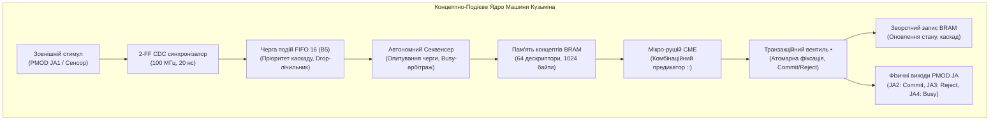

# Машина Кузьміна (Kuzmin Machine): Концептно-Орієнтована Архітектура

* **Версія:** 1.0.3
* **Дата:** 2026-11-19
* **Тип WP:** Guide

> [!IMPORTANT]
> **Призначення репозиторію:** Інженерно-науковий архів первинних досліджень, теоретичних моделей і концептуальних засад **Машини Кузьміна (МК)**: філософія концептів, подій, підписок, проблемно-орієнтованої мови `KPOL` та її ергономічного ASCII/ключового надшару **`EKPOL`** (`.ekpol`), математичний апарат формального аналізу, порівняльні дослідження з класичними обчислювальними моделями, опис крос-платформного двомодового Go-емулятора та TUI-дебагера **`VMK v0.3.1`** (`vmk`), а також узагальнення авторських уточнень семантики та відкритих питань моделі (листопад 2026).

> **Статус апаратних доказів у кремнії (TRL 3 за самооцінкою, листопад 2026):**
> На кристалі Xilinx Zynq-7000 (`XC7Z020-1CLG400C`) платформи Digilent PYNQ-Z1 синтезовано, розтрасовано у відкритому тулчейні OpenXC7 та перевірено в лабораторних умовах (рівень готовності окремих критичних функцій **TRL 3 за шкалою ISO 16290:2013**, без заяв про сертифікацію безпеки чи незалежний аудит рівня TRL 4; вихідний RTL, логи STA і сирі траси знаходяться у закритому інженерному репозиторії проєкту) лінійку конфігурацій:
> 1. **`CFG-R` (Реактивний фізичний шлюз транзакцій):** автономний транзакційний шлюз інваріантів (`kpol_txn_gate_v2`, із формальною перевіркою BMC/PDR) із комбінаційним предикатором `::` та ранніми PoC-демо-рушіями, перевірений натурними HIL-тестами ($`10\dots 20\text{ нс}`$);
> 2. **`CFG-P` та `CFG-P-HA` (Однобанковий та двобанковий програмований BRAM-конвеєр KPOL):** дескрипторний конвеєр на 64 концепти з мікро-рушієм CME, вхідною чергою FIFO 16 (із 1-слотовим буфером утримання каскаду), прямим входом фізичного тригера PMOD JA1 та відкритим бітстрімом OpenXC7 без Vivado (базовий однобанковий конвеєр: $`F_{\max} = 145.94\text{ МГц}`$, `1 597 Estimated LCs`, або `3 351 SLICE_LUTX / 1 399 SLICE_FFX / 1 RAMB36E1`, $`F_{\max} = 103.53\text{ МГц}`$ для AXI-обгортки; двобанковий конвеєр високої готовності `CFG-P-HA` з 8-рівневим бінарним деревом пріоритетного кодера: **`100.69 МГц` (`PASS @ 100.00 MHz`, `9.931 нс`)**, `5 718 SLICE_LUTX`, `1 935 SLICE_FFX`, `2 RAMB36E1`, натурно верифікований на `PYNQ-Z1 + LogicTracer Pico 0.5.0` на **`10 003` гарячих перемиканнях банків під потоком `40 011` подій** за `39.35 мс` із `0` колізій BRAM, `0` `torn-read` і `0` stall-тактів; конвеєр із вихідним шлюзом подій: **`101.67 МГц` (`PASS @ 100.00 MHz`)**, `3 630 SLICE_LUTX`, `1 RAMB36E1`);
> 3. **Багатоядерний кластер `N = 2, 4, 8` із 2-ступеневим конвеєризованим комутатором (`OpenXC7` P&R):** двоступенева конвеєризація міжбанкового комутатора скоротила площу на `33..38% SLICE_LUTX` і підняла трасовану частоту до **`133.89 МГц`** ($N = 2$, `3 894 SLICE_LUTX`), **`103.73 МГц` (`PASS @ 100.00 MHz`)** ($N = 4$, `8 225 SLICE_LUTX`) та **`91.89 МГц`** ($N = 8$, `+80.85%`, `18 112 SLICE_LUTX`).
>
> Логічний аналізатор на Raspberry Pi Pico використано для фізичних вимірювань на ПЛІС. В окремому експерименті `PYNQ-Z1 → GbE → Jetson AGX Orin J501` оброблено `5 × 1 000` подій на `1 024` підписниках GPU. Для програмування й налагодження проєкт має ASCII-нотацію `EKPOL 0.1.0` і емулятор `VMK v0.3.1` на Go. Побітовий збіг образів BRAM перевірено на корпусі прикладів; це не гарантія для довільного текстового перекладу `EKPOL ↔ KPOL` ([специфікація EKPOL, §10](../Engineering/specifications/kpol/ekpol-formal-specification.md)).

---

## Зміст

1. [Філософія та фундаментальні засади](#1-філософія-та-фундаментальні-засади)
2. [Канонічні наукові матеріали репозиторію](#2-канонічні-наукові-матеріали-репозиторію)
3. [Апаратна реалізація, відкритий тулчейн OpenXC7 та стенд HIL](#3-апаратна-реалізація-відкритий-тулчейн-openxc7-та-стенд-hil)
4. [Авторські уточнення семантики та відкриті питання моделі](#4-авторські-уточнення-семантики-та-відкриті-питання-моделі)
5. [Порівняльний аналіз із відомими обчислювальними моделями](#5-порівняльний-аналіз-із-відомими-обчислювальними-моделями)
6. [Цільові галузеві ніші](#6-цільові-галузеві-ніші)
7. [Верифікація, обмеження та відкриті науково-інженерні задачі](#7-верифікація-обмеження-та-відкриті-науково-інженерні-задачі)

---

## 1. Філософія та фундаментальні засади

Архітектурна гіпотеза Машини Кузьміна досліджує парадигму керування через **концепти**, **події** та **підписки** без єдиного глобального лічильника команд (*Program Counter*):

1. **Концепт як одиниця стану та реакцій:** у моделі МК концепт поєднує значення (дані), логічні предикати поточного стану (`Null`, `Positive`, `Negative`, `Even`, `Uneven`, `Changed`) та перелік підписників *(на серійних ПЛІС `CFG-P` дескриптори розміщуються в пасивній двопортовій `BRAM` та послідовно обслуговуються 8-тактовим мікро-рушієм `CME`)*.
2. **Подієвий каскад та підписки (`<-`):** мутація значення концепту або зовнішній фізичний імпульс генерує подію, яка активує прив'язані до концепту підписки без опитування в циклі ПЗ (polling-free).
3. **Семантика «Великої крапки» (`•`) і блокування (`Busy`):** за уточненням Автора від 13.11.2026 точка `•` задає пост-адресний бар'єр порядку (підписка стартує строго після завершення читання або запису), а за авторським роз'ясненням щодо перевірки умов підписки під час адресації стан зайнятості `Busy` утримує нові події в черзі й блокує повторне самозациклювання до завершення поточної активації *(у поточному профілі `CFG-P` захист інваріантів реалізовано окремим вентилем `kpol_txn_gate_v2`, тоді як символ `•` в `CME-1` і поконцептний біт `Busy` у BRAM ще не приведені до канонічної пост-адресної семантики)*.
4. **Апаратна детермінованість (`CFG-P`):** чергова обробка дескрипторів із `BRAM` без втручання ОС забезпечує фіксований 8-тактовий цикл ($`80\text{ нс}`$ при $`100\text{ МГц}`$, $`\sigma_{\text{exec-cycles}} = 0`$ тактів у синхронному домені без урахування вхідного квантування CDC і черги).

---

## 2. Канонічні наукові матеріали репозиторію

У цьому репозиторії зосереджено теоретичний фундамент, математичну формалізацію та погоджені специфікації:

* **[DOU_Article_Kuzmin_Machine_Popular_UA.md](DOU_Article_Kuzmin_Machine_Popular_UA.md)**
  *Полегшена науково-популярна версія статті для широкої спільноти DOU:* стислий виклад ідеї концептів, 3-кроковий міні-курс `KPOL`, порівняння `NTM` проти `PRAM`, огляд запусків від ПК/MCU до ПЛІС без перевантаження низькорівневими специфікаціями та 5 перспективних галузей застосування.
* **[DOU_Article_Kuzmin_Machine_UA.md](DOU_Article_Kuzmin_Machine_UA.md)**
  *Повна інженерна оглядова стаття для спільноти DOU:* розширений виклад концепції Машини Кузьміна, покроковий туторіал із класичного `KPOL`, огляд ергономічного ASCII/ключового надшару `EKPOL` та покрокового налагодження реактивних каскадів без `PC` у повноекранному TUI-дебагері `VMK v0.3.1` на Go, інтуїтивне пояснення математичних меж (умови Бернштейна, теорема Брента, гіллясті процеси, мережеве числення), апаратні заміри на ПЛІС/GPU та підсумкова оцінка наукової цінності й прикладних меж підходу.
* **[Зведений науково-інженерний огляд Машини Кузьміна](Kuzmin-Machine-Overview.md)** — авторська модель концептів і підписок, формальний аналіз, ескіз машини Тюрінга та інженерна реконструкція на ПЛІС і GPU. Редакція 1.0.4 розрізняє результати стенду, оцінки ресурсів і модельні розрахунки.
* **[KPOL-vs-SystemVerilog.md](KPOL-vs-SystemVerilog.md)**
  *Одне правило на трьох рівнях:* EKPOL описує поведінку лічильника, RTL реалізує її, а SVA перевіряє властивості схеми. Приклади каскаду BMS, рукостискання AXI та перемикання банків BRAM показують межі цієї аналогії й різницю між компіляцією правил у дані та синтезом апаратури.
* **[Similar_Machines_to_KM.md](Similar_Machines_to_KM.md)**
  *Порівняльний таксономічний аналіз:* системне порівняння Машини Кузьміна з класичними та неортодоксальними моделями: машина Тюрінга, машина Поста, фон-нейманівська архітектура, Dataflow, Actor Model, Rete-алгоритми, мережі Петрі.
* **Примітка про інженерні артефакти та емулятор `vmk`:** цей репозиторій містить виключно науково-інженерні статті, монографію та аналітичні матеріали з теорії моделі. Самодостатній крос-платформний двомодовий емулятор (`conceptual` + `bram64`), транспайлер `EKPOL <-> KPOL` і повноекранний 4-панельний TUI-дебагер **`vmk` (`VMK v0.3.1`, Go, `0` зовнішніх залежностей)** разом із колекцією виконуваних прикладів та посібниками користувача підтримується в інженерному репозиторії проєкту (і може постачатися як окремий автономний бандл під `Linux / macOS / Windows`), так само як вихідний RTL ПЛІС, CUDA-ядра GPU та стендові протоколи верифікації на платах `PYNQ-Z1` і `NVIDIA Jetson AGX Orin`.

---

## 3. Апаратна реалізація, відкритий тулчейн OpenXC7 та стенд HIL

**Цільова лабораторна платформа:** Digilent PYNQ-Z1 (кристал Xilinx Zynq-7000 `XC7Z020-1CLG400C`).

Апаратна архітектура Машини Кузьміна розділена на дві взаємодоповнюючі конфігурації рівня готовності **TRL 3 (за самооцінкою)**:

### 3.1. Конфігурації ядра: `CFG-R`, `CFG-P`, `CFG-P-HA` та багатоядерний кластер
1. **`CFG-R` (Реактивний фізичний шлюз транзакцій):** апаратний модуль шлюзу, що містить формально верифікований вентиль інваріантів (`kpol_txn_gate_v2`), комбінаційний обчислювач предикатів та спеціалізовані ранні PoC-демо-рушії (алгоритм Евкліда, RCFC, Suite B, Dataflow). Довів натурну стійкість до стресу AXI-шини та стабільність характеристик ($`10\dots 20\text{ нс}`$ на HIL).
2. **`CFG-P` та `CFG-P-HA` (Однобанковий і двобанковий програмований BRAM-конвеєр KPOL / EKPOL):** дескрипторний конвеєр на базі пам'яті концептів BRAM (1024 байти / 64 концепти формату `CME-RAW-1`), універсального мікро-рушія CME та автономного секвенсера подій. Забезпечує виконання як одиночних правил (`KPOL-CME-1`), так і верифікованих ациклічних каскадів між концептами (**`KPOL-CME-2`** із формальним доказом скінченної завершуваності в `Z3` та кодогенерацією безциклового C99 `--emit-c99`) без пересинтезу ПЛІС — причому розробка ведеться як у класичному `.kpol`, так і в ергономічній мові **`EKPOL 0.1.0`** (`.ekpol`, символьна ASCII `<- / ~ / :: / => / .` та ключова `on write / on change / when / commit;` нотації з 100% побітовою ідентичністю згенерованих образів BRAM і двосторонньою трансляцією `--to-ekpol` / `--to-kpol`), а трасування й інтерактивне налагодження виконуються у двомодовому Go-емуляторі та 4-панельному TUI-дебагері **`VMK v0.3.1`** (`--mode conceptual` та `--mode bram64`, життєвий цикл `PRE-LOAD -> POST-LOAD -> RUNNING`, потоковий `STDIO`, покроковий `1-Hop` хвилі). Двобанкова конфігурація високої готовності **`CFG-P-HA`** з 8-рівневим бінарним деревом пріоритетного кодера забезпечує трасовану частоту **`100.69 МГц` (`PASS @ 100.00 MHz`)** і безшовне гаряче оновлення правил за 1 такт між подіями (**`10 003` гарячі перемикання** під потоком `40 011` подій на `PYNQ-Z1 + LogicTracer Pico 0.5.0`, `0` колізій BRAM, `0` `torn-read`).
3. **Багатоядерний кластер `N = 2, 4, 8` із 2-ступеневим конвеєризованим комутатором:** масштабована матриця дескрипторних ядер у `OpenXC7` із 2-ступеневим міжбанковим комутатором (`Stage 1` локальні групи + `Stage 2` міжгруповий арбітр), що скоротила площу на `33..38% SLICE_LUTX` і забезпечила трасовану частоту **`133.89 МГц`** ($N = 2$), **`103.73 МГц` (`PASS @ 100.00 MHz`)** ($N = 4$) та **`91.89 МГц`** ($N = 8$).

### 3.2. Автономний фізичний тракт та черга подій
* **Зовнішній стимул:** фізичний пін PMOD JA1 (`Y18`) або кнопка `BTN0` проходять 2-ступеневий CDC-синхронізатор ($`100\text{ МГц}`$, $`20\text{ нс}`$) та детектор фронту.
* **Черга FIFO 16 та 1-слотовий буфер каскаду:** секвенсер реалізує рукостискання `valid && ready` та однослотовий буфер утримання внутрішнього каскаду `cascade_pending` (формально доведено $k$-індукцією `Z3` відсутність втрат і дублікатів серед усіх прийнятих у синхронний домен подій на редукованій моделі $N = 16$), а для некерованих зовнішніх імпульсів без зворотного тиску веде діагностичний облік відхилень (`events_dropped_count_o`, `fifo_overflow_o`).
* **Конвеєрне виконання:** 4-тактова вибірка дескриптора з BRAM + 2 такти CME/Gate + 1 такт write-back (+ стан стабілізації) = строго **8 тактів ($`80\text{ нс}`$)** детермінованого часу виконання в синхронному домені ПЛІС.
* **Фізична індикація:** виходи PMOD JA2 (Commit, $`100\text{ нс}`$), JA3 (Reject, $`100\text{ нс}`$), JA4 (Busy), а також користувацькі світлодіоди `LED[3:0]` (~$`42\text{ мс}`$ розтягування). Розрахункова затримка вільного тракту «від піна до піна» (при $\sigma_{\text{exec-cycles}} = 0$ тактів у ядрі та теоретичному квантуванні асинхронного входу CDC $`\sigma_{\text{cdc}} \approx 2.89\text{ нс}`$, без урахування черги й повного фізичного джитера стенда):

$$T_{\text{total}} = T_{\text{cdc}} + T_{\text{exec}} + T_{\text{pad}} \approx (20\dots 30)\text{ нс} + 80\text{ нс} + 5\text{ нс} = 105\dots 115\text{ нс}$$

### 3.3. Відкритий тулчейн OpenXC7 (Project X-Ray)
Синтез, розміщення, трасування та збірка бітстріму виконуються **відкритим інструментарієм без Vivado** *(зауважимо, що використання відкритого тулчейну не робить публічним сам закритий пропрієтарний RTL проєкту)*:
* **Синтезатор:** Yosys (`synth_xilinx -flatten -abc9 -arch xc7`);
* **Трасувальник:** `nextpnr-himbaechel` (device `xc7z020clg400-1`);
* **Генератор бітстріму:** `fasm2frames` + `xc7frames2bit`;
* **Оцінка ресурсів і таймінгу після P&R:** базове однобанкове ядро — 1 597 `Estimated LCs` (до-трасувальна оцінка Yosys відносно 53 200 `LUT6`), $`F_{\max} = 145.94\text{ МГц}`$ (`3 351 SLICE_LUTX / 1 399 SLICE_FFX / 1 RAMB36E1`, $`F_{\max} = 103.53\text{ МГц}`$ у повній AXI-обгортці); двобанкове ядро `CFG-P-HA` — `5 718 SLICE_LUTX / 1 935 SLICE_FFX / 2 RAMB36E1`, **`100.69 МГц` (`PASS @ 100.00 MHz`)**; вихідний шлюз 64-бітних кадрів подій із `CRC-8` — `3 630 SLICE_LUTX / 1 524 SLICE_FFX / 1 RAMB36E1`, **`101.67 МГц` (`PASS @ 100.00 MHz`)**; 2-ступеневий кластер $N = 2, 4, 8$ — **`133.89 / 103.73 / 91.89 МГц`**.

### 3.4. Вимірювальний комплекс стенда HIL
Для експериментального підтвердження часових інтервалів спроєктовано стенд:
* **Монтажна схема стенда:** макетна плата BB-102, топологія «Зірка» (Star Grounding), перетворювач рівнів 3.3V $\leftrightarrow$ 5V, датчик Холла SS41F / геркон KSK1A66 із підтяжками 10 кОм, драйвер MOSFET IRLZ44N (вимагає перевірки $`R_{\mathrm{DS(on)}}`$ за `3.3 В` керування) із захисним діодом 1N4007.
* **Логічний аналізатор на Raspberry Pi Pico:** прошивка на RP2040 PIO з частотою вибірки $`125\text{ МГц}`$ (крок дискретизації **$`8.0\text{ нс}`$**; захоплення обмеженої пачки у внутрішню SRAM через DMA перед вивантаженням по USB, оскільки 8 × 125 MS/s = 125 МБ/с перевищують USB Full Speed) та експорт у VCD.

### 3.5. Апаратний інтерфейс Jetson Orin (J501) та розмежування контурів
Для стикування Машини Кузьміна із гетерогенним обчислювальним вузлом Seeed Studio reServer Industrial J501 (NVIDIA Jetson AGX Orin 64GB) підготовлено окрему внутрішню картку інженерного інтерфейсу (в пропрієтарному репозиторії проєкту):
* **Промисловий захищений ввід/вивід (клемник J25):** 4 канали DI ($`12\text{ В} / 24\text{ В}`$ через оптрони SFH690BT), 4 канали DO (до $`40\text{ В}`$, $`0.2\text{ А}`$ через MOSFET CJT04N15) та 2 порти CAN-FD (до $`5\text{ Мбіт/с}`$ через 3PEAK TPT71044 з програмними термінаторами $`120\ \Omega`$).
* **Таймінг-бар'єр оптронів:** затримка проходження оптичної пари SFH690BT ($`\tau \approx 5\dots 15\text{ мкс}`$) забезпечує захист промислового обладнання, але вимагає прямих нерозв'язаних ліній для субмікросекундного HIL-тестування ядра ($`T_{\text{wakeup}} \le 150\text{ нс}`$).

---

## 4. Авторські уточнення семантики та відкриті питання моделі

У ході фахового листування та серії авторських презентацій у листопаді 2026 року (11–15.11.2026) Михайло Ювеналійович Кузьмін надав ключові роз'яснення задуму Машини Кузьміна та мови `KPOL`, які усунули частину ранніх різночитань і чітко окреслили відкриті питання формальної семантики:

| Напрям моделі | Узгоджене авторське роз'яснення М. Ю. Кузьміна (листопад 2026) | Відкриті семантичні та інженерні питання |
| :--- | :--- | :--- |
| **Перевірка подій під час адресації та зайнятість (`Busy`)** | Кожна операція адресації (`→`, `←`, `|`, `:`) ініціює перевірку умов підписки («скільки разів адресуємося — стільки й перевіряємо»); стан зайнятості концепту блокує самозациклювання та утримує нові події в черзі до завершення поточної активації на точці `•` (взаємовиключення читання/запису). | Точний момент зняття зайнятості в конструкції `A • B`, гранулярність блокування атрибутів і семантика знімка стану (*snapshot*) для відкладених тригерів. |
| **Пост-адресний бар'єр «Велика Крапка» (`•`)** | За уточненням Автора від 13.11.2026 наявність точки `•` означає запуск підписки строго після завершення адресації: для читання — після читання (зокрема читання поточних значень `A` і `B`, визначення події та старту підписки), для запису — після запису в пам'ять. | Булева інтерпретація символу `•` на слайді 6 нових презентацій та фізичне розведення в дескрипторі ролей унарного `NOT`, передзаписного вентиля й пост-адресного бар'єра `•`. |
| **Явний неініціалізований стан (`_`) і тригери зміни (`~`)** | Неініціалізований стан `_` кодується окремою валідною ознакою (не тотожний числовому `0`) і штатно активує прив'язані підписки; перевірка умови порівняння та подія фактичної зміни стану (`~`) розрізняються (підписки на зміну спрацьовують лише при фактичній зміні стану), а системні помилки виконання винесено на окремий рівень. | Доля арифметичного чи логічного виразу при читанні концепту, який перебуває у неініціалізованому стані `_`. |
| **Конкурентні записи та спільна пам'ять** | Спільна пам'ять концептів працює без неявних транзакційних блокувань або відкату: результат одночасних записів визначається фактичним порядком звернення, кожна мутація активує підписки, а уникнення логічних гонитв покладається на програміста. | Формальна модель консистентності пам'яті та дисципліна статичного володіння записом для детермінованих застосувань критичної безпеки. |
| **Керування чергами подій, зворотний тиск і послідовний fallback** | При переповненні черги подій цільова політика передбачає блокувальне очікування звільнення слота (*backpressure*) без втрати подій; при зайнятості пулу обчислювачів під час рандеву `Go SR2 →` поточне ядро самостійно виконує другу лінію послідовно (*Graceful Serial Fallback*). | Умови відсутності взаємних блокувань (*deadlock*) у циклічних графах підписок під дією *backpressure* та фізичне узгодження з некерованими зовнішніми лініями без рукостискання. |
| **Область застосування моделі, симуляція МТ та історичний прототип** | Автор позиціонує модель як поєднання концептів, реактивності та паралелізму над спільною пам'яттю (відмовившись від метафори «недетермінованої МТ»); ескіз симуляції машини Тюрінга через перенесення маркера стану між сусідніми концептами `¤-1, ¤, ¤+1` подано як ілюстративний начерк. Ранній прототип на 2–3 платах `STM32` був прямою C-програмою перевірки принципу подій-підписок без віртуальної машини та окремої мови. | Повна аксіоматизація симуляції машини Тюрінга (явне очищення старого маркера стану `Q`, випадок `d = 0`, динамічне добудування стрічки оператором `:`). |
| **Граматика `KPOL`, відсутність циклів і виконувані дужки** | Канонічний напрямок стрілок задано відносно комірки пам'яті (`→` — читання в стек, `←` — запис зі стека), `@` є синтаксичним маркером параметрів транслятора (сторонній псевдокод `SumA` знято), а імперативні цикли (`for`/`while`, `For/Each/Do`) у декларативно-подієвій моделі повністю відсутні. Парні дужки з комами є контекстно-вільними; `OpenBracket` і `CloseBracket` при побудові вкладених груп у `Static` виступають виконуваними концептами (у трансляторі — дві функції-заглушки), а для індексів типу `Token` значення `Min=1, Max=0` за замовчуванням означає одне обов'язкове виконання (при тимчасовому рішенні `Min=1, Max=15` як діапазону `1..16` «на 1 більше», `Collection` — логічне `І`, `Array` — `АБО`). | Оновлена таблиця лексичних роздільників після звільнення символу `#`, одиниці вимірювання `First`/`Length` для імені концепту, узгодження єдиного правила декодування `Max=0` із `15` та правило індексації нетокенних елементів у групах. |
| **Структура концепту в пам'яті (`Def` / `Token`) і формат адреси** | Виділене поле `Size` вилучено й замінено першим атрибутом із порожнім ім'ям (розмірність пов'язана з 4-бітним `Token`); байт `Def` задає 8-бітну маску присутності компонентів концепту (`0..7` зліва направо від молодшого до старшого біта, де `Child` є службовим елементом транслятора). Двійковий формат адреси є питанням платформної реалізації й відкладений до побудови повної ВМ. | Розрізнення між відсутнім компонентом (`Def[i] = 0`) та присутнім компонентом із порожнім значенням або у стані `_`, вирівнювання непарного числа 4-бітних токенів і фіксація цільового адресного ABI. |

---

## 5. Порівняльний аналіз із відомими обчислювальними моделями

Системний таксономічний розбір (деталізовано в **[Similar_Machines_to_KM.md](Similar_Machines_to_KM.md)**):

| Параметр | Машина Тюрінга | Фон Нейман (x86/ARM) | Dataflow (Static/Tagged) | Машина Кузьміна (МК) |
| :--- | :--- | :--- | :--- | :--- |
| **Одиниця програми** | Правило переходу $(q, s)$ | Лінійна команда (PC) | Вузол графа / Токен | Концепт із предикатами та підписками |
| **Механізм активації** | Зчитування символу стрічки | Інкремент Program Counter | Готовність операндів у дузі | Мутація даних / Подія / Зовнішній пін |
| **Модель пам'яті** | Нескінченна 1D стрічка | Адресний лінійний простір | Пам'ять зіставлення токенів | Реактивна дескрипторна BRAM |
| **Атомарність змін** | За 1 крок голівки | Lock-префікси, м'ютекси | Споживання токена | `•` впорядковує фази одного звернення; взаємного виключення між читачами не гарантує |
| **Накладні витрати О/С** | Відсутні (теоретична модель) | Переривання (ISR, $`1\dots10\text{ мкс}`$) | Черги арбітражу токенів | Прямий апаратний відгук ($`80\dots115\text{ нс}`$) |

---

## 6. Цільові галузеві ніші

Аналіз прикладної придатності (деталізовано у [зведеному огляді, §7.1](Kuzmin-Machine-Overview.md#71-пять-перспективних-галузей-застосування-гібриду-eca--dataflowreduction--pram) та [огляді споріднених машин, §12](Similar_Machines_to_KM.md#12-перспективні-галузеві-напрямки-застосування-прикладні-домени)) показує, чому саме цей клас архітектур — **гібриди подієво-продукційних систем (`ECA`), потокових/редукційних машин (`Dataflow / Reduction`) і конкурентних систем переписування над спільною пам'яттю (`PRAM`)** — має сильну власну нішу:

- Класичні процесори (`x86`, `ARM`, `RISC-V`) сильні в глибоких послідовних алгоритмах, але в задачах реактивного контролю стану тисяч параметрів вони тонуть у накладних витратах ОС (`29..77 мкс`), перериваннях і розгалуженнях.
- Гібрид `ECA + Dataflow + PRAM` (ядром якого є **Концепт** із явним станом невизначеності `_`, чистими предикатами `::`, ациклічним каскадом підписок і транзакційним бар'єром `•`) перетворює програму керування на **математично прозорий скінченний граф переходів**, який:
  1. до запуску піддається повному формальному аналізу в SMT-солверах (`Z3`) на відсутність циклів, взаємоблокувань і порушень інваріантів;
  2. однаково природно компілюється і в **активні таблиці блочної пам'яті ПЛІС** (`80 нс` на крок, `0` тактів внутрішнього джитера, гаряче оновлення правил за `1` такт через тіньовий банк `CFG-P-HA` на `100.69 МГц PASS` без пересинтезу бітстріму та 2-ступеневий кластер `133.89 / 103.73 / 91.89 МГц`), і в **резидентні варпи GPU** (`1 024` паралельні підписники за `~1.6..2.0 мкс`), і в **безцикловий детермінований код `MISRA-C99`** (`--emit-c99`, `WCET = const`) для ядер безпеки мікроконтролерів.

На цій основі виділено **5 конкретних перспективних галузей застосування**, які можна обґрунтовано розвивати вже зараз:

| Галузь / домен | Базовий еталон (Baseline) | Цільова роль МК (`ECA + Dataflow + PRAM`) | Критерій інженерної доцільності |
| :--- | :--- | :--- | :--- |
| **1. Апаратні контури безпеки БПЛА, НРК і робототехніки з ШІ (*Hardware Safety Cages / AI Guardrails*)** | Програмні перевірки під ОС Linux (`Jetson Orin`) або жорстко зашитий RTL | Непідкупний залізний запобіжник у `BRAM` ПЛІС (`CFG-P-HA`) між ШІ/автопілотом і приводами | Відсікання небезпечних команд за `80 нс` у залізі незалежно від ОС + гаряча зміна параметрів місії за `1` такт із `CRC-8` (`10 003` перемикання без простою) |
| **2. Автомобільна електроніка (`ISO 26262 ASIL-C/D`), `BMS` та силові інвертори** | Ручний імперативний код C із ризиком маскування збоїв датчиків нулем | Каскадна діагностика (`Комірка -> Модуль -> Батарея -> Контактор`) на `AURIX TC49x CSRM/PPU`, `NXP S32`, `Cortex-R` | Явний стан невизначеності `_` (`valid_mask` проти обриву `isoUART`) + кодогенерація безциклового `MISRA-C99` (`WCET = const`) із сертифікатом `Z3` |
| **3. Цифрова енергетика, релейний захист (`IEC 61850`) та інтерлоки АСУ ТП** | Циклічне опитування ПЛК або жорстко задані правила | Таблиця уставок у `BRAM` | Для цільового обладнання треба перевірити повну затримку, включно з чергами; час внутрішнього кроку не гарантує часу спрацювання захисту |
| **4. Мережеві шлюзи (*SmartNIC*), Pre-Trade Risk і тригери експериментів** | Регістровий RTL або програмний мережевий стек | Дескрипторні правила у `BRAM` | У трасованій точці $K=64$ однобанковий `CFG-P` використав на `39.5%` менше `SLICE_LUTX` і на `78.3%` менше `SLICE_FFX`, але на один блок BRAM більше |
| **5. Гетерогенні комплекси HIL, радарно-оптичний Sensor Fusion та компілятори *Safety IR*** | Розрізнені моделі у Vivado, CUDA та вбудованому C без спільного доказу | Симбіоз «ПЛІС (`80 нс` гейтинг) + резидентні варпи GPU (`1 024` канали за `~1.6..2.0 мкс`)» та єдиний *Safety IR* | Прямий апаратний канал ПЛІС↔GPU (GPIO/GPMC або PCIe GPUDirect RDMA) + автоматична генерація `Z3`-доказів, `RTL` і `C99` з однієї специфікації |

---

## 7. Верифікація, обмеження та відкриті науково-інженерні задачі

Дослідження Машини Кузьміна опирається на формальну перевірку критичних модулів (BMC, композиційну $k$-індукцію та мутаційні тести вентиля `kpol_txn_gate_v2`, секвенсера, двобанкового ядра `CFG-P-HA` з 256-бітним miter-доказом еквівалентності дерева пріоритетного кодера й `6` мутантами та 2-ступеневого міжбанкового комутатора з `5` мутантами), натурні виміри на ПЛІС і вбудованому GPU та критерії спростовності інженерних гіпотез:
* Усі відкриті прогалини моделі (відсутність вбудованого арбітражу гонитв конкурентних записів без неявних блокувань, неповний двійковий контракт маски присутності `Def`/`Token`, відкриті питання формальної семантики щодо оновлених роздільників після `#`, булевої інтерпретації `•` та читання концепту у стані `_`, уніфікація пост-адресного бар'єра `•`, ієрархічне закриття `100 МГц` для багатобанкових кластерів `N ≥ 8` та монтаж прямого апаратного міжплатного мосту ПЛІС↔GPU без участі ОС) оформлено як чіткі завдання та матрицю розбіжностей у **[Kuzmin-Machine-Overview.md (§7.2)](Kuzmin-Machine-Overview.md#72-статус-trl-матриця-розбіжностей-та-відкриті-науково-інженерні-задачі)**.
* Авторські роз'яснення М. Ю. Кузьміна (листопад 2026) та відкриті питання семантики узагальнено у **[§4 цього огляду](#4-авторські-уточнення-семантики-та-відкриті-питання-моделі)** й деталізовано в **[зведеному огляді, §7.2](Kuzmin-Machine-Overview.md#72-статус-trl-матриця-розбіжностей-та-відкриті-науково-інженерні-задачі)**.

### 7.1. Підсумковий інженерний висновок: чим є Машина Кузьміна (парадигма, мова чи апаратний ко-дизайн)

На підставі проведених формальних доказів, фізичного синтезу *Place & Route* та порівняльних вимірювань місце Машини Кузьміна визначається чотирма перевіреними положеннями:

1. **Що таке МК за своєю первинною суттю:** за задумом М. Ю. Кузьміна МК — це не готова апаратура, а **подієво-концептна обчислювальна модель (парадигма) і спосіб запису програм**, близький до класу `PRAM + ECA` (спільна пам'ять станів + правила «подія–умова–дія»). Її ядро — об'єднання в одному **Концепті** чотирьох складових: значення, окремого стану невизначеності `_`, безпобічних предикатів `::` і підписок із чітким фазовим бар'єром `•` без імперативних циклів. Сам автор перевіряв ідею звичайною C-програмою на `STM32`, залишивши фізичну адресацію та низькорівневе представлення відкритими.
2. **Чи можна використовувати її просто як парадигму на загальних мовах (`C`, `Rust`, `C++`, `Python`):** технічно — так, але на звичайному CPU під ОС вона втрачає головну перевагу. Як програмний патерн на `C`/`Rust` вона дає корисну дисципліну моделювання стану (явний біт `_` замість `null`/магічних нулів, відсутність розмазаних по коду `if`-опитувань і видимий граф реакцій). Проте порівняльні заміри на `ARM Cortex-A9` показали ціну софтверної емуляції: поки C99 (`-O3`) крутиться всередині L1-кешу без ОС, 4-концептний каскад займає `~534 нс`, але щойно втручаються події ядра ОС (`29..33 мкс`) або витіснення планувальника (`до 40..77 мкс`), детермінізм зникає. На серверах чи десктопах вона конкурує зі зрілими акторними моделями, реактивними стрімами, `CEP`/Rete-рушіями та синхронними мовами (`Lustre`/`Esterel`), не даючи радикального прискорення сама по собі.
3. **Чому окрема мова (підмножина KPOL та ергономічний надшар EKPOL) все ж потрібна, але не як «заміна Python/C»:** як універсальна мова загального призначення класичний слайдовий KPOL програє звичним мовам за зручністю набору неклавіатурних Unicode-символів та екосистемою (і його повний авторський стандарт досі не завершений). Саме тому поруч із незмінним класичним `.kpol` впроваджено чистий 7-бітний ASCII-надшар **`EKPOL 0.1.0`** (`.ekpol`) із взаємозамінними символьною та програмістською ключовою нотаціями, вбудованими інваріантами `[>= 0]`, блоками `test` і двосторонньою трансляцією `EKPOL <-> KPOL`. Як **вузька статично верифікована мова правил (DSL)** зв'язка `KPOL / EKPOL` виконує функцію, якої не дає довільний код на `C`: компілятор *до запуску* гарантує відсутність циклів (передумова формальної леми Ляпунова про скінченну завершуваність каскадів), контролює межі інваріантів у `Z3` і побітово тотожно компілює граф у фіксовану таблицю дескрипторів (`1024 Б`), код `MISRA-C99` та середовище покрокового налагодження хвилі у `VMK v0.3.1`.
4. **Де МК стає реальним апаратним і вбудованим рішенням зі своєю нішею:** МК розкривається саме як **апаратно-програмний ко-дизайн («статичний компілятор KPOL/EKPOL із Z3-сертифікатом та двомодовим Go-дебагером VMK + дескрипторний конвеєр у `BRAM` ПЛІС + спеціалізовані варпи GPU + кодогенерація безциклового C99 для ядер безпеки MCU»)**:
   - За `SLICE_LUTX` регістрова реалізація компактніша у трасованих точках $K=4,16$, а однобанкова `CFG-P` — при $K=64$ (`3 351` проти `5 543`, ціною одного блока BRAM). Перетин **близько 26 слотів** — інтерполяція, а не вимір чи універсальне правило вибору архітектури.
   - Для двобанкової `CFG-P-HA` перевірено іншу властивість: стенд зафіксував `10 003` перемикання під потоком `40 011` подій без зареєстрованого простою. Висновок про площу однобанкової збірки сюди не переноситься.
   - У багатоядерному кластері з **2-ступеневим конвеєризованим комутатором** площа скорочується на `33..38% SLICE_LUTX`, а трасована частота становить **`133.89 МГц`** ($N = 2$, `3 894 SLICE_LUTX`, пік `33.47 млн` переходів/с), **`103.73 МГц PASS @ 100.00 MHz`** ($N = 4$, `8 225 SLICE_LUTX`, пік `51.87 млн` переходів/с) та **`91.89 МГц`** ($N = 8$, `+80.85%`, `18 112 SLICE_LUTX`, пік `91.89 млн` переходів/с).
   - На `1 024` підписниках локальна медіана GPU в міжплатному експерименті становила близько `2 мкс`. За `5 000` подій виміряний шлях `PYNQ → Jetson → PYNQ` через Linux/GbE дав `RTT p50 = 675.38 мкс`, `p99.9 = 3 143.41 мкс`. `344.78 мкс` — оцінка медіани повного шляху в один бік, не час роботи сокета.
   - Крім ПЛІС+GPU, верифікована таблиця дескрипторів правил і Z3-доказ інваріантів прямо транслюються компілятором (`--emit-c99`) у **безцикловий MISRA-сумісний C99-код** (`WCET = const`, `valid_mask`) для ядер безпеки автомобільних і промислових мікроконтролерів (`Infineon AURIX TC49x CSRM`, `ARM Cortex-M/R`), а також працюють як апаратний запобіжник для ШІ/Linux у робототехніці та БПЛА (`Hardware Safety Cage`).

> **Підсумок в одному реченні:**
> **Машина Кузьміна — це не універсальна заміна CPU чи звичайних мов, і не суто «залізна плата»: за походженням це реактивна парадигма спільної пам'яті (яку зручно програмувати мовою `EKPOL`, тестувати через `STDIO` і покроково налагоджувати у Go-дебагері `VMK v0.3.1`), але справжню вимірювану перевагу над існуючими підходами вона дає саме як спеціалізований ко-дизайн «статичний DSL KPOL/EKPOL із Z3-сертифікатом + активні таблиці `BRAM` на ПЛІС (із гарячим оновленням без простою та конвеєрним кластером) + резидентні варпи GPU + кодогенерація безциклового C99 (`--emit-c99`) для ядер безпеки MCU» у системах жорсткого реального часу з десятками й сотнями перепрограмованих правил захисту та керування.**

### 7.2. Сильна ніша гібриду `ECA + Dataflow/Reduction + PRAM` та перспективні галузі практичного впровадження

Підсумок теоретичних доказів і апаратних вимірювань дозволяє сформулювати **конструктивний, інженерно оптимістичний і науково чесний погляд** на застосування Машини Кузьміна та спорідненого класу архітектур:

1. **Науково-академічна цінність та власна ніша гібриду `ECA + Dataflow/Reduction + PRAM`:**
   - **Математично прозоре ядро:** поєднання в єдиному примітиві «Концепт» значення даних, явного стану невизначеності `_` на рівні носія, чистих безпобічних предикатів `::` та ациклічних підписок із транзакційним бар'єром `•` без імперативних циклів перетворює програму реактивного контролю на **скінченний граф переходів**, який *до запуску* повністю верифікується в SMT-солверах (`Z3`) на відсутність циклів (за функцією рангу Ляпунова), взаємоблокувань і порушень інваріантів;
   - **Триєдина цільова компіляція:** той самий верифікований граф правил без семантичних втрат транслюється в **активні таблиці `BRAM` ПЛІС** (`80 нс` на крок, `0` тактів джитера, гаряче оновлення правил за `1` такт через тіньовий банк `CFG-P-HA` без пересинтезу бітстріму), у **резидентні варпи GPU** (`1 024` паралельні підписники за `~1.6..2.0 мкс`) та в **безцикловий детермінований код `MISRA-C99`** (`WCET = const`) для ядер безпеки мікроконтролерів;
   - **Методологічний еталон (*Reference Case Study*):** проєкт продемонстрував повний цикл перетворення неформальної авторської ідеї через систематичну формалізацію авторських уточнень семантики (листопад 2026), SMT-докази `Z3`, мутаційне тестування і відкритий синтез ПЛІС (`OpenXC7`) у фізично виміряні артефакти в кремнії (`Zynq-7020`, `Jetson AGX Orin`, `LogicTracer RP2040`).

2. **Реалістична стратегія впровадження («Safety IR під капотом») та 5 перспективних галузей:**
   - Хоча мова `KPOL` не призначена замінити `C`, `Rust` чи `Python` для універсального програмування, а програмна емуляція під ОС втрачає детермінізм (`29..77 мкс`), **формалізоване ядро МК має високий прикладний потенціал як проміжне представлення безпеки (*Safety IR*) та апаратно-програмний рушій реактивного захисту** у п'яти високотехнологічних доменах:
     1. *Апаратні контури безпеки для БПЛА, НРК і робототехніки з ШІ (`Hardware Safety Cages / AI Guardrails`):* залізний запобіжник на ПЛІС (`80 нс`, *Fail-Closed*) між ШІ/Linux (`Jetson Orin`) і силовими приводами з легітимним оновленням параметрів місії на льоту через тіньовий банк `BRAM` із `CRC-8`;
     2. *Автомобільна електроніка критичної безпеки (`ISO 26262 ASIL-C/D`), `BMS` та силові інвертори:* каскадна діагностика батарейних стеків і захист інверторів на `Infineon AURIX TC49x` (`CSRM`/`PPU`), `NXP S32`, `ARM Cortex-R` із явним станом невизначеності `_`, безцикловим `MISRA-C99` та сертифікатом `Z3`;
     3. *Цифрова енергетика та промислові інтерлоки:* уставки можна зберігати в оновлюваній таблиці; час реакції конкретного обладнання потребує окремої перевірки;
     4. *Мережеві шлюзи, Pre-Trade Risk і тригери фізичних експериментів:* порівнювати слід конфігурації під конкретну кількість правил; наведена в огляді точка перетину за площею оцінює лише дві збірки на `XC7Z020`;
     5. *Гетерогенні комплекси напівнатурного моделювання (`HIL`), радарно-оптичного Sensor Fusion та інженерні компілятори «живих специфікацій безпеки» (`Safety IR`):* ко-дизайн «ПЛІС (`80 нс` гейтинг) + резидентні варпи GPU (`1 024` канали за `~1.6..2.0 мкс`)» та єдине проміжне представлення, з якого автоматично генеруються формальні докази `Z3`, апаратний `RTL` і вбудований код `C99`.

## Історія версій

| Версія | Дата | Зміни |
|---|---|---|
| 1.0.3 | 2026-11-19 | Оновлено опис огляду до редакції 1.0.4; прибрано окрему рецензію з каталогу. |
| 1.0.2 | 2026-11-19 | Оновлено навігацію на виправлений огляд; уточнено інтерпретацію площі та затримок. |
| 1.0.1 | 2026-11-19 | Додано до каталогу порівняльний документ `KPOL-vs-SystemVerilog.md`. |
| 1.0.0 | 2026-11-19 | Зведено навігацію до єдиного `Kuzmin-Machine-Overview.md` та прибрано посилання на попередні окремі оглядові версії. |

## Абревіатури та глосарій

- **МК** — Машина Кузьміна.
- **KPOL / EKPOL** — проблемно-орієнтована мова МК та її ергономічний ASCII/ключовий надшар.
- **VMK** — двомодовий програмний емулятор і TUI-дебагер Машини Кузьміна.
- **ПЛІС / FPGA** — програмована логічна інтегральна схема.
