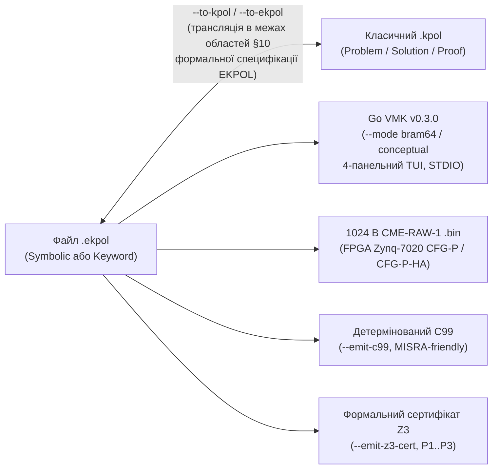

# Посібник: Керівництво користувача та чистий код мов програмування KPOL і EKPOL за принципами Кернігана, Рітчі та Мартіна

* **Версія:** 1.0.6
* **Дата:** 2026-11-20
* **Тип WP:** Guide
* **Статус:** Чинний практичний посібник користувача та стандарт кодування
* **Issue:** `Closes` [#284](https://github.com/nick-fedchik/kuzmin-machine/issues/284); пов'язані задачі [#282](https://github.com/nick-fedchik/kuzmin-machine/issues/282), [#280](https://github.com/nick-fedchik/kuzmin-machine/issues/280), [#278](https://github.com/nick-fedchik/kuzmin-machine/issues/278), [#276](https://github.com/nick-fedchik/kuzmin-machine/issues/276), [#274](https://github.com/nick-fedchik/kuzmin-machine/issues/274), [#270](https://github.com/nick-fedchik/kuzmin-machine/issues/270), [#186](https://github.com/nick-fedchik/kuzmin-machine/issues/186), [#184](https://github.com/nick-fedchik/kuzmin-machine/issues/184), [#8](https://github.com/nick-fedchik/kuzmin-machine/issues/8).
* **Відповідальний:** власник Микола Федчик; укладач — GitHub Copilot CLI (Lead Engineer / Programming Language Architect).
* **Формальні специфікації (мають пріоритет над цим посібником):** [`kpol-formal-specification.md`](../specifications/kpol/kpol-formal-specification.md) (`1.0.1`), [`ekpol-formal-specification.md`](../specifications/kpol/ekpol-formal-specification.md) (`1.0.0`), [`kpol-auth-formal-specification.md`](../specifications/kpol/kpol-auth-formal-specification.md) (`1.0.0`).
* **Нормативні специфікації мов:** [`Engineering/specifications/kpol/ekpol-specification.md`](../specifications/kpol/ekpol-specification.md) (`1.0.2`), [`Engineering/specifications/kpol/kpol-cme-subset.md`](../specifications/kpol/kpol-cme-subset.md) (`0.4.0`), [`Engineering/specifications/kpol/kpol-cme2-profile.md`](../specifications/kpol/kpol-cme2-profile.md) (`0.1.0`), [`Engineering/specifications/kpol/kpol-auth-subset.md`](../specifications/kpol/kpol-auth-subset.md) (`0.1.1`), [`Engineering/specifications/kpol/kpol-consolidated.md`](../specifications/kpol/kpol-consolidated.md) (`0.6.1`).
* **Інструментарій та виконання:** [`Engineering/guides/vmk-users-guide.md`](vmk-users-guide.md) (`1.2.1`), [`Engineering/sw/vmk-go/`](../sw/vmk-go/README.md) (`VMK v0.3.0`), [`Engineering/sw/kpol-ref/ekpol_frontend.py`](../sw/kpol-ref/ekpol_frontend.py), [`Engineering/hw/scripts/compile_kpol_bram_image.py`](../hw/scripts/compile_kpol_bram_image.py), [`Engineering/sw/vmk-go/examples/`](../sw/vmk-go/examples/bms_safety_cascade.ekpol).
* **Автоматична верифікація прикладів посібника:** [`Engineering/sw/tests/test_ekpol_278.py`](../sw/tests/test_ekpol_278.py) (`test_kpol_ekpol_language_guide_examples_compile_and_negative_control`, `test_markdown_math_formulas_have_no_commonmark_broken_escapes`).

---

## Призначення

Це поглиблений посібник із KPOL та EKPOL: як читати, писати й перевіряти програми для Машини Кузьміна. Якщо ще не писали жодної, почніть із [каси на KPOL](kpol-programming-guide.md) або [читацької картки на EKPOL](ekpol-programming-guide.md). Щоб розібрати авторський запис, відкрийте [практикум KPOL-AUTH](kpol-auth-programming-guide.md).

Документ побудовано на перетині двох класичних інженерних шкіл:
1. **Метод Браяна Кернігана і Денніса Рітчі (*The C Programming Language*, *The Practice of Programming* — Simplicity, Clarity, Generality):** навчання починається з найменшої повної, живої програми у перші 60 секунд; кожна нова конструкція вводиться лише на реальних виконуваних прикладах без зайвої води, а наприкінці подано стислий довідковий мануал (*Reference Manual*);
2. **Дисципліна «Чистого коду» Роберта Мартіна (*Clean Code*):** концептно-орієнтована програма керує фізичними контурами безпеки (BMS, силова електроніка, авіоніка), тому імена концептів мусять розкривати фізичний намір і одиниці виміру, кожен концепт повинен виконувати рівно один обов'язок (*SRP*), невизначеність датчиків `_` ніколи не маскується магічними числами, граф підписок будується строго згори донизу за рангом Ляпунова (*ADP*), а кожен модуль містить самоперевірний блок `test` / `Proof`.

### Генеалогія та вибір нотації: класичний KPOL проти EKPOL

У Машині Кузьміна (автор концепції — **Михайло Ювеналійович Кузьмін**, первинні матеріали в [`Research/sources/`](../../Research/sources/README.md)) немає лічильника команд (`PC`) і послідовного потоку інструкцій. Програма — це мережа **концептів (`Concepts`)**, кожен із яких поєднує стан, вхідний предикат припущення `::`, дію трансформації `=>`, пост-умовний інваріант безпеки Великої Крапки `•` і список підписників.

У репозиторії підтримуються дві повністю сумісні мовні оболонки над цією семантикою:

| Мовна оболонка / Профіль | Розширення | Головне призначення | Коли обирати |
| :--- | :--- | :--- | :--- |
| **`EKPOL 0.1.0` — Символьна ASCII (`symbolic`)** | `.ekpol` | Лаконічний запис концептів у чистому 7-бітному ASCII (`<-`, `->`, `~`, `\|`, `::`, `=>`, `.`), де стан, інваріант `[>= 0]` і реакції зібрані в одному блоці `concept`. | Щоденна розробка інженерних каскадів і реактивних алгоритмів; компактні схеми переходів. |
| **`EKPOL 0.1.0` — Ключова програмістська (`keyword`)** | `.ekpol` | Читабельна нотація у стилі Rust / Go / TypeScript (`on write`, `on read`, `on change`, `on call`, `when`, `=>`, `commit;`, `after`). | Командна розробка з C/Rust/Go-інженерами, код-рев'ю контурів безпеки, самодокументовані модулі. |
| **Класичний `KPOL-CME-1` / `KPOL-CME-2`** | `.kpol` | Триблочний контракт `Problem / Solution / Proof` ([`kpol-cme-subset.md`](../specifications/kpol/kpol-cme-subset.md) `0.4.0`, [`kpol-cme2-profile.md`](../specifications/kpol/kpol-cme2-profile.md) `0.1.0`, [`kpol-consolidated.md`](../specifications/kpol/kpol-consolidated.md) `0.6.1`). | Формальна верифікація `Z3` / `SymbiYosys`, сумісність з еталонним корпусом тестів кроку S5 ([#8](https://github.com/nick-fedchik/kuzmin-machine/issues/8)). |
| **Авторський підмножинний `KPOL-AUTH`** | не визначене | Лінійний запис засвідчених авторських конструкцій: групи `{}`/`()`/`[]` з межами `[Min=…, Max=…]`, `Def(…)`, `A • B`, `@x`, `!`, `¬`, `_`; авторські `Go`, `Do`, `←`, `→`, `¤` лінійного запису не мають ([`kpol-auth-formal-specification.md`](../specifications/kpol/kpol-auth-formal-specification.md) `1.0.0`). | Дослідження авторської семантики (`Research/sources/author/`) та експериментальне lowering у `Do/Go`. |

> **Фундаментальний інваріант еквівалентності:** символьний `EKPOL`, ключовий `EKPOL` і класичний `KPOL-CME-1/2` взаємно транслюються без жодних втрат прапорцями `--to-ekpol` / `--to-kpol` і компілюються в **побітово ідентичний (SHA-256) 1024-байтний образ BRAM (`CME-RAW-1`)**, ідентичний C99-код (`--emit-c99`) та ідентичний сертифікат безпеки `Z3` (`--emit-z3-cert`).

---

## Навігація чи використання

* [Частина I. Вступний курс за методом Кернігана і Рітчі (*A Tutorial Introduction*)](#частина-i-вступний-курс-за-методом-кернігана-і-рітчі-a-tutorial-introduction)
  - [1.1. Перша програма за 60 секунд («Hello, Concept!»)](#11-перша-програма-за-60-секунд-hello-concept)
  - [1.2. Анатомія Концепту: стан, типи даних і першокласний стан невизначеності `_` (`undef`)](#12-анатомія-концепту-стан-типи-даних-і-першокласний-стан-невизначеності-_-undef)
  - [1.3. Події адресації та підписки (`<-`, `->`, `|`, `:` та `~` / `on write`, `on read`, `on call`, `on change`)](#13-події-адресації-та-підписки------та--on-write-on-read-on-call-on-change)
  - [1.4. Предикати стану (`::` / `when`)](#14-предикати-стану--when)
  - [1.5. Оператори переходу (`=>`) та семантика Великої Крапки (`.` / `commit` / `•`)](#15-оператори-переходу--та-семантика-великої-крапки--commit-)
  - [1.6. Вбудовані інваріанти безпеки (`[>= 0]`, `[0..5000]`) та апаратний принцип Fail-Closed](#16-вбудовані-інваріанти-безпеки--0-05000-та-апаратний-принцип-fail-closed)
  - [1.7. Відмова від імперативних циклів: реактивне згасання хвилі та групові конструкції (`{ ... }` І, `[ ... ]` АБО, `Exit`)](#17-відмова-від-імперативних-циклів-реактивне-згасання-хвилі-та-групові-конструкції---і---або-exit)
  - [1.8. Потоки вводу-виводу (`@stdin`, `@stdout`, `@stderr`), вбудовані сценарії `test` і конвеєр компіляції](#18-потоки-вводу-виводу-stdin-stdout-stderr-вбудовані-сценарії-test-і-конвеєр-компіляції)
* [Частина II. Дисципліна «Чистого коду» в KPOL та EKPOL за принципами Роберта Мартіна (*Clean Concept-Oriented Code*)](#частина-ii-дисципліна-чистого-коду-в-kpol-та-ekpol-за-принципами-роберта-мартіна-clean-concept-oriented-code)
  - [Правило 1. Промовисті імена з фізичними одиницями виміру (*Use Intention-Revealing & Unit-Explicit Names*)](#правило-1-промовисті-імена-з-фізичними-одиницями-виміру-use-intention-revealing--unit-explicit-names)
  - [Правило 2. Принцип єдиної відповідальності Концепту (*Single Responsibility Principle — SRP*)](#правило-2-принцип-єдиної-відповідальності-концепту-single-responsibility-principle--srp)
  - [Правило 3. Ніколи не маскуйте невизначеність магічними числами (*Never Mask Uncertainty with Magic Numbers*)](#правило-3-ніколи-не-маскуйте-невизначеність-магічними-числами-never-mask-uncertainty-with-magic-numbers)
  - [Правило 4. Принцип ациклічних залежностей і газетний порядок читання згори донизу (*ADP & The Newspaper Metaphor*)](#правило-4-принцип-ациклічних-залежностей-і-газетний-порядок-читання-згори-донизу-adp--the-newspaper-metaphor)
  - [Правило 5. Обирайте правильну нотацію для аудиторії й тримайте стиль однорідним (*Choose the Right Notation & Keep It Orthogonal*)](#правило-5-обирайте-правильну-нотацію-для-аудиторії-й-тримайте-стиль-однорідним-choose-the-right-notation--keep-it-orthogonal)
  - [Правило 6. Захищені інваріанти та явні граничні умови (*Fail-Closed Invariants & Boundary Conditions*)](#правило-6-захищені-інваріанти-та-явні-граничні-умови-fail-closed-invariants--boundary-conditions)
  - [Правило 7. Самоперевірний код: жодного модуля без трикласного блоку `test` (*Self-Testing Code*)](#правило-7-самоперевірний-код-жодного-модуля-без-трикласного-блоку-test-self-testing-code)
  - [Зведена таблиця рефакторингу типових запахів коду (*KPOL/EKPOL Code Smells Catalog*)](#зведена-таблиця-рефакторингу-типових-запахів-коду-kpolekpol-code-smells-catalog)
* [Частина III. Довідник мов KPOL та EKPOL (*K&R Appendix A — Reference Manual*)](#частина-iii-довідник-мов-kpol-та-ekpol-kr-appendix-a--reference-manual)
  - [3.1. Повна таблиця взаємної відповідності конструкцій та дескрипторів BRAM `W0..W3`](#31-повна-таблиця-взаємної-відповідності-конструкцій-та-дескрипторів-bram-w0w3)
  - [3.2. Таблиця кодів предикатів (`0x00..0x06`), кодів дій (`0x00..0x05`) і прапорців `guard_flags`](#32-таблиця-кодів-предикатів-0x000x06-кодів-дій-0x000x05-і-прапорців-guard_flags)
  - [3.3. Таблиця кодів діагностики компілятора (`EKPOL-*`, `KPOL-*`, `CME2-*`) і способи їх усунення](#33-таблиця-кодів-діагностики-компілятора-ekpol--kpol--cme2--і-способи-їх-усунення)
  - [3.4. Шпаргалка команд компіляції, трансляції та верифікації](#34-шпаргалка-команд-компіляції-трансляції-та-верифікації)

---

### Частина I. Вступний курс за методом Кернігана і Рітчі (*A Tutorial Introduction*)

> *«Єдиний спосіб вивчити нову мову програмування — писати нею програми. Перша програма, яку варто написати, однакова для всіх мов...»*
> — Браян Керніган, Денніс Рітчі, *The C Programming Language*

#### 1.1. Перша програма за 60 секунд («Hello, Concept!»)

У класичних мовах перша програма друкує рядок `"hello, world"`. У Машині Кузьміна роль «Hello, World!» виконує **одноконцептний захищений лічильник імпульсів `Counter`** ([`Engineering/sw/vmk-go/examples/increase.ekpol`](../sw/vmk-go/examples/increase.ekpol)), який приймає вхідну подію `Pulse(param)`, перевіряє поріг допуску `param < 20`, збільшує свій стан на `1`, перевіряє інваріант невід'ємності `[>= 0]` і видає зафіксований стан у потік `STDOUT`.

Нижче наведено ту саму програму в трьох еквівалентних записах.

**Варіант А — Символьний `EKPOL` (`symbolic`):**

```ekpol
module Increase;

@stdin
@stdout
concept Counter: i32 = 10 [>= 0] {
    <- Pulse(param) :: param < 20 => Counter += 1 .
}
```

**Варіант Б — Ключовий програмістський `EKPOL` (`keyword`):**

```ekpol
module Increase;

@stdin
@stdout
concept Counter: int32 = 10 [>= 0] {
    on Pulse(param) when param < 20 => Counter += 1 commit;
}
```

**Варіант В — Класичний `KPOL-CME-1` ([`Engineering/hw/tests/kpol_bram_pipeline_increase.kpol`](../hw/tests/kpol_bram_pipeline_increase.kpol)):**

```kpol
Problem Increase {
    Invariants { NonNeg: Counter >= 0; }
}
Solution Increase {
    state Counter: Int32 = 10;
    event Pulse(param: Int32);
    rule Step on Pulse when param < 20 {
        set Counter := Counter + 1;
    }
}
```

##### Миттєвий запуск і трасування у `VMK`

Виконайте з каталогу [`Engineering/sw/vmk-go/`](../sw/vmk-go/README.md):

```bash
cd Engineering/sw/vmk-go
go run ./cmd/vmk --program examples/increase.ekpol --trace-events "0:5,0:25,0:invalid"
```

Машина миттєво завантажить 1 концепт у слот `CID 0` (контрольна сума 1024-байтного образу BRAM `SHA-256 = 4df05b189b9bf120...`) і пропустить крізь нього три події:
1. **`0:5` (номінальний імпульс `param = 5`):** предикат `5 < 20` істинний (`PASS`), дія обчислює кандидат `10 + 1 = 11`, вентиль Великої Крапки `[>= 0]` пропускає `11 >= 0` (`PASS`), стан стає `Counter = 11` (`COMMIT` у `STDOUT`);
2. **`0:25` (поза допуском `param = 25`):** предикат `25 < 20` хибний (`FAIL`), подія відсікається на фазі припущення (`REJECT_GUARD` у `STDERR`), стан гарантовано залишається `Counter = 11`;
3. **`0:invalid` (обрив датчика, стан невизначеності `_`):** апаратний шлюз визначеності миттєво блокує подію до обчислення предиката (`REJECT_FAULT` у `STDERR`), стан залишається `Counter = 11`.

##### Построковий розбір програми

* `module Increase;` — необов'язковий заголовок модуля, що задає ім'я простору концептів (використовується при трансляції у `Problem Increase` та генерації імен функцій C99).
* `@stdin` та `@stdout` — потокові анотації UNIX: концепт `Counter` приймає зовнішні стимули зі стандартного входу `STDIN` і транслює кожен `COMMIT` у `STDOUT` (а відмови `REJECT_*` автоматично спрямовуються у `STDERR`).
* `concept Counter: i32 = 10 [>= 0] { ... }` — оголошення концепту:
  - `Counter` — унікальне ім'я концепту (воно ж — ім'я стану та адреса подій);
  - `: i32` (або `: int32` / `: Int32`) — знаковий 32-бітний цілочисельний тип у доповняльному коді;
  - `= 10` — детерміноване початкове значення у слоті `W0` під час `POST-LOAD`;
  - `[>= 0]` — незмінний інваріант безпеки Великої Крапки: стан концепту за жодних обставин не має права стати від'ємним або переповнити розрядну сітку `Int32`.
* `<- Pulse(param) :: param < 20 => Counter += 1 .` — правило реакції концепту:
  - `<- Pulse(param)` (або `on Pulse(param)` / скорочено `<- param`) — приймач зовнішньої події запису з параметром `param`;
  - `:: param < 20` (або `when param < 20`) — вхідний предикат припущення (*Assumption Guard*);
  - `=> Counter += 1` — оператор переходу стану (інкремент на одиницю);
  - `.` (або `commit;`) — транзакційний бар'єр Великої Крапки (`•`): зафіксувати новий стан і сповістити підписників лише тоді, коли інваріант `[>= 0]` не порушено.

---

#### 1.2. Анатомія Концепту: стан, типи даних і першокласний стан невизначеності `_` (`undef`)

У традиційних мовах (C, Python, Go) змінна — це пасивна комірка пам'яті, яку будь-яка функція може перезаписати у довільний момент часу. У Машині Кузьміна пасивних змінних не існує. Єдиною будівельною одиницею є **Концепт (`Concept`)** — автономна реактивна капсула, що об'єднує чотири нероздільні складові:

$$\text{Concept} = \langle \text{Type},\ \text{Value} \cup \lbrace\bot_{\text{undef}}\rbrace,\ \text{Invariant},\ \text{Reaction Rules} \rangle$$

(де $\bot_{\text{undef}}$ позначає стан невизначеності `_` / `undef`).

##### Система типів `EKPOL` та `KPOL`

| Канонічний тип МК | Запис у `EKPOL` (`symbolic` / `keyword`) | Запис у `KPOL` | Діапазон значень | Підтримка в режимах `VMK` |
| :--- | :--- | :--- | :--- | :--- |
| **32-бітне знакове ціле** | `i32`, `int32`, `Int32` | `Int32` | $-2\,147\,483\,648 \dots 2\,147\,483\,647$ та `_` | `--mode bram64` (`CME-RAW-1`) **і** `--mode conceptual` |
| **64-бітне беззнакове ціле** | `u64`, `uint64`, `U64` | `U64` | $0 \dots 2^{64}-1$ та `_` | `--mode conceptual` (`Nod`, `Factorial`, `Tachometer`) |
| **64-бітне дійсне IEEE 754** | `f64`, `float64`, `Float` | `Float` | Подвійна точність IEEE 754 та `_` | `--mode conceptual` (`Sum`, `Tachometer`) |
| **Тризначний логічний тип** | `bool`, `Bool`, `?` | `?` (`Bool`) | `true` (`!`), `false` (`¬` / `~false`) та `_` (`undef`) | `--mode conceptual` (T-тригер `If`) |

##### Першокласний стан невизначеності `_` (`undef`)

Ключова відмінність Машини Кузьміна від класичних АЛП полягає в тому, що **кожен концепт будь-якого типу, окрім числових чи булевих значень, має апаратно виділений стан невизначеності `_` (в `EKPOL` записується як `_` або `undef`, у `KPOL-CME` — як `Unknown`)**:
* для логічного концепту `?` це три стани: `true` (`!`), `false` (`¬`) та `_` («ще не визначено / обрив лінії»);
* для числового концепту `i32` / `u64` / `f64` число `0` — це валідний фізичний нуль (наприклад, $0\text{ мВ}$ розбалансу комірок або $0\text{ об/хв}$ ротора), тоді як `_` означає відсутність достовірного вимірювання.

Наприклад, T-тригер `If` зі станом невизначеності (`RFC-001`, [`Engineering/sw/vmk-go/examples/if_toggle.ekpol`](../sw/vmk-go/examples/if_toggle.ekpol)) стартує у стані `_` і при першому імпульсі переходить у `true`, а далі перемикається між `false` і `true`:

```ekpol
module IfToggle;

@stdin
@stdout
concept If: ? = _ {
    when If is undef => If = true commit;
    when If == true  => If = false commit;
    when If == false => If = true commit;
}

test CheckIfThreeImpulses {
    send If(1);
    send If(1);
    send If(1);
    expect If == true;
}
```

---

#### 1.3. Події адресації та підписки (`<-`, `->`, `|`, `:` та `~` / `on write`, `on read`, `on call`, `on change`)

Концепт ніколи не опитує оточення у циклі `while (true)` (*polling*). Він перебуває у спокої, доки до нього не звернеться одна з чотирьох адресних операцій Автора або каскадна підписка:

| Вид події | Авторський символ (`KPOL-AUTH`) | Символьний `EKPOL` (`symbolic`) | Ключовий `EKPOL` (`keyword`) | Класичний `KPOL-CME-1/2` | Семантика спрацювання |
| :--- | :--- | :--- | :--- | :--- | :--- |
| **1. Зовнішній запис (`Write`)** | `← @ Int32 x` | `<- Ev(x)` або `<- x` | `on write(x)` / `on input(x)` / `on Ev(x)` | `event Ev(x: Int32); rule R on Ev ...` | Надходження нового вхідного значення `x` із зовнішньої шини (`STDIN`, АЦП, AXI4-Lite `0x00C`). |
| **2. Каскадна підписка (`Subscribe`)** | маркер події `~` у тілі `Src` (АН, слайд 6); `Src • Assign(Dst, e)` — лише лінійна нотація профілю `KPOL-AUTH-L1` | `~ Src` | `on change(Src)` | `rule R on change(Src) ...` | Автоматичне збудження концепту-підписника у наступному хопі хвилі, щойно концепт `Src` успішно виконав `COMMIT` зі зміною свого стану. |
| **3. Адресне читання (`Read`)** | `→ • Sum = 0` | `-> => . Sum = 0` | `on read => after Sum = 0;` | *(концептуальний режим)* | Зчитування поточного значення концепту у `STDOUT` із можливим пост-адресним скиданням після Великої Крапки (`RFC-013`). |
| **4. Реактивний виклик (`Execute`)** | `\| @ U64 (...)` | `\| (a, b)` | `on call(a, b)` / `on exec(a, b)` | *(концептуальний режим)* | Запуск обчислення концепту-алгоритму над аргументами (`Nod(a, b)`, `Factorial(n)`). |
| **5. Ініціалізація (`Init`)** | `Byte i 0` — значення після імені; `:` — підписка на ініціалізацію (АН, слайд 5; #155, слайд 2) | `: Type = Init` | `: Type = Init` | `state C: Int32 = Init;` | Початкове завантаження стану концепту під час фази програмування `POST-LOAD`. |

---

#### 1.4. Предикати стану (`::` / `when`)

Кожне правило реакції може мати **предикат припущення (`Assumption Guard`)**, який відділяється двокрапкою `::` у символьному стилі або ключовим словом `when` у програмістському стилі. Якщо предикат хибний, дія не обчислюється, стан концепту не змінюється, а подія завершується вердиктом `REJECT_GUARD`.

У `EKPOL` підтримуються три родини предикатів:

1. **Елементарні числові порівняння (`==`, `!=`, `<`, `<=`, `>`, `>=`) та побітова маска (`&`):**
   - Символьний стиль: `:: param < 20`, `:: Cell_Delta_mV >= 1`, `:: !(Pack_Fault_Latch == 2)`
   - Ключовий стиль: `when param < 20`, `when Cell_Delta_mV >= 1`, `when not (Pack_Fault_Latch == 2)`
2. **Діапазонні охоронці (`in LO..HI` або `RANGE(x, LO, HI)`):**
   Замість громіздкого подвійного порівняння перевіряють належність знакового 16-бітного числа замкненому інтервалу $[LO, HI]$ за один апаратний такт (`CME_PRED_RANGE = 0x05`):
   - Символьний стиль: `:: delta_mv in 50..5000` (або `:: RANGE(delta_mv, 50, 5000)`)
   - Ключовий стиль: `when delta_mv in 50..5000`
   - Класичний `KPOL-CME-2`: `when delta_mv >= 50 and delta_mv <= 5000`
3. **Іменовані предикати фізичного стану (`is ...`):**
   Дозволяють писати самодокументовані умови без магічних констант:
   - `when x is undef` / `when x is not undef` — перевірка стану невизначеності `_`;
   - `when x is null` / `when x is not null` — перевірка `x == 0` / `x != 0` (`CME_PRED_EQ` / `CME_PRED_NEQ` з `W1 = 0`);
   - `when x is positive` / `when x is negative` — сувора додатність `x > 0` (`CME_PRED_GT`) або від'ємність `x < 0` (`CME_PRED_LT`);
   - `when x is odd` (`is uneven`) / `when x is even` — перевірка молодшого біта `(x & 1) != 0` або `(x & 1) == 0` (`CME_PRED_BITMASK`).

Приклад концепту з іменованим предикатом `is positive` у `EKPOL`, який компілюється безпосередньо в `CME-RAW-1`:

```ekpol
module PositivePulseCounter;

@stdin
@stdout
concept Valid_Pulse_Count: i32 = 0 [>= 0] {
    on write(pulse_mv) when pulse_mv is positive => Valid_Pulse_Count += 1 commit;
}

test CheckPositivePulses {
    send Valid_Pulse_Count(0);
    expect Valid_Pulse_Count == 0;
    send Valid_Pulse_Count(12);
    expect Valid_Pulse_Count == 1;
}
```

---

#### 1.5. Оператори переходу (`=>`) та семантика Великої Крапки (`.` / `commit` / `•`)

Після стрілки `=>` записується дія переходу стану:
* інкремент/декремент на одиницю: `C += 1` (`CME_ACT_INC`), `C -= 1` (`CME_ACT_DEC`);
* додавання/віднімання кроку $K \ge 2$: `C += K` (`CME_ACT_ADD`), `C -= K` (`CME_ACT_SUB`);
* пряме присвоєння: `C = x` або `C := x` (`CME_ACT_ASSIGN`);
* порожня дія: `pass` або `nop` — лише в концептуальному записі; апаратний профіль `bram64` її відхиляє, бо коду `CME_ACT_NOP` у `CME-RAW-1` немає.

##### Дві фундаментальні ролі Великої Крапки (`•` / `.` / `commit` / `after`)

У Машині Кузьміна Велика Крапка (`•` у авторській нотації, `.` у символьному `EKPOL`, `commit;` та `after` у ключовому `EKPOL`) виконує дві чітко розмежовані ролі:

1. **Роль 1 — Пост-умовний транзакційний вентиль у кінці правила (`=> Action .` / `=> Action commit;`):**
   Дія `=>` ніколи не змінює стан концепту напряму в пам'яті `W0`! Спочатку мікроядро обчислює **значення-кандидат (`candidate`)**. Потім Велика Крапка перевіряє інваріант концепту: `[>= 0]` і відсутність 32-бітного переповнення `!ovf32`. Поле `hazard_limit` компілятори KPOL/EKPOL не заповнюють.
   - Якщо інваріант виконується — відбувається атомарний `COMMIT`: `W0 := candidate`, і лише після цієї крапки хвиля подій пробуджує підписників `~ Concept`.
   - Якщо інваріант порушено (наприклад, `0 - 1 = -1 < 0`) — вентиль Великої Крапки блокує транзакцію (`REJECT_INVARIANT`), стан `W0` залишається незмінним, а підписники не отримують хибного сигналу.

2. **Роль 2 — Пост-адресний бар'єр порядку виконання після читання за `RFC-013` (`-> => . Sum = 0` / `on read => after Sum = 0;`):**
   Згідно з відповіддю Автора у [`RFC-013`](../../Research/sources/author/rfc-2026-11-12.md), коли Велика Крапка стоїть **одразу після стрілки читання** (`→ • Sum = 0`), вона розділяє у часі видачу поточного значення читачеві та подальшу зміну стану концепту.

Розглянемо канонічний акумулятор `Sum` ([`Engineering/sw/vmk-go/examples/sum_autoreset.ekpol`](../sw/vmk-go/examples/sum_autoreset.ekpol)):

```ekpol
module SumPostReadReset;

@stdin
@stdout
concept Sum: f64 = 0 [>= 0] {
    <- x :: true => Sum += x .
    -> => . Sum = 0
}

test CheckSumAccumulateAndPostReadReset {
    send Sum(10);
    send Sum(25);
    send ReadSum(0);
    expect Sum == 0;
}
```

Коли ми надсилаємо `send Sum(10)` і `send Sum(25)`, акумулятор накопичує `Sum = 35`. Коли надходить подія читання `->` (`ReadSum`), машина:
1. **До Великої Крапки:** віддає поточну суму `35` у потік `STDOUT` (`READ: Sum = 35`);
2. **Після Великої Крапки (`.` / `after`):** автоматично скидає акумулятор у `Sum = 0`, готуючи його до наступного вікна інтегрування без втрати жодного відліку!

---

#### 1.6. Вбудовані інваріанти безпеки (`[>= 0]`, `[0..5000]`) та апаратний принцип Fail-Closed

У критичних контурах керування перевірка вхідних даних (`::` / `when`) недостатня: навіть при валідному вхідному параметрі внутрішній стан лічильника або інтегратора може вийти за безпечні межі (наприклад, піти у від'ємну область при декременті або переповнити `Int32_MAX`).

Тому в `EKPOL` інваріант безпеки записується безпосередньо в заголовку концепту у квадратних дужках `[>= 0]` (або додатково з верхньою межею небезпеки `[>= 0, <= 200]`):

```ekpol
module SafeCountdownLatch;

@stdin
@stdout
concept Fault_Countdown_Latch: i32 = 1 [>= 0] {
    on EvFaultPulse(severity) when severity >= 1 => Fault_Countdown_Latch -= 1 commit;
}

test VerifyLatchSaturatesAtZeroByInvariantGate {
    send Fault_Countdown_Latch(10);
    expect Fault_Countdown_Latch == 0;
    // Другий аварійний імпульс намагається обчислити 0 - 1 = -1,
    // але вентиль Великої Крапки [>= 0] блокує перехід (REJECT_INVARIANT),
    // утримуючи защіпку в безпечному стані 0!
    send Fault_Countdown_Latch(10);
    expect Fault_Countdown_Latch == 0;
}
```

Саме так працює защіпка аварії `Pack_Fault_Latch` у 4-рівневому каскаді BMS: коли лічильник аварій доходить до `0`, усі наступні імпульси декременту `0 - 1 = -1` відсікаються апаратним вентилем Великої Крапки (`REJECT_INVARIANT`), і защіпка назавжди залишається замкненою в `0` без додаткових розгалужень `if/else`.

---

#### 1.7. Відмова від імперативних циклів: реактивне згасання хвилі та групові конструкції (`{ ... }` І, `[ ... ]` АБО, `Exit`)

У Машині Кузьміна немає операторів `for`, `while` чи `goto`. Як же тоді виконуються ітеративні та рекурсивні алгоритми? Через **взаємну підписку концептів із природним згасанням хвилі подій**, коли на черговому кроці жоден предикат `::` більше не виконується (`Wave Quiescence`).

##### Приклад 1. Реактивний алгоритм Евкліда `Nod(120, 6) = 6` без лічильника циклу

У файлі [`Engineering/sw/vmk-go/examples/nod_euclid.ekpol`](../sw/vmk-go/examples/nod_euclid.ekpol) два концепти `a` і `b` підписані один на одного (`~ b` та `~ a`):

```ekpol
module EuclidNod;

@stdin
concept a: u64 = 120 [>= 0] {
    ~ b :: a > b => a -= b .
}

@stdin
concept b: u64 = 6 [>= 0] {
    ~ a :: b > a => b -= a .
}

@stdout
concept Nod: u64 = _ {
    | (a, b) :: a == b => Nod = a .
}

test CheckEuclidNod120And6 {
    send Nod(120, 6);
    expect Nod == 6;
}
```

Поки `a > b` (`120 > 6`), концепт `a` реактивно віднімає `b` (`114 -> 108 -> ... -> 6`, загалом 19 реактивних кроків). Щойно `a` зрівнюється з `b` (`6 == 6`), обидва предикати `a > b` та `b > a` стають хибними, хвиля віднімань природно згасає, і концепт `Nod` фіксує результат `Nod = 6`.

##### Приклад 2. Факторіал `Factorial(5) = 120` та групові конструкції авторської мови

В авторській нотації (`Research/sources/author/introduction-2026-11-13.md`) також використовуються групові дужки:
* `{ ... }` — **колекція («І» / `AND`):** послідовно-сукупне виконання всіх елементів групи з можливим достроковим виходом через `Exit`;
* `[ ... ]` — **масив вибору («АБО» / `OR`):** спрацьовує перший елемент або діапазон, що задовольнив умову (наприклад, базовий випадок рекурсії `[ 0 1 ] { =1 Exit }`).

У `EKPOL` ([`Engineering/sw/vmk-go/examples/factorial.ekpol`](../sw/vmk-go/examples/factorial.ekpol)) базовий випадок `[ 0 1 ]` записується діапазонним предикатом `when n in 0..1`:

```ekpol
module FactorialRecursive;

@stdin
concept n: u64 = 5 [>= 0] {
    <- val :: val >= 0 => n = val .
}

@stdout
concept Factorial: u64 = _ {
    on call(n) when n in 0..1 => Factorial = 1 commit;
}

test CheckFactorial5 {
    send Factorial(5);
    expect Factorial == 120;
}
```

---

#### 1.8. Потоки вводу-виводу (`@stdin`, `@stdout`, `@stderr`), вбудовані сценарії `test` і конвеєр компіляції

Кожна програма на `EKPOL` або `KPOL` є повноцінним фільтром потоків UNIX і водночас джерелом для чотирьох цільових представлень:



Розглянемо повний 4-рівневий каскад безпеки системи керування батареєю (`BMS Safety Cascade`, [`Engineering/sw/vmk-go/examples/bms_safety_cascade.ekpol`](../sw/vmk-go/examples/bms_safety_cascade.ekpol)):

```ekpol
module BmsSafetyCascade;

@stdin
@stdout
concept Cell_Delta_mV: i32 = 0 [>= 0] {
    <- EvCellDelta(delta_mv) :: delta_mv in 50..5000 => Cell_Delta_mV += 1 .
}

@stdout
concept Module_Thermal_Guard: i32 = 0 [>= 0] {
    ~ Cell_Delta_mV :: Cell_Delta_mV >= 1 => Module_Thermal_Guard += 1 .
}

@stdout
concept Pack_Fault_Latch: i32 = 2 [>= 0] {
    ~ Module_Thermal_Guard :: Module_Thermal_Guard >= 1 => Pack_Fault_Latch -= 1 .
}

@stdout
concept Contactor_Interlock: i32 = 10 [>= 0] {
    ~ Pack_Fault_Latch :: !(Pack_Fault_Latch == 2) => Contactor_Interlock = Pack_Fault_Latch .
}

test BmsFourLevelProtectionAndLatch {
    send Cell_Delta_mV(15);
    expect Cell_Delta_mV == 0;
    expect Contactor_Interlock == 10;
    send Cell_Delta_mV(120);
    expect Cell_Delta_mV == 1;
    expect Module_Thermal_Guard == 1;
    expect Pack_Fault_Latch == 1;
    expect Contactor_Interlock == 1;
    send Cell_Delta_mV(180);
    expect Cell_Delta_mV == 2;
    expect Module_Thermal_Guard == 2;
    expect Pack_Fault_Latch == 0;
    expect Contactor_Interlock == 0;
    send Cell_Delta_mV(250);
    expect Cell_Delta_mV == 3;
    expect Module_Thermal_Guard == 3;
    expect Pack_Fault_Latch == 0;
    expect Contactor_Interlock == 0;
}
```

Однією командою ви можете перевірити вбудований блок `test`, згенерувати 1024-байтний образ BRAM для ПЛІС `PYNQ-Z1`, детермінований модуль C99 для мікроконтролера ARM та математичний сертифікат безпеки `Z3`:

```bash
go build -C Engineering/sw/kpol-go -o kpolc ./cmd/kpolc
Engineering/sw/kpol-go/kpolc build \
  Engineering/sw/vmk-go/examples/bms_safety_cascade.ekpol \
  bms.bin --emit-c99 bms_safety.c --emit-z3-cert bms_z3.json --dump-concepts
rm -f bms.bin bms_safety.c bms_z3.json
```

---

### Частина II. Дисципліна «Чистого коду» в KPOL та EKPOL за принципами Роберта Мартіна (*Clean Concept-Oriented Code*)

> *«Чистий код завжди виглядає так, ніби його писала людина, якій не байдуже.»*
> — Роберт Мартін (*Uncle Bob*), *Clean Code: A Handbook of Agile Software Craftsmanship*

Концептно-подієве програмування дає інженерові надзвичайну щільність висловлення: 4 рядки `EKPOL` замінюють сотню рядків імперативного автомата станів. Але без інженерної дисципліни лаконічність легко перетворюється на криптографію з однолітерних концептів `c0`, `c1` та прихованих магічних констант. Нижче сформульовано **7 золотих правил чистого коду в KPOL та EKPOL** із парними прикладами «❌ Погано» проти «✅ Чисто».

---

#### Правило 1. Промовисті імена з фізичними одиницями виміру (*Use Intention-Revealing & Unit-Explicit Names*)

У Машині Кузьміна ім'я концепту виконує подвійну роботу: це одночасно **ім'я регістра стану** і **назва шини подій**, на яку підписуються інші концепти (`~ Concept_Name`). Однолітерні чи абстрактні імена (`c0`, `val`, `tmp`, `flag`, `data`) змушують читача тримати в голові таблицю відповідності слотів і призводять до помилок розмірності (вольти замість мілівольтів, оберти за секунду замість об/хв).

* **Імена фізичних сенсорів та порогів** обов'язково містять суфікс фізичної одиниці: `_mV`, `_mA`, `_degC`, `_RPM`, `_us`, `_bar`.
* **Імена захисних ланок** вказують їхню архітектурну роль у каскаді: `_Guard` (пороговий охоронець), `_Latch` (незворотна защіпка аварії), `_Interlock` (виконавче блокування контактора/приводу), `_Count` (лічильник подій).

**❌ Погано (Code Smell — *Cryptic Slot Naming*):**

```ekpol
module BadNamingSmell;

@stdin
@stdout
concept c0: i32 = 0 [>= 0] {
    <- x :: x in 50..5000 => c0 += 1 .
}

@stdout
concept flg: i32 = 10 [>= 0] {
    ~ c0 :: c0 >= 1 => flg = c0 .
}

test CheckBadNaming {
    send c0(120);
    expect c0 == 1;
    expect flg == 1;
}
```

**✅ Чисто (Clean EKPOL — *Intention-Revealing & Unit-Explicit Names*):**

```ekpol
module CleanUnitExplicitNames;

@stdin
@stdout
concept Cell_Delta_mV: i32 = 0 [>= 0] {
    <- EvCellDelta(delta_mv) :: delta_mv in 50..5000 => Cell_Delta_mV += 1 .
}

@stdout
concept Contactor_Interlock: i32 = 10 [>= 0] {
    ~ Cell_Delta_mV :: Cell_Delta_mV >= 1 => Contactor_Interlock = Cell_Delta_mV .
}

test CheckCleanNaming {
    send Cell_Delta_mV(120);
    expect Cell_Delta_mV == 1;
    expect Contactor_Interlock == 1;
}
```

---

#### Правило 2. Принцип єдиної відповідальності Концепту (*Single Responsibility Principle — SRP*)

За Робертом Мартіном, модуль повинен мати одну й лише одну причину для зміни. У мікроядрі `CME-RAW-1` цей принцип закріплено апаратно: один 16-байтний дескриптор концепту має рівно одне 32-бітне слово операнда `W1`. Коли розробник намагається запхати в один концепт і діапазонну фільтрацію вхідного сигналу (`in 50..5000`), і масштабування з кроком `+= 10`, виникає апаратна колізія слота `W1` (`EKPOL-COLLISION-ERR` / `CME2-OPERAND-COLLISION`).

Навіть у концептуальному режимі не створюйте «божественний концепт» (*God Concept*). Розкладайте контур безпеки на прозорий конвеєр, де кожен концепт виконує рівно один крок трансформації:
1. **Вхідний фільтр допуску (`Sensor Filter`)** — відсікає шум і реєструє факт аномалії (`+= 1`);
2. **Тепловий/часовий охоронець (`Thermal/Time Guard`)** — накопичує підтверджені події каскаду;
3. **Защіпка аварії (`Fault Latch`)** — веде зворотний відлік до безпечного нуля `[>= 0]`;
4. **Виконавчий інтерлок (`Actuator Interlock`)** — переводить виконавчий механізм у безпечний стан.

**❌ Погано (Code Smell — *God Concept & W1 Operand Collision*):**

```ekpol
// ANTI-PATTERN: EKPOL-COLLISION-ERR (навмисно невалідний приклад із колізією слота W1)
// Спроба поєднати діапазонний фільтр (потребує W1 для 50..5000)
// і стрибок на +10 (потребує W1 для константи 10) в одному дескрипторі:
module BadGodBmsController;

concept God_BMS_Controller: i32 = 0 [>= 0] {
    <- delta_mv :: delta_mv in 50..5000 => God_BMS_Controller += 10 .
}
// Компілятор детерміновано відхилить цей код із помилкою:
// EKPOL-COLLISION-ERR: concept 'God_BMS_Controller': CME-RAW-1 shares one 32-bit W1 operand_val between guard literal and ADD/SUB step != 1
```

**✅ Чисто (Clean EKPOL — *SRP Pipeline Separation*):**

```ekpol
module CleanSrpPipeline;

// 1. Вхідний концепт відповідає виключно за вікно допуску 50..5000 мВ (W1 зберігає межі)
@stdin
@stdout
concept Cell_Overvoltage_Filter_mV: i32 = 0 [>= 0] {
    on write(delta_mv) when delta_mv in 50..5000 => Cell_Overvoltage_Filter_mV += 1 commit;
}

// 2. Підписник відповідає за накопичення штрафних балів або керування інтерлоком
@stdout
concept Pack_Safety_Score: i32 = 0 [>= 0] {
    on change(Cell_Overvoltage_Filter_mV) when Cell_Overvoltage_Filter_mV >= 1 => Pack_Safety_Score += 1 commit;
}

test CheckCleanSrpPipeline {
    send Cell_Overvoltage_Filter_mV(20);
    expect Pack_Safety_Score == 0;
    send Cell_Overvoltage_Filter_mV(150);
    expect Cell_Overvoltage_Filter_mV == 1;
    expect Pack_Safety_Score == 1;
}
```

---

#### Правило 3. Ніколи не маскуйте невизначеність магічними числами (*Never Mask Uncertainty with Magic Numbers*)

У класичному C-коді неініціалізований стан або обрив датчика часто кодують «магічними числами» `-1`, `0`, `-999` або `0xFFFF`. В аварійній автоматиці це смертельно небезпечно: якщо `0` одночасно означає і «датчик ще не опитано», і «розбаланс комірок дорівнює 0 мВ», система вважатиме обірваний дріт ідеально збалансованою батареєю!

У KPOL та EKPOL діє суворе правило:
* **Ніколи не використовуйте `0`, `-1` чи `9999` для позначення невідомого стану.**
* Використовуйте виключно першокласний стан невизначеності `_` (`undef`), а для перевірки входу — предикат `when x is undef` або апаратний шлюз `param_valid = false` (`REJECT_FAULT`).

**❌ Погано (Code Smell — *Magic Number `-1` або `0` for Uninitialized State*):**

```ekpol
module BadMagicZeroState;

// Погано: 0 використовується як ознака "ще не ініціалізовано",
// хоча 0 — це також легітимне робоче значення лічильника!
@stdin
@stdout
concept Sensor_Status: i32 = 0 [>= 0] {
    on write(code) when code == 0 => Sensor_Status += 1 commit;
}

test CheckBadMagicZero {
    send Sensor_Status(0);
    expect Sensor_Status == 1;
}
```

**✅ Чисто (Clean EKPOL — *Explicit Uncertainty State `_` / `undef`*):**

```ekpol
module CleanExplicitUncertainty;

// Чисто: концепт стартує у явному стані невизначеності `undef` (`_`),
// який неможливо сплутати з жодним булевим чи числовим значенням.
@stdin
@stdout
concept Sensor_Ready_Flag: bool = undef {
    when Sensor_Ready_Flag is undef => Sensor_Ready_Flag = true commit;
    when Sensor_Ready_Flag == true  => Sensor_Ready_Flag = false commit;
    when Sensor_Ready_Flag == false => Sensor_Ready_Flag = true commit;
}

test CheckCleanUncertainty {
    send Sensor_Ready_Flag(1);
    expect Sensor_Ready_Flag == true;
}
```

---

#### Правило 4. Принцип ациклічних залежностей і газетний порядок читання згори донизу (*ADP & The Newspaper Metaphor*)

Роберт Мартін порівнює добре написаний вихідний файл із газетною статтею (*The Newspaper Metaphor*), яку читають **згори донизу**, а в архітектурі компонентів формулює **Принцип ациклічних залежностей (*Acyclic Dependencies Principle, ADP*)**.

В апаратному профілі `KPOL-CME-2` / `EKPOL bram64` принцип ADP є математичним законом (теорема Ляпунова `P1_dag_lyapunov_acyclicity` у [`Engineering/validation/kpol-cme/cme2-formal-227/report.md`](../validation/kpol-cme/cme2-formal-227/report.md)):
* Граф каскадних підписок `~` (`on change`) зобов'язаний бути **орієнтованим ациклічним графом (DAG)**, де кожен концепт має не більше одного прямого підписника (`fan-out <= 1`), що гарантує завершення будь-якої хвилі максимум за $N \le 64$ апаратних хопів без зависання конвеєра.
* **Топологічне правило оформлення файлу:** розташовуйте концепти у файлі `.ekpol` строго у порядку зростання їхнього топологічного рангу — від вхідних сенсорів `@stdin` нагорі (ранг 0), через проміжні охоронці (ранги 1, 2) до вихідних актуаторів `@stdout` унизу. Тоді напрямок поширення хвилі у файлі завжди збігається з рухом очей читача згори донизу!

**❌ Погано (Code Smell — *Cyclic Subscription Deadlock `EKPOL-CYCLE-ERR`*):**

```ekpol
// ANTI-PATTERN: EKPOL-CYCLE-ERR (навмисно невалідний приклад із циклом підписок A <-> B)
module BadCyclicCascade;

concept Thermal_Stage_A: i32 = 0 [>= 0] {
    ~ Thermal_Stage_B :: Thermal_Stage_B >= 1 => Thermal_Stage_A += 1 .
}

concept Thermal_Stage_B: i32 = 0 [>= 0] {
    ~ Thermal_Stage_A :: Thermal_Stage_A >= 1 => Thermal_Stage_B += 1 .
}
```

> Спроба скомпілювати наведений вище антипатерн у `CME-RAW-1` негайно блокується 3-кольоровим DFS-аналізатором компілятора ([`validate_ekpol_for_bram64` в `Engineering/sw/kpol-ref/ekpol_frontend.py`](../sw/kpol-ref/ekpol_frontend.py)) із дослівною діагностикою:
> `EKPOL-CYCLE-ERR: cyclic cascade subscription detected involving concept 'Thermal_Stage_A' (Thermal_Stage_A -> Thermal_Stage_B -> Thermal_Stage_A)`.

**✅ Чисто (Clean EKPOL — *Top-to-Bottom Topological DAG by Lyapunov Rank*):**

```ekpol
module CleanTopologicalDag;

// Ранг 0 (Вхід): приймає зовнішню подію з @stdin
@stdin
@stdout
concept Stage0_Ingress_mV: i32 = 10 [>= 0] {
    <- E0(param) :: param < 50 => Stage0_Ingress_mV += 1 .
}

// Ранг 1 (Проміжний фільтр): підписаний лише на Ранг 0 (вище у файлі)
@stdout
concept Stage1_Anomaly_Count: i32 = 0 [>= 0] {
    ~ Stage0_Ingress_mV :: Stage0_Ingress_mV > 10 => Stage1_Anomaly_Count += 1 .
}

// Ранг 2 (Вихідний актуатор / Листок DAG): підписаний лише на Ранг 1
@stdout
concept Stage2_Relay_Drive: i32 = 0 [>= 0] {
    ~ Stage1_Anomaly_Count :: Stage1_Anomaly_Count >= 1 => Stage2_Relay_Drive = Stage1_Anomaly_Count .
}

test CheckTopologicalFlowTopToBottom {
    send Stage0_Ingress_mV(25);
    expect Stage0_Ingress_mV == 11;
    expect Stage1_Anomaly_Count == 1;
    expect Stage2_Relay_Drive == 1;
}
```

---

#### Правило 5. Обирайте правильну нотацію для аудиторії й тримайте стиль однорідним (*Choose the Right Notation & Keep It Orthogonal*)

Браян Керніган у *The Practice of Programming* наголошує: *«Пишіть ясно; не будьте надмірно хитрими; дотримуйтесь єдиного стилю в межах модуля»*.

Хоча граматика `EKPOL 0.1.0` дозволяє змішувати символьну нотацію (`<-`, `~`, `::`, `.`) та ключову нотацію (`on write`, `on change`, `when`, `commit;`) навіть у сусідніх концептах, **у чистому коді в межах одного файлу `.ekpol` слід дотримуватися одного обраного стилю**:
* використовуйте **`--ekpol-style keyword`** для великих промислових модулів безпеки (BMS, інвертори, медичні чи автомобільні інтерлоки), які проходять рев'ю системними інженерами та аудиторами;
* використовуйте **`--ekpol-style symbolic`** для компактних математичних ядер, дослідницьких моделей і коли потрібно бачити пряму візуальну паралель із 16-байтними дескрипторами в TUI-дебагері `VMK`;
* використовуйте вбудований автоформатер `vmk --to-ekpol --ekpol-style symbolic|keyword`, щоб автоматично привести будь-який файл до єдиного канонічного вигляду.

**❌ Погано (Code Smell — *Inconsistent Mixed Style in One Module*):**

```ekpol
module BadMixedStyle;

@stdin
@stdout
concept Voltage_Sense_mV: i32 = 0 [>= 0] {
    <- x :: x in 10..100 => Voltage_Sense_mV += 1 .
}

@stdout
concept Trip_Counter: int32 = 0 [>= 0] {
    on change(Voltage_Sense_mV) when Voltage_Sense_mV >= 1 => Trip_Counter += 1 commit;
}

test CheckMixedStyle {
    send Voltage_Sense_mV(50);
    expect Trip_Counter == 1;
}
```

**✅ Чисто (Clean EKPOL — *Consistent Keyword Style Across the Entire Module*):**

```ekpol
module CleanConsistentKeywordStyle;

@stdin
@stdout
concept Voltage_Sense_mV: int32 = 0 [>= 0] {
    on write(x) when x in 10..100 => Voltage_Sense_mV += 1 commit;
}

@stdout
concept Trip_Counter: int32 = 0 [>= 0] {
    on change(Voltage_Sense_mV) when Voltage_Sense_mV >= 1 => Trip_Counter += 1 commit;
}

test CheckConsistentKeywordStyle {
    send Voltage_Sense_mV(50);
    expect Voltage_Sense_mV == 1;
    expect Trip_Counter == 1;
}
```

---

#### Правило 6. Захищені інваріанти та явні граничні умови (*Fail-Closed Invariants & Boundary Conditions*)

За Мартіном, більшість аварій у промисловому ПЗ виникає на границях діапазонів (*Boundary Conditions*). У KPOL/EKPOL діють два правила граничної гігієни:
1. **Явний інваріант `[>= 0]` у заголовку кожного концепту BRAM-контуру:** ніколи не покладайтеся на те, що «вхідні дані завжди додатні». Завжди декларуйте `[>= 0]`, щоб апаратний вентиль `CME_GUARD_INVARIANT_EN (0x02)` фізично блокував від'ємні стани та знакове переповнення `Int32`.
2. **Використовуйте замкнений діапазон `x in LO..HI` замість односторонніх нерівностей для фізичних датчиків:** будь-який реальний датчик (АЦП напруги, струму, температури) має не лише нижній поріг чутливості `LO`, а й верхню фізичну межу достовірності `HI` (вище якої сигнал означає коротке замикання на лінію живлення).

**❌ Погано (Code Smell — *Unbounded Sensor Assumption `< 5000` Accepting Negative Noise*):**

```ekpol
module BadUnboundedSensor;

// Погано: предикат `delta_mv < 5000` випадково пропустить від'ємні значення (-500 мВ)
// та нульовий тепловий шум (0..49 мВ)!
@stdin
@stdout
concept Noisy_Cell_Counter: i32 = 0 [>= 0] {
    <- delta_mv :: delta_mv < 5000 => Noisy_Cell_Counter += 1 .
}

test CheckBadUnboundedSensor {
    send Noisy_Cell_Counter(5);
    expect Noisy_Cell_Counter == 1;
}
```

**✅ Чисто (Clean EKPOL — *Explicit Two-Sided Physical Window `in 50..5000`*):**

```ekpol
module CleanBoundedSensorWindow;

// Чисто: замкнений інтервал 50..5000 мВ відсікає і тепловий шум (< 50 мВ),
// і нефізичний викид АЦП (> 5000 мВ) одним апаратним предикатом CME_PRED_RANGE!
@stdin
@stdout
concept Filtered_Cell_Counter_mV: i32 = 0 [>= 0] {
    <- delta_mv :: delta_mv in 50..5000 => Filtered_Cell_Counter_mV += 1 .
}

test CheckCleanBoundedSensorWindow {
    send Filtered_Cell_Counter_mV(15);
    expect Filtered_Cell_Counter_mV == 0;
    send Filtered_Cell_Counter_mV(120);
    expect Filtered_Cell_Counter_mV == 1;
    send Filtered_Cell_Counter_mV(6000);
    expect Filtered_Cell_Counter_mV == 1;
}
```

---

#### Правило 7. Самоперевірний код: жодного модуля без трикласного блоку `test` (*Self-Testing Code*)

Роберт Мартін формулює закон TDD: *«Код без тестів — це спадщина (legacy code) з моменту написання»*. У класичному `KPOL-CME-1/2` секція `Proof { scenario ... }` є обов'язковим перед-емісійним бар'єром компілятора (`Pre-Emission Proof Gate`): якщо доказ не проходить або є вакуумним, компілятор відмовляється генерувати образ BRAM!

У `EKPOL` цю роль виконує блок `test <ScenarioName> { ... }`. За стандартом чистого коду проєкту, кожен модуль безпеки повинен містити блок `test` (або `Proof` у `.kpol`), який перевіряє щонайменше **три класи переходів**:
1. **Відсікання вхідним предикатом (`REJECT_GUARD`):** подача стимулу поза робочим діапазоном і перевірка `expect`, що стан концепту не змінився;
2. **Номінальне поширення хвилі (`COMMIT`):** подача робочого стимулу й перевірка станів усіх концептів каскаду від входу до виходу;
3. **Спрацювання вентиля інваріанта Великої Крапки (`REJECT_INVARIANT` / насичення защіпки):** подача повторного аварійного стимулу на межі `[>= 0]` і перевірка, що защіпка не пішла у мінус.

Класичний еквівалент такого трикласного самоперевірного модуля у профілі `KPOL-CME-2`:

```kpol
Problem CleanTwoStageGuard {
    Invariants {
        inv_sensor: Current_Spike_mA >= 0;
        inv_latch: Breaker_Trip_Latch >= 0;
    }
}

Solution CleanTwoStageGuard {
    state Current_Spike_mA: Int32 = 0;
    state Breaker_Trip_Latch: Int32 = 1;

    event EvCurrentSample(sample_ma: Int32);

    rule RFilterSpike on EvCurrentSample when sample_ma >= 100 and sample_ma <= 10000 {
        set Current_Spike_mA := Current_Spike_mA + 1;
    }
    rule RTripLatch on change(Current_Spike_mA) when Current_Spike_mA >= 1 {
        set Breaker_Trip_Latch := Breaker_Trip_Latch - 1;
    }
}

Proof CleanTwoStageGuard {
    scenario ThreeClassSafetyVerification {
        step EvCurrentSample(sample_ma = 20);
        expect Current_Spike_mA == 0;
        expect Breaker_Trip_Latch == 1;

        step EvCurrentSample(sample_ma = 500);
        expect Current_Spike_mA == 1;
        expect Breaker_Trip_Latch == 0;

        step EvCurrentSample(sample_ma = 800);
        expect Current_Spike_mA == 2;
        expect Breaker_Trip_Latch == 0;
    }
}
```

---

#### Зведена таблиця рефакторингу типових запахів коду (*KPOL/EKPOL Code Smells Catalog*)

| Код запаху (*Smell ID*) | Назва антипатерну (*Code Smell*) | Ознака у коді `.ekpol` / `.kpol` | Чим загрожує | Чистий рефакторинг (*Clean Refactoring*) |
| :--- | :--- | :--- | :--- | :--- |
| **`SMELL-01`** | *Cryptic Slot Name* (Криптографічне ім'я) | `concept c0`, `concept x`, `concept tmp`, `concept flg` | Плутанина фізичних розмірностей (мВ проти В) та помилки підписки `~` у каскадах. | Перейменувати за шаблоном `<Об'єкт>_<Величина>_<Одиниця>` або `<Контур>_<Роль>` (`Cell_Delta_mV`, `Pack_Fault_Latch`). |
| **`SMELL-02`** | *God Concept / W1 Collision* (Божественний концепт) | Діапазонний предикат `in LO..HI` + дія `+= K` ($K \ge 2$) в одному концепті (`EKPOL-COLLISION-ERR`). | Неможливість упакувати два 32-бітні операнди в одне слово `W1` дескриптора `CME-RAW-1`. | Розділити за *SRP* на два послідовні концепти: `Filter` (`in LO..HI => += 1`) $\to$ `Accumulator` (`~ Filter => += K`). |
| **`SMELL-03`** | *Magic Fault Number* (Магічне число відмови) | Використання `0`, `-1` або `9999` для ознаки «датчик не готовий / обірваний». | Хибний `COMMIT` при обриві лінії датчика, бо `-1` або `0` проходить числові порівняння. | Використовувати першокласний стан невизначеності `_` (`undef`), предикат `is undef` та апаратне відсікання `REJECT_FAULT`. |
| **`SMELL-04`** | *Spaghetti Cascade / Cycle* (Спагеті-каскад або цикл) | Підписки йдуть знизу вгору по файлу або утворюють кільце `A -> B -> A` (`EKPOL-CYCLE-ERR`). | Нескінченна циркуляція хвилі, відмова компіляції `bram64`, неможливість читати код без графопобудовника. | Упорядкувати концепти строго згори донизу за рангом Ляпунова (`@stdin` ранг 0 $\to$ проміжні ранги $\to$ `@stdout` листок). |
| **`SMELL-05`** | *Chameleon Notation* (Нотація-хамелеон) | Хаотичне змішування `<-` і `on write`, `::` і `when`, `.` і `commit;` у сусідніх рядках одного модуля. | Збільшує когнітивне навантаження під час рев'ю та аудиту безпеки. | Нормалізувати весь модуль командою `vmk --program file.ekpol --to-ekpol --ekpol-style keyword` (або `symbolic`). |
| **`SMELL-06`** | *Half-Open Physical Guard* (Односторонній фізичний поріг) | Предикат датчика `< 5000` або `> 50` замість двостороннього вікна `in 50..5000`. | Пропускає від'ємні наводки АЦП або замикання шини живлення `3.3V / 5V`. | Замінити на двосторонній інтервальний предикат `in LO..HI` + інваріант `[>= 0]` у заголовку концепту. |
| **`SMELL-07`** | *Untested / Vacuum Module* (Модуль без тестів або вакуумний тест) | Відсутній блок `test { ... }` / `Proof { ... }` або тест перевіряє лише 1 тривіальний крок. | Регресія предикатів чи інваріантів при зміні порогів залишається непоміченою до заливки в ПЛІС. | Додати трикласний блок `test`: (1) `REJECT_GUARD`, (2) номінальний каскад `COMMIT`, (3) утримання інваріанта `REJECT_INVARIANT`. |

---

### Частина III. Довідник мов KPOL та EKPOL (*K&R Appendix A — Reference Manual*)

#### 3.1. Повна таблиця взаємної відповідності конструкцій та дескрипторів BRAM `W0..W3`

Кожен концепт у профілі `bram64` (`KPOL-CME-1`, `KPOL-CME-2`, `EKPOL`) компілюється у 16-байтний little-endian дескриптор `CME-RAW-1` (чотири 32-бітні слова `W0..W3` у BRAM ПЛІС `Zynq-7020`):

```text
Слово W0 (байти 0..3)  : state_val      (int32)  — поточне значення стану концепту
Слово W1 (байти 4..7)  : operand_val    (int32)  — 32-бітна константа K або пара int16 [hi:16 | lo:16] для RANGE
Слово W2 (байти 8..11) : [31:24] action_opcode   — код дії (0x00..0x04)
                         [23:16] hazard_limit    — поріг небезпеки для параметра події (профілі записують 0)
                         [15:8]  guard_flags     — бітова маска вентиля безпеки (0x01..0x10)
                         [7:0]   pred_opcode     — код предиката припущення (0x00..0x06)
Слово W3 (байти 12..15): [31:0]  subscriber_cid  — індекс концепту-підписника; каскад можливий лише при значенні < 64
```

| Конструкція | `EKPOL Symbolic` | `EKPOL Keyword` | Класичний `KPOL-CME-1/2` | Авторський `KPOL-AUTH` | Відображення у 16-байтному дескрипторі `CME-RAW-1` (`W0..W3`) |
| :--- | :--- | :--- | :--- | :--- | :--- |
| **Оголошення концепту** | `concept C: i32 = 10 [>= 0]` | `concept C: int32 = 10 [>= 0]` | `Invariants { I: C >= 0; }` + `state C: Int32 = 10;` | `Int32 C 10` (за зразком `Byte Tick 0`, АН) | `W0 = 10`, `W2.guard_flags \|= 0x02` (`INVARIANT_EN`) |
| **Зовнішня подія запису** | `<- Ev(x)` або `<- x` | `on write(x)` / `on Ev(x)` | `event Ev(x: Int32); rule R on Ev` | `← @ Int32 x` | Вхідна подія у слот `cid` концепту `C` |
| **Каскадна підписка** | `~ Src` | `on change(Src)` | `rule R on change(Src)` | підписка в тілі `Src`, що записує `C` (напр. `= 10 Value= …`, АН, слайд 6) | У дескрипторі `Src`: `W3.subscriber_cid = cid(C)` і `Src.W2.guard_flags \|= 0x10` (`SUBSCRIBER_EN`); прапорець обов'язковий для підписника в `CID 0` |
| **Пост-адресне читання** | `-> => . Sum = 0` | `on read => after Sum = 0;` | *(концептуальний режим)* | `→ • Sum = 0` | Виконується у `--mode conceptual` (`PostReadBarrier = true`, `RFC-013`) |
| **Реактивний виклик** | `\| (a, b) :: ...` | `on call(a, b) when ...` | *(концептуальний режим)* | `\| @ U64 (a, b)` | Виконується у `--mode conceptual` (`AddrExecute`) |
| **Безумовний предикат** | `:: true` (або опущено) | `when true` (або опущено) | `when true` | — | `W2.pred_opcode = 0x00` (`NOP`), `W2.guard_flags &= ~0x08` |
| **Рівність (`==` / `is null`)** | `:: x == K` / `:: x is null` | `when x == K` / `when x is null` | `when x == K` | подія-значення `= K` (АН, слайд 6); `Null` (код 1, АН, слайд 4) | `W2.pred_opcode = 0x01` (`EQ`), `W1 = K` (`0` для `is null`) |
| **Нерівність (`!=`)** | `:: x != K` / `:: !(x == K)` | `when x != K` / `when not (x == K)` | `when not (x == K)` | — | `W2.pred_opcode = 0x02` (`NEQ`) або `EQ + INVERT (0x08)`, `W1 = K` |
| **Більше (`>` / `is positive`)** | `:: x > K` / `:: x is positive` | `when x > K` / `when x is positive` | `when x > K` | `~ x > K` (АН, слайд 1); `Positive` (код 2) | `W2.pred_opcode = 0x03` (`GT`), `W1 = K` (`0` для `is positive`) |
| **Менше (`<` / `is negative`)** | `:: x < K` / `:: x is negative` | `when x < K` / `when x is negative` | `when x < K` | `~ x < K`; `Negative` (код 3) | `W2.pred_opcode = 0x04` (`LT`), `W1 = K` (`0` для `is negative`) |
| **Більше або рівне (`>=`)** | `:: x >= K` | `when x >= K` | `when x >= K` | — | `W2.pred_opcode = 0x04` (`LT`), `W2.guard_flags \|= 0x08` (`INVERT`), `W1 = K` |
| **Менше або рівне (`<=`)** | `:: x <= K` | `when x <= K` | `when x <= K` | — | `W2.pred_opcode = 0x03` (`GT`), `W2.guard_flags \|= 0x08` (`INVERT`), `W1 = K` |
| **Діапазон (`in LO..HI`)** | `:: x in LO..HI` | `when x in LO..HI` | `when x >= LO and x <= HI` | — | `W2.pred_opcode = 0x05` (`RANGE`), `W1 = ((HI & 0xFFFF) << 16) \| (LO & 0xFFFF)` |
| **Побітова маска / парність** | `:: (x & M) != 0` / `is odd` / `is even` | `when (x & M) != 0` / `is odd` / `is even` | *(розширення)* | `Even` / `Uneven` (коди 4/5, АН, слайд 4) | `W2.pred_opcode = 0x06` (`BITMASK`), `W1 = M` (`1` для `odd`/`even`, `+ INVERT` для `even`) |
| **Присвоєння (`=`)** | `=> C = x .` | `=> C = x commit;` | `set C := x;` | `=x` (`→ Voltage =0`, `! If =¬`, АН) | `W2.action_opcode = 0x00` (`ASSIGN`) |
| **Інкремент (`+= 1`)** | `=> C += 1 .` | `=> C += 1 commit;` | `set C := C + 1;` | `+=1` (`\| +=1`, АН, слайд 5); `Do '` | `W2.action_opcode = 0x01` (`INC`) |
| **Декремент (`-= 1`)** | `=> C -= 1 .` | `=> C -= 1 commit;` | `set C := C - 1;` | `-=1` (за зразком `-=b`, АН, слайд 3) | `W2.action_opcode = 0x02` (`DEC`) |
| **Додавання константи (`+= K`)** | `=> C += K .` ($K \ge 2$) | `=> C += K commit;` | `set C := C + K;` | `+=K` (за зразком `+=x`, АН, слайд 6) | `W2.action_opcode = 0x03` (`ADD`), `W1 = K` |
| **Віднімання константи (`-= K`)** | `=> C -= K .` ($K \ge 2$) | `=> C -= K commit;` | `set C := C - K;` | `-=K` (за зразком `-=b`) | `W2.action_opcode = 0x04` (`SUB`), `W1 = K` |

---

#### 3.2. Таблиця кодів предикатів (`0x00..0x06`), кодів дій (`0x00..0x05`) і прапорців `guard_flags`

##### Коди предикатів припущення (`pred_opcode`, біти `W2[7:0]`)

| Код (`hex`) | Мнемоніка RTL / Python / Go | Формула базової перевірки (`base_pass`) | Роль слова `W1` (`operand_val`) |
| :---: | :--- | :--- | :--- |
| `0x00` | `CME_PRED_NOP` | `true` (завжди істинно) | Не використовується (`0` або операнд дії `ADD`/`SUB`) |
| `0x01` | `CME_PRED_EQ` | `param == int32(W1)` | 32-бітна знакова константа порівняння `K` |
| `0x02` | `CME_PRED_NEQ` | `param != int32(W1)` | 32-бітна знакова константа порівняння `K` |
| `0x03` | `CME_PRED_GT` | `param > int32(W1)` | 32-бітний знаковий поріг `K` (з `INVERT` дає `param <= K`) |
| `0x04` | `CME_PRED_LT` | `param < int32(W1)` | 32-бітний знаковий поріг `K` (з `INVERT` дає `param >= K`) |
| `0x05` | `CME_PRED_RANGE` | `int16(W1[15:0]) <= param <= int16(W1[31:16])` | Молодші 16 біт — знаковий `lo`, старші 16 біт — знаковий `hi` |
| `0x06` | `CME_PRED_BITMASK` | `(uint32(param) & uint32(W1)) != 0` | 32-бітна бітова маска `MASK` |
| `0x07..0xFF` | *Зарезервовано (`Fail-Closed`)* | `false` (апаратно блокує перехід) | — |

##### Коди дій (`action_opcode`, біти `W2[31:24]`)

| Код (`hex`) | Мнемоніка RTL / Python / Go | Формула обчислення кандидата (`cand`) | Умова 32-бітного переповнення (`ovf32`) |
| :---: | :--- | :--- | :--- |
| `0x00` | `CME_ACT_ASSIGN` | `cand = param` | `false` |
| `0x01` | `CME_ACT_INC` | `cand = W0 + 1` | `W0 == 0x7FFFFFFF` (`2147483647`) |
| `0x02` | `CME_ACT_DEC` | `cand = W0 - 1` | `W0 == -0x80000000` (`-2147483648`) |
| `0x03` | `CME_ACT_ADD` | `cand = W0 + int32(W1)` | Знакове переповнення суми `W0 + W1` за межі `Int32` |
| `0x04` | `CME_ACT_SUB` | `cand = W0 - int32(W1)` | Знакове переповнення різниці `W0 - W1` за межі `Int32` |
| `0x05..0xFF` | *Зарезервовано (`Fail-Closed`)* | Недійсний код операції (`illegal_action = true`) | Транзакцію відхилено: кандидат недійсний |

##### Бітова маска вентиля безпеки (`guard_flags`, біти `W2[15:8]`)

| Біт | Маска (`hex`) | Мнемоніка | Призначення |
| :---: | :---: | :--- | :--- |
| `guard_flags[0]` | `0x01` | `CME_GUARD_ASSUMPTION_EN` | Увімкнути перевірку вхідного предиката `pred_opcode`. |
| `guard_flags[1]` | `0x02` | `CME_GUARD_INVARIANT_EN` | Увімкнути вентиль інваріанта Великої Крапки `[>= 0]`: вимагає `cand >= 0 && !ovf32 && !illegal_action`. |
| `guard_flags[2]` | `0x04` | `CME_GUARD_HAZARD_EN` | Відхиляти транзакцію, якщо `hazard_limit != 0` і знаковий параметр події `param > hazard_limit`. Компілятори KPOL/EKPOL цей прапорець не встановлюють. |
| `guard_flags[3]` | `0x08` | `CME_GUARD_INVERT_ASSUMPTION` | Інвертувати результат `base_pass` вхідного предиката (`!base_pass`, використовується для `>=`, `<=`, `!(x == K)`, `is even`). |
| `guard_flags[4]` | `0x10` | `CME_GUARD_SUBSCRIBER_EN` | Дозволити каскад: підписник збуджується, якщо `commit`, `subscriber_cid < 64` і (`0x10` встановлено або `subscriber_cid != 0`). Компілятори встановлюють прапорець для кожного видавця; без нього неможлива підписка на `CID 0`. |

---

#### 3.3. Таблиця кодів діагностики компілятора (`EKPOL-*`, `KPOL-*`, `CME2-*`) і способи їх усунення

| Код діагностики | Джерело | Причина виникнення | Як виправити |
| :--- | :--- | :--- | :--- |
| **`EKPOL-SYNTAX-ERR`** | `ekpol_frontend.py` / `ekpol.go` | Пропущено `=>`, незакрита дужка `{ ... }` або `[ ... ]`, невідоме ключове слово. | Перевірте наявність `=>` між умовою та дією і термінатора `.` або `commit;` у кінці правила. |
| **`EKPOL-TYPE-ERR`** | `ekpol_frontend.py` / `ekpol.go` | Спроба скомпілювати тип `u64`, `f64`, `bool` (`?`) або початковий стан `_` (`undef`) у апаратний 1024-байтний образ `CME-RAW-1` (`bram64`). | Для апаратного образу `bram64` використовуйте тип `i32` (`int32`) з визначеним цілим початковим станом `>= 0`; для `u64`/`f64`/`?`/`_` запускайте `vmk --mode conceptual`. |
| **`EKPOL-INVARIANT-ERR`** | `ekpol_frontend.py` | Концепт у режимі `bram64` не має інваріанта `[>= 0]` або його початкове значення від'ємне (`Init < 0`). | Додайте `[>= 0]` у заголовок концепту (`concept Name: i32 = 0 [>= 0]`) і задайте невід'ємний початковий стан. |
| **`EKPOL-RANGE-ERR`** | `ekpol_frontend.py` / `ekpol.go` | У діапазоні `in LO..HI` нижня межа більша за верхню (`LO > HI`) або межі виходять за знаковий `int16` (`-32768..32767`). | Переконайтеся, що `-32768 <= LO <= HI <= 32767`. Для 32-бітних порогів поза `int16` використайте односторонній предикат `<` / `>` / `>=` / `<=`. |
| **`EKPOL-COLLISION-ERR`** / **`CME2-OPERAND-COLLISION`** | `ekpol_frontend.py` / `kpol_reference.py` | Правило одночасно використовує константний/діапазонний предикат (займає `W1`) та дію `+= K` / `-= K` з $K \ge 2$ (також вимагає `W1`). | Застосуйте **Правило 2 (SRP)**: винесіть вхідний фільтр (`in LO..HI => += 1`) та інтегратор із кроком `+= K` (`~ Filter => += K`) у два послідовні концепти. |
| **`EKPOL-CYCLE-ERR`** / **`CME2-CASCADE`** / **`KPOL-LOWER-CYCLE`** | `ekpol_frontend.py` / `kpol_reference.py` / `kpol-auth` | Цикл у графі підписок `~` (`C0 -> C1 -> C0`), самопідписка `C0 -> C0`, `fan-out > 1` або підписка на неоголошений концепт. | Застосуйте **Правило 4 (ADP)**: усуньте зворотний зв'язок у дескрипторному каскаді або виконуйте циклічний алгоритм Евкліда у `--mode conceptual`. |
| **`EKPOL-PROOF-ERR`** / **`CME2-PROOF`** / **`B3-PROOF`** | `ekpol_frontend.py` / `kpol_reference.py` | Очікування `expect` у блоці `test` / `Proof` не збіглося з фактичним станом після `send`/`step`, або блок `Proof` порожній. | Запустіть покрокове трасування `vmk --program file.ekpol --trace-events ...`, перевірте яку фазу (`Predicate` чи `Invariant Gate`) не пройшла подія, і виправте правило або сценарій. |

---

#### 3.4. Шпаргалка команд компіляції, трансляції та верифікації

Докладний опис команд `kpolc` для кожної мови — у розділах «Користування компілятором» посібників [KPOL](kpol-programming-guide.md#8-користування-компілятором-kpolc), [EKPOL](ekpol-programming-guide.md#користування-компілятором-kpolc) і [KPOL-AUTH](kpol-auth-programming-guide.md#8-користування-компілятором-kpolc-auth). Усі наведені нижче команди перевірені й готові до виконання з кореня репозиторію:

```bash
# 1. Запуск програми .ekpol або .kpol у Go VMK v0.3.0 із покроковим трасуванням хвилі
(cd Engineering/sw/vmk-go && go run ./cmd/vmk --program examples/bms_safety_cascade.ekpol --trace-events "0:15,0:120,0:180")

# 2. Відкриття повноекранного інтерактивного TUI-дебагера (клавіші: ↑/↓, e — подія, n/Space — мікро-хоп, m — стан, d — Diff/Source, q — вихід)
(cd Engineering/sw/vmk-go && go run ./cmd/vmk --program examples/bms_safety_cascade.ekpol --tui)

# 3. Переклад між символьним EKPOL, ключовим EKPOL та класичним KPOL компілятором kpolc (Go; спершу виконайте крок 5, щоб його зібрати)
Engineering/sw/kpol-go/kpolc to-ekpol --ekpol-style keyword Engineering/sw/vmk-go/examples/bms_safety_cascade.ekpol
Engineering/sw/kpol-go/kpolc to-ekpol --ekpol-style symbolic Engineering/sw/vmk-go/examples/bms_safety_cascade.ekpol
Engineering/sw/kpol-go/kpolc to-kpol Engineering/sw/vmk-go/examples/bms_safety_cascade.ekpol

# 4. Потоковий режим UNIX STDIO (COMMIT -> stdout, REJECT_* -> stderr)
printf "0:15\n0:120\n0:invalid\nstatus\n" | (cd Engineering/sw/vmk-go && go run ./cmd/vmk --program examples/bms_safety_cascade.ekpol --stdio)

# 5. Збирання kpolc, перевірка й виконання тестів, компіляція у 1024-байтний образ BRAM (CME-RAW-1), C99-модуль та Z3-сертифікат
go build -C Engineering/sw/kpol-go -o kpolc ./cmd/kpolc
Engineering/sw/kpol-go/kpolc check Engineering/sw/vmk-go/examples/bms_safety_cascade.ekpol
Engineering/sw/kpol-go/kpolc verify Engineering/sw/vmk-go/examples/bms_safety_cascade.ekpol
Engineering/sw/kpol-go/kpolc build \
  Engineering/sw/vmk-go/examples/bms_safety_cascade.ekpol \
  bms.bin --emit-c99 bms_safety.c --emit-z3-cert bms_z3.json --dump-concepts
rm -f bms.bin bms_safety.c bms_z3.json

# 6. Запуск повного приймального пакета тестів мови EKPOL та прикладів цього посібника
python3 -m pytest -v Engineering/sw/tests/test_ekpol_278.py
```

---

## Обмеження

1. **Атрибуція та розмежування з авторськими першоджерелами (`AGENTS.md §6.1`):**
   * Автор концепції Машини Кузьміна та базової мови KPOL — **Михайло Ювеналійович Кузьмін** (первинні матеріали у [`Research/sources/`](../../Research/sources/README.md)).
   * Мова `EKPOL 0.1.0` ([`ekpol-specification.md`](../specifications/kpol/ekpol-specification.md)), верифікаційні профілі `KPOL-CME-1` / `KPOL-CME-2`, двомодовий емулятор `VMK v0.3.0`, генератор C99 і сформульовані в цьому посібнику правила чистого коду за Керніганом, Рітчі та Мартіном є похідними інженерними напрацюваннями проєкту (М. Федчик, інженерні агенти) і не приписуються Автору концепції.
2. **Апаратні межі 16-байтного дескриптора `CME-RAW-1` (`--mode bram64`) проти `--mode conceptual`:**
   * Апаратний конвеєр `CFG-P` / `CFG-P-HA` у ПЛІС `Zynq-7020` виконує до 64 концептів типу `Int32` із суворо ациклічним графом підписок (`DAG`, `fan-out <= 1`, спільне 32-бітне слово операнда `W1`).
   * Концепти з типами `u64`, `f64`, `bool` (`?`), початковим станом невизначеності `_` (`undef`), пост-адресним скиданням після читання (`-> => . Sum = 0` / `RFC-013`) та реактивними циклами (`Nod`, `Factorial`) виконуються у концептуальній віртуальній машині `vmk --mode conceptual`.
   * Семантика цих концептуальних конструкцій у EKPOL 0.1.0 **не визначена** ([`ekpol-formal-specification.md`, §11](../specifications/kpol/ekpol-formal-specification.md#11-концептуальні-конструкції-статус)): `vmk --mode conceptual` обирає вбудований симулятор за іменем модуля чи концепту, тому результати прикладів `Nod`, `Factorial`, `Sum`, `If` і `Tachometer` є властивістю симулятора, а не наслідком тексту правил.
   * Розширений 32-байтний дескриптор `CME-RAW-2` (`W0..W7` з окремим апаратним бітом `W1.state_valid` для `_` та розділеними 32-бітними операндами предиката і дії) зафіксовано на рівні архітектурного рішення [`ADR B7`](../decisions/cme-raw2-kpol-sys02.md), а його реалізація в RTL `CFG-P2` відкладена до отримання відповіді Автора на `RFC-017` п. 3 ([#186](https://github.com/nick-fedchik/kuzmin-machine/issues/186)).
3. **Відкриті питання авторської граматики `KPOL-AUTH` ([#186](https://github.com/nick-fedchik/kuzmin-machine/issues/186)):**
   * Дванадцять точок невизначеності `KPOL-AUTH-U01..U12` (`RFC-009`, `RFC-015`–`RFC-018`: зв'язок І/АБО з `Min`/`Max`, не-`Token` межі, написання й момент виконання `CloseBracket`, заміна `#`, екранування в тексті, одиниця довжини `Name`, булеве значення `•`, стан `busy`, читання `_`, роль `Child` і ширина `Def`, `Def[i]=0` проти `_`; див. [`kpol-auth-formal-specification.md`, §5](../specifications/kpol/kpol-auth-formal-specification.md#5-контекстні-умови-та-гейти-невизначеності)) залишаються заблокованими за принципом `fail-closed` у пакеті [`Engineering/sw/kpol-auth/`](../sw/kpol-auth/__init__.py) до надходження відповідей Автора.
4. **Позиція щодо стандартів (`Project/policies/standards-position.md`):**
   * Дотримання практик чистого коду, формальної верифікації `Z3`, MISRA-дружньої генерації C99 та процесів ASPICE 4.0 є внутрішньою інженерною дисципліною проєкту; жодна формальна сертифікація чи відповідність стандартам ISO 26262 / IEC 61508 не заявляється.

---

## Історія версій

| Версія | Дата | Зміни |
| :--- | :--- | :--- |
| 1.0.6 | 2026-11-20 | Команди компіляції, трансляції та перевірки переведено на `kpolc` (Go); додано посилання на розділи «Користування компілятором» трьох посібників. |
| 1.0.5 | 2026-11-20 | Додано переходи до трьох вступних практикумів і нових шляхів формальних специфікацій. |
| 1.0.4 | 2026-11-19 | Додано посилання на формальну специфікацію `KPOL-AUTH` (`1.0.0`) і KPOL `1.0.1`; виправлено опис `KPOL-AUTH`: лінійна нотація не приймає `←`/`→`, перелік точок `U01..U12` узгоджено з реєстром; у таблицях §1.3 і довідника колонку `KPOL-AUTH` замінено засвідченими формами Автора з локаторами «Пример для АН» (АН), а незасвідчені форми (`: x = K`, `: ¬(x = K)`, `[ LO .. HI ]`, `= x •` тощо) прибрано. |
| 1.0.3 | 2026-11-19 | Узгоджено з формальними специфікаціями KPOL та EKPOL: виправлено розшифрування KPOL (*Problem-Oriented*), розкладку слова `W2` (`pred [7:0]`, `flags [15:8]`, `hazard_limit [23:16]`, `action [31:24]`) і `W3`, вилучено неіснуючий `CME_ACT_NOP (0x05)`, уточнено семантику `HAZARD_EN` і `SUBSCRIBER_EN`, коди `CME2-CASCADE`/`CME2-PROOF`, межі трансляції та статус концептуального режиму. |
| 1.0.2 | 2026-11-18 | Усунення помилки рендерингу GitHub MathJax (`Extra close brace or missing open brace`) у §1.2 ([#284](https://github.com/nick-fedchik/kuzmin-machine/issues/284)): замінено `\{\_\}` (де парсер GitHub CommonMark `cmark-gfm` з'їдає бекслеші перед розділовими знаками ASCII, перетворюючи формулу на невалідний індекс `{_}`) на чистий запис `\lbrace\bot_{\text{undef}}\rbrace` та додано регресійний тест `test_markdown_math_formulas_have_no_commonmark_broken_escapes` у `test_ekpol_278.py`. |
| 1.0.1 | 2026-11-18 | Усунення зауважень рецензії `F1..F4` у PR #285 ([#284](https://github.com/nick-fedchik/kuzmin-machine/issues/284)): виправлено версії нормативних специфікацій (`kpol-cme-subset.md` `0.4.0`, `kpol-consolidated.md` `0.6.1`, `kpol-cme2-profile.md` `0.1.0`, `kpol-auth-subset.md` `0.1.0`, `ekpol-specification.md` `1.0.1`), наведено дослівний текст діагностики `EKPOL-CYCLE-ERR` та `EKPOL-COLLISION-ERR` із `compile_ekpol_to_bram_image`, розширено верифікацію класичних `.kpol` прикладів (`verify_module` / `VMK`) і додано другий негативний контроль (`EKPOL-COLLISION-ERR`) у `test_ekpol_278.py`. |
| 1.0.0 | 2026-11-18 | Перший випуск фундаментального «Керівництва користувача та чистого коду мов програмування KPOL і EKPOL» за принципами Браяна Кернігана, Денніса Рітчі (*The C Programming Language*, *The Practice of Programming*) та Роберта Мартіна (*Clean Code*): Частина I (вступний курс від «Hello, Concept!» до каскадів BMS і реактивного алгоритму Евкліда), Частина II (7 золотих правил чистого коду з парними прикладами «Погано vs Чисто» та каталогом `SMELL-01..07`), Частина III (довідник відповідності нотацій, кодів `CME-RAW-1`, діагностики компілятора та CLI-шпаргалка) з автоматичною компіляцією всіх прикладів у `pytest` (Issue [#284](https://github.com/nick-fedchik/kuzmin-machine/issues/284)). |

---

## Абревіатури та глосарій

| Термін | Значення |
| :--- | :--- |
| **АН** | Презентація М. Ю. Кузьміна «Пример для АН» ([`Research/sources/author/kuzmin-2024-example-for-AN.pdf`](../../Research/sources/author/kuzmin-2024-example-for-AN.pdf)); номер слайда = номер сторінки PDF. |
| **KPOL** | Kuzmin Problem-Oriented Language — проблемно-орієнтована мова програмування Машини Кузьміна (класичні профілі `KPOL-CME-1`, `KPOL-CME-2`; авторський діалект `KPOL-AUTH`). |
| **EKPOL** | Ergonomic KPOL (`0.1.0`) — ергономічна концептно-орієнтована мова програмування Машини Кузьміна у чистому 7-бітному ASCII з підтримкою символьної (`symbolic`: `<-`, `->`, `~`, `::`, `=>`, `.`) та ключової програмістської (`keyword`: `on write`, `on read`, `on change`, `when`, `commit`, `after`) нотацій. |
| **Концепт (`Concept`)** | Неподільна реактивна капсула стану, типу даних, біта визначеності (`_` / `undef`), вхідного предиката припущення `::`, дії переходу `=>`, інваріанта безпеки Великої Крапки `[...]` та списку підписників. |
| **Велика Крапка (`•` / `.` / `commit` / `after`)** | Апаратний транзакційний вентиль інваріанта в кінці правила (блокує порушення `[>= 0]` та переповнення `Int32` із вердиктом `REJECT_INVARIANT`) та пост-адресний бар'єр порядку виконання після читання за `RFC-013` (`-> => . Sum = 0`). |
| **Стан невизначеності (`_` / `undef`)** | Першокласний стан відсутності достовірного значення концепту або обриву вхідного датчика (`Valid = false`, `KPOL-SYS-02`), який апаратно блокує поширення аварійного каскаду через `REJECT_FAULT`. |
| **SRP (`Single Responsibility Principle`)** | Принцип єдиної відповідальності Роберта Мартіна: один концепт відповідає рівно за один фізичний інваріант і один крок трансформації сигналу. |
| **ADP (`Acyclic Dependencies Principle`)** | Принцип ациклічних залежностей Роберта Мартіна: граф каскадних підписок `~` утворює орієнтований ациклічний граф (DAG), упорядкований у файлі згори донизу за рангом Ляпунова. |
| **`CME-RAW-1`** | 1024-байтний двійковий формат таблиці 64 дескрипторів концептів по 16 байтів (`W0..W3`, little-endian) для апаратного конвеєра `CFG-P` / `CFG-P-HA`. |
| **VMK** | Virtual Machine of Kuzmin (`v0.3.0`) — самодостатній двомодовий емулятор (`bram64` + `conceptual`), двосторонній транспайлер `EKPOL <-> KPOL` і повноекранний інтерактивний TUI-дебагер на Go (`Engineering/sw/vmk-go/`). |
| **WP** | Work Product — робочий продукт інженерного процесу згідно з внутрішньою структурою проєкту. |
