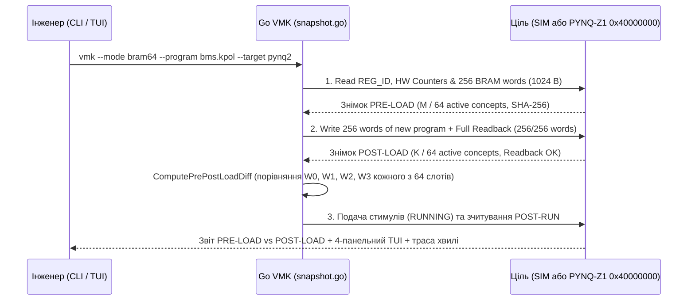

# Посібник користувача VMK (Virtual Machine of Kuzmin) та повноекранного інтерактивного TUI-дебагера (`Engineering/sw/vmk-go`, SemVer `0.3.1`)

* **Версія:** 1.3.0
* **Дата:** 2026-11-19
* **Тип WP:** Guide
* **Статус:** Чинний практичний посібник користувача
* **Issue:** `Closes` [#276](https://github.com/nick-fedchik/kuzmin-machine/issues/276), оновлено в [#278](https://github.com/nick-fedchik/kuzmin-machine/issues/278), [#280](https://github.com/nick-fedchik/kuzmin-machine/issues/280), [#284](https://github.com/nick-fedchik/kuzmin-machine/issues/284) та [#289](https://github.com/nick-fedchik/kuzmin-machine/issues/289); пов'язані задачі [#274](https://github.com/nick-fedchik/kuzmin-machine/issues/274), [#272](https://github.com/nick-fedchik/kuzmin-machine/issues/272), [#270](https://github.com/nick-fedchik/kuzmin-machine/issues/270), [#252](https://github.com/nick-fedchik/kuzmin-machine/issues/252), [#253](https://github.com/nick-fedchik/kuzmin-machine/issues/253), [#186](https://github.com/nick-fedchik/kuzmin-machine/issues/186).
* **Відповідальний:** власник Микола Федчик; укладач — GitHub Copilot CLI (Lead Engineer / Documentation Engineer).
* **Цільовий модуль ПЗ:** [`Engineering/sw/vmk-go/`](../sw/vmk-go/README.md) ([`cmd/vmk/main.go`](../sw/vmk-go/cmd/vmk/main.go), [`internal/vmk/tui_fullscreen.go`](../sw/vmk-go/internal/vmk/tui_fullscreen.go), [`examples/*.ekpol`](../sw/vmk-go/examples/bms_safety_cascade.ekpol), [`examples/*.kpol`](../sw/vmk-go/examples/bms_safety_cascade.kpol), `go 1.22`+, `std` only).
* **Парний підручник з мов програмування:** [`Engineering/guides/kpol-ekpol-language-guide.md`](kpol-ekpol-language-guide.md) (`1.0.2`, [каталог `Engineering/guides/`](README.md)).
* **Нормативна специфікація та звіт верифікації:** [`Engineering/specifications/sw/vmk-go-emulator-and-tui-debugger.md`](../specifications/sw/vmk-go-emulator-and-tui-debugger.md) (`1.3.0`), [`Engineering/specifications/kpol/ekpol-specification.md`](../specifications/kpol/ekpol-specification.md) (`1.0.2`), [`Engineering/validation/kpol-cme/vmk-go-274/report.md`](../validation/kpol-cme/vmk-go-274/report.md) (`1.1.0`), [`Engineering/validation/kpol-cme/ekpol-278/report.md`](../validation/kpol-cme/ekpol-278/report.md) (`1.0.1`).

---

## Призначення

Цей посібник призначений для системних, апаратних (FPGA/RTL) та вбудованих (C99/Go/Python) інженерів, дослідників реактивних обчислень та верифікаторів проєкту **Машини Кузьміна** (`nick-fedchik/kuzmin-machine`). Документ покроково пояснює, як збирати та використовувати виконуваний бінарник **`vmk` (`VMK — Virtual Machine of Kuzmin v0.3.1`)**, розташований у [`Engineering/sw/vmk-go/`](../sw/vmk-go/README.md).

### Що таке VMK і яку задачу він вирішує

На відміну від класичних процесорів фон Неймана, у Машині Кузьміна (автор концепції — **Михайло Ювеналійович Кузьмін**, первинні матеріали в [`Research/sources/`](../../Research/sources/README.md)) **немає глобального лічильника команд (`Program Counter, PC`)** і немає послідовного потоку інструкцій. Одиницею стану, захисту та реакції є **концепт (`Concept`)**, а виконання програми відбувається як поширення **хвилі подій (`Event Cascade Wave`)** за графом підписок між концептами:

$$\text{External Event } (cid_0, \text{param}, \text{valid}) \longrightarrow C_0 \xrightarrow{\text{COMMIT}} C_1 \xrightarrow{\text{COMMIT}} \dots \xrightarrow{\text{COMMIT}} C_k$$

Через відсутність `PC` традиційні дебагери на кшталт `gdb` або `lldb` (побудовані навколо точок зупинки за адресою інструкції та стека викликів) не придатні для діагностики програм МК. Коли каскад зупиняється або видає неочікуваний стан, інженер має бачити:
1. Скільки концептів було завантажено в машину **до** програмування (`PRE-LOAD State`) і як змінилася топологія слотів **після** завантаження (`POST-LOAD State & Diff`);
2. Яку саме з **10 внутрішніх фаз оцінки концепту** не пройшла подія на глибині каскаду `Depth = d`: чи спрацював вхідний предикат припущення `::` (`Predicate`), яке значення-кандидат обчислила дія (`Action`), чи пропустив його пост-умовний вентиль інваріанта Великої Крапки `•` (`Invariant Gate`), чи подія була заблокована через стан невизначеності `_` (`REJECT_FAULT`);
3. Як події проходять крізь стандартні потоки UNIX (`STDIN` $\to$ `STDOUT` для `COMMIT`/`READ` та `STDERR` для `REJECT_*`).

Саме для цього в модулі [`Engineering/sw/vmk-go/`](../sw/vmk-go/go.mod) створено самодостатній двомодовий емулятор і 4-панельний TUI-дебагер `vmk` на мові Go (виключно стандартна бібліотека `std`, без жодної зовнішньої залежності), який поєднує два виконавчі режими:
* **`--mode conceptual`** — навчально-концептуальна віртуальна машина за первинними джерелами та відповідями Автора (`RFC-001..018`: типізовані концепти `?`, `Int32`, `U64`, `Float`, стан невизначеності `_`, 4 види адресації `←`, `→`, `|`, `:`, пост-адресний бар'єр Великої Крапки `•` після читання `→ •`, одноразовий захист від самозбудження `Busy`, колекції `{ ... }` «І», масиви вибору `[ ... ]` «АБО» та `Exit`);
* **`--mode bram64`** — побітово точна 64-слотова модель апаратного конвеєра дескрипторів `CME-RAW-1` (`1024 B`, однобанковий `CFG-P` та двобанковий `CFG-P-HA` з контрольною сумою `CRC-8-CCITT` і вхідною чергою `FIFO 16`), яка підтримує як локальну симуляцію (`--target sim`), так і пряме підключення по SSH/MMIO до фізичної плати ПЛІС **`Digilent PYNQ-Z1`** (`--target pynq1 | pynq2`).

---

## Навігація чи використання

### 2.1. Встановлення, збірка та швидкий старт за 30 секунд

Модуль [`Engineering/sw/vmk-go/`](../sw/vmk-go/go.mod) потребує лише стандартного компілятора Go версії **`go >= 1.22`** (перевірено на `go 1.22` в Ubuntu 24.04 GitHub Actions CI та локальному `go1.27.1 linux/amd64`) і не завантажує жодних пакетів із мережі (`0` директив `require` у `go.mod`).

#### Крок 1. Перевірка компілятора Go та запуск модульних тестів

```bash
cd Engineering/sw/vmk-go
go version
go test -v ./...
```

Очікуваний вивід модульних тестів (`< 0.05 с`):

```text
=== RUN   TestBRAM64PredicatesActionsInvariantsAndUncertainties
--- PASS: TestBRAM64PredicatesActionsInvariantsAndUncertainties (0.00s)
=== RUN   TestBRAM64OverflowFIFO16AndDualBankCRC8
--- PASS: TestBRAM64OverflowFIFO16AndDualBankCRC8 (0.00s)
=== RUN   TestBMSSafetyCascadeAndPrePostLoadDiff
--- PASS: TestBMSSafetyCascadeAndPrePostLoadDiff (0.00s)
=== RUN   TestConceptualModeAllSixExamples
--- PASS: TestConceptualModeAllSixExamples (0.00s)
=== RUN   TestCLIStdioFailOnRejectTUIAndUnreachableTarget
--- PASS: TestCLIStdioFailOnRejectTUIAndUnreachableTarget (0.01s)
=== RUN   TestAllPredicatesActionsSelfSuppressAndExamplesAll
--- PASS: TestAllPredicatesActionsSelfSuppressAndExamplesAll (0.00s)
PASS
ok  	github.com/nick-fedchik/kuzmin-machine/Engineering/sw/vmk-go/internal/vmk	0.017s
```

#### Крок 2. Збірка виконуваного бінарника `vmk` та перевірка версії

> **Примітка щодо робочого дерева:** щоб не залишати невідстежуваний бінарник у робочому дереві Git після роботи, видаляйте зібраний `./vmk` після перевірки або використовуйте `go run ./cmd/vmk`.

```bash
cd Engineering/sw/vmk-go
go build -o vmk ./cmd/vmk
./vmk --version
```

Вивід:

```text
VMK (Virtual Machine of Kuzmin) v0.3.1
```

Для збірки 5 статичних крос-платформних релізних бінарників (`linux/amd64`, `linux/arm64`, `darwin/arm64`, `darwin/amd64`, `windows/amd64.exe` + `dist/SHA256SUMS` із `CGO_ENABLED=0 -tags public`, без лабораторного SSH/MMIO коду) використовується скрипт [`scripts/build_releases.sh`](../sw/vmk-go/scripts/build_releases.sh), а для однокрокового експорту автономного публічного пакета `module vmk` із автоматичним аудитом відсутності приватних даних — [`scripts/export_public_bundle.sh`](../sw/vmk-go/scripts/export_public_bundle.sh):

```bash
cd Engineering/sw/vmk-go
bash scripts/build_releases.sh
```

#### Крок 3. Миттєвий демонстраційний прогін обох режимів

```bash
# Навчально-концептуальний режим: реактивний НСД Евкліда Nod(120, 6) = 6
go run ./cmd/vmk --example nod

# Апаратно-точний 64-слотовий BRAM-режим: 4-рівневий каскад безпеки BMS
go run ./cmd/vmk --example bms
```

---

### 2.2. Два режими роботи VMK (`conceptual` проти `bram64`)

VMK підтримує два взаємодоповнювальні режими виконання, які обираються прапорцем `--mode conceptual` або `--mode bram64` (якщо `--mode` не вказано явно, VMK автоматично обирає `conceptual` для прикладів `if`, `sum`, `nod`, `factorial`, `tachometer` та `bram64` для `bms`, `increase`, `decrease`, `cascade`, `auth` і зовнішніх файлів `--program`).

| Характеристика | `--mode conceptual` ([`internal/vmk/conceptual.go`](../sw/vmk-go/internal/vmk/conceptual.go)) | `--mode bram64` ([`internal/vmk/bram64.go`](../sw/vmk-go/internal/vmk/bram64.go)) |
| :--- | :--- | :--- |
| **Призначення** | Навчально-концептуальна модель та візуалізація авторської семантики МК (`RFC-001..018`) на канонічних прикладах зі статей і презентацій М. Ю. Кузьміна. | Побітово точна емуляція та покрокове трасування 64-слотового апаратного конвеєра дескрипторів `CME-RAW-1` (`CFG-P` / `CFG-P-HA`), сумісна такт-у-такт з RTL `kpol_bram_pipeline_axi.sv` та C99 (`--emit-c99`). |
| **Формат пам'яті концептів** | До 64 типізованих слотів `ConceptualSlot` + 3 вбудовані потокові концепти `STDIN`, `STDOUT`, `STDERR` (`Pre-load: 3 / 64`). | 64 апаратні слоти по 16 байтів (`W0..W3`, little-endian, сумарно `1024 B` BRAM) у двох банках `Bank 0` та `Bank 1`. |
| **Типи даних** | `?` (`Bool`: `!` True, `¬` False, `_` Undefined), `Int32`, `U64`, `Float` (`float64`), `Class`, `Stream`. | Знаковий `Int32` у доповняльному коді (`W0` — поточний стан, `W1` — 32-бітний операнд або пара `int16` меж `[lo, hi]`). |
| **Стан невизначеності `_`** | Повноцінне значення кожного концепту (`Valid = false`, відображається як `_`); підтримує перехід із `_` (наприклад, у `? If _`: `_ -> !`) та відсікання невалідних вхідних даних (`REJECT_FAULT`). | 64-бітна маска визначеності `ValidMask` у VMK + вхідна ознака `param_valid`; при `!param_valid` або невалідному слоті концепту генерує `REJECT_FAULT` і зберігає `W0` незмінним (`KPOL-SYS-02`). |
| **Види адресації** | Усі 4 авторські види адресації: `←` (запис / подія), `→` (читання), `|` (виконання / виклик алгоритму), `:` (ініціалізація / екземпляр). | Подієвий запис `Event(cid, param, valid)` у вхідну чергу `FIFO 16` або безпосередньо в слот `CID 0..63`. |
| **Роль Великої Крапки `•`** | Як інваріантний бар'єр **і** як пост-адресний бар'єр порядку виконання за [`RFC-013`](../../Research/sources/author/rfc-2026-11-12.md): у `→ • Sum = 0` спочатку повертається поточне значення у `STDOUT` (`35`), і строго після цього виконується підписка `Sum = 0`. | Апаратний пост-умовний вентиль інваріанта `EvalInvariantGate`: перевіряє `GuardInvariantEn`, відсутність 32-бітного переповнення (`!ovf32`), невід'ємність кандидата (`cand >= 0`) та поріг `HazardLimit`. |
| **Топологія каскадів і цикли** | Підтримує реактивні цикли з природним згасанням хвилі (`Nod(120, 6) = 6`), рекурсію з масивом вибору `[ 0 1 ] { ... Exit }` (`Factorial(5) = 120`) та одноразовий прапорець `Busy` проти самозациклення (`RFC-001` в `If`). | Суворо ациклічний орієнтований граф підписок (`DAG`, теорема Ляпунова `P1_dag_lyapunov_acyclicity`, максимум 64 кроки на подію) + апаратне придушення самопідписки (`subscriber_cid == cid` $\to$ `SUPPRESSED_SELF`). |
| **Підключення до фізичної ПЛІС** | Локальна симуляція (`Target: SIM (RFC-001..018)`). | Локальна симуляція (`--target sim`) або жива ПЛІС `Digilent PYNQ-Z1` (`--target pynq1 | pynq2`). |

> **Прозора сумісність дескрипторних прикладів із `--mode conceptual`:** якщо запустити дескрипторний приклад (`bms`, `cascade`, `increase`, `decrease`, `auth`) із прапорцем `--mode conceptual` (зокрема у потоковому режимі `--stdio`), VMK автоматично виконає його на дескрипторному ядрі та позначить режим у шапці TUI як `Mode: conceptual (descriptor-backed)`.

---

### 2.3. Життєвий цикл підключення до машини (`PRE-LOAD -> POST-LOAD -> RUNNING`) та інспекція кількості концептів

Коли інженер підключається до машини Кузьміна (фізичної плати `PYNQ-Z1` або симулятора `sim`), критично знати: **чи була машина порожньою до нашого підключення, чи в її BRAM уже працювала попередня програма, і які саме слоти змінилися після запису нового образу**. Для цього модуль [`internal/vmk/snapshot.go`](../sw/vmk-go/internal/vmk/snapshot.go) реалізує трифазний протокол `PRE-LOAD -> POST-LOAD -> RUNNING`:



Розглянемо реальний вивід інспекції підключення на прикладі 4-рівневого каскаду захисту батареї BMS (`go run ./cmd/vmk --example bms` або підключення до фізичної плати `pynq2` з [`raw/pynq2_live_vmk_session.log`](../validation/kpol-cme/vmk-go-274/raw/pynq2_live_vmk_session.log)):

```text
=== MACHINE CONNECTION & PROGRAMMING SNAPSHOT (PYNQ2 | HW_ID=0x4B504D43 'KPMC') ===
  Capacity          : 64 concept slots (1024 B CME-RAW-1 BRAM)
  PRE-LOAD State    : 1 / 64 active concepts (free=63, SHA-256=ef5e343eb743d5e4...) | HW Counters: events=112, commits=78, rejects=34, dropped=0
  POST-LOAD State   : 4 / 64 active concepts (entry=[0], internal=[1 2], leaf=[3], free=60, SHA-256=de03442454424b5c...)
  Readback & Diff   : 256/256 words OK (verified=true); 4 slot(s) modified during programming
+-----+----------------------+---------+-------------+--------------+-------------------------------------------------------------------------------------------------------------------------+------------------------------------------+
| CID | Name                 | Changed | Pre-Load W0 | Post-Load W0 | Pre-Load Rule -> Post-Load Rule                                                                                         | Pre-Sub -> Post-Sub (W3)                 |
+-----+----------------------+---------+-------------+--------------+-------------------------------------------------------------------------------------------------------------------------+------------------------------------------+
| C00 | Cell_Delta_mV        | YES     | 11          | 0            | ::(param < 20) | W0' := W0 + 1 | •(cand>=0 && !ovf) => ::(50 <= param <= 5000) | W0' := W0 + 1 | •(cand>=0 && !ovf) | None (0) => -> C1 (Module_Thermal_Guard) |
| C01 | Module_Thermal_Guard | YES     | _ (empty)   | 0            | EMPTY => ::(!(param < 1) [>= 1]) | W0' := W0 + 1 | •(cand>=0 && !ovf)                                                 | None => -> C2 (Pack_Fault_Latch)         |
| C02 | Pack_Fault_Latch     | YES     | _ (empty)   | 2            | EMPTY => ::(!(param < 1) [>= 1]) | W0' := W0 - 1 | •(cand>=0 && !ovf)                                                 | None => -> C3 (Contactor_Interlock)      |
| C03 | Contactor_Interlock  | YES     | _ (empty)   | 10           | EMPTY => ::(!(param == 2) [!= 2]) | W0' := param | •(cand>=0 && !ovf)                                                 | None => None (0)                         |
+-----+----------------------+---------+-------------+--------------+-------------------------------------------------------------------------------------------------------------------------+------------------------------------------+
```

#### 1. Як читати знімок ДО програмування (`PRE-LOAD State`)
* `Capacity: 64 concept slots (1024 B CME-RAW-1 BRAM)` — загальна апаратна місткість банку дескрипторів конвеєра `CFG-P` (`64` слоти по `16 Б`).
* `PRE-LOAD State: 1 / 64 active concepts (free=63, SHA-256=ef5e343eb743d5e4...)` — до нашого запису в BRAM машини був активний лише **1 концепт із 64** (одноконцептна програма `Increase.kpol` у слоті `C00` з накопиченим станом `Pre-Load W0 = 11`, тоді як слоти `C01..C63` були порожніми `_ (empty)`).
* `HW Counters: events=112, commits=78, rejects=34, dropped=0` — значення апаратних регістрів телеметрії ПЛІС (`0x018..0x028`) на момент підключення.
* **Особливість початкового стану `PRE-LOAD` у локальному симуляторі (`--target sim`):**
  - при запуску `--example bms` симулятор навмисно передініціалізується образом 1-концептної програми `Increase.kpol` (`Pre-load: 1 / 64`, `Pre-Load W0 = 10`), щоб інженер бачив повноцінну картину перезапису існуючого слота `C00` та додавання нових слотів `C01..C03` без потреби у фізичній платі;
  - при запуску інших BRAM-прикладів (`increase`, `decrease`, `cascade`, `auth`) або зовнішнього файлу `--program <file.kpol>` симулятор стартує з чистої нульової BRAM (`Pre-load: 0 / 64`);
  - у чисто концептуальному режимі (`if`, `sum`, `nod`, `factorial`, `tachometer`) до завантаження користувацької програми в машині вже присутні **`3 / 64`** системні потокові концепти (`STDIN`, `STDOUT`, `STDERR`).

#### 2. Як читати знімок ПІСЛЯ внесення програми (`POST-LOAD State & Diff`)
* `POST-LOAD State: 4 / 64 active concepts (entry=[0], internal=[1 2], leaf=[3], free=60, SHA-256=de03442454424b5c...)` — після завантаження `BmsSafetyCascade` активними стали **4 концепти з 64**, а **60 слотів** залишилися вільними (`free=60`). Автоматичний аналізатор топології [`AnalyzeConceptTopology`](../sw/vmk-go/internal/vmk/snapshot.go) класифікував активні концепти за їхньою роллю в каскаді:
  - **`entry=[0]` (вхідні кореневі концепти):** слоти з нульовим вхідним степенем підписок (`inDeg == 0`), які приймають зовнішні події (тут `C00 Cell_Delta_mV`, а також ізольовані концепти без підписок);
  - **`internal=[1 2]` (внутрішні каскадні вузли):** слоти, які мають і вхідну підписку (`inDeg > 0`), і вихідну підписку (`outEdge`, тут `C01 Module_Thermal_Guard` та `C02 Pack_Fault_Latch`);
  - **`leaf=[3]` (вихідні листкові концепти):** термінальні слоти каскаду (`inDeg > 0`, без вихідної підписки, тут `C03 Contactor_Interlock`), на яких хвиля подій завершується.
* `Readback & Diff: 256/256 words OK (verified=true); 4 slot(s) modified during programming` — підтвердження того, що всі 256 32-бітних слів, вичитаних назад із BRAM після програмування, побітово збіглися із записаним образом, а функція `ComputePrePostLoadDiff` перевірила кожне з 4 слів (`W0`, `W1`, `W2`, `W3`) кожного слота і зафіксувала зміну 4 слотів (`Changed = YES`), включно зі зміною правила `Pre-Load Rule -> Post-Load Rule` та адреси підписника `Pre-Sub -> Post-Sub (W3)`.

#### 3. Як читати дескрипторну таблицю концептів (`--dump-concepts`)

Щоб вивести лише розшифровану таблицю 16-байтних дескрипторів `CME-RAW-1` без запуску хвилі подій, виконайте:

```bash
cd Engineering/sw/vmk-go
go run ./cmd/vmk --mode bram64 \
  --program ../../validation/kpol-cme/c99-emitter-270/bms_safety_cascade.kpol \
  --profile KPOL-CME-2 --dump-concepts
```

Вивід Блоку 2 (`BRAM DESCRIPTOR TABLE`):

```text
=== [BLOCK 2] BRAM DESCRIPTOR TABLE (--dump-concepts, 4 active of 64 slots) ===
+-----+----------------------+-----------------+-----------+------------------------+-----------------------------------------------------------------------------+----------------------------------+
| CID | Name                 | W0 (Init State) | Valid (_) | W1 (Operand)           | W2 (Hex & Decoded: Predicate ::, Action, Invariant •)                     | W3 (Subscriber -> CID)           |
+-----+----------------------+-----------------+-----------+------------------------+-----------------------------------------------------------------------------+----------------------------------+
| C00 | Cell_Delta_mV        | 0 (0x00000000)  | 1 (valid) | 327680050 (0x13880032) | 0x01001305 [::(50 <= param <= 5000) | W0' := W0 + 1 | •(cand>=0 && !ovf)] | 1 (-> C1 (Module_Thermal_Guard)) |
| C01 | Module_Thermal_Guard | 0 (0x00000000)  | 1 (valid) | 1 (0x00000001)         | 0x01001B04 [::(!(param < 1) [>= 1]) | W0' := W0 + 1 | •(cand>=0 && !ovf)] | 2 (-> C2 (Pack_Fault_Latch))     |
| C02 | Pack_Fault_Latch     | 2 (0x00000002)  | 1 (valid) | 1 (0x00000001)         | 0x02001B04 [::(!(param < 1) [>= 1]) | W0' := W0 - 1 | •(cand>=0 && !ovf)] | 3 (-> C3 (Contactor_Interlock))  |
| C03 | Contactor_Interlock  | 10 (0x0000000A) | 1 (valid) | 2 (0x00000002)         | 0x00000B01 [::(!(param == 2) [!= 2]) | W0' := param | •(cand>=0 && !ovf)] | 0 (None (0))                     |
+-----+----------------------+-----------------+-----------+------------------------+-----------------------------------------------------------------------------+----------------------------------+
```

Значення колонок дескриптора `CME-RAW-1` (`16 Б = 4 × 32 біти`):
* **`W0 (Init State)`** (`байти 0..3`): початковий 32-бітний знаковий стан концепту в доповняльному коді (наприклад, для `C02 Pack_Fault_Latch` `W0 = 2`, для `C03 Contactor_Interlock` `W0 = 10`).
* **`Valid (_)`**: поточний стан біта визначеності концепту (`1 (valid)` — визначений стан; `_ (invalid)` — концепт перебуває у стані невизначеності `_` за `RFC-005` / `KPOL-SYS-02`).
* **`W1 (Operand)`** (`байти 4..7`): константний операнд правила. Для звичайних предикатів це знакове `int32`, а для діапазонного предиката `PredRANGE (0x05)` у слоті `C00` слово `0x13880032` містить дві упаковані знакові `int16`-межі: молодші 16 біт `0x0032 = 50` (`lo`), старші 16 біт `0x1388 = 5000` (`hi`).
* **`W2 (Hex & Decoded: Predicate ::, Action, Invariant •)`** (`байти 8..11`): упаковане керуюче слово `[action_op:8 | hazard_limit:8 | guard_flags:8 | pred_op:8]` та його людиночитана формула:
  - `pred_op` (`біти 7:0`): `0x00` `NOP` (`true`), `0x01` `EQ` (`==`), `0x02` `NEQ` (`!=`), `0x03` `GT` (`>`), `0x04` `LT` (`<`), `0x05` `RANGE` (`lo <= param <= hi`), `0x06` `BITMASK` (`(param & W1) != 0`), `0x07` `UGT` (`u32(param) > u32(W1)`);
  - `guard_flags` (`біти 15:8`): бітова маска `0x01` (`GuardAssumptionEn` — увімкнено `::`), `0x02` (`GuardInvariantEn` — увімкнено вентиль Великої Крапки `•`), `0x04` (`GuardHazardEn` — перевірка `HazardLimit`), `0x08` (`GuardInvertAssumption` — логічна інверсія `::`, наприклад `!(param < 1)` для `>= 1`), `0x10` (`GuardSubscriberEn` — дозвіл каскадного переходу на підписника, зокрема на `CID 0`);
  - `action_op` (`біти 31:24`): `0x00` `ASSIGN` (`W0' := param`), `0x01` `INC` (`W0 + 1`), `0x02` `DEC` (`W0 - 1`), `0x03` `ADD` (`W0 + W1`), `0x04` `SUB` (`W0 - W1`), `0x05` `NOP` (`W0' := W0`).
* **`W3 (Subscriber -> CID)`** (`байти 12..15`): індекс концепту-підписника (`0..63`), якому передається нове значення `W0'` як вхідний параметр `param` каскадної події у разі успішного `COMMIT`.

---

### 2.4. Повноекранний інтерактивний TUI-дебагер (`--tui`, `--tui-canvas`, `--render-fullscreen-tui`) та детермінований кадр (`--render-tui-frame`)

Починаючи з версії **`VMK v0.3.0` / `v0.3.1`** ([`internal/vmk/tui_fullscreen.go`](../sw/vmk-go/internal/vmk/tui_fullscreen.go), платформні драйвери [`term_linux.go`](../sw/vmk-go/internal/vmk/term_linux.go), [`term_darwin.go`](../sw/vmk-go/internal/vmk/term_darwin.go), [`term_other.go`](../sw/vmk-go/internal/vmk/term_other.go) та [`internal/vmk/tui.go`](../sw/vmk-go/internal/vmk/tui.go)), TUI-дебагер надає три взаємодоповнювальні режими візуалізації та керування:
1. **Повноекранний інтерактивний TUI-дебагер у вікні термінала (`--tui` або `--tui-canvas` / підкоманда `vmk tui`):**
   - При запуску на реальному терміналі (`TTY`) переводить екран у `alternate screen buffer` (`\x1b[?1049h\x1b[?25l`), вмикає `raw mode` клавіатури через крос-платформні термінальні адаптери (`Linux TCGETS/TCSETS`, `macOS TIOCGETA/TIOCSETA` та non-POSIX fallback для `Windows` при `CGO_ENABLED=0`) без жодних зовнішніх бібліотечних залежностей, автоматично визначає розмір вікна `(rows, cols)` через `TIOCGWINSZ` (за замовчуванням `36 × 124`) і гарантовано відновлює термінал при виході (`q`) або сигналах переривання;
   - Підтримує повноцінну навігацію стрілками (`↑`/`↓` або `j`/`k`, `←`/`→`, `PageUp`/`PageDown`, `Tab`) як для апаратно-точного режиму **`bram64`**, так і для концептуального режиму **`conceptual` / `EKPOL`**;
2. **Одноразовий рендер повноекранного багатопанельного TUI-кадру (`--render-fullscreen-tui`):**
   - Виводить у термінал або лог повноцінний псевдографічний (`┌─┬─┐│└─┴─┘`) екран із інспектором вибраного концепту без очікування клавіш у `stdin`;
3. **Детермінований 4-панельний ASCII-кадр (`--render-tui-frame`):**
   - Виводить плоский ASCII-знімок (`+---+---+`) для батч-тестів, CI-логів і `diff`.

#### Команда запуску повноекранного інтерактивного TUI-дебагера

```bash
cd Engineering/sw/vmk-go

# 1. Інтерактивний повноекранний TUI-дебагер у вікні термінала (bram64 або conceptual)
./vmk --tui --program examples/bms_safety_cascade.ekpol
./vmk --tui --program examples/sum_autoreset.ekpol

# 2. Миттєвий перегляд повноекранного багатопанельного полотна без блокування на stdin
./vmk --example bms --render-fullscreen-tui
```

#### Компоновка повноекранного інтерфейсу (`Full-Screen Layout` у `tui_fullscreen.go`)

```text
 VMK v0.3.1 FULL-SCREEN DEBUGGER | Target: SIM (0x4B504D43 'KPMC') | Mode: bram64 (BmsSafetyCascade) | Phase: PRE-LOAD -> POST-LOAD -> INTERACTIVE
 Concepts: Active 4/64 (Pre-load: 1/64, Changed: 4, Free: 60) | Entry:[0] Internal:[1 2] Leaf:[3] | Queue:0 pending | Events:14 | Commits:10 | Rejects:4 | Faults(_):1
┌─ *FOCUS* [1] CONCEPTS (↑/↓ Select, a:All/Act, w:W…┬─ [2] CONCEPT INSPECTOR (d:Toggle View) ──────────────────────────────┐
│ Sel W CID  Name                State (Δ)   Valid …│ Concept ID & Name : C00 (Cell_Delta_mV) | Type: Int32 | Watch: OFF   │
│ >   C00 Cell_Delta_mV      W0=3(+3)    [CHGD]  ->…│ Topology & Role   : ENTRY (@stdin, @stdout) | Bank: 0                │
│     C01 Module_Thermal_Gu… W0=3(+3)    [CHGD]  ->…│ State Evolution   : Pre-Load W0: 10 -> Post-Load W0: 0 -> Current W0…│
│     C02 Pack_Fault_Latch   W0=0(-2)    [CHGD]  ->…│ Validity Bit (_)  : 1 (VALID)                                        │
│     C03 Contactor_Interlo… W0=0(-10)   [CHGD]  No…│ BRAM Words (Hex)  : W0=0x00000003  W1=0x13880032  W2=0x01001305  W3=…│
│                                                   │ Predicate (::)    : 50 <= param <= 5000 (assump_en=true, op=0x05)    │
│                                                   │ Action (=>)       : W0' := W0 + 1 (act_op=0x01, W1_i32=327680050)    │
│                                                   │ Big Dot Gate (•)  : cand >= 0 && !ovf32 (inv_en=true, hazard=0)      │
│                                                   │ Subscription (W3) : -> C1 (Module_Thermal_Guard)                     │
│                                                   │ Last Activity     : Step #11 (E5.0): param=250, valid=1 => COMMIT (W…│
├───────────────────────────────────────────────────┴─ [3] CASCADE WAVE TRACE & PENDING EVENT QUEUE (n/Space: 1-Hop | s: Fu┤
│ Pending Queue (0): (empty — press [e] to create/queue an event, or [n/Space] to pulse selected concept)                  │
│ Step    │Dp│Concept        │Event     │Pre    │Predicate ::    │Candidate │Gate •       │Verdict         │Post   │Next   │
│ E3.0#3  │0 │C00 Cell_Delta…│p=120,v=1 │W0=0,v…│50 <= param <= …│W0' := W0…│cand >= 0 &&…│COMMIT*         │W0=1,v…│->C01  │
│ E3.1#4  │1 │C01 Module_The…│p=1,v=1   │W0=0,v…│!(param < 1) [>…│W0' := W0…│cand >= 0 &&…│COMMIT*         │W0=1,v…│->C02  │
│ E3.2#5  │2 │C02 Pack_Fault…│p=1,v=1   │W0=2,v…│!(param < 1) [>…│W0' := W0…│cand >= 0 &&…│COMMIT*         │W0=1,v…│->C03  │
│ E3.3#6  │3 │C03 Contactor_…│p=1,v=1   │W0=10,…│!(param == 2) […│W0' := pa…│cand >= 0 &&…│COMMIT*         │W0=1,v…│None   │
├─ [4] STDIO STREAMS (STDIN / STDOUT / STDERR) & INTERACTIVE EVENT CREATOR ────────────────────────────────────────────────┤
│ STDIN  (06) : E2: C00(Cell_Delta_mV) <- param=0, valid=_ ; E3: C00(Cell_Delta_mV) <- param=120, valid=1                  │
│ STDOUT (10) -> COMMIT: Module_Thermal_Guard[cid=1] = 3 (pre=2, depth=1, param=3)                                         │
│ STDERR (04) -> REJECT_INVARIANT: Pack_Fault_Latch[cid=2] kept W0=0 (depth=2, param=3, valid=1)                           │
│ STATUS      : Ready. Use Up/Down to select concept, [e] New Event, [n/Space] 1-Hop, [s] Full Step, [d] Inspector/Source/…│
│ KEYS: [↑/↓] Select Concept │ [e/Enter] New Event │ [n/Space] 1-Hop Wave │ [s] Full Step │ [f] Fault(_) │ [m] Modify W0/_…│
└──────────────────────────────────────────────────────────────────────────────────────────────────────────────────────────┘
```

1. **Верхній 2-рядковий інверсний статус-бар:**
   - Відображає версію `VMK v0.3.1 FULL-SCREEN DEBUGGER`, ціль (`SIM` або `PYNQ2`), виконавчий режим і назву модуля, фазу життєвого циклу (`PRE-LOAD -> POST-LOAD -> INTERACTIVE`), баланс концептів (`Active K/64`, `Pre-load M/64`, `Changed Δ`, `Free F`, списки `Entry`, `Internal`, `Leaf`), розмір черги подій `Queue: Q pending` та лічильники `Events`, `Commits`, `Rejects`, `Faults(_)`.
2. **Ліва верхня панель `[1] CONCEPTS` + Права верхня панель `[2] CONCEPT INSPECTOR / SOURCE / PRE-POST DIFF`:**
   - У списку **`[1] CONCEPTS`** курсор `↑`/`↓` (або `j`/`k`) рухається по активних концептах (клавіша `a` перемикає між показом лише активних `K` концептів та всіх `64` слотів BRAM `C00..C63`). Зірочка `*` позначає встановлений `Watchpoint`, `[CHGD]` (зелений) — концепт змінив свій стан відносно `Post-Load`, `[_ FLT]` / `[_ UDF]` (червоний) — концепт перебуває у стані невизначеності `_`;
   - У панелі **`[2] CONCEPT INSPECTOR`** автоматично відкривається детальна картка вибраного курсором концепту:
     * `Concept ID & Name`, `Type` (`Int32`, `Float`, `U64`, `?`) та статус `Watch`;
     * `Topology & Role` (`ENTRY`, `INTERNAL CASCADE`, `LEAF`, прагми `@stdin`, `@stdout`) і номер активного банку `Bank`;
     * `State Evolution`: повний ланцюжок `Pre-Load W0 -> Post-Load W0 -> Current W0 (Δ)`;
     * `Validity Bit (_)`: `1 (VALID)` або `_ (UNDEFINED / FAULT)`;
     * `BRAM Words (Hex)`: шістнадцяткові значення `W0`, `W1`, `W2`, `W3`;
     * `Predicate (::)`, `Action (=>)`, `Big Dot Gate (•)`, `Subscription (W3)` та `Last Activity` (останній крок хвилі, де цей концепт оцінювався);
   - Натискання клавіші **`d`** циклічно перемикає панель `[2]` між карткою **`CONCEPT INSPECTOR`**, пронумерованим вихідним кодом **`SOURCE CODE (.ekpol / .kpol)`** та таблицею **`PRE-LOAD vs POST-LOAD DIFF`**!
3. **Середня панель `[3] CASCADE WAVE TRACE & PENDING EVENT QUEUE`:**
   - Верхній рядок панелі показує живу чергу запланованих подій **`Pending Queue`**, включно з внутрішніми каскадними переходами (`HOP d=1 C01(param=1,valid=1)`), які очікують на виконання під час покрокового мікро-трасування;
   - Нижче розташована 11-колонкова таблиця виконаних кроків хвилі (`Step | Dp | Concept | Event | Pre | Predicate :: | Candidate | Gate • | Verdict | Post | Next`) з кольоровою підсвіткою вердиктів (`COMMIT` — зелений, `REJECT_GUARD` — жовтий, `REJECT_INVARIANT` / `REJECT_FAULT` — червоний) та прокруткою при фокусі `Tab`.
4. **Нижня панель `[4] STDIO STREAMS & INTERACTIVE EVENT CREATOR`:**
   - Показує живі потоки `STDIN`, `STDOUT` (зелений), `STDERR` (червоний), інформаційний рядок `STATUS`, панель гарячих клавіш `KEYS:` та вбудовані інтерактивні діалоги **Конструктора Подій (`[e]`)**, **Редактора Стану Концепту (`[m]`)** і **Довідки (`[?]`)**.

#### Гарячі клавіші повноекранного TUI-дебагера (`VMK v0.3.1`)

| Клавіша | Дія в повноекранному TUI-дебагері (`--tui` / `--tui-canvas`) |
| :--- | :--- |
| **`↑` / `↓`** або **`j` / `k`** | Вибір концепту в панелі `[1] CONCEPTS` (з миттєвим оновленням картки `CONCEPT INSPECTOR` праворуч) або вертикальна прокрутка активної панелі (`[2]`, `[3]`, `[4]`). |
| **`PageUp` / `PageDown`** | Швидкий перехід на 5 позицій угору/вниз у списку концептів або в таблиці траси каскаду. |
| **`Tab`** | Перемикання фокуса між 4 панелями: `[1] CONCEPTS` $\to$ `[2] INSPECTOR / SOURCE / DIFF` $\to$ `[3] CASCADE WAVE TRACE` $\to$ `[4] STDIO & EVENT BAR`. |
| **`e`** або **`Enter`** | Відкрити інтерактивний **Конструктор Подій (`Manual Event Creator Dialog`)** для вибраного концепту: стрілки `←`/`→` змінюють цільовий концепт, `Tab` перемикає операцію (`1:Write/Stimulus(<-)`, `2:Fault/Undef(_)`, `3:Read(->)`, `4:Call(\|)`), з клавіатури вводиться числовий параметр (наприклад, `120`, `-10`, `250`), **`Enter`** виконує подію негайно, а **`+`** **додає подію в чергу `Pending Queue` без негайного виконання**, щоб пройти її покроково! |
| **`n`** або **`Space`** | **Single Micro-Step (`1-Hop Wave`):** виконує **рівно один мікро-крок (хоп) хвилі каскаду**! Наприклад, для каскаду `C00 -> C01 -> C02 -> C03` перше натискання `Space` оцінює лише `C00` і кладе каскадну подію для підписника `C01` на початок видимої черги `Pending Queue`, щоб інженер бачив перестрибування хвилі по одному концепту за раз. |
| **`s`** | **Full Event Step:** виконує наступну подію з черги `Pending Queue` разом із усім її каскадом до повної стабілізації хвилі. |
| **`f`** | **Quick Fault (`_`):** миттєво інжектує подію зі станом невизначеності / збоєм датчика `_` (`param_valid = false`) у вибраний курсором концепт і перевіряє спрацювання `REJECT_FAULT`. |
| **`m`** | **Modify Concept State (`What-If` редактор стану концепту):** відкриває діалог ручної зміни поточного значення `W0` вибраного концепту або перемикання його біта валідності `Valid (1 <-> _)` клавішею `Tab` чи `_` прямо під час сеансу дебагу. |
| **`d`** | Циклічно перемикає праву верхню панель `[2]` між `CONCEPT INSPECTOR`, `SOURCE CODE (.ekpol / .kpol)` та `PRE-LOAD vs POST-LOAD DIFF`. |
| **`a`** | Перемикає список `[1]` між показом лише активних концептів (`K`) та всіх `64` слотів BRAM (`C00..C63`). |
| **`w`** | Встановити або зняти точку спостереження **`Watchpoint (*)`** на вибраному курсором концепті. |
| **`r`** | **Reset to Post-Load:** скинути всі стани концептів `W0`, маску `ValidMask`, лічильники та чергу подій до початкового стану відразу після завантаження програми. |
| **`?`** або **`h`** | Відкрити або закрити модальне вікно повної довідки гарячих клавіш (`Help Overlay`). |
| **`q`** | Чистий вихід із дебагера з автоматичним відновленням екрана термінала. |

#### Детермінований 4-панельний ASCII-кадр (`--render-tui-frame`) для пакетних перевірок

Для автоматизованих скриптів і логів прапорець `--render-tui-frame` зберігає класичний плоский 4-панельний звіт:

```bash
cd Engineering/sw/vmk-go
printf "Cell_Delta_mV 15\nCell_Delta_mV _\nCell_Delta_mV 120\nCell_Delta_mV 180\nCell_Delta_mV 250\n" | \
  go run ./cmd/vmk --mode bram64 \
    --program ../../validation/kpol-cme/c99-emitter-270/bms_safety_cascade.kpol \
    --stdio --watch-cid 2,3 --break-on-reject --render-tui-frame
```

#### Точки спостереження та зупинки (`Watchpoints & Breakpoints`)

* `--watch-cid 0,2,3` — відстежує всі звернення до перелічених слотів `CID` і позначає їх у колонці `Verdict` маркером `*` (`*WATCH_CID(C2:Pack_Fault_Latch)`) та в підсумковому списку `Watchpoints / Breakpoints Triggered`. У повноекранному TUI точка спостереження також миттєво вмикається/вимикається клавішею **`w`** на вибраному концепті.
* `--break-on-reject` — генерує спрацювання точки зупинки `*BREAK_ON_REJECT(<Verdict>)` щоразу, коли будь-який концепт відхиляє подію (`REJECT_GUARD`, `REJECT_INVARIANT` або `REJECT_FAULT`).
* `--stop-on-breakpoint` — негайно зупиняє подальше просування хвилі каскаду на першому ж кроці, де спрацював `Watchpoint` або `Breakpoint` (`HaltedOnBreakpoint = true`).

---

### 2.5. Потокове введення-виведення `STDIO` (`stdin` / `stdout` / `stderr`), прагми `# @stdin` / `# @stdout` та автотестування

Прапорець `--stdio` ([`internal/vmk/stdio.go`](../sw/vmk-go/internal/vmk/stdio.go)) перетворює `vmk` на стандартний UNIX-фільтр, який приймає вхідні події або команди з потоку `stdin` і строго розділяє вихідні потоки:
* **`stdout`** отримує виключно підтверджені переходи станів (`COMMIT: ...`) та операції читання (`READ: ...`);
* **`stderr`** отримує виключно діагностику відмов (`REJECT_GUARD: ...`, `REJECT_INVARIANT: ...`, `REJECT_FAULT: ...`) та помилки CLI/I/O.

#### 1. Формати вхідних рядків `stdin` у режимі `--mode bram64 --stdio`

У режимі `bram64` парсер `ParseStdioInputLine` підтримує 5 зручних форматів (порожні рядки та коментарі `# ...` або `// ...` ігноруються):

| Формат рядка `stdin` | Приклад | Як інтерпретується у `bram64` |
| :--- | :--- | :--- |
| Число (`<param>`) | `120` | Подія у вхідний концепт за замовчуванням (`# @stdin` або перший активний слот) із `param = 120, valid = 1`. |
| Невизначеність (`_`) | `_` або `invalid` / `fault` | Подія у вхідний концепт за замовчуванням із невалідним станом (`param = 0, valid = _`) $\to$ викликає `REJECT_FAULT`. |
| `<Concept> <param>` | `Cell_Delta_mV 180` або `write C0 180` | Подія у вказаний концепт (за назвою, `C0`, `C00`, `cid0` або номером `0`) із параметром `180`. |
| `<CID>:<param>[:<valid>]` | `0:120` або `C0:0:_` | Компактна нотація траси (сумісна з `--trace-events`). |
| Рядок `JSONL` | `{"concept":"Cell_Delta_mV","param":120,"valid":true}` | Машиночитаний JSON-об'єкт для інтеграції з зовнішніми сервісами та тестовими генераторами. |

Приклад запуску через UNIX-пайп із розділенням `stdout` і `stderr`:

```bash
cd Engineering/sw/vmk-go
printf "15\n_\n120\n180\n250\n" | \
  go run ./cmd/vmk --mode bram64 --example bms --stdio --fail-on-reject \
  >stdout_commits.log 2>stderr_rejects.log ; echo "Exit code: $?"
```

Вміст `stdout_commits.log` (лише успішні переходи `COMMIT`):

```text
COMMIT: Cell_Delta_mV[cid=0] = 1 (pre=0, depth=0, param=120, valid=1)
COMMIT: Module_Thermal_Guard[cid=1] = 1 (pre=0, depth=1, param=1, valid=1)
COMMIT: Pack_Fault_Latch[cid=2] = 1 (pre=2, depth=2, param=1, valid=1)
COMMIT: Contactor_Interlock[cid=3] = 1 (pre=10, depth=3, param=1, valid=1)
COMMIT: Cell_Delta_mV[cid=0] = 2 (pre=1, depth=0, param=180, valid=1)
COMMIT: Module_Thermal_Guard[cid=1] = 2 (pre=1, depth=1, param=2, valid=1)
COMMIT: Pack_Fault_Latch[cid=2] = 0 (pre=1, depth=2, param=2, valid=1)
COMMIT: Contactor_Interlock[cid=3] = 0 (pre=1, depth=3, param=0, valid=1)
COMMIT: Cell_Delta_mV[cid=0] = 3 (pre=2, depth=0, param=250, valid=1)
COMMIT: Module_Thermal_Guard[cid=1] = 3 (pre=2, depth=1, param=3, valid=1)
```

Вміст `stderr_rejects.log` (лише заблоковані події `REJECT_*`, код виходу `1` завдяки `--fail-on-reject`):

```text
REJECT_GUARD: Cell_Delta_mV[cid=0] kept W0=0 (depth=0, param=15, valid=1, pred=(50 <= param <= 5000)=>false, cand=1, gate=(cand >= 0 && !ovf32)=>true)
REJECT_FAULT: Cell_Delta_mV[cid=0] kept W0=0 (depth=0, param=0, valid=_, pred=(50 <= param <= 5000)=>false, cand=1, gate=(cand >= 0 && !ovf32)=>false)
REJECT_INVARIANT: Pack_Fault_Latch[cid=2] kept W0=0 (depth=2, param=3, valid=1, pred=(!(param < 1) [>= 1])=>true, cand=-1, gate=(cand >= 0 && !ovf32)=>false)
```

#### 2. Прагми `# @stdin` та `# @stdout` у файлах `.kpol`

У верхніх коментарях файлу `.kpol` можна явно задати вхідний концепт за замовчуванням та відфільтрувати, які саме концепти каскаду мають друкуватися у `stdout` (наприклад, лише термінальний листок каскаду `Contactor_Interlock`):

```text
# @stdin Cell_Delta_mV
# @stdout Contactor_Interlock
```

* Якщо прагма `# @stdin <Concept>` задана, то рядки `stdin`, які містять лише число (`120`) або `_`, автоматично спрямовуються у слот `<Concept>`.
* Якщо прагма `# @stdout <Concept1, Concept2>` задана, у потік `stdout` виводяться повідомлення `COMMIT:` лише для вказаних вихідних концептів (проміжні внутрішні кроки каскаду виконуються, але не засмічують вихідний потік споживача). Якщо `# @stdout` не вказано, у `stdout` виводяться всі активні концепти.

#### 3. Команди `stdin` у концептуальному режимі (`--mode conceptual --stdio`)

У режимі `--mode conceptual --stdio` вхідний потік приймає символьні команди адресації концептів (`write`, `toggle`, `read`, `call`):

```bash
# Приклад 1: Акумулятор Sum із пост-адресним скиданням при читанні (RFC-013) та відсіканням '_'
cd Engineering/sw/vmk-go
printf "write Sum 10\nwrite Sum 25\nwrite Sum _\nread Sum\nread Sum\n" | \
  go run ./cmd/vmk --mode conceptual --example sum --stdio 2>stderr.log
```

Вивід потоку `stdout` (підтверджені записи `COMMIT` та читання `READ`):

```text
COMMIT: Sum[cid=0] = 10 (pre=0, ← += 10)
COMMIT: Sum[cid=0] = 35 (pre=10, ← += 25)
READ: Sum = 35 (post-dot → • reset Sum = 0)
READ: Sum = 0 (post-dot → • reset Sum = 0)
```

Вивід потоку `stderr` (вміст `stderr.log` — відсікання невалідного запису `write Sum _`; якщо не перенаправляти `2>stderr.log`, у терміналі `vmk` спочатку друкує буфер `stdout`, а слідом за ним — `stderr`):

```text
REJECT_FAULT: Sum[cid=0] kept 35 (input valid=_)
```

Зверніть увагу: перша команда `read Sum` повертає накопичену суму `35`, після чого пост-адресний бар'єр Великої Крапки `→ • Sum = 0` скидає акумулятор у `0`, тому друга команда `read Sum` повертає вже `0`.

```bash
# Приклад 2: Перемикання T-тригера If (write If 1 або toggle If)
printf "toggle If\ntoggle If\ntoggle If\n" | \
  go run ./cmd/vmk --mode conceptual --example if --stdio

# Приклад 3: Виклик реактивного НСД Евкліда Nod(120, 6) та рекурсивного Factorial(5)
printf "call Nod 120 6\n" | go run ./cmd/vmk --mode conceptual --example nod --stdio
printf "call Factorial 5\n" | go run ./cmd/vmk --mode conceptual --example factorial --stdio
```

---

### 2.6. Каталог і приклади запуску всіх 10 вбудованих програм (`--example ...`)

У бінарник `vmk` вбудовано **10 еталонних програм** ([`internal/vmk/examples.go`](../sw/vmk-go/internal/vmk/examples.go)): 5 чисто концептуальних прикладів за матеріалами Автора (`if`, `sum`, `nod`, `factorial`, `tachometer`) та 5 дескрипторних прикладів (`bms`, `increase`, `decrease`, `cascade`, `auth`), а також мета-режим `--example all`, який послідовно виконує всі 10 програм.

| Назва (`--example`) | Режим за замовчуванням | Профіль / джерело | Команда запуску | Що саме демонструє та очікуваний результат (`./vmk --example all`) |
| :--- | :---: | :--- | :--- | :--- |
| **`if`** | `conceptual` | `RFC-001` (`? If _`) | `vmk --example if` | T-тригер, що стартує зі стану невизначеності `_`. За 3 імпульси запису (`Events=3, Commits=3`) проходить траєкторію **`_ -> ! -> ¬ -> !`** (фінальний стан `If = !`). Прапорець `Busy` блокує нескінченне самозбудження (`SUPPRESSED_SELF`). |
| **`sum`** | `conceptual` | `RFC-013` (`Float Sum 0`) | `vmk --example sum` | Накопичення `0 + 10 + 25 = 35` (`Events=3, Commits=3`). Під час читання `→ • Sum = 0` спочатку повертає **`35`** у `STDOUT` (`read_returned_value = 35`), а потім пост-адресно скидає стан `Sum` у **`0`** (`post_read_state = 0`). |
| **`nod`** | `conceptual` | Алгоритм Евкліда (`Nod(120, 6)`) | `vmk --example nod` | Реактивна хвиля взаємного віднімання `a -= b` між двома концептами (`a=120, b=6`). У концептуальній віртуальній машині VMK виконує **`19` реактивних кроків віднімання** (`20` кроків оцінки хвилі `E0.0..E19.0`, де на кроці `#19` при `a == b == 6` хвиля природно згасає і фіксує **`Nod = 6`**, фінальні стани слотів `[a=6, b=6, Nod=6]`). Окреме спеціалізоване апаратне RTL-ядро `km_euclid_core.sv` ([`kpol_debugger.py`](../sw/kpol-ref/kpol_debugger.py)) у симуляції `iverilog` виконує цю саму задачу за **`58` тактів** (`19 × 3 + 1`, `result = 6`). |
| **`factorial`** | `conceptual` | Масив вибору `[ 0 1 ]` + `Exit` | `vmk --example factorial` | Рекурсивне обчислення `Factorial(5)` (`Events=9, Commits=9`): 4 кроки спуску (`5 -> 4 -> 3 -> 2 -> 1`), 1 крок спрацювання базового масиву `[ 0 1 ] { Factorial = 1 Exit }` та 4 кроки зворотного множення до **`120`** (фінальні стани слотів `[n=1, Factorial=120]`). |
| **`tachometer`** | `conceptual` | Клас `Tachometer` (`Tick`, `_Tick`) | `vmk --example tachometer` | 3 імпульси колеса `Tick` накопичують `Revolutions = 3`, `Distance = 6`; імпульс таймера `_Tick(dt=1s)` за правилом `→ •` (`Events=7, Commits=7`) обчислює **`Speed = 6`** і скидає `Revolutions = 0` (фінальні стани `[Revolutions=0, Distance=6, Speed=6]`). |
| **`bms`** | `bram64` | `KPOL-CME-2` (`4` концепти) | `vmk --example bms` | 4-рівневий каскад захисту батареї (`Cell_Delta_mV -> Module_Thermal_Guard -> Pack_Fault_Latch -> Contactor_Interlock`). На 6 демо-стимулах (`15, 5500, _, 120, 180, 250`; `Events=14, Commits=10, Rejects=4, Faults(_)=1`) демонструє всі 4 види вердиктів: `REJECT_GUARD`, `REJECT_FAULT`, `COMMIT` по всій глибині `Depth 0..3` (розмикання контактора `10 -> 1 -> 0`) та `REJECT_INVARIANT` при спробі декременту защіпки `0 -> -1` (фінальні стани **`[3, 3, 0, 0]`**; на 9 стимулах стендового HIL-тесту — **`[4, 4, 0, 0]`**). |
| **`increase`** | `bram64` | `KPOL-CME-1` (`1` концепт) | `vmk --example increase` | Базовий одноконцептний лічильник `Counter = 10` з умовою `param < 20`: на стимулах `5, 25, _` (`Events=3, Commits=1, Rejects=2, Faults(_)=1`) демонструє `COMMIT` (`10 -> 11`), `REJECT_GUARD` (`param=25`) та `REJECT_FAULT` (`param=_`), фінальний стан **`[11]`**. |
| **`decrease`** | `bram64` | `KPOL-CME-1` (`1` концепт) | `vmk --example decrease` | Лічильник `Counter = 1` із декрементом `Counter - 1` та інваріантом `Counter >= 0`: на стимулах `5, 5, 25` (`Events=3, Commits=1, Rejects=2, Faults(_)=0`) демонструє `COMMIT` (`1 -> 0`), блокування `0 -> -1` вентилем Великої Крапки `•` (`REJECT_INVARIANT`) та `REJECT_GUARD`, фінальний стан **`[0]`**. |
| **`cascade`** | `bram64` | `KPOL-CME-2` (`4` концепти) | `vmk --example cascade` | Канонічний 4-концептний каскад `C0 -> C1 -> C2 -> C3` на стимулах `10, 100, 10, 10` (`Events=12, Commits=10, Rejects=2, Faults(_)=0`, фінальні стани **`[13, 3, 0, 0]`**). |
| **`auth`** | `bram64` | `KPOL-AUTH` (`Do/Go` + BRAM) | `vmk --example auth` | Компіляція авторського запису `Concept(Counter, 10, ...) / Counter • Assign(Mirror, Counter + 1)` у 5 слів 32-бітного байткоду `Do/Go` (`0x12000000..0x50000000`) та каскад дескрипторів `Counter -> Mirror` на стимулах `-5, 25, _` (`Events=4, Commits=2, Rejects=2, Faults(_)=1`, фінальні стани **`[25, 1]`**). |

Щоб виконати всі 10 прикладів одним запуском і зберегти повний машиночитаний звіт у JSON:

```bash
cd Engineering/sw/vmk-go
go run ./cmd/vmk --example all --json-out vmk_all_examples.json
```

---

### 2.7. Двобанкове гаряче оновлення правил (`CFG-P-HA` у `bram64`) та робота з фізичною платою `PYNQ-Z1` (`--target pynq1 | pynq2`)

#### 1. Двобанкове гаряче оновлення дескрипторів (`Bank 0 / Bank 1` та `CRC-8-CCITT`)

У режимі `bram64` ([`internal/vmk/bram64.go`](../sw/vmk-go/internal/vmk/bram64.go)) реалізовано програмну модель двобанкової пам'яті дескрипторів `CFG-P-HA` за контрактом [B4 v2.4.0](../specifications/hw/kpol-image-loader-pipeline-contract.md):
* Рушій `BRAM64Engine` підтримує два банки по 64 дескриптори (`Bank0` і `Bank1`) та індикатор активного банку `ActiveBank` (відображається в шапці TUI як `Bank=0` або `Bank=1`).
* Метод `HotUpdateShadowSlot(cid, packet16, expectedCRC8, overrideW0)` приймає 16-байтний пакет нового дескриптора, обчислює контрольну суму **`CRC-8-CCITT`** (поліном `0x07`, початкове значення `0x00`) і у разі розбіжності CRC відхиляє пакет за принципом `fail-closed` (`VMK-HA-CRC8`), не змінюючи тіньовий банк.
* При валідному `CRC-8` оновлення записується в неактивний тіньовий банк (`ShadowDescriptors`), виставляється прапорець `SwapPending = true`, а виклик `SwapBanksAtIdleBoundary()` атомарно перемикає активний банк між хвилями подій (на межі `ST_IDLE`), зберігаючи живий накопичений стан `W0` для всіх слотів, де не було замовлено явного перезапису `overrideW0`.

#### 2. Підключення `vmk` до фізичної плати `Digilent PYNQ-Z1` (`--target pynq1 | pynq2`)

Коли в прапорці `--target` (або `--connect`) вказано апаратну ціль `pynq1`, `pynq2` чи явну адресу `user@host`, метод [`ExecutePYNQSession`](../sw/vmk-go/internal/vmk/pynq.go) (разом зі структурою знімків у [`internal/vmk/snapshot.go`](../sw/vmk-go/internal/vmk/snapshot.go)):
1. Автоматично бере ексклюзивне системне блокування **`syscall.Flock` на файлі `/tmp/km-bench.lock`** із таймаутом очікування до `120 с` (відповідно до правила `AGENTS.md §2.3`, щоб унеможливити одночасний доступ кількох агентів або тестів до `/dev/mem` плати). При запуску зовнішніх оболонок або батч-скриптів також можна обгортати команду у `flock -w 120 /tmp/km-bench.lock`;
2. Підключається по SSH до плати, компілює та виконує C99 MMIO-зонд за базовою фізичною адресою **`0x40000000`** (`HW_ID = 0x4B504D43` `"KPMC"` для `CFG-P` або `0x4B504841` `"KPHA"` для `CFG-P-HA`), передаючи `PYNQ_SUDO_PASS` через `stdin` (`sudo -S -p ''`) без підстановки пароля в рядок команди оболонки (або викликаючи `sudo -n`, якщо `PYNQ_SUDO_PASS` не задано);
3. Знімає повний апаратний знімок **`PRE-LOAD`** (`256` слів BRAM + апаратні лічильники `REG_EVENTS`, `REG_COMMITS`, `REG_REJECTS`, `REG_LAST_STATE`, `REG_DROPPED`), записує 256 слів нової програми, виконує зворотну перевірку **`POST-LOAD` (`256/256 words OK`)**, подає валідні стимули через `REG_EVENT_PARAM (0x00C)` та `REG_SW_TRIGGER (0x010)` і зчитує фінальний апаратний знімок **`POST-RUN`**.

Приклад команди для роботи з фізичною платою `pynq2`:

```bash
cd Engineering/sw/vmk-go
printf "Cell_Delta_mV 15\nCell_Delta_mV 5500\nCell_Delta_mV _\nCell_Delta_mV 120\nCell_Delta_mV 49\nCell_Delta_mV 180\nCell_Delta_mV 250\nCell_Delta_mV 5000\nCell_Delta_mV -10\n" | \
  PYNQ_SUDO_PASS='<ваш_пароль_sudo>' \
  flock -w 120 /tmp/km-bench.lock \
  go run ./cmd/vmk --mode bram64 \
    --program ../../validation/kpol-cme/c99-emitter-270/bms_safety_cascade.kpol \
    --profile KPOL-CME-2 --stdio --render-tui-frame --target pynq2
```

#### 3. Змінні оточення та коди виходу процесу `vmk`

| Змінна оточення / Код виходу | Значення за замовчуванням | Призначення |
| :--- | :--- | :--- |
| `KM_PYNQ1_HOST` | `xilinx@192.168.68.81` (локальний стенд) | SSH-адреса першої стендової плати `PYNQ-Z1` при виборі `--target pynq1` (перевизначається змінною оточення). |
| `KM_PYNQ2_HOST` | `xilinx@192.168.68.69` (локальний стенд) | SSH-адреса другої стендової плати `PYNQ-Z1` при виборі `--target pynq2` (перевизначається змінною оточення). |
| `PYNQ_SUDO_PASS` | `<ваш_пароль_sudo>` (за замовчуванням порожній `""` $\to$ `sudo -n`) | Пароль `sudo` користувача на платі `PYNQ-Z1` для доступу C99 MMIO-зонда до `/dev/mem` (передається безпечно через `stdin` у `sudo -S -p ''` без інтерполяції в оболонку). |
| **Код виходу `0`** | Успішне виконання | Програма скомпільована і виконана успішно (навіть якщо були `REJECT_*`, коли прапорець `--fail-on-reject` не вказано). |
| **Код виходу `1`** | Відмова події при `--fail-on-reject` | Увімкнено `--fail-on-reject` (або `--exit-on-reject`) і під час сесії трапився принаймні один `REJECT_GUARD`, `REJECT_INVARIANT` або `REJECT_FAULT`. |
| **Код виходу `2`** | Помилка CLI / компіляції / цілі (`VMK-TARGET-IO`) | Некоректні прапорці CLI, помилка синтаксису `.kpol` або недосяжність апаратної цілі по SSH/MMIO (повертається діагностика `VMK-TARGET-IO: ...` у `stderr`). |

---

### 2.8. Повний довідник прапорців командного рядка (`CLI Reference`)

Виконуваний файл `vmk` підтримує опціональні позиційні підкоманди (`vmk run`, `vmk trace`, `vmk tui`, `vmk version`) та прапорці стандартного пакета `flag` ([`internal/vmk/cli.go`](../sw/vmk-go/internal/vmk/cli.go)):

| Прапорець / підкоманда | Аргумент / тип | Значення за замовчуванням | Опис |
| :--- | :--- | :--- | :--- |
| `--mode` | `bram64 \| conceptual` | Автовибір за `--example` або `bram64` | Вибір виконавчого режиму: апаратно-точний 64-слотовий BRAM (`bram64`) або навчально-концептуальний (`conceptual`). |
| `--example` | `if \| sum \| nod \| factorial \| tachometer \| bms \| increase \| decrease \| cascade \| auth \| all` | `""` | Запуск одного з 10 вбудованих канонічних прикладів або всіх 10 прикладів поспіль (`all`). |
| `--program` | `<шлях до .kpol, .ekpol або .bin>` | `""` | Шлях до вхідного файлу програми `.kpol`, ергономічного файлу `.ekpol` або готового 1024-байтного двійкового образу BRAM `.bin`. |
| `--profile` | `KPOL-CME-1 \| KPOL-CME-2 \| KPOL-AUTH \| EKPOL` | `KPOL-CME-2` (або автовибір `EKPOL` для `.ekpol`) | Профіль вбудованого компілятора KPOL/EKPOL під час компіляції текстового файлу `--program`. |
| `--to-kpol` | Булевий прапорець | `false` | Транслювати вхідну програму `.ekpol` у канонічний класичний `.kpol` (`Problem / Solution / Proof`) і вивести в `stdout`. |
| `--to-ekpol` | Булевий прапорець | `false` | Транслювати класичний файл `.kpol` або вбудований приклад (`increase`, `decrease`, `cascade`, `bms`) у чистий `.ekpol` і вивести в `stdout`. |
| `--ekpol-style` | `symbolic \| keyword` | `symbolic` | Стиль форматування під час генерації `.ekpol` (`symbolic`: `<-`, `~`, `::`, `.`; `keyword`: `on write`, `on change`, `when`, `commit;`). |
| `--target` (аліас `--connect`) | `sim \| pynq1 \| pynq2 \| user@host` | `sim` | Цільова машина: локальний симулятор (`sim`) або фізична плата `PYNQ-Z1` по SSH/MMIO (`pynq1`, `pynq2`, `user@host`). |
| `--trace-events` | `<spec>` (наприклад, `"0:10,0:100,0:_"`) | `""` | Перелік подій через кому або крапку з комою у форматі `<CID_або_Назва>:<param>[:<valid>]` для пакетного трасування. |
| `--dump-concepts` | Булевий прапорець | `false` | Вивести розшифровану таблицю дескрипторів BRAM (`W0`, `Valid(_)`, `W1`, `W2`, `W3`) для активних концептів. |
| `--stdio` | Булевий прапорець | `false` | Читати події/команди з `stdin`, направляти `COMMIT`/`READ` у `stdout`, а всі `REJECT_*` — у `stderr`. |
| `--fail-on-reject` (аліас `--exit-on-reject`) | Булевий прапорець | `false` | Завершувати процес із кодом виходу `1`, якщо під час виконання відбувся хоча б один `REJECT_*` (для CI/CD). |
| `--tui` (або підкоманда `tui`) | Булевий прапорець | `false` | Запустити повноекранний інтерактивний TUI-дебагер у вікні термінала (`alternate screen`, `raw mode` клавіатури, навігація `↑/↓`, `Concept Inspector`, `Event Creator [e]`, `1-Hop [n/Space]`). |
| `--tui-canvas` (або `--tui-Canvas`) | Булевий прапорець | `false` | Запустити повноекранний TUI-дебагер у режимі полотна (`RunFullScreenTUI`), зокрема для автоматизованого покрокового керування через потік клавіш у тестах. |
| `--render-fullscreen-tui` | Булевий прапорець | `false` | Одноразово відрендерити повноекранне багатопанельне псевдографічне (`┌─┬─┐`) полотно TUI з інспектором вибраного концепту без очікування вводу. |
| `--render-tui-frame` | Булевий прапорець | `false` | Примусово вивести детермінований 4-панельний ASCII-кадр TUI у `stdout` без інтерактивного очікування клавіш. |
| `--watch-cid` | `<cids>` (наприклад, `"0,2,3"`) | `""` | Список слотів `CID` через кому, на яких встановлюються точки спостереження (`*WATCH_CID`). |
| `--break-on-reject` | Булевий прапорець | `false` | Встановити точку спрацювання (`*BREAK_ON_REJECT`) на будь-яку відмову охоронця, інваріанта чи невизначеності. |
| `--stop-on-breakpoint` | Булевий прапорець | `false` | Негайно зупиняти виконання хвилі подій при першому спрацюванні `Watchpoint` або `Breakpoint`. |
| `--json-out` | `<шлях до .json>` | `""` | Записати повний структурований звіт сесії (`pre_load`, `post_load`, `load_diffs`, `telemetry`, `steps`, `stdio`, `pynq_hw_report`) у JSON-файл. |
| `--version` (або `-v`, `version`) | Булевий прапорець | `false` | Вивести версію `VMK (Virtual Machine of Kuzmin) v0.3.1` та завершити роботу з кодом `0`. |

---

### 2.9. Ергономічна мова `EKPOL 0.1.0` (`.ekpol`): написання програм у символьній та ключовій нотаціях і двостороння трансляція (`--to-ekpol` / `--to-kpol`)

Починаючи з версії `v0.2.0` ([Issue #278](https://github.com/nick-fedchik/kuzmin-machine/issues/278), [специфікація `ekpol-specification.md`](../specifications/kpol/ekpol-specification.md)), поруч із класичними профілями `KPOL-CME-1`, `KPOL-CME-2` та `KPOL-AUTH` підтримується ергономічна мова **`EKPOL 0.1.0` (`Ergonomic KPOL`, файли `.ekpol`)**. Вона дозволяє описувати концепти в чистому 7-бітному ASCII без спецсимволів клавіатури і без багатослівного дублювання між секціями `Problem / Solution / Proof`, генеруючи **100% побітово ідентичний 1024-байтний образ BRAM (`SHA-256`)**, C99-код (`--emit-c99`) та Z3-сертифікат (`--emit-z3-cert`).

#### 1. Дві взаємозамінні нотації `EKPOL`: символьна (`symbolic`) та ключова (`keyword`)

У кожному концепті `concept <Name>: <Type> = <Init> [>= 0] { ... }` правила реакції можна писати як короткими ASCII-операторами, так і зрозумілими ключовими словами:

```ekpol
// Варіант А: Символьна ASCII-нотація (symbolic)
@stdin
@stdout
concept Cell_Delta_mV: i32 = 0 [>= 0] {
    <- EvCellDelta(delta_mv) :: delta_mv in 50..5000 => Cell_Delta_mV += 1 .
}

@stdout
concept Module_Thermal_Guard: i32 = 0 [>= 0] {
    ~ Cell_Delta_mV :: Cell_Delta_mV >= 1 => Module_Thermal_Guard += 1 .
}
```

```ekpol
// Варіант Б: Ключова програмістська нотація (keyword)
@stdin
@stdout
concept Cell_Delta_mV: int32 = 0 [>= 0] {
    on EvCellDelta(delta_mv) when delta_mv in 50..5000 => Cell_Delta_mV += 1 commit;
}

@stdout
concept Module_Thermal_Guard: int32 = 0 [>= 0] {
    on change(Cell_Delta_mV) when Cell_Delta_mV >= 1 => Module_Thermal_Guard += 1 commit;
}
```

#### 2. Каталог готових прикладів `Engineering/sw/vmk-go/examples/*.ekpol` та команди запуску

У каталозі [`Engineering/sw/vmk-go/examples/`](../sw/vmk-go/examples/bms_safety_cascade.ekpol) розміщено 9 канонічних програм на `EKPOL` та 4 парні класичні відповідники на `.kpol`:
* BRAM-програми (`--mode bram64`, парні `.ekpol` + `.kpol`): [`bms_safety_cascade.ekpol`](../sw/vmk-go/examples/bms_safety_cascade.ekpol) ([`.kpol`](../sw/vmk-go/examples/bms_safety_cascade.kpol)), [`cascade_4concept.ekpol`](../sw/vmk-go/examples/cascade_4concept.ekpol) ([`.kpol`](../sw/vmk-go/examples/cascade_4concept.kpol)), [`increase.ekpol`](../sw/vmk-go/examples/increase.ekpol) ([`.kpol`](../sw/vmk-go/examples/increase.kpol)), [`decrease.ekpol`](../sw/vmk-go/examples/decrease.ekpol) ([`.kpol`](../sw/vmk-go/examples/decrease.kpol));
* Концептуальні програми (`--mode conceptual`): [`if_toggle.ekpol`](../sw/vmk-go/examples/if_toggle.ekpol), [`sum_autoreset.ekpol`](../sw/vmk-go/examples/sum_autoreset.ekpol), [`nod_euclid.ekpol`](../sw/vmk-go/examples/nod_euclid.ekpol), [`factorial.ekpol`](../sw/vmk-go/examples/factorial.ekpol), [`tachometer.ekpol`](../sw/vmk-go/examples/tachometer.ekpol).

Приклади запуску та двосторонньої трансляції:

```bash
cd Engineering/sw/vmk-go

# 1. Прямий запуск .ekpol (автоматично визначає режим bram64 або conceptual)
go run ./cmd/vmk --program examples/bms_safety_cascade.ekpol --trace-events "0:15,0:120,0:180" --render-tui-frame
go run ./cmd/vmk --program examples/sum_autoreset.ekpol

# 2. Трансляція класичного .kpol або вбудованого прикладу в .ekpol (символьний або ключовий стиль)
go run ./cmd/vmk --example bms --to-ekpol --ekpol-style symbolic
go run ./cmd/vmk --example bms --to-ekpol --ekpol-style keyword

# 3. Зворотна трансляція .ekpol у класичний .kpol (Problem / Solution / Proof)
go run ./cmd/vmk --program examples/bms_safety_cascade.ekpol --to-kpol

# 4. Компіляція .ekpol у 1024-Б образ BRAM, C99-модуль і Z3-сертифікат компілятором kpolc (Go)
go build -C ../kpol-go -o kpolc ./cmd/kpolc
../kpol-go/kpolc build examples/bms_safety_cascade.ekpol bms.bin \
  --emit-c99 bms_safety.c --emit-z3-cert bms_z3.json --dump-concepts
rm -f bms.bin bms_safety.c bms_z3.json
```

---

## Обмеження

1. **Атрибуція та розмежування з первинними авторськими джерелами (`AGENTS.md §6.1`):**
   * Автор концепції Машини Кузьміна — **Михайло Ювеналійович Кузьмін** (первинні матеріали у [`Research/sources/`](../../Research/sources/README.md)). Програмний модуль [`Engineering/sw/vmk-go/`](../sw/vmk-go/go.mod), специфікація [`vmk-go-emulator-and-tui-debugger.md`](../specifications/sw/vmk-go-emulator-and-tui-debugger.md) та цей посібник є похідними інженерними напрацюваннями проєкту (М. Федчик, інженерні агенти) і не приписуються Автору концепції.
2. **Межа між концептуальним режимом (`--mode conceptual`) та апаратним конвеєром `CME-RAW-1` (`--mode bram64`):**
   * Апаратний конвеєр `CFG-P` (`kpol_bram_pipeline_axi.sv`) та його двобанкова версія `CFG-P-HA` (`kpol_bram_pipeline_axi_ha.sv`) оперують 16-байтними дескрипторами `CME-RAW-1` над 32-бітними цілими `Int32` та вимагають ациклічності графа підписок (`DAG`).
   * Рекурсивні й циклічні конструкції (`Nod(120, 6)`, `Factorial(5)`), тип `Float64`, пост-адресне скидання після читання (`→ • Sum = 0`) та клас `Tachometer` виконуються у концептуальній віртуальній машині `--mode conceptual` і не транслюються в 16-байтний слот `CME-RAW-1`.
   * Наявність `--mode conceptual` не закриває 12 відкритих питань авторської граматики `KPOL-AUTH-U01..U12` (`RFC-009, 015–018`), які залишаються заблокованими за принципом `fail-closed` у [#186](https://github.com/nick-fedchik/kuzmin-machine/issues/186).
3. **Особливості роботи з фізичною платою `PYNQ-Z1` (`--target pynq1 | pynq2`):**
   * Усі звернення до фізичних плат виконуються виключно під міжпроцесним блокуванням `/tmp/km-bench.lock` (`AGENTS.md §2.3`).
   * Оскільки регістр `REG_EVENT_PARAM (0x00C)` у поточному RTL `CFG-P` (`CME-RAW-1`) приймає 32-бітне слово без окремого апаратного біта `state_valid` (який спроєктовано для 32-байтного дескриптора `CME-RAW-2` в [`ADR B7`](../decisions/cme-raw2-kpol-sys02.md)), події зі станом невизначеності `_` (`param_valid = false`) під час сесії `--target pynq2` відсікаються шлюзом визначеності `BRAM64Engine` (`REJECT_FAULT`), а валідні 32-бітні події виконуються безпосередньо в ПЛІС `Zynq-7020`.
4. **Позиція щодо стандартів (`Project/policies/standards-position.md`):**
   * Орієнтація на процеси ASPICE 4.0 у документації та трасуванні є внутрішнім інженерним орієнтиром проєкту; жодна сертифікація чи відповідність стандартам функціональної безпеки (ISO 26262, IEC 61508 тощо) не заявляється.

---

## Історія версій

| Версія | Дата | Зміни |
| :--- | :--- | :--- |
| 1.3.0 | 2026-11-19 | #289: консолідовано крос-платформний пакет `VMK v0.3.1` у канонічний модуль `Engineering/sw/vmk-go/` (`term_{linux,darwin,other}.go`, build-тег ізоляції `pynq.go` / `pynq_public.go`, 4 класичні приклади `examples/*.kpol`, скрипти `scripts/build_releases.sh` та `scripts/export_public_bundle.sh`). |
| 1.2.1 | 2026-11-18 | #284: додано перехресну навігацію на парне «Керівництво користувача та чистий код мов KPOL і EKPOL» (`kpol-ekpol-language-guide.md` `1.0.2`) та індекс каталогу `Engineering/guides/README.md`. |
| 1.2.0 | 2026-11-18 | #280: оновлено під `VMK v0.3.0` та повноекранний інтерактивний TUI-дебагер (`internal/vmk/tui_fullscreen.go`, `--tui`, `--tui-canvas`, `--render-fullscreen-tui`), описано навігацію по концептах (`↑/↓`, `Tab`), картку `CONCEPT INSPECTOR`, діалог ручного створення подій (`[e]` та `+` у чергу), покроковий мікро-хоп хвилі (`[n]` / `Space`), ручне редагування стану концепту (`[m]`) та перемикання `Inspector / Source / Pre-Post Diff` (`[d]`). |
| 1.1.0 | 2026-11-18 | #278: оновлено під `VMK v0.2.0` та мову `EKPOL 0.1.0` (додано §2.9 про символьну та ключову нотації `.ekpol`, каталог `examples/*.ekpol` і прапорці двосторонньої трансляції `--to-kpol`, `--to-ekpol`, `--ekpol-style symbolic\|keyword`). |
| 1.0.1 | 2026-11-18 | Ураховано всі 5 зауважень незалежної рецензії `claude-sonnet-5.5` у PR #277 (`F1..F5`): виправлено відносні шляхи `../../validation/...` у командах запуску з `Engineering/sw/vmk-go` (`F1`); винесено PYNQ-драйвер у `internal/vmk/pynq.go` з безпечною передачею `PYNQ_SUDO_PASS` через `stdin` (`sudo -S -p ''`) або `sudo -n` без інтерполяції в оболонку та замінено пароль на плейсхолдер `<ваш_пароль_sudo>` (`F2, F4`); показано роздільний вивід потоків `stdout` і `stderr` у прикладі `sum --stdio` (`F3`); уточнено атрибуцію `19` реактивних віднімань у VMK проти `58` тактів спеціалізованого RTL-ядра `km_euclid_core.sv` у симуляції `iverilog` і звірено всі фінальні стани таблиці §2.6 із `vmk --example all` (`F5`). |
| 1.0.0 | 2026-11-18 | Перша редакція практичного Посібника користувача VMK (`Virtual Machine of Kuzmin v0.1.0`) та 4-панельного TUI-дебагера на Go (`Engineering/sw/vmk-go/`) за Issue #276. |

## Абревіатури та глосарій

| Термін | Значення |
| :--- | :--- |
| **VMK** | Virtual Machine of Kuzmin — двомодовий емулятор, потоковий фільтр `STDIO` та 4-панельний TUI-дебагер Машини Кузьміна на мові Go (`Engineering/sw/vmk-go/`). |
| **Концепт (`Concept`)** | Базова комірка стану, припущення `::`, дії, інваріанта Великої Крапки `•` та підписки в Машині Кузьміна (`CID 0..63` у `bram64`). |
| **Велика Крапка (`•` / Big Dot)** | Пост-умовний бар'єр інваріанта та порядку виконання: у `bram64` — вентиль `EvalInvariantGate` (`cand >= 0 && !ovf32`), який блокує порушення інваріанта до зміни стану `W0`; у `conceptual` (`RFC-013`) — також пост-адресний бар'єр після читання `→ •`. |
| **Стан невизначеності (`_`)** | Явно виділений стан відсутності валідного значення концепту або пошкодження вхідного сигналу датчика (`Valid = false`, `RFC-005` / `KPOL-SYS-02`). |
| **`CME-RAW-1`** | 16-байтний (`W0..W3`, little-endian) двійковий формат дескриптора концепту в 64-слотовій BRAM (`1024 B`). |
| **`CFG-P` / `CFG-P-HA`** | Однобанкова (`1 × RAMB36E1`, `HW_ID = 0x4B504D43`) та двобанкова (`2 × RAMB36E1`, беззупинне гаряче оновлення правил із `CRC-8`, `HW_ID = 0x4B504841`) конфігурації апаратного BRAM-конвеєра МК. |
| **`PRE-LOAD` / `POST-LOAD`** | Фази інспекції стану машини: знімок 64 слотів BRAM і апаратних лічильників **до** запису нової програми (`PRE-LOAD`) та верифікований знімок і послотна таблиця змін **після** програмування (`POST-LOAD`). |
| **`TUI`** | Text-based User Interface — 4-панельний текстовий інтерфейс покрокового налагодження каскадів подій (`--tui`, `--render-tui-frame`). |
| **`STDIO`** | Потоковий режим роботи через стандартні потоки UNIX (`stdin` — вхідні події/команди, `stdout` — `COMMIT`/`READ`, `stderr` — `REJECT_*`). |
| **`HIL`** | Hardware-in-the-Loop — верифікація за участю фізичної плати ПЛІС `Digilent PYNQ-Z1` (`Zynq-7020`). |
