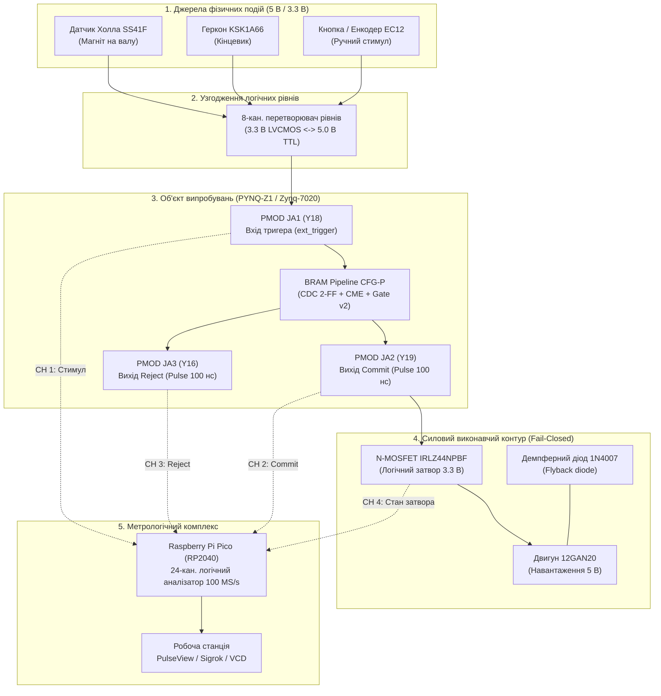

# Посібник і схема монтажу: Лабораторний стенд HIL на PYNQ-Z1

* **Версія:** 1.0.1
* **Дата:** 2026-11-12
* **Тип Work Product:** `Guide` / `Design` (підтип `Hardware Detailed Design & Wiring Schematics`, ASPICE 4.0 `HWE.2`)
* **Статус:** Нормативно узгоджено (Approved Baseline)
* **ASPICE 4.0 процеси:** `HWE.1` (Hardware Requirements), `HWE.2` (Hardware Design), `HWE.3` (Hardware Verification), `HWE.4` (Hardware Integration)
* **Пов'язані документи:** [`Engineering/hw/boards/bench-procurement.md`](https://github.com/nick-fedchik/kuzmin-machine/blob/707fdba697d92ef9874c9013eb6f4f3cb2796d70/hw/boards/bench-procurement.md), [`Engineering/hw/boards/radiomag-order-a4.md`](https://github.com/nick-fedchik/kuzmin-machine/blob/707fdba697d92ef9874c9013eb6f4f3cb2796d70/hw/boards/radiomag-order-a4.md), [`Engineering/design/bram-pipeline-event-integration.md`](../../../design/bram-pipeline-event-integration.md)

---


* **Тип WP редакції NG:** Guide
* **Укладач редакції NG:** GitHub Copilot CLI, Auto; конкретна модель не атестована.
* **Підстава редакції NG:** команда власника від 2026-11-12; локальне перенесення без legacy.
* **Походження:** [оригінал 1.0.0](https://github.com/nick-fedchik/kuzmin-machine/blob/707fdba697d92ef9874c9013eb6f4f3cb2796d70/hw/boards/pynq-z1/hil-bench-wiring-guide.md), `707fdba697d92ef9874c9013eb6f4f3cb2796d70`.
* **Стан редакції NG:** адаптовано до нової структури; незалежна рецензія не проведена.

> **Межі редакції NG.** Перенесення й оформлення не є новим експериментом,
> повторною науковою перевіркою або затвердженням baseline. Авторство,
> рішення, числа й рецензії нижче стосуються зазначених оригінальних
> об'єктів та версій, а не автоматично цієї локальної копії.

## 1. Призначення і межі

### 1.1. Призначення посібника
Цей посібник визначає повну принципову схему з'єднань, попінову комутацію, схемотехніку захисних ланцюгів та порядок безпечного фізичного монтажу лабораторного стенда Hardware-in-the-Loop (HIL) для Машини Кузьміна (КМ).

Стенд призначений для прямого фізичного вимірювання характеристик детермінізму, реакції конвеєра на зовнішній стимул та fail-closed захисту інваріантів за ланцюгом:
$$\text{Фізичний стимул (Холл/Геркон/Кнопка)} \xrightarrow{\text{Level Shifter}} \text{PYNQ-Z1 (PL BRAM-конвеєр)} \xrightarrow{\text{80 нс}} \text{PMOD JA (Commit/Reject)} \xrightarrow{\text{MOSFET / Двигун}} \text{Pico Logic Analyzer (VCD)}$$

### 1.2. Межі застосування
* **Охоплює:** Комутацію між платою PYNQ-Z1, вимірювальним логічним аналізатором Raspberry Pi Pico, безпайковою макетною платою BB-102 (830 точок), 8-канальним перетворювачем рівнів 3,3 В $\leftrightarrow$ 5 В, комутаційним N-MOSFET `IRLZ44NPBF`, мікромотором `12GAN20` (N20), цифровим датчиком Холла `SS41F`, герконом `KSK1A66-1020` та джерелами живлення.
* **Не охоплює:** Внутрішній RTL-код (специфіковано в [`Engineering/design/bram-pipeline-event-integration.md`](../../../design/bram-pipeline-event-integration.md) та [`Engineering/specifications/hw/event-queue-ingress-specification.md`](../../../specifications/hw/event-queue-ingress-specification.md)).
* **Критична норма безпеки:** Логічні піни FPGA Zynq-7020 на роз'ємах PMOD та Arduino Shield працюють суворо за стандартом **3,3 В LVCMOS**. Подача напруги $> 3,6\text{ В}$ безпосередньо на кристал призводить до незворотного виходу з ладу I/O банків ПЛІС.

---

## 2. Склад і принципова електрична схема стенда

### 2.1. Загальна блок-схема взаємодії вузлів стенда



---

### 2.2. Розпіновка інтерфейсу PMOD JA (PYNQ-Z1)

Роз'єм PMOD JA на платі PYNQ-Z1 є основним портом зв'язку між конвеєром PL та зовнішнім світом:

| Пін роз'єму | Пін FPGA Zynq | Сигнал у конвеєрі `CFG-P` | Напрямок | Електричний стандарт | Призначення на стенді |
| :---: | :---: | :--- | :---: | :---: | :--- |
| **JA1** | `Y18` | `ext_hw_trigger_i` | Вхід | 3,3 В LVCMOS | Вхід фізичного стимулу (після 2-FF CDC синхронізатора) |
| **JA2** | `Y19` | `hw_commit_pulse_o` | Вихід | 3,3 В LVCMOS | Імпульс валідної транзакції (100 нс pulse stretcher $\to$ затвор MOSFET) |
| **JA3** | `Y16` | `hw_reject_pulse_o` | Вихід | 3,3 В LVCMOS | Імпульс порушення інваріанта / аварії (100 нс pulse stretcher $\to$ індикатор) |
| **JA4** | `Y17` | `hw_pipeline_busy_o` | Вихід | 3,3 В LVCMOS | Сигнал зайнятості конвеєра (Busy status monitor) |
| **JA5 / JA11** | `GND` | `GND` | Живлення | 0 В | Спільна земля стенда (**Star GND**) |
| **JA6 / JA12** | `VCC3V3`| `VCC3V3` | Живлення | +3,3 В (до 100 мА) | Опорна напруга низької сторони Level Shifter (LV) |

---

### 2.3. Схемотехніка вузлів на макетній платі BB-102

#### 2.3.1. Вхідний вузол датчика Холла `SS41F`
Датчик Холла `SS41F` має вихід типу «відкритий колектор» (Open-Collector) і живиться від напруги 5,0 В:
* **Пін 1 (VCC):** Підключається до шини `+5V_AUX` (мережа XOKO).
* **Пін 2 (GND):** Підключається до шини `GND_STAR`.
* **Пін 3 (OUT):** Підключається до входу високої сторони `HV1` перетворювача рівнів.
* **Підтягуючий резистор:** Резистор $R_1 = 4{,}7\text{ кОм}$ (із набору KRONS) встановлюється між піном 3 (OUT) та шиною `+5V_AUX`.
* *Робота:* При піднесенні південного полюса магніту вихід замикається на землю ($0\text{ В}$), при віддаленні — підтягується до $+5\text{ В}$. Перетворювач рівнів транслює цей сигнал на рівень $0\text{ В} \leftrightarrow 3{,}3\text{ В}$ на контакт PMOD JA1.

#### 2.3.2. Силовий комутаційний вузол Fail-Closed на MOSFET `IRLZ44NPBF`
Транзистор `IRLZ44NPBF` є логічним польовим транзистором (Logic-Level N-MOSFET), повне відкриття каналу якого відбувається при напрузі на затворі $V_{GS} \ge 3{,}0\text{ В}$:
* **Затвор (Gate, пін 1):**
  * Послідовний резистор захисту від дзвону затвора: $R_g = 100\text{ Ом}$ між виходом PMOD JA2 (Commit) та затвором.
  * Резистор безпечної підтяжки (Pull-down): $R_{pd} = 100\text{ кОм}$ між затвором та `GND_STAR`. Забезпечує гарантований знеструмлений стан двигуна при старті FPGA або обриві дроту.
* **Стік (Drain, пін 2):** Підключається до мінусового виводу двигуна `12GAN20`.
* **Витік (Source, пін 3):** Підключається безпосередньо до шини `GND_STAR`.
* **Захисний демпферний діод (Flyback Diode):**
  * Діод `1N4007` або діод Шотткі (із комплекту розхідників) встановлюється **паралельно контактам двигуна**:
    * **Катод (смуга):** до шини `+5V_MOTOR`.
    * **Анод:** до стоку (Drain) польового транзистора.
  * *Призначення:* Гасіння ЕРС самоіндукції обмотки двигуна ($V = -L \frac{di}{dt}$ до $50\text{ В}$ при раптовому вимиканні), що запобігає лавинному пробою транзистора та перешкодам на лінії живлення FPGA.

#### 2.3.3. Підключення вимірювача Raspberry Pi Pico (RP2040)
Raspberry Pi Pico живиться від окремого USB-кабелю, підключеного до ПК або хаба. Його входи GPIO (3,3 В толерантні) використовуються для логічного аналізу:

| GPIO Pico | Фізичний сигнал стенда | Призначення каналу у VCD-трасі |
| :---: | :--- | :--- |
| **GP0** | Вихід датчика Холла (після Level Shifter, 3,3 В) | Канал 0: Момент фізичного спрацьовування датчика (External Stimulus) |
| **GP1** | PYNQ-Z1 PMOD JA1 (`ext_hw_trigger_i`) | Канал 1: Вхід тригера на вході в кристал FPGA |
| **GP2** | PYNQ-Z1 PMOD JA2 (`hw_commit_pulse_o`) | Канал 2: Строб підтвердження правила Commit ($80\text{ нс} + 100\text{ нс}$ pulse) |
| **GP3** | PYNQ-Z1 PMOD JA3 (`hw_reject_pulse_o`) | Канал 3: Строб аварійного відхилення Reject (порушення інваріанта) |
| **GP4** | Напруга на затворі MOSFET (Gate) | Канал 4: Фізичний фронт відкриття/закриття силового ключа |
| **GP5** | PYNQ-Z1 PMOD JA4 (`hw_pipeline_busy_o`) | Канал 5: Монітор циклу виконання конвеєра BRAM |
| **GND (Pin 38)**| Шина `GND_STAR` | Опорний нуль логічного аналізатора |

---

## 3. Заземлення (Star GND) та електробезпека

### 3.1. Топологія заземлення «Зірка» (Star Grounding)
При одночасному керуванні індуктивним навантаженням (мотор $12\text{GAN20}$) та реєстрації сигналів наносекундного діапазону ($10\text{ нс}$) петлі заземлення (Ground Loops) створюють паразитні наведення до $1\text{ В}$.

**Обов'язкове правило:**
Всі нульові провідники з'єднуються в **одній фізичній точці** на спільній шині мінус макетної плати BB-102:
1. `GND` від роз'єму PMOD JA (PYNQ-Z1).
2. `GND` низької сторони Level Shifter.
3. `GND` високої сторони Level Shifter.
4. `GND` від Raspberry Pi Pico (Pin 38).
5. Витік (Source) силового транзистора `IRLZ44NPBF`.
6. Мінусовий дріт зовнішнього джерела живлення 5 В (мережевий фільтр `XOKO`).

```
    PYNQ-Z1 PMOD GND ─────────┐
    Pico Pin 38 (GND) ────────┼───> [ СПІЛЬНА ТОЧКА STAR GND ] <─── XOKO 5V Power Supply (-)
    Level Shifter GND ────────┤               │
    IRLZ44N Source ───────────┘               v
                                   Шина GND на макетці BB-102
```

### 3.2. Розподіл ліній живлення
* **Шина 3,3 В (Логіка):** Береться виключно з пінів 6/12 роз'єму PMOD JA плати PYNQ-Z1 (забезпечує живлення низької сторони LV Level Shifter, струм споживання $< 10\text{ мА}$).
* **Шина 5,0 В (Силова та датчики):** Подається від зовнішнього фільтра `XOKO SP-4-2-1` через кабель `USB-A → крокодили`. **Категорично заборонено** живити мотор від 5 В виходу PYNQ-Z1 або портів ПК!

---

## 4. Стан і методика перевірки перед першим увімкненням

Перед подачею напруги та підключенням шлейфів до PYNQ-Z1 оператор стенда зобов'язаний виконати регламент холодного вхідного контролю за допомогою мультиметра `UNI-T UT136B+`:

1. **Тест на відсутність короткого замикання (КЗ):**
   - Перевести мультиметр у режим звукового прозвонювання.
   - Виміряти опір між шиною `+3.3V` та `GND_STAR` (має бути $> 1\text{ кОм}$).
   - Виміряти опір між шиною `+5V_AUX` та `GND_STAR` (має бути $> 500\text{ Ом}$).
2. **Перевірка напруг живлення без підключення FPGA:**
   - Подати живлення 5 В від фільтра `XOKO`.
   - Виміряти постійну напругу на шині `+5V_AUX` (має бути $5{,}0\text{ В} \pm 0{,}25\text{ В}$).
   - Перевірити напругу на виході датчика Холла при піднесенні магніту (має перемикатися між $0{,}1\text{ В}$ та $5{,}0\text{ В}$).
3. **Перевірка перетворювача рівнів:**
   - Подати на вхід високої сторони $5{,}0\text{ В}$ $\to$ виміряти напругу на низькій стороні (має бути суворо $\le 3{,}3\text{ В}$).
4. **Підключення шлейфів PMOD JA:**
   - Лише після підтвердження безпечних напруг ($\le 3{,}3\text{ В}$) вимкнути живлення, підключити 6-піновий шлейф до PMOD JA плати PYNQ-Z1 та повторно перевірити загальну масу.

---

## 5. Зв'язок із вимогами проєкту (Traceability Matrix)

| Елемент схеми стенда | Реалізована вимога | Метод верифікації | Критерій успіху |
| :--- | :--- | :--- | :--- |
| **PMOD JA1 $\to$ 2-FF CDC** | `REQ-HW-011` (CDC Metastability Hardening) | Осцилограф / Pico VCD | Відсутність збоїв метастабільності при подачі асинхронного імпульсу. |
| **PMOD JA2 / Pulse Stretcher** | `REQ-HW-012` (Deterministic Execution Cycle) | Логічний аналізатор Pico | Затримка між фронтом JA1 та фронтом JA2 становить строго 8 тактів ($80\text{ нс}$). |
| **IRLZ44N + Flyback Diode** | `REQ-SYS-012` (Fail-Closed Hazard Mitigation) | Фізичне навантаження (мотор) | При подачі невалідного параметра `Pulse(25)` сигнал Commit пригнічується, мотор знеструмлений. |
| **Star GND + Level Shifter** | Захист цілісності обладнання (Safety) | Мультиметр `UT136B+` | Напруга на всіх лініях PMOD $\le 3{,}3\text{ В}$ за будь-яких режимів комутації. |

---

## Історія версій

| Версія | Дата | Автор | Зміни |
| :--- | :--- | :--- | :--- |
| 1.0.1 | 2026-11-12 | Редакція NG: структура, навігація та оформлення WP; нових результатів не заявлено. |
| 1.0.0 | 2026-11-12 | Antigravity (agy) | Первинна нормативна редакція посібника з монтажу та електричної схеми стенда HIL (ASPICE HWE.2). |

## Абревіатури та глосарій

| Термін | Значення |
| :--- | :--- |
| **HIL** | Hardware-in-the-Loop, випробування з фізичним обладнанням у контурі |
| **PMOD** | Peripheral Module, стандарт 12-пінових інтерфейсних роз'ємів Digilent |
| **Star GND** | Топологія заземлення «Зірка», зведення всіх земляних провідників в одну точку |
| **Flyback Diode** | Зворотний захисний діод для гасіння ЕРС самоіндукції індуктивних навантажень |
| **Level Shifter** | Двонапрямний активний транслятор логічних рівнів 3,3 В $\leftrightarrow$ 5,0 В |
| **VCD** | Value Change Dump, стандартний формат файлів осцилограм логічних аналізаторів |
