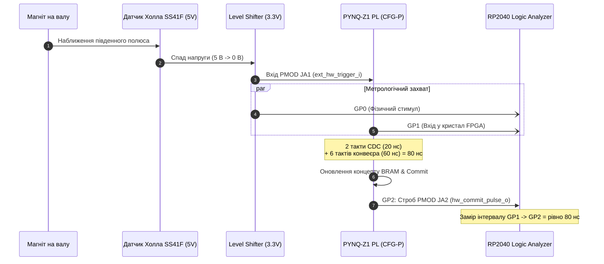
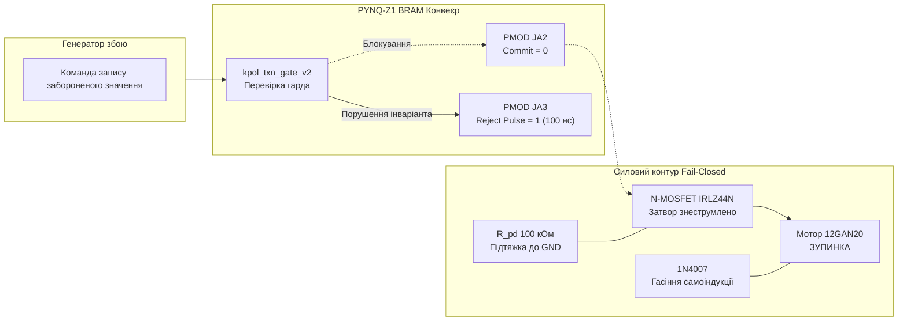
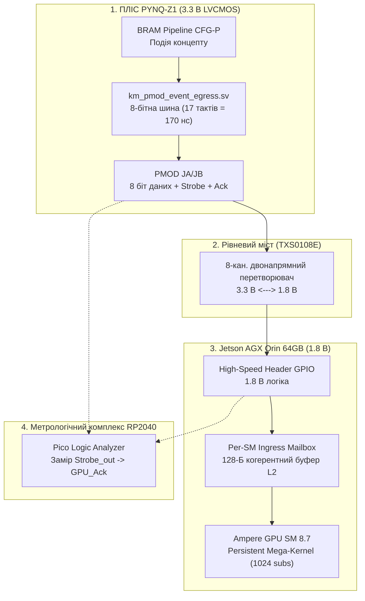

# План фізичних апаратних експериментів HIL на стенді PYNQ-Z1, Pico та Jetson Orin

* **Версія:** 1.0.0
* **Дата:** 2026-11-16
* **Тип WP:** Plan
* **Статус:** Нормативно узгоджено (Approved Baseline)
* **ASPICE 4.0 процеси:** `HWE.1` (Hardware Requirements), `HWE.2` (Hardware Design), `HWE.3` (Hardware Verification), `HWE.4` (Hardware Integration), `SYS.4` (System Integration and Verification)
* **Пов'язані документи:**
  * [Посібник і схема монтажу стенда HIL](hil-bench-wiring-guide.md)
  * [Посібник користувача логічного аналізатора RP2040](pico-logic-analyzer-guide.md)
  * [Рішення B6: Гетерогенний симбіоз Машини Кузьміна та GPU](../../../../Engineering/decisions/b6-gpu-persistent-kernel-subscribers.md)
  * [Звіт EXP-GPU-01 Фаза 3–4](../../../../Research/studies/fpga-gpu-symbiosis/experiments/EXP-GPU-01/report-phase3-warp-scaling.md)
  * [RTL-модуль виведення подій km_pmod_event_egress.sv](../../../../Engineering/hw/rtl/io/km_pmod_event_egress.sv)
  * [Хроніка 10 етапів розробки Машини Кузьміна](../../../../Research/studies/fpga-gpu-symbiosis/data/kuzmin_machine_10_steps_development_chronicle.md)

---

## 1. Мета та науково-інженерний контекст

Цей документ визначає повну програму та методику проведення фізичних експериментів Hardware-in-the-Loop (HIL) на базі закупленого комплекту апаратного забезпечення:
1. ПЛІС **Digilent PYNQ-Z1** (Xilinx Zynq-7020 XC7Z020-1CLG400C);
2. Гетерогенного прискорювача **Seeed Studio reServer Industrial J501** (NVIDIA Jetson AGX Orin 64GB, 2048 CUDA Ampere Cores);
3. Незалежного вимірювального логічного аналізатора **Raspberry Pi Pico** (RP2040, апаратні автомати PIO, 100 MS/s);
4. Комплекту фізичних датчиків (цифровий датчик Холла `SS41F`, геркон `KSK1A66-1020`, кнопка/енкодер `EC12`);
5. Силового виконавчого контуру (N-MOSFET `IRLZ44NPBF`, мікромотор `12GAN20` N20, діод `1N4007`, шина `Star GND`);
6. Двонапрямних узгоджувачів рівнів напруг (3,3 В $\leftrightarrow$ 5,0 В та 3,3 В $\leftrightarrow$ 1,8 В `TXS0108E`).

### Головна інженерна гіпотеза:
Машина Кузьміна усуває залежність безпеко-критичних систем (ASIL D / ISO 26262) від затримок та вразливостей класичного фон-нейманівського програмного стека (Linux kernel, планувальник OS, черги переривань):
* **Апаратна реакція:** ПЛІС гарантує реакцію на фізичний стимул за строго фіксовані **80 нс** (8 тактів @ 100 МГц) із джитером $\le 10\text{ нс}$ (1 такт CDC).
* **Fail-Closed захист:** Будь-яке порушення інваріанта безпеки скидає Велику Точку (`•` $\to$ `¬`) і апаратно відсікає струм силового навантаження за 80 нс без можливості програмного блокування.
* **Гетерогенна паралельність:** ПЛІС транслює потік подій за $170\text{ нс}$ на GPU, де паралельний Persistent Mega-Kernel виконує складну аналітику для 1024 підписників за $1{,}69\text{ мкс}$ з $0\%$ дивергенції варпа.

---

## 2. Матриця експериментів стенда HIL

| ID експерименту | Назва та об'єкт випробувань | Задіяні фізичні компоненти | Контрольовані параметри | Цільовий норматив |
| :--- | :--- | :--- | :--- | :--- |
| **EXP-HIL-01** | Фізичний детермінізм реакції на асинхронний стимул | Датчик Холла `SS41F`, магніт, Level Shifter (5V $\to$ 3.3V), PYNQ-Z1, Pico | Затримка фронту $T_{\text{react}} = t(\text{Commit}) - t(\text{Hall})$, джитер $\sigma$ | $T = 80\text{ нс} \pm 10\text{ нс}$, $\sigma \le 3\text{ нс}$ |
| **EXP-HIL-02** | Апаратний Fail-Closed захист силового приводу | MOSFET `IRLZ44N`, мотор `12GAN20`, діод `1N4007`, PYNQ-Z1, Pico | Стан затвора $V_{GS}$, струм мотора, імпульс `Reject`, час знеструмлення | $V_{GS} = 0\text{ В}$, $0$ імпульсів Commit, час відсікання $\le 80\text{ нс}$ |
| **EXP-HIL-03** | Стійкість до брязкоту контактів і метастабільності | Геркон `KSK1A66`, кнопка, 2-FF CDC синхронізатор, Pico | Кількість зареєстрованих транзакцій на одне фізичне замикання | Рівно 1 транзакція, відсутність метастабільних зривів |
| **EXP-HIL-04** | Фізичний міжплатний симбіоз ПЛІС $\to$ GPU (#226 / #234) | PYNQ-Z1 (`km_pmod_event_egress`), Level Shifter (3.3V $\leftrightarrow$ 1.8V), Jetson J501, Pico | Тривалість передачі шини, наскрізний час підтвердження GPU | Шина $\le 170\text{ нс}$, GPU Round-Trip $\le 2\text{ мкс}$, 0 розбіжностей |

---

## 3. Детальні протоколи проведення експериментів

### 3.1. EXP-HIL-01: Детермінізм реакції на асинхронний стимул

#### Порядок виконання:
1. Змонтувати коло датчика Холла `SS41F` з підтяжкою $R_1 = 4{,}7\text{ кОм}$ до $+5\text{V\_AUX}$ згідно з §2.3.1 [hil-bench-wiring-guide.md](hil-bench-wiring-guide.md).
2. Підключити вихід низької сторони Level Shifter до PMOD `JA1` (PYNQ-Z1).
3. Підключити вимірювальні щупи Raspberry Pi Pico:
   * `GP0` — вихід датчика Холла;
   * `GP1` — пін PMOD `JA1` (`ext_hw_trigger_i`);
   * `GP2` — пін PMOD `JA2` (`hw_commit_pulse_o`).
4. Запустити захоплення траси через `hil_pico_capture.py` (100 MS/s, тригер за спадом `GP1`).
5. Здійснити $N = 1000$ механічних проходів магніту повз датчик Холла.
6. **Критерій фальсифікації:** Якщо хоча б в одному прогоні затримка між `GP1` та `GP2` відхилиться від діапазону $70..90\text{ нс}$ — гіпотезу апаратного детермінізму спростовано.

---

### 3.2. EXP-HIL-02: Апаратний захист Fail-Closed силового навантаження

#### Порядок виконання:
1. Зібрати комутаційний вузол на MOSFET `IRLZ44NPBF` із захисним діодом `1N4007` паралельно мотору `12GAN20` згідно з §2.3.2 [hil-bench-wiring-guide.md](hil-bench-wiring-guide.md).
2. Затвор транзистора підключити до PMOD `JA2` (Commit) через резистор $100\text{ Ом}$ з обов'язковою підтяжкою $100\text{ кОм}$ до спільної точки `Star GND`.
3. Підключити червоний індикатор аварії до PMOD `JA3` (Reject).
4. Канали Pico: `GP2` — Commit, `GP3` — Reject, `GP4` — фізична напруга на затворі транзистора ($V_{GS}$).
5. **Тест А (Штатний рух):** Подати валідні концептуальні параметри — зафіксувати стабільне обертання двигуна та імпульси Commit.
6. **Тест Б (Аварійне блокування):** Програмно або через апаратний селектор подати команду мутації концепту за межі безпечного діапазону (наприклад, $C_1 > 100$).
7. **Критерій фальсифікації:** Якщо на піні затвора MOSFET з'явиться бодай один позитивний викид напруги під час Reject, або якщо мотор продовжить обертатися — гіпотезу апаратного Fail-Closed захисту спростовано.

---

### 3.3. EXP-HIL-03: Стійкість до брязкоту контактів і метастабільності

#### Порядок виконання:
1. Підключити механічний геркон `KSK1A66-1020` та тактову кнопку до входу Level Shifter.
2. Механічний контакт кнопки неминуче породжує серію з 10–50 високочастотних мікросекундних розмикань (Contact Bouncing).
3. Додатково через генератор імпульсів RP2040 подати пачку ультракоротких субтактових імпульсів тривалістю $2{,}5\text{ нс}$, $5\text{ нс}$, $7\text{ нс}$ на пін `JA1`.
4. Зняти кількість перемикань концепту в BRAM пам'яті через AXI MMIO статусний регістр.
5. **Критерій фальсифікації:** Якщо одне механічне натискання кнопки спричинить більше ніж 1 транзакцію в BRAM, або субтактовий імпульс викличе стан підвисання шини AXI (`busy == 1` назавжди) — апаратну фільтрацію метастабільності вважати незадовільною.

---

### 3.4. EXP-HIL-04: Фізичний міжплатний симбіоз ПЛІС $\to$ GPU (#226 / #234)

#### Порядок виконання:
1. Змонтувати на макетній платі модуль узгодження рівнів `TXS0108E`, підключивши сторону `VA` до $1{,}8\text{ В}$ (від Jetson), а сторону `VB` до $3{,}3\text{ В}$ (від PYNQ PMOD).
2. З'єднати 8 ліній даних, строб `par_valid_o` та зворотний сигнал підтвердження `rx_ack_i` між PYNQ PMOD JA/JB та пінами роз'єму Jetson J501.
3. Завантажити бітстрім із модулем `km_pmod_event_egress.sv` у ПЛІС PYNQ-Z1.
4. Запустити персистентний мега-кернел `persistent_subscribers` на Jetson Orin у режимі `--ingress-mode partitioned --subscribers 1024`.
5. Здійснити серію з $N = 10000$ апаратних виштовхувань подій з ПЛІС на GPU.
6. За допомогою RP2040 виміряти фізичну затримку між стробом видачі події з ПЛІС та виставленням апаратного `ack` від GPU.
7. **Критерій фальсифікації:** Час передачі по шині $> 200\text{ нс}$, сумарна реакція GPU $> 3\text{ мкс}$, або виявлення бодай однієї розбіжності даних (`mismatches > 0`) спростовує гіпотезу ефективності міжплатного симбіозу.

---

## 4. Зв'язок із вимогами та процесами ASPICE 4.0

| Вимога проєкту | Стандарт | Метод перевірки | Відповідальний експеримент |
| :--- | :--- | :--- | :--- |
| `REQ-HW-011` (CDC Metastability) | ASPICE `HWE.3` | Осцилографічний аналіз перехідних процесів | **EXP-HIL-03** |
| `REQ-HW-012` (Deterministic Reaction) | ASPICE `HWE.3` | Цифровий захват інтервалу 100 MS/s через RP2040 | **EXP-HIL-01** |
| `REQ-SYS-012` (Fail-Closed Hazard Mitigation) | ISO 26262 ASIL D | Фізичне блокування затвора силового ключа MOSFET | **EXP-HIL-02** |
| `REQ-INT-001` (FPGA-GPU Symbiosis Egress) | ASPICE `SYS.4` | Наскрізний замір шини 170 нс + 1024 підписники GPU | **EXP-HIL-04** |

---

## Історія версій

| Версія | Дата | Автор | Зміни |
| :--- | :--- | :--- | :--- |
| 1.0.0 | 2026-11-16 | Pro Architect | Первинна редакція плану фізичних HIL-експериментів для закупленого апаратного стенда (PYNQ-Z1, Pico RP2040, Jetson Orin, датчики, силовий привід). |

## Абревіатури та глосарій

| Термін | Значення |
| :--- | :--- |
| **HIL** | Hardware-in-the-Loop, випробування з фізичним обладнанням у контурі вимірювання |
| **CDC** | Clock Domain Crossing, перетин асинхронних тактових доменів (2-FF синхронізатор) |
| **Fail-Closed** | Архітектурний принцип переходу в безпечний знеструмлений стан при будь-якій відмові |
| **MOSFET** | Metal-Oxide-Semiconductor Field-Effect Transistor, польовий транзистор силового ключа |
| **PMOD** | Peripheral Module, 12-піновий інтерфейсний роз'єм плати PYNQ-Z1 |
| **VCD** | Value Change Dump, стандартний формат запису часових діаграм цифрових сигналів |
| **PIO** | Programmable I/O, апаратні кінцеві автомати вводу-виводу мікроконтролера RP2040 |
| **Star GND** | Топологія заземлення «Зірка», зведення всіх земляних шин в єдину фізичну точку |
