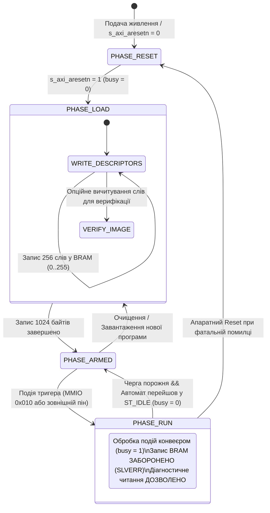

# Специфікація контракту життєвого циклу образу та інтерфейсу loader ↔ PL (kpol_loader_pipeline_contract)

* **Тип Work Product:** `Specification` (з інтегрованими `Decision`, `Requirement`, `Protocol`, `Register`)
* **Версія:** 2.4.0 (натурна верифікація двобанкової модифікації `CFG-P-HA` на `PYNQ-Z1` при `100.69 МГц` за Issue #253)
* **Дата:** 2026-11-17
* **Статус:** Запропоновано на затвердження власником (Proposed)
* **ASPICE 4.0 процеси:** `SYS.3` (System Architectural Design), `HWE.1` (Hardware Requirements Analysis), `SWE.1` (Software Requirements Analysis)
* **Батьківська Work Item:** #5 (віха S2), задача [#133](https://github.com/nick-fedchik/kuzmin-machine/issues/133) (рішення B4), розширення [#252](https://github.com/nick-fedchik/kuzmin-machine/issues/252) / [#259](https://github.com/nick-fedchik/kuzmin-machine/issues/259) / [#253](https://github.com/nick-fedchik/kuzmin-machine/issues/253) (`CFG-P-HA`)
* **Пов'язані результати:** S4 / Issue [#7](https://github.com/nick-fedchik/kuzmin-machine/issues/7) (PR #137, виконання двох програм на одному бітстрімі), S2 / Issue [#48](https://github.com/nick-fedchik/kuzmin-machine/issues/48) (PR #138, специфікація карти регістрів AXI), `EXP-GPU-02` / Issues [#252](https://github.com/nick-fedchik/kuzmin-machine/issues/252), [#253](https://github.com/nick-fedchik/kuzmin-machine/issues/253) (PR #258, #265, двобанковий `CFG-P-HA` та HIL на `PYNQ-Z1`), S5 / Issue [#8](https://github.com/nick-fedchik/kuzmin-machine/issues/8)
* **Цільовий RTL-модуль:** [`Engineering/hw/rtl/bus/kpol_bram_pipeline_axi.sv`](../../hw/rtl/bus/kpol_bram_pipeline_axi.sv) (`CFG-P`, Варіант 1) та [`Engineering/hw/rtl/bus/kpol_bram_pipeline_axi_ha.sv`](../../hw/rtl/bus/kpol_bram_pipeline_axi_ha.sv) (`CFG-P-HA`, Варіант 2 з [`km_concept_bram_dual_ha.sv`](../../hw/rtl/core/km_concept_bram_dual_ha.sv))

---

* **Тип WP редакції NG:** Specification
* **Укладач редакції NG:** GitHub Copilot CLI, Auto; конкретна модель не атестована.
* **Підстава редакції NG:** команда власника від 2026-11-12; локальне перенесення без legacy.
* **Походження:** [оригінал 2.0.0](https://github.com/nick-fedchik/kuzmin-machine/blob/707fdba697d92ef9874c9013eb6f4f3cb2796d70/specs/hw/kpol-image-loader-pipeline-contract.md), `707fdba697d92ef9874c9013eb6f4f3cb2796d70`.
* **Стан редакції NG:** адаптовано до нової структури; незалежна рецензія не проведена.

> **Межі редакції NG.** Перенесення й оформлення не є новим експериментом,
> повторною науковою перевіркою або затвердженням baseline. Авторство,
> рішення, числа й рецензії нижче стосуються зазначених оригінальних
> об'єктів та версій, а не автоматично цієї локальної копії.

## 1. Призначення і межі

### 1.1. Проблема та контекст
В експерименті S4 (Issue #7, PR #137) було фізично підтверджено можливість виконання двох різних програм KPOL (`Increase` та `Decrease`) на кристалі Zynq-7000 (PYNQ-Z1) на єдиному бітстрімі без пересинтезу та перепрограмування FPGA.
Водночас порядок взаємодії між програмним завантажувачем (loader) на стороні процесора ARM Cortex-A9 та апаратним конвеєром PL спирався на емпіричну послідовність дій HIL-скриптів без нормативної специфікації фаз, правил арбітражу пам'яті та захисту від конфліктів.

**Мета специфікації:** формалізувати архітектурне рішення **B4** ([`Engineering/design/s2-candidate-system.md`, §7.1](../../design/s2-candidate-system.md#71-пять-рішень-для-погодження)) та зафіксувати точний контракт життєвого циклу бінарного образу KPOL, фази роботи, допустимі операції для кожної фази, реакцію на несвоєчасні доступи, а також вимоги до сумісності форматів loader $\leftrightarrow$ PL.

### 1.2. Межі розрізнення обгорток
- **Цільовий об'єкт цієї специфікації:**
  1. Базова однобанкова конвеєрна обгортка [`kpol_bram_pipeline_axi.sv`](../../hw/rtl/bus/kpol_bram_pipeline_axi.sv) (`CFG-P`, `1 × RAMB36E1`), яка реалізує доступ до BRAM через адресні регістри `13'h004`/`13'h008`, керування тригером `13'h010` та зчитування телеметрії `13'h014`..`13'h02C`.
  2. Двобанкова обгортка високої готовності [`kpol_bram_pipeline_axi_ha.sv`](../../hw/rtl/bus/kpol_bram_pipeline_axi_ha.sv) (`CFG-P-HA`, `2 × RAMB36E1` через [`km_concept_bram_dual_ha.sv`](../../hw/rtl/core/km_concept_bram_dual_ha.sv), ID `0x4B504841` `"KPHA"`), яка зберігає карту `0x000..0x02C` і додає регістри гарячої інжекції правил у тіньовий банк під час `busy == 1` (`0x030..0x044`).
- **Розмежування з Issue #48:** Ручна AXI-обгортка [`kpol_txn_gate_axi_lite.sv`](https://github.com/nick-fedchik/kuzmin-machine/blob/707fdba697d92ef9874c9013eb6f4f3cb2796d70/hw/rtl/bus/kpol_txn_gate_axi_lite.sv) (`CFG-R`) регулюється окремим документом [`kpol-txn-gate-axi-lite-interface.md`](kpol-txn-gate-axi-lite-interface.md). Специфікація pipeline не замінює і не змінює карту регістрів #48.
- **Формат образу:** Формат бінарного образу 1024 байти встановлено у межах задач #19/#8 та компілятора [`Engineering/hw/scripts/compile_kpol_bram_image.py`](../../hw/scripts/compile_kpol_bram_image.py); ця специфікація визначає інтерфейс завантаження та виконання цього образу, не дублюючи мовний парсер KPOL.

---

## 2. Архітектурне рішення B4 (Decision ADR-B4)

* **Статус:** Рекомендовано розробником, очікує підтвердження власника проєкту (Варіант 1 і Варіант 2 реалізовані в окремих RTL-модулях без взаємної колізії).
* **Питання:** Коли loader може змінювати образ у BRAM: виключно в окремій фазі конфігурації чи допустима конкурентна «гаряча» модифікація під час оброблення подій?

### 2.1. Варіанти рішень
1. **Варіант 1 (Розділені фази завантаження та виконання — Staged Phases у базовому `CFG-P`):**
   - Робота однобанкового конвеєра [`kpol_bram_pipeline_axi.sv`](../../hw/rtl/bus/kpol_bram_pipeline_axi.sv) строго розділена на дві взаємовиключні фази:
     - **Фаза завантаження (`PHASE_LOAD`):** виконавець зупинено (`busy == 0`), loader має монопольний доступ до BRAM через Port A (`0x004`/`0x008`).
     - **Фаза виконання (`PHASE_RUN`):** секвенсер обробляє події через Port B (`busy == 1`). Будь-які спроби запису дескрипторів у BRAM (`0x004`/`0x008`) з боку процесора відхиляються з відповіддю `AXI_RESP_SLVERR`.
     - **Фаза телеметрії:** діагностичне читання результатів та стану через окремі регістри дозволено у будь-якій фазі.
   - *Переваги:* Відсутність ризику «розірваного запису» (torn write) 128-бітного дескриптора концепту при використанні лише одного блока `1 × RAMB36E1`.
2. **Варіант 2 (Двобанкове гаряче оновлення правил із тіньовим банком — Shadow-Bank Live Reloading у `CFG-P-HA`, [#252](https://github.com/nick-fedchik/kuzmin-machine/issues/252), [PR #258](https://github.com/nick-fedchik/kuzmin-machine/pull/258)):**
   - Модулі [`km_concept_bram_dual_ha.sv`](../../hw/rtl/core/km_concept_bram_dual_ha.sv) та [`kpol_bram_pipeline_axi_ha.sv`](../../hw/rtl/bus/kpol_bram_pipeline_axi_ha.sv) інстанціюють два блоки пам'яті (`2 × RAMB36E1`: активний банк і тіньовий банк), залишаючи базові файли `CFG-P` незмінними.
   - Під час активної обробки подій (`busy == 1`, за умови `swap_pending == 0 && sync_busy == 0`) хост записує оновлені слова дескрипторів у `Port A` тіньового банку через регістри `0x030` (`SHADOW_ADDR`) та `0x034` (`SHADOW_DATA`, з автоінкрементом адреси) і виставляє запит перемикання у `0x038` (`BANK_SWAP_CTRL`). При оновленні лише слів правил `W1..W3` усі коміти живого стану `W0` з `Port B` секвенсера автоматично дзеркалюються в обидва банки (`shadow_w0_override_q[cid] == 0`).
   - Атомарне перемикання `active_bank_q` виконується строго на межі стану спокою секвенсера `ST_IDLE` (`seq_at_idle_boundary == 1`), після чого фоновий автомат `SYNC_READ -> SYNC_WRITE` на `Port A` досинхронізує змінені слова в новий тіньовий банк за `2 * K` тактів.
   - У звіті [`EXP-GPU-02 Етапи 1–3`](../../../Research/studies/fpga-gpu-symbiosis/experiments/EXP-GPU-02/report-stage1-2-cfg-p-ha.md) (`1.0.0`, [#252](https://github.com/nick-fedchik/kuzmin-machine/issues/252), [#253](https://github.com/nick-fedchik/kuzmin-machine/issues/253)) методом необмеженої $k$-індукції та BMC у `yosys-smtbmc + Z3` (`H1..H7`, мутанти `M1..M5`) формально доведено: `0` міжпортових колізій (`H2`), `0` розірваних читань дескриптора `torn-read` (`H3`), `0` stall-тактів секвенсера (`H4`, кожна подія триває рівно `8` тактів) та обмежене очікування перемикання `1..8` тактів (`H5`). Завдяки збалансованому 8-рівневому бінарному дереву пріоритетного кодера у `km_concept_bram_dual_ha.sv` досягнуто закриття таймінгу в `OpenXC7 nextpnr-himbaechel` при **$F_{\max} = 100.69\text{ МГц}$** (`PASS at 100.00 MHz`, `5 718 SLICE_LUTX`, `2 RAMB36E1`, бітстрім `kpol_pynq_ha.bit` SHA-256 `b5f455aa...`) та виконано натурну HIL-верифікацію на фізичному кристалі `Zynq-7020` (`pynq2`, `10 003` гарячих перемикань, `40 011` подій, `0` колізій, `0` `torn-read`, `8` тактів/подію) із зовнішнім захватом імпульсів `JA2_COMMIT` аналізатором `LOGICTRACER_PICO_0.5.0` (`100 MS/s` + 200-МГц blast-таймер).

### 2.2. Обґрунтування вибору
Варіант 1 (`CFG-P`) залишається базовою однобанковою конфігурацією з мінімальною витратою пам'яті (`1 × RAMB36E1`), фізично перевіреною в S4 (Issue #7), тоді як Варіант 2 (`CFG-P-HA`, `2 × RAMB36E1`) забезпечує беззупинне гаряче оновлення правил на ходу без модифікації RTL базового ядра. Обидві конфігурації спроєктовано з урахуванням принципів детермінованого фазового розмежування та захисної відмови (`fail-closed`); процесна база проєкту орієнтується на добровільні кроки ASPICE 4.0, проте оцінювання чи сертифікація на відповідність стандартам функціональної безпеки (зокрема ISO 26262) не виконувалися згідно з [`Project/policies/standards-position.md`](../../../Project/policies/standards-position.md).

---

## 3. Модель життєвого циклу та фази виконання (Lifecycle Specification)

### 3.1. Діаграма станів життєвого циклу образу

### 3.2. Матриця операцій за фазами життєвого циклу

| Операція шини AXI4-Lite | `PHASE_RESET` | `PHASE_LOAD` | `PHASE_ARMED` | `PHASE_RUN` (`busy == 1`) |
| :--- | :---: | :---: | :---: | :---: |
| **Запис адреси BRAM (`0x004`)** | Ігнорується | **Дозволено (`OKAY`)** | **Дозволено (`OKAY`)** | **Заборонено (`SLVERR`)** |
| **Запис даних BRAM (`0x008`)** | Ігнорується | **Дозволено (`OKAY`)** | **Дозволено (`OKAY`)** | **Заборонено (`SLVERR`)** |
| **Запис параметра події (`0x00C`)** | Ігнорується | Дозволено (`OKAY`) | **Дозволено (`OKAY`)** | **Заборонено (`SLVERR`)** |
| **Запуск транзакції (`0x010`)** | Ігнорується | Заборонено (`SLVERR`)| **Дозволено (`OKAY`)** | **Заборонено (`SLVERR`)** |
| **Читання ID ядра (`0x000`)** | Ігнорується | Дозволено (`OKAY`) | Дозволено (`OKAY`) | **Дозволено (`OKAY`)** |
| **Читання даних BRAM (`0x008`)** | Ігнорується | Дозволено (`OKAY`) | Дозволено (`OKAY`) | Дозволено (`OKAY`, Port A) |
| **Читання статусу `busy` (`0x014`)** | Ігнорується | Дозволено (`0`) | Дозволено (`0`) | **Дозволено (`1`)** |
| **Читання телеметрії (`0x018`..`0x02C`)**| Ігнорується | Дозволено (`OKAY`) | Дозволено (`OKAY`) | **Дозволено (`OKAY`)** |
| **Очищення переповнення W1C (`0x02C`, bit 16)** | Ігнорується | Дозволено (`OKAY`, при `busy == 0`) | **Дозволено (`OKAY`, при `busy == 0`)** | **Заборонено (`SLVERR`)** |
| **Зовнішній тригер під час запису Port A (`write_fire` / `bram_we`)** | Заблоковано | **Заблоковано (`hw_trigger_ready_o = 0`)** | **Заблоковано на тактах `write_fire` / `bram_we`** | Утримується/арбітрується за B5 |
| **Неповностробовий запис (`wstrb != 4'hF`)**| Ігнорується| **Заборонено (`SLVERR`)**| **Заборонено (`SLVERR`)**| **Заборонено (`SLVERR`)** |
| **Невирівняна адреса (`addr[1:0] != 0`)** | Ігнорується | **DECERR** | **DECERR** | **DECERR** |
| **`CFG-P-HA`: запис адреси/даних тіньового банку (`0x030`, `0x034`)** | Ігнорується | Дозволено (`OKAY`, при `!swap_pending && !sync_busy`) | Дозволено (`OKAY`, при `!swap_pending && !sync_busy`) | **Дозволено (`OKAY`, при `!swap_pending && !sync_busy`; інакше `SLVERR`)** |
| **`CFG-P-HA`: запит перемикання банку (`0x038`, write `1`)** | Ігнорується | Дозволено (`OKAY`, перемикання за `1` такт) | Дозволено (`OKAY`, перемикання за `1` такт) | **Дозволено (`OKAY`, атомарний swap на межі `ST_IDLE` за `1..8` тактів)** |
| **`CFG-P-HA`: читання статусу/телеметрії swap (`0x038..0x044`)** | Ігнорується | Дозволено (`OKAY`; запис у `0x03C..0x044` → `DECERR`) | Дозволено (`OKAY`; запис у `0x03C..0x044` → `DECERR`) | **Дозволено (`OKAY`; запис у `0x03C..0x044` → `DECERR`)** |

---

## 4. Контракт формату виконуваного образу (Format & Memory Layout)

1. **Загальний розмір:** Рівно **1024 байти** (256 слів по 32 біти).
2. **Адресний простір BRAM:** 64 концептні дескриптори (індекси CID `0` .. `63`), кожен займає рівно 16 байтів (4 слова по 32 біти):
   - `Слово 0 (+0x0)`: `val_cur` — 32-бітне початкове значення концепту (signed int32);
   - `Слово 1 (+0x4)`: `operand` — 32-бітний операнд предикату або дії (int32);
   - `Слово 2 (+0x8)`: `opcodes/guards` — паковані бітові поля:
     - `[7:0]`: `pred_opcode` (00 NOP, 01 EQ, 02 NEQ, 03 GT, 04 LT, 05 RANGE, 06 BITMASK);
     - `[15:8]`: `guard_flags`: bit 0 — assumption known, bit 1 — invariant known, bit 2 — hazard enabled, bit 3 — інверсія предиката, bit 4 — явний дозвіл каскадної підписки `CME_GUARD_SUBSCRIBER_EN` (зокрема на `subscriber_cid = 0`; для зворотної сумісності з legacy-дескрипторами `subscriber_cid` у діапазоні `1..63` також активує каскад, а в профілі `KPOL-CME-1` bit 4 дорівнює `0` і `subscriber_cid = 0`); решта бітів `[7:5]` = `0`;
     - `[23:16]`: `hazard_limit`, 8-бітна межа, **не тип події**;
     - `[31:24]`: `action_opcode` (00 ASSIGN, 01 INC, 02 DEC, 03 ADD, 04 SUB), **не прапорці захисту**;
   - `Слово 3 (+0xC)`: `subscriber_cid` — 32-бітний ідентифікатор цільового підписника для каскаду.
3. **Порядок байтів (Endianness):** Little-Endian (LSB за меншою адресою).
4. **Послідовність завантаження:** Loader повинен послідовно записати 256 слів від адреси 0 до 255. Часткове завантаження менше ніж 1024 байти вважається незавершеним станом конфігурації.

Опис W2 виправлено за `ConceptMicroDescriptor.pack` та
`km_concept_micro_engine.sv` у базі
`727c19ecb08a6bd45cffea541a64db01acaab148`. Колишня таблиця v1.0.0
не відповідала цим реалізаціям; це **не зміна фактичних байтів образу**
або RTL. MAJOR-версія документа змінена через виправлення попереднього
контрактного твердження. Дозволені opcode й поля цільового мовного
профілю окремо обмежує
[KPOL-CME-1 / CME-RAW-1](../kpol/kpol-cme-subset.md#4-abi-cme-raw-1);
сам loader не визначає семантику мови. Зокрема ASSIGN у поточному CME
бере `event_param`, а не константу. Фази й правила доступу цим
виправленням не змінено.

---

## 5. Перевірні вимоги (Requirements — SYS / HW / SW)

| ID вимоги | Назва та зміст вимоги | Походження | Метод перевірки | Критерій успіху | Статус |
| :--- | :--- | :--- | :--- | :--- | :--- |
| `REQ-SYS-015` | **Staged Execution Lifecycle:** Процесор та логіка PL повинні суворо дотримуватися фазового розподілу завантаження та виконання образу. | Рішення B4, G1/N2 | HIL на PYNQ-Z1 | У фазі `PHASE_LOAD` дозволено повний запис образу; у фазі `PHASE_RUN` стан BRAM ізольовано від модифікації CPU. | Підтверджено в S4 (#7) |
| `REQ-SYS-016` | **Read-Only Telemetry Non-Interference:** Зчитування регістрів статусу та лічильників процесором під час обробки подій не повинно впливати на детермінізм конвеєра. | Потреба N1 | Тестбенч симуляції | Постійні AXI-читання регістру `0x014` не додають жодного такту затримки до роботи FSM секвенсера. | Чернетка (Draft) |
| `REQ-HW-017` | **Execution Write-Protection Interlock:** Спроба запису адреси або даних у BRAM через AXI при активному сигналі `busy == 1` повертає `AXI_RESP_SLVERR`. | Безпека пам'яті (HWE.1) | RTL Тестбенч | Перевірка повернення `bresp == 2'b10` на будь-яку транзакцію запису в регістри `0x004`/`0x008` при `busy = 1`. | Реалізовано в RTL |
| `REQ-SW-011` | **Full Image Ingestion Verification:** Завантажувач зобов'язаний передати всі 256 слів дескрипторів перед виставленням команди старту або дозволом зовнішнього тригера. | Надійність ПЗ (SWE.1) | Інтеграційний тест | Драйвер блокує виклик `trigger()` до моменту завершення ітерації завантаження масиву 1024 байтів. | Реалізовано в драйвері |
| `REQ-SW-012` | **Dynamic Multi-Program Reloading:** Завантажувач повинен забезпечувати перемикання між різними скомпільованими образами KPOL без виклику перепрограмування FPGA. | Мета S4 (Issue #7) | HIL на PYNQ-Z1 | Послідовне виконання програм `Increase` та `Decrease` на одному бітстрімі з перевіркою незмінності SHA-256 бітстріму. | **ПІДТВЕРДЖЕНО (HIL PR #137)** |

---

## 6. Проєкт верифікаційного протоколу (Protocol)

### 6.1. Об'єкт і тестове середовище
- **Об'єкт:** Бітстрім `kpol_bram_pipeline_pynq_z1_top` на платформі Digilent PYNQ-Z1 та симуляційний стенд `test_kpol_bram_pipeline.py`.
- **Завантажувач:** Модуль `hil_kpol_bram_pipeline.py` (з використанням бібліотеки прямого доступу через MMIO).

### 6.2. Верифікаційні сценарії
1. **Сценарій 1 (Штатне послідовне завантаження двох програм — підтверджено в S4):**
   - Завантаження бінарного образу `increase.bin` $\to$ запуск $\to$ перевірка стану ($10 \to 11$);
   - Завантаження бінарного образу `decrease.bin` $\to$ запуск $\to$ перевірка стану ($10 \to 9$);
   - Звірка хешів SHA-256 бітстріму до і після обох запусків.
2. **Сценарій 2 (Негативний контроль несвоєчасного запису):**
   - Запуск тривалої серії каскадних транзакцій (активний стан `busy == 1`);
   - Спроба запису слова в BRAM за адресою `0x008`;
   - *Очікування:* AXI повертає `SLVERR`, вміст комірки в BRAM не спотворюється, конвеєр успішно добігає кінця.
3. **Сценарій 3 (Негативний контроль неповного байтового стробу):**
   - Запис за адресою `0x008` зі стробом `wstrb = 4'b0001` (1 байт);
   - *Очікування:* Повернення `SLVERR`, запис блокується.

---

## 7. Двоспрямоване трасування (Traceability Register)

| Елемент контракту | Вимоги (SYS.3 / HWE.1 / SWE.1) | Реалізація в коді | Доказ верифікації | Поточний статус |
| :--- | :--- | :--- | :--- | :--- |
| **Розділені фази (Load vs Run)** | `REQ-SYS-015` | `kpol_bram_pipeline_axi.sv:115-125` | HIL PR #137 | **Підтверджено фізично (S4)** |
| **Захист від запису при `busy`** | `REQ-HW-017` | `kpol_bram_pipeline_axi.sv:115,117` | `test_kpol_bram_pipeline.py` | Реалізовано в RTL |
| **Формат образу 1024 байти** | `REQ-HW-005`, `REQ-SW-001` | `compile_kpol_bram_image.py` | HIL PR #137 | **Підтверджено фізично (S4)** |
| **Безпечне читання телеметрії** | `REQ-SYS-016` | `kpol_bram_pipeline_axi.sv:138-149` | `test_kpol_bram_pipeline.py` | Реалізовано в RTL |
| **Перезавантаження програм** | `REQ-SW-012` | `hil_kpol_bram_pipeline.py` | HIL PR #137 | **Підтверджено фізично (S4)** |
| **Двобанкове гаряче оновлення без `torn-read` (`CFG-P-HA`)** | Рішення B4 (Варіант 2) | `km_concept_bram_dual_ha.sv`, `kpol_bram_pipeline_axi_ha.sv`, `rule_injector.py`, `hil_exp_gpu_02_runner.py` | [Звіт `EXP-GPU-02` Етапи 1–3 (`1.0.0`, #252/#253)](../../../Research/studies/fpga-gpu-symbiosis/experiments/EXP-GPU-02/report-stage1-2-cfg-p-ha.md), `Z3` (`H1..H7`, `M1..M5`), `OpenXC7` (`100.69 МГц`), HIL `pynq2 + LOGICTRACER_PICO_0.5.0` (`10 003` перемикань) | **Підтверджено формально (Z3) та фізично на Zynq-7020 (#252/#253)** |

---

## 8. Історія версій

| Версія | Дата | Автор | Зміни |
| :--- | :--- | :--- | :--- |
| **1.0.0** | 2026-11-12 | Antigravity (agy) | Створення нормативної специфікації контракту життєвого циклу образу та інтерфейсу loader ↔ PL для закриття задачі #133 (рішення B4). |
| **2.0.0** | 2026-11-12 | GitHub Copilot CLI | За #19 виправлено несумісну з compiler/RTL таблицю W2 та пов'язано з B3; код, фази й історичні докази B4 не змінено. |
| **2.1.0** | 2026-11-14 | GitHub Copilot CLI | За #167 зафіксовано явний прапорець каскаду `guard_flags[4]` (`CME_GUARD_SUBSCRIBER_EN`) для підтримки каскадів на `CID 0`. |
| **2.2.0** | 2026-11-14 | GitHub Copilot CLI | За #168 закрито 1-тактове вікно гонитви між записом Port A (`write_fire` / `bram_we`) та зовнішнім тригером (`hw_trigger_ready_o = 0`) і додано W1C очищення переповнення через `0x02C` (bit 16) при `busy == 0`. |
| **2.3.0** | 2026-11-17 | GitHub Copilot CLI | За #252/#259/#8 зафіксовано двобанкову модифікацію високої готовності `CFG-P-HA` (`Варіант 2` з тіньовим банком `2 × RAMB36E1`, регістри `0x030..0x044`, формальний SMT-доказ `Z3`: `0` `torn-read`, `0` stall-тактів) та замінено заяву у §2.2 на обережне формулювання згідно зі `standards-position.md`. |
| **2.4.0** | 2026-11-17 | GitHub Copilot CLI | За #253 зафіксовано досягнення $F_{\max} = 100.69\text{ МГц}$ (`PASS at 100.00 MHz`) у `OpenXC7` після заміни лінійного пошуку `dirty_next_w` на 8-рівневе бінарне дерево та натурну HIL-верифікацію Варіанта 2 (`CFG-P-HA`) на `PYNQ-Z1` (`pynq2`, `10 003` гарячих перемикань, `0` колізій, `0` `torn-read`, `8` тактів/подію) + `LOGICTRACER_PICO_0.5.0`. |

## Історія версій

| Версія | Дата | Зміни |
|---|---|---|
| 2.4.0 | 2026-11-17 | Додано підсумки натурної HIL-верифікації Варіанта 2 (`CFG-P-HA`) на `Zynq-7020` (`pynq2`, `100.69 МГц` в `OpenXC7`, `10 003` перемикань, `LOGICTRACER_PICO_0.5.0`) для закриття #253. |
| 2.3.0 | 2026-11-17 | Зафіксовано двобанкову конфігурацію `CFG-P-HA` (`Варіант 2`, `0x030..0x044`, `Z3` доказ у #252/#259) та узгоджено §2.2 зі `standards-position.md` (#8). |
| 2.2.0 | 2026-11-14 | Закрито гонитву `Load vs Run` на тактах `write_fire`/`bram_we` та додано W1C для `0x02C` при `busy == 0` (#168). |
| 2.1.0 | 2026-11-14 | Уточнено біт 4 поля `guard_flags` (`CME_GUARD_SUBSCRIBER_EN = 0x10`) для каскаду на `CID 0` зі збереженням сумісності `KPOL-CME-1` (#167). |
| 2.0.1 | 2026-11-12 | Редакція NG: структура, навігація та оформлення WP; нових результатів не заявлено. |

## Абревіатури та глосарій

| Термін | Значення |
|---|---|
| WP | Work Product, результат роботи з визначеним призначенням. |
| NG | Нова структура локальної робочої копії; не нова доказова baseline. |
| SHA | Ідентифікатор Git-коміту або контрольна сума з указаним алгоритмом. |
