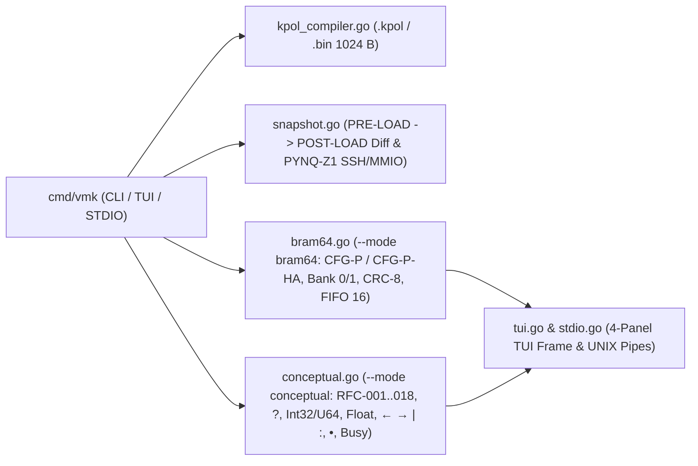

# Специфікація віртуальної машини Кузьміна (VMK) та 4-панельного TUI-дебагера на Go (`Engineering/sw/vmk-go`, SemVer `0.1.0`)

* **Версія:** 1.0.1
* **Дата:** 2026-11-18
* **Тип WP:** Specification
* **Статус:** Запропоновано на затвердження власником (Proposed)
* **ASPICE 4.0 процеси:** `SWE.1` (Software Requirements Analysis), `SWE.2` (Software Architectural Design), `SWE.3` (Software Detailed Design and Unit Construction)
* **Issue:** `Closes` [#274](https://github.com/nick-fedchik/kuzmin-machine/issues/274); пов'язані задачі [#272](https://github.com/nick-fedchik/kuzmin-machine/issues/272), [#270](https://github.com/nick-fedchik/kuzmin-machine/issues/270), [#252](https://github.com/nick-fedchik/kuzmin-machine/issues/252), [#253](https://github.com/nick-fedchik/kuzmin-machine/issues/253), [#186](https://github.com/nick-fedchik/kuzmin-machine/issues/186), [#8](https://github.com/nick-fedchik/kuzmin-machine/issues/8).
* **Відповідальний:** власник Микола Федчик; укладач — GitHub Copilot CLI (Lead Engineer / Architect).
* **Цільовий програмний модуль:** [`Engineering/sw/vmk-go/`](../../sw/vmk-go/go.mod) (`cmd/vmk`, `internal/vmk`, Go `1.22`+, виключно стандартна бібліотека `std`).
* **Верифікація:** [`Engineering/sw/vmk-go/internal/vmk/vmk_test.go`](../../sw/vmk-go/internal/vmk/vmk_test.go), [`Engineering/sw/tests/test_vmk_go_274.py`](../../sw/tests/test_vmk_go_274.py) та звіт [`Engineering/validation/kpol-cme/vmk-go-274/report.md`](../../validation/kpol-cme/vmk-go-274/report.md).

---

## 1. Призначення та межі

### 1.1. Призначення
Програмний модуль **VMK (Virtual Machine of Kuzmin)** у [`Engineering/sw/vmk-go/`](../../sw/vmk-go/go.mod) (`v0.1.0`) надає самодостатній, статично компільований виконуваний бінарник `vmk` на мові Go без жодних зовнішніх залежностей поза стандартною бібліотекою (`std`), призначений для:
1. Побітово точної емуляції та покрокового 10-фазного трасування 64-слотового апаратного конвеєра дескрипторів `CME-RAW-1` (`CFG-P` та двобанкового `CFG-P-HA`, режим `--mode bram64`), а також прямого підключення до фізичної плати `PYNQ-Z1` (`--target sim|pynq1|pynq2`) під міжпроцесним блокуванням `/tmp/km-bench.lock`;
2. Навчально-концептуального виконання та візуалізації семантичної моделі Машини Кузьміна за первинними матеріалами та відповідями Автора концепції М. Ю. Кузьміна (`RFC-001..018`, режим `--mode conceptual`);
3. Автоматизованого потокового тестування програм МК через стандартні потоки UNIX (`--stdio`: `stdin` / `stdout` / `stderr`, `--fail-on-reject`) та інтерактивного чи детермінованого 4-панельного TUI-відлагодження (`--tui`, `--render-tui-frame`).

### 1.2. Межі та атрибуція (`AGENTS.md §6.1`)
- Автор концепції Машини Кузьміна — **Михайло Ювеналійович Кузьмін** (первинні джерела в [`Research/sources/`](../../../Research/sources/README.md)). Ця специфікація та Go-реалізація `Engineering/sw/vmk-go` є похідними інженерними артефактами проєкту (М. Федчик, інженерні агенти) і не замінюють первинних авторських джерел.
- Режим `--mode conceptual` реалізує навчально-ілюстративну віртуальну машину для 6 канонічних прикладів зі слайдів та статей Автора (`If`, `Sum`, `Nod(120, 6) = 6`, `Factorial(5) = 120`, `Tachometer`, `BMS`), тоді як 12 відкритих точок невизначеності `KPOL-AUTH-U01..U12` у фронтенді [`Engineering/sw/kpol-auth/`](../../sw/kpol-auth/__init__.py) залишаються заблокованими за принципом `fail-closed` до відповідей Автора в межах [#186](https://github.com/nick-fedchik/kuzmin-machine/issues/186).
- Процесна орієнтація на ASPICE 4.0 є добровільним внутрішнім орієнтиром проєкту згідно з [`Project/policies/standards-position.md`](../../../Project/policies/standards-position.md); сертифікація за стандартами функціональної безпеки не заявляється.

---

## 2. Архітектура модуля та два виконавчі режими (`bram64` і `conceptual`)

Модуль `github.com/nick-fedchik/kuzmin-machine/Engineering/sw/vmk-go` фіксує в [`go.mod`](../../sw/vmk-go/go.mod) директиву `go 1.22` (для повної сумісності зі штатним пакетом `golang-go` в Ubuntu 24.04 GitHub Actions CI та локальним компілятором `go1.27+`) і не містить жодної директиви `require`.

### 2.1. Режим `--mode bram64` (Апаратно-точний 64-слотовий BRAM-режим `CME-RAW-1` / `CFG-P` / `CFG-P-HA`)
Реалізований у [`internal/vmk/bram64.go`](../../sw/vmk-go/internal/vmk/bram64.go) та [`internal/vmk/kpol_compiler.go`](../../sw/vmk-go/internal/vmk/kpol_compiler.go):
1. **Пам'ять дескрипторів та двобанкове гаряче оновлення (`Bank 0` / `Bank 1`):**
   - 64 слоти концептів (`CID 0..63`), кожен розміром 16 байтів (`W0` `CurrentState`, `W1` `OperandVal`, `W2` `[action_op:8 | hazard_limit:8 | guard_flags:8 | pred_op:8]`, `W3` `SubscriberCID`, little-endian, сумарно `1024 B`).
   - Підтримка двох банків дескрипторів (`Bank0`, `Bank1`, `ActiveBank`) та методу `HotUpdateShadowSlot(cid, packet16, expectedCRC8, overrideW0)` із перевіркою контрольної суми `CRC-8-CCITT` (поліном `0x07`) і атомарним перемиканням `SwapBanksAtIdleBoundary()` на межі `ST_IDLE` зі збереженням живого стану `W0` згідно з контрактом [B4 v2.4.0 (`CFG-P-HA`)](../hw/kpol-image-loader-pipeline-contract.md).
2. **Арифметика, предикати `::`, дії та вентиль інваріанта Великої Крапки `•`:**
   - Усі обчислення виконуються в точній 32-бітній модульній арифметиці доповняльного коду (`uint32` / `int32` без UB).
   - Предикати `pred_opcode` (`0..7`): `0x00` `NOP` (`true`), `0x01` `EQ` (`==`), `0x02` `NEQ` (`!=`), `0x03` `GT` (знакове `>`), `0x04` `LT` (знакове `<`), `0x05` `RANGE` (знакові межі `int16` `lo <= param <= hi`), `0x06` `BITMASK` (`(param & operand) != 0`), `0x07` `UGT` (беззнакове `u32(param) > u32(operand)`), з підтримкою біта інверсії `GuardInvertAssumption` (`0x08`).
   - Дії `action_opcode` (`0..5`): `0x00` `ASSIGN` (`W0' := param`), `0x01` `INC` (`W0 + 1`, переповнення при `0x7FFFFFFF`), `0x02` `DEC` (`W0 - 1`, переповнення при `0x80000000`), `0x03` `ADD` (`W0 + operand`), `0x04` `SUB` (`W0 - operand`), `0x05` `NOP` (`W0' := W0`). *(Примітка: розширені коди `PredUGT = 0x07` та `ActNOP = 0x05` реалізують повну таблицю мікрокодів `CME-RAW-1`, тоді як у чинному RTL `km_concept_micro_engine.sv` та `kpol_debugger.py` коди поза `0x00..0x06` / `0x00..0x04` потрапляють у гілку `default`.)*
   - Вентиль інваріанта Великої Крапки `•` (`EvalInvariantGate`): перевіряє `GuardInvariantEn != 0`, відсутність знакового 32-бітного переповнення (`!arithOverflow`), невід'ємність кандидата (`int32(cand) >= 0`) та відсутність перевищення порога небезпеки (`GuardHazardEn`).
   - Захист від самопідписки (`self_suppress` $\to$ вердикт `SUPPRESSED_SELF` при `subscriber_cid == cid`) та вхідна черга `FIFO 16` (`EnqueueFIFO`, `DrainFIFO`) з обліком `FIFOOverflow` і `DroppedEvents`.

### 2.2. Режим `--mode conceptual` (Навчально-концептуальна Віртуальна Машина Кузьміна за `RFC-001..018`)
Реалізований у [`internal/vmk/conceptual.go`](../../sw/vmk-go/internal/vmk/conceptual.go):
1. **Типізовані концепти та стан невизначеності `_`:**
   - Підтримуються типи `?` (`Bool`: `!` True, `¬` False, `_` Undefined), `Int32`, `U64`, `Float` (`float64`), `Class` та вбудовані віртуальні потоки `STDIN`, `STDOUT`, `STDERR`.
   - Кожен слот має явний прапорець визначеності `Valid bool` (`false` відповідає стану невизначеності `_` за `RFC-005` / `KPOL-SYS-02`).
2. **Чотири види адресації та пост-адресний бар'єр Великої Крапки `•` (`RFC-013`):**
   - Підтримуються всі 4 види адресації: `←` (`Write`), `→` (`Read`), `|` (`Execute/Call`), `:` (`Init/Instance`).
   - При читанні з пост-адресним бар'єром `→ •` (наприклад, у `Sum`: `→ • Sum = 0`) спочатку поточне значення концепту повертається споживачу / у потік `STDOUT` (`READ: Sum = 35`), і **строго після цього** виконується підписка за Великою Крапкою `•` (`Sum = 0`).
3. **Одноразовий захист від самозациклення (`Busy` за `RFC-001`) та групи:**
   - Під час виконання підписки концепту прапорець `Busy = true` блокує повторне рекурсивне самозбудження того самого концепту в межах однієї хвилі (зокрема в T-тригері `If`: `? If _ ; ! If = ¬ ; ¬ = !`), забезпечуючи скінченний перехід за один імпульс.
   - Підтримуються колекції `{ ... }` («І»), масиви вибору `[ ... ]` («АБО», зокрема базовий випадок `[ 0 1 ] { Factorial = 1 Exit }`) та вихід `Exit`.

### 2.3. Каталог вбудованих прикладів (`--example`)
Модуль `vmk` містить 6 основних та 4 додаткові канонічні приклади (`--example <if|sum|nod|factorial|tachometer|bms|increase|decrease|cascade|auth|all>`):
1. `if` — T-тригер `? If _` зі станом невизначеності `_` та траєкторією `_ -> ! -> ¬ -> !` (`RFC-001`);
2. `sum` — акумулятор `Float Sum 0` із накопиченням `← += x` (`+10`, `+25` $\to$ `35`) та пост-адресним авто-скиданням при читанні `→ • Sum = 0` (`RFC-013`);
3. `nod` — реактивний алгоритм Евкліда `Nod(120, 6) = 6` (`19` реактивних віднімань + `1` крок згасання хвилі = `20` кроків оцінки, `58` тактів у `km_euclid_core.sv`);
4. `factorial` — рекурсивний факторіал `Factorial(5) = 120` із масивом вибору `[ 0 1 ] { Factorial = 1 Exit }`;
5. `tachometer` — клас `Tachometer` (`Revolutions`, `Distance`, `Speed` при імпульсах колеса `Tick` і таймері `_Tick`);
6. `bms` — 4-концептний каскад захисту батареї BMS (`Cell_Delta_mV -> Module_Thermal_Guard -> Pack_Fault_Latch -> Contactor_Interlock`), а також профілі `increase`, `decrease` (`KPOL-CME-1`), `cascade` (`KPOL-CME-2`) та `auth` (`KPOL-AUTH`). При виклику цих дескрипторних прикладів із прапорцем `--mode conceptual` (зокрема з `--stdio`) вони прозоро виконуються на дескрипторному трасувальнику з маркуванням шапки `Mode: conceptual (descriptor-backed)`.

---

## 3. Протокол підключення до машини (`PRE-LOAD` $\to$ `POST-LOAD` $\to$ `RUNNING`)

Реалізований у [`internal/vmk/snapshot.go`](../../sw/vmk-go/internal/vmk/snapshot.go) (`MachineConnection`):
1. **Фаза `PRE-LOAD` (до внесення нової програми):**
   - При підключенні до симулятора (`--target sim`) або фізичної плати `PYNQ-Z1` (`--target pynq1|pynq2` під `syscall.Flock` на `/tmp/km-bench.lock` через SSH та C99 MMIO-зонд за адресою `0x40000000`) VMK спочатку вичитує `REG_ID (0x000)`, апаратні лічильники (`events`, `commits`, `rejects`, `last_state`, `dropped`) та всі `256` 32-бітних слів BRAM (`1024 B`).
   - Будується `PreLoadSnapshot` із хешем `SHA-256` та топологією активних концептів до програмування (`PreLoadActiveConcepts / 64`). У симуляційному режимі (`--target sim`) для демонстраційних прикладів стан `PRE-LOAD` ініціалізується детерміновано: у `--mode conceptual` (`if`, `sum`, `nod`, `factorial`, `tachometer`) передіснують `3 / 64` віртуальні потокові концепти (`STDIN`, `STDOUT`, `STDERR`); у `--example bms` перед завантаженням BMS у симулятор завантажено 1-концептну програму `Increase.kpol` (`1 / 64`), щоб відтворити натурний стендовий перехід `1 / 64 -> 4 / 64`; у решті BRAM-прикладів (`increase`, `decrease`, `cascade`, `auth`) симулятор стартує з чистої нульової BRAM (`0 / 64`).
2. **Фаза `POST-LOAD` та таблиця `Pre-Load vs Post-Load Diff`:**
   - Після запису 256 слів нової програми VMK виконує повне зворотне вичитування (`ReadbackVerified: 256/256 words OK`), класифікує слоти на `Entry`, `Internal`, `Leaf`, `Free` та порівнює всі 4 слова кожного слота (`W0`, `W1`, `W2`, `W3`) у `ComputePrePostLoadDiff`.
3. **Обробка помилок зв'язку з ціллю:**
   - Якщо апаратна ціль недосяжна по SSH або повертає помилку MMIO, `MachineConnection` повертає типізовану помилку з префіксом `VMK-TARGET-IO:` і CLI завершується з кодом виходу `2`.

---

## 4. Контракт потокового інтерфейсу `STDIO` та 4-панельного TUI

### 4.1. Потоковий інтерфейс `STDIO` (`--stdio`, `--fail-on-reject`)
- Підтримує директиви `# @stdin <Concept>` і `# @stdout <Concept1, Concept2, ...>` у коментарях `.kpol`.
- Приймає на `stdin`: числові параметри (`120`), символ невизначеності (`_`), пари `<cid_or_name> <param>` (`Cell_Delta_mV 180`, `0:120`), рядки JSONL (`{"cid":0,"param":120,"valid":true}`) та команди концептуальної МК (`write Sum 10`, `read Sum`, `call Nod 120 6`, `call Factorial 5`).
- Маршрутизує всі підтверджені переходи та читання у `stdout` (`COMMIT: <Name>[cid=...] = <val> ...` або `READ: <Name> = <val>`), а всі відмови охоронців, інваріанта чи невизначеності (`REJECT_GUARD`, `REJECT_INVARIANT`, `REJECT_FAULT`) — у `stderr`.
- За наявності прапорця `--fail-on-reject` (або `--exit-on-reject`) повертає код виходу `1`, якщо під час сесії відбувся хоча б один `REJECT_*`.

### 4.2. 4-панельний TUI-дебагер (`--tui`, `--render-tui-frame`)
Формує детермінований 4-панельний кадр (`RenderBRAM64TUIFrame` / `RenderConceptualTUIFrame`) та інтерактивний цикл керування (`s` Step, `i` STDIN, `f` Fault `_`, `r` Reload, `q` Quit):
1. **Шапка машини:** версія `VMK (Virtual Machine of Kuzmin) v0.1.0`, ціль (`SIM` / `PYNQ2`), режим (`bram64` / `conceptual`), стан `PRE-LOAD -> POST-LOAD -> RUNNING`, лічильники концептів (`Active: K / 64`, `Pre-load: M / 64`, `Changed on load: Δ`, `Free: 64 - K`, `Entry / Internal / Leaf`) та телеметрія (`Events`, `Commits`, `Rejects`, `Faults(_)`).
2. **Панель 1 (`CONCEPT TABLE`):** таблиця концептів (`CID | Name | Type | Pre-Load W0 | Post-Load W0 | Current W0 (Δ) | Valid(_) | Predicate :: | Action | Gate • | Subscriber`).
3. **Панель 2 (`PROGRAM SOURCE CODE & LIVE STDIO STREAMS`):** вихідний код програми та живі потоки `STDIN`, `STDOUT`, `STDERR`.
4. **Панель 3 (`CASCADE WAVE STEP TRACE`):** покрокова 10-колонкова таблиця трасування хвилі подій (`Step | Depth | CID (Name) | Event(param, valid) | Pre-State | Predicate :: | Candidate | Gate • | Verdict | Post-State | Next Subscriber`) та спрацьовані `Watchpoints / Breakpoints`.

---

## Історія версій

| Версія | Дата | Зміни |
| :--- | :--- | :--- |
| 1.0.1 | 2026-11-18 | За рецензією PR #275 (`claude-sonnet-5.5`, `N1..N6`): задокументовано виконання BRAM-прикладів (`bms`, `cascade`, `increase`, `decrease`, `auth`) у `--mode conceptual --stdio` як `conceptual (descriptor-backed)` та походження початкового стану `PRE-LOAD` у симуляторі (`3/64`, `1/64`, `0/64`) проти фізичної плати `PYNQ-Z1`. |
| 1.0.0 | 2026-11-18 | Первинний випуск специфікації двомодового емулятора VMK (`bram64` + `conceptual`) та 4-панельного TUI-дебагера на Go (`Engineering/sw/vmk-go`, SemVer `0.1.0`) за Issue #274. |

## Абревіатури та глосарій

| Термін | Значення |
| :--- | :--- |
| VMK | Virtual Machine of Kuzmin — програмна віртуальна машина та дебагер Машини Кузьміна на мові Go (`Engineering/sw/vmk-go`). |
| CME-RAW-1 | 16-байтний (`W0..W3`) двійковий формат дескриптора концепту в 64-слотовій BRAM (`1024 B`). |
| CFG-P / CFG-P-HA | Однобанкова (`1 × RAMB36E1`) та двобанкова (`2 × RAMB36E1`, беззупинне гаряче оновлення правил) конфігурації апаратного BRAM-конвеєра МК. |
| TUI | Text-based User Interface — 4-панельний текстовий інтерфейс налагодження. |
| STDIO | Стандартні потоки вводу/виводу (`stdin`, `stdout`, `stderr`). |
| HIL | Hardware-in-the-Loop — верифікація за участю фізичної плати ПЛІС `PYNQ-Z1`. |
