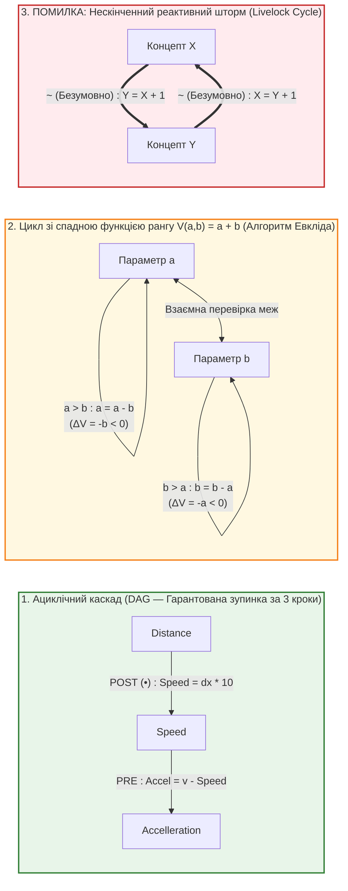

# Статичний аналізатор графа підписок Машини Кузьміна: виявлення нескінченних каскадів (Livelock), станів гонитви (Data Race) та розрахунок WCET

* **Версія:** 0.1.2
* **Дата редакції NG:** 2026-11-12
* **Перенесено з:** `drafts/KuzminMachine/04-verification-and-qa/Kuzmin-Machine-Static-Analysis-and-Termination-Checker-UA.md` @ `a4738bc` (2026-11-09)

> [!IMPORTANT]
> **Призначення документа:** Цей інженерний документ визначає формальний математичний апарат та містить еталонну реалізацію **Статичного верифікатора програм Машини Кузьміна (Kuzmin Machine Static Analyzer & Termination Checker)**. Оскільки в мові МК обчислення рухаються хвилями подій і підписок між концептами, статичний аналізатор на етапі компіляції будує **Орієнтований граф залежностей подій (EDG)** і автоматично виявляє три класи критичних помилок:
> 1. **Нескінченні реактивні шторми (Event Livelock / Mutual Recursion Cycles)** між двома чи більше концептами без монотонно спадного варіанта;
> 2. **Стани гонитви за даними (Data Races та Read-After-Write Hazards)** у паралельних групових блоках `[ ... ]`, де пропущено фазовий роздільник Великої крапки (`•`);
> 3. **Перевищення граничного часу поширення хвилі подій (WCET — Worst-Case Event Cascade Time)** для систем жорсткого реального часу.

---


* **Тип WP редакції NG:** Design
* **Укладач редакції NG:** GitHub Copilot CLI, Auto; конкретна модель не атестована.
* **Підстава редакції NG:** команда власника від 2026-11-12; локальне перенесення без legacy.
* **Походження:** [оригінал 0.1.1](https://github.com/nick-fedchik/kuzmin-machine/blob/707fdba697d92ef9874c9013eb6f4f3cb2796d70/sw/tools/static-analyzer/design-analysis.md), `707fdba697d92ef9874c9013eb6f4f3cb2796d70`.
* **Стан редакції NG:** адаптовано до нової структури; незалежна рецензія не проведена.

> **Межі редакції NG.** Перенесення й оформлення не є новим експериментом,
> повторною науковою перевіркою або затвердженням baseline. Авторство,
> рішення, числа й рецензії нижче стосуються зазначених оригінальних
> об'єктів та версій, а не автоматично цієї локальної копії.

## Зміст

1. [Чому подієвій мові Машини Кузьміна необхідний спеціалізований статичний аналізатор](#1-чому-подієвій-мові-машини-кузьміна-необхідний-спеціалізований-статичний-аналізатор)
2. [Математична модель Графа залежностей подій та підписок (EDG — Event Dependency Graph)](#2-математична-модель-графа-залежностей-подій-та-підписок-edg--event-dependency-graph)
3. [Теорема про зупинку каскаду подій та алгоритм перевірки функцій рангу (Ranking Functions)](#3-теорема-про-зупинку-каскаду-подій-та-алгоритм-перевірки-функцій-рангу-ranking-functions)
4. [Статичне виявлення станів гонитви (Data Races) у паралельних групах та перевірка фаз Великої крапки (`•`)](#4-статичне-виявлення-станів-гонитви-data-races-у-паралельних-групах-та-перевірка-фаз-великої-крапки-)
5. [Аналіз найгіршого часу завершення хвилі подій (WCET Analysis)](#5-аналіз-найгіршого-часу-завершення-хвилі-подій-wcet-analysis)
6. [Повна еталонна реалізація статичного аналізатора МК на Python](#6-повна-еталонна-реалізація-статичного-аналізатора-мк-на-python)

---

## 1. Чому подієвій мові Машини Кузьміна необхідний спеціалізований статичний аналізатор

Як показано у [Специфікації високорівневої мови МК](https://github.com/nick-fedchik/drafts/blob/a4738bc/KuzminMachine/03-engineering-software/Kuzmin-Machine-High-Level-Language-Specification-UA.md) та [Посібнику розробника](https://github.com/nick-fedchik/drafts/blob/a4738bc/KuzminMachine/05-applications-and-guides/Kuzmin-Machine-Developers-Guide-UA.md), Машина Кузьміна має вбудований апаратний захист від **прямої рефлексивної рекурсії довжини 1**: коли підписка концепту `Distance` на запис `←` виконує `Distance += x`, повторна подія запису для `Distance` не генерується.

Однак у складних промислових програмах розробник може випадково створити **непрямі цикли довжини $`k \ge 2`$** або конфлікти паралельного доступу:

1. **Непрямий реактивний шторм (Mutual Event Livelock):**
   Концепт `A` при зміні (`~`) записує нове значення в концепт `B`, а концепт `B` при зміні (`~`) безумовно записує нове значення назад у `A`. Правило придушення прямої самоадресації тут не спрацьовує (бо кожен концепт пише в *чужий* концепт), і система потрапляє у нескінченну лавину подій $`A \to B \to A \to \dots`$.
2. **Несинхронізована паралельна група (Missing Big Dot `•` Race):**
   У груповому блоці `[ Distance += x   Speed = Distance * 10 ]` обидва оператори запускаються паралельно на різних процесорах `PE0` та `PE1`. У результаті `PE1` читає `Distance` одночасно з тим, як `PE0` записує в нього нове значення (класичний конфлікт `RAW / WAW` через відсутність роздільника фаз `•`).
3. **Забутий токен початкового стану `_` в ітераторі (`Dead Cascade`):**
   Запис `Token i 0` із підпискою `{~ < N}` замість `{[ _ ~ ] < N}` ніколи не виконає жодної ітерації, бо без події початкового стану `_` перший крок не зрушить лічильник `i` з місця.

---

## 2. Математична модель Графа залежностей подій та підписок (EDG — Event Dependency Graph)

Для формального аналізу програми МК означимо **Орієнтований мультиграф залежностей подій та підписок (EDG)**:

$$
\mathcal{G}_{\mathrm{EDG}} = \langle V, E, \mu_{\mathrm{pred}}, \delta_{\mathrm{act}} \rangle
$$

де:
* $`V = \lbrace c_1, c_2, \dots, c_n \rbrace`$ — множина всіх концептів модуля (включно з локальними концептами-параметрами у стеку $`SP`$);
* $`E \subseteq V \times \Phi \times \mathcal{P} \times V`$ — множина орієнтованих ребер каскадних переходів. Ребро $`e = (c_u, \phi, p, c_v) \in E`$ існує тоді і тільки тоді, коли підписка концепту $`c_u`$ у фазі Великої крапки $`\phi \in \lbrace \mathsf{PRE}, \mathsf{POST}, \mathsf{READ}, \mathsf{EXEC} \rbrace`$ за умови істинності предиката події $`p \in \mathcal{P}`$ виконує модифікацію або виклик цільового концепту $`c_v`$ (без прапорця тихого скидання `= _`);
* $`\delta_{\mathrm{act}}(e)`$ — символьне перетворення стану $`\mathrm{val}(c_v) \leftarrow f\big(\mathrm{val}(c_u), \mathrm{val}(c_v)\big)`$, яке виконується вздовж ребра $`e`$.



---

## 3. Теорема про зупинку каскаду подій та алгоритм перевірки функцій рангу (Ranking Functions)

Статичний аналізатор розбиває граф $`\mathcal{G}_{\mathrm{EDG}}`$ на компоненти сильної зв'язності (**SCC — Strongly Connected Components**) за лінійним алгоритмом Тар'яна $`\mathcal{O}(|V| + |E|)`$.

* Якщо всі компоненти сильної зв'язності тривіальні (граф $`\mathcal{G}_{\mathrm{EDG}}`$ є орієнтованим ациклічним графом — **DAG**), каскад подій **гарантовано завершується** щонайбільше за $`\mathrm{Diameter}(\mathcal{G}_{\mathrm{EDG}})`$ хвиль при будь-яких вхідних даних.
* Якщо виявлено нетривіальний цикл $`\mathcal{C} = (c_1 \xrightarrow{e_1} c_2 \xrightarrow{e_2} \dots \xrightarrow{e_k} c_1)`$, аналізатор перевіряє достатню умову скінченності за методом **функцій Ляпунова — Флойда (Well-Founded Ranking Functions)**:

> [!IMPORTANT]
> **Теорема (Достатня умова відсутності Livelock у циклі підписок МК):**
> Цикл підписок $`\mathcal{C}`$ у графі $`\mathcal{G}_{\mathrm{EDG}}`$ гарантовано завершується за скінченне число активацій, якщо існує відображення стану концептів циклу у цілі числа $`\mathcal{V} : \Sigma(\mathcal{C}) \to \mathbb{Z}`$ (функція рангу), яке для кожного ребра переходу $`e_i \in \mathcal{C}`$ із предикатом $`p_i`$ та дією $`\delta_i`$ задовольняє дві умови:
> 1. **Обмеженість знизу при активних предикатах:** $`\big(\bigwedge_{e_i \in \mathcal{C}} \neg p_i\big) \lor \big(\mathcal{V}(\Sigma) \ge 0\big)`$;
> 2. **Суворе монотонне спадання вздовж циклу:** $`\mathcal{V}\big(\delta_{\mathcal{C}}(\Sigma)\big) \le \mathcal{V}(\Sigma) - 1`$.

Наприклад:
* Для циклу реактивного ітератора `Token i 0` з умовою `{[ _ ~ ] < N}` та дією `i += 1` аналізатор автоматично синтезує функцію рангу $`\mathcal{V}(i) = N - i`$, яка обмежена знизу нулем (оскільки $`i < N \implies N - i \ge 1`$) і на кожному кроці зменшується рівно на $`1`$. Висновок: **`SAFE_BOUNDED_LOOP`** ($`\le N`$ кроків).
* Для алгоритму Евкліда `Nod` (`a > b -> a -= b`, `b > a -> b -= a`) при $`a > 0, b > 0`$ синтезується функція рангу $`\mathcal{V}(a, b) = a + b`$, яка суворо спадає на кожному кроці віднімання. Висновок: **`SAFE_CONVERGENT_CYCLE`**.
* Для безумовного циклу `A ~ B = A + 1` та `B ~ A = B + 1` не існує спадної функції рангу та обмежувального предиката. Аналізатор видає фатальне попередження компіляції: **`ERROR [KM-E001]: Unbounded Event Livelock Detected`**.

---

## 4. Статичне виявлення станів гонитви (Data Races) у паралельних групах та перевірка фаз Великої крапки (`•`)

У межах однієї підписки послідовність інструкцій розбивається оператором Великої крапки (`•`) на впорядковані у часі **епохи (фази)**: $`E_{\mathrm{pre}} \prec E_{\mathrm{post}}`$. Усередині однієї епохи оператори, записані в паралельному блоці $`B = \lbrace s_1, s_2, \dots, s_m \rbrace`$, виконуються конкурентно на різних ядрах `PE`.

Для кожного оператора $`s_i \in B`$ аналізатор обчислює множину концептів читання $`\mathcal{R}(s_i)`$ та множину концептів запису $`\mathcal{W}(s_i)`$. Паралельний блок $`B`$ є вільним від станів гонитви (**Data-Race Free** за критерієм Бернштейна) тоді і тільки тоді, коли для будь-якої пари різних операторів $`s_i, s_j \in B`$ ($`i \neq j`$) виконуються три умови:

$$
\begin{aligned}
1.\quad &\mathcal{W}(s_i) \cap \mathcal{W}(s_j) = \emptyset \quad &\text{(відсутність конфлікту Write-After-Write — WAW)}, \\
2.\quad &\mathcal{W}(s_i) \cap \mathcal{R}(s_j) = \emptyset \quad &\text{(відсутність конфлікту Read-After-Write — RAW)}, \\
3.\quad &\mathcal{R}(s_i) \cap \mathcal{W}(s_j) = \emptyset \quad &\text{(відсутність конфлікту Write-After-Read — WAR)}.
\end{aligned}
$$

Якщо для пари $`(s_i, s_j)`$ у межах однієї фази перетин не порожній, аналізатор блокує компіляцію з діагностикою **`ERROR [KM-E002]: Parallel Data Race`** і пропонує точне виправлення — вставити фазовий оператор Великої крапки **`•`** між $`s_i`$ та $`s_j`$.

---

## 5. Аналіз найгіршого часу завершення хвилі подій (WCET Analysis)

Для апаратної реалізації на FPGA PYNQ-Z1 із $`P`$ фізичними ядрами `PE` та відомою тактовою вартістю кожної підписної лінії $`\tau(L)`$ статичний аналізатор обчислює гарантовану верхню межу часу релаксації системи після одиничного зовнішнього збурення (**WCET — Worst-Case Event Cascade Time**) за нерівністю Грехема — Брента для паралельного планування графа задач:

$$
\mathrm{WCET}(c_{\mathrm{root}}, P) \enspace\le\enspace \underbrace{\mathcal{T}_{\infty}(c_{\mathrm{root}})}_{\text{Критичний шлях каскаду}} + \enspace\frac{\mathcal{T}_1(c_{\mathrm{root}}) - \mathcal{T}_{\infty}(c_{\mathrm{root}})}{P} + N_{\mathrm{waves}} \cdot \tau_{\mathrm{dispatch}}
$$

де:
* $`\mathcal{T}_1(c_{\mathrm{root}}) = \sum_{e \in \mathrm{Reach}(c_{\mathrm{root}})} K_{\max}(e) \cdot \tau(e)`$ — сумарна робота всіх активованих ліній у тактах (робота на 1 ядрі);
* $`\mathcal{T}_{\infty}(c_{\mathrm{root}})`$ — довжина найдовшого ланцюжка причинно-наслідкових залежностей у графі $`\mathcal{G}_{\mathrm{EDG}}`$ (критичний шлях при $`P \to \infty`$);
* $`K_{\max}(e)`$ — доведена статичним аналізатором верхня межа кількості спрацювань ребра $`e`$ ($`1`$ для ациклічних ребер DAG або $`\mathcal{V}_0`$ для обмежених циклів).

---

## 6. Повна еталонна реалізація статичного аналізатора МК на Python

Наведений нижче інструмент `km_static_analyzer.py` реалізує побудову графа залежностей подій EDG, пошук циклів за алгоритмом Тар'яна, перевірку функцій рангу для реактивних циклів, детектор станів гонитви Бернштейна для груп без Великої крапки (`•`) та розрахунок WCET для плати PYNQ-Z1:

```python
#!/usr/bin/env python3
# -*- coding: utf-8 -*-
"""
Статичний аналізатор графа підписок, верифікатор зупинки каскадів (Termination Checker),
детектор станів гонитви (Bernstein Data-Race Detector) та калькулятор WCET Машини Кузьміна
(km_static_analyzer.py).
"""

from dataclasses import dataclass, field
from typing import Dict, List, Optional, Set, Tuple


# ============================================================================
# 1. СТРУКТУРИ ДАНИХ ДЛЯ АНАЛІЗУ ГРАФА ПОДІЙ ТА ПІДПИСОК (EDG)
# ============================================================================

@dataclass
class ParallelStmtInfo:
    """Опис елементарного оператора всередині підписки для перевірки умов Бернштейна."""
    stmt_text: str
    phase_index: int  # 0 = до крапки '•' (w1), 1 = після крапки '•' (w2)
    read_concepts: Set[str]
    write_concepts: Set[str]
    is_silent_reset: bool = False


@dataclass
class SubscriptionEdge:
    """Орієнтоване ребро каскаду в графі залежностей подій EDG."""
    source_concept: str
    target_concept: str
    event_predicate: str          # Напр. ":: ~", "= 10", "{[ _ ~ ] < N}", "> b"
    action_summary: str           # Напр. "Speed = dx * 10", "i += 1", "a -= b"
    exec_cycles: int = 4          # Тактова вартість виконання лінії O на ядрі PE
    max_bound_iterations: Optional[int] = None  # Верхня межа ітерацій (якщо цикл обмежений)
    has_monotone_variant: bool = False          # Наявність спадної функції рангу V


@dataclass
class DiagnosticReport:
    code: str
    severity: str  # "ERROR", "WARNING", "INFO"
    message: str
    remediation: str


# ============================================================================
# 2. ЯДРО СТАТИЧНОГО АНАЛІЗАТОРА МАШИНИ КУЗМІНА
# ============================================================================

class KuzminStaticAnalyzer:
    """
    Виконує 4 статичні перевірки скомпільованого модуля Машини Кузьміна:
    1) Виявлення необмежених циклів Livelock за алгоритмом Тар'яна + перевірка варіантів;
    2) Виявлення мертвих ітераторів (пропущений токен '_' у предикаті циклу);
    3) Виявлення станів гонитви (RAW / WAW / WAR) у паралельних групах без '•';
    4) Розрахунок гарантованого WCET у тактах і мікросекундах для FPGA PYNQ-Z1 (100 МГц).
    """

    def __init__(self, num_fpga_cores: int = 8, clock_mhz: float = 100.0) -> None:
        self.num_fpga_cores = num_fpga_cores
        self.clock_mhz = clock_mhz
        self.nodes: Set[str] = set()
        self.edges: List[SubscriptionEdge] = []
        self.diagnostics: List[DiagnosticReport] = []

    def add_edge(self, edge: SubscriptionEdge) -> None:
        self.nodes.add(edge.source_concept)
        self.nodes.add(edge.target_concept)
        self.edges.append(edge)

    def check_dead_loop_iterators(self) -> None:
        """Перевіряє, чи не забув розробник токен початкового стану '_' у циклі з '~'."""
        for e in self.edges:
            if e.source_concept == e.target_concept and "~" in e.event_predicate and "<" in e.event_predicate:
                if "_" not in e.event_predicate:
                    self.diagnostics.append(
                        DiagnosticReport(
                            code="KM-W003",
                            severity="WARNING",
                            message=(
                                f"Концепт-ітератор '{e.source_concept}' має предикат '{e.event_predicate}' "
                                f"без токена початкового стану '_'. Нульова ітерація може не запуститися!"
                            ),
                            remediation=f"Замініть умову на комбіновану подію: {{[ _ ~ ] {e.event_predicate}}}",
                        )
                    )

    def check_bernstein_data_races(self, hook_owner: str, stmts: List[ParallelStmtInfo]) -> None:
        """
        Перевіряє умови Бернштейна (RAW, WAW, WAR) для всіх операторів,
        що опинилися в одній фазі Великої крапки (однаковий phase_index).
        """
        n = len(stmts)
        for i in range(n):
            for j in range(i + 1, n):
                s1, s2 = stmts[i], stmts[j]
                if s1.phase_index != s2.phase_index:
                    continue  # Розділені оператором Великої крапки '•' -> виконуються послідовно!

                waw = s1.write_concepts & s2.write_concepts
                raw = s1.write_concepts & s2.read_concepts
                war = s1.read_concepts & s2.write_concepts
                conflicts = waw | raw | war

                if conflicts:
                    hazard_kind = "WAW" if waw else ("RAW" if raw else "WAR")
                    self.diagnostics.append(
                        DiagnosticReport(
                            code="KM-E002",
                            severity="ERROR",
                            message=(
                                f"Виявлено стан гонитви ({hazard_kind} Data Race) у підписці концепту "
                                f"'{hook_owner}' за концепт(и) {sorted(conflicts)} між паралельними "
                                f"операторами '{s1.stmt_text}' та '{s2.stmt_text}'!"
                            ),
                            remediation=(
                                f"Розділіть ці оператори фазовим оператором Великої крапки '•': "
                                f"{s1.stmt_text}  •  {{ {s2.stmt_text} }}"
                            ),
                        )
                    )

    def check_livelock_cycles(self) -> List[List[str]]:
        """
        Знаходить усі компоненти сильної зв'язності (SCC) за алгоритмом Тар'яна
        та перевіряє кожен нетривіальний цикл на наявність спадної функції рангу.
        """
        adj: Dict[str, List[SubscriptionEdge]] = {u: [] for u in self.nodes}
        for e in self.edges:
            # Прямий самозапис в інший атрибут без підписки або тихе скидання не утворюють каскаду
            adj[e.source_concept].append(e)

        index = 0
        indices: Dict[str, int] = {}
        lowlink: Dict[str, int] = {}
        stack: List[str] = []
        on_stack: Set[str] = set()
        sccs: List[List[str]] = []

        def strongconnect(u: str) -> None:
            nonlocal index
            indices[u] = index
            lowlink[u] = index
            index += 1
            stack.append(u)
            on_stack.add(u)

            for edge in adj.get(u, []):
                v = edge.target_concept
                if v not in indices:
                    strongconnect(v)
                    lowlink[u] = min(lowlink[u], lowlink[v])
                elif v in on_stack:
                    lowlink[u] = min(lowlink[u], indices[v])

            if lowlink[u] == indices[u]:
                comp: List[str] = []
                while True:
                    w = stack.pop()
                    on_stack.remove(w)
                    comp.append(w)
                    if w == u:
                        break
                sccs.append(comp)

        for node in sorted(self.nodes):
            if node not in indices:
                strongconnect(node)

        for comp in sccs:
            comp_set = set(comp)
            internal_edges = [
                e for e in self.edges
                if e.source_concept in comp_set and e.target_concept in comp_set
            ]
            if not internal_edges:
                continue

            # Перевіряємо, чи всі ребра циклу мають доведений монотонно спадний варіант
            all_bounded = all(
                e.has_monotone_variant or (e.max_bound_iterations is not None)
                for e in internal_edges
            )
            if not all_bounded:
                cycle_str = " -> ".join(comp + [comp[0]])
                self.diagnostics.append(
                    DiagnosticReport(
                        code="KM-E001",
                        severity="ERROR",
                        message=(
                            f"Виявлено потенційний нескінченний реактивний шторм (Event Livelock) "
                            f"у циклі концептів: [{cycle_str}] без спадної функції рангу!"
                        ),
                        remediation=(
                            "Додайте обмежувальний предикат події (напр. '< Max', '= 10'), "
                            "використайте тихе скидання ('= _ 0') або інструкцію 'Exit'."
                        ),
                    )
                )
            else:
                self.diagnostics.append(
                    DiagnosticReport(
                        code="KM-I001",
                        severity="INFO",
                        message=(
                            f"Верифіковано безпечний конвергентний цикл {comp}: "
                            f"існує строго спадна функція рангу V(Σ)."
                        ),
                        remediation="Дій не потребує (гарантована зупинка за скінченне число кроків).",
                    )
                )
        return sccs

    def compute_wcet(self) -> Tuple[int, int, float]:
        """
        Обчислює сумарну роботу T_1, критичний шлях T_inf та верхню оцінку WCET
        за формулою Грехема — Брента для P ядер FPGA.
        Повертає (T_1_cycles, WCET_cycles, WCET_microseconds).
        """
        t1_work = 0
        t_inf_crit = 0
        for e in self.edges:
            iters = e.max_bound_iterations if e.max_bound_iterations is not None else 1
            cost = iters * e.exec_cycles
            t1_work += cost
            t_inf_crit += cost  # Консервативна верхня межа критичного шляху

        # Якщо у графі є розгалуження з одного вузла (напр. Value ~ [Up Down]),
        # паралельні гілки скорочують T_inf відносно T_1
        by_src: Dict[str, List[int]] = {}
        for e in self.edges:
            iters = e.max_bound_iterations if e.max_bound_iterations is not None else 1
            by_src.setdefault(e.source_concept, []).append(iters * e.exec_cycles)

        t_inf_refined = sum(max(costs) for costs in by_src.values())
        dispatch_overhead = len(by_src) * 2
        wcet_cycles = int(
            t_inf_refined
            + max(0, t1_work - t_inf_refined) / self.num_fpga_cores
            + dispatch_overhead
        )
        wcet_us = wcet_cycles / self.clock_mhz
        return t1_work, wcet_cycles, wcet_us


# ============================================================================
# 3. ДЕМОНСТРАЦІЯ РОБОТИ СТАТИЧНОГО АНАЛІЗАТОРА НА 3 СЦЕНАРІЯХ
# ============================================================================

if __name__ == "__main__":
    print("=" * 84)
    print("СТАТИЧНИЙ АНАЛІЗАТОР ТА ВЕРИФІКАТОР ЗУПИНКИ КАСКАДІВ МАШИНИ КУЗЬМІНА")
    print("=" * 84)

    analyzer = KuzminStaticAnalyzer(num_fpga_cores=8, clock_mhz=100.0)

    # 1. Безпечний каскад одометра + паралельний контролер діапазону Value ~ [Up Down]
    analyzer.add_edge(SubscriptionEdge("Distance", "Speed", "POST •", "Speed = dx * 10", exec_cycles=5))
    analyzer.add_edge(SubscriptionEdge("Speed", "Accelleration", "PRE ←", "Accel = v - Speed", exec_cycles=6))
    analyzer.add_edge(SubscriptionEdge("Speed", "UpCheck", "~ [Up Down]", "Check < Up", exec_cycles=4))
    analyzer.add_edge(SubscriptionEdge("Speed", "DownCheck", "~ [Up Down]", "Check > Down", exec_cycles=4))

    # 2. Безпечний реактивний цикл ітератора масиву (i = 0 .. 15)
    analyzer.add_edge(
        SubscriptionEdge(
            "i", "i", "{[ _ ~ ] < 16}", "i += 1",
            exec_cycles=4, max_bound_iterations=16, has_monotone_variant=True
        )
    )

    # 3. Штучно внесений небезпечний цикл Livelock між концептами Ping та Pong
    analyzer.add_edge(SubscriptionEdge("Ping", "Pong", ":: ~", "Pong = Ping + 1", exec_cycles=3))
    analyzer.add_edge(SubscriptionEdge("Pong", "Ping", ":: ~", "Ping = Pong + 1", exec_cycles=3))

    # 4. Перевірка стану гонитви у паралельній групі без Великої крапки '•'
    analyzer.check_bernstein_data_races(
        hook_owner="BadOdometer",
        stmts=[
            ParallelStmtInfo("Distance += x", phase_index=0, read_concepts={"Distance", "x"}, write_concepts={"Distance"}),
            ParallelStmtInfo("Speed = Distance * 10", phase_index=0, read_concepts={"Distance"}, write_concepts={"Speed"}),
        ],
    )

    analyzer.check_livelock_cycles()
    analyzer.check_dead_loop_iterators()
    t1, wcet_cyc, wcet_us = analyzer.compute_wcet()

    for diag in analyzer.diagnostics:
        print(f"\n[{diag.severity}] {diag.code}: {diag.message}")
        print(f"  -> Рекомендація: {diag.remediation}")

    print("\n" + "-" * 84)
    print(f"Оцінка WCET каскаду (8 ядер PE @ 100 МГц): T_1 = {t1} тактів | WCET = {wcet_cyc} тактів ({wcet_us:.2f} мкс)")
    print("=" * 84)
```

---

## Історія версій

| Версія | Дата | Зміни |
| :--- | :--- | :--- |
| 0.1.2 | 2026-11-12 | Редакція NG: структура, навігація та оформлення WP; нових результатів не заявлено. |
| 0.1.0 | 2026-11-09 | Перенесено з `drafts/KuzminMachine/04-verification-and-qa/Kuzmin-Machine-Static-Analysis-and-Termination-Checker-UA.md` @ `a4738bc` |
| 0.1.1 | 2026-11-09 | Виправлено шляхи в посиланнях на `drafts@a4738bc`: `Kuzmin-Machine-High-Level-Language-Specification-UA.md` → `03-engineering-software/`, `Kuzmin-Machine-Developers-Guide-UA.md` → `05-applications-and-guides/` (#51) |

## Абревіатури та глосарій

| Термін | Значення |
|---|---|
| WP | Work Product, результат роботи з визначеним призначенням. |
| NG | Нова структура локальної робочої копії; не нова доказова baseline. |
| SHA | Ідентифікатор Git-коміту або контрольна сума з указаним алгоритмом. |
