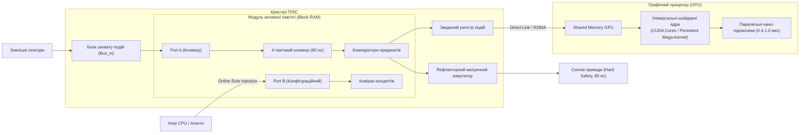

# Чернетка патенту KM-PAT-01: Гетерогенний пристрій детермінованої подієвої обробки для кіберфізичних систем керування

* **Версія:** 0.1.0
* **Дата:** 2026-11-13
* **Тип WP:** Specification / Patent Draft
* **Статус:** Чернетка заявки на винахід (Apparatus Claim Draft).
* **Власник:** Микола Федчик; винахідник — Микола Федчик.
* **Підстава:** Архітектурне рішення [ADR B6](../../Engineering/decisions/b6-gpu-persistent-kernel-subscribers.md), експериментальні пакети [EXP-GPU-01](../../Research/studies/fpga-gpu-symbiosis/experiments/EXP-GPU-01/README.md) та [EXP-GPU-02](../../Research/studies/fpga-gpu-symbiosis/experiments/EXP-GPU-02/README.md).

---

## 1. Назва винаходу
**ГЕТЕРОГЕННИЙ ПРИСТРІЙ ДЕТЕРМІНОВАНОЇ ПОДІЄВОЇ ОБРОБКИ ДЛЯ КІБЕРФІЗИЧНИХ СИСТЕМ КЕРУВАННЯ**  
*(HETEROGENEOUS SYSTEM FOR DETERMINISTIC EVENT-DRIVEN PROCESSING IN CYBER-PHYSICAL CONTROL SYSTEMS)*

## 2. Галузь техніки
Винахід належить до обчислювальної техніки, цифрової мікроелектроніки та систем автоматичного керування реального часу, зокрема до гетерогенних обчислювальних комплексів на базі програмованих логічних інтегральних схем (ПЛІС / FPGA) та графічних процесорів (GPU), призначених для високошвидкісного реагування на події в кіберфізичних, роботизованих та критично безпечних системах.

## 3. Рівень техніки (Prior Art)
Відомі класичні системи обробки подій реального часу:
1. **Системи на базі дискретних мікроконтролерів (MCU):** Використовують апаратні переривання (IRQ) та послідовні шини (UART, SPI, CAN). Недоліком є високий час перемикання контексту ($`10\dots 100\ \mu\text{с}`$), значний джитер ($\sigma \gt 10\ \mu\text{с}$) та параліч системи при одночасному виникненні багатьох подій (Interrupt Storm).
2. **Системи на базі графічних прискорювачів (GPU):** Забезпечують масовий паралелізм, але страждають від софтверних затримок операційної системи та драйвера при запуску ядер (`cudaLaunchKernel`, $`3\dots 10\ \mu\text{с}`$), а також розходження потоків (Warp Divergence) при обробці неструктурованих умовних розгалужень.
3. **Класичні контролери на ПЛІС:** Забезпечують швидкість, але потребують багатогодинного пересинтезу бітстріму кристала для зміни правил логіки, що унеможливлює динамічне навчання без зупинки об'єкта.

## 4. Суть винаходу та технічний результат
Винахід вирішує задачу усунення «вузького місця» виконання підписок (Callback Bottleneck) та забезпечення детермінованої субмікросекундної реакції при збереженні можливості онлайнового оновлення правил на льоту.

**Досягнутий технічний результат полягає у:**
1. Зменшенні повного наскрізного часу реакції системи від фізичної події до виконання 32 векторних підписників до величини $`T_{\text{e2e}} \lt 1.0\ \mu\text{с}`$;
2. Забезпеченні апаратного нульового джитеру в рефлекторному контурі безпеки ($`\sigma \le 5\text{ нс}`$);
3. Повному усуненні дивергенції варпів (Warp Divergence) у масиві обчислювачів GPU;
4. Забезпеченні можливості динамічного оновлення правил у внутрішній активній пам'яті за $`\le 20\text{ нс}`$ без зупинки основного контуру безпеки.

## 5. Опис конструкції пристрою
Гетерогенний пристрій детермінованої подієвої обробки містить:
1. **Блок швидкісного захвату вхідних подій ($`Bus_{\text{in}}`$):** Апаратно узгоджений за напругою модуль приймання дискретних сигналів із фільтрами брязкоту контактів та детекторами фронтів.
2. **Модуль активної пам'яті на базі Block RAM:** Внутрішньокристальний блок двопортової статичної пам'яті з організацією концептуальних комірок. Кожна комірка містить числове значення стану, прапорці `VALID`/`BUSY`, комбінаційний компаратор предикатів (`::`) та двійкову маску підписників. Модуль містить Port A для конвеєра обробки та Port B для онлайнової інжекції правил.
3. **Матричний комутатор рефлекторного рівня (Reflex Crossbar):** Апаратний комутатор, що за 1 машинний такт ($`10\text{ нс}`$) передає сигнал аварійного захисту на вихідні силові каскади при спрацьовуванні критичних предикатів.
4. **Інтерфейс прямого доступу до пам'яті (Direct Interconnect):** Синхронна шина зв'язку з графічним прискорювачем (PCIe Direct / GPUDirect RDMA або швидкісна паралельна шина), що передає зведений регістр подій у фіксовану адресу пам'яті GPU без залучення системного CPU.
5. **Масив універсальних шейдерних ядер GPU:** Мультипроцесори архітектури SIMT, у швидку спільну пам'ять (Shared Memory) яких завантажено постійно виконуваний персистентний кернел (Persistent Mega-Kernel), що реалізує наносекундне опитування прапорця та паралельне виконання коду активованих підписників без звернення до глобальної пам'яті DRAM.

## 6. Формула винаходу (Patent Claims)

### Незалежний пункт 1 (Пристрій):
Гетерогенний пристрій детермінованої подієвої обробки для кіберфізичних систем керування, що містить:
* блок швидкісного захвату вхідних подій середовища;
* модуль активної пам'яті станів концептів, виконаний на базі апаратних блоків статичної пам'яті Block RAM програмованої логічної інтегральної схеми (ПЛІС), що містить логічні схеми предикатного зіставлення;
* апаратний матричний комутатор рефлекторного рівня для миттєвої комутації аварійних реакцій;
* високошвидкісний інтерфейс прямої передачі регістрів подій;
* та графічний прискорювач обчислень;  
**який відрізняється тим, що:**
* модуль активної пам'яті виконано на базі двопортової Block RAM, перший порт якої з'єднаний із фіксованим 4-тактовим апаратним конвеєром рефлекторного зіставлення умов із часом обробки не більше $`80\text{ нс}`$ та нульовим апаратним джитером, а другий порт виділено для онлайнового динамічного перезапису предикатних матриць на льоту;
* високошвидкісний інтерфейс прямої передачі з'єднує зведений регістр подій ПЛІС безпосередньо з внутрішньою надшвидкою спільною пам'яттю (Shared Memory) потокових мультипроцесорів графічного прискорювача;
* а графічний прискорювач містить персистентний мега-кернел, розгорнутий на масиві універсальних векторних/скалярних шейдерних ядер (ALU INT32/FP32), що виконує безперервне апаратне опитування стану зведеного регістра подій та забезпечує паралельне предикатне виконання коду множини підписників без розходження варпів і без звернення до зовнішньої пам'яті DRAM із загальною наскрізною затримкою не більше $`1.0\ \mu\text{с}`$.

### Залежні пункти (2–5):
2. Пристрій за п. 1, який відрізняється тим, що кожна комірка активної пам'яті Block RAM містить розрядне поле числового значення концепту, апаратні біти валідації `VALID` та зайнятості `BUSY`, комбінаційний компаратор відношення та розрядну маску підписників, синхронізовану з атомарним операційним бар'єром.
3. Пристрій за п. 1, який відрізняється тим, що універсальні шейдерні ядра графічного прискорювача виконують фільтрацію та вибір активних підписників за допомогою апаратних інструкцій вибірки бітового поля (Bitfield Extract) та умовного предикатного вибору (Predicated Execution) без використання інструкцій умовного переходу.
4. Пристрій за п. 1, який відрізняється тим, що другий порт активної пам'яті Block RAM сполучений через конфігураційну шину з керуючим процесором вищого рівня, забезпечуючи перезапис порогів спрацьовування та топології зв'язків за час не більше 2 машинних тактів без призупинення роботи конвеєра на першому порту.
5. Пристрій за п. 1, який відрізняється тим, що матричний комутатор рефлекторного рівня містить апаратні лінії зворотного тиску (Credit-Based Backpressure), здатні зупиняти вхідний потік подій за один такт при перевищенні порогу черги.

---

## 7. Історія версій

| Версія | Дата | Автор | Зміни |
|---|---|---|---|
| 0.1.0 | 2026-11-13 | Микола Федчик | Первинна редакція чернетки опису та формули патенту на пристрій (KM-PAT-01). |

## 8. Абревіатури та глосарій

* **BRAM** — Block RAM.
* **CII** — Computer-Implemented Inventions.
* **GPU** — Graphics Processing Unit.
* **Shared Memory** — внутрішньокристальна швидка пам'ять потокового мультипроцесора GPU.
* **Warp Divergence** — ефект деградації паралелізму SIMT при неоднорідних розгалуженнях потоків.
