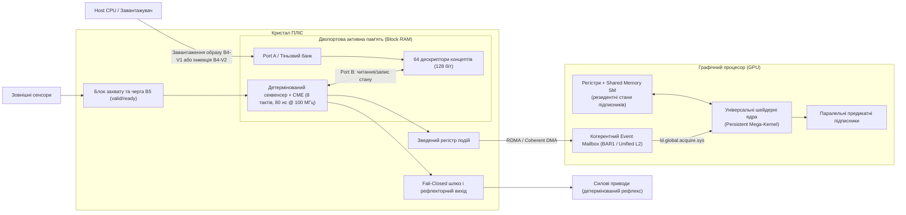

# Чернетка патенту KM-PAT-01: Гетерогенний пристрій детермінованої подієвої обробки для кіберфізичних систем керування

* **Версія:** 0.2.0
* **Дата:** 2026-11-14
* **Тип WP:** Specification / Patent Draft
* **Статус:** Чернетка заявки на винахід (Apparatus Claim Draft; числові показники швидкодії є розрахунковими/цільовими до завершення HIL EXP-GPU-01/02).
* **Власник:** Микола Федчик; винахідник — Микола Федчик.
* **Підстава:** Архітектурне рішення [ADR B6](../../Engineering/decisions/b6-gpu-persistent-kernel-subscribers.md), експериментальні пакети [EXP-GPU-01](../../Research/studies/fpga-gpu-symbiosis/experiments/EXP-GPU-01/README.md) та [EXP-GPU-02](../../Research/studies/fpga-gpu-symbiosis/experiments/EXP-GPU-02/README.md).

---

## 1. Назва винаходу
**ГЕТЕРОГЕННИЙ ПРИСТРІЙ ДЕТЕРМІНОВАНОЇ ПОДІЄВОЇ ОБРОБКИ ДЛЯ КІБЕРФІЗИЧНИХ СИСТЕМ КЕРУВАННЯ**  
*(HETEROGENEOUS SYSTEM FOR DETERMINISTIC EVENT-DRIVEN PROCESSING IN CYBER-PHYSICAL CONTROL SYSTEMS)*

## 2. Галузь техніки
Винахід належить до обчислювальної техніки, цифрової мікроелектроніки та систем автоматичного керування реального часу, зокрема до гетерогенних обчислювальних комплексів на базі програмованих логічних інтегральних схем (ПЛІС / FPGA) та графічних процесорів (GPU), призначених для високошвидкісного реагування на події в кіберфізичних, роботизованих та критично безпечних системах.

## 3. Рівень техніки (Prior Art)
Відомі класичні системи обробки подій реального часу:
1. **Системи на базі дискретних мікроконтролерів (MCU):** Використовують апаратні переривання (IRQ) та послідовні шини (UART, SPI, CAN). Недоліком є високий час перемикання контексту ($`10\dots 100\ \mu\text{с}`$), значний джитер ($\sigma \gt 10\ \mu\text{с}$) та параліч системи при одночасному виникненні багатьох подій (Interrupt Storm).
2. **Системи на базі графічних прискорювачів (GPU):** Забезпечують масовий паралелізм, але страждають від софтверних затримок операційної системи та драйвера при запуску ядер (`cudaLaunchKernel`, $`3\dots 10\ \mu\text{с}`$), а також розходження потоків (Warp Divergence) при обробці неструктурованих умовних розгалужень.
3. **Класичні контролери на ПЛІС:** Забезпечують швидкість, але потребують багатогодинного пересинтезу бітстріму кристала для зміни правил логіки, що унеможливлює динамічне навчання без зупинки об'єкта.

## 4. Суть винаходу та технічний результат
Винахід вирішує задачу усунення «вузького місця» виконання підписок (Callback Bottleneck) та забезпечення детермінованої субмікросекундної реакції при збереженні можливості онлайнового оновлення правил на льоту.

**Очікуваний (цільовий) технічний результат полягає у:**
1. Скороченні розрахункового наскрізного часу реакції системи від фізичної події до завершення обчислення 32 векторних підписників до цільової межі $`T_{\text{e2e}} \lt 1.0\ \mu\text{с}`$ (підлягає метрологічному підтвердженню на фізичному стенді за `EXP-GPU-01`);
2. Забезпеченні фіксованої тактової тривалості обчислення рефлекторного контуру ПЛІС ($`80\text{ нс}`$ на подію для 8-тактового автомата при $`100\text{ МГц}`$ за вільної черги) без програмного джитеру переривань ОС;
3. Усуненні дивергенції варпів (Warp Divergence) для однорідних предикатно-керованих функцій підписників у масиві обчислювачів GPU;
4. Можливості оновлення дескрипторів правил у внутрішньокристальній Block RAM без пересинтезу бітстріму ПЛІС (у фазово-розділеному режимі завантаження або без зупинки потоку подій у двобанковому виконанні з тіньовим буфером).

## 5. Опис конструкції пристрою
Гетерогенний пристрій детермінованої подієвої обробки містить:
1. **Блок швидкісного захвату вхідних подій ($`Bus_{\text{in}}`$):** Апаратно узгоджений за напругою модуль приймання дискретних сигналів із синхронізаторами тактового домену, фільтрами брязкоту контактів та вхідною чергою зі зворотним тиском (`valid/ready`).
2. **Модуль активної пам'яті на базі Block RAM:** Внутрішньокристальний блок двопортової статичної пам'яті з організацією концептуальних дескрипторів (поточне значення стану, операнд, мікрокод предиката й дії, прапорці охоронців/аварійної межі та ідентифікатор підписника). У базовому втіленні (`CFG-P`, `B4 Варіант 1`) перший порт сполучений із конфігураційною шиною завантаження образу у фазі зупинки конвеєра, а другий порт — з автономним секвенсером подій; в альтернативному високодоступному втіленні (`CFG-P-HA`, `B4 Варіант 2`) передбачено тіньовий банк дескрипторів із атомарним перемиканням активного банку між подіями без розірваного читання (`torn read`).
3. **Транзакційний шлюз та рефлекторний вихідний комутатор:** Синхронний шлюз фазового рішення Великої Крапки (`•`), що у режимі `fail-closed` блокує модифікацію стану за невідомих або аварійних умов і формує апаратний строб захисної дії.
4. **Інтерфейс прямої передачі подій (Direct Event Interconnect):** Високошвидкісний канал зв'язку з графічним прискорювачем (`GPUDirect RDMA` через `PCIe BAR1` або системний `DMA` / синхронна шина у когерентну пам'ять SoC), що записує зведений регістр подій (`Event Mailbox`) у кешовану `L2` апаратно-когерентну область пам'яті GPU без диспетчеризації центральним процесором.
5. **Масив універсальних шейдерних ядер GPU:** Потокові мультипроцесори архітектури SIMT, на яких постійно виконується персистентний мега-кернел (Persistent Mega-Kernel). Варп виконує атомарне `acquire`-опитування когерентного буфера `Event Mailbox` (через `L2`-кеш), а всі робочі змінні станів, коефіцієнти та таблиці диспетчеризації підписників утримує резидентно у регістровому файлі та внутрішній спільній пам'яті (`Shared Memory` SM), уникаючи звернень до некешованої зовнішньої DRAM під час обчислення реакцій.

## 6. Формула винаходу (Patent Claims)

### Незалежний пункт 1 (Пристрій):
Гетерогенний пристрій детермінованої подієвої обробки для кіберфізичних систем керування, що містить:
* блок швидкісного захвату вхідних подій середовища;
* модуль активної пам'яті станів концептів, виконаний на базі апаратних блоків статичної пам'яті Block RAM програмованої логічної інтегральної схеми (ПЛІС), поєднаний із логічними схемами предикатного зіставлення й транзакційного захисту;
* апаратний комутатор рефлекторного рівня для видачі захисних реакцій;
* високошвидкісний інтерфейс прямої передачі регістрів подій;
* та графічний прискорювач обчислень;  
**який відрізняється тим, що:**
* модуль активної пам'яті на базі двопортової Block RAM з'єднаний одним портом із детермінованим скінченним автоматом-конвеєром предикатного зіставлення та `fail-closed` транзакційного шлюзу з фіксованою кількістю тактів обслуговування події без пересинтезу бітстріму ПЛІС, а іншим конфігураційним портом — із трактом запису дескрипторів концептів;
* високошвидкісний інтерфейс прямої передачі сполучає зведений регістр подій ПЛІС без участі центрального процесора з апаратно-когерентною областю пам'яті низької латентності графічного прискорювача;
* а графічний прискорювач містить персистентний мега-кернел, розгорнутий на масиві універсальних векторних/скалярних шейдерних ядер (ALU INT32/FP32), який виконує безперервне атомарне `acquire`-опитування вказаної когерентної області пам'яті та забезпечує паралельне предикатне виконання коду множини підписників із постійним резидентним утриманням змінних стану, коефіцієнтів і таблиць маршрутизації підписників у регістровому файлі та внутрішній спільній пам'яті (`Shared Memory`) потокових мультипроцесорів без розходження варпів.

### Залежні пункти (2–6):
2. Пристрій за п. 1, який відрізняється тим, що кожний дескриптор концепту в активній пам'яті Block RAM містить поле поточного значення концепту, операнд, коди операцій предиката та дії, бітові прапорці охоронців припущення, інваріанту та порогу небезпеки (`hazard`), а також ідентифікатор цільового підписника каскаду, синхронізовані транзакційним шлюзом за правилом `fail-closed`.
3. Пристрій за п. 1, який відрізняється тим, що універсальні шейдерні ядра графічного прискорювача виконують фільтрацію та вибір активних підписників за допомогою апаратних інструкцій вибірки бітового поля (Bitfield Extract) та умовного предикатного вибору (Predicated Execution) без розгалужених умовних переходів між потоками одного варпа.
4. Пристрій за п. 1, який відрізняється тим, що конфігураційний тракт запису дескрипторів Block RAM виконано або з апаратним фазовим блокуванням запису на час активності секвенсера (`busy == 1`) для унеможливлення розірваного читання багатослівних дескрипторів, або у вигляді подвійного (тіньового) банку Block RAM із атомарним перемиканням активного банку на межі завершення машинного циклу події без зупинки вхідного потоку.
5. Пристрій за п. 1, який відрізняється тим, що вхідний тракт захвату подій ПЛІС містить кільцеву чергу фіксованої глибини з апаратним сигналом готовності (`ready`) зворотного тиску, який резервує слот під внутрішні каскадні переходи між концептами та запобігає втраті подій керованих джерел.
6. Пристрій за п. 1, який відрізняється тим, що апаратно-когерентна область пам'яті низької латентності графічного прискорювача реалізована як вирівняна за лінією `L2`-кешу поштова комірка (`Event Mailbox`) у пам'яті `PCIe BAR1 VRAM` при прямому доступі `GPUDirect RDMA` або в системно-когерентній об'єднаній пам'яті однокристальної системи (`Unified Memory SoC`).

---

## 7. Історія версій

| Версія | Дата | Автор | Зміни |
|---|---|---|---|
| 0.2.0 | 2026-11-14 | Микола Федчик, Copilot CLI | #165: узгоджено формулу та опис із реальною ієрархією пам'яті GPU (`Coherent Event Mailbox` у `BAR1/Unified L2` + резидентні стани у регістрах/`Shared Memory` SM), варіантами портів BRAM (`B4-V1`/`B4-V2`), чергою `B5` і проєктним статусом цільових метрик. |
| 0.1.0 | 2026-11-13 | Микола Федчик | Первинна редакція чернетки опису та формули патенту на пристрій (KM-PAT-01). |

## 8. Абревіатури та глосарій

* **BRAM** — Block RAM.
* **CII** — Computer-Implemented Inventions.
* **GPU** — Graphics Processing Unit.
* **Shared Memory** — внутрішньокристальна швидка пам'ять потокового мультипроцесора GPU.
* **Warp Divergence** — ефект деградації паралелізму SIMT при неоднорідних розгалуженнях потоків.
