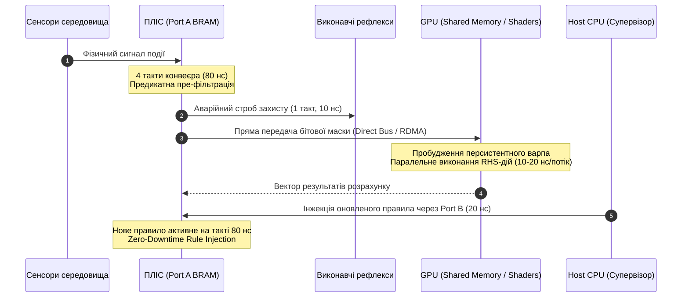

# Чернетка патенту KM-PAT-02: Спосіб багаторівневого детермінованого керування подіями в кіберфізичних комплексах реального часу

* **Версія:** 0.1.0
* **Дата:** 2026-11-13
* **Тип WP:** Specification / Patent Draft
* **Статус:** Чернетка заявки на винахід (Method Claim Draft).
* **Власник:** Микола Федчик; винахідник — Микола Федчик.
* **Підстава:** Архітектурне рішення [ADR B6](../../Engineering/decisions/b6-gpu-persistent-kernel-subscribers.md), експериментальні пакети [EXP-GPU-01](../../Research/studies/fpga-gpu-symbiosis/experiments/EXP-GPU-01/README.md) та [EXP-GPU-02](../../Research/studies/fpga-gpu-symbiosis/experiments/EXP-GPU-02/README.md).

---

## 1. Назва винаходу
**СПОСІБ БАГАТОРІВНЕВОГО ДЕТЕРМІНОВАНОГО КЕРУВАННЯ ПОДІЯМИ В КІБЕРФІЗИЧНИХ КОМПЛЕКСАХ РЕАЛЬНОГО ЧАСУ ТА ДИНАМІЧНОЇ МОДИФІКАЦІЇ БАЗ ЗНАНЬ**  
*(METHOD FOR MULTI-LEVEL DETERMINISTIC EVENT CONTROL AND DYNAMIC KNOWLEDGE BASE RECONFIGURATION IN REAL-TIME CYBER-PHYSICAL SYSTEMS)*

## 2. Галузь техніки
Винахід належить до методів організації паралельних обчислень у реальному часі, цифрового оброблення сигналів та автоматичного регулювання високодинамічними промисловими об'єктами, зокрема до способів ієрархічної диспетчеризації реактивних подій у гетерогенних обчислювальних комплексах «ПЛІС — Графічний прискорювач — Керуючий комп'ютер».

## 3. Рівень техніки (Prior Art)
У відомих способах подієвого керування:
1. Застосовують опитування портів (Polling) або черги переривань (IRQ) центральним процесором. Це призводить до недетермінованого часу виклику функцій зворотного зв'язку (колбеків) у діапазоні $`10\dots 1000\ \mu\text{с}`$ та колапсу системи при стрибках частоти вхідних сигналів.
2. Використовують програмні машини виведення продукційних правил (типу RETE/CLIPS). Їхнім недоліком є стохастичний час обходу дерева умов у пам'яті DRAM і часовий джитер понад $`10\ \mu\text{с}`$, що заборонено для контурів жорсткої безпеки (Hard Real-Time).
3. Перепрограмування правил на ПЛІС вимагає повної зупинки роботи системи для завантаження нового бітстріму, що унеможливлює безперервну адаптацію та онлайн-навчання в процесі функціонування.

## 4. Суть способу та технічний результат
В основу винаходу поставлено задачу створення способу багаторівневого керування, який забезпечує гарантований наносекундний детермінізм критичного аварійного захисту, паралельне виконання масиву складних обчислювальних функцій на GPU без накладних витрат операційної системи, а також модифікацію правил без зупинки виробничого циклу.

**Технічний результат:**
1. Забезпечення детермінованого часу виконання захисних рефлексів $`T_{\text{reflex}} \le 80\text{ нс}`$ із нульовим джитером ($`\sigma \le 5\text{ нс}`$);
2. Розпаралелювання виконання до 1024 незалежних функцій-підписників у межах сумарного часу $`T_{\text{e2e}} \le 1.0\ \mu\text{с}`$;
3. Повна ліквідація явища дивергенції варпів при обчисленнях на GPU;
4. Забезпечення інжекції нових правил у базу знань за час $`\le 20\text{ нс}`$ без порушення часового детермінізму паралельного конвеєра.

## 5. Послідовність реалізації способу
Спосіб реалізується через наступну сукупність кроків:
1. **Крок 1 (Захоплення та предикатна компресія):** Фізичні сигнали з сенсорів середовища фіксуються вхідним апаратним портом ПЛІС і подаються на перший порт активної пам'яті Block RAM. Комбінаційні схеми компараторів виконують пре-фільтрацію шуму безпосередньо в активній пам'яті, відсікаючи події, що не змінюють стан системи.
2. **Крок 2 (Атомарна фіксація та рефлекторна реакція):** При виконанні умов предикатів стан концепту фіксується за транзакційним бар'єром Великої Крапки (`•`). Якщо концепт належить до класу аварійного захисту, апаратний матричний комутатор за 1 такт ($`10\text{ нс}`$) видає керівний сигнал на виконавчі органи.
3. **Крок 3 (Емісія зведеної маски подій):** Паралельно формується єдине двійкове слово зведеного регістра подій, де кожен активний біт відповідає номеру концепту, що змінив стан.
4. **Крок 4 (Прямий трансфер у спільну пам'ять GPU):** Двійкова маска передається через високошвидкісний прямий канал зв'язку (GPUDirect RDMA або паралельна шина) у внутрішню швидку пам'ять (Shared Memory) графічного процесора, минаючи оперативну пам'ять хоста і стек ОС Linux.
5. **Крок 5 (Шейдерна паралельна обробка):** Персистентне ядро, що безперервно виконується на універсальних шейдерних ядрах GPU (CUDA Cores), фіксує зміну бітової маски, призначає окремі потоки варпа на обчислення кожного активованого підписника, обчислює аналітичні алгоритми регулювання (ПІД, фільтрацію, траєкторії) виключно в регістрах і спільній пам'яті, та записує результуючий вектор у вихідний буфер.
6. **Крок 6 (Онлайнова модифікація бази знань):** При надходженні команди оптимізації від вищого рівня супервізора, нові значення порогів предикатів та маски дозволу записуються через другий незалежний порт Block RAM за 1–2 такти ($`10\dots 20\text{ нс}`$), вступаючи в дію з наступного машинного циклу без зупинки конвеєра на першому порту.

## 6. Формула винаходу (Patent Claims)

### Незалежний пункт 1 (Спосіб):
Спосіб багаторівневого детермінованого керування подіями в кіберфізичних комплексах реального часу, що включає захоплення вхідних сигналів сенсорів, порівняння параметрів із граничними значеннями та запуск функцій реакції,  
**який відрізняється тим, що:**
* обробку розділяють на два взаємодіючі апаратні контури: жорсткий рефлекторний контур на кристалі ПЛІС та масово-паралельний контур обчислення підписок на графічному прискорювачі;
* у рефлекторному контурі здійснюють апаратну комбінаційну пре-фільтрацію вхідних сигналів у внутрішній двопортовій активній пам'яті Block RAM за фіксований детермінований час не більше $`80\text{ нс}`$ із нульовим джитером, при цьому критичні захисні команди видають через матричний комутатор за один машинний такт безпосередньо на виконавчі приводи;
* паралельно з видачею захисних команд формують стислу бітову маску змінених концептуальних станів та передають її безпосередньо у внутрішню спільну пам'ять (Shared Memory) мультипроцесорів графічного прискорювача через прямий апаратний інтерфейс;
* у графічному прискорювачі здійснюють безперервне опитування вказаної бітової маски персистентним ядром на універсальних шейдерних ядрах та виконують паралельні алгоритми підписників із часом відгуку не більше $`1.0\ \mu\text{с}`$ без звернення до зовнішньої пам'яті DRAM;
* а модифікацію правил предикатів, порогів спрацьовування та масок зв'язків здійснюють шляхом онлайнового запису конфігураційних слів у другий порт двопортової Block RAM за час не більше 2 машинні такти без припинення чи затримки конвеєра обробки подій на першому порту.

### Залежні пункти (2–4):
2. Спосіб за п. 1, який відрізняється тим, що паралельне виконання коду підписників на шейдерних ядрах графічного прискорювача здійснюють за допомогою апаратних інструкцій вибірки бітових полів та предикатного умовного вибору, запобігаючи виникненню дивергенції варпів при довільних наборах активних підписників.
3. Спосіб за п. 1, який відрізняється тим, що при перевищенні вхідним потоком подій пропускної здатності конвеєра, на вхідні сенсорні канали формують апаратний сигнал зворотного тиску (Credit-Based Backpressure) за один тактовий цикл, запобігаючи некерованому переповненню черг та втраті інформації.
4. Спосіб за п. 1, який відрізняється тим, що під час функціонування системи здійснюють статистичне накопичення ко-активацій концептів, і на основі виявлених кореляцій синтезують агреговані макро-концепти, які записують через другий порт Block RAM як нові еквівалентні правила зі зменшеною глибиною логічного виведення.

---

## 7. Історія версій

| Версія | Дата | Автор | Зміни |
|---|---|---|---|
| 0.1.0 | 2026-11-13 | Микола Федчик | Первинна редакція чернетки опису та формули патенту на спосіб (KM-PAT-02). |

## 8. Абревіатури та глосарій

* **Backpressure** — зворотний тиск регулювання потоку даних.
* **BRAM** — Block RAM.
* **CII** — Computer-Implemented Inventions.
* **GPU** — Graphics Processing Unit.
* **RDMA** — Remote Direct Memory Access.
* **Zero-Downtime Rule Injection** — інжекція правил без зупинки системи.
