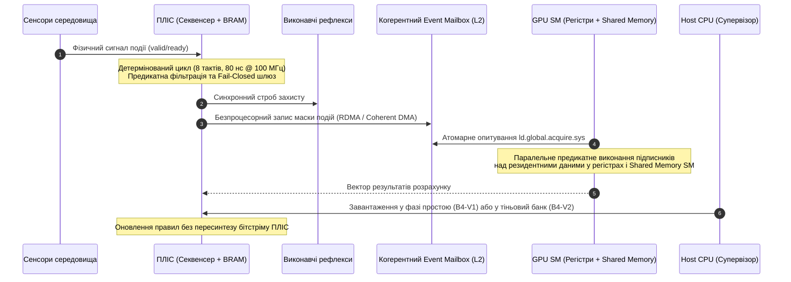

# Чернетка патенту KM-PAT-02: Спосіб багаторівневого детермінованого керування подіями в кіберфізичних комплексах реального часу

* **Версія:** 0.2.0
* **Дата:** 2026-11-14
* **Тип WP:** Specification / Patent Draft
* **Статус:** Чернетка заявки на винахід (Method Claim Draft; числові показники швидкодії є розрахунковими/цільовими до завершення HIL EXP-GPU-01/02).
* **Власник:** Микола Федчик; винахідник — Микола Федчик.
* **Підстава:** Архітектурне рішення [ADR B6](../../Engineering/decisions/b6-gpu-persistent-kernel-subscribers.md), експериментальні пакети [EXP-GPU-01](../../Research/studies/fpga-gpu-symbiosis/experiments/EXP-GPU-01/README.md) та [EXP-GPU-02](../../Research/studies/fpga-gpu-symbiosis/experiments/EXP-GPU-02/README.md).

---

## 1. Назва винаходу
**СПОСІБ БАГАТОРІВНЕВОГО ДЕТЕРМІНОВАНОГО КЕРУВАННЯ ПОДІЯМИ В КІБЕРФІЗИЧНИХ КОМПЛЕКСАХ РЕАЛЬНОГО ЧАСУ ТА ДИНАМІЧНОЇ МОДИФІКАЦІЇ БАЗ ЗНАНЬ**  
*(METHOD FOR MULTI-LEVEL DETERMINISTIC EVENT CONTROL AND DYNAMIC KNOWLEDGE BASE RECONFIGURATION IN REAL-TIME CYBER-PHYSICAL SYSTEMS)*

## 2. Галузь техніки
Винахід належить до методів організації паралельних обчислень у реальному часі, цифрового оброблення сигналів та автоматичного регулювання високодинамічними промисловими об'єктами, зокрема до способів ієрархічної диспетчеризації реактивних подій у гетерогенних обчислювальних комплексах «ПЛІС — Графічний прискорювач — Керуючий комп'ютер».

## 3. Рівень техніки (Prior Art)
У відомих способах подієвого керування:
1. Застосовують опитування портів (Polling) або черги переривань (IRQ) центральним процесором. Це призводить до недетермінованого часу виклику функцій зворотного зв'язку (колбеків) у діапазоні $`10\dots 1000\ \mu\text{с}`$ та колапсу системи при стрибках частоти вхідних сигналів.
2. Використовують програмні машини виведення продукційних правил (типу RETE/CLIPS). Їхнім недоліком є стохастичний час обходу дерева умов у пам'яті DRAM і часовий джитер понад $`10\ \mu\text{с}`$, що заборонено для контурів жорсткої безпеки (Hard Real-Time).
3. Перепрограмування правил на ПЛІС вимагає повної зупинки роботи системи для завантаження нового бітстріму, що унеможливлює безперервну адаптацію та онлайн-навчання в процесі функціонування.

## 4. Суть способу та технічний результат
В основу винаходу поставлено задачу створення способу багаторівневого керування, який забезпечує гарантований наносекундний детермінізм критичного аварійного захисту, паралельне виконання масиву складних обчислювальних функцій на GPU без накладних витрат операційної системи, а також модифікацію правил без зупинки виробничого циклу.

**Очікуваний (цільовий) технічний результат:**
1. Забезпечення фіксованої тактової тривалості обчислення захисних рефлексів на ПЛІС ($`T_{\text{reflex}} = 80\text{ нс}`$ на подію для 8-тактового автомата при $`100\text{ МГц}`$ за вільної черги) без програмного джитеру ОС;
2. Масштабоване розпаралелювання множини функцій-підписників із цільовим наскрізним часом $`T_{\text{e2e}} \le 1.0\ \mu\text{с}`$ для одного варпа (32 підписники; перевіряється в `EXP-GPU-01`);
3. Усунення явища дивергенції варпів для однорідних предикатно-керованих операторів підписників на GPU;
4. Можливість переконфігурації бази правил у Block RAM без пересинтезу бітстріму ПЛІС (у безпечній фазі зупинки або без переривання конвеєра через тіньовий банк дескрипторів).

## 5. Послідовність реалізації способу
Спосіб реалізується через наступну сукупність кроків:
1. **Крок 1 (Захоплення зі зворотним тиском та предикатна фільтрація):** Фізичні сигнали з сенсорів середовища фіксуються вхідним портом ПЛІС у черзі зі зворотним тиском (`valid/ready`) і обслуговуються детермінованим секвенсером з вибіркою дескриптора з Block RAM. Комбінаційні схеми компараторів виконують пре-фільтрацію вхідного параметра, відсікаючи події, які порушують припущення, інваріанти або пороги небезпеки (`hazard`).
2. **Крок 2 (Атомарна фіксація та рефлекторна реакція):** При виконанні всіх умов охоронців стан концепту фіксується за транзакційним бар'єром Великої Крапки (`•`) у режимі `fail-closed`, а рефлекторний вихідний тракт видає синхронний сигнал на виконавчі органи.
3. **Крок 3 (Емісія зведеної маски подій):** Паралельно формується компактне двійкове слово зведеного регістра подій, де активні розряди кодують ідентифікатори концептів, що зафіксували перехід.
4. **Крок 4 (Безпроцесорний трансфер у когерентний поштовий буфер GPU):** Двійкова маска передається через прямий апаратний канал (`GPUDirect RDMA` у `BAR1 VRAM` або системний `DMA` / швидкісну шину у когерентну `Unified Memory`) у вирівняну за лінією `L2`-кешу комірку `Event Mailbox` графічного прискорювача, минаючи диспетчер потоків ОС.
5. **Крок 5 (Шейдерна паралельна обробка з резидентним станом у SM):** Персистентний мега-кернел, що безперервно виконується на універсальних шейдерних ядрах GPU (CUDA Cores / SP / XVE), виявляє оновлення `Event Mailbox` через атомарне `acquire`-читання системної області видимості (`ld.global.acquire.sys`), розподіляє потоки варпа за бітовою маскою та обчислює алгоритми регулювання виключно над змінними й коефіцієнтами, які постійно розміщені в регістровому файлі та внутрішній `Shared Memory` SM, після чого записує вихідний вектор.
6. **Крок 6 (Динамічна переконфігурація бази правил):** Нові дескриптори предикатів, порогів і каскадних підписок записуються у Block RAM без пересинтезу бітстріму: або в атомарно захищеній фазі простою конвеєра (`busy == 0`, `B4 Варіант 1`), або в тіньовий банк Block RAM із однокроковим перемиканням активного банку між подіями без розірваного читання (`B4 Варіант 2`).

## 6. Формула винаходу (Patent Claims)

### Незалежний пункт 1 (Спосіб):
Спосіб багаторівневого детермінованого керування подіями в кіберфізичних комплексах реального часу, що включає захоплення вхідних сигналів сенсорів, порівняння параметрів із граничними значеннями та запуск функцій реакції,  
**який відрізняється тим, що:**
* обробку розділяють на два взаємодіючі апаратні контури: жорстко детермінований рефлекторний контур на кристалі ПЛІС та масово-паралельний контур обчислення підписок на графічному прискорювачі;
* у рефлекторному контурі здійснюють апаратну предикатну фільтрацію та `fail-closed` транзакційну перевірку вхідних подій за дескрипторами у внутрішньокристальній активній пам'яті Block RAM за фіксоване число тактів без пересинтезу бітстріму ПЛІС із прямою видачею критичних захисних сигналів на виконавчі приводи;
* паралельно формують стислу бітову маску зафіксованих переходів концептів і без участі центрального процесора передають її через прямий апаратний інтерфейс у когерентну область пам'яті низької латентності графічного прискорювача;
* у графічному прискорювачі здійснюють безперервне атомарне `acquire`-опитування вказаної когерентної області пам'яті персистентним ядром на універсальних шейдерних ядрах та виконують паралельні предикатно-керовані алгоритми активованих підписників виключно над станами й коефіцієнтами, постійно резидентними в регістровому файлі та внутрішній спільній пам'яті (`Shared Memory`) потокових мультипроцесорів без звернень тіла підписників до некешованої зовнішньої пам'яті DRAM;
* а переконфігурацію дескрипторів предикатів, порогів і зв'язків здійснюють записом конфігураційних слів у Block RAM ПЛІС із апаратним захистом від розірваного читання багатослівного дескриптора.

### Залежні пункти (2–5):
2. Спосіб за п. 1, який відрізняється тим, що паралельне виконання коду підписників на шейдерних ядрах графічного прискорювача здійснюють за допомогою апаратних інструкцій вибірки бітових полів та предикатного умовного вибору, запобігаючи виникненню дивергенції варпів при довільних комбінаціях активних підписників однорідної структури.
3. Спосіб за п. 1, який відрізняється тим, що при заповненні вхідної черги ПЛІС з урахуванням зарезервованих слотів внутрішніх каскадів знімають апаратний сигнал готовності (`ready`) зворотного тиску, утримуючи події керованих джерел без втрат.
4. Спосіб за п. 1, який відрізняється тим, що апаратний захист від розірваного читання під час переконфігурації Block RAM реалізують або відхиленням конфігураційних записів шини при активному секвенсері (`busy == 1`), або записом оновлених 128-бітних дескрипторів у тіньовий банк двопортової Block RAM із атомарним перемиканням активного банку між сусідніми циклами обробки подій без зупинки конвеєра.
5. Спосіб за п. 1, який відрізняється тим, що під час функціонування системи здійснюють статистичне накопичення ко-активацій концептів, синтезують агреговані правила зі зменшеною глибиною каскаду та завантажують їх у Block RAM на етапі переконфігурації.

---

## 7. Історія версій

| Версія | Дата | Автор | Зміни |
|---|---|---|---|
| 0.2.0 | 2026-11-14 | Микола Федчик, Copilot CLI | #165: узгоджено формулу й опис із реальною ієрархією пам'яті GPU (`Event Mailbox` у когерентній L2/BAR1/Unified пам'яті + резидентні стани в регістрах/`Shared Memory` SM), режимами захисту від torn-read (`B4-V1`/`B4-V2`) та проєктним статусом числових меж. |
| 0.1.0 | 2026-11-13 | Микола Федчик | Первинна редакція чернетки опису та формули патенту на спосіб (KM-PAT-02). |

## 8. Абревіатури та глосарій

* **Backpressure** — зворотний тиск регулювання потоку даних.
* **BRAM** — Block RAM.
* **CII** — Computer-Implemented Inventions.
* **GPU** — Graphics Processing Unit.
* **RDMA** — Remote Direct Memory Access.
* **Zero-Downtime Rule Injection** — інжекція правил без зупинки системи.
