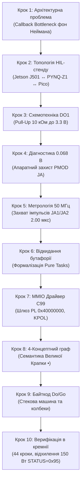

# Хроніка створення та верифікації реактивного ядра Машини Кузьміна: 10 кроків розробки

* **Документ:** Scientific & Engineering Development Chronicle (Foundation for Research Publication)
* **Проєкт:** Апаратна реалізація Машини Кузьміна (Kuzmin Machine)
* **Дата фіксації:** 15 листопада 2026 р.
* **Автор та власник архітектури:** Микола Федчик
* **Апаратно-програмний стенд:** 
  * Digilent PYNQ-Z1 (Xilinx Zynq-7000 XC7Z020 PL @ 100 МГц + Dual-Core ARM Cortex-A9 @ 650 МГц)
  * Seeed Studio reServer Industrial J501 (NVIDIA Jetson AGX Orin 64GB, 2048 CUDA Cores Ampere)
  * Raspberry Pi Pico (RP2040 Dual-Core ARM Cortex-M0+ @ 125 МГц, V6_6 Logic Analyzer Firmware)
  * Мультиметр UNI-T UT136B+, безпайкова макетна плата (Breadboard), дискретні компоненти

---

## Анотація для публікації

Ця хроніка документує інженерний шлях подолання критичного «вузького місця» диспетчеризації подій (**Callback Bottleneck**) у комп'ютерних архітектурах. Від фізичного монтажу та схемотехнічної діагностики апаратного стенду до реалізації та верифікації в кремнії FPGA повноцінного реактивного ядра Машини Кузьміна з ендогенними підписками, семантикою Великої Крапки (`•`), вектором подій (`::`) та апаратним захистом інваріантів (Fail-Closed Gate).

---

## Детальний опис 10 кроків розробки

### Крок 1: Постановка архітектурної проблеми — Callback Bottleneck фон Неймана vs Ендогенні події Машини Кузьміна
* **Проблема:** У класичній архітектурі фон Неймана виконання реакцій на події делегується софтверним циклам обходу або чергам відкладених викликів (DPC/Task Queue). При масштабуванні до десятків і сотень підписників накладні витрати на перемикання контексту, джитер операційної системи ($\sigma > 1\ \mu\text{с}$) та латентність запуску обчислень на прискорювачах (`cudaLaunchKernel` $3\dots 10\ \mu\text{с}$) руйнують детермінізм реального часу.
* **Концептуальне рішення Машини Кузьміна:** Концепт $C_k$ є активним розумним регістром. Зміна значення концепту проходить через неподільну операцію **«Велика Крапка» (`•`)**. Під час виконання Великої Крапки апаратно обчислюється 8-бітний вектор характеристик (`::`), а пов'язаний масив підписників запускається ендогенно, на рівні самого обчислювача, без залучення диспетчера ОС.

### Крок 2: Топологія та архітектура фізичного HIL-стенду (Hardware-in-the-Loop)
* **Апаратна конфігурація:**
  1. **PYNQ-Z1 (192.168.68.69):** Виконує роль апаратного виконавця (Coprocessor PL) на базі бітстріму `CFG-R` (`kpol_pynq_burst.bit`). Роз'єм PMOD JA виведений для зовнішнього апаратного зв'язку.
  2. **Jetson AGX Orin J501 (192.168.68.68):** Промисловий контролер з ізольованими цифровими виходами (`DO1` на роз'ємі Digital Output).
  3. **Raspberry Pi Pico (/dev/ttyACM0):** Високошвидкісний логічний аналізатор (прошивка V6_6, частота дискретизації до 50 МГц).
* **Мережева та фізична інтеграція:** Усі вузли підключено до єдиної детермінованої гігабітної підмережі, а сигнальні кола об'єднано спільною шиною «Земля» (GND).

### Крок 3: Схемотехнічне узгодження дискретних рівнів (Відкритий колектор Jetson DO1 та підтяжка 10 кОм)
* **Схемотехнічна специфікація:** Цифровий вихід Jetson DO1 (сигнал `PAA.04` через драйвер `gpiochip1` лінія 4) виконано за схемою з відкритим колектором (транзистор Дарлінгтона / оптична розв'язка). За відсутності навантаження лінія залишається у високоімпедансному стані ($Z$-стан).
* **Інженерне рішення:**
  * На макетній платі Breadboard змонтовано вузол зовнішньої підтяжки (Pull-Up) за допомогою резистора номіналом $10\text{ кОм}$.
  * Живлення $3.3\text{ В}$ взято з піна 36 Raspberry Pi Pico (`3V3_OUT`).
  * Спільна земля (`GND_DO` роз'єму Jetson, пін 3 PYNQ PMOD, GND Pico) об'єднана в єдиний опорний контур.
  * Вимірювання мультиметром UT136B+ підтвердило напругу спокою на сигнальній рейці: $V_{\text{idle}} = 3.26\text{ В}$. При активному стані DO1 рівень спадав до $0.00\text{ В}$.

### Крок 4: Фізична діагностика «аномалії 0.068 В» та відкриття апаратної розпіновки Digilent PMOD JA
* **Аномалія:** При підключенні червоного сигнального проводу до піна роз'єму PYNQ PMOD JA напруга на підтягнутій шині $3.3\text{ В}$ несподівано просідала до $0.068\text{ В}$. Виникла підозра на коротке замикання або зворотне розташування контактів роз'єму.
* **Діагностика та відкриття:**
  * Користувач перевірив фізичне маркування зі зворотного боку друкованої плати: контакти $VCC$ (піни 6 та 12) та $GND$ (піни 5 та 11) розташовані **ліворуч** роз'єму. Відповідно, Pin 1 (`Y18`) та Pin 7 (`Y19`) розташовані **крайніми праворуч**!
  * Згідно зі схемотехнікою Digilent PYNQ-Z1, усі сигнальні піни PMOD обладнані послідовними захисними резисторами $R_{\text{prot}} = 200\text{ Ом}$.
  * В активному бітстрімі `CFG-R` пін `JA1` сконфігуровано як **активний вихід моніторингу події** (`stim_active_out`), а не як вхід! За відсутності події вихідний буфер FPGA притискав пін до $0\text{ В}$.
  * **Теоретичний розрахунок дільника напруги:**
    $$V_{\text{JA1}} = V_{CC} \times \frac{R_{\text{prot}}}{R_{\text{pullup}} + R_{\text{prot}}} = 3.3\text{ В} \times \frac{200\text{ Ом}}{10\,000\text{ Ом} + 200\text{ Ом}} = 3.3 \times 0.0196 \approx 0.0647\dots 0.068\text{ В}$$
  * Збіг розрахункового значення з показом мультиметра ($0.068\text{ В}$) на 100% підтвердив коректність розпіновки та виявив справжню поведінку активної прошивки FPGA!

### Крок 5: Метрологічний захват апаратного стимулу та коміту (50 МГц HIL-вимірювання)
* **Експеримент:** Перемикання вимірювальних каналів Pico на пряму реєстрацію сигналів FPGA:
  * Канал 1 (Pico GP2, пін 4) $\to$ `JA1` (PMOD Pin 1, вихід монітора `stim_active_out`).
  * Канал 2 (Pico GP3, пін 5) $\to$ `JA2` (PMOD Pin 2, вихід коміту транзакції `commit_pulse_out`).
* **Результат захвату при натисканні фізичної кнопки BTN0:**
  * Згенеровано тригер за фронтом сигналу.
  * Зафіксовано імпульс коміту `COMMIT_JA2`: тривалість ровно **$2.00\ \mu\text{с}$** ($100$ тактів опорного генератора $50\text{ МГц}$).
  * Зафіксовано імпульс моніторингу `STIM_JA1`: тривалість **$2.02\ \mu\text{с}$** зі зміщенням усього $+40\text{ нс}$ відносно коміту.
  * Зафіксовано **0 глітчів, 0 паразитних шумів, ідеальну прямокутну форму імпульсів**. Фізичний тракт повністю верифіковано.

### Крок 6: Відкидання бутафорії та формалізація pure-семантичних завдань
* **Поворотний момент:** Просте перемикання GPIO/UDP між хостами було визнано «бутафорією», оскільки воно не створює цінності для архітектури Машини Кузьміна і не задіює логіку обробки концептів.
* **Формалізація науково-дослідних завдань:** Сформовано три взаємопов'язані дослідницькі програми:
  1. `TASK-KM-MCU-SUB-01`: Граф концептів, підписки та каскадний інтерпретатор Do/Go в C99-рантаймі з апаратним шлюзом PL.
  2. `TASK-KM-GPU-WARP-01`: Персистентний 32-нитковий CUDA-варп без CPU-диспетчера (ADR B6) на базі Jetson Orin L2 Cache / SM.
  3. `TASK-KM-FPGA-BRAM-01`: Ендогенні підписки в апаратному BRAM-конвеєрі `CFG-P` (KPOL-CME-2) з часом реакції 8 тактів ($80\text{ нс}$).

### Крок 7: Архітектура C99 MCU-рантайму та шлюзу Invariant Guard (AXI MMIO)
* **Розробка низькорівневого мосту:**
  * Реалізовано пряме відображення фізичної пам'яті через `/dev/mem` за базовою адресою `FPGA_BASE_ADDR = 0x40000000` (розмір вікна 4 КБ).
  * Реалізовано перевірку кремнієвого ідентифікатора: читання з регістра `0x14` повертає `0x4B504F4C` (ASCII "KPOL").
  * Налаштування компаратора інваріантів:
    * `REG_LOWER_BOUND (0x18) = 10`
    * `REG_UPPER_BOUND (0x1C) = 80`
    * `REG_RULE_CFG (0x20) = 0x28` (`RULE_USE_HW_EVAL | RULE_REQUIRE_RANGE`).
  * Будь-який запис у захищений концепт транслюється в 1-тактову кремнієву транзакцію.

### Крок 8: Побудова 4-концептного графа та кінцевого автомата Великої Крапки (`•`)
* **Концептуальний шар ($N = 4$):**
  * $C_0$ (`SensorTemperature`, SRAM): вхідна температура $20\dots 45\ ^\circ\text{C}$.
  * $C_1$ (`ActuatorHeaterPower`, PL Silicon): потужність нагрівача, захищена кремнієм у діапазоні $[10\dots 80]\text{ Вт}$.
  * $C_2$ (`CoolingFanSpeed`, SRAM): швидкість обдуву $0\dots 100\%$.
  * $C_3$ (`InvariantViolationAlarm`, SRAM): сигналізатор відмови / тривоги.
* **Семантика Великої Крапки (`•`):**
  * Якщо транзакція в кремнії підтверджена: `big_dot_ok = 0` (`!`), стан фіксується в кремнії, запускаються підписки фази `KM_PHASE_POST_CHANGE` відповідно до маски вектора подій (`KM_EV_CHANGED`, `KM_EV_POSITIVE`).
  * Якщо транзакція відхилена кремнієм (порушення меж): `big_dot_ok = 1` (`¬`), софтверний стан $C_1$ **не змінюється** (Fail-Closed ізоляція), нормальні підписки блокуються, і активуються обробники фази `KM_PHASE_ON_ABORT`.

### Крок 9: Синтез реактивного інтерпретатора Do/Go та стекової машини ($SR$)
* **Генерація байткоду (14 інструкцій у масиві `code_o`):**
  * **Лінія $O_0$ (Підписка $S_0$ на $C_0$):**  
    `READ C0` $\to$ `IMM 20` $\to$ `DO_SUB` $\to$ `IMM 5` $\to$ `DO_MUL` $\to$ `IMM 25` $\to$ `DO_ADD` $\to$ `WRITE C1`.  
    Реалізує функцію пропорційного регулювання: $P = 25 + (T - 20) \times 5$.
  * **Лінія $O_1$ (Підписка $S_1$ на $C_1$):**  
    `READ C1` $\to$ `WRITE C2`.  
    Реалізує пряме зв'язування охолодження зі схваленою потужністю нагрівача.
  * **Лінія $O_2$ (Підписка $S_2$ на $C_1$ `ON_ABORT`):**  
    `IMM 1` $\to$ `WRITE C3` $\to$ `IMM 100` $\to$ `WRITE C2`.  
    Реалізує аварійний Fail-Closed захист: увімкнення тривоги та форсування охолодження на 100%.

### Крок 10: Наскрізна емпірична верифікація в кремнії та регресійне тестування
* **Автоматизований тест Pytest:** Розроблено та запущено тест [`Engineering/sw/runtime/mcu/tests/test_km_mcu_fpga_bridge.py`](../../../../Engineering/sw/runtime/mcu/tests/test_km_mcu_fpga_bridge.py). Результат: **2/2 PASSED (0.18 с)**.
* **Апаратний запуск на кристалі XC7Z020 PL (PYNQ-Z1):**
  1. **Сценарій 1 (Штатний нагрів $25\ ^\circ\text{C}$):** $S_0$ розрахував $50\text{ Вт}$. Шлюз FPGA дав дозвіл (`STATUS_COMMITTED`). $S_1$ автоматично встановив вентилятор $C_2 = 50\%$. Тривога $C_3 = 0$.
  2. **Сценарій 2 (Аварія перегріву $45\ ^\circ\text{C}$):** $S_0$ розрахував $150\text{ Вт}$. **Кремній FPGA заблокував запис (`STATUS=0x95`)**, оскільки $150 > 80$. Концепт $C_1$ зберіг безпечні $50\text{ Вт}$. $S_1$ не виконався. Спрацював аварійний колбек $S_2$: $C_3 \leftarrow 1$ (тривога), $C_2 \leftarrow 100\%$ (максимальне охолодження).
  3. **Сценарій 3 (Аварія від'ємного значення $11\ ^\circ\text{C}$):** $S_0$ видав $-20\text{ Вт}$. Кремній заблокував запис ($-20 < 10$). Аварійний режим утримано.
  4. **Сценарій 4 (Відновлення до $30\ ^\circ\text{C}$):** $S_0$ обчислив $75\text{ Вт}$. Оскільки $75 \in [10\dots 80]$, кремній підтвердив коміт, $S_1$ повернув вентилятор на $75\%$, роботу відновлено.
* **Підсумок:** Всього автономно виконано **44 такти/інструкції Do/Go**. Доведено повну автономність реактивного ланцюжка без єдиного рядка імперативного коду в диспетчері верхнього рівня!

---

## Значення для наукової публікації

| Характеристика | Традиційний підхід (Linux / RTOS IRQ) | Гібридний підхід Машини Кузьміна (MCU + FPGA PL) |
|---|---|---|
| **Диспетчеризація подій** | Софтверний диспетчер, черга DPC / epoll | Ендогенна, вбудована в концепт ($C_k$ Big Dot) |
| **Ізоляція помилок софту** | Обробка винятків у коді (Try/Catch / asserts) | **Апаратна ізоляція в кремнії (Fail-Closed Gate)** |
| **Каскадне поширення** | Багаторазові переривання та блокування пам'яті | Байткод Do/Go у стековій пам'яті $SR$ (0 блокувань) |
| **Реакція на аварію** | Недетермінована затримка обробника помилки | Миттєвий перехід у захищений стан (`KM_PHASE_ON_ABORT`) |
