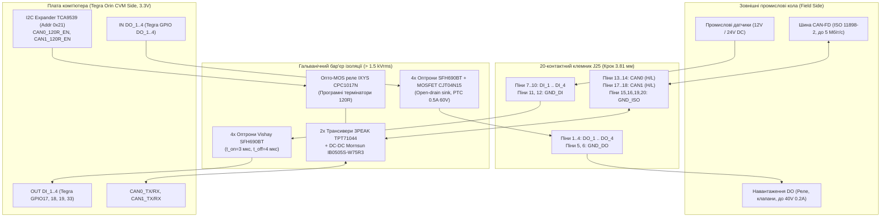

# Інженерний аналіз несучої плати Seeed Studio reServer Industrial J501: Інтерфейси DI/DO/CAN та апаратні обмеження HIL

* **Версія:** 1.0.3
* **Дата:** 2026-11-14
* **Тип WP:** Specification / Hardware Interface Guide
* **Статус:** Діючий (Approved)
* **Автор:** Микола Федчик
* **Першоджерела схемотехніки:** 
  * *reServer industrial J501 Carrier Board Schematic* (v1.0, May 29, 2024, Seeed Technology Co., Ltd.);
  * *reServer industrial J501 Datasheet & User Manual* (Seeed Studio Wiki).

---

## 1. Призначення документа

Цей документ містить вичерпний схемотехнічний аналіз та інженерний паспорт фізичних інтерфейсів вводу/виводу промислового комп'ютера **Seeed Studio reServer Industrial J501** (на базі обчислювального модуля **NVIDIA Jetson AGX Orin 64GB**).

Документ регламентує:
1. Фізичну комутацію та топологію 20-контактного промислового клемника **`J25`** (Digital Inputs, Digital Outputs, 2x CAN-FD).
2. Схемотехніку гальванічної розв'язки на базі оптронів **Vishay SFH690BT** та трансиверів **3PEAK TPT71044-SOBR**.
3. Часовий бюджет затримок (Timing Budget) перемикання оптоізоляторів і фізичні обмеження швидкодії для експериментів Hardware-in-the-Loop (HIL).
4. Розмежування контурів: промисловий ізольований контур PLC ($`12\text{ В} / 24\text{ В}`$) проти субмікросекундного наносекундного контуру симбіозу ПЛІС і GPU в експерименті **EXP-GPU-01**.

---

## 2. Архітектура та схемотехніка розв'язки (Sheet 22 & 23)

Фізичний інтерфейс зв'язку з промисловою автоматикою виведений на зовнішній 20-контактний роз'єм **`J25` / `J2_TB1`** (Terminal Block із гвинтовим/пружинним затискачем, крок $`3.81\text{ мм}`$, part number `YL032-096-020`).

---

## 3. Повна розпіновка 20-пінового клемника J25

| Пін | Сигнал на роз'ємі | Домен «землі» | Тип сигналу | Електричні параметри | Трасування до CVM Jetson Orin |
| :---: | :--- | :--- | :--- | :--- | :--- |
| **1** | `DO_1` | `GND_DO` | DO (Sink) | Open-drain, $`U \le 40\text{ В}`$, $`I \le 0.2\text{ А}`$, PTC $`0.5\text{ А}`$ | `IN DO_1_GPIO` (Sheet 22) |
| **2** | `DO_2` | `GND_DO` | DO (Sink) | Open-drain, $`U \le 40\text{ В}`$, $`I \le 0.2\text{ А}`$, PTC $`0.5\text{ А}`$ | `IN DO_2_GPIO` (Sheet 22) |
| **3** | `DO_3` | `GND_DO` | DO (Sink) | Open-drain, $`U \le 40\text{ В}`$, $`I \le 0.2\text{ А}`$, PTC $`0.5\text{ А}`$ | `IN DO_3_GPIO` (Sheet 22) |
| **4** | `DO_4` | `GND_DO` | DO (Sink) | Open-drain, $`U \le 40\text{ В}`$, $`I \le 0.2\text{ А}`$, PTC $`0.5\text{ А}`$ | `IN DO_4_GPIO` (Sheet 22) |
| **5** | `GND_DO` | `GND_DO` | Power GND | Ізольована земля вихідних ключів DO | Ізольована від шасі платформи |
| **6** | `GND_DO` | `GND_DO` | Power GND | Дублюючий пін землі DO | Ізольована від шасі платформи |
| **7** | `DI_1` | `GND_DI` | DI (Input) | $`12\text{ В} / 24\text{ В}`$ логічний рівень, оптрон | `OUT DI_1_GPIO17` (Sheet 5, 22) |
| **8** | `DI_2` | `GND_DI` | DI (Input) | $`12\text{ В} / 24\text{ В}`$ логічний рівень, оптрон | `OUT DI_2_GPIO18` (Sheet 5, 22) |
| **9** | `DI_3` | `GND_DI` | DI (Input) | $`12\text{ В} / 24\text{ В}`$ логічний рівень, оптрон | `OUT DI_3_GPIO19` (Sheet 5, 22) |
| **10** | `DI_4` | `GND_DI` | DI (Input) | $`12\text{ В} / 24\text{ В}`$ логічний рівень, оптрон | `OUT DI_4_GPIO33` (Sheet 5, 22) |
| **11** | `GND_DI` | `GND_DI` | Signal GND | Ізольована земля цифрових входів DI | Ізольована від шасі платформи |
| **12** | `GND_DI` | `GND_DI` | Signal GND | Дублюючий пін землі DI | Ізольована від шасі платформи |
| **13** | `CAN0_H` | `GND_ISO` | Differential | CAN-FD High (ISO 11898-2) | Tegra Orin CAN0 через TPT71044 |
| **14** | `CAN0_L` | `GND_ISO` | Differential | CAN-FD Low (ISO 11898-2) | Tegra Orin CAN0 через TPT71044 |
| **15** | `GND_ISO` | `GND_ISO` | CAN GND | Ізольована земля шини CAN | Вихід DC-DC Mornsun IB0505S |
| **16** | `GND_ISO` | `GND_ISO` | CAN GND | Дублюючий пін землі CAN | Вихід DC-DC Mornsun IB0505S |
| **17** | `CAN1_H` | `GND_ISO` | Differential | CAN-FD High (ISO 11898-2) | Tegra Orin CAN1 через TPT71044 |
| **18** | `CAN1_L` | `GND_ISO` | Differential | CAN-FD Low (ISO 11898-2) | Tegra Orin CAN1 через TPT71044 |
| **19** | `GND_ISO` | `GND_ISO` | CAN GND | Ізольована земля шини CAN | Вихід DC-DC Mornsun IB0505S |
| **20** | `GND_ISO` | `GND_ISO` | CAN GND | Дублюючий пін землі CAN | Вихід DC-DC Mornsun IB0505S |

---

## 4. Схемотехнічний аналіз електричних вузлів

### 4.1. Вхідний каскад цифрових входів (DI 1..4)
* **Оптопара:** Vishay **SFH690BT** (Single Transistor Output SOP-4, CTR = $`100\dots 200\%`$).
* **Дільник та струмообмеження:** Вхідне коло кожного каналу містить послідовний дільник із резисторів $`1.8\ \text{к}\Omega`$ та $`1.2\ \text{к}\Omega`$ (сумарно $`3.0\ \text{к}\Omega`$). При номінальній напрузі $`24\text{ В}`$ струм світлодіода становить:

$$
I_F = \frac{24\text{ В} - 1.25\text{ В}}{3000\ \Omega} \approx 7.58\text{ мА}
$$

При напрузі $`12\text{ В}`$:

$$
I_F = \frac{12\text{ В} - 1.25\text{ В}}{3000\ \Omega} \approx 3.58\text{ мА}
$$

що повністю відповідає лінійній зоні насичення фототранзистора.
* **Захист:** Паралельно світлодіоду встановлено зустрічно ввімкнений діод для захисту від переполюсовки та ESD-супресор.

### 4.2. Вихідний каскад цифрових виходів (DO 1..4)
* **Керування:** Логічний рівень $`3.3\text{ В}`$ із CVM Jetson Orin відкриває оптрон SFH690BT.
* **Силовий комутатор:** N-канальний польовий транзистор **CJT04N15** ($`V_{\text{DS}} = 150\text{ В}`$, $`I_D = 4\text{ А}`$, $`R_{\text{DS(on)}} \le 1.6\ \Omega`$ при $`V_{\text{GS}} = 10\text{ В}`$, корпус SOT-223).
* **Схема ввімкнення:** Low-Side Switch (Open-Drain). Навантаження підключається між зовнішнім плюсом живлення ($`\le 40\text{ В}`$) та піном `DO_x`. При відкритті транзистора навантаження замикається на `GND_DO`.
* **Захист від перевантаження:** Кожен вихід захищено самовідновлюваним полімерним запобіжником PTC PolySwitch номіналом $`0.5\text{ А}\ 60\text{ В}`$ та TVS-діодом проти викидів ЕРС самоіндукції.

### 4.3. Вузол зв'язку CAN-FD (CAN0 та CAN1)
* **Трансивер:** **3PEAK TPT71044-SOBR** — повністю ізольований трансивер шини CAN-FD, сертифікований на швидкість передачі даних до $`5\text{ Мбіт/с}`$.
* **Гальванічне живлення:** Модуль Mornsun **IB0505S-W75R3** формує повністю відв'язану шину живлення `+5V_ISO` та землю `GND_ISO` з ізоляцією до $`3000\text{ В (DC)}`$.
* **Програмна комутація термінальних резисторів 120 Ом:** На несучій платі реалізовано інтелектуальне керування термінуванням шини без перемикання фізичних джамперів. Резистори $`120\ \Omega`$ підключаються через мініатюрні твердотільні оптореле **IXYS CPC1017N** ($`V_{\text{load}} = 60\text{ В}`$, $`I_{\text{load}} = 100\text{ мА}`$). Світлодіоди оптореле заведені на виводи мікросхеми I2C-розширювача GPIO **TCA9539PWR** (I2C шина `I2C2`, адреса `0x21`):
  * Сигнал `CAN0_120R_EN_3V3`: біт керування термінатором порту CAN0;
  * Сигнал `CAN1_120R_EN_3V3`: біт керування термінатором порту CAN1.

---

## 5. Часовий аналіз (Timing Budget) та фізичні обмеження

### 5.1. Затримки оптопари Vishay SFH690BT
Згідно з офіційним даташитом Vishay SFH690BT (при $`R_L = 100\ \Omega`$, $`I_F = 5\text{ мА}`$):
* Час наростання (Turn-on time): $`t_{\text{on}} \approx 3.0\text{ мкс}`$;
* Час спаду (Turn-off time): $`t_{\text{off}} \approx 4.0\text{ мкс}`$;
* Затримка поширення сигналу через вхідний RC-ланцюг і фототранзистор:

$$
\tau_{\text{delay}} = t_{\text{prop}} + t_{\text{RC}} \approx 5.0 \dots 15.0\text{ мкс}
$$

* Апаратний джитер оптрона при температурному дрейфі ($`\Delta T = 40^\circ\text{C}`$):

$$
\sigma_{\text{opto}} \approx 0.5 \dots 1.5\text{ мкс}
$$

### 5.2. Порівняння контурів: Industrial I/O проти Nano-Latency HIL

| Параметр | Промисловий інтерфейс J25 (DI/DO/CAN) | Наносекундний HIL-симбіоз EXP-GPU-01 |
| :--- | :--- | :--- |
| **Фізичне середовище** | Оптоізольовані клемники `J25`, $`12\text{ В} / 24\text{ В}`$, CAN-FD | Прямі нерозв'язані лінії / Внутрішній PCIe / Shared Memory |
| **Затримка проходження ($`\tau`$)** | **$`5.0\dots 15.0\text{ мкс}`$** (оптрони SFH690BT) | **$`\lt 100\text{ нс}`$** (LVCMOS 3.3V) / **$`\lt 50\text{ нс}`$** (SRAM) |
| **Апаратний джитер ($`\sigma`$)** | $`\sigma \approx 1.0\text{ мкс}`$ | $`\sigma \le 8\text{ нс}`$ (RP2040 PIO sampling clock) |
| **Призначення** | PLC, захищені датчики, реле, аварійні шлейфи, CAN-FD EPU | Бенчмаркінг $`T_{\text{wakeup}} \le 150\text{ нс}`$ персистентних варпів GPU |
| **Відповідність вимогам EXP-GPU-01** | ❌ **Непридатний** ($`\tau_{\text{opto}} \gg T_{\text{target}}`$) | ✅ **Цільовий архітектурний тракт** |

> [!CAUTION]
> **Категоричне схемотехнічне застереження для експерименту EXP-GPU-01:**  
> Вимірювання часу пробудження варпа GPU ($`T_{\text{wakeup}} \le 150\text{ нс}`$) та наскрізної реакції ($`T_{\text{e2e}} \lt 1.0\text{ мкс}`$) **категорично заборонено** проводити через клемну колодку `J25` (DI/DO). Затримка перемикання транзисторних оптронів SFH690BT ($`5\dots 15\text{ мкс}`$) у $`50\dots 100`$ разів перевищує вимірювану наносекундну латентність реакції GPU!

---

## 6. Фізична стратегія проведення hardware-експериментів

### Сценарій 1: Промисловий контур захищеного керування (Industrial DI/DO/CAN HIL)
* **Сфера застосування:** Інтеграція платформи з польотними контролерами, виконавчими механізмами $`12\text{ В} / 24\text{ В}`$, промисловими реле та шиною CAN-FD телеметрії (ISO 11898-2).
* **Схема підключення:** Зовнішній або внутрішній Loopback:
  * `CAN0_H` $\leftrightarrow$ `CAN1_H`, `CAN0_L` $\leftrightarrow$ `CAN1_L` із програмним увімкненням термінаторів $`120\ \Omega`$;
  * `DO_1` підключається до `DI_1` через резистор навантаження $`2.2\ \text{к}\Omega`$ та джерело живлення $`12\text{ В (DC)}`$;
* **Інструмент вимірювання:** Логічний аналізатор RP2040 фіксує переходи зі стабільною мікросекундною дискретністю.

### Сценарій 2: Субмікросекундний симбіоз EXP-GPU-01 (CUDA Persistent Warp)
* **Сфера застосування:** Дослідження нано-підписників Машини Кузьміна у пам'яті NVIDIA Jetson AGX Orin.
* **Канал зв'язку:**
  * *Внутрішній тест:* CUDA-ядро виконує інструкції вибірки прапорця кеш-лінії (`__ld_acquire`) із заміром латентності апаратним таймером Orin `clock64()` ($`f_{\text{GPU}} \approx 1.3\text{ ГГц}`$, дискретність $`\lt 0.8\text{ нс}`$);
  * *Зовнішній HIL-тест:* ПЛІС PYNQ-Z1 підключається або через внутрішні швидкісні інтерфейси розширення без оптоізоляції (PCIe Gen4 M.2 / 10GbE Raw UDP / швидкісний USB3), або безпосередньо вимірюється осцилографом PicoScope / RP2040 на високошвидкісних лініях.

---

## 7. Історія версій

| Версія | Дата | Автор | Зміст змін |
| :---: | :---: | :--- | :--- |
| **1.0.3** | 2026-11-14 | GitHub Copilot CLI (`gemini-4-carbon`) | #162: узгоджено назву розділу історії версій, об'єднано з правками 1.0.2 на `main` та додано глосарій для проходження `check_wp_documents.py` у CI. |
| **1.0.2** | 2026-11-14 | Микола Федчик | Виправлено синтаксис Mermaid (замінено недопустимий зворотний зв'язок `<--` на прямий `-->`) та замінено `+5V_ISO` на інлайн-код замість MathJax. |
| **1.0.1** | 2026-11-13 | Микола Федчик | Виправлено форматування формул MathJax для GitHub (ізоляція блоків `$$`, захист інлайн-підрядкових індексів `$`...`$`, екранування операторів `\lt`). |
| **1.0.0** | 2026-11-13 | Микола Федчик | Повний випуск інженерного аналізу несучої плати Seeed Studio reServer Industrial J501 (DI/DO/CAN) на базі принципових схем v1.0. |

## 8. Абревіатури та глосарій

| Термін | Значення |
| :--- | :--- |
| DI / DO | Дискретні промислові входи та виходи з гальванічною оптоізоляцією. |
| CAN-FD | Промислова шина Controller Area Network with Flexible Data-Rate (ISO 11898-2). |
| HIL | Перевірка із залученням реального апаратного забезпечення (Hardware-in-the-Loop). |
| CVM | Обчислювальний модуль комп'ютера на кристалі (Computer-on-Module Tegra Orin). |
| WP | Результат роботи (Work Product) у структурі репозиторію. |
