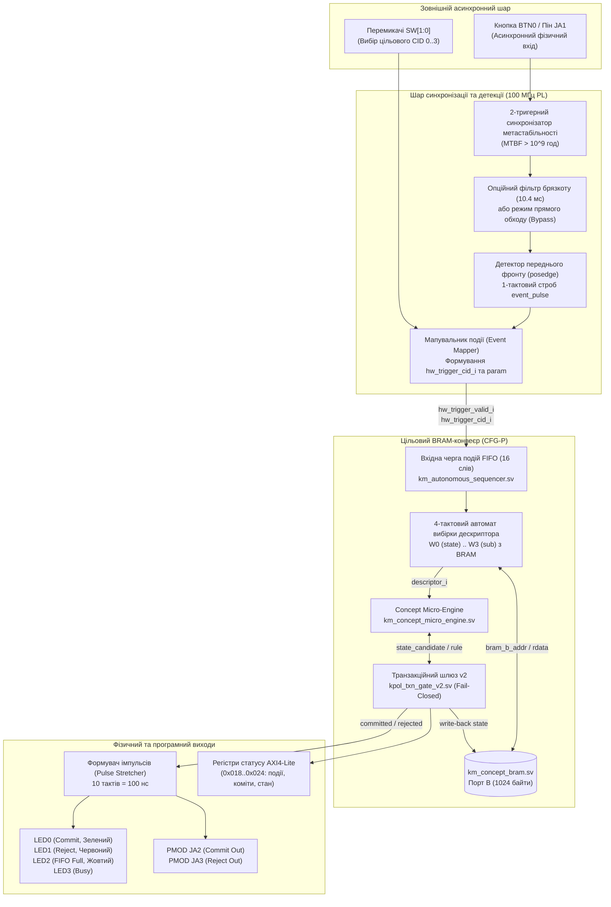

# Архітектурна конструкція: Інтеграція зовнішньої події з BRAM-конвеєром (CFG-P)

* **Тип Work Product:** `Design` (з інтегрованими `Decision`, `Requirement`, `Protocol`, `Register`)
* **Версія:** 1.0.0
* **Дата:** 2026-11-12
* **Статус:** Запропоновано на затвердження власником (Proposed)
* **ASPICE 4.0 процеси:** `SYS.3` (System Architectural Design), `HWE.1` (Hardware Requirements Analysis), `HWE.2` (Hardware Design)
* **Батьківська Work Item:** #5 (віха S2), задача [#134](https://github.com/nick-fedchik/kuzmin-machine/issues/134) (рішення B2)
* **Ціль / Потреби:** G1 (Автономний реактивний виконавець без PS) / N1 (Детермінізм реакції), N2 (Гнучкість KPOL через BRAM)

---

## 1. Призначення і межі

### 1.1. Проблема та мета
У межах етапу S2 зафіксовано два незалежні напрями верифікації апаратної частини:
1. **`CFG-R` (Реактивний фізичний шлюз):** бітстрім на базі ручної AXI-обгортки [`kpol_txn_gate_axi_lite.sv`](../hw/rtl/bus/kpol_txn_gate_axi_lite.sv) та `kpol_txn_gate` v1, який у випробуваннях AV-10/AV-11 підтвердив автономну реакцію на стимул PL та стійкість до стресу шини AXI при незмінному стані ядра.
2. **`CFG-P` (Програмований BRAM-конвеєр):** бітстрім на базі [`kpol_bram_pipeline_pynq_z1_top.v`](../hw/boards/pynq-z1/kpol_bram_pipeline_pynq_z1_top.v) та [`kpol_bram_pipeline_axi.sv`](../hw/rtl/bus/kpol_bram_pipeline_axi.sv), який в експерименті S4 (Issue #7, PR #137) довів виконання двох різних скомпільованих програм KPOL на єдиному бітстрімі без пересинтезу.

У поточній реалізації `CFG-P` ініціація події можлива **виключно через програмний регістр MMIO** (`write 13'h010`), а вхід апаратного тригера `hw_trigger_valid_i` не виведений на зовнішні піни кристала.

**Мета цієї конструкції:** формалізувати архітектурне рішення **B2** ([`architecture/s2-candidate-system.md`, §7.1](s2-candidate-system.md#71-пять-рішень-для-погодження)) та спроєктувати повний наскрізний шлях:
$$\text{Фізична зовнішня подія} \xrightarrow{\text{CDC / Trigger}} \text{BRAM-конвеєр (Sequencer + CME + Gate v2)} \xrightarrow{\text{Pipeline}} \text{Спостережуваний фізичний результат}$$

### 1.2. Межі розрізнення
- **Що входить:** Конструкція тракту, тактування, межі тактових доменів, логіка детекції фронту, мапування події на CID, взаємодія з чергою FIFO 16, фізичні точки індикації (LED/PMOD), проєкт верифікаційного протоколу, вимоги та трасування.
- **Що не входить:** Безпосередня зміна RTL-коду (реалізується окремим Task після погодження власником), перезбирання бітстріму та фізичні вимірювання на стенді.
- **Застереження щодо метрик:** У `CFG-R` лінія JA1 була монітором внутрішнього стимулу PL. Її метрика $p_{99} \le 60\text{ нс}$ **не переноситься** на `CFG-P`, оскільки конвеєр BRAM містить 4-тактову вибірку дескриптора з пам'яті.

---

## 2. Архітектурне рішення B2 (Decision ADR-B2)

* **Статус:** Рекомендовано розробником, очікує підтвердження власника проєкту.
* **Контекст:** Вибір між збереженням ізольованих конфігурацій `CFG-P` / `CFG-R` та створенням єдиного інтегрованого цільового тракту.

### 2.1. Варіанти
1. **Варіант 1 (Ізольовані демонстрації):** Залишити `CFG-P` суто керованим через AXI/PS, а автономність демонструвати лише на `CFG-R`.
   - *Недолік:* Неможливість довести ключову ціль проєкту G1 — автономне виконання скомпільованого KPOL-коду у відповідь на реальні зовнішні події реального часу.
2. **Варіант 2 (Інтегрований цільовий тракт у CFG-P — РЕКОМЕНДОВАНО):**
   - Інтегрувати фізичний вхід події у `kpol_bram_pipeline_pynq_z1_top.v`.
   - Підключити його через блок синхронізації (CDC) до входу `hw_trigger_valid_i` секвенсера [`km_autonomous_sequencer.sv`](../hw/rtl/core/km_autonomous_sequencer.sv).
   - Вивести сигнали успіху (`commit`), відхилення (`reject`) та переповнення черги на фізичні піни світлодіодів та роз'єму PMOD JA.
   - Зберегти `CFG-R` як окремий історично прийнятий результат S6 (AV-10/AV-11).

### 2.2. Обґрунтування вибору
Варіант 2 усуває розрив між програмною гнучкістю (S4) та апаратною автономністю (S6), утворюючи повноцінний мінімальний життєздатний продукт (MVP) Машини Кузьміна.

---

## 3. Склад і конструкція наскрізного тракту (Design)

### 3.1. Структурна схема тракту

### 3.2. Специфікація інтерфейсів та переходів тракту

| Етап тракту | Модуль / Інстанція | Вхідний інтерфейс | Вихідний інтерфейс | Часовий контракт |
| :--- | :--- | :--- | :--- | :--- |
| **1. Приймання події** | `kpol_bram_pipeline_pynq_z1_top` | Фізичний пін `btn[0]` або `pmod_ja[0]` | `ext_raw_signal` | Асинхронний сигнал |
| **2. Синхронізація (CDC)** | `km_cdc_sync` (новий або інлайн) | `ext_raw_signal` | `sync_event_pulse` | 2 такти $F_{\text{clk}}$ ($20\text{ нс}$), усунення метастабільності |
| **3. Мапування** | Декодер стимулу | `sync_event_pulse`, `sw_i[1:0]` | `hw_trigger_valid_i`, `hw_trigger_cid_i`, `param` | 1 такт ($10\text{ нс}$) |
| **4. Буферизація** | `km_autonomous_sequencer:fifo` | `hw_trigger_valid_i` | `fifo_wr_ptr`, `fifo_count` | 1 такт постановки в чергу при `fifo_count < 16` |
| **5. Вибірка BRAM** | `km_autonomous_sequencer:fsm` | `fifo_rd_ptr` | Запит W0..W3 через `bram_b_addr_o` | Рівно 4 такти ($40\text{ нс}$) потактового конвеєра |
| **6. Обчислення CME** | `km_concept_micro_engine` | 128-бітний дескриптор, `param` | Кандидат нового стану, прапорці інваріантів | Комбінаційне декодування предикатів + операторів |
| **7. Шлюз інваріантів** | `kpol_txn_gate_v2` | Умови, кандидат, охоронець | `committed_o` або `rejected_o` | 1 такт фіксації на фронті `clk` |
| **8. Фіксація стану** | `km_autonomous_sequencer` | `cme_committed` | `bram_b_we_o`, `bram_b_wdata_o` | 1 такт запису оновленого стану в BRAM |
| **9. Вихідна індикація** | Pulse Stretcher | `committed_o`, `rejected_o` | `pmod_ja[1:2]`, `leds[1:0]` | Розтягування імпульсу на 10 тактів ($100\text{ нс}$) |

### 3.3. Часовий бюджет та аналіз латентності

- **Латентність від фізичного фронту до початку обробки:**
  $$T_{\text{ingress}} = T_{\text{cdc}} + T_{\text{edge}} = 20\text{ нс} + 10\text{ нс} = 30\text{ нс}$$
- **Латентність виконання в конвеєрі (при порожній черзі):**
  $$T_{\text{exec}} = T_{\text{fsm\_start}} + T_{\text{bram\_fetch}} + T_{\text{cme\_gate}} + T_{\text{writeback}} = 10 + 40 + 20 + 10 = 80\text{ нс (8 тактів)}$$
- **Загальна наскрізна затримка (Pin-to-Pin):**
  $$T_{\text{total}} = T_{\text{ingress}} + T_{\text{exec}} + T_{\text{out\_pad}} \approx 30\text{ нс} + 80\text{ нс} + 5\text{ нс} = 115\text{ нс}$$
- **Детермінізм:** Час виконання є строго константним (0 джитер відносно моменту захоплення тактом $F_{\text{clk}}$).

---

## 4. Перевірні вимоги (Requirements — SYS / HW)

| ID вимоги | Назва та зміст вимоги | Походження | Метод перевірки | Критерій успіху | Статус |
| :--- | :--- | :--- | :--- | :--- | :--- |
| `REQ-SYS-011` | **External Autonomous Pipeline Triggering:** Конвеєр BRAM повинен починати виконання концепту за зовнішнім фізичним сигналом без участі ARM Cortex-A9. | Задача #134, G1 / N2 | HIL на PYNQ-Z1 | Генерація імпульсу на вході викликає зміну лічильника `events_processed_count` в AXI без виклику функцій драйвера CPU. | Чернетка (Draft) |
| `REQ-SYS-012` | **Observable Fail-Closed Indication:** При порушенні інваріанта стан у BRAM залишається незмінним, на виході формується сигнал Reject, а Commit пригнічується. | Рішення B2, H6 | Симуляція + HIL | При подачі невалідного параметра `led[1]` (Reject) спалахує, `led[0]` (Commit) = 0, значення `REG_STATE` не змінюється. | Чернетка (Draft) |
| `REQ-HW-011` | **CDC Metastability Hardening:** Зовнішній асинхронний сигнал повинен проходити щонайменше 2-ступеневу тригерну синхронізацію перед подачею на логіку конвеєра. | Стандарт безпеки ISO 26262-5 | Статичний аналіз RTL / Lint | Відсутність попереджень CDC у Verilator/Vivado, розрахований MTBF $> 10^9$ годин. | Чернетка (Draft) |
| `REQ-HW-012` | **Deterministic Execution Cycle:** Час виконання одного концепту від десеріалізації з черги до готовності результату повинен становити строго 8 тактів ($80\text{ нс}$). | Вимога детермінізму N1 | RTL Testbench | Потактовий збіг кількості тактів у тестбенчі між `active_cid_q` та `cme_committed`/`cme_rejected`. | Чернетка (Draft) |
| `REQ-HW-013` | **Non-Silent FIFO Overflow Behavior:** При переповненні вхідної черги (16 подій) модуль повинен сигналізувати про відкидання події без пошкодження пам'яті BRAM. | Задача #135 (B5) | Тестбенч граничних умов | Спроба запису 17-ї події виставляє прапорець `fifo_overflow`, попередні 16 подій обробляються без втрат. | Чернетка (Draft) |

---

## 5. Проєкт верифікаційного протоколу (Protocol)

### 5.1. Об'єкт і конфігурація
- **Об'єкт:** Модифікований модуль конвеєра з виведеними портами зовнішнього тригера та top-модуль `kpol_bram_pipeline_pynq_z1_top`.
- **Середовище:**
  1. Симуляція: Icarus Verilog (`iverilog -g2012`), тестбенч `kpol_bram_pipeline_ext_event_tb.sv`.
  2. Фізичний стенд: Digilent PYNQ-Z1, логічний аналізатор / осцилограф на пінах PMOD JA.

### 5.2. Тестові сценарії
1. **Сценарій 1 (Позитивний — Commit):**
   - У BRAM завантажено програму `Increase` (стан $10 \to 11$, охоронець: `param < 20`).
   - Подається зовнішній імпульс на вхід із параметром `param = 5`.
   - *Очікування:* `committed` активується через $115\text{ нс}$, стан у BRAM стає $11$, на світлодіоді `LED0` фіксується спалах, лічильник комітів зростає на 1.
2. **Сценарій 2 (Негативний — Fail-Closed Reject):**
   - Та сама програма `Increase`.
   - Подається зовнішній імпульс із параметром `param = 25` (порушення інваріанта).
   - *Очікування:* `rejected` активується через $115\text{ нс}$, стан у BRAM залишається строго $10$, на `LED1` фіксується спалах, лічильник відхилень зростає на 1.
3. **Сценарій 3 (Стрес-серія та переповнення черги):**
   - Подається пачка з 20 імпульсів із періодом $20\text{ нс}$ (швидше, ніж темп обробки $80\text{ нс}$).
   - *Очікування:* Перші 16 подій фіксуються у FIFO, наступні 4 генерують сигнал переповнення, система не зависає, аварійного скидання не відбувається.

---

## 6. Двоспрямоване трасування (Traceability Register)

| Джерело / Вхід | Архітектурний елемент (Design) | Вимога (Requirement) | Протокол верифікації | Поточний статус |
| :--- | :--- | :--- | :--- | :--- |
| **G1 / N2 (Автономність)** | CDC + Event Mapper (§3.1) | `REQ-SYS-011`, `REQ-HW-011` | Протокол §5.2, Сценарій 1 | Проєкт розроблено, очікує погодження |
| **H6 (Fail-Closed захист)** | Шлюз `kpol_txn_gate_v2` (§3.2) | `REQ-SYS-012` | Протокол §5.2, Сценарій 2 | Доведено у S3-62 (#62), заплановано HIL |
| **N1 (Детермінізм)** | Конвеєр 8 тактів (§3.3) | `REQ-HW-012` | Тестбенч симуляції | Підтверджено в RTL `km_autonomous_sequencer` |
| **B5 / #135 (Черга FIFO)** | FIFO 16 слів (§3.2) | `REQ-HW-013` | Протокол §5.2, Сценарій 3 | Вхід до задачі #135 |
| **S4 / #7 (Програми KPOL)** | BRAM Port B Fetch (§3.1) | `REQ-HW-005` | HIL PR #137 | **Виконано фізично на PYNQ-Z1** |
| **S6 / AV-10/11 (Стійкість)** | Фізичний шлюз CFG-R | `REQ-HW-008` | Звіти AV-10 / AV-11 | **Прийнято власником (S6)** |

---

## 7. Історія версій

| Версія | Дата | Автор | Зміни |
| :--- | :--- | :--- | :--- |
| **1.0.0** | 2026-11-12 | Antigravity (agy) | Первинна редакція архітектурного дизайну наскрізного тракту «зовнішня подія → BRAM-конвеєр → результат» на виконання задачі #134 (B2). |
