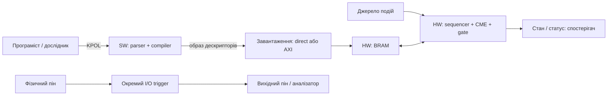

# S2: кандидатні межі, архітектура та вимоги

* **Версія:** 0.1.2 (робоча пропозиція, не baseline)
* **Дата:** 2026-11-12
* **Issue:** [#5](https://github.com/nick-fedchik/kuzmin-machine/issues/5)
* **Виконавець:** GitHub Copilot CLI, Auto; конкретна модель середовищем не показана.
* **Рецензент:** не призначено.
* **База аналізу:** `aa982ee02a68acd6d4f99e6c1f5876063f305635`.

## 1. Межі та невизначеність

Це не затверджена архітектура чи нова база вимог MVP. Власник ще не
погодив системну межу, потреби, остаточні критерії або підмножину KPOL;
[#19](https://github.com/nick-fedchik/kuzmin-machine/issues/19) відкрита.
Кандидатні ID нижче не замінюють історичні `REQ-*`, а пріоритети — лише
пропозиція для порівняння. Жоден пункт не змінює чинних гейтів S1–S6.

Джерела: [цілі, потреби й історична карта](../requirements/traceability/goals-needs-work-items.md),
[оцінка історичних REQ](../docs/research/verification/requirements-trace-assessment-114.md),
[план рефакторингу](refactoring-plan.md) та
[паспорт TRL](../process/trl/TRL-passport.md). План — джерело намірів,
а не підтвердження втілення. У ньому, зокрема, FIFO на 64 події, тоді як
[RTL секвенсера](../hw/rtl/core/km_autonomous_sequencer.sv) має 16.
Вибір глибини й поведінка при переповненні не погоджені.

## 2. Системна межа для обговорення

**Кандидат об'єкта:** експериментальна система, що приймає визначену
підмножину тексту KPOL та події, компілює програму в образ і виконує
заданий сценарій на конкретній конфігурації RTL / FPGA. Програміст,
фізичне джерело подій, спостерігач і комп'ютер для запуску перевірок —
зовнішні ролі. Хост, компілятор, драйвер, конфігурація FPGA й виконавчий
контур є можливими частинами системи; точне розміщення межі та
відповідальність за завантаження і запуск потребують рішення.

Поза цією пропозицією: обіцянки про будь-яку програму KPOL, галузеві
сценарії, сертифікація, підтверджений Secure Boot та апаратна безпека.
Підпис і ACL як поточний scope відкладено за рішеннями щодо #67/#68;
дефект тесту [#115](https://github.com/nick-fedchik/kuzmin-machine/issues/115)
від цього не зникає. Зовнішня система чи реальний користувач не
підтверджені як замовник.

G1/N1 — перевірити працездатність певного об'єкта; G1/N2 — пов'язати
KPOL і виконання; G2/N3 — дослідити внесок; G3/N4 — зручність; G4/N5 —
походження і керованість. Це кандидати з [карти §3](../requirements/traceability/goals-needs-work-items.md#3-цілі-сторони-й-потреби),
а не нові погоджені потреби.

## 3. Системна архітектура: окремі конфігурації

Схема показує **логічні зв'язки**, а не доведену конфігурацію одного
бітстріму. На поточній базі direct/AXI конвеєр та I/O trigger мають
окремі RTL і тестбенчі. Зв'язок I/O trigger → BRAM-конвеєр як єдина
апаратна система тут не встановлено. У симуляційному AXI-сценарії подію
ініціюють регістровим записом; це не доказ S6 без участі PS.

| Інтерфейс / відповідальність | Кандидат і локатор | Контракт або прогалина |
|---|---|---|
| Текст → образ | [компіляційний скрипт](../hw/scripts/compile_kpol_bram_image.py), [референс KPOL](../sw/kpol-ref/kpol_reference.py) | `parse_module` → `compile_concept_microcode_bram_image`; підтримувана мова не консолідована (#19). |
| Завантаження → BRAM | [ручна обгортка конвеєра](../hw/rtl/bus/kpol_bram_pipeline_axi.sv), [BRAM](../hw/rtl/core/km_concept_bram.sv) | У цій конфігурації через регістри задають адресу/дані; конфлікти, формати й межі потребують окремого контракту. Це не ручна обгортка #48. |
| Подія → стан | [секвенсер](../hw/rtl/core/km_autonomous_sequencer.sv), [CME](../hw/rtl/core/km_concept_micro_engine.sv), [gate v2](../hw/rtl/core/kpol_txn_gate_v2.sv) | Параметр/ідентифікатор події → дескриптор → рішення → запис стану; черга, одночасні події й часовий контракт не погоджені. |
| Пін → пін | [I/O trigger](../hw/rtl/io/km_io_trigger_engine.sv), [testbench](../hw/tb/km_io_trigger_engine_tb.sv) | Окрема конфігурація; testbench є симуляцією. Для фізичного шляху потрібні визначені пін/синхронізація, зразок і спосіб спостереження участі PS. |
| Статус → спостерігач | [AXI тестбенч](../hw/tests/kpol_bram_pipeline_axi_tb.sv) | Симуляція читає стан і лічильники; без окремого фізичного протоколу не доводить фізичне виконання. |

У gate v2 рішення реєструються на фронті такту; це не підтверджує
«0 тактів» між довільними фізичними точками. Потрібно визначити точки
вимірювання, тактування і значення сигналу відхилення для конкретного
об'єкта. Вхідна синхронізація, шлюз і вихідний шлях можуть мати різні
затримки; їх не можна складати чи порівнювати без виміряного протоколу.

## 4. HW і SW: кандидати та розподіл

| Частина | Відповідальність як кандидат | Поточні входи / межі |
|---|---|---|
| SW parser / compiler | Прийняти погоджений текст і згенерувати образ або повідомити про непідтримуваний вхід | [#8](https://github.com/nick-fedchik/kuzmin-machine/issues/8), [#19](https://github.com/nick-fedchik/kuzmin-machine/issues/19); повноту відмови для всіх входів не доведено. |
| SW loader / driver | Завантажити образ, подати керування й прочитати статус для визначеного пристрою | [компіляційний скрипт](../hw/scripts/compile_kpol_bram_image.py) лише створює файл; фізичне завантаження й конфігурація — окремий крок. |
| HW пам'ять / інтерфейс | Зберігати дескриптори та надавати доступ виконавцю | [BRAM RTL](../hw/rtl/core/km_concept_bram.sv), [обгортка конвеєра](../hw/rtl/bus/kpol_bram_pipeline_axi.sv); арбітраж і колізії не прийнято. |
| HW sequencer / CME / gate | Обробити визначену подію й застосувати визначену перевірку до зміни стану | [#6](https://github.com/nick-fedchik/kuzmin-machine/issues/6), [#18](https://github.com/nick-fedchik/kuzmin-machine/issues/18), [#62](https://github.com/nick-fedchik/kuzmin-machine/issues/62); v1 і v2 не взаємозамінні. |
| HW I/O path | Відреагувати на зовнішню подію у визначеній конфігурації | [#9](https://github.com/nick-fedchik/kuzmin-machine/issues/9), [#72](https://github.com/nick-fedchik/kuzmin-machine/issues/72), [#73](https://github.com/nick-fedchik/kuzmin-machine/issues/73); зв'язок з основним конвеєром та фізичні межі ще не встановлено. |

## 5. Атомарні кандидатні вимоги для обмеженого прикладу

Усі рядки мають стан **чернетка, не погоджено**. `P1` — пропонований
першочерговий пріоритет для демонстрації; не релізний gate. Формулювання
стосується лише двох збережених сценаріїв і не визначає всього KPOL.
Перед прийманням необхідно зафіксувати версії джерел, реалізації, межу
об'єкта, незалежний очікуваний результат і метод перевірки.

Спільна передумова C: окремо скомпілювати
[`increase`](../hw/tests/kpol_bram_pipeline_increase.kpol) та
[`decrease`](../hw/tests/kpol_bram_pipeline_decrease.kpol), кожна має
початковий `Counter = 10`; подати `Pulse(param=5)`, а потім
`Pulse(param=25)`. Конкретний шлях та спостереження — з
[інтеграційного тесту](../hw/tests/test_kpol_bram_pipeline.py) і
[AXI тестбенча](../hw/tests/kpol_bram_pipeline_axi_tb.sv).

| ID / пріоритет | Походження та обґрунтування | Кандидатна вимога з критерієм | Компонент / WI | Метод і поточна межа результату |
|---|---|---|---|---|
| `C-SYS-001` / P1 | G1/N2; історичні `REQ-SW-001`, `REQ-HW-001`; перевірити змінність поведінки | За C після `Pulse(5)` стан `Counter` становить 11 для increase і 9 для decrease. | Parser/compiler, BRAM, sequencer, CME; [#7](https://github.com/nick-fedchik/kuzmin-machine/issues/7), [#8](https://github.com/nick-fedchik/kuzmin-machine/issues/8), [#19](https://github.com/nick-fedchik/kuzmin-machine/issues/19) | Сценарний тест direct і AXI; [тест](../hw/tests/test_kpol_bram_pipeline.py) містить обидва очікування. Симуляція не є доказом HIL чи довільної програми. |
| `C-SYS-002` / P1 | G1/N2; ті самі історичні ID; перевірити guard на заданих сценаріях | За C після наступного `Pulse(25)` значення `Counter` залишається відповідно 11 або 9. | Ті самі компоненти і #7/#8/#19 | Той самий [тестбенч AXI](../hw/tests/kpol_bram_pipeline_axi_tb.sv); перевірити окремо на вибраному апаратному об'єкті перед фізичним висновком. |
| `C-SW-001` / P1 | G1/N2; історичний `REQ-SW-001`; переносимий вхід для обмеженого тесту | Для кожного з двох файлів C компіляційний скрипт створює новий образ рівно 1024 байти. | Parser/compiler; #8/#19 | [Інтеграційний тест](../hw/tests/test_kpol_bram_pipeline.py); довжина не доводить правильності всіх байтів чи специфікації мови. |
| `C-HW-001` / P1 | G1/N2; історичний `REQ-HW-005`; забезпечити завантаження прикладу | У симуляційному AXI-сценарії запис 256 повних 32-бітних слів кожного образу перед його подіями завершується відповідями `OKAY`. | Ручна обгортка конвеєра та BRAM; #7 | [AXI тестбенч](../hw/tests/kpol_bram_pipeline_axi_tb.sv), `load_image`; це не перевірка довільних доступів чи фізичної BRAM. |

Ці вимоги не доводять S4: для нього потрібні дві програми на одному
**фізичному** бітстрімі з незмінним SHA-256 відповідно до
[настанови §4](../process/PROJECT-MANUAL.md#4-віхи-trl-і-маршрут-до-mvp).
Компонентні вимоги, розширення subset, захист і часові показники поки
залишаються прогалинами, а не вигаданими числовими нормами.

### Зворотні зв'язки

| Артефакт | Відповідні кандидати | Межі |
|---|---|---|
| Два KPOL-файли, compiler та [тест](../hw/tests/test_kpol_bram_pipeline.py) | `C-SYS-001/002`, `C-SW-001` → G1/N2 → #7/#8/#19 | Лише два приклади; subset #19 не погоджено. |
| [AXI testbench](../hw/tests/kpol_bram_pipeline_axi_tb.sv) і [ручний pipeline RTL](../hw/rtl/bus/kpol_bram_pipeline_axi.sv) | `C-SYS-001/002`, `C-HW-001` → G1/N2 → #7 | Поведінка цієї конфігурації в симуляції; інші регістри/топології — поза кандидатними вимогами. |
| [I/O trigger](../hw/rtl/io/km_io_trigger_engine.sv), [gate v2](../hw/rtl/core/kpol_txn_gate_v2.sv) | G1/N1 → #9/#18/#62/#72; історичні `REQ-SYS-001/002/006` | Кандидатні вимоги до часової поведінки і fail-closed ще не сформульовано; результат поточних дослідів не підміняти. |
| [AXI-64](../experiments/AXI-64/report.md) | Гіпотеза #64, історичний `REQ-HW-008` | Інший згенерований slave; не доказ ручного pipeline чи #48. PDR під припущеннями master/скидання, не HIL. |

## 6. Дослідження, паралельна робота та TRL

Q1 (семантика), Q2 (порівняння новизни) і Q3 (зручність) лишаються
дослідницькими питаннями [карти §4](../requirements/traceability/goals-needs-work-items.md#4-кандидатні-ланцюги),
а не продуктовими вимогами. Для Q3 [#120](https://github.com/nick-fedchik/kuzmin-machine/issues/120)
потрібні погоджені протокол і критерій до запуску та підмножина #19.

Власник повідомив 2026-11-12 про паралельну роботу Antigravity над
#72 (AXI-навантаження), #62 (fail-closed) та #9 (трасування AV-10).
Це **повідомлення про роботу, не результат чи зміна критеріїв**. На базі
цього документа текст #72 формулює спостереження участі PS, а #62 — BMC
для декількох об'єктів; до погодження змін не ототожнювати AXI-стрес чи
«0 тактів» з їхніми чинними критеріями. Виправлення 0.1.1: [AV-10](../experiments/AV-10/report.md)
і дані вже були в базі `aa982ee` після злиття [PR #124](https://github.com/nick-fedchik/kuzmin-machine/pull/124);
заява 0.1.0 про їх відсутність у Git була помилковою. Наявність артефактів
не дорівнює незалежному підтвердженню всіх висновків.

**Оновлення 0.1.2:** за [рішенням власника 2026-11-12](../requirements/traceability/goals-needs-work-items.md#12-типи-wi-та-наступний-зріз-wp)
100 подій у серії достатньо; AV-10 прийнято як підтвердження S6 у
перевіреній конфігурації з критерієм `p99 ≤ 60 нс`. Власник повідомив
про кілька однакових серій. Це прийняття результату власником після
вимірювань, не незалежна рецензія та не затвердження кандидатної
архітектури або інших конфігурацій.

TRL 1–3 у [паспорті](../process/trl/TRL-passport.md) — самооцінка, з
обмеженнями незалежності; TRL 3 стосується конкретної функції gate v1,
а не всього конвеєра. TRL 4 — ціль, не висновок цієї пропозиції.
Симуляція, формальний доказ під припущеннями, mock і фізичне вимірювання
є різними типами доказів; жоден не переноситься автоматично між об'єктами.

## 7. Рішення власника і наступні кроки

1. Погодити або змінити системну межу й ролі §2 та окремість
   конфігурацій §3; визначити, чи потрібен спільний фізичний контур.
2. За #19 вирішити підтримувану підмножину та джерело очікувань;
   відхилені конструкції й діагностика потребують окремих критеріїв.
3. Переглянути кандидатні ID, їхні пріоритети й методи; лише після
   погодження створювати нормативну базу. Для кожної нової вимоги додати
   однозначну версію об'єкта і зворотні зв'язки до перевірки й результату.
4. Дочекатися окремих результатів Antigravity за #9/#62/#72 і зіставити
   артефакти, умови, зміни протоколу та незалежну рецензію з критеріями.
5. Для всіх решти історичних ID і артефактів визначити долю за
   [картою §8–10](../requirements/traceability/goals-needs-work-items.md#8-зворотне-трасування-артефактів).
   S2/#5 залишається відкритим до повного трасування й рішення власника.

## Історія версій

| Версія | Дата | Зміни |
|---|---|---|
| 0.1.0 | 2026-11-12 | Кандидатні межі, архітектура системи/HW/SW, обмежені вимоги та зворотні зв'язки для #5. |
| 0.1.1 | 2026-11-12 | Виправлено твердження про відсутність AV-10 у базі; висновків експерименту не переоцінено. |
| 0.1.2 | 2026-11-12 | Відображено рішення власника про прийняття AV-10 для перевіреної конфігурації S6. |

## Абревіатури та глосарій

| Термін | Значення |
|---|---|
| BRAM / FPGA / RTL | Блокова пам'ять / програмована логічна інтегральна схема / опис апаратної логіки |
| CME | Concept Micro-Engine, мікрорушій концепту |
| HIL / PS | Випробування з фізичною апаратурою в контурі / процесорна система Zynq |
| KPOL / WI / WP | Мова проєкту / одиниця роботи / робочий продукт |
| TRL / MVP | Рівень технологічної готовності / мінімальний продукт проєкту |
