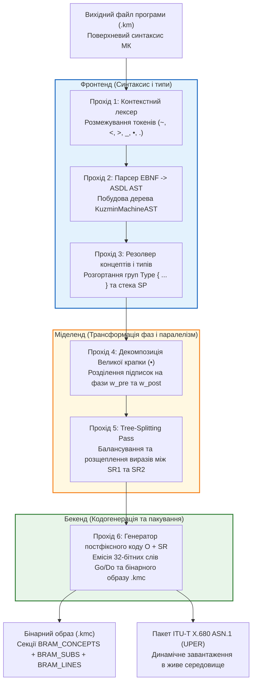
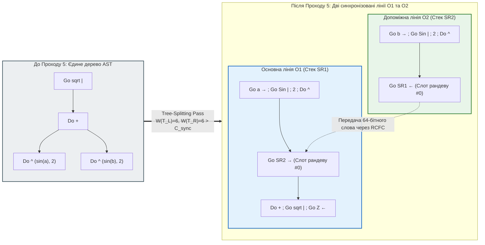

# Архітектура компілятора, розщеплювача графів виразів та стекового асемблера Машини Кузьміна

* **Версія:** 0.1.1
* **Перенесено з:** `drafts/KuzminMachine/03-engineering-software/Kuzmin-Machine-Compiler-and-Assembler-Architecture-UA.md` @ `a4738bc` (2026-11-09)

> [!IMPORTANT]
> **Призначення документа:** Цей інженерний документ визначає повну архітектуру інструментального ланцюжка компіляції (**Compiler & Assembler Toolchain**) для високорівневої мови програмування Машини Кузьміна (МК). Документ формалізує багатопрохідний конвеєр перетворення вихідного коду `.km` через алгебраїчне дерево абстрактного синтаксису ([ASDL / ASN.1](../../docs/theory/asn.md)) у паралельні підписні лінії $`O + SR`$ та бінарний образ `.kmc`, готовий до безпосереднього завантаження у блочну пам'ять BRAM [апаратного прискорювача на FPGA PYNQ-Z1](https://github.com/nick-fedchik/drafts/blob/a4738bc/KuzminMachine/02-engineering-hardware/Kuzmin-Machine-FPGA-PYNQ-Z1-Architecture-UA.md) або [еталонної віртуальної машини](https://github.com/nick-fedchik/drafts/blob/a4738bc/KuzminMachine/03-engineering-software/Kuzmin-Machine-Reference-VM-and-Cycle-Accurate-Simulator-UA.md).

---

## Зміст

1. [Огляд багатопрохідного конвеєра компіляції МК](#1-огляд-багатопрохідного-конвеєра-компіляції-мк)
2. [Лексичний аналізатор із контекстним розмежуванням перевантажених токенів](#2-лексичний-аналізатор-із-контекстним-розмежуванням-перевантажених-токенів)
3. [Фронтенд: побудова ASDL AST, таблиця концептів та області видимості](#3-фронтенд-побудова-asdl-ast-таблиця-концептів-та-області-видимості)
4. [Міделенд: алгоритм автоматичного розщеплення бінарних виразів (Tree-Splitting Pass)](#4-міделенд-алгоритм-автоматичного-розщеплення-бінарних-виразів-tree-splitting-pass)
5. [Бекенд: генерація інструкцій `Go`/`Do`, синтез фаз Великої крапки (`•`) та релокація](#5-бекенд-генерація-інструкцій-godo-синтез-фаз-великої-крапки--та-релокація)
6. [Специфікація бінарного виконуваного контейнера `.kmc` (Kuzmin Machine Compiled Image)](#6-специфікація-бінарного-виконуваного-контейнера-kmc-kuzmin-machine-compiled-image)
7. [Еталонна реалізація компілятора та дизасемблера МК на Python](#7-еталонна-реалізація-компілятора-та-дизасемблера-мк-на-python)

---

## 1. Огляд багатопрохідного конвеєра компіляції МК

На відміну від класичних імперативних компіляторів (GCC, LLVM), які будують граф потоку керування (*Control Flow Graph — CFG*) з базових блоків і переходів `br / jmp`, компілятор Машини Кузьміна будує **Граф реактивних концептів і підписних ліній** (*Reactive Concept & Subscription Graph — RCSG*).

Компіляція виконується за **6 детермінованих проходів**:



---

## 2. Лексичний аналізатор із контекстним розмежуванням перевантажених токенів

У поверхневому синтаксисі МК (див. [Специфікацію високорівневої мови](https://github.com/nick-fedchik/drafts/blob/a4738bc/KuzminMachine/03-engineering-software/Kuzmin-Machine-High-Level-Language-Specification-UA.md)) кілька символів алфавіту мають різну граматичну природу залежно від позиції у рядку. Контекстний лексер підтримує скінченний автомат із чотирма лексичними режимами: `MODE_DECL` (оголошення концепту), `MODE_EVENT` (предикат події ліворуч від тіла підписки), `MODE_EXPR` (інфіксний вираз праворуч від `=`) та `MODE_ASM` (після ключових слів `Go` або `Do`).

### 2.1. Таблиця детермінованого розмежування омонімічних лексем

| Символ | У режимі `MODE_DECL` | У режимі `MODE_EVENT` | У режимі `MODE_EXPR` | У режимі `MODE_ASM` (`Go`/`Do`) |
| :---: | :--- | :--- | :--- | :--- |
| **`~`** | Помилка синтаксису | Подія зміни значення (`DataPropertyEvent::valChanged`, код `6`) | Префікс оператора порівняння (`~ =`, `~ >`, `~ <`) | Після `Do`: побітова інверсія (`DoOpcode::bitInvert`, код `12`) |
| **`<` / `>`** | Відкриття/закриття генератора циклу `<i = 0 < N ... >` | Компаратор події межі (`ComparisonOperator::lessThan` / `greaterThan`) | Інфіксний оператор відношення порядку (`<`, `>`) | Після `Do`: побітовий зсув вліво/вправо (`shiftLeft` `10`, `shiftRight` `11`) |
| **`_`** | Ознака невизначеного початкового стану (`isUndefined = TRUE`) | Подія відсутності значення (`DataPropertyEvent::absentValue`, код `0`) | Модифікатор тихого присвоєння після `=` (`Tick = _ 0`) | Літерал невизначеного стану |
| **`.`** | Токен дійсного типу (`TypeToken::floatPoint`, код `3`) | Помилка синтаксису | Посилання на поточне значення власного концепту (`selfCurrent`) або доступ до поля `Obj.Field` | Роздільник складеного імені |
| **`•`** | Відкриття фазового блоку `[• : ...]` | Маркер межі між пре-фазою $`w_1`$ та пост-фазою $`w_2`$ | Вхідне значення при записі (`bigDotIn`) або булевий прапорець успішності | Системний регістр фази концепту |
| **`'`** | Токен символьного типу (`TypeToken::character`, код `4`) | Початок коментаря у парі `' # ... »` | Початок коментаря або символьний літерал | Після `Do`: остача від ділення / унарний інкремент (`DoOpcode::modulo`, код `5`) |

---

## 3. Фронтенд: побудова ASDL AST, таблиця концептів та області видимості

Під час Проходів 2 та 3 компілятор будує ієрархічну таблицю символів (**Symbol & Concept Table**) з трьома рівнями лексичної видимості:

1. **Рівень 0 — Глобальний простір концептів середовища (`Scope::Global`):** містить усі класи `Class`, глобальні масиви, функції та апаратні порти (`"0p0"`, `"0x128AF"`). Кожному концепту виділяється унікальний глобальний індекс $`\mathrm{ConceptId} \in \lbrace 0 \dots 4095 \rbrace`$.
2. **Рівень 1 — Простір екземпляра класу (`Scope::ClassInstance`, токен `¤`):** містить поля секції `: { ... }`. Під час інстанціювання `Obj = Class : (args)` поля отримують суміжний блок індексів відносно базової адреси екземпляра `¤`.
3. **Рівень 2 — Локальний кадр стека параметрів (`Scope::ParamStack`, стек $`SP`$):** містить параметри, оголошені після `@`, а також локальні лічильники реактивних циклів (`Token i 0`). Звернення до них адресується відносно вершини стека параметрів $`SP`$.

### 3.1. Канонізація групових оголошень та скорочених функцій

На етапі побудови AST виконуються три обов'язкові синтаксичні нормалізації (Desugaring):

1. **Розгортання блоків типу:**
   Конструкція `Float { Distance 0  Speed 0  Accelleration 0 }` розгортається у три послідовні вузли `ConceptDecl` з типом `TypeFloat` (`код 3`), розміром `Size4B` та прапорцем суміжного розміщення в BRAM.
2. **Нормалізація повернення значення функції:**
   Скорочений запис `Float Sigmoid | @ Float x = 1 / (1 + e^(-x))` перетворюється на канонічне присвоєння власному концепту `. = 1 / (1 + e^(-x))` у фазі виконання `OnExecHook` (`|`).
3. **Синтез прихованого інкремента в апаратних портах:**
   Префіксний запис `++Out` або `++Counter` перетворюється на канонічний вузол `MutateUpdateStmt(target=Out, op=AluAdd, rhs=LitInt(1))`, який під час кодогенерації стає трикомандним стековим патерном `Go Out → ; Do ' ; Go Out ←`.

---

## 4. Міделенд: алгоритм автоматичного розщеплення бінарних виразів (Tree-Splitting Pass)

Однією з найважливіших інновацій компілятора Машини Кузьміна є **Прохід 5 (Tree-Splitting Pass)** — автоматичне перетворення одного арифметичного дерева виразу на кілька паралельних підписних ліній $`O_1, O_2, \dots, O_m`$, які виконуються одночасно на різних стек-регістрах ($`SR_1, SR_2, \dots`$) із синхронізацією через апаратний комутатор рандеву (**RCFC**).

### 4.1. Математичний критерій доцільності розщеплення вузла AST

Нехай $`T`$ — бінарне піддерево виразу з кореневою операцією $`\odot \in \lbrace +, -, *, /, \mathbin{\&}, \mathrm{Or}, \# \rbrace`$, лівим піддеревом $`T_L`$ та правим піддеревом $`T_R`$. Визначимо функцію оцінки обчислювальної ваги піддерева $`W(T)`$ у тактах виконання:

$$
W(T) = \begin{cases}
1, & \text{якщо } T \text{ — константа або просте читання концепту } (\mathtt{Go\ X\ \rightarrow}), \\
W(T_1) + c_{\mathrm{alu}}(\mathrm{op}), & \text{якщо } T = \mathrm{Unary}(\mathrm{op}, T_1), \\
W(T_L) + W(T_R) + c_{\mathrm{alu}}(\odot), & \text{якщо } T = \mathrm{Binary}(\odot, T_L, T_R), \\
c_{\mathrm{call}}(f) + \sum_{i} W(a_i), & \text{якщо } T = \mathrm{Call}(f, \lbrace a_i \rbrace).
\end{cases}
$$

Нехай $`C_{\mathrm{sync}} = 2`$ такти — апаратні накладні витрати на передачу одного слова через комутатор рандеву RCFC (`Go SR1 ←` у допоміжній лінії та `Go SR2 →` в основній лінії). Розщеплення бінарного вузла $`T = \mathrm{Binary}(\odot, T_L, T_R)`$ на дві паралельні підписні лінії виконується тоді і тільки тоді, коли одночасно виконуються дві умови:

1. **Умова незалежності за даними (Data Independence):** Піддерева $`T_L`$ і $`T_R`$ не мають спільних побічних ефектів запису (множини модифікованих концептів не перетинаються):

$$
\mathrm{WriteSet}(T_L) \cap \Big( \mathrm{ReadSet}(T_R) \cup \mathrm{WriteSet}(T_R) \Big) = \emptyset
$$

2. **Умова додатного прискорення (Profitability Threshold):** Вага меншого з двох піддерев перевищує поріг накладних витрат на міжстекове рандеву $`\Theta_{\mathrm{split}}`$:

$$
\min\big(W(T_L), W(T_R)\big) > C_{\mathrm{sync}} \quad \Longrightarrow \quad \max\big(W(T_L), W(T_R)\big) + C_{\mathrm{sync}} < W(T_L) + W(T_R)
$$

### 4.2. Формальний алгоритм трансформації дерева при розщепленні

Якщо бінарний вузол $`T = \mathrm{Binary}(\odot, T_L, T_R)`$ задовольняє критерій розщеплення:
1. Компілятор виділяє новий віртуальний ідентифікатор слота рандеву $`s \in \lbrace 0 \dots 63 \rbrace`$ та допоміжну підписну лінію $`O_{\mathrm{aux}}`$ (закріплену за логічним стеком `SR2`).
2. Праве піддерево $`T_R`$ компілюється у постфіксну послідовність інструкцій лінії $`O_{\mathrm{aux}}`$, у кінець якої додається інструкція вивантаження результату в основний стек:
   ```text
   O_aux :  CodeGen(T_R)  ;  Go SR1 ← (slot = s)
   ```
3. В основній лінії $`O_{\mathrm{main}}`$ (логічний стек `SR1`) компілюється ліве піддерево $`T_L`$, після чого замість коду $`T_R`$ вставляється одиночна інструкція читання зі слота рандеву та бінарна операція АЛП:
   ```text
   O_main : CodeGen(T_L)  ;  Go SR2 → (slot = s)  ;  Do ⊙
   ```
4. Ідентифікатор допоміжної лінії $`O_{\mathrm{aux}}`$ додається до списку паралельного запуску `nestedSubsSR` дескриптора підписки, щоб апаратний диспетчер одночасно видав $`O_{\mathrm{main}}`$ та $`O_{\mathrm{aux}}`$ двом вільним ядрам (або виконав $`O_{\mathrm{aux}}`$ у режимі Fallback на першому ядрі).



---

## 5. Бекенд: генерація інструкцій `Go`/`Do`, синтез фаз Великої крапки (`•`) та релокація

### 5.1. Трансляція чотирьох фаз Великої крапки (`•`) у таблицю підписок

Кожен концепт у глобальній таблиці концептів має чотири слоти початкових вказівників на списки підписок відповідно до фази Великої крапки (`BigDotPhase`):

| Фаза у високорівневому коді | Індекс фази | Куди прив'язується згенерована лінія $`O + SR`$ | Поведінка апаратного ядра при виконанні |
| :--- | :---: | :--- | :--- |
| `← w_1 •` або `[• : w_1]` | `0` (`PRE_WRITE`) | Вказівник `sub_pre_write_ptr` концепту | Запускається при спробі запису **до** зміни поля `val_current` у BRAM. Якщо після $`w_1`$ прапорець `• == ¬`, запис скасовується. |
| `← • w_2` або `[: • w_2]` | `1` (`POST_CHANGE`) | Вказівник `sub_post_change_ptr` концепту | Запускається автоматично на наступному такті **після** фіксації нового значення `val_current` та обчислення вектора `ev_vec[6:0]`. |
| `→ w_1 • w_2` | `2` (`ON_READ`) | Вказівники `sub_pre_read_ptr` ($`w_1`$) та `sub_post_read_ptr` ($`w_2`$) | Під час виконання `Go X →` спочатку виконується $`w_1`$, потім значення `X` кладеться у стек $`SR`$, а $`w_2`$ ставиться в чергу пост-обробки. |
| `\| w_exec` | `3` (`ON_EXEC`) | Вказівник `sub_on_exec_ptr` концепту | Запускається при прямому виклику `Go X \|` або при спрацюванні таймера/переривання. |

### 5.2. Кодування 32-бітних інструкцій лінії $`O`$ (Сумісність із FPGA PYNQ-Z1)

Бекенд компілятора генерує кожну низькорівневу команду у вигляді вирівняного 32-бітного слова, яке безпосередньо виконується скінченним автоматом процесорного елемента `kuzmin_core_sr.sv`:

$$
\mathrm{Word}_{32}(O) = \underbrace{\mathrm{Class}[31:28]}_{4\text{ біти}} \enspace\parallel\enspace \underbrace{\mathrm{SubOp}[27:24]}_{4\text{ біти}} \enspace\parallel\enspace \underbrace{\mathrm{Flags}[23:16]}_{8\text{ бітів}} \enspace\parallel\enspace \underbrace{\mathrm{Operand}[15:0]}_{16\text{ бітів}}
$$

* **`Class = 0x1` (`OPC_GO`):**
  * `SubOp[1:0]`: `00` = `|` (Виконати), `01` = `←` (Записати зі стека), `10` = `→` (Зчитати у стек), `11` = `:` (Адреса / Ініціалізація);
  * `Flags[0]`: `1` = самоадресація всередині власної підписки (*Self-Addressing Suppression* — фізичний запис у BRAM без повторної генерації події запису);
  * `Flags[1]`: `1` = тихе присвоєння (`= _ val` — скидання без генерації каскаду);
  * `Flags[2]`: `1` = міжстекове рандеву (`Operand[5:0]` вказує номер слота рандеву $`s \in \lbrace 0 \dots 63 \rbrace`$ у блоці RCFC);
  * `Operand[15:0]`: `ConceptId` цільового концепту або зміщення у стеку параметрів $`SP`$.
* **`Class = 0x2` (`OPC_DO`):**
  * `SubOp[3:0]`: код операції АЛП за авторським словником (`0` = `+`, `1` = `-`, `2` = `*`, `3` = `/`, `4` = `^`, `5` = `'`, `6` = `&`, `7` = `Or`, `8` = `¬`, `9` = `#`, `10` = `<`, `11` = `>`, `12` = `~`).
* **`Class = 0x3` (`OPC_IMM`):**
  * Завантаження 16-бітної знакової константи `Operand[15:0]` на вершину стек-регістра $`SR`$ (для 32/64-бітних констант використовується посилання на константний концепт у таблиці `BRAM_CONCEPTS`).
* **`Class = 0x4` (`OPC_TEST_EV`):**
  * Перевірка події `::` або компаратора `~` з умовним переходом на зміщення гілки `else` або виходом із групи (`Exit`).

---

## 6. Специфікація бінарного виконуваного контейнера `.kmc` (Kuzmin Machine Compiled Image)

Скомпільований модуль зберігається у файлі `.kmc` з порядком байтів **Little-Endian**, який підтримує завантаження за нульовий час (*Zero-Copy DMA Load*) безпосередньо у три сегменти блочної пам'яті FPGA PYNQ-Z1 або оперативної пам'яті мікроконтролера STM32.

| Зміщення (байти) | Поле заголовка / секції | Розмір | Опис та призначення |
| :---: | :--- | :---: | :--- |
| `0x00..0x03` | `magic[4]` | 4 байти | Магічна сигнатура формату: ASCII `"KMC1"` (`0x31434D4B`) |
| `0x04..0x05` | `version_major`, `version_minor` | 2 байти | Версія специфікації ISA (`0x0001`) |
| `0x06..0x07` | `flags` | 2 байти | Біт 0: наявність паралельних ліній рандеву; Біт 1: наявність таблиці імен для налагоджувача |
| `0x08..0x0B` | `num_concepts` | 4 байти | Кількість 128-бітних дескрипторів у секції `BRAM_CONCEPTS` |
| `0x0C..0x0F` | `num_subscriptions` | 4 байти | Кількість 64-бітних дескрипторів підписок $`SP`$ у секції `BRAM_SUBS` |
| `0x10..0x13` | `num_instructions` | 4 байти | Загальна кількість 32-бітних інструкцій у секції `BRAM_LINES` |
| `0x14..0x17` | `entry_concept_id` | 4 байти | Ідентифікатор стартового концепту (або `0xFFFFFFFF`, якщо модуль суто реактивний) |
| `0x18..0x1F` | `crc64_checksum` | 8 байтів | Контрольна сума образу для перевірки цілісності при передачі по AXI DMA / UART |
| `0x20..` | **Секція 1: `CONCEPT_TABLE`** | $`16 \times N_{\mathrm{concepts}}`$ | Масив 128-бітних дескрипторів концептів (тип, розмір, початкове значення, вказівники підписок) |
| Далі | **Секція 2: `SUB_DESCRIPTORS`** | $`8 \times N_{\mathrm{subs}}`$ | Масив 64-бітних дескрипторів підписок (маска подій `trigger_mask[7:0]`, адреса початку лінії $`O`$, довжина, `else_line_id`) |
| Далі | **Секція 3: `LINE_CODE_O`** | $`4 \times N_{\mathrm{instr}}`$ | Масив 32-бітних машинних слів інструкцій (`OPC_GO`, `OPC_DO`, `OPC_IMM`, `OPC_TEST_EV`) |
| Далі (опц.) | **Секція 4: `DEBUG_SYMTAB`** | Змінний | Таблиця відповідності `ConceptId <-> UTF-8 Ім'я` та координат рядків вихідного коду `.km` |

---

## 7. Еталонна реалізація компілятора та дизасемблера МК на Python

Нижче наведено самодостатній, готовий до запуску код еталонного компілятора високорівневої мови Машини Кузьміна (`kmc_compiler.py`), який реалізує контекстний лексер, побудову AST, **автоматичне розщеплення бінарних дерев виразів (Tree-Splitting Pass)** між стеками `SR1` та `SR2`, генерацію 32-бітного машинного коду та дизасемблювання:

```python
#!/usr/bin/env python3
# -*- coding: utf-8 -*-
"""
Еталонний компілятор, розщеплювач графів виразів (Tree-Splitter) та асемблер
Машини Кузьміна (Kuzmin Machine Compiler Toolchain — kmc_compiler.py).
"""

from dataclasses import dataclass, field
from enum import IntEnum
import struct
from typing import Dict, List, Optional, Set, Tuple


# ============================================================================
# 1. КАНОНІЧНІ КОНСТАНТИ ТА ОПКОДИ МАШИНИ КУЗЬМІНА
# ============================================================================

class TypeToken(IntEnum):
    TOKEN        = 0   # Token / ? / Boolean
    UNSIGNED_INT = 1   # + / Byte / U8..U64
    SIGNED_INT   = 2   # +- / Int8..Int64
    FLOAT_POINT  = 3   # . / Float / Double
    CHARACTER    = 4   # ' / Char
    TEXT_STRING  = 5   # " / String
    CONCEPT_REF  = 6   # : / Subscribe
    POINTER      = 7   # ↑
    MATRIX_ROW   = 8   # ←
    MATRIX_COL   = 9   # ↓
    TABLE_MATRIX = 10  # #
    CONCEPT_GRP  = 11  # []
    HW_PIN       = 12  # └─
    IO_CHANNEL   = 13  # ⇄
    DATA_FRAME   = 14  # ▭
    USER_CLASS   = 15  # Class


class GoMode(IntEnum):
    EXEC_SUB  = 0  # "|" : Виконати підписки концепту
    WRITE_POP = 1  # "←" : Витягти зі стека SR і записати в концепт
    READ_PUSH = 2  # "→" : Зчитати значення концепту на вершину стека SR
    PUSH_ADDR = 3  # ":" : Покласти адресу / ініціалізувати концепт


class DoOpcode(IntEnum):
    ADD        = 0   # "+"
    SUB        = 1   # "-"
    MUL        = 2   # "*"
    DIV        = 3   # "/"
    POW        = 4   # "^"
    MOD_INC    = 5   # "'"
    BIT_AND    = 6   # "&"
    BIT_OR     = 7   # "Or"
    LOG_NOT    = 8   # "¬"
    BIT_XOR    = 9   # "#"
    SHIFT_LEFT = 10  # "<"
    SHIFT_RGHT = 11  # ">"
    BIT_INVERT = 12  # "~"


class DataEvent(IntEnum):
    ABSENT   = 0  # :: _
    IS_NULL  = 1  # :: Null
    POSITIVE = 2  # :: Positive
    NEGATIVE = 3  # :: Negative
    EVEN     = 4  # :: Even
    UNEVEN   = 5  # :: Uneven
    CHANGED  = 6  # :: ~


class OpcodeClass(IntEnum):
    OPC_NOP     = 0x0
    OPC_GO      = 0x1
    OPC_DO      = 0x2
    OPC_IMM     = 0x3
    OPC_TEST_EV = 0x4
    OPC_EXIT    = 0x5


# Прапорці в полі Flags[7:0] інструкції Go
FLAG_SELF_SUPPRESS = 0x01  # Запис у власний атрибут без повторної події (анти-зациклення)
FLAG_SILENT_RESET  = 0x02  # Тихе присвоєння (= _ val)
FLAG_RENDEZVOUS    = 0x04  # Міжстекова синхронізація SR1 <-> SR2 через слот RCFC


# ============================================================================
# 2. ВУЗЛИ АЛГЕБРАЇЧНОГО АБСТРАКТНОГО СИНТАКСИСУ (ASDL AST)
# ============================================================================

@dataclass
class ExprNode:
    """Базовий вузол виразу у дереві AST."""
    pass


@dataclass
class LitIntNode(ExprNode):
    value: int


@dataclass
class RefConceptNode(ExprNode):
    name: str


@dataclass
class UnaryAluNode(ExprNode):
    op: DoOpcode
    operand: ExprNode


@dataclass
class BinaryAluNode(ExprNode):
    op: DoOpcode
    left: ExprNode
    right: ExprNode


@dataclass
class CallConceptNode(ExprNode):
    callee: str
    args: List[ExprNode]


@dataclass
class MachineWord:
    """32-бітна інструкція підписної лінії O."""
    opc_class: OpcodeClass
    sub_op: int
    flags: int
    operand: int
    comment: str = ""

    def encode_u32(self) -> int:
        return (
            ((int(self.opc_class) & 0xF) << 28)
            | ((self.sub_op & 0xF) << 24)
            | ((self.flags & 0xFF) << 16)
            | (self.operand & 0xFFFF)
        )

    def disassemble(self, symtab: Dict[int, str]) -> str:
        word_hex = f"0x{self.encode_u32():08X}"
        if self.opc_class == OpcodeClass.OPC_GO:
            mode_sym = {0: "|", 1: "←", 2: "→", 3: ":"}[self.sub_op & 0x3]
            if self.flags & FLAG_RENDEZVOUS:
                target_name = f"SR_SLOT#{self.operand}"
            else:
                target_name = symtab.get(self.operand, f"Concept#{self.operand}")
            fl_str = ""
            if self.flags & FLAG_SELF_SUPPRESS:
                fl_str += " [SELF_SUPPRESS]"
            if self.flags & FLAG_SILENT_RESET:
                fl_str += " [SILENT_RESET]"
            if self.flags & FLAG_RENDEZVOUS:
                fl_str += " [RENDEZVOUS]"
            return f"{word_hex}  Go {target_name:<12} {mode_sym}{fl_str}  {self.comment}"
        elif self.opc_class == OpcodeClass.OPC_DO:
            op_sym = {
                0: "+", 1: "-", 2: "*", 3: "/", 4: "^", 5: "'",
                6: "&", 7: "Or", 8: "¬", 9: "#", 10: "<", 11: ">", 12: "~"
            }[self.sub_op]
            return f"{word_hex}  Do {op_sym:<14} {self.comment}"
        elif self.opc_class == OpcodeClass.OPC_IMM:
            signed_val = self.operand if self.operand < 0x8000 else self.operand - 0x10000
            return f"{word_hex}  Imm {signed_val:<13} {self.comment}"
        elif self.opc_class == OpcodeClass.OPC_EXIT:
            return f"{word_hex}  Exit"
        return f"{word_hex}  Nop"


@dataclass
class CompiledSubscriptionLine:
    """Скомпільована підписна лінія O + перелік дочірніх ліній SR."""
    line_id: int
    owner_concept: str
    stack_role: str  # "SR1 (Primary)" або "SR2 (Auxiliary)"
    instructions: List[MachineWord] = field(default_factory=list)
    spawned_lines: List[int] = field(default_factory=list)


# ============================================================================
# 3. МІДЕЛЕНД ТА БЕКЕНД: РОЗЩЕПЛЮВАЧ ДЕРЕВ ВИРАЗІВ І КОДОГЕНЕРАТОР
# ============================================================================

class KuzminCompiler:
    """
    Компілятор високорівневих виразів та підписок Машини Кузьміна
    з підтримкою автоматичного розпаралелювання між стеками SR1 та SR2.
    """

    SYNC_OVERHEAD_CYCLES = 2  # Поріг C_sync у тактах для рентабельності рандеву

    def __init__(self) -> None:
        self.concept_ids: Dict[str, int] = {}
        self.id_to_name: Dict[int, str] = {}
        self.lines: List[CompiledSubscriptionLine] = []
        self._next_concept_id: int = 1
        self._next_line_id: int = 100
        self._next_rendezvous_slot: int = 0

    def register_concept(self, name: str) -> int:
        if name not in self.concept_ids:
            cid = self._next_concept_id
            self._next_concept_id += 1
            self.concept_ids[name] = cid
            self.id_to_name[cid] = name
        return self.concept_ids[name]

    def estimate_weight(self, node: ExprNode) -> int:
        """Обчислює оцінку складності піддерева W(T) у тактах."""
        if isinstance(node, (LitIntNode, RefConceptNode)):
            return 1
        if isinstance(node, UnaryAluNode):
            return self.estimate_weight(node.operand) + 1
        if isinstance(node, BinaryAluNode):
            op_cost = 3 if node.op in (DoOpcode.DIV, DoOpcode.POW) else 1
            return self.estimate_weight(node.left) + self.estimate_weight(node.right) + op_cost
        if isinstance(node, CallConceptNode):
            return 3 + sum(self.estimate_weight(a) for a in node.args)
        return 1

    def collect_reads(self, node: ExprNode) -> Set[str]:
        if isinstance(node, RefConceptNode):
            return {node.name}
        if isinstance(node, UnaryAluNode):
            return self.collect_reads(node.operand)
        if isinstance(node, BinaryAluNode):
            return self.collect_reads(node.left) | self.collect_reads(node.right)
        if isinstance(node, CallConceptNode):
            s = {node.callee}
            for a in node.args:
                s |= self.collect_reads(a)
            return s
        return set()

    def compile_assignment(
        self,
        owner_concept: str,
        target_concept: str,
        expr: ExprNode,
        enable_parallel_split: bool = True,
        silent_reset: bool = False,
    ) -> CompiledSubscriptionLine:
        """
        Компілює присвоєння `target_concept = expr` в основну лінію O1 (SR1)
        та, за потреби, автоматично виділяє допоміжні лінії O2 (SR2).
        """
        self.register_concept(owner_concept)
        target_id = self.register_concept(target_concept)

        main_line = CompiledSubscriptionLine(
            line_id=self._alloc_line_id(),
            owner_concept=owner_concept,
            stack_role="SR1 (Primary)",
        )
        self.lines.append(main_line)

        self._emit_expr(expr, main_line, enable_parallel_split)

        write_flags = 0
        if owner_concept == target_concept:
            write_flags |= FLAG_SELF_SUPPRESS
        if silent_reset:
            write_flags |= FLAG_SILENT_RESET

        main_line.instructions.append(
            MachineWord(
                opc_class=OpcodeClass.OPC_GO,
                sub_op=int(GoMode.WRITE_POP),
                flags=write_flags,
                operand=target_id,
                comment=f"' # Запис результату в концепт {target_concept} »",
            )
        )
        return main_line

    def _emit_expr(
        self,
        node: ExprNode,
        current_line: CompiledSubscriptionLine,
        enable_split: bool,
    ) -> None:
        if isinstance(node, LitIntNode):
            current_line.instructions.append(
                MachineWord(
                    opc_class=OpcodeClass.OPC_IMM,
                    sub_op=0,
                    flags=0,
                    operand=node.value & 0xFFFF,
                    comment=f"' # Константа {node.value} -> стек SR »",
                )
            )
            return

        if isinstance(node, RefConceptNode):
            cid = self.register_concept(node.name)
            current_line.instructions.append(
                MachineWord(
                    opc_class=OpcodeClass.OPC_GO,
                    sub_op=int(GoMode.READ_PUSH),
                    flags=0,
                    operand=cid,
                    comment=f"' # Зчитати {node.name} у стек SR »",
                )
            )
            return

        if isinstance(node, UnaryAluNode):
            self._emit_expr(node.operand, current_line, enable_split)
            current_line.instructions.append(
                MachineWord(
                    opc_class=OpcodeClass.OPC_DO,
                    sub_op=int(node.op),
                    flags=0,
                    operand=0,
                )
            )
            return

        if isinstance(node, CallConceptNode):
            for arg in node.args:
                self._emit_expr(arg, current_line, enable_split)
            callee_id = self.register_concept(node.callee)
            current_line.instructions.append(
                MachineWord(
                    opc_class=OpcodeClass.OPC_GO,
                    sub_op=int(GoMode.EXEC_SUB),
                    flags=0,
                    operand=callee_id,
                    comment=f"' # Виклик концепту-функції {node.callee} »",
                )
            )
            return

        if isinstance(node, BinaryAluNode):
            w_left = self.estimate_weight(node.left)
            w_right = self.estimate_weight(node.right)

            # Перевірка критерію розщеплення між двома стеками SR1 та SR2
            if enable_split and min(w_left, w_right) > self.SYNC_OVERHEAD_CYCLES:
                slot_id = self._alloc_rendezvous_slot()
                aux_line = CompiledSubscriptionLine(
                    line_id=self._alloc_line_id(),
                    owner_concept=current_line.owner_concept,
                    stack_role="SR2 (Auxiliary)",
                )
                self.lines.append(aux_line)
                current_line.spawned_lines.append(aux_line.line_id)

                # 1. Права гілка виразу компілюється в допоміжну лінію O2 (SR2)
                self._emit_expr(node.right, aux_line, enable_split=False)
                aux_line.instructions.append(
                    MachineWord(
                        opc_class=OpcodeClass.OPC_GO,
                        sub_op=int(GoMode.WRITE_POP),
                        flags=FLAG_RENDEZVOUS,
                        operand=slot_id,
                        comment=f"' # Передати результат із SR2 у SR1 через слот рандеву #{slot_id} »",
                    )
                )

                # 2. Ліва гілка виразу залишається в основній лінії O1 (SR1)
                self._emit_expr(node.left, current_line, enable_split=False)
                current_line.instructions.append(
                    MachineWord(
                        opc_class=OpcodeClass.OPC_GO,
                        sub_op=int(GoMode.READ_PUSH),
                        flags=FLAG_RENDEZVOUS,
                        operand=slot_id,
                        comment=f"' # Прийняти операнд із SR2 через слот рандеву #{slot_id} »",
                    )
                )
                current_line.instructions.append(
                    MachineWord(
                        opc_class=OpcodeClass.OPC_DO,
                        sub_op=int(node.op),
                        flags=0,
                        operand=0,
                        comment="' # Бінарна операція після синхронізації стеків »",
                    )
                )
            else:
                # Стандартна послідовна RPN-трансляція на одному стеку SR1
                self._emit_expr(node.left, current_line, enable_split)
                self._emit_expr(node.right, current_line, enable_split)
                current_line.instructions.append(
                    MachineWord(
                        opc_class=OpcodeClass.OPC_DO,
                        sub_op=int(node.op),
                        flags=0,
                        operand=0,
                    )
                )

    def pack_kmc_binary(self) -> bytes:
        """Формує бінарний образ .kmc із заголовком KMC1."""
        all_words: List[int] = []
        for line in self.lines:
            for instr in line.instructions:
                all_words.append(instr.encode_u32())

        header = struct.pack(
            "<4sHHIIIIQ",
            b"KMC1",
            1,
            1,  # flags: parallel lines enabled
            len(self.concept_ids),
            len(self.lines),
            len(all_words),
            0xFFFFFFFF,
            0xA5A5F00DCAFEBEEF,
        )
        code_sec = struct.pack(f"<{len(all_words)}I", *all_words)
        return header + code_sec

    def _alloc_line_id(self) -> int:
        lid = self._next_line_id
        self._next_line_id += 1
        return lid

    def _alloc_rendezvous_slot(self) -> int:
        s = self._next_rendezvous_slot
        self._next_rendezvous_slot = (self._next_rendezvous_slot + 1) % 64
        return s


# ============================================================================
# 4. ДЕМОНСТРАЦІЯ РОБОТИ КОМПІЛЯТОРА НА КАНОНІЧНОМУ ПРИКЛАДІ Z = sqrt(sin^2(a) + sin^2(b))
# ============================================================================

if __name__ == "__main__":
    compiler = KuzminCompiler()

    # Будуємо AST для виразу: Z = sqrt(sin(a)^2 + sin(b)^2)
    sin_a_sq = BinaryAluNode(
        op=DoOpcode.POW,
        left=CallConceptNode("Sin", [RefConceptNode("a")]),
        right=LitIntNode(2),
    )
    sin_b_sq = BinaryAluNode(
        op=DoOpcode.POW,
        left=CallConceptNode("Sin", [RefConceptNode("b")]),
        right=LitIntNode(2),
    )
    expr_z = CallConceptNode(
        callee="sqrt",
        args=[BinaryAluNode(op=DoOpcode.ADD, left=sin_a_sq, right=sin_b_sq)],
    )

    compiler.compile_assignment(owner_concept="Z", target_concept="Z", expr=expr_z)

    print("=" * 84)
    print("ДИЗАСЕМБЛЕР ЗГЕНЕРОВАНИХ ПІДПИСНИХ ЛІНІЙ (Tree-Splitting Pass: SR1 <-> SR2)")
    print("=" * 84)
    for line in compiler.lines:
        spawn_info = f", паралельні лінії SR: {line.spawned_lines}" if line.spawned_lines else ""
        print(f"\n[Лінія #{line.line_id}] Власник: {line.owner_concept} | Роль: {line.stack_role}{spawn_info}")
        print("-" * 84)
        for idx, instr in enumerate(line.instructions):
            print(f"  {idx:02d}: {instr.disassemble(compiler.id_to_name)}")

    kmc_bytes = compiler.pack_kmc_binary()
    print(f"\nРозмір згенерованого бінарного образу .kmc: {len(kmc_bytes)} байтів.")
```

---

## Історія версій

| Версія | Дата | Зміни |
| :--- | :--- | :--- |
| 0.1.0 | 2026-11-09 | Перенесено з `drafts/KuzminMachine/03-engineering-software/Kuzmin-Machine-Compiler-and-Assembler-Architecture-UA.md` @ `a4738bc` |
| 0.1.1 | 2026-11-09 | Посилання на специфікацію ASN замінено відносним на [`docs/theory/asn.md`](../../docs/theory/asn.md); посилання на FPGA-архітектуру веде на `02-engineering-hardware/` у `drafts@a4738bc` (#51) |
