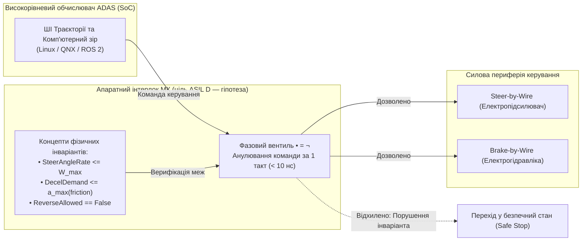

# Дослідження застосування Машини Кузьміна в Automotive: Функціональна безпека (ISO 26262) та Кіберзахист (ISO/SAE 21434)

> **Внутрішня робоча копія, не публікація; міграція не є науковим прийняттям.** Перенесено з `drafts@774d575:KuzminMachine/06-economic-model/automotive-safety-cybersecurity.md` 2026-11-10, Issue #84. Міграція не підтверджує тверджень, прогнозів чи самоприсвоєних статусів. Незмінний оригінал і SHA-256 — у реєстрі міграції.


> [!IMPORTANT]
> **Призначення документа:** Галузеве науково-економічне дослідження життєздатності, технічної архітектури, нормативної відповідності та економічної ефективності застосування Машини Кузьміна (МК) у сучасній автомобільній промисловості для програмно-визначених автомобілів (Software-Defined Vehicles, SDV).
>
> **Статус щодо стандартів безпеки:** згадки ISO 26262 / ASIL, DO-178C / DO-254 / DAL, IEC 61508 / SIL, IEC 62304 та ISO/SAE 21434 у цьому документі означають цільові домени й припущення, а не досягнуту відповідність. Зовнішніх вимог за цими стандартами немає; аналіз небезпек, цілі безпеки, кваліфікація інструментів і незалежне оцінювання не виконувалися. Див. [позицію проєкту](../../../process/standards-position.md).

---

## Зміст

1. [Галузевий контекст та регуляторні стандарти](#1-галузевий-контекст-та-регуляторні-стандарти)
2. [Критичні виклики та біль індустрії (Pain Points)](#2-критичні-виклики-та-біль-індустрії-pain-points)
3. [Архітектурне рішення на базі Машини Кузьміна](#3-архітектурне-рішення-на-базі-машини-кузьміна)
4. [KPOL-специфікація автомобільного інтерлока безпеки](#4-kpol-специфікація-автомобільного-інтерлока-безпеки)
5. [Економічна модель: CAPEX, OPEX, TCO та окупність](#5-економічна-модель-capex-opex-tco-та-окупність)
6. [Спростовні критерії Поппера (Falsifiable Hypotheses)](#6-спростовні-критерії-поппера-falsifiable-hypotheses)
7. [Висновки та дорожня карта інтеграції в AUTOSAR](#7-висновки-та-дорожня-карта-інтеграції-в-autosar)

---

## 1. Галузевий контекст та регуляторні стандарти

Автомобільна промисловість переживає фундаментальну трансформацію до архітектури програмно-визначеного автомобіля (SDV) та централізованих зональних контролерів (Zonal ECUs). Сучасний преміальний автомобіль містить понад 100 мільйонів рядків вихідного коду.

Основними нормативними регуляторами є:
* **ISO 26262 (Road vehicles — Functional safety):** визначає рівні повноти безпеки від ASIL A до ASIL D. Рівень **ASIL D** має цільове значення метрики випадкових апаратних відмов (PMHF) менше $10^{-8}$ на годину ($< 10\text{ FIT}$) і найсуворіші вимоги до процесу та механізмів безпеки.
* **ISO/SAE 21434 (Road vehicles — Cybersecurity engineering):** вимагає наскрізного захисту життєвого циклу автомобіля від кібератак, включаючи аналіз загроз (TARA) та апаратні корені довіри (Hardware Root of Trust).
* **Правила ООН UNECE R155 / R156:** обов'язкова сертифікація систем управління кібербезпекою (CSMS) та оновлення програмного забезпечення (SUMS) як передумова допуску транспортного засобу на ринки ЄС, Японії та Південної Кореї.

---

## 2. Критичні виклики та біль індустрії (Pain Points)

1. **Недетермінізм нейромереж ADAS (L2+/L3/L4):** Системи комп'ютерного зору (на базі CNN, ViT, Occupancy Networks) за своєю природою є ймовірнісними. Вони схильні до фантомних гальмувань (phantom braking), помилкової інтерпретації відблисків сонця або неочікуваних дорожніх ситуацій. Збій автопілота веде до аварій, людських жертв та багатомільйонних судових позовів.
2. **Вразливість комунікаційних шин CAN-FD та Automotive Ethernet:** Підключення автомобіля до хмари (OTA, V2X) створює критичні вектори атак. Дослідники неодноразово демонстрували дистанційне перехоплення керування кермом і гальмами через ін'єкцію підроблених повідомлень у шину CAN.
3. **Колосальні збитки від відкликання автопарків (Safety Recalls):** За даними NHTSA, середнє відкликання модельного ряду через помилки у вбудованому софті коштує автовиробнику від $100M до $600M, не враховуючи репутаційних втрат.

---

## 3. Архітектурне рішення на базі Машини Кузьміна

Машина Кузьміна впроваджується не як заміна центрального процесора SoC (NVIDIA Orin або Qualcomm Ride), а як **ізольований апаратний інтерлок безпеки (Hardware Safety Cage)** з цільовим рівнем ASIL D (гіпотеза) на кристалі CPLD/FPGA або виділеному IP-блоці ASIC між обчислювачем ШІ та виконавчими приводами X-by-Wire (рульова рейка, гальмівний гідроблок, інвертор тягового електродвигуна).



### Ключові апаратні переваги МК:
* **Тактова реакція відсікання ($< 10\text{ нс}$):** Вентиль Великої крапки `• = ¬` фізично розриває передачу забороненого сигналу за 1 такт апаратної логіки без необхідності перемикання контексту RTOS.
* **Дротовий апаратний брандмауер шини CAN-FD (Wire-Speed IDS/IPS):** Концептна сітка здійснює валідацію лічильників повідомлень (Message Sequence Counter), дельти часу надходження кадру та ентропії ідентифікатора. Пакет-ін'єкція блокується безпосередньо в трансивері до потрапляння в пам'ять ECU.

---

## 4. KPOL-специфікація автомобільного інтерлока безпеки

```kpol
Problem AutomotiveSteerByWireSafety {
    Assumptions {
        VehicleSpeed in [0.0 .. 250.0]        # Швидкість автомобіля, км/год
        RoadFriction in [0.1 .. 1.0]          # Коефіцієнт зчеплення з покриттям
    }

    Invariants {
        # Гранична швидкість повороту коліс залежно від швидкості руху
        MaxSteerRate: SteerAngleRate <= (300.0 / (VehicleSpeed + 10.0))
        # Заборона різкого гальмування, що перевищує межу зчеплення
        MaxDecelLimit: DecelDemand <= (RoadFriction * 9.81)
        # Фізична заборона реверсу на швидкості понад 2 км/год
        NoReverseAtSpeed: (VehicleSpeed > 2.0) => (ReverseGearEngaged == false)
    }

    Hazards {
        RolloverRisk: (SteerAngleRate > 45.0) and (VehicleSpeed > 100.0)
            Trigger: EmergencyStabilization = true, OverrideAI = true
    }
}

Solution AutomotiveSteerByWireSafety {
    Float VehicleSpeed 0.0
    Float RoadFriction 0.8
    Float SteerAngleRate 0.0 {
        # Апаратний пре-хук блокування небезпечного кутового прискорення
        [• : > (300.0 / (VehicleSpeed + 10.0))  • = ¬]
    }
    Float DecelDemand 0.0 {
        [• : > (RoadFriction * 9.81)  • = ¬]
    }
    Bool ReverseGearEngaged false {
        [• : (VehicleSpeed > 2.0) and (self == true)  • = ¬]
    }
    pin EmergencyStabilization = "0p1"
    pin OverrideAI = "0p2"
}
```

---

## 5. Економічна модель: CAPEX, OPEX, TCO та окупність

### 5.1. Параметричний розрахунок (серія 500 критичних вузлів керування)

| Стаття витрат | Традиційний стек (Lockstep ARM + AUTOSAR) | Стек Машини Кузьміна (FPGA Cage) | Різниця та обґрунтування |
| :--- | :--- | :--- | :--- |
| Розробка ПЗ ($C_{\mathrm{Dev}}$) | $250,000 | $380,000 | +$130,000 (витрати на вивчення та інтеграцію нового тулчейну) |
| Інструменти та САПР ($C_{\mathrm{Tool}}$) | $45,000 | $15,000 | -$30,000 (відкритий верифікатор замість дорогих комерційних ліцензій) |
| Сертифікація ASIL D ($C_{\mathrm{Cert}}$) | $300,000 | $180,000 | -$120,000 (припущення: формальне SMT-доведення скоротить вартість тестування; кваліфікацію інструментів не виконано) |
| Апаратура ($500 \times C_{\mathrm{HW}}$) | $40,000 ($80/шт) | $110,000 ($220/шт) | +$70,000 (ПЛІС/CPLD дорожчі у серії за стандартні MCU) |
| Енергоспоживання за 5 років | $12,000 | $4,500 | -$7,500 (подієвий сплячий режим ядра) |
| Підтримка та дебаг за 5 років | $180,000 | $60,000 | -$120,000 (усунення дефектів багатопоточності та гонитв) |
| Залишковий ризик аварій/відкликань | $150,000 | $20,000 | -$130,000 (апаратний бар'єр виключає пропуск критичного збою) |
| **РАЗОМ TCO (5 років)** | **$977,000** | **$769,500** | **Чиста економія: $207,500 (21.2%)** |

### 5.2. Оцінка ринку (TAM / SAM / SOM)
* **TAM (Total Addressable Market):** Ринок автомобільної електроніки та напівпровідників — $75B+ ($150B до 2030 р.).
* **SAM (Serviceable Available Market):** Сегмент мікроконтролерів безпеки ADAS та X-by-Wire — $8.5B.
* **SOM (Serviceable Obtainable Market):** Частка ринку ліцензування IP-ядер безпеки (1.5% від SAM) — $127M щорічно.

---

## 6. Спростовні критерії Поппера (Falsifiable Hypotheses)

Гіпотеза переваги Машини Кузьміна в Automotive буде **повністю спростована**, якщо:
1. Lockstep-ядро ARM Cortex-R52 під управлінням сертифікованої SafeRTOS або PikeOS забезпечить затримку реакції на порушення інваріанта менше ніж 50 нс без зростання дисперсії (jitter), усуваючи перевагу апаратного фазового вентиля МК.
2. Витрати на сертифікацію компілятора KPOL за стандартом ISO 26262 Tool Confidence Level 3 (TCL3) перевищать сукупну економію на зменшенні обсягу тестування за перші 3 роки впровадження.
3. Багатозмінні інваріанти шасі (наприклад, 14-вимірна матриця стійкості кузова) не зможуть бути зведені до локальних концептів без значних затримок арбітражу пам'яті.

---

## 7. Висновки та дорожня карта інтеграції в AUTOSAR

1. Машина Кузьміна не претендує на роль процесора загального призначення для медіасистем чи навігації. Її можлива ринкова ніша — **апаратний бар'єр безпеки** для систем із цільовим рівнем ASIL D та вимогами ISO/SAE 21434 (гіпотеза: потребує HARA, TARA і незалежного оцінювання).
2. Дорожня карта комерціалізації передбачає:
   * **Фаза 1 (2026):** Створення Complex Device Driver (CDD) для AUTOSAR Classic, що зв'язує МК-акселератор зі стандартним стеком RTE (Runtime Environment).
   * **Фаза 2 (2027):** Проведення стендових випробувань Hardware-in-the-Loop (HIL) на реальній рульовій рейці автомобіля.
   * **Фаза 3 (2028):** Ліцензування готового синтезованого IP-блока виробникам Tier-1 (Bosch, Continental, Denso).
