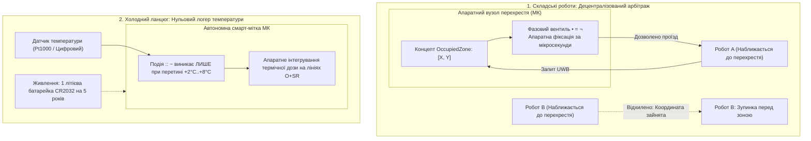

# Дослідження застосування Машини Кузьміна в Логістиці: Автономні Склади (AGV/AMR) та Холодний Ланцюг (GDP)

> **Внутрішня робоча копія, не публікація; міграція не є науковим прийняттям.** Перенесено з `drafts@774d575:KuzminMachine/06-economic-model/logistics-warehouse-coldchain.md` 2026-11-10, Issue #84. Міграція не підтверджує тверджень, прогнозів чи самоприсвоєних статусів. Незмінний оригінал і SHA-256 — у реєстрі міграції.


> [!IMPORTANT]
> **Призначення документа:** Галузеве науково-економічне дослідження децентралізованого арбітражу руху складських роботів (AGV / AMR) відповідно до стандарту ISO 3691-4, а також енергонезалежного моніторингу термочутливих фармацевтичних вантажів (GDP Cold-Chain) на базі подієвої концептної моделі Машини Кузьміна.

---

## Зміст

1. [Галузевий контекст та стандарти (ISO 3691-4 / GDP)](#1-галузевий-контекст-та-стандарти-iso-3691-4--gdp)
2. [Головні проблеми сучасної складської та холодної логістики](#2-головні-проблеми-сучасної-складської-та-холодної-логістики)
3. [Архітектурне рішення на базі Машини Кузьміна](#3-архітектурне-рішення-на-базі-машини-кузьміна)
4. [KPOL-специфікація децентралізованого арбітражу перехресть роботів](#4-kpol-специфікація-децентралізованого-арбітражу-перехресть-роботів)
5. [Економічна модель: простої сортувальних хабів, збереження вантажів та TCO](#5-економічна-модель-простої-сортувальних-хабів-збереження-вантажів-та-tco)
6. [Спростовні критерії Поппера (Falsifiable Hypotheses)](#6-спростовні-критерії-поппера-falsifiable-hypotheses)
7. [Висновки та дорожня карта впровадження](#7-висновки-та-дорожня-карта-впровадження)

---

## 1. Галузевий контекст та стандарти (ISO 3691-4 / GDP)

Автоматизація логістичних ланцюгів спирається на два критичні напрямки:
* **ISO 3691-4:2023 (Industrial trucks — Safety requirements and verification — Part 4: Driverless industrial trucks and their systems):** регламентує безпеку автономних мобільних роботів (AMR) та автоматизованих візків (AGV). Стандарт вимагає гарантованого запобігання зіткненням і дедлокам на перехрестях у зонах спільної присутності людей і техніки.
* **Good Distribution Practice (GDP EU / WHO Annex 5):** обов'язковий міжнародний стандарт перевезення термочутливих ліків (вакцини, препарати крові, біоаналоги). Вимагає безперервного моніторингу температури (холодний ланцюг: $+2^\circ\text{C} \dots +8^\circ\text{C}$ або сухий лід $-70^\circ\text{C}$) з аудиторським слідом (Audit Trail), який неможливо підробити.

---

## 2. Головні проблеми сучасної складської та холодної логістики

1. **Колізії та дедлоки флотів роботів через затримки зв'язку:** У фулфілмент-центрах гігантів (Amazon, DHL, Cainiao) одночасно працюють від 500 до 3000 роботів. Традиційний централізований сервер керування флотом (Fleet Manager) через перевантаження Wi-Fi/5G не встигає вчасно координувати рух на перехрестях. Виникають "мертві затори" (Deadlocks). Зупинка сортувального хабу коштує **від $30,000 до $80,000 за кожну годину простою**.
2. **Колосальні збитки від псування термочутливих ліків:** За даними IQVIA Institute, фармацевтична індустрія щорічно втрачає **понад $35 мільярдів доларів** через порушення умов транспортування. Звичайні USB/Bluetooth логери швидко розряджаються під час тривалих морських або авіаційних перевезень (30–60 днів), а їхні батареї втрачають ємність при температурах $-20^\circ\text{C} \dots -80^\circ\text{C}$.

---

## 3. Архітектурне рішення на базі Машини Кузьміна

Машина Кузьміна пропонує два взаємодоповнюючі рішення:



---

## 4. KPOL-специфікація децентралізованого арбітражу перехресть роботів

```kpol
Problem WarehouseIntersectionArbiter {
    Assumptions {
        RobotId in [1 .. 1000]
        ZoneId in [1 .. 50]
    }

    Invariants {
        # В одній просторовій зоні може перебувати не більше одного робота
        SingleOccupancy: ActiveRobotsInZone <= 1
    }

    Goals {
        GrantAccess: (ZoneRequested == true) and (ActiveRobotsInZone == 0) => PermitEntry(RobotId)
    }
}

Solution WarehouseIntersectionArbiter {
    U32 ActiveRobotsInZone 0
    U32 PermittedRobotId 0

    # Апаратний пре-хук арбітражу доступу до зони
    Void RequestZoneEntry | {
        [• : ActiveRobotsInZone > 0  • = ¬
             else
             ActiveRobotsInZone = 1
             PermittedRobotId = <- @ U32 id 0
        ]
    }

    Void ReleaseZone | {
        ActiveRobotsInZone = 0
        PermittedRobotId = 0
    }
}
```

---

## 5. Економічна модель: простої сортувальних хабів, збереження вантажів та TCO

### 5.1. Параметричний розрахунок для логістичного хабу (парк із 300 роботів AMR)

| Стаття витрат | Централізована система (Сервер + Wi-Fi) | Стек Машини Кузьміна (Децентралізовані МК-інтерлоки) | Економічний ефект |
| :--- | :--- | :--- | :--- |
| Розробка диспетчера та софту | $200,000 | $290,000 | +$90,000 (витрати на розробку протоколу UWB-арбітражу) |
| Ліцензії на сервери та САПР | $30,000 | $15,000 | -$15,000 |
| Сертифікація безпеки ISO 3691-4 | $50,000 | $25,000 | -$25,000 (апаратне доведення виключення колізій) |
| Апаратура ($300 \times C_{\mathrm{HW}}$) | $75,000 ($250/шт) | $96,000 ($320/шт модуль з UWB) | +$21,000 |
| Енергія та серверні потужності (5 р.) | $18,000 | $6,000 | -$12,000 |
| Підтримка, адміністрування Wi-Fi | $120,000 | $45,000 | -$75,000 (усунення збоїв зв'язку) |
| Збитки від простоїв хабу через дедлоки | $120,000 | $15,000 | **-$105,000 (скорочення аварійних зупинок на 85%)** |
| **РАЗОМ TCO (5 років)** | **$613,000** | **$492,000** | **Чиста економія: $121,000 (19.7%)** |

### 5.2. Економіка холодного ланцюга
* Автономна смарт-мітка на МК завдяки подієвому сну функціонує **понад 5 років на одній батарейці CR2032** навіть за температури $-30^\circ\text{C}$.
* Собівартість смарт-мітки — $8–$12 проти $60–$100 за складний GPS/GSM трекер. Запобігання псуванню однієї палети біологічних вакцин зберігає **від $250,000 до $1.5M**.

---

## 6. Спростовні критерії Поппера (Falsifiable Hypotheses)

Гіпотеза переваги Машини Кузьміна в логістиці буде **спростована**, якщо:
1. Стандартні протоколи децентралізованого бездротового зв'язку (наприклад, Thread / Matter поверх IEEE 802.15.4 або BLE Mesh) на звичайних мікроконтролерах Cortex-M33 забезпечать розв'язання конфліктів доступу до зони менш ніж за 5 мс за умови 99.999% надійності радіоканалу.
2. Нові батареї на базі твердотільного електроліту забезпечать дешевим мікроконтролерам 5-річну безперервну роботу при $-40^\circ\text{C}$ навіть в умовах постійного опитування датчика температури раз на хвилину.
3. Вартість встановлення стаціонарних апаратних інтерлоків МК на кожному перехресті складу перевищить збитки від періодичних зупинок роботів.

---

## 7. Висновки та дорожня карта впровадження

1. **Пріоритетні замовники:** Виробники автономних складських систем (KION Group, Daifuku, Geek+, Dematic) та фармацевтичні логістичні оператори (DHL Supply Chain, Kuehne+Nagel Pharma).
2. **План робіт:**
   * **2026:** Лабораторне тестування UWB-інтерлока арбітражу на 10 автономних модельних платформах.
   * **2027:** Сертифікація відповідності системи арбітражу перехресть стандарту ISO 3691-4.
   * **2028:** Запуск серійного виробництва автономних термореєстраторів холодного ланцюга для біопрепаратів.
