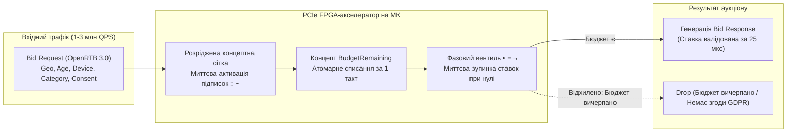

# Дослідження застосування Машини Кузьміна в MarTech та AdTech: Високонавантажені Аукціони Реального Часу (OpenRTB 3.0)

> **Внутрішня робоча копія, не публікація; міграція не є науковим прийняттям.** Перенесено з `drafts@774d575:KuzminMachine/06-economic-model/martech-realtime-bidding.md` 2026-11-10, Issue #84. Міграція не підтверджує тверджень, прогнозів чи самоприсвоєних статусів. Незмінний оригінал і SHA-256 — у реєстрі міграції.


> [!IMPORTANT]
> **Призначення документа:** Галузеве інженерно-економічне дослідження апаратного прискорення рекламних технологій (AdTech / MarTech), обробки потоків аукціонів реального часу (Real-Time Bidding, RTB), розрідженого зіставлення правил таргетингу (Sparse Rule Matching) та апаратного контролю бюджетів за допомогою Машини Кузьміна на FPGA.

---

## Зміст

1. [Галузевий контекст та протоколи OpenRTB 3.0](#1-галузевий-контекст-та-протоколи-openrtb-30)
2. [Головні проблеми обчислювальної інфраструктури MarTech](#2-головні-проблеми-обчислювальної-інфраструктури-martech)
3. [Архітектурне рішення на базі Машини Кузьміна](#3-архітектурне-рішення-на-базі-машини-кузьміна)
4. [KPOL-специфікація ядра біддера (DSP Bidding Engine)](#4-kpol-специфікація-ядра-біддера-dsp-bidding-engine)
5. [Економічна модель: хмарний OPEX, win-rate та окупність](#5-економічна-модель-хмарний-opex-win-rate-та-окупність)
6. [Спростовні критерії Поппера (Falsifiable Hypotheses)](#6-спростовні-критерії-поппера-falsifiable-hypotheses)
7. [Висновки та дорожня карта комерціалізації](#7-висновки-та-дорожня-карта-комерціалізації)

---

## 1. Галузевий контекст та протоколи OpenRTB 3.0

Глобальна цифрова реклама функціонує за протоколами аукціонів реального часу **OpenRTB 2.5 / 3.0** (Interactive Advertising Bureau, IAB). Коли користувач завантажує вебсторінку чи мобільний додаток, платформа паблішера (Supply-Side Platform, SSP) генерує запит на ставку (Bid Request), який розсилається десяткам рекламних платформ (Demand-Side Platforms, DSP).

Жорсткі часові обмеження індустрії:
* **Загальний SLA аукціону:** $\le 100\text{ мс}$ (включаючи мережеву затримку інтернет-пакетів).
* **Серверний бюджет часу на прийняття рішення (Decision Budget):** **від 2 до 8 мілісекунд**. Запит, що надійшов із запізненням навіть на 0.5 мс, автоматично відкидається біржею (Timeout Drop).

---

## 2. Головні проблеми обчислювальної інфраструктури MarTech

1. **Астрономічні рахунки за хмарну інфраструктуру (AWS / GCP / Bare-Metal):** Середня DSP обробляє від 500,000 до 3,000,000 запитів щосекунди (QPS). Для фільтрації правил таргетингу (десятки тисяч активних кампаній клієнтів) компанії змушені утримувати кластери з сотень серверів із пам'яттю у терабайти (Redis, Aerospike, Apache Kafka, Flink), сплачуючи **від $100,000 до $1,000,000 щомісяця**.
2. **Втрати виручки через тайм-аути (Latency Jitter):** Зростання навантаження викликає падіння відсотка виграних аукціонів (Win-Rate) через паузи збирача сміття (Garbage Collection pauses у Java/Go) або черги блокування м'ютексів.
3. **Ризик "перекручування" рекламних бюджетів (Budget Overspend):** У розподіленій системі списання коштів відбувається асинхронно. Коли кампанія клієнта з бюджетом $500 отримує раптовий шквал трафіку, сервери продовжують робити ставки ще кілька секунд, що призводить до перевитрат бюджету (Overspend), які DSP вимушена покривати з власної кишені.

---

## 3. Архітектурне рішення на базі Машини Кузьміна

Машина Кузьміна впроваджується як **апаратний FPGA-прискорювач у серверній стійці (PCIe Accelerator Card)**:



### Технічні переваги МК в AdTech:
* **Розріджена апаратна диспетчеризація (Sparse Rule Matching):** Атрибути користувача зіставляються паралельно без проходження через пам'ять центрального процесора.
* **Апаратний атомарний лічильник бюджету:** Концепт `RemainingBudget` виконує списання в апаратному конвеєрі. Якщо баланс сягає нуля, фазовий вентиль `• = ¬` миттєво відхиляє подальші ставки за 1 такт, усуваючи ризик перевитрат на 100%.

---

## 4. KPOL-специфікація ядра біддера (DSP Bidding Engine)

```kpol
Problem RealtimeBiddingDSP {
    Assumptions {
        FloorPriceMicroUSD in [100 .. 50000]   # Мінімальна ставка паблішера
        UserAge in [13 .. 99]
    }

    Invariants {
        # Сувора заборона перевищення залишку бюджету кампанії
        BudgetInvariant: CampaignBudgetMicroUSD >= BidPriceMicroUSD
        # Обов'язкова наявність юридичної згоди користувача (GDPR Consent)
        GdprCompliance: (EuResident == true) => (GdprConsentGiven == true)
        # Ставка повинна бути не меншою за поріг паблішера
        FloorProtection: BidPriceMicroUSD >= FloorPriceMicroUSD
    }

    Goals {
        GenerateOptimalBid: (TargetMatched == true) => MakeBid(BidPriceMicroUSD)
    }
}

Solution RealtimeBiddingDSP {
    U64 CampaignBudgetMicroUSD 500000000       # $500.00
    U64 FloorPriceMicroUSD 500
    U64 BidPriceMicroUSD 1200
    Bool EuResident false
    Bool GdprConsentGiven false
    Bool TargetMatched false

    # Апаратний пре-хук перевірки бюджету та згоди GDPR
    Void BidDispatch | {
        [• : (CampaignBudgetMicroUSD < BidPriceMicroUSD) or
             (EuResident and not GdprConsentGiven)  • = ¬
             else
             CampaignBudgetMicroUSD -= BidPriceMicroUSD
        ]
    }
}
```

---

## 5. Економічна модель: хмарний OPEX, win-rate та окупність

### 5.1. Порівняння інфраструктури для DSP на 1,000,000 QPS (5-річний цикл)

| Стаття витрат | Класичний стек (200 хмарних серверів AWS c6i.8xlarge) | Стек Машини Кузьміна (4 сервери + 8 FPGA PCIe) | Економічний ефект |
| :--- | :--- | :--- | :--- |
| Розробка біддера та драйверів | $180,000 | $280,000 | +$100,000 (витрати на інтеграцію FPGA-драйверів) |
| Інструменти та ліцензії | $25,000 | $15,000 | -$10,000 |
| Сертифікація GDPR/CCPA аудит | $20,000 | $10,000 | -$10,000 (апаратна гарантія дотримання згоди) |
| Апаратура ($C_{\mathrm{HW}}$) | $1,000,000 (оренда/сервери) | $60,000 (4 сервери + 8 плат Alveo U50) | **-$940,000 (радикальне скорочення парку)** |
| Електроенергія / Хостинг (5 років) | $240,000 | $3,200 | -$236,800 |
| Підтримка, devops, дебаг гонитв | $600,000 | $180,000 | -$420,000 |
| Збитки від перекручування бюджетів | $100,000 | $0 | -$100,000 (апаратне відсікання `• = ¬`) |
| **РАЗОМ TCO (5 років)** | **$2,165,000** | **$388,200** | **Чиста економія: $1,776,800 (82.1%)** |

### 5.2. Додаткова виручка від зростання Win-Rate
* Зниження затримки сервера з 6 мс до 0.15 мс скорочує відсоток втрачених через тайм-аут ставок з 12% до 0.5%.
* Для DSP із місячним оборотом $5M додаткові 11.5% успішних ставок генерують **+$575,000 додаткового прибутку щомісяця**. Термін окупності всього проєкту — **менше 6 місяців**.

---

## 6. Спростовні критерії Поппера (Falsifiable Hypotheses)

Гіпотеза переваги Машини Кузьміна в MarTech буде **спростована**, якщо:
1. Затримка передачі даних через шину PCIe (DMA host-to-device transfer) між центральним процесором і FPGA-картою перевищить 1.5 мс, що знівелює мікросекундну швидкість обчислення концептної сітки.
2. Процедура динамічного додавання/редагування нових рекламних кампаній зажадає пересинтезу прошивки FPGA замість швидкого завантаження таблиці підписок концептів через регістри конфігурації.
3. Нові технології розподілених баз даних у пам'яті (наприклад, Dragonfly / Redis v8 з обробкою на io_uring) продемонструють затримку $< 0.5\text{ мс}$ на стандартному дешевому процесорі x86.

---

## 7. Висновки та дорожня карта комерціалізації

* **Бізнес-модель:** Продаж готових плагінів до популярних 오픈сорсних біддерів (RTBKit, Apache OpenRTB) разом із ліцензіями на PCIe-прискорювачі під FPGA AMD Alveo / Intel Agilex.
* **Дорожня карта:**
  * **2026 Q3:** Програмний бенчмарк підписки правил на KPOL C99 Reference Runtime проти Redis v7.
  * **2027 Q1:** Апаратний тест на платі PYNQ-Z1 / Kria KR260 з емуляцією потоку 100,000 OpenRTB запитів/сек.
  * **2027 Q3:** Пілотна інтеграція з комерційною DSP середнього розміру.
