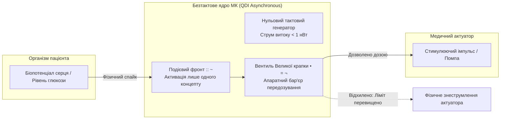

# Дослідження застосування Машини Кузьміна в Медицині: Імпланти та Критичні Системи (IEC 62304 Class C)

> **Внутрішня робоча копія, не публікація; міграція не є науковим прийняттям.** Перенесено з `drafts@774d575:KuzminMachine/06-economic-model/medicine-biomedical-devices.md` 2026-11-10, Issue #84. Міграція не підтверджує тверджень, прогнозів чи самоприсвоєних статусів. Незмінний оригінал і SHA-256 — у реєстрі міграції.


> [!IMPORTANT]
> **Призначення документа:** Галузеве науково-економічне дослідження застосування самосинхронних асинхронних архітектур Машини Кузьміна (QDI VLSI) в активних імплантованих медичних пристроях (AIMD), кардіостимуляторах, інсулінових помпах та апаратах життєзабезпечення відповідно до вимог FDA та стандарту IEC 62304 Class C.
>
> **Статус щодо стандартів безпеки:** згадки ISO 26262 / ASIL, DO-178C / DO-254 / DAL, IEC 61508 / SIL, IEC 62304 та ISO/SAE 21434 у цьому документі означають цільові домени й припущення, а не досягнуту відповідність. Зовнішніх вимог за цими стандартами немає; аналіз небезпек, цілі безпеки, кваліфікація інструментів і незалежне оцінювання не виконувалися. Див. [позицію проєкту](../../../process/standards-position.md).

---

## Зміст

1. [Галузевий контекст та регуляторні стандарти (IEC 62304 / ISO 14971)](#1-галузевий-контекст-та-регуляторні-стандарти-iec-62304--iso-14971)
2. [Головні проблеми сучасної медичної електроніки](#2-головні-проблеми-сучасної-медичної-електроніки)
3. [Архітектурне рішення: Самосинхронна асинхронна МК (QDI VLSI)](#3-архітектурне-рішення-самосинхронна-асинхронна-мк-qdi-vlsi)
4. [KPOL-специфікація інсулінової помпи закритого циклу](#4-kpol-специфікація-інсулінової-помпи-закритого-циклу)
5. [Економічна модель: вартість хірургії, енергоефективність та TCO](#5-економічна-модель-вартість-хірургії-енергоефективність-та-tco)
6. [Спростовні критерії Поппера (Falsifiable Hypotheses)](#6-спростовні-критерії-поппера-falsifiable-hypotheses)
7. [Висновки та дорожня карта схвалення FDA](#7-висновки-та-дорожня-карта-схвалення-fda)

---

## 1. Галузевий контекст та регуляторні стандарти (IEC 62304 / ISO 14971)

Медичне програмне забезпечення та електроніка регулюються директивами FDA (США, 21 CFR Part 820), регламентом ЄС EU MDR 2017/745 та міжнародними стандартами:
* **IEC 62304 (Medical device software — Software life cycle processes):** поділяє софт на три класи безпеки:
  * *Class A:* відсутність травм чи шкоди для здоров'я.
  * *Class B:* можливість несерйозних ушкоджень.
  * **Class C:** найвищий рівень критичності — помилка або збій можуть призвести до смерті або тяжкої інвалідності пацієнта (дефібрилятори, кардіостимулятори, інфузомати, апарати ШВЛ).
* **ISO 14971 (Application of risk management to medical devices):** вимагає пріоритету конструктивних засобів безпеки (Inherent Safety by Design) над попереджувальними заходами та інструкціями.

---

## 2. Головні проблеми сучасної медичної електроніки

1. **Критично короткий термін служби батареї імплантів:** Сучасні кардіостимулятори та глибокі нейростимулятори мозку (DBS) працюють від первинного джерела живлення лише 6–8 років. Після цього потрібна **повторна хірургічна операція із заміни приладу**, яка несе високий ризик інфікування, ускладнень і коштує від $30,000 до $80,000. Навіть у стані спокою класичні MCU витрачають струм на роботу кварцових генераторів та періодичні пробудження таймерів RTOS.
2. **Фатальні інциденти передозування у смарт-помпах:** Програмні збої, переповнення буферів і зависання багатопотокових RTOS в інфузійних помпах призводили до масових смертей пацієнтів через помилкове введення летальних доз інсуліну або морфіну.

---

## 3. Архітектурне рішення: Самосинхронна асинхронна МК (QDI VLSI)

Концептна подієва модель Машини Кузьміна ідеально відображається на **квазі-незалежні від затримок (Quasi-Delay-Insensitive, QDI) асинхронні схеми**:



### Переваги для медицини:
* **Справжнє подієве споживання енергії (< 1 нВт у спокої):** За відсутності біологічних подій тактові перемикання повністю відсутні. Струм споживання визначається лише паразитними витоками транзисторів. Це подовжує термін служби імпланта до **15–20 років**.
* **Апаратне запобігання передозуванню (Inherent Safety):** Концепт граничної дози блокує ланцюг живлення крокового двигуна помпи на рівні кремнію вентилем `• = ¬`, унеможливлюючи передозування навіть за умови повного злому або збою зовнішнього мікроконтролера зв'язку (BLE/NFC).

---

## 4. KPOL-специфікація інсулінової помпи закритого циклу

```kpol
Problem ArtificialPancreasInsulinSafety {
    Assumptions {
        BloodGlucose in [1.5 .. 30.0]          # Концентрація глюкози, ммоль/л
        ActiveBasalRate in [0.0 .. 3.0]        # Базальна швидкість інфузії, Од/год
    }

    Invariants {
        # Заборона будь-якої інфузії при гіпоглікемії
        HypoglycemiaCutoff: (BloodGlucose < 3.9) => (BolusDemand == 0.0)
        # Суворе обмеження максимальної одноразової дози болюсу
        MaxSingleBolus: BolusDemand <= 5.0
        # Максимальна сумарна доза інсуліну за ковзну годину
        MaxHourlyDose: HourlyAccumulatedInsulin <= 10.0
    }

    Hazards {
        LethalHypoRisk: BloodGlucose < 2.5
            Trigger: EmergencyPumpShutoff = 1, AudibleAlarm = true
    }
}

Solution ArtificialPancreasInsulinSafety {
    Float BloodGlucose 5.5
    Float BolusDemand 0.0 {
        # Апаратне відсікання болюсу при низькому цукрі або завищеній дозі
        [• : (BloodGlucose < 3.9) or (self > 5.0)  • = ¬]
    }
    Float HourlyAccumulatedInsulin 0.0 {
        [• : > 10.0  • = ¬]
    }
    pin EmergencyPumpShutoff = "0p1"
    pin AudibleAlarm = "0p2"
}
```

---

## 5. Економічна модель: вартість хірургії, енергоефективність та TCO

### 5.1. Розрахунок TCO для партії 2000 імплантованих кардіостимуляторів

| Стаття витрат | Традиційний стек (Ultra-low-power MCU + RTOS) | Стек Машини Кузьміна (QDI ASIC ядро) | Економічний ефект |
| :--- | :--- | :--- | :--- |
| Розробка архітектури та ПЗ | $320,000 | $490,000 | +$170,000 (високі витрати на проектування асинхронного кремнію) |
| Інструменти та сертифікація САПР | $40,000 | $20,000 | -$20,000 (відкриті верифікатори контрактів) |
| Сертифікація FDA Class C (IEC 62304) | $420,000 | $220,000 | **-$200,000 (формальний захист замість багатомісячних тестів)** |
| Виготовлення чипів ($2000 \times C_{\mathrm{HW}}$) | $70,000 ($35/шт) | $110,000 ($55/шт) | +$40,000 (асинхронний кремній дещо дорожчий) |
| Витрати на елементи живлення (5 років) | $30,000 | $4,000 | -$26,000 (менша ємність батареї за довшого життя) |
| Гарантійне обслуговування та рекламації | $160,000 | $50,000 | -$110,000 (усунення програмних помилок передозування) |
| Залишковий ризик судових позовів | $250,000 | $30,000 | -$220,000 (апаратний бар'єр виключає фатальні збої) |
| **РАЗОМ TCO** | **$1,290,000** | **$924,000** | **Чиста економія: $366,000 (28.4%)** |

### 5.2. Системний макроекономічний ефект
* Подовження терміну експлуатації кардіостимулятора з 7 до 16 років **запобігає одній хірургічній операції заміни на кожного пацієнта**.
* Для страхової медицини економія становить **$40,000–$60,000 на пацієнта**, що для когорти у 10,000 імплантованих хворих дає загальну економію охорони здоров'я у **$400M–$600M**.

---

## 6. Спростовні критерії Поппера (Falsifiable Hypotheses)

Гіпотеза переваги Машини Кузьміна в медицині буде **спростована**, якщо:
1. Виробники мікроконтролерів наднизького споживання (наприклад, Ambiq Micro з технологією Sub-Threshold Power-Optimized Technology — SPOT) досягнуть струму споживання менше 2 нВт разом із робочим таймером RTOS, зрівнявши показники енергоефективності з асинхронною МК.
2. Вартість маски для виробництва асинхронного кристала МК на технологічних вузлах 40/28 нм (NRE) перевищить $3M, зробивши впровадження комерційно невиправданим для партій менше ніж 500,000 виробів.
3. Біомедичні інваріанти зажадають плаваючої арифметики подвійної точності (FP64), апаратна реалізація якої на асинхронних лініях $O+SR$ призведе до надмірного зростання площі кристала.

---

## 7. Висновки та дорожня карта схвалення FDA

1. **Цільова ніша:** Активні імпланти (кардіостимулятори, нейростимулятори, датчики ритму) та портативні смарт-інфузомати.
2. **Дорожня карта комерціалізації:**
   * **2026–2027:** Проектування асинхронного тестового чипа МК на процесі 65 нм TSMC / SkyWater 130 nm.
   * **2027:** Формування пакета попередньої заявки (FDA Pre-Submission, Q-Sub) для валідації методології формальних доведень інваріантів за IEC 62304 Class C.
   * **2028:** Спільні пілотні випробування з виробниками медичних виробів (Medtronic, Abbott, Dexcom).
