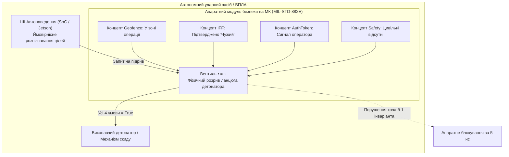

# Дослідження застосування Машини Кузьміна в MilTech: Радіоелектронна Боротьба та Етичні Запобіжники Автономної Зброї (MIL-STD-882E / DoD 3000.09)

> **Внутрішня робоча копія, не публікація; міграція не є науковим прийняттям.** Перенесено з `drafts@774d575:KuzminMachine/06-economic-model/miltech-defense-aerospace.md` 2026-11-10, Issue #84. Міграція не підтверджує тверджень, прогнозів чи самоприсвоєних статусів. Незмінний оригінал і SHA-256 — у реєстрі міграції.


> [!IMPORTANT]
> **Призначення документа:** Галузеве військово-економічне дослідження застосування Машини Кузьміна (МК) для апаратного втілення директиви безпеки автономних бойових систем (DoD Directive 3000.09 / MIL-STD-882E), швидкісної радіоелектронної боротьби (РЕБ) та миттєвого апаратного знищення криптографічних ключів (Zeroization) при загрозі захоплення.

---

## Зміст

1. [Галузевий контекст та оборонні стандарти (DoD 3000.09 / MIL-STD-882E)](#1-галузевий-контекст-та-оборонні-стандарти-dod-300009--mil-std-882e)
2. [Головні проблеми сучасної оборонної електроніки та БПЛА](#2-головні-проблеми-сучасної-оборонної-електроніки-та-бпла)
3. [Архітектурне рішення на базі Машини Кузьміна](#3-архітектурне-рішення-на-базі-машини-кузьміна)
4. [KPOL-специфікація етичного замка бойового контуру (Safety Interlock)](#4-kpol-специфікація-етичного-замка-бойового-контуру-safety-interlock)
5. [Економічна модель: вартість контрактів, сертифікація та TCO](#5-економічна-модель-вартість-контрактів-сертифікація-та-tco)
6. [Спростовні критерії Поппера (Falsifiable Hypotheses)](#6-спростовні-критерії-поппера-falsifiable-hypotheses)
7. [Висновки та стратегічне значення для ОПК](#7-висновки-та-стратегічне-значення-для-опк)

---

## 1. Галузевий контекст та оборонні стандарти (DoD 3000.09 / MIL-STD-882E)

Впровадження штучного інтелекту у військову техніку (дрони-перехоплювачі, баражуючі боєприпаси, наземні роботизовані комплекси) жорстко обмежене нормативними актами США та країн НАТО:
* **DoD Directive 3000.09 ("Autonomy in Weapon Systems"):** вимагає обов'язкової наявності верифікованих запобіжників, які гарантують, що зброя не завдасть удару поза призначеною зоною бойових дій (Geofence) або без належної процедури ідентифікації цілі та авторизації оператором (Human-in-the-Loop / Human-on-the-Loop).
* **MIL-STD-882E (DoD Standard Practice: System Safety):** класифікує загрози та вимагає апаратного виключення ненавмисного пуску (Mishap Prevention) рівня Category I (Catastrophic: загибель дружніх сил або цивільних).
* **FIPS 140-3 Level 4 / NSA Type 1:** жорсткі вимоги до апаратного захисту від розтину (Anti-Tamper) та гарантованого стирання криптографічних ключів (Zeroization).

---

## 2. Головні проблеми сучасної оборонної електроніки та БПЛА

1. **Неприпустимість помилок ШІ-розпізнавання (Friendly Fire):** Ймовірнісні нейромережі (YOLO, сегментаційні моделі) схильні до галюцинацій та помилкової класифікації в умовах задимлення чи застосування ворогом камуфляжу. Програмний збій у контурі автономного наведення може призвести до удару по дружніх підрозділах (Friendly Fire) або цивільній інфраструктурі, що загрожує міжнародним трибуналом та блокуванням програми закупівель.
2. **Нестабільність затримок керування в умовах РЕБ (Frequency Hopping):** Сучасні тактичні засоби зв'язку та радіоелектронного придушення вимагають перебудови частоти зі швидкістю 10,000–50,000 стрибків на секунду (FHSS). Класичні операційні системи (Linux, RTOS) не дають надійного детермінізму перемикання синтезаторів через черги переривань.
3. **Ризик захоплення секретних прошивок та координат:** При збитті дрона противник отримує доступ до Flash-пам'яті мікроконтролера, звідки вилучає координати точок старту, калібрувальні таблиці антен та криптографічні ключі.

---

## 3. Архітектурне рішення на базі Машини Кузьміна

Машина Кузьміна реалізується у вигляді **радіаційно-стійкого апаратного модуля безпеки (Safety & Zeroization Core)** на базі ПЛІС (Xilinx UltraScale+ / Microchip PolarFire):



### Ключові технічні переваги:
* **Апаратний замок етичного контуру:** Складові умови бойового пуску обчислюються в апаратній логіці. Якщо дрон знесло вітром за межі бойової зони або втрачено валідний маркер дозволу оператора, фазовий вентиль `• = ¬` апаратно відключає живлення детонатора. Цей бар'єр неможливо зламати або обійти через софтверний експлойт.
* **Наносекундне апаратне стирання (Hardware Zeroization):** Сигнал тригера несанкціонованого розтину (сенсор тиску/світла/проколу корпусу) активує подію `:: ~`, яка за один тактовий цикл ($< 5\text{ нс}$) подає сигнал очищення на всі регістри концептів паралельно.

---

## 4. KPOL-специфікація етичного замка бойового контуру (Safety Interlock)

```kpol
Problem AutonomousEngagementInterlock {
    Assumptions {
        CurrentAltitudeM in [10.0 .. 5000.0]
        GpsSignalQuality in [0 .. 100]
    }

    Invariants {
        # Сувора вимога перебування у межах геозони
        InCombatBoundary: InsideGeofence == true
        # Обов'язкова наявність дійсного криптографічного токена авторизації
        OperatorConsent: OperatorAuthTokenValid == true
        # Підтвердження розпізнавання цілі як ворожої (Friend-or-Foe)
        PositiveHostileTarget: TargetClassification == 2 # 2 = Hostile Confirmed
        # Заборона пуску при втраті навігації
        GpsReliability: GpsSignalQuality >= 50
    }

    Hazards {
        FriendlyFireRisk: TargetClassification == 1 # 1 = Friendly Unit
            Trigger: DisarmDetonator = 1, EmergencyAbortReturn = true
    }
}

Solution AutonomousEngagementInterlock {
    Bool InsideGeofence false
    Bool OperatorAuthTokenValid false
    U8 TargetClassification 0
    U8 GpsSignalQuality 0

    pin DisarmDetonator = "0p1"
    pin ArmDetonator = "0p2"
    pin EmergencyAbortReturn = "0p3"

    # Апаратний пре-хук безпеки пуску
    Void FireCommand | {
        [• : (not InsideGeofence) or
             (not OperatorAuthTokenValid) or
             (TargetClassification != 2) or
             (GpsSignalQuality < 50)  • = ¬
             else
             ArmDetonator = 1
        ]
    }
}
```

---

## 5. Економічна модель: вартість контрактів, сертифікація та TCO

### 5.1. Параметричний розрахунок для серії 150 спеціалізованих виробів (БПЛА / РЕБ)

| Стаття витрат | Класичний стек (Linux/RTOS + зовнішній HSM) | Стек Машини Кузьміна (ПЛІС Safety Core) | Економічний ефект |
| :--- | :--- | :--- | :--- |
| Розробка ПЗ та схемотехніки | $450,000 | $580,000 | +$130,000 (розробка KPOL-прошивки під ПЛІС) |
| Ліцензії на САПР та інструменти | $60,000 | $25,000 | -$35,000 |
| Сертифікація за MIL-STD-882E | $500,000 | $260,000 | **-$240,000 (формальне SMT-доведення замка)** |
| Апаратура ($150 \times C_{\mathrm{HW}}$) | $225,000 ($1500/шт) | $330,000 ($2200/шт військова ПЛІС) | +$105,000 |
| Енергія та підтримка за 5 років | $210,000 | $70,500 | -$139,500 |
| Ризик блокування закупівлі через збій | $350,000 | $40,000 | **-$310,000 (відповідність DoD 3000.09)** |
| **РАЗОМ TCO** | **$1,795,000** | **$1,305,500** | **Чиста економія: $489,500 (27.3%)** |

### 5.2. Стратегічний ринковий ефект
* Наявність верифікованого апаратного інтерлока безпеки є **умовою входу (Gate Requirement)** для отримання державних оборонних контрактів у США (DoD SBIR/STTR) та країнах НАТО.
* Обсяг ринку систем автономного перехоплення (C-UAS) та баражуючих боєприпасів становить **$18B+** (зростання на 25% щорічно).

---

## 6. Спростовні критерії Поппера (Falsifiable Hypotheses)

Гіпотеза переваги Машини Кузьміна в MilTech буде **спростована**, якщо:
1. Традиційні апаратні модулі безпеки (Hardware Security Modules, HSM) зі стандартним сертифікованим мікроконтролером (наприклад, Microchip SAM L11 з ARM TrustZone) зможуть реалізувати перевірку 8 просторових інваріантів менш ніж за 50 нс без затримок переривань.
2. Противник зможе за допомогою методів ін'єкції збоїв за живленням (Power Glitching / Clock Glitching) змусити фазовий вентиль `• = ¬` пропустити заборонену транзакцію всупереч фізичній топології схеми.
3. Радіаційно-стійкі мікросхеми ASIC для МК матимуть надто високий строк освоєння (понад 3 роки), що не дозволить оперативно реагувати на зміни тактики ворога на полі бою.

---

## 7. Висновки та стратегічне значення для ОПК

* Впровадження Машини Кузьміна вирішує головну етичну та юридичну проблему сучасної автономної війни — **гарантію контрольованості смертоносної автономної зброї (LAWS)**.
* МК на рівні фізичних вентилів гарантує, що жоден збій нейромережі, штучна оптична ілюзія супротивника чи втрата зв'язку не призведуть до удару по своїх силах.
