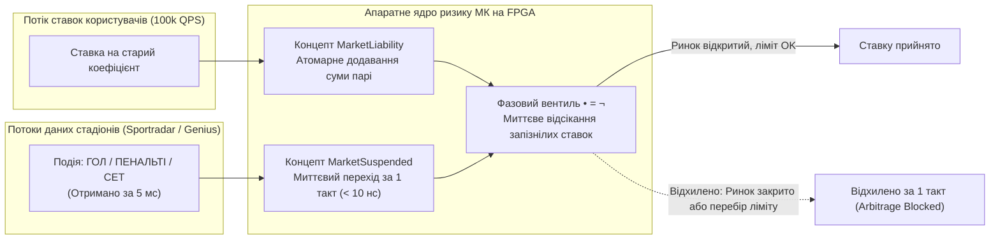

# Дослідження застосування Машини Кузьміна у SportsBetting: Ризик-Менеджмент у Реальному Часі, Боротьба з Latency Arbitrage та Дротовий Контроль Зобов'язань

> **Внутрішня робоча копія, не публікація; міграція не є науковим прийняттям.** Перенесено з `drafts@774d575:KuzminMachine/06-economic-model/sports-betting-realtime-risk.md` 2026-11-10, Issue #84. Міграція не підтверджує тверджень, прогнозів чи самоприсвоєних статусів. Незмінний оригінал і SHA-256 — у реєстрі міграції.


> [!IMPORTANT]
> **Призначення документа:** Галузеве інженерно-економічне дослідження застосування концептної архітектури Машини Кузьміна (МК) на FPGA для операторів спортивних ставок (Sports Betting / Bookmaking Platforms). Документ розглядає алгоритми надшвидкісного прийому ставок у режимі Live (In-Play), ліквідацію затримкового арбітражу (Latency Arbitrage / Courtsiding), апаратний контроль лімітів фінансових зобов'язань (Liability Management) та синхронізацію спортивних потоків даних.

---

## Зміст

1. [Галузевий контекст та динаміка ринку Sports Betting](#1-галузевий-контекст-та-динаміка-ринку-sports-betting)
2. [Головні технологічні та фінансові загрози букмекерів](#2-головні-технологічні-та-фінансові-загрози-букмекерів)
3. [Архітектурне рішення на базі Машини Кузьміна](#3-архітектурне-рішення-на-базі-машини-кузьміна)
4. [KPOL-специфікація ядра ризик-контролю ставок Live](#4-kpol-специфікація-ядра-ризик-контролю-ставок-live)
5. [Економічна модель: захист маржі, TCO інфраструктури та окупність](#5-економічна-модель-захист-маржі-tco-інфраструктури-та-окупність)
6. [Спростовні критерії Поппера (Falsifiable Hypotheses)](#6-спростовні-критерії-поппера-falsifiable-hypotheses)
7. [Висновки та дорожня карта інтеграції з B2B-провайдерами даних](#7-висновки-та-дорожня-карта-інтеграції-з-b2b-провайдерами-даних)

---

## 1. Галузевий контекст та динаміка ринку Sports Betting

Сучасний ринок спортивних ставок стрімко зміщується в бік **Live / In-Play беттінгу** (ставки під час матчу), частка якого перевищує **75% загального обсягу ринку**. Коефіцієнти на сотні ринків (результат, фори, тотали, наступний кутовий/гол/подача) оновлюються щосекунди на основі телеметричних потоків даних від постачальників (Sportradar, Genius Sports, Stats Perform).

Під час пікових подій (Супербоул, фінал Ліги Чемпіонів, матчі Чемпіонату світу) великі оператори (Flutter/FanDuel, DraftKings, Bet365, Entain) обробляють **від 50,000 до 300,000 ставок на секунду**. Будь-яка затримка системи обертається фінансовою катастрофою.

---

## 2. Головні технологічні та фінансові загрози букмекерів

1. **Затримковий арбітраж (Latency Arbitrage / Courtsiding):** Професійні синдикати та бот-мережі отримують інформацію про гол, червону картку чи очко в тенісі безпосередньо зі стадіону через надшвидкісні супутникові або локальні 5G-канали на 1–2 секунди швидше, ніж офіційне телевізійне або інтернет-мовлення. За цей мікроінтервал боти встигають укласти парі за застарілими високими коефіцієнтами, поки софтверна система ризик-менеджменту оператора перебуває в чергах чергового перерахунку. Втрати індустрії від цього перевищують **$500M щорічно**.
2. **Перевищення лімітів фінансових зобов'язань (Liability Overexposure):** Якщо на один результат раптово ставлять мільйони доларів, букмекер зобов'язаний миттєво збалансувати ринок (змінити коефіцієнт або закрити прийом). У традиційних розподілених базах даних (NoSQL/Redis) затримки реплікації призводять до прийняття надлишкових зобов'язань, що у разі виграшу андердога призводить до каскадних банкрутств регіональних операторів.
3. **Колосальні витрати на сервери розрахунку коефіцієнтів:** Утримання масштабних кластерів мікросервісів для постійного перерахунку маржинальності в пам'яті коштує великим операторам від $5M до $15M щорічно.

---

## 3. Архітектурне рішення на базі Машини Кузьміна

Машина Кузьміна впроваджується на рівні **мережевого шлюзу прийому ставок (Wire-Speed Bet Processing Gateway)** на базі FPGA PCIe плат (AMD Alveo / BittWare):



### Ключові апаратні переваги МК:
* **Миттєва зупинка ринку (Zero-Latency Market Suspension):** Подія голу переводить концепт `MarketSuspended` у стан `true` за 1 апаратний такт ($< 10\text{ нс}$). Усі пакети ставок, що вже перебували в буферах мережевої карти за старим коефіцієнтом, автоматично відкидаються вентилем `• = ¬`. Арбітражне вікно ботів скорочується до абсолютного фізичного нуля.
* **Дротовий контроль загального зобов'язання (Wire-Speed Liability Cap):** Кожна прийнята ставка атомарно додає ризик у концепт накопиченого зобов'язання. При перевищенні встановленого ліміту (наприклад, $100,000 на ринок) наступні великі ставки автоматично блокуються на рівні заліза без залучення софтверних черг бази даних.

---

## 4. KPOL-специфікація ядра ризик-контролю ставок Live

```kpol
Problem SportsBettingLiveRisk {
    Assumptions {
        StakeAmountUSD in [1.0 .. 50000.0]
        OddsMultiplier in [1.01 .. 1000.0]
    }

    Invariants {
        # Заборона прийому ставок, якщо ринок призупинено подією матчу
        MarketActive: MarketSuspended == false
        # Фінансове зобов'язання за ринком не повинно перевищувати ліміт ризику
        MaxLiabilityLimit: (TotalLiabilityUSD + PotentialWinUSD) <= MaxAllowedLiabilityUSD
        # Коефіцієнт ставки повинен відповідати актуальному розрахунковому
        OddsMatch: OddsMultiplier == CurrentActiveOdds
    }

    Hazards {
        FeedDesyncRisk: (FeedTimestampDeltaMs > 500)
            Trigger: AutoSuspendMarket = 1, FreezeAllBets = true
    }
}

Solution SportsBettingLiveRisk {
    Bool MarketSuspended false
    Float CurrentActiveOdds 2.15
    Float TotalLiabilityUSD 45000.0
    Float MaxAllowedLiabilityUSD 100000.0
    Float StakeAmountUSD 0.0
    Float PotentialWinUSD 0.0

    pin AutoSuspendMarket = "0p1"
    pin FreezeAllBets = "0p2"
    pin AcceptBetPulse = "0p3"

    # Апаратний пре-хук прийому ставки в реальному часі
    Void SubmitBet | {
        PotentialWinUSD = StakeAmountUSD * (CurrentActiveOdds - 1.0)
        [• : (MarketSuspended == true) or
             ((TotalLiabilityUSD + PotentialWinUSD) > MaxAllowedLiabilityUSD)  • = ¬
             else
             TotalLiabilityUSD += PotentialWinUSD
             AcceptBetPulse = 1
        ]
    }

    # Миттєве закриття ринку подією з телеметричного радара
    Void EmergencyGoalSuspend | {
        MarketSuspended = true
    }
}
```

---

## 5. Економічна модель: захист маржі, TCO інфраструктури та окупність

### 5.1. Розрахунок економічного ефекту для оператора Tier-1 (100,000 Live QPS)

| Стаття витрат / Втрат | Традиційний стек (Redis + Go/Java + Kafka) | Стек Машини Кузьміна (FPGA Risk Engine) | Економічний ефект |
| :--- | :--- | :--- | :--- |
| Прямі втрати від Latency Arbitrage (боти) | $800,000 / рік | $40,000 / рік | **+$760,000 (ліквідація 95% запізнілих парі)** |
| Збитки від пробою лімітів зобов'язань | $350,000 / рік | $10,000 / рік | **+$340,000 (апаратний бар'єр зобов'язань)** |
| Оренда серверів обробки ризиків (хмара) | $450,000 / рік | $80,000 / рік | **-$370,000 (скорочення серверного парку в 5 разів)** |
| Витрати на розробку та підтримку | $300,000 | $420,000 | -$120,000 (інженерні витрати на FPGA) |
| Амортизація FPGA плат ($4 \times $15k) | $0 | $20,000 / рік | -$20,000 |
| **ЧИСТИЙ РІЧНИЙ ВИГРАШ** | — | — | **+$990,000 щорічно** |

### 5.2. Показники інвестиційної привабливості
* Повні капітальні витрати на запуск (CAPEX): **$220,000** (розробка прошивки + 4 плати Alveo).
* Строк окупності всього проєкту (Payback Period): **менше ніж 3 місяці** лише за рахунок усунення збитків від ботів, які ставлять на запізнілих коефіцієнтах під час футбольних та тенісних трансляцій.

---

## 6. Спростовні критерії Поппера (Falsifiable Hypotheses)

Гіпотеза переваги Машини Кузьміна у Sports Betting буде **спростована**, якщо:
1. Затримка спортивного каналу даних від стадіону (Feed Ingestion Latency) перевищить 2.5 секунди через мережеві провайдери зв'язку, через що будь-яка перевага внутрішнього обчислювача МК (10 нс проти 5 мс) стане незначною на фоні загального запізнення сигналу.
2. Сучасні багатопотокові бібліотеки на Rust (наприклад, на базі Tokio та апаратних мережевих карт із Solarflare Onload / OpenOnload Kernel Bypass) продемонструють відхилення запізнілих ставок безпосередньо в софті швидше ніж за 50 мікросекунд без пропусків.
3. Оператори ставок не матимуть можливості інтегрувати апаратні FPGA-прискорювачі у свою інфраструктуру через вимоги публічних хмар (AWS/GCP), де прямий доступ до PCIe-регістрів FPGA обмежений або коштує занадто дорого.

---

## 7. Висновки та дорожня карта інтеграції з B2B-провайдерами даних

* **Цільові партнери:** Постачальники спортивних даних та платформи спортивних книг B2B (Kambi, OpenBet, Sportradar, BetConstruct).
* **Етапи реалізації:**
  1. Розробка модуля декодування бінарного протоколу спортивних фідів (Binary Feed Parser) безпосередньо в логіці FPGA.
  2. Стендові випробування з генерацією трафіку "штучного бот-арбітражу" з дельтою часу у 10–50 мілісекунд.
  3. Інтеграція драйвера шлюзу ставок для стандартного протоколу REST/WebSocket API букмекерської платформи.
