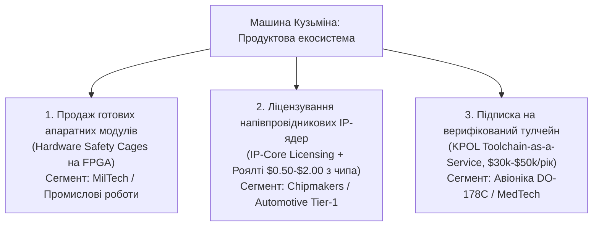
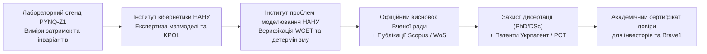
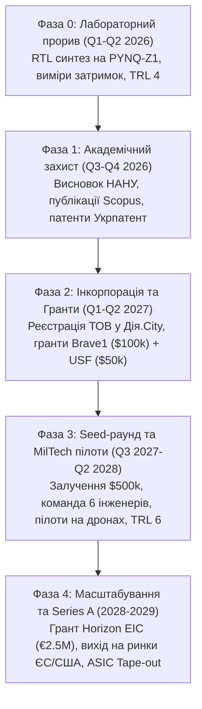
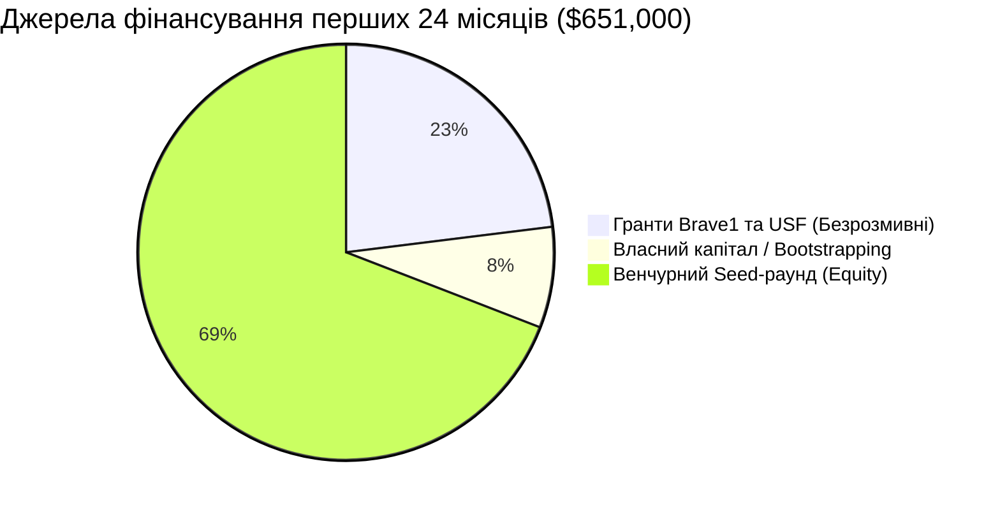
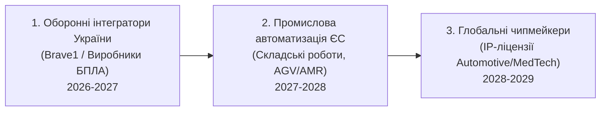
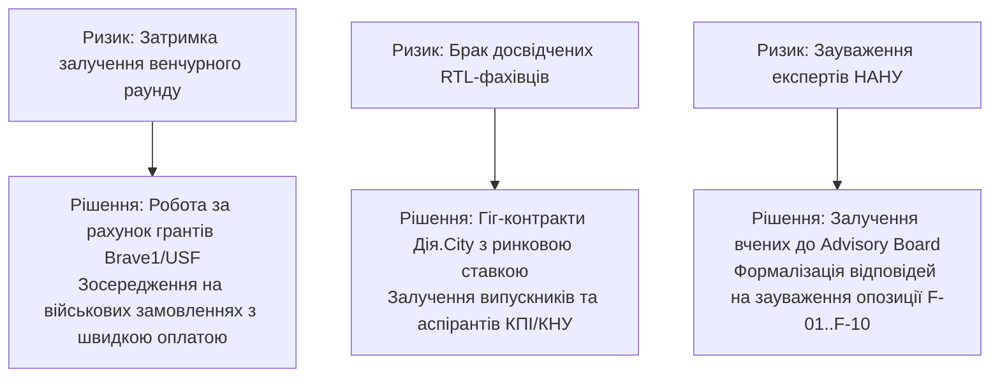

# План розвитку бізнесу (Business Development Plan) проєкту Машини Кузьміна

> **Внутрішня робоча копія, не публікація; міграція не є науковим прийняттям.** Перенесено з `drafts@774d575:KuzminMachine/06-economic-model/Business_Development_Plan.md` 2026-11-10, Issue #84. Міграція не підтверджує тверджень, прогнозів чи самоприсвоєних статусів. Незмінний оригінал і SHA-256 — у реєстрі міграції.

> [!IMPORTANT]
> **Призначення документа:** Стратегічний та операційний план комерціалізації архітектури Машини Кузьміна (МК). Документ визначає поетапний перехід від поточної лабораторної верифікації на наявному апаратному забезпеченні (FPGA PYNQ-Z1) до академічного захисту в Національній академії наук України (НАН України), корпоративного структурування в юрисдикції України (резидентство Дія.City), залучення безрозмивних оборонних грантів (Brave1) та венчурного капіталу (Seed / Series A).
>
> **Статус щодо стандартів безпеки:** згадки ISO 26262 / ASIL, DO-178C / DO-254 / DAL, IEC 61508 / SIL, IEC 62304 та ISO/SAE 21434 у цьому документі означають цільові домени й припущення, а не досягнуту відповідність. Зовнішніх вимог за цими стандартами немає; аналіз небезпек, цілі безпеки, кваліфікація інструментів і незалежне оцінювання не виконувалися. Див. [позицію проєкту](../../process/standards-position.md).

---

## Зміст

1. [Стратегічне бачення, місія та бізнес-модель](#1-стратегічне-бачення-місія-та-бізнес-модель)
2. [Поточний статус: Верифікація та локальні експерименти на наявному hardware](#2-поточний-статус-верифікація-та-локальні-експерименти-на-наявному-hardware)
3. [Етап академічної легітимізації: Науковий захист в НАН України](#3-етап-академічної-легітимізації-науковий-захист-в-нан-україни)
4. [Корпоративна структура та юрисдикція: Заснування компанії в Україні](#4-корпоративна-структура-та-юрисдикція-заснування-компанії-в-україні)
5. [Поетапна дорожня карта розвитку (Phase-Gate Roadmap 2026–2029)](#5-поетапна-дорожня-карта-розвитку-phase-gate-roadmap-20262029)
6. [Фінансова модель, бюджет та розрахунок потреби в інвестиціях](#6-фінансова-модель-бюджет-та-розрахунок-потреби-в-інвестиціях)
7. [Таблиця розподілу капіталу (Cap Table) та етапи фінансування](#7-таблиця-розподілу-капіталу-cap-table-та-етапи-фінансування)
8. [Стратегія виходу на ринок (Go-to-Market) та продажі](#8-стратегія-виходу-на-ринок-go-to-market-та-продажі)
9. [Організаційний план та ключові кадри](#9-організаційний-план-та-ключові-кадри)
10. [Ключові показники ефективності (KPIs) та план контролю ризиків](#10-ключові-показники-ефективності-kpis-та-план-контролю-ризиків)

---

## 1. Стратегічне бачення, місія та бізнес-модель

### 1.1. Бачення (Vision)
Створити першого в Україні та Східній Європі національного DeepTech лідера у сегменті **детермінованих реактивних обчислювачів, формально верифікованих апаратних інтерлоків безпеки та мікроелектроніки реального часу**.

### 1.2. Місія (Mission)
Забезпечити критичну інфраструктуру, автономні оборонні комплекси (MilTech) та високонадійну цивільну техніку (Avionics, Automotive, Medicine) математично гарантованим захистом від програмних збоїв, недетермінізму та несанкціонованого перехоплення керування за допомогою кремнієвих фазових вентилів Машини Кузьміна.

### 1.3. Модель монетизації (Трьохвекторна структура доходу)

1. **Direct Hardware Sales (Продаж апаратних модулів):**
   - Виробництво та постачання серійних плат-інтерлоків на базі промислових ПЛІС (Xilinx Artix-7, Microchip PolarFire) для українських виробників дронів, систем РЕБ та складських роботів. Маржинальність: 45–60%.
2. **Semiconductor IP-Core Licensing (Ліцензування кремнієвих IP-ядер):**
   - Передача (після майбутньої сертифікації) синтезованих VHDL/SystemVerilog модулів глобальним виробникам чипів (NXP, Infineon, STMicroelectronics) із виплатою фіксованого ліцензійного платежу ($150,000–$500,000 за проект) та роялті $0.50–$2.00 з кожного випущеного чипа. Маржинальність: 85–95%.
3. **Toolchain & Verification Subscription (Підписка на ПЗ та сервіси доведення):**
   - Надання корпоративної ліцензії на компілятор KPOL, генератор SMT-доведень (Lean 4 / Z3) та засоби кваліфікації за стандартами DO-330 / ISO 26262. Річна ліцензія на робоче місце: $30,000–$50,000.

> [!TIP]
> **Детальний порівняльний аналіз моделей монетизації (IP-роялті проти Hardware проти Cloud HaaS):**
> Повне порівняння CAPEX, OPEX, валової маржі та життєвого циклу DeepTech викладено в спеціалізованому документі [`commercialization-models-and-patent-strategy.md`](commercialization-models-and-patent-strategy.md).

---

## 2. Поточний статус: Верифікація та локальні експерименти на наявному hardware

Початкова точка реалізації бізнес-плану спирається на виконану інженерно-теоретичну роботу:

### 2.1. Досягнуті інженерні рубежі
1. **Специфікація та формальний аналіз мови KPOL v0.1:**
   - Створено рекурсивний синтаксичний парсер (AST), типізовані концептні зв'язки, формалізовано семантику однотактового фазового вентиля `• = ¬`.
2. **RTL-модель транзакційного шлюзу:**
   - Модуль `kpol_txn_gate.sv` мовою SystemVerilog успішно пройшов функціональну верифікацію в тестбенчі `kpol_txn_gate_tb.sv` (Icarus Verilog), лінтинг (Verilator) та перевірку синтезованості в Yosys.
3. **Фізичний лабораторний стенд на базі PYNQ-Z1:**
   - Плата Digilent PYNQ-Z1 (чип Xilinx Zynq-7020 XC7Z020CLG400-1) перебуває в робочому стані в лабораторному середовищі (`~/vida/tlumach`).
   - Підтверджено роботу середовища Linux Zynq-7000, драйверів PYNQ 3.1.1, взаємодію підсистеми процесора (PS) з програмованою логікою (PL) через інтерфейси AXI.
4. **Аудит наукової опозиції:**
   - Проведено незалежну експертизу, отримано 10 критичних зауважень опонентів (F-01..F-10). Сформовано конструктивні відповіді, розмежовано межі застосовності МК (орієнтація на розріджений реактивний контур замість щільних обчислень).

### 2.2. Завдання поточного етапу (найближчі 3–6 місяців)
* Доопрацювати та синтезувати первинний бітстрім повноцінного інтерлоку на платі PYNQ-Z1.
* Провести точні фізичні вимірювання затримки відхилення аварійного стану на реальному тактовому генераторі (очікувано $< 10\text{ нс}$).
* Оформити результати вимірювань у науковий лабораторний протокол для подання в академічні інститути.

---

## 3. Етап академічної легітимізації: Науковий захист в НАН України

Глибокі апаратні інновації (DeepTech) стикаються з бар'єром недовіри: великі промислові замовники та державні оборонні структури не купують несертифіковані архітектурні рішення без вагомого теоретичного фундаменту. Захист в НАН України забезпечує **державну наукову легітимізацію та усунення технологічного скепсису**.

### 3.1. Інститути-партнери та напрямки експертизи
1. **Інститут кібернетики імені В. М. Глушкова НАН України:**
   - *Предмет:* Математична строгість концептної моделі Кузьміна, формальна верифікація предикатів мови KPOL, зведення до SMT-доведень (Lean 4 / Z3).
   - *Результат:* Висновок спеціалізованого наукового семінару Відділення інформатики НАН України.
2. **Інститут проблем моделювання в енергетиці ім. Г. Є. Пухова НАН України:**
   - *Предмет:* Моделювання критичних систем у реальному часі, апаратні спеціалізовані структури, аналіз детермінізму реакції при відмовах датчиків.
   - *Результат:* Спільний протокол верифікації параметрів реального часу (WCET) на базі FPGA-стенда.

### 3.2. Патентна стратегія та реєстрація інтелектуальної власності
* **Національні патенти (Укрпатент / ДП "УКРНОІВІ"):**
  1. Патент на винахід: «Спосіб апаратного захисту контуру керування критичними системами на базі фазових вентилів та концептної пам'яті».
  2. Патент на корисну модель: «Апаратний інтерлок для безпілотних літальних апаратів із функцією миттєвого занулення».
* **Міжнародна заявка (WIPO PCT):**
  - Подання заявки за процедурою Patent Cooperation Treaty (PCT) із закріпленням світового пріоритету з наступним переходом на національні фази в США (USPTO) та ЄС (EPO).
* **Свідоцтва про реєстрацію авторського права на комп'ютерні програми:**
  - На компілятор мови KPOL, RTL-ядро транзакційного шлюзу та бібліотеку SMT-верифікації.

Детальний 30-місячний графік патентування, структуру формули винаходу (спосіб проти пристрою) та покрокові витрати див. у [`commercialization-models-and-patent-strategy.md`](commercialization-models-and-patent-strategy.md).

---

## 4. Корпоративна структура та юрисдикція: Заснування компанії в Україні

Для отримання державних оборонних контрактів, грантів та залучення міжнародних венчурних інвестицій буде створено прозору дворівневу корпоративну структуру:

### 4.1. Операційна компанія в Україні
* **Форма власності:** Товариство з обмеженою відповідальністю (ТОВ «Машина Кузьміна» / англ. *Kuzmin Computing Systems LLC*).
* **Спеціальний правовий режим:** **Дія.City** (статус резидента).
* **Податкові переваги Дія.City:**
  - Податок на виведений капітал (ПнВК): **9%** (замість стандартного податку на прибуток 18%), що дозволяє реінвестувати весь зароблений прибуток у R&D без податкових втрат.
  - Податок на доходи фізичних осіб (ПДФО) для співробітників та гіг-контракторів: **5%**.
  - Військовий збір: згідно з чинним законодавством (1.5% / 5%).
  - Єдиний соціальний внесок (ЄСВ): **22% від мінімальної заробітної плати** в Україні.
  - Інструменти англійського права: гіг-контракти (Gig-contracts), договори про неконкуренцію (NCA), нерозголошення (NDA), опціонні договори для ключових інженерів (ESOP), конвертовані позики (Convertible Loan Agreement, SAFE).

> [!NOTE]
> **Регуляторні правила грантів, спецрахунки та звітність:**
> Детальні інструкції щодо відкриття цільових банківських спецрахунків, бухгалтерських проводок за П(С)БО 15, структури допустимих витрат і проходження камерального аудиту Brave1 див. у спеціалізованому документі [`ukrainian-grants-funding-and-reporting-guide.md`](ukrainian-grants-funding-and-reporting-guide.md).

### 4.2. Холдингова структура для міжнародного масштабування (Фаза 3+)
При підготовці раунду Series A реєструється материнська холдингова компанія в юрисдикції Delaware (C-Corp, США) або Великобританії, яка володіє 100% частки українського ТОВ. Українське ТОВ залишається головним центром R&D розробки та власником оборонних ліцензій України.

---

## 5. Поетапна дорожня карта розвитку (Phase-Gate Roadmap 2026–2029)

### Деталізація етапів:

* **Фаза 0: Лабораторний прорив (Q1–Q2 2026, поточна):**
  - Завершення симуляцій та синтезу модуля `kpol_txn_gate.sv` під FPGA XC7Z020.
  - Складання лабораторного протоколу фізичних вимірювань затримок та споживання енергії.
* **Фаза 1: Академічний захист та патентування (Q3–Q4 2026):**
  - Наукова доповідь у Відділенні інформатики НАН України.
  - Подання заявок на патенти в Україні та реєстрація пріоритету PCT.
  - Отримання офіційного експертного висновку наукової ради.
* **Фаза 2: Інкорпорація та безрозмивне фінансування (Q1–Q2 2027):**
  - Реєстрація ТОВ, вступ у Дія.City.
  - Подання заявки до оборонного кластера **Brave1** на грант $50,000–$100,000 під тему «Апаратний інтерлок безпеки бойового контуру автономних БПЛА».
  - Подання заявки до Українського фонду стартапів (USF) на грант $50,000.
* **Фаза 3: Венчурний Seed-раунд та польові випробування (Q3 2027 – Q2 2028):**
  - Залучення $500,000 інвестицій за оцінкою компанії Post-Money $3.5M–$4.0M.
  - Розгортання повнофункціонального прототипу на стійких ПЛІС PolarFire.
  - Проведення полігонних випробувань у складі реального безпілотного апарату (TRL 6).
* **Фаза 4: Міжнародна експансія та підготовка до випуску мікросхеми (2028–2029):**
  - Подання заявки на грант Європейської інноваційної ради (EIC Accelerator) на суму до €2.5M без розмиття частки.
  - Комерційне ліцензування IP-ядер для закордонних замовників (Automotive / MedTech).
  - Підготовка багатопроєктного запуску кремнієвого кристала (MPW Shuttle Tape-out) через консорціум Europractice (TSMC 28 нм).

---

## 6. Фінансова модель, бюджет та розрахунок потреби в інвестиціях

### 6.1. Бюджет R&D та операційної діяльності (Фази 1–3, горизонт 24 місяці)

| Стаття витрат | Місячний бюджет ($) | 24 місяці ($) | Частка (%) |
| :--- | :--- | :--- | :--- |
| **Фонд оплати праці (R&D Payroll, Дія.City):** | | | |
| • Lead FPGA/RTL Architect (1 особа) | $4,500 | $108,000 | 16.6% |
| • Formal Verification / SMT Engineer (1 особа) | $4,000 | $96,000 | 14.8% |
| • Compiler / KPOL Toolchain Developer (1 особа) | $3,500 | $84,000 | 12.9% |
| • Embedded Safety Systems Engineer (1 особа) | $3,500 | $84,000 | 12.9% |
| • Hardware PCB / Test Engineer (1 особа) | $3,000 | $72,000 | 11.1% |
| • CEO / Business Development / IP Lead (1 особа) | $3,000 | $72,000 | 11.1% |
| **Податки Дія.City, бухгалтерія, юридичний супровід** | $1,500 | $36,000 | 5.5% |
| **Апаратне забезпечення, плати, прилади, вимірювачі** | — | $38,000 | 5.8% |
| **Ліцензії САПР EDA (Vivado Enterprise, Formal Tools)** | — | $22,000 | 3.4% |
| **Патентування (Укрпатент + PCT міжнародна фаза)** | — | $25,000 | 3.8% |
| **Академічні збори, публікації Scopus, сертифікація** | — | $14,000 | 2.1% |
| **РАЗОМ БЮДЖЕТ (24 місяці)** | | **$651,000** | **100.0%** |

### 6.2. Джерела формування капіталу (Financing Sources)

1. **Власний внесок фаундерів (Bootstrapping):** $51,000 (покриття перших витрат стенда, попередніх патентів).
2. **Безрозмивні гранти України (Non-Dilutive Grants):**
   - Грант **Brave1**: $100,000 (двома траншами за результатами демонстрацій).
   - Грант **Українського фонду стартапів (USF)**: $50,000.
3. **Венчурний інвестиційний Seed-раунд:** $450,000 (виділяється двома траншами під досягнення TRL 5 та TRL 6).

---

## 7. Таблиця розподілу капіталу (Cap Table) та етапи фінансування

| Етап / Раунд | Засновники (Founders) | Опціонний пул команди (ESOP) | Ангельські інвестори | Венчурний фонд (Seed VC) | Оцінка Post-Money ($) | Залучений капітал ($) |
| :--- | :--- | :--- | :--- | :--- | :--- | :--- |
| **Заснування (Day 1)** | 100.0% | 0.0% | 0.0% | 0.0% | $500,000 | $51,000 (Власні) |
| **Після грантів Brave1/USF** | 90.0% | 10.0% | 0.0% | 0.0% | $1,500,000 | $150,000 (Гранти) |
| **Seed-раунд (TRL 5/6)** | 76.5% | 10.0% | 2.5% | 11.0% | $4,100,000 | $450,000 (Equity) |
| **Series A (TRL 7/8, прогноз)** | 58.0% | 12.0% | 2.0% | 28.0% | $18,000,000 | $3,500,000 (Equity) |

> [!TIP]
> Завдяки залученню безрозмивних грантів кластера Brave1 та USF на ранніх стадіях засновники зберігають понад **76% власності компанії** до моменту завершення польових випробувань TRL 6, що забезпечує високу інвестиційну мотивацію команди.

---

## 8. Стратегія виходу на ринок (Go-to-Market) та продажі

### 8.1. Сегмент 1: Оборонний сектор України (Fast-track GTM)
* **Цільові клієнти:** Вітчизняні розробники безпілотних авіаційних комплексів, далекобійних ударних дронів та наземних роботизованих платформ.
* **Ціннісна пропозиція:** Апаратний блок «етичного запобіжника» та миттєвого занулення, який неможливо обійти програмним зломом чи перехопленням каналу керування.
* **Канал продажу:** Пряма контрактація через платформу кластера **Brave1** та Агенцію оборонних закупівель Міністерства оборони України.

### 8.2. Сегмент 2: Виробники промислових роботів (Industry 4.0)
* **Цільові клієнти:** Виробники складських роботів (AGV/AMR) у Польщі, Німеччині та країнах Балтії.
* **Ціннісна пропозиція:** Апаратний арбітраж перехресть без центрального сервера, що усуває простої через затримки Wi-Fi/5G мережі за стандартом ISO 3691-4.
* **Канал продажу:** Участь у міжнародних виставках промислової автоматизації (Hannover Messe, SPS Nuremberg), прямий продаж інтеграційних модулів.

### 8.3. Сегмент 3: Ліцензування напівпровідникових IP-ядер (Global IP Licensing)
* **Цільові клієнти:** Напівпровідникові компанії, постачальники рішень для автомобільної електроніки (Tier-1) та розробники медичних імплантів.
* **Ціннісна пропозиція (гіпотеза, не перевірено):** можливе скорочення вартості сертифікації за ISO 26262 (ASIL D) або DO-178C (DAL A) завдяки математичним SMT-доказам; оцінка «до 40 %» не має підтвердження.
* **Канал продажу:** Партнерство з напівпровідниковими альянсами (Arm Total Access Ecosystem, RISC-V International, Europractice).

---

## 9. Організаційний план та ключові кадри

### 9.1. Структура команди на етапі Seed (6 штатних спеціалістів)
1. **Chief Executive Officer (CEO) / Business Development Lead:**
   - Залучення грантів, взаємодія з Brave1, захист інтелектуальної власності, робота з венчурними фондами.
2. **Chief Technology Officer (CTO) / Lead RTL Architect:**
   - Розробка системної архітектури МК мовами SystemVerilog/VHDL, оптимізація під FPGA та ASIC, керування RTL-інженерами.
3. **Formal Verification & Mathematics Lead:**
   - Інтеграція формальних методів доведення (Lean 4, Z3 SMT), взаємодія з вченими Інституту кібернетики НАН України.
4. **Compiler & Toolchain Engineer:**
   - Розробка AST-парсера, кодогенератора та компілятора мови KPOL у бінарні дескриптори концептної пам'яті.
5. **Embedded Safety Engineer:**
   - Інтеграція апаратних інтерфейсів (CAN-FD, Ethernet, AXI, UWB), кваліфікація відповідності стандартам безпеки.
6. **Hardware PCB & Stand Verification Engineer:**
   - Проєктування друкованих плат стендів, проведення теплових, частотних та електромагнітних випробувань.

### 9.2. Науково-консультативна рада (Scientific Advisory Board)
Формується з 3 провідних фахівців Відділення інформатики НАН України (доктори наук, професори з кібернетики, теорії автоматів та апаратного моделювання) для постійного рецензування наукових звітів та супроводу патентного портфеля.

---

## 10. Ключові показники ефективності (KPIs) та план контролю ризиків

### 10.1. Стратегічні цільові KPIs на 24 місяці

| Показник (KPI) | Поточний рівень (M0) | Ціль через 12 міс. (M12) | Ціль через 24 міс. (M24) |
| :--- | :--- | :--- | :--- |
| **Рівень технологічної готовності (TRL)** | TRL 3/4 | TRL 5 (Стендовий зразок) | TRL 6 (Полігонний пілот) |
| **Фізична затримка реакції вентиля `• = ¬`** | Не виміряно в PL ($< 10\text{ нс}$ sim) | $\le 12\text{ нс}$ на PYNQ-Z1 | $\le 8\text{ нс}$ на PolarFire |
| **Патентний портфель (Patents)** | 0 поданих заявок | 2 патенти України | 2 патенти України + 1 PCT |
| **Академічні публікації (Scopus/WoS)** | 0 публікацій | 2 статті | 4+ статті + Монографія |
| **Залучене фінансування (Total Capital)** | $0 | $150,000 (Гранти) | $651,000 (Гранти + Seed) |
| **Діючі пілотні проєкти (PoC)** | 0 | 1 лабораторний PoC | 2 промислові пілоти |

### 10.2. План контролю та реагування на ризики

---

## 11. Підсумковий висновок

План розвитку проєкту Машини Кузьміна поєднує фундаментальний науковий підхід із прагматичною інженерно-економічною стратегією:
1. **Надійний стартовий майданчик:** Наявний лабораторний стенд на базі PYNQ-Z1 та синтезований RTL-шлюз дозволяють мінімізувати первинні витрати.
2. **Академічний трамплін:** Захист в НАН України конвертує наукову новизну у вагомий сертифікат довіри для замовників критичних систем.
3. **Ефективна економіка в Україні:** Статус резидента **Дія.City** та безрозмивні гранти **Brave1** створюють оптимальні умови для досягнення готовності TRL 6 із мінімальним розмиттям капіталу засновників.
