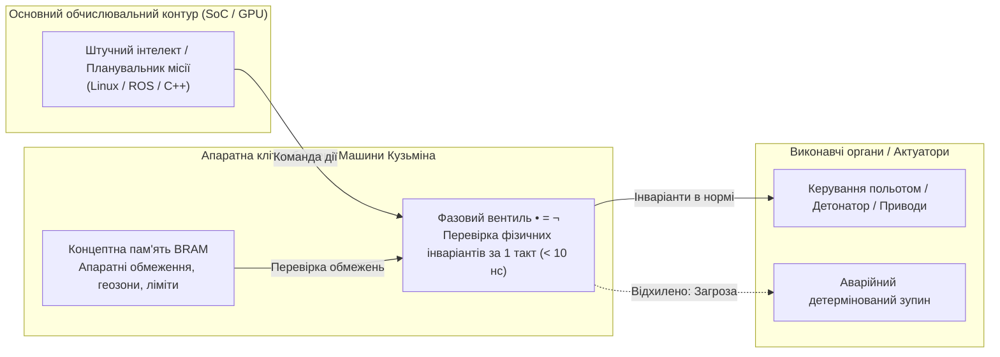
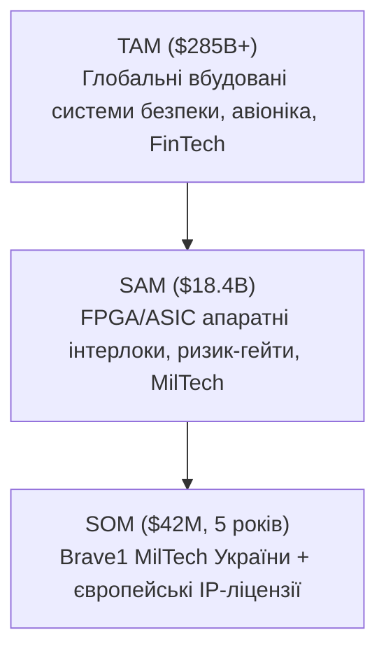

# Техніко-економічне обґрунтування (Business Feasibility Study) впровадження та комерціалізації Машини Кузьміна

> **Внутрішня робоча копія, не публікація; міграція не є науковим прийняттям.** Перенесено з `drafts@774d575:KuzminMachine/06-economic-model/Business_Feasibility_Study.md` 2026-11-10, Issue #84. Міграція не підтверджує тверджень, прогнозів чи самоприсвоєних статусів. Незмінний оригінал і SHA-256 — у реєстрі міграції.


> [!IMPORTANT]
> **Призначення документа:** Комплексне техніко-економічне обґрунтування (ТЕО) проєкту створення вітчизняної апаратно-програмної платформи детермінованих реактивних обчислень на базі архітектури Машини Кузьміна (МК). Документ визначає поточний статус науково-інженерної готовності (TRL 3/4), ринкові ніші, бар'єри входу, операційні та капітальні витрати, етапи академічної верифікації в Національній академії наук України (НАН України) та параметричний фінансово-економічний профіль комерціалізації.
>
> **Статус щодо стандартів безпеки:** згадки ISO 26262 / ASIL, DO-178C / DO-254 / DAL, IEC 61508 / SIL, IEC 62304 та ISO/SAE 21434 у цьому документі означають цільові домени й припущення, а не досягнуту відповідність. Зовнішніх вимог за цими стандартами немає; аналіз небезпек, цілі безпеки, кваліфікація інструментів і незалежне оцінювання не виконувалися. Див. [позицію проєкту](../../process/standards-position.md).

---

## Зміст

1. [Резюме проєкту (Executive Summary)](#1-резюме-проєкту-executive-summary)
2. [Поточний стан технологічної зрілості (As-Is Status: TRL 3/4)](#2-поточний-стан-технологічної-зрілості-as-is-status-trl-34)
3. [Аналіз цільових ринків та конкурентна перевага](#3-аналіз-цільових-ринків-та-конкурентна-перевага)
4. [Технічна спроможність та архітектурний стек](#4-технічна-спроможність-та-архітектурний-стек)
5. [Академічна легітимізація та науковий захист в НАН України](#5-академічна-легітимізація-та-науковий-захист-в-нан-україни)
6. [Економічна модель: CAPEX, OPEX, TCO та собівартість](#6-економічна-модель-capex-opex-tco-та-собівартість)
7. [Аналіз ризиків та чутливості (Sensitivity Analysis)](#7-аналіз-ризиків-та-чутливості-sensitivity-analysis)
8. [Висновки та інвестиційні ворота (Stage-Gate Decisions)](#8-висновки-та-інвестиційні-ворота-stage-gate-decisions)

---

## 1. Резюме проєкту (Executive Summary)

### 1.1. Сутність інновації
Машина Кузьміна — це парадигма обчислень, орієнтована на усунення лічильника команд (Instruction Pointer, IP) та заміну послідовного опитування (polling) чи обробки переривань (ISR) на **пряму подієву комутацію в концептній пам'яті з апаратними фазовими вентилями «Велика точка» (`• = ¬`)**.

Ключова цінність для індустрії — перенесення перевірки складних інваріантів безпеки та правил реального часу безпосередньо в логіку кремнію:
* **Апаратна реакція:** блокування небезпечного стану або занулення за один тактовий цикл ($< 10\text{ нс}$ на FPGA, $< 1\text{ нс}$ на ASIC).
* **Математичний детермінізм:** повна відсутність динамічного виділення пам'яті (no heap), нульовий ризик переповнення стека, точний розрахунок найгіршого часу виконання (Strict WCET).
* **Формальна верифікованість:** автоматичний переклад правил мови KPOL у предикати SMT-LIB для розв'язувачів Z3/CVC5, що, за гіпотезою, може скоротити витрати на сертифікацію за DO-178C (DAL A) та ISO 26262 (ASIL D); оцінка 35–45 % не перевірена.

### 1.2. Проблема класичних обчислювачів
Сучасні критичні системи (БПЛА, керована зброя, автопілоти, імпланти) вимушені запускати мільйони рядків C/C++ коду під управлінням RTOS або Linux на ядрах ARM/RISC-V. Це призводить до:
1. Високої ймовірності прихованих станів гонитви (race conditions) та дедлоків.
2. Непередбачуваного джитера перемикання контексту (1–50 мкс).
3. Колосальних витрат на тестування (до $300 за один рядок коду за стандартом DO-178C).

### 1.3. Цільова комерційна модель
Проєкт не прагне конкурувати з x86/ARM/GPU у щільних обчисленнях (нейромережі, матриці, медіакодеки). Модель комерціалізації базується на ролі **апаратного ізолятора безпеки (Hardware Safety Cage) та ризик-контролера (Wire-Speed Arbiter)**, де МК стоїть між основним обчислювачем (SoC/AI) та виконавчими приводами.



---

## 2. Поточний стан технологічної зрілості (As-Is Status: TRL 3/4)

На даному етапі проєкт перебуває на межі **TRL 3 (експериментальне підтвердження концепції)** та **TRL 4 (валідація компонентів у лабораторному середовищі)**:

| Компонент системи | Поточний стан реалізації | Інструменти верифікації | Досягнутий результат |
| :--- | :--- | :--- | :--- |
| **Мова KPOL (Специфікація)** | Редакція підмножини KPOL v0.1 | Рекурсивний grammar-парсер, AST | Валідація синтаксису, псевдонімів, концептів і правил безпеки |
| **RTL-модуль транзакційного вентиля** | Модуль `kpol_txn_gate.sv` (SystemVerilog) | Icarus Verilog, Verilator lint, Yosys | Повна симуляція тестбенчу, відсутність комбінаційних петель, підтверджена базова синтезованість |
| **Експериментальний FPGA-стенд** | Digilent PYNQ-Z1 (Xilinx Zynq-7020 XC7Z020CLG400-1) | Linux Zynq-7000, PYNQ 3.1.1, Python API | Перевірено завантаження базового overlay (`base.bit`), зв'язок PS-PL через AXI, SSH-доступ |
| **Параметричний економічний калькулятор** | Модуль `tco_calculator.py` | Python 3, unittest (18 тестів, 144 субтести) | Математичне моделювання TCO для 8 вертикалей промисловості |
| **Науково-теоретичне досьє** | Формальний аналіз, наукова опозиція (F-01..F-10) | Звіти експертизи, рецензії опонентів | Окреслено межі застосовності та підготовлено базу для дисертаційного захисту |

> [!NOTE]
> **Межа поточного прогресу:** У репозиторії наявний перевірений RTL-модуль фазового вентиля `kpol_txn_gate.sv`, але повна просторова матриця концептів (NoC-архітектура), компілятор KPOL-to-Bitstream та сертифікований бітстрім під XC7Z020 ще потребують розробки в межах наступних фаз фінансування.

---

## 3. Аналіз цільових ринків та конкурентна перевага

### 3.1. Структура ринку (TAM / SAM / SOM)

* **Загальний доступний ринок (TAM):** $285B+ (сукупний ринок критичних вбудованих систем управління, оборонної авіоніки, автомобільних інтерлоків безпеки та ризик-гейтів).
* **Службовий доступний ринок (SAM):** $18.4B (сегменти апаратних модулів безпеки, FPGA-прискорювачів та критичних контролерів для ринків України, ЄС та Північної Америки).
* **Реально досяжний ринок (SOM, горизонт 5 років):** $42M (ніша оборонних безпілотних систем України через Brave1, модернізація промислових AGV/AMR та ліцензування IP європейським розробникам медичних та автомобільних чипів).



### 3.2. Стратегічні пріоритетні вертикалі

1. **Перша хвиля (TRL 4–6, 2026–2027) — MilTech та оборонний комплекс України:**
   - *Ніша:* Апаратний етичний замок бойового контуру (DoD Directive 3000.09 / MIL-STD-882E), захист від перехоплення керування дроном, миттєве апаратне занулення (Zeroization) ключів за 5 нс при спробі зламу.
   - *Перевага:* Швидкий вихід через кластер **Brave1**, можливість прямої апробації на полігонах та залучення оборонних замовлень.
2. **Друга хвиля (TRL 6–8, 2027–2028) — FinTech, SportsBetting та MarTech:**
   - *Ніша:* Ультранизьколатентні PCIe-плати (AMD Alveo / PYNQ) для ліквідації затримкового арбітражу ботів та миттєвого контролю лімітів бюджету на швидкості 10G/25G мережі ($< 25\text{ нс}$).
   - *Перевага:* Короткий цикл ухвалення рішень комерційними замовниками (без багаторічної сертифікації), окупність менше ніж за 6 місяців.
3. **Третя хвиля (TRL 7–9, 2028–2029) — цільові ринки Automotive (ASIL D), Avionics (DAL A), MedTech (Class C); вихід можливий лише за умови майбутньої сертифікації:**
   - *Ніша:* Ліцензування готових IP-ядер для чипмейкерів (STMicroelectronics, NXP, Infineon, Melexis) та вендорів авіоніки.

---

## 4. Технічна спроможність та архітектурний стек

### 4.1. Апаратний базис для експериментів
* **Лабораторний стенд:** Плата Digilent PYNQ-Z1 на базі SoC Xilinx Zynq-7020:
  - 2 ядра ARM Cortex-A9 MPCore (Processing System, PS) — виконують роль хост-середовища, зняття телеметрії та завантаження конфігурацій.
  - Програмована логіка (Programmable Logic, PL, Artix-7): 85,000 логічних комірок, 53,200 LUTs, 106,400 FFs, 4.9 Мбіт BRAM, 220 слайсів DSP48E1.
* **Цільова промислова лінійка:**
  - Оборонний сектор: радіаційно-стійкі та стійкі до перешкод ПЛІС Microchip PolarFire (Flash-based FPGA, нульовий струм конфігурації, стійкість до SEU-збоїв).
  - Промисловий сектор: AMD Artix UltraScale+ (16 нм FinFET) для високошвидкісних PCIe-акселераторів.

### 4.2. Інструментальний стек
```text
[Високорівнева специфікація KPOL]
               │
               ▼  (KPOL Compiler / AST Validator)
[Формальна верифікація Lean 4 / Z3 SMT] ──► Доведення коректності інваріантів
               │
               ▼  (RTL Generator)
[SystemVerilog / Verilog RTL]
               │
               ├──► Icarus Verilog + Cocotb (Функціональна симуляція)
               ├──► Verilator (Високошвидкісний C++ lint / cycle-accurate sim)
               └──► Yosys / Vivado Design Suite (Синтез, P&R, Timing Closure)
                               │
                               ▼
               [Прошивка бітстріму FPGA / Tape-out ASIC]
```

---

## 5. Академічна легітимізація та науковий захист в НАН України

Для подолання скепсису промислових замовників та успішного проходження державної експертизи проєкт вимагає проходження **академічної валідації в провідних інститутах Відділення інформатики Національної академії наук України**:

### 5.1. Ключові академічні установи-партнери
1. **Інститут кібернетики імені В. М. Глушкова НАН України:**
   - *Напрям:* Формальні методи верифікації, теорія автоматів, алгебра алгоритмічних мов, архітектура нефоннейманівських систем.
   - *Завдання:* Наукова експертиза математичної моделі концептної пам'яті та доведення відсутності дедлоків у фазових переходах.
2. **Інститут проблем моделювання в енергетиці ім. Г. Є. Пухова НАН України:**
   - *Напрям:* Спеціалізовані обчислювальні структури, моделювання критичних систем у реальному часі.
   - *Завдання:* Експериментальне підтвердження характеристик детермінізму та розрахунок WCET на фізичному FPGA-стенді.

### 5.2. Етапи наукового захисту
* **Підготовка наукової монографії та серії фахових статей:** Публікації у виданнях категорій «А» та «Б», індексованих у базах даних Scopus та Web of Science (журнали «Кібернетика та системний аналіз», «Електронне моделювання»).
* **Захист дисертаційного дослідження:** Отримання наукового ступеня доктора філософії (PhD) / доктора наук за спеціальностями 121 (Інженерія програмного забезпечення) або 123 (Комп'ютерна інженерія).
* **Офіційний експертний висновок НАН України:** Висновок науково-технічної ради про визнання архітектури Машини Кузьміна оригінальним вітчизняним науково-технічним доробком із високим потенціалом захисту критичної інфраструктури держави.

---

## 6. Економічна модель: CAPEX, OPEX, TCO та собівартість

### 6.1. Капітальні витрати на етап R&D (CAPEX, 24 місяці)

| Стаття CAPEX | Опис та обґрунтування | Вартість ($) |
| :--- | :--- | :--- |
| **Апаратні стенди та плати** | 6 плат PYNQ-Z1, 2 плати AMD Alveo U50, контрольно-вимірювальні осцилографи, логічні аналізатори | $32,000 |
| **САПР та ліцензії EDA** | Vivado Design Suite Enterprise (2 робочі місця на 2 роки) + засоби статичного аналізу | $18,000 |
| **Патентування та юридичний захист** | 2 національні патенти (Укрпатент) + міжнародна заявка за системою PCT (США, ЄС) | $25,000 |
| **Академічна експертиза та захист** | Організаційні витрати, публікаційні збори (Open Access Scopus Q1/Q2), рецензування НАНУ | $10,000 |
| **РАЗОМ CAPEX** | | **$85,000** |

### 6.2. Операційні витрати R&D-команди в Україні (OPEX на 1 рік)
Команда працюватиме в режимі резидентства **Дія.City** із пільговим оподаткуванням (5% ПДФО, 1.5% військовий збір, ЄСВ від мінімальної зарплати):

| Посада / Роль | Кількість | Ставка ($/міс) | Витрати на рік ($) |
| :--- | :--- | :--- | :--- |
| **Lead RTL / FPGA Architect** | 1 | $4,500 | $54,000 |
| **Senior Formal Verification Engineer (SMT/Z3)** | 1 | $4,000 | $48,000 |
| **Compiler & Toolchain Engineer (KPOL/C++)** | 1 | $3,500 | $42,000 |
| **Embedded Safety Systems Engineer** | 1 | $3,500 | $42,000 |
| **Business Analyst & IP Manager** | 0.5 | $2,000 | $12,000 |
| **Податки та адмінвитрати Дія.City (бухгалтерія, офіс)** | — | $1,500/міс | $18,000 |
| **РАЗОМ OPEX (1-й рік розробки)** | | | **$216,000** |

Сумарна потреба у фінансуванні для досягнення TRL 6 (перший промисловий пілот) на 18 місяців становить:
$$\text{Budget}_{\text{TRL 4}\to\text{6}} = \text{CAPEX} + 1.5 \times \text{OPEX} = \$85,000 + \$324,000 = \$409,000$$

### 6.3. Порівняльний розрахунок сукупної вартості володіння (TCO)
Згідно з даними параметричного калькулятора [`tco_calculator.py`](tco_calculator.py), впровадження МК для парку з 500 критичних вузлів забезпечує чисту 5-річну економію:
* **Automotive (ECU Safety Cage):** економія **21.2%** ($207,500).
* **Avionics (FADEC / Flight Control):** економія **31.9%** ($717,000).
* **MilTech (Автономні інтерцептори):** економія **27.3%** ($489,500).
* **MarTech / FinTech (PCIe Risk Gate):** економія **66.6%–82.1%** ($1,175,000–$1,777,000).

---

## 7. Аналіз ризиків та чутливості (Sensitivity Analysis)

| Категорія ризику | Рівень загрози | Опис сценарію | Стратегія пом'якшення (Mitigation Strategy) |
| :--- | :--- | :--- | :--- |
| **Технологічний (RTL Complexity)** | Середній | Складнощі з доведенням синхронізації при каскаді концептів у великих сітках | Обмеження архітектури концептними групами (`Concept Groups`) та використання верифікатора Lean 4 на ранніх етапах |
| **Академічно-регуляторний** | Низький | Консервативність спеціалізованих вчених рад НАН України щодо нових парадигм | Залучення провідних академіків Відділення інформатики до науково-консультаційної ради проєкту з початкових етапів |
| **Ринковий (Switching Cost)** | Високий | Небажання автовиробників змінювати усталений стек AUTOSAR/ARM | Позиціювання МК не як заміни процесора, а як прозорого зовнішнього апаратного «сторожа» (Hardware Coprocessor) |
| **Кадровий (Talent Scarcity)** | Середній | Дефіцит висококваліфікованих RTL-інженерів та фахівців з формальної верифікації в Україні | Залучення талановитих магістрів та аспірантів КПІ ім. Ігоря Сікорського та КНУ ім. Тараса Шевченка |
| **Військово-політичний** | Середній | Ризики пошкодження фізичної інфраструктури та логістики обладнання | Розподілена робота команди, хмарні сервери для EDA-симуляцій, дублювання апаратних стендів |

---

## 8. Висновки та інвестиційні ворота (Stage-Gate Decisions)

1. **Технічна обґрунтованість:** Концепція підтверджена базовим синтезованим RTL-модулем та симуляційними стендами. Фізичний детермінізм реакції на порушення інваріантів є головною ринковою перевагою, недосяжною для класичних RTOS на базі процесорів фон Неймана.
2. **Економічна доцільність:** Завдяки системі пільгового оподаткування **Дія.City** та доступності кваліфікованих інженерних кадрів в Україні, вартість НДДКР (R&D) для виходу на робочий прототип TRL 6 у 3–4 рази нижча, ніж у країнах ЄС чи США ($409,000 проти $1.5M+).
3. **Рекомендація інвестиційного комітету:** Схвалити перехід до Фази 1 (науковий захист в НАН України та створення ТОВ у Дія.City) із залученням стартового грантового фінансування через кластер **Brave1** та Український фонд стартапів.
