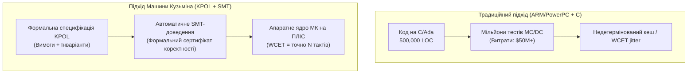

# Дослідження застосування Машини Кузьміна в Авіоніці: Критичні системи польоту (DO-178C / DO-254 DAL A)

> **Внутрішня робоча копія, не публікація; міграція не є науковим прийняттям.** Перенесено з `drafts@774d575:KuzminMachine/06-economic-model/avionics-safety-critical.md` 2026-11-10, Issue #84. Міграція не підтверджує тверджень, прогнозів чи самоприсвоєних статусів. Незмінний оригінал і SHA-256 — у реєстрі міграції.


> [!IMPORTANT]
> **Призначення документа:** Галузеве науково-економічне дослідження детермінізму, формальної верифікації часу найгіршого випадку (WCET), скорочення витрат на авіаційну сертифікацію та впровадження Машини Кузьміна (МК) у бортових системах керування повітряними суднами (FADEC, Fly-by-Wire).
>
> **Статус щодо стандартів безпеки:** згадки ISO 26262 / ASIL, DO-178C / DO-254 / DAL, IEC 61508 / SIL, IEC 62304 та ISO/SAE 21434 у цьому документі означають цільові домени й припущення, а не досягнуту відповідність. Зовнішніх вимог за цими стандартами немає; аналіз небезпек, цілі безпеки, кваліфікація інструментів і незалежне оцінювання не виконувалися. Див. [позицію проєкту](../../process/standards-position.md).

---

## Зміст

1. [Галузевий контекст та стандарти DO-178C / DO-254](#1-галузевий-контекст-та-стандарти-do-178c--do-254)
2. [Головні проблеми авіаційного обчислювального стека](#2-головні-проблеми-авіаційного-обчислювального-стека)
3. [Архітектурне рішення на базі Машини Кузьміна](#3-архітектурне-рішення-на-базі-машини-кузьміна)
4. [KPOL-специфікація контуру FADEC (керування тягою двигуна)](#4-kpol-специфікація-контуру-fadec-керування-тягою-двигуна)
5. [Економічна модель: вартість рядка коду, ліцензії та окупність](#5-економічна-модель-вартість-рядка-коду-ліцензії-та-окупність)
6. [Спростовні критерії Поппера (Falsifiable Hypotheses)](#6-спростовні-критерії-поппера-falsifiable-hypotheses)
7. [Висновки та стратегія кваліфікації за DO-330](#7-висновки-та-стратегія-кваліфікації-за-do-330)

---

## 1. Галузевий контекст та стандарти DO-178C / DO-254

Бортова авіоніка цивільної та військової авіації регулюється найсуворішим у світовій індустрії набором стандартів безпеки:
* **RTCA DO-178C / EUROCAE ED-12C:** стандартизує розробку програмного забезпечення для бортових систем. Найвищий рівень **DAL A (Design Assurance Level A)** призначається для систем, відмова яких призводить до катастрофічної аварії літака із загибеллю пасажирів та екіпажу. Вимагає 100% структурного покриття коду за критерієм **MC/DC (Modified Condition/Decision Coverage)**.
* **RTCA DO-254 / EUROCAE ED-80:** вимоги до проектування складного апаратного забезпечення (FPGA, ASIC, CPLD).
* **FAA AC 20-193 (колишній CAST-32A):** циркуляр, що встановлює жорсткі вимоги до сертифікації багатоядерних процесорів (MCP) через проблему недетермінованої інтерференції між ядрами.

---

## 2. Головні проблеми авіаційного обчислювального стека

1. **Астрономічна вартість розробки софту DAL A:** Вартість одного рядка коду на C/Ada, сертифікованого за рівнем DAL A, сягає **$150–$300**. Бортовий комплекс сучасного лайнера (Airbus A350, Boeing 787) містить мільйони рядків, а витрати на тестування MC/DC перевищують 60% загального бюджету авіоніки.
2. **Проблема непередбачуваного часу реакції (WCET):** У сучасних процесорах наявність конвеєрів, дворівневого кешу команд і даних, механізмів позачергового виконання (Out-of-Order Execution) та спекулятивних переходів робить точний розрахунок найгіршого часу виконання (Worst-Case Execution Time, WCET) практично неможливим без колосальних запасів по затримках.
3. **Блокування сертифікації багатоядерних чипів (AC 20-193):** Виробники літаків змушені штучно відключати додаткові ядра сучасних процесорів, щоб уникнути непередбачуваної конкуренції за спільну шину пам'яті DDR.

---

## 3. Архітектурне рішення на базі Машини Кузьміна

Машина Кузьміна пропонує альтернативний фундаментальний підхід до обчислень у DAL A системах:



### Ключові інженерні переваги МК:
* **Нульовий динамічний розподіл пам'яті:** Концепти є статично розміщеними регістровими комірками. Відсутність купи (heap) повністю усуває загрозу фрагментації пам'яті чи memory leak.
* **Точний апаратний такт WCET:** Усі реакції на події `:: ~` мають фіксовану довжину конвеєра. Час переходу між концептами розраховується з точністю до одного тактового сигналу кварцового резонатора.
* **Апаратна ізоляція критичних каналів:** Замість складних програмних гіпервізорів (ARINC 653 Part 1) МК реалізує апаратне розділення потоків подій за топологією зв'язків.

---

## 4. KPOL-специфікація контуру FADEC (керування тягою двигуна)

```kpol
Problem FadecTurbineSafety {
    Assumptions {
        N1_FanSpeed in [0.0 .. 120.0]         # Відсоток від номінальних обертів
        EGT_Temp in [20.0 .. 1200.0]          # Температура вихідних газів, °C
    }

    Invariants {
        # Заборона перевищення максимальних обертів турбіни низького тиску
        MaxFanSpeed: N1_FanSpeed <= 105.0
        # Заборона перегріву турбіни (Thermal Stall Protection)
        MaxTurbineTemp: EGT_Temp <= 950.0
        # Захист від надмірної подачі палива при занизьких обертах
        FuelRatioLimit: FuelFlowKgSec <= (0.05 * N1_FanSpeed)
    }

    Hazards {
        EngineSurgeRisk: (EGT_Temp > 950.0) and (N1_FanSpeed > 100.0)
            Trigger: EmergencyFuelBleed = 1, SurgeAlarm = true
    }
}

Solution FadecTurbineSafety {
    Float N1_FanSpeed 0.0
    Float EGT_Temp 400.0
    Float FuelFlowKgSec 0.5 {
        # Апаратний запобіжник паливної апаратури
        [• : > (0.05 * N1_FanSpeed)  • = ¬]
    }
    pin EmergencyFuelBleed = "0p1"
    Bool SurgeAlarm false {
        [: •  SurgeAlarm == true  EmergencyFuelBleed = 1]
    }
}
```

---

## 5. Економічна модель: вартість рядка коду, ліцензії та окупність

### 5.1. Параметричне порівняння (програма розробки комп'ютера керування польотом)

| Стаття витрат | Класичний стек DAL A (PowerPC + C + RTOS) | Стек Машини Кузьміна (KPOL + ПЛІС) | Економічний ефект |
| :--- | :--- | :--- | :--- |
| Розробка вихідного коду | $600,000 | $750,000 | +$150,000 (навчання інженерів специфікації KPOL) |
| Ліцензії на кваліфіковані компілятори | $80,000 | $30,000 | -$50,000 (відкрита еталонна верифікація) |
| Верифікація DO-178C (тести MC/DC) | $850,000 | $450,000 | **-$400,000 (економія 47% завдяки SMT-доведенню)** |
| Сертифікація заліза DO-254 (100 шт.) | $120,000 | $180,000 | +$60,000 (радіаційно-стійкі ПЛІС дорожчі) |
| Витрати на підтримку та супровід | $180,000 | $60,000 | -$120,000 (математична доведеність інваріантів) |
| Ризик затримки здачі сертифікації літака | $400,000 | $50,000 | -$350,000 (усунення непередбачуваного WCET) |
| **РАЗОМ TCO** | **$2,245,000** | **$1,528,000** | **Чиста економія: $717,000 (31.9%)** |

### 5.2. Ринковий потенціал (TAM / SAM / SOM)
* **TAM:** Світовий ринок авіаційної електроніки — $50B+.
* **SAM:** Системи критичного керування польотом і двигунами (Flight Control & Engine Controls) — $12B.
* **SOM:** Сегмент рішень формально верифікованих апаратних інтерлоків для БПЛА та пасажирських літаків — $180M щорічно.

---

## 6. Спростовні критерії Поппера (Falsifiable Hypotheses)

Гіпотеза придатності Машини Кузьміна в авіоніці буде **спростована**, якщо:
1. Авіаційні регулятори (FAA / EASA) відмовляться визнавати результати автоматичного SMT-доведення KPOL без проведення 100% фізичних динамічних тестів MC/DC на реальному залізі.
2. Вартість кваліфікації транслятора KPOL відповідно до стандарту RTCA DO-330 (Software Tool Qualification) перевищить $1.5M, що знівелює перевагу для малих та середніх програм розробки авіоніки.
3. Радіаційно-стійкі матриці FPGA (Microchip RTG4, Xilinx Virtex-5QV) не зможуть вмістити необхідну кількість концептів через вищі питомі витрати LUT на один концепт МК порівняно зі звичайною мікроконтролерною архітектурою.

---

## 7. Висновки та стратегія кваліфікації за DO-330

* Найвигіднішою точкою входу МК в аерокосмічну галузь є **FADEC і вторинні захисні контури БПЛА**, де цикли сертифікації коротші, ніж у великій цивільній авіації.
* Стратегічний крок — створення кваліфікаційного пакета **KPOL Tool Qualification Kit (TQK)** відповідно до вимог RTCA DO-330 Tool Qualification Level 1 (TQL-1), що дозволить використовувати інструменти KPOL як офіційні засоби верифікації без необхідності дублюючого ручного тестування коду.
