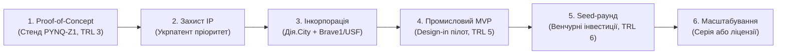
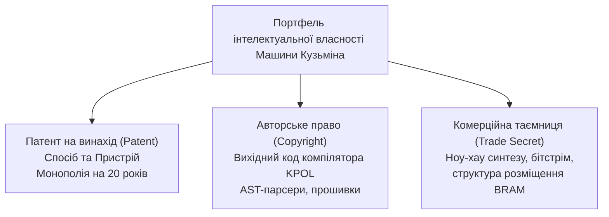
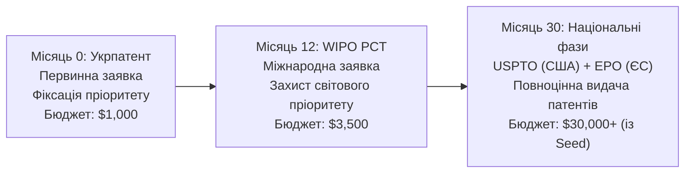
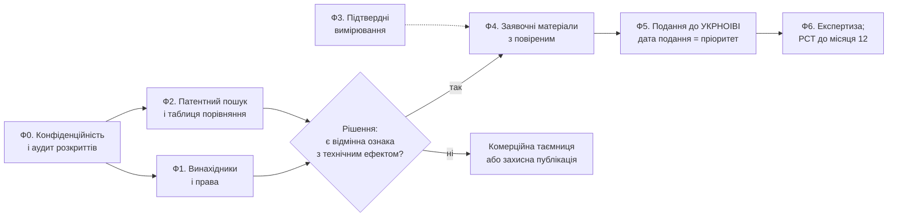
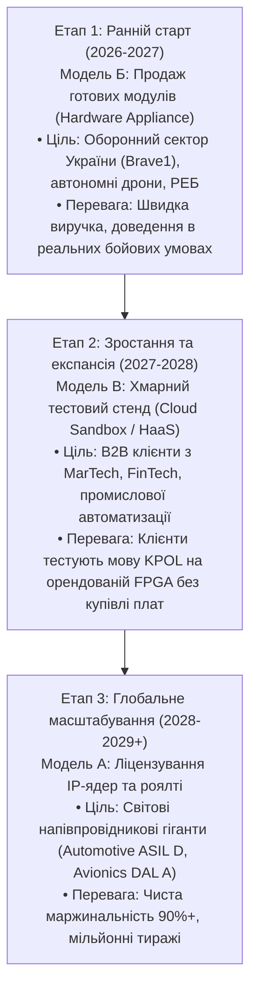

# Стратегія патентування та порівняльний аналіз моделей комерціалізації DeepTech

> **Внутрішня робоча копія, не публікація; міграція не є науковим прийняттям.** Перенесено з `drafts@774d575:KuzminMachine/06-economic-model/commercialization-models-and-patent-strategy.md` 2026-11-10, Issue #84. Міграція не підтверджує тверджень, прогнозів чи самоприсвоєних статусів. Незмінний оригінал і SHA-256 — у реєстрі міграції.

> [!IMPORTANT]
> **Призначення документа:** Практичний посібник та економічний аналіз життєвого циклу комерціалізації програмно-апаратних рішень Машини Кузьміна (МК). Документ деталізує покроковий маршрут стартапу (від PoC до TRL 9), міжнародну патентну стратегію (Укрпатент $\to$ PCT $\to$ USPTO/EPO) та порівнює три фундаментальні бізнес-моделі: ліцензування патенту/роялті (ARM model), прямий продаж фізичних виробів (Hardware OEM) та надання хмарних обчислювальних потужностей на власних датацентрах (HaaS).

---

## Зміст

1. [Життєвий цикл та етапи запуску DeepTech стартапу](#1-життєвий-цикл-та-етапи-запуску-deeptech-стартапу)
2. [Стратегія правового захисту та патентування](#2-стратегія-правового-захисту-та-патентування)
   * 2.1. [Що саме підлягає патентуванню: Спосіб і Пристрій проти Коду](#21-що-саме-підлягає-патентуванню-спосіб-і-пристрій-проти-коду)
   * 2.2. [Триетапний міжнародний патентний маршрут](#22-триетапний-міжнародний-патентний-маршрут)
   * 2.3. [Календарний графік, бюджет і витрати на патентування](#23-календарний-графік-бюджет-і-витрати-на-патентування)
   * 2.4. [План дій для отримання патенту (стан на 2026-11-08)](#24-план-дій-для-отримання-патенту-стан-на-2026-11-08)
   * 2.5. [Оцінка шансів на патенти та авторське право (стан на 2026-11-08)](#25-оцінка-шансів-на-патенти-та-авторське-право-стан-на-2026-11-08)
3. [Порівняльний аналіз трьох моделей комерціалізації](#3-порівняльний-аналіз-трьох-моделей-комерціалізації)
   * 3.1. [Модель А: Ліцензування патенту та IP-ядер (Роялті)](#31-модель-а-ліцензування-патенту-та-ip-ядер-роялті)
   * 3.2. [Модель Б: Продаж фізичного готового виробу (Hardware Appliance)](#32-модель-б-продаж-фізичного-готового-виробу-hardware-appliance)
   * 3.3. [Модель В: Онлайн-послуги та хмарні обчислення у датацентрах (Cloud HaaS)](#33-модель-в-онлайн-послуги-та-хмарні-обчислення-у-датацентрах-cloud-haas)
   * 3.4. [Зведена економічна матриця порівняння моделей](#34-зведена-економічна-матриця-порівняння-моделей)
4. [Оптимальна гібридна стратегія для Машини Кузьміна](#4-оптимальна-гібридна-стратегія-для-машини-кузьміна)
5. [Висновки та контрольні критерії ухвалення рішень](#5-висновки-та-контрольні-критерії-ухвалення-рішень)

---

## 1. Життєвий цикл та етапи запуску DeepTech стартапу

Запуск стартапу у сфері програмно-апаратних комплексів (Hardware-Software Co-Design) має специфічну циклічність, обумовлену нелінійною вартістю виправлення помилок на кремнії (Non-Recurring Engineering, NRE) та тривалим циклом довіри замовників.

### Етап 1: Лабораторний Proof-of-Concept (TRL 3 $\to$ 4)
* **Мета:** Довести, що архітектура функціонує на фізичному кремнії, а не лише в теоретичних формулах.
* **Дії:** Складання вимірювальних стендів на наявному серійному hardware (FPGA Digilent PYNQ-Z1 із чипом Xilinx Zynq-7020).
* **Артефакт:** Протокол вимірювання фізичних затримок спрацьовування фазового вентиля `• = ¬` ($< 10\text{ нс}$), підтверджена синтезованість модуля `kpol_txn_gate.sv` мовою SystemVerilog у середовищах Verilator та Yosys.

### Етап 2: Патентна фіксація світового пріоритету
* **Мета:** Заблокувати копіювання ідеї конкурентами до публічного виходу на ринок чи публікацій статей.
* **Дії:** Пошук аналогів (Prior Art Search) та подання первинної національної заявки на винахід.
* **Правило безпеки:** Жодного відкритого виступу, наукової доповіді чи публікації коду до реєстрації номера вхідної патентної заявки.

### Етап 3: Інкорпорація та безрозмивні гранти (TRL 4 $\to$ 5)
* **Мета:** Отримати юридичну суб'єктність та перший робочий капітал без втрати частки засновників (zero dilution).
* **Дії:** Заснування ТОВ в Україні, отримання резидентства в **Дія.City** (податок на виведений капітал 9%, 5% ПДФО для гіг-контракторів).
* **Фінансування:** Подання на гранти оборонного кластера **Brave1** ($50k–$100k) та **Українського фонду стартапів (USF)** ($25k–$50k).

### Етап 4: Інтеграційний пілот у замовника (Design-in Pilot, TRL 5 $\to$ 6)
* **Мета:** Інтеграція прототипу в кінцевий виріб замовника (безпілотний комплекс, система РЕБ, складський робот).
* **Дії:** Створення апаратного мезонінного модуля під роз'єми системи замовника, адаптація бібліотек мови KPOL під протоколи клієнта (CAN-FD, UART, AXI).
* **Артефакт:** Підписаний акт успішних полігонних випробувань та попередній контракт про наміри (Letter of Intent / LOI).

### Етап 5: Залучення венчурного капіталу (Seed Round)
* **Мета:** Сформувати інженерний штаб і підготувати серійний продукт.
* **Дії:** Залучення $450k–$600k інвестицій за оцінкою Post-Money $3.5M–$4.5M від спеціалізованих DeepTech та оборонних фондів.

### Етап 6: Сертифікація та промислове масштабування (TRL 7 $\to$ 9)
* **Дії:** Проходження кваліфікаційних процедур для критичних індустрій (DO-254 для авіоніки, ISO 26262 для авто, MIL-STD-882E для військових), перехід до серійного ліцензування або постачання.

---

## 2. Стратегія правового захисту та патентування

### 2.1. Що саме підлягає патентуванню: Спосіб і Пристрій проти Коду

У напівпровідниковій галузі та вбудованих системах діє суворе розмежування типів інтелектуальної власності:

1. **Патент на винахід (Patent on Invention):**
   * *Не патентується:* Абстрактні математичні алгоритми, чисті комп'ютерні програми як набір інструкцій (згідно із законодавством України, ЄС та США).
   * *Патентується:*
     * **Спосіб (Method claim):** спосіб апаратного захисту контуру керування критичними виконавчими механізмами шляхом подієвої фазової фільтрації у концептній пам'яті.
     * **Пристрій / Система (Apparatus/System claim):** обчислювальний модуль без лічильника команд, що містить матрицю дескрипторів концептів, комбінаційний вентиль «Велика точка» та контур миттєвого занулення.
2. **Авторське право (Copyright):**
   * Захищає конкретний текст коду компілятора KPOL, синтаксичного аналізатора та програмного коду прошивок. Запобігає прямому копіюванню файлів («Ctrl+C / Ctrl+V»).
3. **Комерційна таємниця (Trade Secret / Know-How):**
   * Внутрішні алгоритми синтезу бітстріму під конкретну структуру FPGA, топологія міжз'єднань концептної сітки, які не розкриваються в патентній формулі й передаються замовнику виключно у вигляді закритих бінарних блоків (Obfuscated Netlist / Encrypted IP-core).

---

### 2.2. Триетапний міжнародний патентний маршрут

Спроба одночасно подати патент у США та Європі на ранньому етапі призводить до витрати $40,000–$80,000, які критично необхідні для R&D. Пропонується перевірений трьохетапний маршрут:

#### Етап 1: Перша національна заявка (Україна) — Місяць 0
* Подання заявки на винахід до Національного органу інтелектуальної власності (ДП «УКРНОІВІ» / Укрпатент).
* Фіксується **Дата пріоритету (Priority Date)**. Будь-хто у світі, хто подасть аналогічну заявку пізніше цієї дати, отримає відмову через відсутність новизни.
* З цього моменту проєкт отримує легальний статус **«Patent Pending»**, що дозволяє безпечно демонструвати технологію інвесторам та клієнтам.

#### Етап 2: Міжнародна заявка за процедурою PCT (Patent Cooperation Treaty) — Місяць 12
* Подається до Всесвітньої організації інтелектуальної власності (WIPO) протягом 12 місяців після української заявки.
* Процедура PCT **не видає "всесвітнього патенту"** (такого не існує), але дає дві фундаментальні переваги:
  1. Отримання авторитетного міжнародного звіту про пошук (International Search Report, ISR) та письмового висновку патентного відомства щодо патентоздатності.
  2. **Відтермінування витрат на 18 місяців** (разом 30 місяців від дати первинного пріоритету). Засновники отримують півтора року на пошук інвестицій або закриття перших комерційних угод, не витрачаючи грошей на окремі країни.

#### Етап 3: Перехід на національні фази (США, Європа, Японія) — Місяць 30
* Подання документів у патентні відомства конкретних цільових ринків: **USPTO** (США), **EPO** (Європа), за необхідності **JPO** (Японія).
* Витрати на цьому етапі покриваються з коштів залученого венчурного Seed-раунду.

---

### 2.3. Календарний графік, бюджет і витрати на патентування

| Етап патентування | Термін (дедлайн) | Склад робіт | Орієнтовна вартість ($) | Джерело фінансування |
| :--- | :--- | :--- | :--- | :--- |
| **Пошук на новизну (Prior Art Search)** | Місяць -1 | Перевірка баз даних Google Patents, Espacenet, USPTO, WIPO патентним повіреним | $600 – $1,200 | Власні кошти фаундерів |
| **Складання та подання заявки в Україні** | Місяць 0 | Написання патентної формули, креслень, опис винаходу, сплата держзборів | $800 – $1,500 | Власні кошти / Bootstrapping |
| **Міжнародне подання заявки PCT** | Місяць 11–12 | Переклад англійською, сплата зборів WIPO, робота патентного повіреного | $3,000 – $4,500 | Грант Brave1 / USF |
| **Міжнародний звіт про пошук (ISR)** | Місяць 16 | Аналіз висновку експертів WIPO, коригування формули винаходу | $500 – $1,000 | Грант USF |
| **Перехід на національну фазу: США (USPTO)** | Місяць 30 | Американський патентний повірений, держзбори USPTO, адаптація претензій | $12,000 – $18,000 | Венчурний Seed-раунд |
| **Перехід на національну фазу: Європа (EPO)** | Місяць 30 | Європейський повірений, збори EPO, переклади (за потреби) | $15,000 – $22,000 | Венчурний Seed-раунд |
| **РАЗОМ ДО ВИХОДУ НА СВІТОВІ РИНКИ** | **30 місяців** | | **$31,900 – $48,200** | **Поетапно** |

### 2.4. План дій для отримання патенту (стан на 2026-11-08)

> [!WARNING]
> Це робочий план, а не юридичний висновок. Строки, збори й вимоги до заявки треба підтвердити з патентним повіреним до подання.

#### 2.4.1. Вихідна оцінка

| Критерій | Стан | Висновок |
| :--- | :--- | :--- |
| Достатність розкриття (відтворюваність) | Є RTL `kpol_txn_gate.sv`, обгортка AXI4-Lite, top-модуль PYNQ-Z1, карта регістрів, регресійні тести, HIL-протокол на XC7Z020 | Для опису й прикладу здійснення достатньо. Нові експерименти для подання не обов'язкові |
| Новизна моделі МК | Модель опублікована автором на DOU у 2020–2023 рр. | Саму модель (концепти, підписки, оператор `•`) запатентувати не можна: пільговий строк минув |
| Новизна апаратної реалізації 2026 р. | Репозиторій `drafts` приватний. Публічний репозиторій `articles` (з 2026-07-26) містить загальні описи fail-closed політик (напр., `Expert_Systems/Volume-1/ch03`, додано 2026-11-04), але не RTL шлюзу | Потенційно нова; потрібен аудит публічних розкриттів і патентний пошук |
| Винахідницький рівень | Близькі аналоги: апаратні монітори runtime verification, hardware assertion checkers, safety interlocks, синхронні мови (Esterel), транзакційна пам'ять. Звіт наукової опозиції: новизна «не встановлена» | Головний ризик. Без таблиці порівняння з аналогами подавати заявку не можна |
| Права й винахідники | Не оформлено | Потрібна письмова угода до подання |
| Заявлені переваги | 10 нс — однотактна оцінка в PL, фізичний джитер не виміряно; AXI і Linux userspace виміряно (N = 10 000) | В описі не можна стверджувати виміряний нульовий джитер у PL |

**Принцип:** патентується не модель обчислень, а конкретне технічне рішення з технічним ефектом. Робочий кандидат — апаратний транзакційний шлюз, що фіксує новий стан лише тоді, коли відомі й істинні вхідні передумови та інваріант, а будь-який невідомий сигнал призводить до відмови (fail-closed), з окремими ознаками причини відмови й небезпеки. Інші RTL-модулі (`km_concept_bram*`, `km_predicate_evaluator`, `km_rcfc_engine`, `km_cascade_arbiter_engine`, `km_euclid_core`) — кандидати на залежні пункти або окремі заявки після перевірки їхнього статусу верифікації.

#### 2.4.2. Фази робіт

| Фаза | Строк (орієнтовно) | Дії | Результат / критерій завершення |
| :--- | :--- | :--- | :--- |
| **Ф0. Конфіденційність і аудит розкриттів** | 2026-11-09 … 11-15 | Не публікувати RTL, карту регістрів, HIL-протоколи й опис шлюзу в `articles`, на DOU, конференціях і в грантових заявках. Скласти перелік публічних розкриттів із датами: `articles`, профіль `nick-fedchik`, обговорення DOU 04–05.11.2026, листи й презентації третім особам. Для контактів з партнерами — NDA | Реєстр розкриттів із датами й посиланнями. Найраніша релевантна дата визначає крайній строк подання (п. 2.4.4) |
| **Ф1. Винахідники й права** | 2026-11-09 … 11-22 | Заповнити форму розкриття винаходу (invention disclosure). Для кожної ознаки майбутньої формули записати, хто її запропонував. Винахідником може бути лише людина: внесок ШІ-асистентів (Gemini, Copilot) не дає їм прав, але треба показати, яку ознаку задумала людина. Укласти угоду між співавторами (М. Кузьмін, М. Федчик): частки, хто заявник (фізичні особи або майбутнє ТОВ), порядок передання прав, розподіл доходів. Підпис М. Кузьміна — особисто; за потреби — нотаріальне засвідчення | Підписана угода й форма розкриття. Без неї подання не починати |
| **Ф2. Патентний пошук** | 2026-11-16 … 12-13 | Бази: Espacenet, Google Patents, WIPO Patentscope, база УКРНОІВІ; непатентна література: IEEE Xplore, ACM, праці з runtime verification на FPGA. Попередні класи МПК/CPC для пошуку: G05B 9/02 (електричні засоби безпеки), G06F 11/30 (моніторинг), G06F 9/467 (транзакційна пам'ять), G06F 15/7867 (реконфігуровані архітектури) — уточнити з повіреним. Ключові слова UA/EN: hardware invariant monitor, fail-closed commit gate, transactional state register, three-valued validity, safety interlock FPGA. За бюджету — замовити платний інформаційний пошук в УКРНОІВІ або в повіреного | Протокол пошуку (запити, бази, дати) і таблиця порівняння: ознаки формули × 5–10 найближчих аналогів |
| **Рішення go / no-go** | до 2026-12-15 | Оцінити разом із повіреним, чи є ознака, якої немає в найближчому аналогу, і який технічний ефект вона дає | «Так» → Ф4. «Ні» → зберегти як ноу-хау або зробити захисну публікацію, щоб ніхто інший не запатентував рішення |
| **Ф3. Підтвердні вимірювання** (паралельно, не блокує подання) | 2026-11-16 … 12-20 | Стенд рівня 0 з [`Hardware_Procurement.md`](../../hw/boards/bench-procurement.md): фізична затримка й джитер від піна до піна (`pynq1` як лічильник часу для `pynq2`, аналізатор на Pico); fail-closed поведінка при обриві або невизначеному вході; поведінка при скиданні й зникненні живлення; fail-closed актуатор на D4184 | Протокол із сирими даними. В опис потрапляють лише виміряні величини з методикою |
| **Ф4. Заявочні матеріали** | 2026-12-07 … 2027-01-24 | Опис: галузь, рівень техніки (з таблиці Ф2), суть, технічний результат, креслення (структурна схема, часові діаграми), приклад здійснення на Zynq-7000/PYNQ-Z1. Формула: незалежні пункти «пристрій» і «спосіб»; залежні — інтерфейс AXI4-Lite, діапазонний інваріант через XADC, коди причин відмови, керування актуатором. Реферат. Перевірка повіреним | Пакет, готовий до подання |
| **Ф5. Подання в Україні** | до 2027-01-31 | Подати до УКРНОІВІ, сплатити збори. Вибір виду охорони — з повіреним: **винахід** (кваліфікаційна експертиза, до 20 років, придатний як основа для PCT) або **корисна модель** (лише формальна експертиза, до 10 років, швидше, але легше оскаржити; за чинною редакцією закону — лише для продукту, перевірити) | Номер і дата подання заявки (пріоритет), статус «Patent Pending» |
| **Ф6. Після подання** | місяці 1–12 | Супровід експертизи за клопотанням (відповіді на запити експертизи). Публікації — лише після дати подання і в межах розкритого в заявці. Нові поліпшення — окремими заявками до публікації. До місяця 12 — рішення про PCT (див. 2.2) | Рішення про PCT і бюджет на нього (грант Brave1/USF) |

#### 2.4.3. Ризики й заходи

| Ризик | Наслідок | Захід |
| :--- | :--- | :--- |
| Аналоги з runtime verification і safety interlocks | Відмова через відсутність винахідницького рівня | Ф2 до витрат на складання заявки; вузька формула з конкретними ознаками |
| Власні публікації до дати подання | В Україні й США є пільговий строк 12 місяців для розкриття самим винахідником (ст. 7 Закону України «Про охорону прав на винаходи і корисні моделі»; 35 U.S.C. §102(b)(1)); у Європейському патентному відомстві такого пільгового строку практично немає (ст. 55 EPC) | Мораторій на публікації (Ф0); реєстр розкриттів; для ЄС формула має відрізнятися від уже опублікованого |
| Спір про авторство чи права | Недійсність патенту або блокування комерціалізації | Угода Ф1 до подання; приватна історія git; ключові версії зафіксувати кваліфікованою електронною позначкою часу |
| Недоведені переваги в описі | Претензії експертизи, втрата довіри інвесторів | Ф3; в описі — лише виміряні величини |
| Брак бюджету | Затримка подання | Мінімальний варіант — пошук + українська заявка (див. 2.3: ≈$1 400–2 700); PCT — з грантів |

#### 2.4.4. Ключові дати й контроль

* **Крайній строк подання в Україні** — 12 місяців від найранішого релевантного власного розкриття. Якщо аудит Ф0 визнає релевантними матеріали `articles` від 2026-07-26, це **2026-07-26 + 12 міс. = 2027-07-26**. Робоча ціль — **до 2027-01-31**.
* **PCT** — не пізніше 12 місяців від дати подання української заявки (див. 2.2).
* Статус фаз фіксувати в цьому підрозділі з датою оновлення.

### 2.5. Оцінка шансів на патенти та авторське право (стан на 2026-11-08)

> [!WARNING]
> Це експертна оцінка до патентного пошуку (фаза Ф2 у п. 2.4), а не юридичний висновок. Після пошуку оцінка може змінитися в будь-який бік.

#### 2.5.1. Чому саму модель МК запатентувати не можна

* **Новизна абсолютна.** Усе, що стало публічно доступним до дати подання заявки, є попереднім рівнем техніки, навіть якщо рішення оприлюднив сам автор.
* **Пільговий строк минув.** Для власного розкриття винахідником в Україні та США він становить 12 місяців. Публікації М. Кузьміна на DOU 2021–2023 рр. вийшли за ці межі.
* **Абстрактна модель обчислень сама по собі не патентується.**
* **За М. Кузьміним залишаються авторство й наукова першість.** Їх підтверджують дати публікацій.
* **Видалення публікацій на DOU нічого не дасть:**
  * новизну визначають за фактом публічної доступності в будь-який момент до подання, а не за тим, чи доступна публікація зараз;
  * копії тем вже збережено: Wayback Machine — [35914, 2021-12-28](http://web.archive.org/web/20211228123309/https://dou.ua/forums/topic/35914/), [43177, 2023-04-24](http://web.archive.org/web/20230424070738/https://dou.ua/forums/topic/43177/); на ці теми також посилається досьє;
  * приховування відомого попереднього рівня техніки шкодить: у США це підстава визнати патент таким, що не має сили (inequitable conduct);
  * М. Кузьмін втратив би головний доказ першості.

Висновок: публікації треба залишити. Патентувати слід нові технічні ознаки реалізації 2026 р., яких немає в дописах на DOU. Винахідників визначають окремо для кожної ознаки формули: М. Кузьмін — співвинахідник, якщо зробив творчий внесок саме в ці ознаки.

#### 2.5.2. Шанси за видами охорони

| Об'єкт | Шанс | Обґрунтування |
| :--- | :--- | :--- |
| Патент на саму модель МК | ≈0 | Опублікована на DOU у 2021–2023 рр.; абстрактна модель не патентується |
| **Корисна модель в Україні** на апаратний шлюз | **Висока ймовірність отримати** | Експертиза лише формальна. Але такий патент легко оскаржити, якщо новизну спростують |
| Патент на винахід в Україні на нинішній шлюз `kpol_txn_gate` | Низька | Логіка проста: «всі сигнали відомі й істинні → зафіксувати стан, інакше відмова». Експерт, найімовірніше, визнає її очевидною |
| Патент на винахід на нетривіальне апаратне рішення | Помірна | Кандидати: апаратна концептна пам'ять із подієвими підписками (`km_concept_bram*`), арбітраж рандеву між стеками (`km_rcfc_engine`), каскадний арбітраж (`km_cascade_arbiter_engine`). Лише якщо пошук не знайде аналогів, а модулі пройдуть перевірку на платі |
| Патенти США / Європи | Нижча, ніж в Україні | Сувора оцінка очевидності. У Європі (майже без пільгового строку) шкодять ще й власні публікації в репозиторії `articles` |
| **Свідоцтво про реєстрацію авторського права** | **≈100 %** | Формальна реєстрація без перевірки новизни |

#### 2.5.3. Авторське право й «авторські свідоцтва»

* Радянського «авторського свідоцтва на винахід» більше немає; його замінили патент на винахід і патент на корисну модель.
* Нинішнє свідоцтво УКРНОІВІ лише засвідчує авторство конкретного твору. Можливі об'єкти:
  * М. Кузьмін — тексти й технічна специфікація МК;
  * М. Федчик — код RTL, C і Python, досьє, аналітичні документи.
* Свідоцтво захищає форму (текст, код), а не ідею: воно не забороняє іншим реалізувати модель по-своєму.
* Код, згенерований ШІ без творчого внеску людини, може не охоронятися авторським правом. Для таких об'єктів закон України «Про авторське право і суміжні права» 2022 р. встановлює окреме, слабше право (sui generis). Тому творчий внесок людини варто документувати.

#### 2.5.4. Інші форми охорони

* **Комерційна таємниця (ноу-хау)** — для нерозкритих деталей: налаштування синтезу, бітстріми, внутрішні методики тестування. Діє, поки зберігається конфіденційність (NDA, обмежений доступ).
* **Охорона топографії інтегральної мікросхеми** — якщо дійде до виготовлення ASIC. Бітстрім FPGA топографією не є.

#### 2.5.5. Практичний висновок

1. Одразу зареєструвати авторське право: тексти М. Кузьміна та код і документи М. Федчика.
2. Провести патентний пошук і порівняння з аналогами за п. 2.4 (фаза Ф2).
3. За позитивного результату подати заявку на корисну модель або винахід на найнетривіальніше апаратне рішення, а не на простий шлюз.

---

## 3. Порівняльний аналіз трьох моделей комерціалізації

Засновники програмно-апаратних стартапів часто стоять перед дилемою: **отримувати роялті з патенту, продавати готові залізячні пристрої чи піднімати власні хмарні сервери в датацентрах?**

Нижче наведено детальний аналіз кожної з трьох моделей.

---

### 3.1. Модель А: Ліцензування патенту та IP-ядер (Роялті)

У цій моделі компанія функціонує як чистий центр розробки інтелектуальної власності (IP House / Fabless IP Provider) за аналогією з **ARM Holdings, Rambus, Imagination Technologies**. Компанія не виробляє жодного фізичного чипа чи плати.

* **Як генерується дохід:**
  1. **Upfront License Fee:** Одноразовий фіксований платіж за доступ до SystemVerilog/VHDL коду IP-ядра МК та тулчейну компілятора ($150,000–$500,000 за проект).
  2. **Running Royalty:** Фіксований відсоток або сума з кожного виробленого партнером чипа ($0.50–$2.00 з одиниці кремнію).
  3. **Annual Maintenance & Support:** 15–20% від вартості ліцензії щорічно за оновлення та виправлення помилок.
* **Переваги:**
  - Неймовірна валова маржинальність (Gross Margin 85–95%).
  - Повна відсутність витрат на закупівлю металу, кремнію, складів і логістики.
  - Глобальна масштабованість: один раз розроблене ядро може стояти в 100 мільйонах чипів по всьому світу.
* **Недоліки та підводні камені:**
  - **Колосальний цикл продажу (Sales Cycle 18–36 місяців):** Великі чипмейкери (STMicroelectronics, NXP, Infineon) узгоджують включення чужого IP-ядра роками.
  - **Проблема «курки та яйця»:** Ніхто з гігантів не купить IP-ядро у молодого стартапу, доки воно не буде перевірене в реальному кремнії на великих обсягах.
  - **Ризик порушення та складнощі аудиту:** Контролювати реальну кількість випущених чипів на фабриках у Китаї чи на Тайвані юридично складно й вимагає дорогих міжнародних судів.

---

### 3.2. Модель Б: Продаж фізичного готового виробу (Hardware Appliance)

Стартап замовляє контрактне виробництво друкованих плат, встановлює FPGA/CPLD-чипи, зашиває туди своє ядро МК, упаковує прилад у захищений корпус і продає замовнику як готову систему (Plug-and-Play Appliance), аналогічно до **Cisco, Apple, DJI**.

* **Як генерується дохід:**
  1. **Прямий продаж обладнання:** Продаж готових модулів апаратного захисту (Safety & Security Interlock Box) за ціною $350–$2,500 за модуль.
  2. **Сервісні контракти на обслуговування:** Гарантійна заміна, виїзні інженерні роботи, технічна підтримка (15–25% вартості пристрою щорічно).
* **Переваги:**
  - **Найшвидший вихід на першу виручку (Time-to-Revenue 3–6 місяців):** Клієнт купує готову "коробку", вставляє у свій дрон чи верстат і бачить результат без зміни власного технологічного процесу.
  - **Ідеально для оборонного замовлення (MilTech):** Міністерство оборони України та виробники БПЛА купують конкретні фізичні вироби за чіткими контрактами через кластер Brave1.
  - **Повний захист інтелектуальної власності:** Замовник отримує закритий «чорний ящик» із захищеним від зчитування бітстрімом (Anti-Tamper & Bitstream Encryption).
* **Недоліки та підводні камені:**
  - **Капіталомісткість (Working Capital):** Щоб виготовити партію в 1,000 модулів, потрібно заморозити $100,000–$200,000 власних або кредитних коштів на закупівлю чипів і компонентів.
  - **Логістичні ризики (Supply Chain):** Дефіцит мікросхем на світовому ринку може паралізувати поставки на пів року.
  - **Нижча валова маржинальність (35–55%):** Значна частина ціни з'їдається собівартістю компонентів (BOM).

---

### 3.3. Модель В: Онлайн-послуги та хмарні обчислення у датацентрах (Cloud HaaS)

Стартап збирає потужні сервери з власними FPGA-акселераторами МК (наприклад, PCIe-карти на базі AMD Alveo), розміщує їх у датацентрах і надає замовникам онлайн-доступ за моделлю Hardware-as-a-Service (HaaS) або API, аналогічно до **Groq Cloud, Cerebras Cloud, SambaNova**.

* **Як генерується дохід:**
  1. **Оплата за споживання (Usage-based API):** Наприклад, $0.001 за кожну перевірену транзакцію чи виконаний предикат безпеки.
  2. **Оренда виділених серверних вузлів (Dedicated Bare-Metal FPGA Instance):** $2,000–$5,000 на місяць за сервер з апаратною картою МК (для FinTech або MarTech).
* **Переваги:**
  - Миттєвий доступ користувачів по всьому світу: клієнту не потрібно нічого монтувати у себе в стійках.
  - Регулярна місячна виручка (Monthly Recurring Revenue, MRR), яку високо цінують класичні венчурні фонди (SaaS-мультиплікатори).
* **Недоліки та підводні камені для апаратного DeepTech:**
  - **Екстремальний CAPEX та збитки від простою:** Якщо стартап витратить $150,000 на купівлю серверів і оренду стійки в ДЦ, але залучить лише 3 клієнти — сервери простоюють, а щомісячні платежі за колокацію, оптику та енергію спалюють бюджет компанії.
  - **Фізичне протиріччя головній перевазі МК:** Головна цінність МК — **наносекундна реакція на фізичному об'єкті** (автомобіль, літак, дрон, мікропомпа). Якщо сигнал іде через інтернет до хмарного датацентру, пінг мережі становить 10–50 мілісекунд, що **повністю вбиває наносекундну перевагу МК**.

---

### 3.4. Зведена економічна матриця порівняння моделей

| Параметр порівняння | Модель А: Ліцензування та роялті | Модель Б: Продаж готових виробів (Hardware) | Модель В: Онлайн-хмара у датацентрах (HaaS) |
| :--- | :--- | :--- | :--- |
| **Початковий CAPEX** | Низький ($20k–$40k на софт) | Середній ($50k–$150k на партії) | Екстремальний ($200k+ на сервери) |
| **Щомісячний OPEX** | Мінімальний (лише R&D) | Середній (виробництво, логістика) | Дуже високий (оренда ДЦ, трафік) |
| **Валова маржа (Gross Margin)** | **85% – 95%** | **35% – 55%** | **60% – 70%** |
| **Швидкість перших грошей** | Дуже повільно (18–36 міс.) | **Швидко (3–6 міс.)** | Середньо (6–12 міс.) |
| **Складність масштабування** | Нульова (цифровий файл) | Висока (виробничі лінії) | Середня (докупівля серверів) |
| **Захист інтелектуальної власності** | Слабкий (ризик витоку RTL) | **Максимальний (крипто-бітстрім)** | **Абсолютний (залізо в руках компанії)** |
| **Відповідність перевагам МК** | Висока (для глобального ринку) | **Ідеальна (автономні об'єкти)** | Низька (інтернет-пінг нівелює швидкість) |

---

## 4. Оптимальна гібридна стратегія для Машини Кузьміна

Прямий вибір між роялті, залізом чи хмарою на ранньому етапі є помилковим. Для Машини Кузьміна розроблено **поетапну гібридну бізнес-модель (Phase-Gate Commercialization Path)**:

### Етап 1: Продаж готових апаратних інтерлоків (Hardware Appliance) — 2026–2027 рр.
* **Чому це критично зараз:** Україні потрібні готові апаратні рішення тут і зараз. Виробники військових безпілотників та РЕБ готові купувати готові плати-інтерлоки партіями по 50–500 штук за ціною $300–$800 за виріб.
* **Результат:** Компанія генерує позитивний грошовий потік, фінансує R&D без критичної залежності від венчурних інвесторів і отримує **найсильніший маркетинговий аргумент у світі — бойове підтвердження надійності**.

### Етап 2: Хмарний пісочник (Cloud Testbed / Sandbox) без власного ДЦ — 2027–2028 рр.
* **Як реалізувати розумно:** Компанія **не будує власний датацентр**. Замість цього орендується 1–2 готові FPGA-ноди в AWS (інстанси EC2 F1) або європейському хмарному провайдері Hetzner/OVH.
* **Призначення:** Інженери комерційних клієнтів (MarTech біддинг, FinTech ризик-системи, залізнична автоматика) отримують доступ через веб-інтерфейс. Вони компілюють свій код мовою KPOL, симулюють затримки та бачать перевагу МК за 15 хвилин без підписання контрактів на залізо.

### Етап 3: Перехід до напівпровідникових роялті (IP Licensing) — 2028–2029+ рр.
* **Вихід на глобальний рівень:** Маючи за плечима тисячі працюючих фізичних виробів (Етап 1), сотні навчених інженерів на хмарному стенді (Етап 2) та міжнародні патенти США/ЄС, стартап виходить на світові концерни (NXP, STMicroelectronics, Infineon, Renesas).
* **Монетизація:** Продаж ліцензій на синтезоване кремнієве IP-ядро МК для інтеграції в їхні мікроконтролери та отримання **пасивного роялті $0.50–$1.50 з кожного випущеного у світі чипа**.

---

## 5. Висновки та контрольні критерії ухвалення рішень

1. **Патентування — це засіб оборони, а не бізнес-модель:** Сам по собі патент не приносить грошей. Він потрібен для захисту ринку та збільшення капіталізації компанії перед інвесторами. Починати слід із дешевої української заявки для фіксації пріоритету, потім переходити на PCT, і лише на стадії венчурного Seed-раунду платити за патенти США та ЄС.
2. **Відмова від будівництва власних датацентрів:** На ранньому етапі побудова власного ДЦ призведе до банкрутства через високі капітальні та експлуатаційні витрати. Хмарний доступ має надаватися виключно як демонстраційний стенд (Sandbox) на базі орендованої інфраструктури.
3. **Пріоритет фізичного продукту на першому етапі:** Продаж готових апаратних інтерлоків для оборонного комплексу України через кластер Brave1 є найшвидшим, найменш ризикованим та найбільш прибутковим стартом для проєкту Машини Кузьміна.
