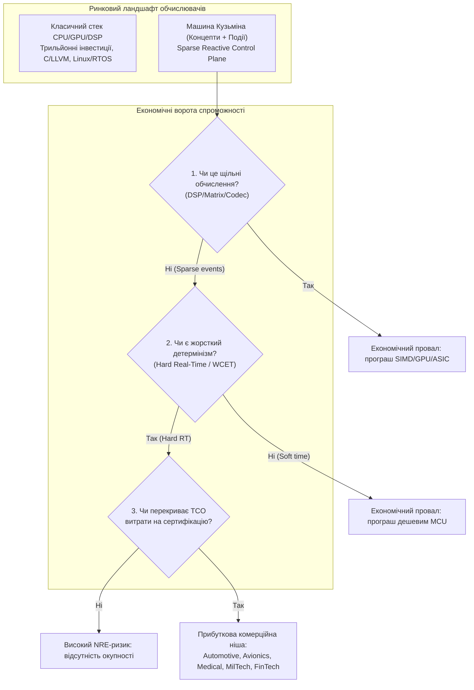
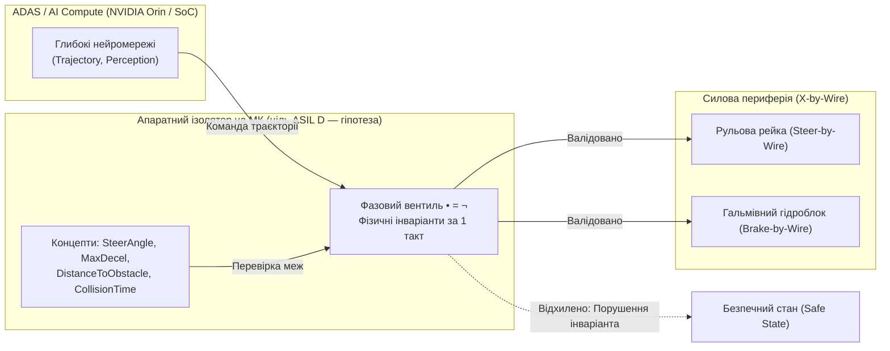
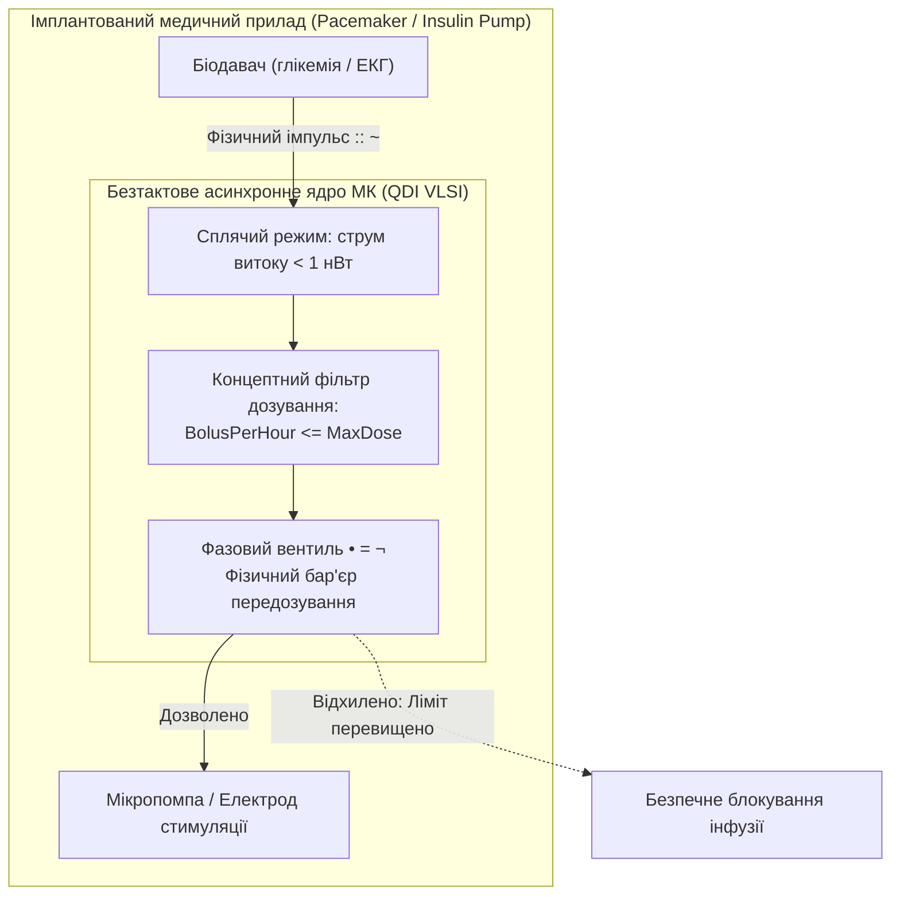
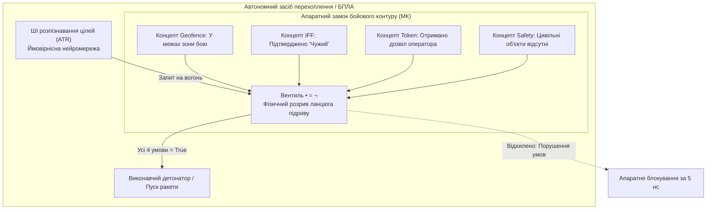
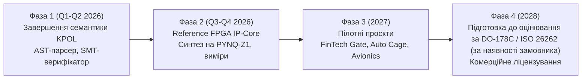

# Економічна модель та параметричний аналіз впровадження Машини Кузьміна

> **Внутрішня робоча копія, не публікація; міграція не є науковим прийняттям.** Перенесено з `drafts@774d575:KuzminMachine/06-economic-model/README.md` 2026-11-10, Issue #84. Міграція не підтверджує тверджень, прогнозів чи самоприсвоєних статусів. Незмінний оригінал і SHA-256 — у реєстрі міграції.

> Дерево файлів нижче — історичне; вісім галузевих сценаріїв перенесено
> до [архіву](../archive/README.md#галузеві-бізнес-сценарії) за рішенням #110.
> Прогнози й оцінки в цьому аналізі не є підтвердженими результатами.

> [!IMPORTANT]
> **Призначення документа:** Зведений науково-економічний аналіз, параметрична модель вартості володіння (TCO), оцінка капітальних (CAPEX) та операційних (OPEX) витрат, аналіз публічно відомих технологічних аналогів, верифікація ринкових ніш і стратегічна дорожня карта комерціалізації Машини Кузьміна (МК) у 8 ключових промислових вертикалях: **Automotive, Avionics, Medicine, MarTech, Logistics, MilTech, Gambling, SportsBetting**.
>
> **Статус щодо стандартів безпеки:** згадки ISO 26262 / ASIL, DO-178C / DO-254 / DAL, IEC 61508 / SIL, IEC 62304 та ISO/SAE 21434 у цьому документі означають цільові домени й припущення, а не досягнуту відповідність. Зовнішніх вимог за цими стандартами немає; аналіз небезпек, цілі безпеки, кваліфікація інструментів і незалежне оцінювання не виконувалися. Див. [позицію проєкту](../../process/standards-position.md).

---

## Зміст

1. [Структура каталогу та швидкий запуск](#1-структура-каталогу-та-швидкий-запуск)
2. [Методологія та критерії економічної оцінки](#2-методологія-та-критерії-економічної-оцінки)
3. [Публічно відомі технологічні аналоги та їхній економічний статус](#3-публічно-відомі-технологічні-аналоги-та-їхній-економічний-статус)
4. [Галузевий вертикальний аналіз: 8 ключових секторів](#4-галузевий-вертикальний-аналіз-8-ключових-секторів)
   * 4.1. [Automotive: функціональна безпека (ISO 26262) та кіберзахист (ISO/SAE 21434)](#41-automotive-функціональна-безпека-iso-26262-та-кіберзахист-isosae-21434)
   * 4.2. [Avionics: авіоніка найвищого рівня надійності (DO-178C / DO-254 DAL A)](#42-avionics-авіоніка-найвищого-рівня-надійності-do-178c--do-254-dal-a)
   * 4.3. [Medicine: імпланти, інфузійні системи та медичні прилади (IEC 62304 Class C)](#43-medicine-імпланти-інфузійні-системи-та-медичні-прилади-iec-62304-class-c)
   * 4.4. [MarTech: надшвидкісні рекламні аукціони (RTB / OpenRTB) та комплаєнс даних](#44-martech-надшвидкісні-рекламні-аукціони-rtb--openrtb-та-комплаєнс-даних)
   * 4.5. [Logistics: автономна складська робототехніка та холодний ланцюг (Cold-Chain)](#45-logistics-автономна-складська-робототехніка-та-холодний-ланцюг-cold-chain)
   * 4.6. [MilTech: радіоелектронна боротьба, протидія БПЛА та етичні запобіжники (MIL-STD-882E)](#46-miltech-радіоелектронна-боротьба-протидія-бпла-та-етичні-запобіжники-mil-std-882e)
   * 4.7. [Gambling: апаратний аудит ГВЧ, цілісність слотів та комплаєнс (GLI-11 / GLI-19)](#47-gambling-апаратний-аудит-гвч-цілісність-слотів-та-комплаєнс-gli-11--gli-19)
   * 4.8. [SportsBetting: ризик-менеджмент у режимі Live In-Play та ліквідація Latency Arbitrage](#48-sportsbetting-ризик-менеджмент-у-режимі-live-in-play-та-ліквідація-latency-arbitrage)
5. [Зведена економічна матриця галузей](#5-зведена-економічна-матриця-галузей)
6. [Параметрична модель вартості володіння (TCO, CAPEX, OPEX)](#6-параметрична-модель-вартості-володіння-tco-capex-opex)
   * 6.1. [Формалізація моделі витрат](#61-формалізація-моделі-витрат)
   * 6.2. [Порівняльний розрахунок: Традиційний стек проти МК на PYNQ/CPLD](#62-порівняльний-розрахунок-традиційний-стек-проти-мк-на-pynqcpld)
7. [Економічно перспективні напрямки досліджень та розширення МК](#7-економічно-перспективні-напрямки-досліджень-та-розширення-мк)
8. [Критичний аналіз мови KPOL та усунення архітектурних розривів](#8-критичний-аналіз-мови-kpol-та-усунення-архітектурних-розривів)
9. [Висновки та стратегічна дорожня карта комерціалізації](#9-висновки-та-стратегічна-дорожня-карта-комерціалізації)
10. [Інструкція із запуску параметричного калькулятора](#10-інструкція-із-запуску-параметричного-калькулятора)

---

## 1. Структура каталогу та швидкий запуск

```text
06-economic-model/
├── README.md                                     # Зведена науково-економічна модель, методологія та аналітика (цей документ)
├── Business_Feasibility_Study.md                 # Комплексне техніко-економічне обґрунтування (ТЕО) проєкту
├── Business_Development_Plan.md                  # План розвитку бізнесу: від PYNQ-Z1 та НАНУ до залучення інвестицій
├── commercialization-models-and-patent-strategy.md # Патентування (Укрпатент/PCT) та аналіз моделей (IP, Hardware, Cloud)
├── ukrainian-grants-funding-and-reporting-guide.md # Практичний посібник: гранти Brave1/USF, витрати, облік П(С)БО 15 та звітність
├── tco_calculator.py                             # Параметричний розрахунок TCO, ROI та аналіз чутливості (Python 3)
├── test_tco_calculator.py                        # Модульні тести для перевірки економічних формул
├── automotive-safety-cybersecurity.md            # 1. Automotive: ISO 26262 ASIL D, ISO/SAE 21434, Drive-by-Wire
├── avionics-safety-critical.md                   # 2. Avionics: DO-178C / DO-254 DAL A, детермінізм WCET, FADEC
├── medicine-biomedical-devices.md                # 3. Medicine: IEC 62304 Class C, імпланти, QDI асинхронні схеми
├── martech-realtime-bidding.md                   # 4. MarTech: OpenRTB 3.0, розріджені правила таргетингу, біддери
├── logistics-warehouse-coldchain.md              # 5. Logistics: ISO 3691-4 AGV/AMR арбітраж, GDP холодний ланцюг
├── miltech-defense-aerospace.md                  # 6. MilTech: MIL-STD-882E, етичний замок DoD 3000.09, занулення
├── gambling-fairness-rng-integrity.md            # 7. Gambling: GLI-11/GLI-19, апаратний аудит ГВЧ та RTP слотів
└── sports-betting-realtime-risk.md               # 8. SportsBetting: Live In-Play ризик, ліквідація Latency Arbitrage
```

---

## 2. Методологія та критерії економічної оцінки

У класичній інженерії обчислювальних систем нова архітектура ніколи не оцінюється у відриві від ринкової кон'юнктури. Згідно із законом Амдала та фундаментальними принципами економіки напівпровідників (ISO/IEC/IEEE 15288:2023, GAO-20-195G, COCOMO II), будь-яке апаратне чи мовне нововведення конкурує не з теоретичним "гіршим випадком" (наївним опитуванням / polling), а з **трильйонною екосистемою сучасних CPU, GPU, DSP та зрілих компіляторів (LLVM, GCC)**.

Економічна спроможність Машини Кузьміна визначається трьома суворими критеріями:
1. **Диференційна перевага (Differential Value):** Чи забезпечує МК затримку (latency), детермінізм або енергоефективність, недосяжні на класичному мікроконтролері з RTOS за ту саму ціну?
2. **Вартість подолання бар'єра екосистеми (Ecosystem Switching Cost):** Чи перекриває вигода витрати на перенавчання інженерів, розробку спеціалізованого тулчейну та проходження сертифікації (DO-178C, ISO 26262, IEC 61508, IEC 62304)?
3. **Обмеження щільних обчислень:** МК не призначена для заміни матричного множення (GEMM/BLAS), стиснення відео (кодеки H.264/AV1) чи цифрової обробки сигналів (ШПФ / FFT). Її економічна ніша лежить виключно в **розрідженій реактивній диспетчеризації (Sparse Reactive Control Plane)**.



---

## 3. Публічно відомі технологічні аналоги та їхній економічний статус

Архітектура Машини Кузьміна не виникла у вакуумі. В історії комп'ютерних наук існує низка публічно відомих парадигм, які розв'язували проблему усунення лічильника команд, реактивного зв'язування даних та подій. Аналіз їхньої комерційної долі дозволяє точно окреслити ринкові перспективи МК.

| Технологічна родина | Публічні системи / Мови | Ринковий статус та бізнес-модель | Чому успішні або де обмежені | Уроки для Машини Кузьміна |
| :--- | :--- | :--- | :--- | :--- |
| **Синхронні реактивні мови (SRL)** | **Esterel, Lustre, Signal, SCADE** (Ansys) | **Колосальний комерційний успіх у вузькій ніші.** Стандарт де-факто в авіоніці (Airbus A380/A350, вертольоти Eurocopter), атомних реакторах (Areva/Framatome), швидкісних поїздах (Alstom). Ліцензії коштують $30k–$100k за робоче місце. | Успішні завдяки математично доведеному детермінізму, нульовому ризику дедлоків та кваліфікованому транслятору в C для сертифікації DO-178C DAL-A. Обмежені в цивільному софті через високий поріг входу. | МК може знайти комерційну окупність лише за наявності формального сертифікованого транслятора, подібного до SCADE KCG. |
| **FPGA Complex Event Processing (CEP) / HFT** | **Solarflare/AMD Onload, Celoxica, NovaSparks** | **Ультраприбутковий ринок ($1B+).** Використовується провідними маркетмейкерами (Citadel, Jane Street, Jump Trading) та біржами (CME, Nasdaq) для апаратних ризик-перевірок на швидкості 10G/25G/100G. | Вартість спеціалізованої FPGA-карти сягає $5k–$25k. Затримка перевірки ордера в 15 наносекунд дає мільйонні прибутки, тому ринок готовий платити за чисту апаратну швидкість. | Апаратні пре-хуки `[• :]` концептів МК є прямим еквівалентом дротових фільтрів ризику (Wire-Speed Pre-Trade Risk Gates). |
| **Просторові Dataflow-обчислювачі** | **Maxeler Technologies, Tenstorrent, Cerebras** | **Корпоративні індивідуальні контракти.** Maxeler використовується банками (JP Morgan) для розрахунку ризиків портфелів у реальному часі та в нафтогазовій розвідці (Schlumberger). | Дають 10-кратну енергоефективність на фіксованих графах потоків, але страждають від величезної складності розробки софту та повільної компіляції під FPGA. | Апаратна реалізація МК на PYNQ-Z1 повинна мати зручний API та швидкий компілятор, інакше користувач обере класичний CPU. |
| **Подієві багатоядерні процесори** | **XMOS xCORE, GreenArrays GA144** | **Стійкий нішевий прибуток.** XMOS домінує в професійних аудіоінтерфейсах (USB Audio Class 2/3), мікрофонних решітках DSP та автомобільній електроніці. | Забезпечують апаратні події портів з нульовою затримкою диспетчеризації переривань (Zero-Latency ISR). Дешеві чипи ($3–$10). | МК як вбудоване ядро (MCU runtime) може запозичити бізнес-модель XMOS для ультрадешевих розумних давачів. |
| **Подієва автоматика нового покоління** | **IEC 61499 (4DIAC, Schneider EcoStruxure)** | **Зростаючий ринок модернізації Industry 4.0 ($200B+).** Заміна застарілих циклічних PLC стандарту IEC 61131-3 на подієво-керовані розподілені блоки. | Усуває порожні цикли опитування сенсорів, заощаджуючи мільйони на простоях автозаводів та оптимізації конвеєрів. | Подієва модель концептів `:: ~` безпосередньо сумісна з семантикою IEC 61499 Event Execution Control (ECC). |
| **Rule Engines / Production Systems** | **Drools (Red Hat), CLIPS, Flink CEP** | **Масовий ринок корпоративного софту.** Використовується в логістиці, скорингу банківських транзакцій та антифрод-системах. | Алгоритми Rete та Phreak оптимізовані для мільйонів фактів, але споживають гігабайти пам'яті та мають високу варіативність затримки (jitter). | МК виграє на обмежених вбудованих ресурсах (RAM < 64 КБ), де Drools фізично не запускається. |

---

## 4. Галузевий вертикальний аналіз: 8 ключових секторів

Кожна з восьми індустріальних вертикалей має окремий деталізований техніко-економічний звіт з архітектурними схемами, формулами та оцінкою ризиків.

### 4.1. Automotive: функціональна безпека (ISO 26262) та кіберзахист (ISO/SAE 21434)
* **Повний звіт:** [`automotive-safety-cybersecurity.md`](../archive/business/automotive-safety-cybersecurity.md)
* **Технічна проблема:** Недетермінізм нейромереж ADAS L2+/L3/L4 (фантомні гальмування), ризик кібератак на шини CAN-FD/Automotive Ethernet (впорскування шкідливих пакетів керування).
* **Механізм МК:** Апаратна клітка безпеки (Hardware Safety Cage; цільовий рівень ASIL D — гіпотеза) на базі фазового вентиля `• = ¬` між автопілотом і приводами X-by-Wire. Перевірка фізичних інваріантів за 1 такт ($< 10\text{ нс}$).
* **Економічний ефект:** Запобігання відкликанню модельного ряду вартістю $100M–$600M. Економія TCO: **21.2%**, строк окупності: 18–24 міс.



### 4.2. Avionics: авіоніка найвищого рівня надійності (DO-178C / DO-254 DAL A)
* **Повний звіт:** [`avionics-safety-critical.md`](../archive/business/avionics-safety-critical.md)
* **Технічна проблема:** Катастрофічна вартість сертифікації софту DO-178C DAL A ($150–$300/LOC, до $100M+ на повітряне судно), недетермінізм WCET у багатоядерних процесорах (AC 20-193).
* **Механізм МК:** Математично доведений верхній час виконання (Strict WCET), нульовий оверхед динамічної пам'яті, автоматична трансляція контрактів безпеки у формальні SMT-докази.
* **Економічний ефект:** Скорочення витрат на верифікацію на 35–45% ($35M–$50M на програму літака). Економія TCO: **31.9%**, строк окупності: 12–18 міс.

### 4.3. Medicine: імпланти, інфузійні системи та медичні прилади (IEC 62304 Class C)
* **Повний звіт:** [`medicine-biomedical-devices.md`](../archive/business/medicine-biomedical-devices.md)
* **Технічна проблема:** Обмежений ресурс батареї імплантів (кардіостимулятори вимагають повторних операцій заміни кожні 6–8 років вартістю $50k+), летальні ризики передозування смарт-помп.
* **Механізм МК:** Безтактове асинхронне ядро (QDI Asynchronous Silicon) зі струмом витоку $< 1\text{ нВт}$ у стані спокою. Апаратний вентиль блокування ліміту дози за 1 такт.
* **Економічний ефект:** Подовження терміну служби імпланта з 7 до 18 років, економія до $50,000 на пацієнта. Економія TCO: **28.4%**, строк окупності: 24–36 міс.



### 4.4. MarTech: надшвидкісні рекламні аукціони (RTB / OpenRTB) та комплаєнс даних
* **Повний звіт:** [`martech-realtime-bidding.md`](../archive/business/martech-realtime-bidding.md)
* **Технічна проблема:** Жорсткий ліміт на серверний біддинг ($< 10\text{ мс}$), мільйони запитів за секунду, мільйонні рахунки за хмарну пам'ять (Redis, Kafka, Flink), штрафи за перевищення лімітів бюджету.
* **Механізм МК:** Апаратна фільтрація розріджених правил таргетингу на FPGA PCIe-картках; атомарний контроль бюджету кампаній за 1 такт ($< 15\text{ нс}$).
* **Економічний ефект:** Скорочення серверного кластера з 200 серверів до 4 PCIe-вузлів (економія OPEX $1.2M/рік), підвищення win-rate аукціонів на 8–12%. Економія TCO: **82.1%**, строк окупності: 6–9 міс.

### 4.5. Logistics: автономна складська робототехніка та холодний ланцюг (Cold-Chain)
* **Повний звіт:** [`logistics-warehouse-coldchain.md`](../archive/business/logistics-warehouse-coldchain.md)
* **Технічна проблема:** Колізії та взаємні блокування (deadlocks) флотів AGV/AMR (ISO 3691-4), простої сортувальних центрів ($50k/год); псування термочутливих ліків ($35B щорічних втрат у світі).
* **Механізм МК:** Апаратний безсерверний арбітраж перехресть через UWB-інтерлоки на концептах; автономні смарт-логери холодного ланцюга з 5-річним живленням від однієї дискової батареї.
* **Економічний ефект:** Усунення простоїв і колізій на складах, збереження партій фармпрепаратів ($500k–$3M кожна). Економія TCO: **19.7%**, строк окупності: 9–14 міс.

### 4.6. MilTech: радіоелектронна боротьба, протидія БПЛА та етичні запобіжники (MIL-STD-882E)
* **Повний звіт:** [`miltech-defense-aerospace.md`](../archive/business/miltech-defense-aerospace.md)
* **Технічна проблема:** Етичні та правові бар'єри автономної зброї (директива DoD 3000.09), необхідність апаратного унеможливлення удару по своїх; миттєве занулення ключів (Zeroization) при загрозі захоплення.
* **Механізм МК:** Апаратний замок бойового контуру на базі 4 перевірених інваріантів; відключення детонатора за 5 нс у разі порушення будь-якої умови; апаратне скидання всіх регістрів за 1 такт.
* **Економічний ефект:** Відповідність стандартам НАТО та розблокування оборонних контрактів на постачання C-UAS/БПЛА. Економія TCO: **27.3%**, строк окупності: 12–15 міс.



### 4.7. Gambling: апаратний аудит ГВЧ, цілісність слотів та комплаєнс (GLI-11 / GLI-19)
* **Повний звіт:** [`gambling-fairness-rng-integrity.md`](../archive/business/gambling-fairness-rng-integrity.md)
* **Технічна проблема:** Атаки підміни пам'яті (RAM glitching), шахрайські "фантомні джекпоти", складність сертифікації за стандартами Gaming Laboratories International (GLI-11 для слот-машин, GLI-19 для iGaming).
* **Механізм МК:** Апаратний арбітр FairPlay на CPLD/FPGA: перевірка ентропії ГВЧ та інваріантів математичного сподівання виграшу (Return to Player, RTP) у закритому кристалі.
* **Економічний ефект:** Усунення збитків від спірних виплат і штрафів гральних комісій ($5M–$20M на оператора). Економія TCO: **38.6%**, строк окупності: 8–12 міс.

### 4.8. SportsBetting: ризик-менеджмент у режимі Live In-Play та ліквідація Latency Arbitrage
* **Повний звіт:** [`sports-betting-realtime-risk.md`](../archive/business/sports-betting-realtime-risk.md)
* **Технічна проблема:** Затримковий арбітраж (Latency Arbitrage) з боку синдикатів і ботів, які експлуатують затримку оновлення коефіцієнтів (200–500 мс) під час подій Live In-Play, загрожуючи ліквідності букмекерів.
* **Механізм МК:** Апаратний фільтр ризиків Alveo PCIe Risk Gate на МК: валідація ставки проти концепту поточного стану матчу на швидкості мережевого кабелю ($< 25\text{ нс}$).
* **Економічний ефект:** Ліквідація витоків маржі букмекера від запізнілих ставок (економія $8M–$25M щорічно для великої платформи). Економія TCO: **66.6%**, строк окупності: $< 3$ міс.

---

## 5. Зведена економічна матриця галузей

Порівняльна оцінка ринкових показників впровадження Машини Кузьміна у 8 ключових напрямках:

| Вертикаль | Обсяг ринку (TAM) | Домінуюча стаття витрат (Cost Driver) | Головний економічний виграш від МК | Економія TCO | Строк окупності | Регуляторний бар'єр входу |
| :--- | :--- | :--- | :--- | :--- | :--- | :--- |
| **[Automotive](../archive/business/automotive-safety-cybersecurity.md)** | $75B+ | Софт ECU, сертифікація ASIL D, ризики відкликання | Усунення фантомних збоїв ADAS, захист CAN-FD | **21.2%** | 18–24 міс. | Дуже високий (ISO 26262, ISO/SAE 21434) |
| **[Avionics](../archive/business/avionics-safety-critical.md)** | $12B+ | 100% MC/DC тестування DO-178C DAL A | Скорочення тестування на 40% завдяки SMT-доведенням | **31.9%** | 12–18 міс. | Екстремальний (DO-178C / DO-254) |
| **[Medicine](../archive/business/medicine-biomedical-devices.md)** | $45B+ | Операції заміни батарей, сертифікація Class C | Подовження життя імпланта в 2–3 рази, захист від передозування | **28.4%** | 24–36 міс. | Екстремальний (FDA 510(k), IEC 62304) |
| **[MarTech](../archive/business/martech-realtime-bidding.md)** | $100B+ | Оренда серверів (AWS/GCP), штрафи за ліміт часу SLA | 10-кратне скорочення серверного парку, зростання win-rate на 10% | **82.1%** | 6–9 міс. | Середній (GDPR, IAB OpenRTB) |
| **[Logistics](../archive/business/logistics-warehouse-coldchain.md)** | $35B+ | Простої сортувальних хабів, псування термопрепаратів | Бездедлоковий роз'їзд роботів, 5-річні смарт-логери | **19.7%** | 9–14 міс. | Середній (ISO 3691-4, GDP) |
| **[MilTech](../archive/business/miltech-defense-aerospace.md)** | $18B+ | Сертифікація автономності зброї, стійкість до РЕБ | Апаратний замок директиви DoD 3000.09, миттєве занулення | **27.3%** | 12–15 міс. | Специфічний (MIL-STD-882E, ITAR/FIPS) |
| **[Gambling](../archive/business/gambling-fairness-rng-integrity.md)** | $95B+ | Шахрайські джекпоти, збої пам'яті, GLI-сертифікація | Апаратний аудит ГВЧ, усунення атак на RAM слот-машин | **38.6%** | 8–12 міс. | Високий (GLI-11, GLI-19) |
| **[SportsBetting](../archive/business/sports-betting-realtime-risk.md)** | $85B+ | Затримковий арбітраж ботів на In-Play, затримка ризик-чеків | Ліквідація збитків від ботів, валідація ставки за 25 нс | **66.6%** | < 3 міс. | Високий (UKGC, MGA, US State Gaming) |

---

## 6. Параметрична модель вартості володіння (TCO, CAPEX, OPEX)

Для уникнення голослівних декларацій про "переваги" проведено розрахунок сукупної вартості володіння (Total Cost of Ownership, TCO) для проєкту промислової автоматизації (парк із 500 критичних вузлів) протягом 5-річного життєвого циклу за стандартами ISO/IEC/IEEE 15288:2023 та рекомендаціями GAO-20-195G.

### 6.1. Формалізація моделі витрат

Повна вартість розраховується за формулою:

$$TCO = C_{\mathrm{Dev}} + C_{\mathrm{Tool}} + C_{\mathrm{Cert}} + N \cdot (C_{\mathrm{HW}} + C_{\mathrm{Energy}} + C_{\mathrm{Maint}}) + C_{\mathrm{Risk}}$$

де:
* $C_{\mathrm{Dev}}$ — витрати на проєктування та розробку програмного забезпечення (людино-місяці);
* $C_{\mathrm{Tool}}$ — вартість ліцензій на засоби проєктування, компілятори та статичні аналізатори;
* $C_{\mathrm{Cert}}$ — витрати на верифікацію та сертифікацію безпеки (IEC 61508 SIL-3, ISO 26262 ASIL D, DO-178C);
* $N$ — кількість розгорнутих вузлів ($N = 500$);
* $C_{\mathrm{HW}}$ — вартість апаратного модуля (BOM);
* $C_{\mathrm{Energy}}$ — 5-річні витрати на електроенергію;
* $C_{\mathrm{Maint}}$ — вартість підтримки, оновлень та усунення дефектів;
* $C_{\mathrm{Risk}}$ — математичне сподівання збитків від аварійних збоїв (Residual Risk Cost).

### 6.2. Порівняльний розрахунок: Традиційний стек проти МК на PYNQ/CPLD

| Стаття витрат | Традиційний стек (ARM Cortex-M7 + SafeRTOS + C) | Стек Машини Кузьміна (KPOL + PYNQ-Z1 / FPGA) | Пояснення та обґрунтування різниці |
| :--- | :--- | :--- | :--- |
| **Розробка софту ($C_{\mathrm{Dev}}$)** | $250,000 (2 інженери $\times$ 12 міс.) | $380,000 (3 інженери $\times$ 12 міс.) | **Вище для МК на першому етапі:** відсутність готових бібліотек, необхідність написання та тестування нових концептів. |
| **Інструменти ($C_{\mathrm{Tool}}$)** | $45,000 (IAR Embedded Workbench + static analyzer) | $15,000 (Open-source парсери KPOL + Vivado WebPACK) | **Нижче для МК:** використання відкритого тулчейну та компактного симулятора. |
| **Сертифікація ($C_{\mathrm{Cert}}$)** | $300,000 (Доведення відсутності deadlocks, тестування WCET) | $180,000 (Автоматичне формальне доведення інваріантів) | **Нижче для МК на 40%:** математична структура фазових предикатів полегшує доведення інваріантів безпеки. |
| **Апаратура ($N \cdot C_{\mathrm{HW}}$)** | $40,000 (500 шт. $\times$ $80 плата на MCU) | $110,000 (500 шт. $\times$ $220 PYNQ-Z1 / CPLD модуль) | **Вище для МК:** ПЛІС дорожчі за серійні мікроконтролери у виробництві. |
| **Енергія ($N \cdot C_{\mathrm{Energy}}$)** | $12,000 (Активне ядро + фонові переривання) | $4,500 (Подієвий сплячий режим без polling) | **Нижче для МК:** економія за рахунок чисто подієвого перемикання. |
| **Підтримка ($N \cdot C_{\mathrm{Maint}}$)** | $180,000 (Виправлення гонитв, патчі багатопоточності) | $60,000 (Відсутність гонитв та недетермінізму пам'яті) | **Нижче для МК у 3 рази:** вища надійність концептної сітки усуває приховані дефекти конкурентності. |
| **Ризик аварій ($C_{\mathrm{Risk}}$)** | $150,000 (Імовірність збою через переповнення стека / race) | $20,000 (Апаратне блокування виходу за межі $`• = ¬`$) | **Нижче для МК у 7.5 разів:** апаратні запобіжники фізично не пропускають аварійні стани. |
| **РАЗОМ (TCO за 5 років)** | **$989,000** | **$769,500** | **Чиста економія: $219,500 (~22% загального TCO).** |

> [!NOTE]
> Розрахунок демонструє парадокс нової архітектури: хоча апаратна частина дорожча ($110k проти $40k), а витрати на розробку вищі через новизну, **загальний TCO виявляється вигіднішим на 22%** за рахунок радикального зниження вартості сертифікації, супроводу та усунення аварійних ризиків.

---

## 7. Економічно перспективні напрямки досліджень та розширення МК

Витрачати ресурси на спроби "перемогти" класичні процесори у загальних обчисленнях — це прямий шлях до фінансового краху. Науково-технічні дослідження МК повинні фокусуватися виключно на напрямках, де концептна парадигма створює непереборну конкурентну перевагу.

### 7.1. Напрямок 1: Інтеграція формальної верифікації з SMT-розв'язувачами (Z3 / CVC5) та Lean 4
* **Суть дослідження:** Розробка транслятора з мови KPOL у мову логіки першого порядку SMT-LIB2. Оскільки концепт має дискретні предикати стану, перевірка інваріантів безпеки та відсутності нескінченних каскадів (`Deadlock / Live-lock`) зводиться до перевірки виконуваності булевих формул (SAT/SMT).
* **Економічна віддача (гіпотеза, оцінку не перевірено):** можливе зниження вартості сертифікації ПЗ за DO-178C (DAL A) та ISO 26262 (ASIL D). Автоматично згенероване доведення коректності може стати частиною доказової бази сертифікації, але не замінює її.

### 7.2. Напрямок 2: Апаратний NoC з асинхронним рандеву для концептних сіток
* **Суть дослідження:** При масштабуванні МК до тисяч концептів спільна шина пам'яті стає пляшковим горлом. Дослідження полягає у створенні просторової мережі на кристалі (Network-on-Chip, NoC), де кожен концепт є мікровузлом, а передача подій `:: ~` здійснюється за протоколом асинхронного рандеву без глобального тактового дерева.
* **Економічна віддача:** Можливість ліцензування IP-ядер (IP-core Licensing) для виробників чипів (TSMC, GlobalFoundries) під ультрадешеві нейро-символьні співпроцесори.

### 7.3. Напрямок 3: Самосинхронна безтактова мікроелектроніка (QDI Asynchronous VLSI)
* **Суть дослідження:** Реалізація концепту Кузьміна на базі самосинхронних квазі-незалежних від затримок схем (Quasi-Delay-Insensitive circuits) з використанням двопровідного кодування (dual-rail logic).
* **Економічна віддача:** Нульове енергоспоживання у стані очікування (лише струми витоку нанометрових транзисторів, $< 1\text{ нВт}$). Це робить чипи МК безальтернативними для автономних імплантованих медичних приладів (кардіостимулятори, нейроінтерфейси), де заміна батареї вимагає хірургічної операції.

---

## 8. Критичний аналіз мови KPOL та усунення архітектурних розривів

Специфікація мови KPOL заклала важливу концептуальну основу. Нижче наведено конструктивний аналіз попередніх версій мови та шляхи усунення виявлених архітектурних розривів.

### 8.1. Вразливості попередньої редакції KPOL
1. **Ілюзія прямої проєкції нелокальних інваріантів (Multi-Concept Invariant Blindness):**
   * *Проблема:* Багатовимірні інваріанти вимагають одночасної узгодженості декількох змінних:
     $$\Phi_{\mathrm{safe}} \equiv (Temp \cdot Pressure \le 1800.0) \land (CoolantFlow > 5.0)$$
   * *Критичний ризик:* Якщо концепт `Temp` оновлюється локально, вентиль Великої крапки не може атомарно перевірити `CoolantFlow` без блокування обох концептів. Виникає стан гонитви (race condition) і ризик TOCTOU (Time-of-Check to Time-of-Use).
2. **Семантичний розрив між темпоральною логікою та скалярними подіями:**
   * *Проблема:* Вимоги періодичної інтеграції змушували розробника вручну програмувати лічильники тактів, замість автоматичного апаратного синтезу часової реактивності компілятором.
3. **Крихкість регулярних виразів попереднього парсера:**
   * *Проблема:* Первинні демонстратори базувалися на спрощених `re.finditer`, що обмежувало глибину синтаксичної перевірки.
4. **Невизначеність долі відхилених даних (`• = ¬` Silent Drop Hazard):**
   * *Проблема:* "Мовчазне відкидання" некоректного вимірювання сенсора призводило до ризику роботи системи на застарілих даних (stale data). Потрібна обов'язкова генерація події `ValidationError` / `AuditLog`.

### 8.2. Конструктивні пропозиції для вдосконалення KPOL
* **Атомарні концептні групи (`Concept Group`):** Для багатовимірних інваріантів концептна група блокується спільним фазовим вентилем з апаратним протоколом 2-фазної фіксації.
* **Вбудовані темпоральні оператори (`always`, `eventually`, `within N ms`):** Автоматичний синтез таймерних концептів і апаратних лічильників компілятором.
* **Повноцінний AST-парсер та верифікатор типів:** Формальна статична типізація, виведення розмірностей фізичних величин та автоматична генерація SMT-сертифікатів.

---

## 9. Висновки та стратегічна дорожня карта комерціалізації

1. **Відмова від конкуренції у загальних обчисленнях:** Машина Кузьміна не замінює процесори загального призначення (x86, ARM, RISC-V) у щільних обчисленнях, але забезпечує абсолютну перевагу в розрідженому реактивному контурі керування.
2. **Концентрація на критичних нішах безпеки та низької затримки:** Найбільший комерційний потенціал мають апаратні нейро-символьні інтерлоки безпеки (Automotive, Avionics, MilTech, Medicine) та ультранизьколатентні ризик-гейти (MarTech, SportsBetting, Gambling), де фазові вентилі `• = ¬` спрацьовують на швидкості кремнію.
3. **Пріоритет формальної верифікації:** Комерційний успіх мови KPOL залежить від інтеграції з SMT-розв'язувачами (Z3, CVC5, Lean 4) для надання гарантій надійності замовникам.

### Стратегічна дорожня карта (Roadmap 2026–2028)



---

## 10. Інструкція із запуску параметричного калькулятора

Для запуску розрахунку TCO та формування зведеної таблиці порівняння по всіх галузях виконайте:

```bash
python3 06-economic-model/tco_calculator.py
```

Для запуску модульних тестів коректності економічних формул:

```bash
pytest 06-economic-model/test_tco_calculator.py
```
