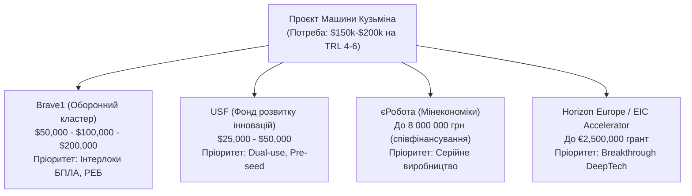
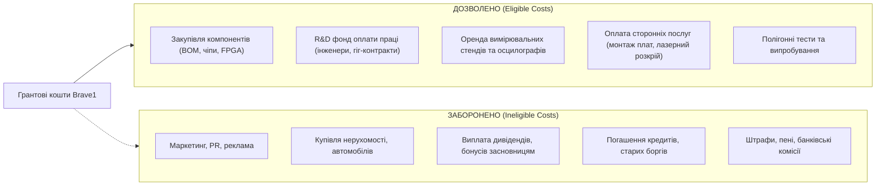
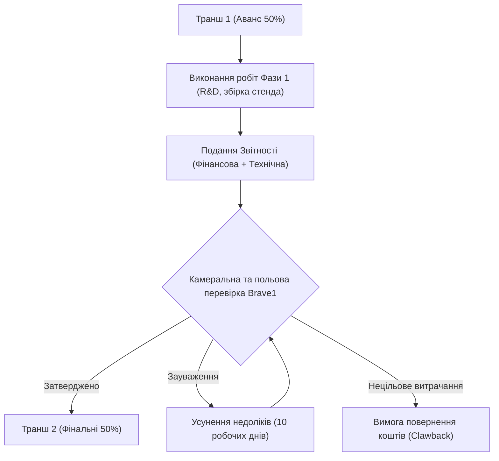
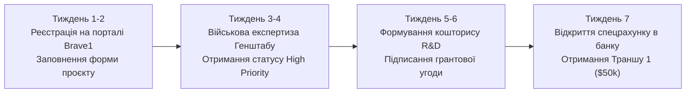

# Грантове фінансування DeepTech та MilTech в Україні: умови отримання, витрати, облік та звітність

> **Внутрішня робоча копія, не публікація; міграція не є науковим прийняттям.** Перенесено з `drafts@774d575:KuzminMachine/06-economic-model/ukrainian-grants-funding-and-reporting-guide.md` 2026-11-10, Issue #84. Міграція не підтверджує тверджень, прогнозів чи самоприсвоєних статусів. Незмінний оригінал і SHA-256 — у реєстрі міграції.

> [!IMPORTANT]
> **Призначення документа:** Практичний регуляторно-фінансовий посібник для команди проєкту Машини Кузьміна (МК) та українських DeepTech/MilTech стартапів. Документ визначає актуальні умови отримання безрозмивних грантів (кластер **Brave1**, **Український фонд стартапів / USF**, програми **єРобота**, **Horizon Europe**), структуру допустимих та заборонених витрат, правила бухгалтерського обліку цільового фінансування (П(С)БО 15), вимоги податкового режиму **Дія.City** та стандарти проходження фінансового і технічного аудиту.

---

## Зміст

1. [Огляд грантових програм для апаратно-програмних рішень в Україні](#1-огляд-грантових-програм-для-апаратно-програмних-рішень-в-україні)
2. [Оборонний кластер Brave1: ключове джерело фінансування MilTech](#2-оборонний-кластер-brave1-ключове-джерело-фінансування-miltech)
   * 2.1. [Суми грантів та градація за рівнями готовності (TRL)](#21-суми-грантів-та-градація-за-рівнями-готовності-trl)
   * 2.2. [Вимоги до заявника та військова експертиза](#22-вимоги-до-заявника-та-військова-експертиза)
   * 2.3. [Структура допустимих та заборонених витрат](#23-структура-допустимих-та-заборонених-витрат)
3. [Український фонд стартапів (USF / Фонд розвитку інновацій)](#3-український-фонд-стартапів-usf--фонд-розвитку-інновацій)
4. [Бухгалтерський та податковий облік грантів у Дія.City](#4-бухгалтерський-та-податковий-облік-грантів-у-діяcity)
   * 4.1. [Вимога окремого спеціального рахунку](#41-вимога-окремого-спеціального-рахунку)
   * 4.2. [Бухгалтерські проводки цільового фінансування (П(С)БО 15)](#42-бухгалтерські-проводки-цільового-фінансування-псбо-15)
   * 4.3. [Податкові наслідки: ПДВ, податок на виведений капітал (ПнВК), ПДФО та ЄСВ](#43-податкові-наслідки-пдв-податок-на-виведений-капітал-пнвк-пдфо-та-єсв)
5. [Порядок звітності та проходження аудиту](#5-порядок-звітності-та-проходження-аудиту)
   * 5.1. [Фінансова звітність та первинні документи](#51-фінансова-звітність-та-первинні-документи)
   * 5.2. [Науково-технічний звіт та фізична демонстрація](#52-науково-технічний-звіт-та-фізична-демонстрація)
6. [Типові помилки, ризики та захист від повернення коштів (Clawback Prevention)](#6-типові-помилки-ризики-та-захист-від-повернення-коштів-clawback-prevention)
7. [Покроковий план подання заявки Машини Кузьміна до Brave1](#7-покроковий-план-подання-заявки-машини-кузьміна-до-brave1)

---

## 1. Огляд грантових програм для апаратно-програмних рішень в Україні

Для стартапів, які розробляють складні технології на стику заліза та софту (FPGA, мікроконтролери, формальна верифікація, алгоритми реального часу), гранти є **найкращим джерелом первинного фінансування**, оскільки вони не розмивають частку засновників (Non-dilutive funding).

---

## 2. Оборонний кластер Brave1: ключове джерело фінансування MilTech

Кластер **Brave1** створений Міністерством цифрової трансформації, Міністерством оборони, Генеральним штабом ЗСУ, РНБО та Міністерством стратегічних галузей промисловості. Це головний акселератор оборонних інновацій в Україні.

### 2.1. Суми грантів та градація за рівнями готовності (TRL)
Грантова програма Brave1 має чіткий поділ за сумами залежно від технологічної зрілості та оцінки Генерального штабу:

| Рівень гранту | Сума фінансування | Цільовий рівень TRL | Вимоги до поточного стану проєкту |
| :--- | :--- | :--- | :--- |
| **Початковий (Tier 1)** | **$10,000** | TRL 3 $\to$ 4 | Перевірена концепція, лабораторний зразок, макет |
| **Базовий (Tier 2)** | **$25,000** | TRL 4 $\to$ 5 | Робочий прототип, підтверджені базові характеристики |
| **Просунутий (Tier 3)** | **$50,000** | TRL 5 $\to$ 6 | Інтегрований зразок, готовий до полігонних випробувань |
| **Стратегічний (Tier 4)** | **$100,000** | TRL 6 $\to$ 7 | Прототип, що пройшов полігон, підготовка до кодифікації |
| **Максимальний (Tier 5)** | **$200,000+** | TRL 7 $\to$ 8 | Пріоритетні напрямки (РЕБ, ШІ, БПЛА), масштабування |

> [!NOTE]
> Для Машини Кузьміна оптимальний маршрут у Brave1 — це подання заявки на **$50,000 або $100,000** під тему *«Апаратний інтерлок безпеки бойового контуру автономних БПЛА з функцією однотактового занулення»* на базі наявного стенда PYNQ-Z1.

---

### 2.2. Вимоги до заявника та військова експертиза

1. **Юридична форма:**
   * ТОВ (Товариство з обмеженою відповідальністю), зареєстроване в Україні. Фізичні особи-підприємці (ФОП) можуть претендувати лише на менші суми, але для серйозного R&D вимагається юридична особа.
   * Кінцеві бенефіціарні власники (КБВ) — виключно громадяни України або країн-партнерів. Повна відсутність громадян РФ, РБ чи підсанкційних осіб у структурі власності.
2. **Військова експертиза (Military Assessment):**
   * Заявка обов'язково передається експертам Генерального штабу ЗСУ та профільних інститутів Міноборони.
   * Оцінюються: актуальність для лінії фронту, стійкість до РЕБ, швидкість інтеграції, безпека оператора.
   * Виставляється оцінка: **High Priority, Medium Priority або Low Priority**. Гранти отримують розробки зі статусом High та Medium Priority.

---

### 2.3. Структура допустимих та заборонених витрат

Кошти гранту Brave1 є **цільовими** і можуть спрямовуватися лише на затверджені статті бюджету:

* **Допустимі статті витрат (Eligible):**
  - Закупівля електронних компонентів (FPGA-плати, сенсори, друковані плати, роз'єми, радіомодулі).
  - Заробітна плата R&D команди (RTL-архітектор, інженер верифікації, програміст) або виплати за гіг-контрактами у Дія.City.
  - Послуги контрактного виробництва (монтаж SMD-елементів, виготовлення корпусів).
  - Оренда лабораторного обладнання та сертифікаційні випробування.
* **Категорично заборонені статті (Ineligible):**
  - Маркетинг, реклама, участь у виставках (для цього існують інші гранти).
  - Придбання капітальних основних засобів, не пов'язаних безпосередньо з R&D (меблі, легкові авто, нерухомість).
  - Закриття заборгованостей за попередні періоди.
  - Конвертація коштів у готівку без належного первинного документообігу.

---

## 3. Український фонд стартапів (USF / Фонд розвитку інновацій)

USF фокусується як на цивільних, так і на технологіях подвійного призначення (Dual-Use):
* **Грант Dual-Use:** до **$35,000 – $50,000**.
* **Етапи відбору:**
  1. Технічна перевірка комплаєнсу заявки (Compliance Check).
  2. Експертне оцінювання двома незалежними профільними експертами (оцінка бізнес-моделі, команди, технологічної спроможності).
  3. **Pitch Day:** коротка презентація перед Конкурсною комісією (питання-відповіді щодо економіки та технічної реалізації).
  4. Затвердження рішення Наглядовою радою Фонду.

---

## 4. Бухгалтерський та податковий облік грантів у Дія.City

Недотримання правил ведення бухгалтерського обліку гранту — це найчастіша причина вимоги про повернення коштів (Clawback).

### 4.1. Вимога окремого спеціального рахунку
* Одержувач гранту зобов'язаний відкрити в уповноваженому українському банку **окремий поточний банківський рахунок зі спеціальним режимом використання** (спецрахунок).
* **Залізне правило:** На цей рахунок надходять виключно кошти гранту. Категорично забороняється змішувати грантові кошти з виручкою від комерційної діяльності, інвестиціями чи позиками.
* Усі вихідні платежі здійснюються безпосередньо з цього спецрахунку контрагентам за цільовими договорами.

---

### 4.2. Бухгалтерські проводки цільового фінансування (П(С)БО 15)

В українському обліку гранти обліковуються за нормами **Національного положення (стандарту) бухгалтерського обліку 15 «Дохід» (П(С)БО 15)**:

| Господарська операція | Дебет (Дт) | Кредит (Кт) | Економічний зміст |
| :--- | :--- | :--- | :--- |
| **Отримання повідомлення про надання гранту** | Рахунок 377 (Розрахунки з іншими дебіторами) | Рахунок 482 (Цільове фінансування та надходження) | Фіксація дебіторської заборгованості грантодавця |
| **Зарахування коштів гранту на спецрахунок** | Рахунок 311/Грант (Поточний рахунок у банку) | Рахунок 377 | Фактичний прихід траншу грошей |
| **Списання витрат на R&D (зарплата, матеріали)** | Рахунок 23 / 941 (Виробництво / Витрати на НДДКР) | Рахунок 661 / 631 (Розрахунки з персоналом / постачальниками) | Визнання фактичних цільових витрат за актами |
| **Визнання доходу пропорційно витратам** | Рахунок 482 (Цільове фінансування) | Рахунок 718 (Дохід від безоплатно одержаних активів) | **Грантовий дохід визнається точно в сумі понесених витрат** |

> [!IMPORTANT]
> **Фінансовий баланс:** Оскільки дохід за кредитом субрахунку 718 нараховується строго одночасно і в рівній сумі з понесеними витратами (дебет 941), **чистий фінансовий результат від гранту дорівнює нулю ($0)**. Грант не створює бухгалтерського прибутку, що підлягає оподаткуванню.

---

### 4.3. Податкові наслідки: ПДВ, податок на виведений капітал (ПнВК), ПДФО та ЄСВ

1. **Податок на додану вартість (ПДВ):**
   * Отримання грантових коштів **не є об'єктом оподаткування ПДВ** (п. 185.1 Податкового кодексу України), оскільки відсутня операція з постачання товарів або послуг грантодавцю.
2. **Податок на прибуток / Дія.City (ПнВК 9%):**
   * Для резидента Дія.City, що перебуває на спеціальному режимі оподаткування (податок на виведений капітал), отримання гранту та його цільове витрачання **не оподатковується 9% ПнВК**.
   * Оподаткування 9% виникне лише у випадку, якщо компанія спробує вивести ці гроші у вигляді дивідендів чи нецільових виплат нерезидентам.
3. **Оподаткування виплат інженерам (Гіг-спеціалісти Дія.City):**
   * Виплати R&D інженерам оподатковуються за пільговими ставками Дія.City:
     - **ПДФО: 5%**
     - **Військовий збір: 1.5% / 5%** (відповідно до законодавства на дату виплати)
     - **ЄСВ: 22% від розміру мінімальної зарплати** в Україні (незалежно від фактичного розміру винагороди).

---

## 5. Порядок звітності та проходження аудиту

Фінансування у Brave1 та USF зазвичай розбивається на транші (наприклад, 50% аванс і 50% після схвалення проміжного звіту).

### 5.1. Фінансова звітність та первинні документи
До фінансового звіту додається вичерпний реєстр первинних документів у PDF:
1. **Банківська виписка:** Повна виписка зі спеціального рахунку за звітний період з мокрими печатками або КЕП банку.
2. **Договори та накладні:** Копії договорів із постачальниками компонентів (наприклад, дистриб'юторами FPGA Xilinx / Digilent), видаткові накладні (ТТН, акти приймання-передачі).
3. **Документи з персоналом:** Гіг-контракти або цивільно-правові договори (ЦПХ), деталізовані акти наданих послуг із розпискою виконаних інженерних задач (наприклад: *«Розробка та верифікація модуля фазового вентиля на мові SystemVerilog, час виконання: 140 год»*), платіжні доручення про сплату винагороди та податків (ПДФО, ВЗ, ЄСВ).

---

### 5.2. Науково-технічний звіт та фізична демонстрація
Військові та технічні експерти Brave1 не оцінюють "паперові звіти" — вони вимагають **фізичного підтвердження**:
1. **Звіт про досягнення TRL:** Опис досягнутих технічних параметрів порівняно із заявкою (частота обробки, час затримки, відсутність дедлоків).
2. **Відеофіксація випробувань:** Відеозапис роботи стенда із демонстрацією вимірювань на осцилографі/логічному аналізаторі або відео польових випробувань на полігоні з прив'язкою до часу та телеметрії.
3. **Виїзна комісія або стендовий демо-день:** Представники кластера мають право призначити візит до лабораторії розробника або вимагати показу прототипу на військовому полігоні.

---

## 6. Типові помилки, ризики та захист від повернення коштів (Clawback Prevention)

| Типова помилка стартапу | Наслідок для компанії | Як запобігти (Правило захисту) |
| :--- | :--- | :--- |
| **Змішування коштів на рахунку** | Блокування рахунку, визнання витрат нецільовими | Здійснювати всі витрати **виключно зі спецрахунку гранту** |
| **Зміна кошторису без узгодження** | Відмова у зарахуванні витрат | Якщо стаття витрат змінюється більше ніж на 10%, подавати офіційний лист-запит до Brave1 **до оплати** |
| **Неконкретні акти виконаних робіт** | Претензії аудиторів до реальності R&D послуг | В актах обов'язково зазначати детальний опис виконаної інженерної задачі, номер модуля, назву стенда |
| **Порушення дедлайнів звітності** | Штрафні санкції, припинення наступних траншів | Готувати фінансовий пакет паралельно з виконанням робіт, а не в останній день |
| **Зрив термінів закупівлі деталей** | Протермінування етапу через дефіцит чіпів | Заздалегідь бронювати чіпи у дистриб'юторів або закладати альтернативні компоненти |

---

## 7. Покроковий план подання заявки Машини Кузьміна до Brave1

1. **Крок 1: Підготовка профілю розробки (Тиждень 1–2):**
   * Реєстрація на платформі `brave1.ukraine.ua`.
   * Формулювання військової цінності МК: *«Апаратний модуль безпеки (Hardware Safety Cage) польотного контролера БПЛА для унеможливлення перехоплення керування, ліквідації програмних збоїв автопілота та захисту від витоку ключів шифрування шляхом апаратного занулення за 5 нс»*.
2. **Крок 2: Проходження військової оцінки Генштабу (Тиждень 3–4):**
   * Надання результатів попередніх симуляцій SystemVerilog модуля `kpol_txn_gate.sv` та фото стенда PYNQ-Z1.
   * Отримання висновку експертів щодо пріоритетності розробки.
3. **Крок 3: Захист бюджету та підписання грантового договору (Тиждень 5–6):**
   * Подання кошторису: закупівля 5 радіаційно-стійких плат FPGA (Microchip PolarFire), виплати 3 інженерам (RTL, верифікація, ембеддед) за гіг-контрактами Дія.City, оплата послуг виготовлення мезонінних плат.
4. **Крок 4: Отримання коштів та запуск робіт (Тиждень 7):**
   * Відкриття цільового рахунку та отримання 50% авансового траншу на виконання Фази 1 робіт.

---

## 8. Висновок

Гранти в Україні (особливо кластер Brave1) — це повністю робочий, ефективний та легальний механізм запуску DeepTech проєкту без передчасного продажу часток інвесторам.

Успіх реалізації полягає у дотриманні трьох непорушних правил:
1. **Технічна правда:** здається не папір, а реальне фізичне залізо та вимірювання затримок.
2. **Фінансова дисципліна:** окремий спецрахунок, 100% первинних документів і жодних готівкових операцій.
3. **Синхронізація з Дія.City:** легальні гіг-контракти з мінімальним податковим навантаженням (5% ПДФО + ЄСВ з мінімалки).
