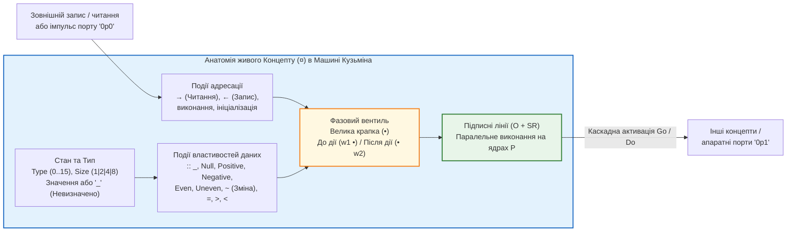
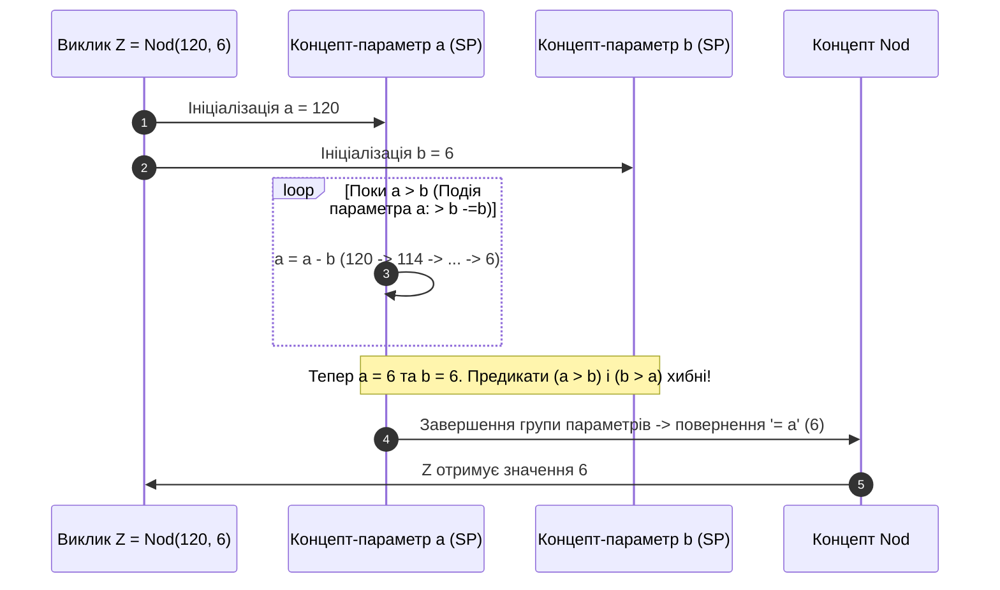

# Посібник розробника (Developer's Guide) з високорівневої мови програмування Машини Кузьміна

> **Внутрішня робоча копія, не публікація; міграція не є науковим прийняттям.** Перенесено з `drafts@774d575:KuzminMachine/05-applications-and-guides/Kuzmin-Machine-Developers-Guide-UA.md` 2026-11-10, Issue #84. Міграція не підтверджує тверджень, прогнозів чи самоприсвоєних статусів. Незмінний оригінал і SHA-256 — у реєстрі міграції.


> [!IMPORTANT]
> **Призначення посібника:** Цей документ є практичним інженерним керівництвом для програмістів, системних архітекторів та розробників вбудованих і FPGA-систем, які опановують високорівневу мову програмування **Машини Кузьміна (МК)**. Посібник побудовано за принципом «від зміни мислення та базових ідіом — до промислових патернів проєктування, багатопроцесорного розпаралелювання та апаратної інтеграції на PYNQ-Z1».
>
> **Пов'язані специфікації проєкту:**
> * [Формальна специфікація високорівневої мови МК (EBNF та семантика)](../software/Kuzmin-Machine-High-Level-Language-Specification-UA.md)
> * [Формальна специфікація в нотації абстрактного синтаксису (ASDL та ITU-T X.680 ASN.1)](../../theory/asn.md)
> * [Архітектура апаратного прискорювача Машини Кузьміна на FPGA PYNQ-Z1](../hardware/Kuzmin-Machine-FPGA-PYNQ-Z1-Architecture-UA.md)
> * [Науково-інженерне досьє на Машину Кузьміна](../theory/Kuzmin-Machine-Scientific-and-Engineering-Dossier-UA.md)

---

## Зміст

1. [Зміна мислення: як думати в парадигмі Машини Кузьміна](#1-зміна-мислення-як-думати-в-парадигмі-машини-кузьміна)
2. [Швидкий старт: типи даних, стани та оголошення концептів](#2-швидкий-старт-типи-даних-стани-та-оголошення-концептів)
3. [Програмування на подіях: повний каталог реактивних тригерів](#3-програмування-на-подіях-повний-каталог-реактивних-тригерів)
4. [Фазовий оператор «Велика крапка» (`•`) та керування транзакціями](#4-фазовий-оператор-велика-крапка--та-керування-транзакціями)
5. [Функції, реактивні параметри (`@`) та рекурсія без `if`](#5-функції-реактивні-параметри--та-рекурсія-без-if)
6. [Масиви, реактивні цикли (без `for`/`while`) та функції вищого порядку](#6-масиви-реактивні-цикли-без-forwhile-та-функції-вищого-порядку)
7. [Об'єктно-концептна архітектура (`Class`) і живе середовище виконання](#7-обєктно-концептна-архітектура-class-і-живе-середовище-виконання)
8. [Системне та апаратне програмування: порти, переривання та паралелізм на FPGA](#8-системне-та-апаратне-програмування-порти-переривання-та-паралелізм-на-fpga)
9. [Каталог канонічних патернів проєктування, антипатернів та шпаргалка розробника](#9-каталог-канонічних-патернів-проєктування-антипатернів-та-шпаргалка-розробника)

---

## 1. Зміна мислення: як думати в парадигмі Машини Кузьміна

Якщо ви переходите на мову Машини Кузьміна з традиційних імперативних мов (C, C++, Python, Rust), головна помилка — намагатися писати «послідовний сценарій інструкцій» з глобальним лічильником команд (`PC`) та перевірками `if / else / for / while`.

У Машині Кузьміна **немає пасивних змінних і немає центрального циклу опитування**. Єдиною будівельною цеглиною програми є **Концепт (`¤`)** — активна, автономна комірка пам'яті, яка сама знає:
* яке значення вона зараз зберігає (або що значення відсутнє — `_`);
* які **події** відбуваються під час звернення до неї чи зміни її стану;
* які **підписки** (реактивні дії) потрібно автоматично запустити на вільних обчислювальних ядрах, коли ця подія настала.

### 1.1. Порівняння імперативного та концептно-подієвого підходів

| Завдання розробника | Як мислить програміст C / Python | Як мислить розробник Машини Кузьміна |
| :--- | :--- | :--- |
| **Зберігання стану** | Пасивна змінна `int counter = 0;` у пам'яті. | Активний концепт `Byte Tick 0`, який сам реагує на читання, запис і досягнення порогу. |
| **Розгалуження** | Оператор `if (counter == 10) { ... }` всередині зовнішньої функції. | Внутрішня підписка самого концепту `Tick` на власну подію `= 10`. |
| **Цикл по масиву** | Імперативний цикл `for (int i = 0; i < N; i++)`. | Концепт-індекс `Token i 0` із підпискою на власну зміну `{[ _ ~ ] < N}`, що сам себе просуває (`i += 1`). |
| **Агрегація даних із давача** | Зовнішній потік читає порт, додає в буфер, а інший потік бере м'ютекс і обнуляє буфер. | Концепт `Voltage` перехоплює власний запис (`← @ Float x += x`) для накопичення і власне читання (`→ Voltage = 0`) для автоскидання. |
| **Багатоядерність** | Ручне створення потоків (`pthread`, `std::async`), черг та блокувань. | Незалежні оператори в групі `[ ... ]` та піддерева виразів автоматично розщеплюються на паралельні підписні лінії $`O + SR`$. |



### 1.2. Перша програма за 2 хвилини: три базові реактивні ідіоми

Ознайомтеся з трьома короткими фрагментами коду, які демонструють ядро мови МК.

> [!NOTE]
> **Правило коментарів у мові МК:** Будь-який коментар відкривається послідовністю `' #` (апостроф і решітка) та закривається символом правої ялинкової лапки `»`. Наприклад: `' # Це коментар розробника »`.

```text
' # Ідіома 1: Автономний лічильник імпульсів зі скиданням при порозі 10 »
Byte Counter 0
    ← Counter += 1               ' # При кожному записі — збільшуємо себе на 1 »
    = 10 { Counter = _ 0  ++Out } ' # Як тільки став рівним 10 — тихо обнуляємося і даємо імпульс у Out »

' # Ідіома 2: Булевий тригер-інвертор (мигалка станів) »
? Toggle _                       ' # Початковий стан не визначений (_) »
    ! Toggle = ¬                 ' # Якщо встановили в Істину (!) — перемкнутися в Хибність (¬) »
    ¬ Toggle = !                 ' # Якщо встановили в Хибність (¬) — перемкнутися в Істину (!) »

' # Ідіома 3: Чиста реактивна функція в один рядок »
Float Sigmoid | @ Float x = 1 / (1 + e^(-x))
```

---

## 2. Швидкий старт: типи даних, стани та оголошення концептів

### 2.1. Базова формула оголошення концепту

Кожне оголошення у високорівневій мові МК створює іменований концепт за схемою:

$$
\langle\text{Тип та Розмір}\rangle \quad \langle\text{Ім'я концепту}\rangle \quad \langle\text{Початкове значення або }\underline{\hspace{0.4em}}\rangle
$$

У мові одночасно підтримуються **символьні позначення типів** (з авторського словника `Type 0..15`) та їхні **мнемонічні псевдоніми** для зручності читання:

| Код `Type` | Символьний токен | Мнемонічні псевдоніми у коді | Допустимі розміри `Size` (байти) | Інженерне призначення |
| :---: | :---: | :--- | :---: | :--- |
| `0` | `Token` | `Token`, `?`, `Boolean` | `1, 2, 4, 8` | Перелічуваний токен, індекс ітератора або булевий прапорець |
| `1` | `+` | `Byte`, `U8`, `U16`, `U32`, `U64` | `1, 2, 4, 8` | Беззнакове ціле число (напр. `+ 1 Counter` або `Byte Counter`) |
| `2` | `+-` | `Int8`, `Int16`, `Int32`, `Int64` | `1, 2, 4, 8` | Знакове ціле число у доповняльному коді (`+- A` або `Int32 A`) |
| `3` | `.` | `Float`, `Double` | `4, 8` | Дійсне число з рухомою комою IEEE 754 |
| `4` | `'` | `Char` | `1, 2, 4` | Одиночний символ |
| `5` | `"` | `String` | Динамічний | Текстовий рядок |
| `6` | `:` | `Ref`, `Subscribe` | `2, 4, 8` | Посилання на інший концепт або дескриптор підписки |
| `7` | `↑` | `Ptr` | `4, 8` | Прямий вказівник на адресу пам'яті |
| `8` | `←` | `Row` | Динамічний | Горизонтальний вектор-рядок |
| `9` | `↓` | `Col` | Динамічний | Вертикальний вектор-стовпець |
| `10` | `#` | `Table` | Динамічний | Двовимірна таблиця / матриця |
| `11` | `[]` | `Array`, `Group` | Стат. / Дин. | Масив або група концептів |
| `12` | `└─` | `Pin` | `1, 2, 4` | Фізичний вивід мікроконтролера / ПЛІС (напр. `"0p0"`) |
| `13` | `⇄` | `Channel` | `1, 2, 4, 8` | Двоспрямований апаратний канал вводу-виводу |
| `14` | `▭` | `Frame` | Динамічний | Пакетний кадр даних |
| `15` | `Class` | `Class` | Динамічний | Користувацький клас-шаблон концептів |

### 2.2. Три критичні особливості станів, які має знати кожен розробник

#### 1. Відсутнє значення (`_`) — це НЕ нуль (`0`)
У традиційних мовах неініціалізована змінна містить сміття або неявно занулюється. У Машині Кузьміна стан **`_`** («Відсутнє значення», код події `:: _`) — це апаратно відстежуваний прапорець (`is_undef = 1` у таблиці концептів):
```text
Byte Tick 0          ' # Концепт ініціалізовано числом 0 (активна подія :: Null) »
Byte Sensor _        ' # Концепт створено, але даних ще немає (активна подія :: _) »
```

#### 2. Тихе присвоєння `= _ Значення` проти звичайного `= Значення`
Коли ви пишете `Tick = 0`, машина виконує повноцінну операцію запису (`←`), яка викликає всі підписки на запис і зміну стану `Tick`. Якщо ж потрібно **скинути концепт у початковий стан без запуску ланцюгової реакції подій запису** (наприклад, обнулити лічильник одразу після його вичитування), використовуйте модифікатор `_` перед значенням:
```text
Tick = _ 0           ' # Тихе скидання концепту Tick у 0 без повторного тригера події запису »
```

#### 3. Інверсна булева конвенція (`!` = 0, `¬` = 1)
У словнику операцій МК булевий тип `?` визначено так:
* **`!`** (Істина / True) має числовий код **`0`** (відсутність помилки / узгодженість);
* **`¬`** (Хибність / False) має числовий код **`1`** (наявність заперечення / розбіжність).

На рівні високорівневого коду завжди використовуйте символьні літерали `!` та `¬`, щоб не залежати від бітового представлення:
```text
? Ready !            ' # Булевий концепт Ready ініціалізовано значенням Істина (!) »
? Alarm ¬            ' # Булевий концепт Alarm ініціалізовано значенням Хибність (¬) »
```

### 2.3. Блокове групування за типом (Type-Scoped Grouping)

Щоб не повторювати назву типу перед кожним полем одного типу, виносьте тип перед фігурними дужками `{ ... }`. Це не лише скорочує код, а й розміщує концепти в суміжній області пам'яті:

```text
Float {
    Distance 0
    Speed 0
    Accelleration 0
}
```

---

## 3. Програмування на подіях: повний каталог реактивних тригерів

Щоб прив'язати реактивну поведінку до концепту, достатньо з нового рядка (з відступом або у блоці `[ ... ]`) вказати **специфікатор події**, а праворуч від нього — дії, які мають виконатися.

### 3.1. Події адресації (`←`, `→`, `|`, `:`)

Концепт може перехоплювати будь-який вид звернення до себе:

| Символ події | Назва події | Коли спрацьовує | Типовий сценарій використання |
| :---: | :--- | :--- | :--- |
| **`←`** | Подія запису | Коли зовнішній код виконує `Concept = x` або `Go Concept ←` | Валідація вхідних даних, інтегрування (накопичення суми), масштабування |
| **`→`** | Подія читання | Коли зовнішній код читає значення концепту (`y = Concept` або `Go Concept →`) | Ліниве обчислення значення на льоту, автоматичне обнулення буфера після читання |
| **`\|`** | Подія виконання | При прямому виклику концепту як функції/методу (`Concept()` або `Go Concept \|`) | Виконання алгоритму, кроку таймера або обробника переривання |
| **`:`** | Подія ініціалізації | Під час створення екземпляра концепту (`Obj = Class : (args)`) | Розгортання внутрішніх полів та початкова конфігурація |

#### Практичний приклад: Патерн «Інтегрувальний давач із автоскиданням»
У промисловому лічильнику електроенергії вхідні відліки напруги `Voltage` надходять щомілісекунди і мають підсумовуватися, а раз на 10 тактів накопичена сума вичитується для обчислення потужності й одразу обнуляється для наступного вікна вимірювання:

```text
Float Voltage
    ← @ Float x += x     ' # Перехоплення запису: нове значення x додається до поточного Voltage »
    → Voltage = 0        ' # Перехоплення читання: видати поточну суму в стек і скинути Voltage у 0 »
```
Зверніть увагу: завдяки цим двом рядкам зовнішньому коду не потрібно знати, що `Voltage` є інтегратором! Зовнішній код просто пише `Voltage = "0p1"` (зчитати з порту АЦП і записати у `Voltage`), а концепт сам акумулює суму.

### 3.2. Внутрішні події властивостей даних (`::`) та порівняння (`~`)

Крім факту звернення, концепт безперервно моніторить математичні властивості свого значення (в апаратній реалізації на PYNQ-Z1 всі 7 предикатів обчислюються комбінаційно за **1 такт** у модулі `kuzmin_event_evaluator.sv`):

```text
Int32 Signal _
    :: _        Print("Давач не підключено")      ' # Код 0: значення відсутнє (_) »
    :: Null     Print("Нульовий рівень сигналу")  ' # Код 1: значення дорівнює 0 »
    :: Positive LedGreen = !                      ' # Код 2: значення суворо більше 0 (> 0) »
    :: Negative LedRed = !                        ' # Код 3: значення суворо менше 0 (< 0) »
    :: Even     ParityBit = 0                     ' # Код 4: парне ціле число »
    :: Uneven   ParityBit = 1                     ' # Код 5: непарне ціле число »
    :: ~        LogHistory = Signal               ' # Код 6: значення змінилося (val_new != val_old) »
```

> [!TIP]
> **Скорочений запис у тілі концепту:** Коли однозначність очевидна з контексту, префікс `::` перед `~`, `=`, `>`, `<` можна опускати. Наприклад, запис `~ Change |` всередині концепту `Value` означає: *«при кожній зміні значення `Value` (`:: ~`) викликати виконання концепту `Change` (`|`)»*.

### 3.3. Події порівняння з порогом та множинні події `[v1 v2 ...]`

```text
' # 1. Порівняння з константою або іншим концептом »
Byte Tick 0
    = 10  Value = Voltage * Electricity / Tick^2  ' # Спрацьовує, коли Tick досягає 10 »

' # 2. Діапазонний фільтр (подвійна умова в одній підписці) »
Float Temperature 20.0
    [• : :: > Min < Max   Status = !   else   Alarm = ! ]

' # 3. Подія належності множині значень [0 1] »
U64 n _
    [0 1] { Result = 1  Exit }                    ' # Спрацьовує, якщо n == 0 АБО n == 1 »
```

---

## 4. Фазовий оператор «Велика крапка» (`•`) та керування транзакціями

Коли ви підписуєтеся на читання (`→`) або запис (`←`) концепту, виникає ключове інженерне питання: **підписка має виконатися ДО того, як нове значення ляже в комірку (або буде прочитане з неї), чи ПІСЛЯ цього?**

У високорівневій мові МК цим керує оператор **Велика крапка (`•`)** — фазовий роздільник і водночас вбудований булевий прапорець успішності операції над концептом.

### 4.1. Чотири канонічні позиції Великої крапки (`•`)

Розташування символу `•` відносно дій $`w_1`$ та $`w_2`$ однозначно визначає фазу виконання:

| Запис у коді | Фаза виконання | Що робить Машина Кузьміна |
| :--- | :--- | :--- |
| **`← w_1 •`** або **`[• : w_1]`** | **Пре-фаза (До фіксації)** | Спочатку виконує $`w_1`$ (перевіряє або модифікує вхідне значення), і лише якщо `• == !`, записує результат у комірку концепту. |
| **`← • w_2`** або **`[: • w_2]`** | **Пост-фаза (Після зміни)** | Спочатку оновлює значення комірки концепту, а потім запускає каскадну реакцію $`w_2`$ для сповіщення залежних концептів. |
| **`← w_1 • w_2`** | **Двофазна транзакція запису** | Виконує підготовку/накопичення $`w_1`$, фіксує стан концепту в точці `•`, і одразу після цього запускає пост-обробку $`w_2`$. |
| **`→ w_1 • w_2`** | **Двофазна транзакція читання** | Перед видачею значення виконує $`w_1`$ (оновлює розрахунок), у точці `•` віддає готове значення читачеві в стек $`SR`$, а після цього виконує $`w_2`$ (наприклад, скидає лічильник). |

### 4.2. Розбір реальних інженерних прикладів із Великою крапкою

#### Приклад А: Одометр і спідометр (`← w_1 • w_2`)
Коли від давача колеса надходить приріст шляху `x`, потрібно **спочатку** додати його до загальної дистанції `Distance`, зафіксувати нову дистанцію, і **після цього** оновити миттєву швидкість `Speed`:

```text
Distance 0
    ← @ Float x 0   Distance += x   •   { Speed = x * 10 }
```
Покрокова траса виконання при записі `Distance = 0.5`:
1. Вхідне значення `0.5` зв'язується з параметром `@ Float x`.
2. **До крапки `•` ($`w_1`$):** виконується `Distance += x`. Завдяки правилу придушення самоадресації це оновлення безпосередньо модифікує акумулятор `Distance`, не викликаючи нескінченної рекурсії.
3. **Точка `•`:** нове значення `Distance` зафіксовано, прапорець `•` дорівнює `!` (Істина).
4. **Після крапки `•` ($`w_2`$):** запускається блок `{ Speed = x * 10 }`, який записує `5.0` у концепт `Speed` (що, своєю чергою, викличе підписку самого `Speed` для розрахунку прискорення `Accelleration`!).

#### Приклад Б: Тахометр зі скиданням після читання (`→ • w_2`)
Коли контролер запитує кількість обертів двигуна, концепт `Tick` має видати обчислене значення `Revolutions` і одразу після видачі тихо обнулити накопичені імпульси:

```text
Byte Tick 0
    | += 1
    → • Revolutions = Tick * 600   Tick = _ 0
```

#### Приклад В: Скорочене посилання на поточне значення (`.`) та вхідний потік (`•`)
У компактних однорядкових фільтрах всередині квадратних дужок `[• : ...]` символ звичайної крапки **`.`** позначає **поточне збережене значення самого концепту**, а символ **`•`** — **вхідне значення**, що намагається записатися в концепт:

```text
' # Концепт Square при будь-якому записі числа x автоматично зберігає його квадрат x * x »
Int32 Square 0 [• : . = • * • ]

' # Лічильник Counter при досягненні 10 скидає власне значення (.) у 0 і збільшує порт Out »
+ 1 Counter [• : = 10   . = 0   ++Out ]
```

---

## 5. Функції, реактивні параметри (`@`) та рекурсія без `if`

У мові Машини Кузьміна функції не є окремою сутністю — **функція це звичайний концепт із підпискою на подію виконання `|`** та списком параметрів після символу **`@`**. Значення, яке повертає функція, — це просто фінальне значення цього концепту після завершення його підписки.

### 5.1. Три стилі написання функцій

```text
' # Стиль 1: Явне присвоєння імені концепту-функції »
Int32 Sum | @ (Int32 x, Int32 y) Sum = x + y

' # Стиль 2: Лаконічне повернення через '=' без дублювання імені »
Float Sigmoid | @ Float x = 1 / (1 + e^(-x))

' # Стиль 3: Одночасне приймання списку однотипних параметрів із початковими значеннями »
Float Hypot : @ (Float ((a 0, b 0))) = sqrt(a^2 + b^2)
```

### 5.2. Суперсила МК: Реактивні параметри в стеку $`SP`$

Оскільки кожен параметр у блоці `@ (...)` розміщується у стеку параметрів $`SP`$ як повноцінний тимчасовий концепт, **ви можете прив'язувати події та підписки безпосередньо до параметрів функції всередині круглих дужок `@ (...)`!**

Розглянемо класичний алгоритм Евкліда (пошук найбільшого спільного дільника `Nod`), який у мові МК записується в один рядок без жодного `while` чи `if`:

```text
U64 Nod | @ U64 ( a _ > b -=b , b _ > a -=a ) = a

' # Виклик функції: »
Z = Nod(120, 6)
```

#### Як це працює під капотом (покроковий розбір для розробника):
1. При виклику `Nod(120, 6)` у стеку параметрів $`SP`$ створюються два 64-бітні концепти-параметри: `a` (отримує `120`) та `b` (отримує `6`).
2. До параметра `a` прикріплена подія `> b` із дією `-= b` (тобто `a = a - b`). Оскільки $`120 > 6`$, ця подія миттєво спрацьовує!
3. До параметра `b` прикріплена симетрична подія `> a` із дією `-= a` (тобто `b = b - a`).
4. Кожна зміна `a` або `b` повторно перевіряє нерівності $`a > b`$ та $`b > a`$. Між двома параметрами виникає реактивний пінг-понг віднімань доти, доки не настане рівність $`a = b = 6`$.
5. Коли $`a = b`$, жодна з подій `> b` та `> a` більше не активується. Реактивний процес у дужках `@ (...)` завершується, і виконується фінальна частина `= a`, яка записує число `6` як результат концепту `Nod` і повертає його в `Z`.



### 5.3. Рекурсія через множинні події `[0 1]` та переривання групи `Exit`

Для рекурсивних алгоритмів замість тернарного оператора чи `if (n <= 1) return 1;` використовується подія належності параметра множині базових випадків `[0 1]` у парі з командою **`Exit`**, яка негайно припиняє виконання поточної групи підписок:

```text
U64 Factorial | @ U64 n [0 1] { Factorial = 1  Exit }
                      = Factorial(n - 1) * n
```
* Якщо `Factorial` викликано з `n = 5`, подія `[0 1]` не спрацьовує, і виконується другий рядок `= Factorial(4) * 5`.
* Коли рекурсивний спуск досягає `n = 1`, спрацьовує тригер `[0 1]`, концепту `Factorial` присвоюється `1`, а команда `Exit` відсікає подальший рекурсивний виклик.

---

## 6. Масиви, реактивні цикли (без `for`/`while`) та функції вищого порядку

### 6.1. Оголошення та бездужкова індексація масивів

У мові МК індексація масивів і груп починається з **`0`**. Квадратні дужки `[ ... ]` використовуються лише під час **оголошення** масиву, тоді як **доступ до елемента за індексом записується просто через пробіл**: `A i` або `B 0`.

```text
Int32 A []                     ' # Динамічний масив A (розмір визначається під час наповнення) »
Int32 B [4] (2, 5, 4, 3)       ' # Статичний масив B на 4 елементи, ініціалізований кортежем »

' # Читання та запис елементів за індексом (без квадратних дужок!): »
Int32 First = B 0              ' # First отримує значення 2 »
B 3 = 10                       ' # Четвертий елемент масиву B стає рівним 10 »
```

### 6.2. Два канонічні патерни реактивних циклів

Оскільки в МК немає інструкції `for`, ітерація будується на подіях концепту-лічильника `i`. Розробникові доступні дві еквівалентні форми запису:

#### Форма 1: Комбінована групова подія `{[ _ ~ ] < Limit}` (рекомендована для векторних функцій)
```text
Int32 SumA [] | {
    Token i 0
    {[ _ ~ ] < A.Length} {
        SumA i = A i + B i
        i += 1
    }
}
```
**Як читати предикат `{[ _ ~ ] < A.Length}`:**
1. `[ _ ~ ]` — подія спрацьовує у двох випадках: у момент первинної появи лічильника `i` (`_`, тобто для нульового індексу `i = 0`) **або** при кожній наступній зміні значення `i` (`~`, коли виконується `i += 1`).
2. `< A.Length` — обмежувальна умова: блок виконується лише доти, доки $`i < \mathrm{Length}(A)`$. Як тільки `i` зрівняється з довжиною масиву `A.Length`, подія стає хибною і цикл зупиняється.

#### Форма 2: Компактний генератор діапазону `<i = 0 < N ... >` (для локальних циклів у підписках)
```text
' # Заповнення перших 5 елементів масиву квадратами індексів: »
<i = 0 < 5   Arr i = i * i   ++i >
```

### 6.3. Функції вищого порядку (`Higher-Order Functions`)

У мові МК функція є звичайним концептом, тому її можна передавати як параметр до іншої функції. Більше того, в сигнатурі `@ (...)` можна одразу задати **реалізацію функції-параметра за замовчуванням**:

```text
' # Окрема функція піднесення до квадрата: »
Int32 Squaring | @ (Int32 x) Squaring = x * x

' # Універсальна функція редукції (згортки) вектора z[] за допомогою функції F: »
' # Якщо другий аргумент F при виклику не передано, за замовчуванням діє тотожна функція F = x »
Int32 SumZ 0 | @ (
    Int32 z [],
    Int32 F | @ Int32 x | F = x
) {
    Token i 0
    {[ _ ~ ] < z.Length} SumZ += F(z i)
    i += 1
}

' # Приклад 1: Звичайна сума елементів масиву B (використовується F за замовчуванням): »
Int32 TotalSum = SumZ(B)

' # Приклад 2: Сума квадратів елементів масиву B (передаємо концепт-функцію Squaring): »
Int32 SumOfSquares = SumZ(B, Squaring)
```

---

## 7. Об'єктно-концептна архітектура (`Class`) і живе середовище виконання

Для проєктування складних підсистем (промислових контролерів, драйверів давачів, скінченних автоматів) концепти об'єднуються у **Класи (`Class`)**.

### 7.1. Двосекційна анатомія класу (`|` та `:`)

На відміну від C++ чи Java, де поля і методи перемішані, у класі Машини Кузьміна чітко розділені дві фази адресації:

```text
Class Ім'яКласу
| @ <ПараметриКонструктора> {
    ' # СЕКЦІЯ 1: КОНСТРУКТОР ВИКОНАННЯ (адресація |) »
    ' # Виконується один раз одразу після розгортання полів у пам'яті. »
    ' # Тут прив'язують переривання, запускають таймери, копіюють стартові уставки »
    ' # та підписують зовнішні події через Subscribe. »
}
: {
    ' # СЕКЦІЯ 2: ТІЛО ІНІЦІАЛІЗАЦІЇ КОНЦЕПТУ (адресація :) »
    ' # Декларативний опис внутрішніх концептів-полів, їхніх початкових значень »
    ' # та постійних реактивних підписок між ними. »
}
```

### 7.2. Повний розбір еталонного класу: Автономний контролер діапазону (`Class Control`)

Розглянемо реальне інженерне завдання: створити автономний програмно-апаратний сторож (Watchdog / Range Controller), який стежить за тим, щоб вимірювана величина `Value` залишалася в межах між нижньою уставкою `Down` та верхньою уставкою `Up`. Причому межі `Up` і `Down` можуть змінюватися динамічно під час роботи!

```text
Class Control
| @ Float {
    PUp _                           ' # Вхідний параметр конструктора: верхня межа »
    PDown _                         ' # Вхідний параметр конструктора: нижня межа »
    _ Boolean E !                   ' # Опціональний зовнішній булевий концепт-подія »
} {
    Up = PUp                        ' # Копіюємо початкову верхню уставку у внутрішній концепт Up »
    Down = PDown                    ' # Копіюємо початкову нижню уставку у внутрішній концепт Down »
    E.Subscribe(Value)              ' # Динамічно підписуємо зовнішній концепт E на зміни Value »
}
: {
    Float Up    ~ Up                ' # Якщо змінилася верхня уставка Up — перевірити поріг Up »
    Float Down  ~ Down              ' # Якщо змінилася нижня уставка Down — перевірити поріг Down »
    Float Value ~ [ Up Down ]       ' # Якщо змінилося Value — ПАРАЛЕЛЬНО перевірити обидва пороги! »

    Float Up    | Print(Timer & Value)  ' # Дія при спрацюванні тривоги верхньої межі »
    Float Down  | Print(Timer & Value)  ' # Дія при спрацюванні тривоги нижньої межі »

    > Down (Value, Down)  ? ¬ Down  ' # Якщо Value не більше Down — підняти тривогу нижньої межі »
    < Up   (Value, Up)    ? ¬ Up    ' # Якщо Value не менше Up — підняти тривогу верхньої межі »
}
```

#### Як інстанціювати клас і працювати з живим об'єктом:
Створення екземпляра класу виконується оператором ініціалізації **`:`**:

```text
' # 1. Створення живого концепту NewControl у середовищі машини з межами (100.0, 10.0) »
NewControl = Control : (100.0, 10.0)

' # 2. Подальша робота: ми просто пишемо нові значення у поле Value або міняємо уставку Up! »
' # Жодних методів check() викликати не потрібно — об'єкт реагує автоматично: »
NewControl.Value = 42.5             ' # У межах норми (паралельна перевірка [Up Down] проходить тихо) »
NewControl.Value = 105.2            ' # Перевищення Up! Автоматично спрацьовує Print(Timer & Value) »
NewControl.Up = 120.0               ' # Динамічно підняли верхню межу — система сама переоцінила стан »
```

---

## 8. Системне та апаратне програмування: порти, переривання та паралелізм на FPGA

Мова Машини Кузьміна спроєктована так, щоб один і той самий код міг працювати як на мікроконтролері (наприклад, STM32), так і на багатоядерному апаратному прискорювачі FPGA (наприклад, **Digilent PYNQ-Z1 / Xilinx Zynq-7020**, детально описаному в [архітектурній специфікації FPGA](../hardware/Kuzmin-Machine-FPGA-PYNQ-Z1-Architecture-UA.md)).

### 8.1. Апаратні літерали портів (`"0p..."`) та векторів переривань (`"0x..."`)

У мові МК немає потреби писати регістрові маски `GPIOA->IDR` чи налаштовувати контролер переривань NVIC вручну — апаратні ресурси виступають такими самими концептами:

1. **Літерал фізичного порту `"<НомерКонтролера>p<НомерВиводу>"`** (наприклад, `"0p0"`, `"0p1"`):
   * Читання з `"0p1"` (`Voltage = "0p1"`) транслюється компілятором у низькорівневу команду `Go "0p1" → ; Go Voltage ←`, яка напряму опитує вхідний пін або канал АЦП.
   * Запис або інкремент порту (`++Out`, де `└─ Out = "0p1"`) генерує імпульс на фізичному виводі.
2. **Літерал вектора переривання `"0x<ШістнадцятковаАдреса>"`**:
   * Присвоєння `"0x128AF" = Tick |` у конструкторі класу `|` автоматично реєструє метод `Tick |` як апаратний обробник переривання за вектором `0x128AF`.

```text
Class TachometerController
| {
    "0x128AF" = Tick |              ' # Апаратне переривання від геркона викликає Tick | »
    Timer(100, Tick |)              ' # Апаратний таймер кожні 100 мс також викликає Tick | »
}
: {
    Byte Tick 0
        | += 1
}
```

### 8.2. Керування паралелізмом: як писати код, що на 100% завантажує ядра МК

Компілятор Машини Кузьміна використовує два механізми автоматичного розпаралелювання, якими розробник може керувати свідомо:

#### Правило 1: Незалежні оператори в дужках `[ ... ]` або `{ ... }` стають паралельними лініями підписки
Коли у підписці потрібно одночасно виконати кілька незалежних дій (наприклад, обнулити таймер і одночасно зчитати два канали АЦП — напругу та струм), запишіть їх у групових дужках:

```text
Void Tick | [ Tick = 0   Voltage = "0p1"   Electricity = "0p0" ]
```
Компілятор перетворить цей один рядок на **колекцію з трьох незалежних підписних ліній**, які планувальник (або блок **RCFC** у FPGA PYNQ-Z1) одночасно роздасть трьом вільним процесорам `PE0`, `PE1`, `PE2`:
* Лінія 1: `(0, Go Tick ←)`
* Лінія 2: `(Go "0p1" →, Go Voltage ←)`
* Лінія 3: `(Go "0p0" →, Go Electricity ←)`

Якщо ж між діями потрібна **сувора послідовність** (наприклад, спочатку інтегрувати відстань, а потім обчислити швидкість), розділяйте їх фазовим оператором Великої крапки **`•`**:
```text
← @ Float x 0   Distance += x   •   { Speed = x * 10 }
```

#### Правило 2: Балансуйте бінарні дерева арифметичних виразів для міжстекового рандеву (`SR1` $\leftrightarrow$ `SR2`)
Коли ви пишете складний математичний вираз з бінарними операціями (`+`, `-`, `*`, `/`), наприклад:
```text
Float Z : @ (Float ((a 0, b 0))) = sqrt(sin^2(a) + sin^2(b))
```
компілятор бачить, що лівий доданок $\sin^2(a)$ і правий доданок $\sin^2(b)$ не залежать один від одного:
* Ліва гілка $\sin^2(a)$ залишається виконуватися на основному стек-регістрі **`SR1`** (Процесор 1);
* Права гілка $\sin^2(b)$ автоматично виноситься у другу підписну лінію на допоміжний стек-регістр **`SR2`** (Процесор 2) і завершується інструкцією передачі `Go SR1 ←`;
* Процесор 1 у точці додавання виконує зустрічне читання `Go SR2 →` та `Do +`.
* **Гарантія відмовостійкості (Fallback):** Якщо в момент виконання у системі немає вільного другого ядра, Процесор 1 автоматично підхоплює другу лінію і виконує її сам без жодного взаємного блокування (deadlock).

### 8.3. Низькорівневі вставки `Go` та `Do` (Inline Stack Assembly)

У критичних за часом місцях розробник може писати низькорівневі команди стекової машини безпосередньо всередині високорівневих підписок:

* **`Go <Концепт> →`** — зчитати значення концепту на вершину стек-регістра $`SR`$;
* **`Go <Концепт> ←`** — витягти значення з вершини стек-регістра $`SR`$ і записати в концепт;
* **`Go <Концепт> |`** — активувати виконання підписок концепту;
* **`Go <Концепт> :`** — покласти в стек ідентифікатор/адресу концепту (або ініціалізувати екземпляр);
* **`Do <Операція>`** — виконати операцію АЛП над вершиною стека (`+`, `-`, `*`, `/`, `^`, `'` — остача/інкремент, `&`, `Or`, `¬`, `#` — XOR, `<` — зсув вліво, `>` — зсув вправо, `~` — побітова інверсія).

```text
' # Приклад прямої низькорівневої вставки для обчислення A = A - B: »
Go A →   Go B →   Do -   Go A ←
```

---

## 9. Каталог канонічних патернів проєктування, антипатернів та шпаргалка розробника

### 9.1. Шість золотих патернів проєктування (Design Patterns) на мові МК

````carousel
```text
' # ПАТЕРН 1: Акумулятор зі скиданням при читанні (Read-Clear Integrator) »
' # Застосування: інтегрування сигналів АЦП, підрахунок пакетів за часове вікно »

Float EnergyBucket 0
    ← @ Float sample += sample      ' # Кожен запис додає відлік до суми »
    → • EnergyBucket = _ 0          ' # Після видачі суми читачеві — тихо обнуляє себе »
```
<!-- slide -->
```text
' # ПАТЕРН 2: Двофазний конвеєр похідних величин (Two-Phase Derivative Chain) »
' # Застосування: кінематика (шлях -> швидкість -> прискорення), ПІД-регулятори »

Float {
    Distance 0
        ← @ Float dx 0  Distance += dx  •  { Speed = dx * 10 }
    Speed 0
        ← @ Float v     Accelleration = (v - Speed)  Speed = v
    Accelleration 0
}
```
<!-- slide -->
```text
' # ПАТЕРН 3: Реактивне зближення в параметрах (Parameter Ping-Pong) »
' # Застосування: ітеративні чисельні методи та НСД без імперативних циклів »

U64 Nod | @ U64 ( a _ > b -=b , b _ > a -=a ) = a
```
<!-- slide -->
```text
' # ПАТЕРН 4: Саморушний індексний каскад (Self-Propelling Index Cascade) »
' # Застосування: обробка векторів і матриць без оператора for »

Int32 MapAdd [] | @ (Int32 A [], Int32 B []) {
    Token i 0
    {[ _ ~ ] < A.Length} {
        MapAdd i = A i + B i
        i += 1
    }
}
```
<!-- slide -->
```text
' # ПАТЕРН 5: Паралельний сторож меж (Parallel Boundary Watchdog) »
' # Застосування: промислова автоматика, захист виходу параметрів за допуски »

Float Value _
    ~ [ Up Down ]                   ' # Зміна Value одночасно будить обидва компаратори »
```
<!-- slide -->
```text
' # ПАТЕРН 6: Базовий відсікач рекурсії (Set-Guard & Exit) »
' # Застосування: рекурсивні алгоритми на деревах і графах »

U64 Factorial | @ U64 n [0 1] { Factorial = 1  Exit }
                      = Factorial(n - 1) * n
```
````

### 9.2. Типові помилки початківців (Антипатерни) та як їх уникати

| № | Антипатерн (Неправильно) | Чому це помилка в Машині Кузьміна | Канонічне рішення (Правильно) |
| :-: | :--- | :--- | :--- |
| **1** | Індексація масиву через квадратні дужки у виразах: `Sum = A[i] + B[i]` | У мові МК квадратні дужки `[ ... ]` у тілі підписки означають **групову подію належності множині** або блок паралельних інструкцій, а не індекс масиву. | Пишіть індекс через пробіл після імені масиву: `Sum = A i + B i`. |
| **2** | Скидання лічильника звичайним присвоєнням у підписці читання: `→ Tick = 0` (коли на `←` висить інкремент `Tick += 1`) | Звичайне присвоєння `Tick = 0` генерує подію запису `←`, що викличе підписку `← Tick += 1` і замість нуля встановить `1`. | Використовуйте **тихе присвоєння з підкресленням** та фазову крапку: `→ • Tick = _ 0`. |
| **3** | Написання залежних за даними дій в одному груповому блоці без `•`: `[ Distance += x   Speed = Distance * 2 ]` | Оператори в групі `[ ... ]` можуть виконуватися **паралельно на різних ядрах**, тому `Speed` може прочитати старе значення `Distance` (стан гонитви — Data Race). | Розділіть залежні кроки фазовим оператором Великої крапки: `Distance += x  •  { Speed = Distance * 2 }`. |
| **4** | Очікування, що `Concept : (args)` лише виділить пам'ять без запуску коду | Оператор `:` виконує **двофазну ініціалізацію**: розгортає секцію `: { ... }` і одразу автоматично викликає конструктор виконання `\|`. | Розміщуйте декларації полів у `: { ... }`, а всю стартову динаміку (таймери, підписки) — у `\| { ... }`. |
| **5** | Забутий ініціалізаційний стан `_` у предикаті реактивного циклу: `{~ < A.Length}` замість `{[ _ ~ ] < A.Length}` | Подія `~` спрацьовує лише при **зміні** вже існуючого значення. Без токена `_` нульова ітерація (`i = 0`) ніколи не запуститься! | Завжди вказуйте диз'юнкцію початкового стану та зміни: `{[ _ ~ ] < A.Length}`. |

---

### 9.3. Шпаргалка розробника Машини Кузьміна (Quick Reference Card)

```text
================================================================================
                ШПАРГАЛКА З ВИСОКОРІВНЕВОЇ МОВИ МАШИНИ КУЗЬМІНА
================================================================================
1. ОГОЛОШЕННЯ КОНЦЕПТІВ ТА ТИПІВ
   Byte X 0            ' # Беззнакове 1 байт (+ 1 X = 0) »
   Int32 Y -5          ' # Знакове 4 байти (+- 4 Y = -5) »
   Float Z _           ' # Дійсне число з невизначеним початковим станом (_) »
   ? Flag !            ' # Булевий концепт: ! (True, код 0), ¬ (False, код 1) »
   └─ PinIn = "0p0"    ' # Прив'язка до фізичного виводу 0 контролера 0 »
   Int32 Arr [4] (1,2,3,4) ' # Статичний масив; звернення до елемента: Arr i »

2. ПОДІЇ АДРЕСАЦІЇ (Перехоплення звернень до концепту)
   ← @ Float x += x    ' # Перехоплення ЗАПИСУ в концепт »
   → • . = _ 0         ' # Перехоплення ЧИТАННЯ (після видачі значення тихо скинути в 0) »
   | += 1              ' # Перехоплення ВИКОНАННЯ (виклик концепту як методу) »
   : { ... }           ' # Тіло ІНІЦІАЛІЗАЦІЇ (при створенні екземпляра класу) »

3. ПОДІЇ СТАНУ ТА ВЛАСТИВОСТЕЙ ДАНИХ (:: та ~)
   :: _                ' # Значення відсутнє (не ініціалізовано) »
   :: Null             ' # Дорівнює 0 »
   :: Positive         ' # Більше 0 (> 0) »
   :: Negative         ' # Менше 0 (< 0) »
   :: Even / Uneven    ' # Парне / Непарне »
   :: ~  (або просто ~) ' # Значення змінилося (val_new != val_old) »
   = 10 / > Max / < Min ' # Порівняння з константою або іншим концептом »
   [0 1]               ' # Значення належить множині {0, 1} »
   {[ _ ~ ] < Limit}   ' # Ітератор циклу: при ініціалізації (_) та кожній зміні (~) до Limit »

4. ФАЗОВИЙ ОПЕРАТОР «ВЕЛИКА КРАПКА» (•)
   ← w1 • w2           ' # w1 виконується ДО фіксації значення, w2 — ПІСЛЯ фіксації »
   .                   ' # Поточне збережене значення концепту »
   •                   ' # Вхідне значення при записі або прапорець успішності (! / ¬) »

5. НИЗЬКОРІВНЕВІ КОМАНДИ СТЕК-РЕГІСТРА (Go / Do)
   Go X →  (Читати в SR)      Go X ←  (Записати з SR)
   Go X |  (Виконати X)       Go X :  (Адреса / Ініціалізація X)
   Do +  Do -  Do *  Do /  Do ^  Do ' (Mod/Inc)  Do &  Do Or  Do ¬  Do # (XOR)  Do <  Do >  Do ~
================================================================================
```
