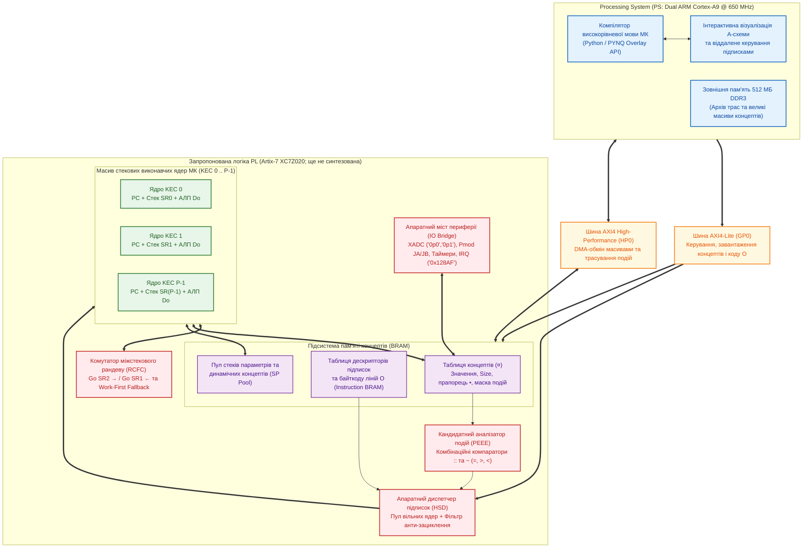
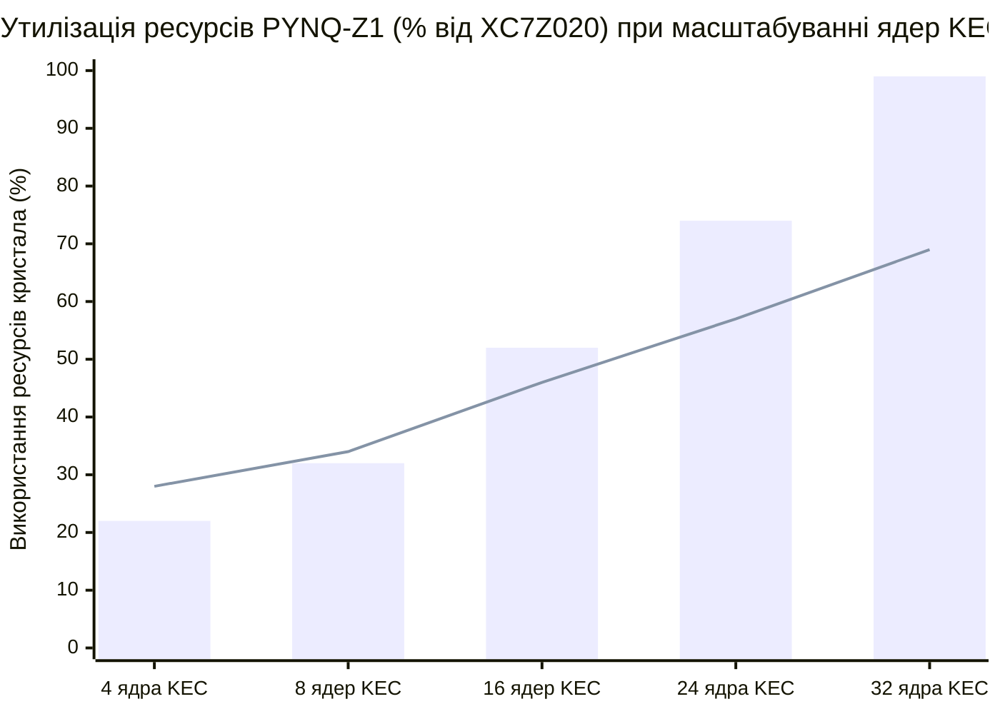
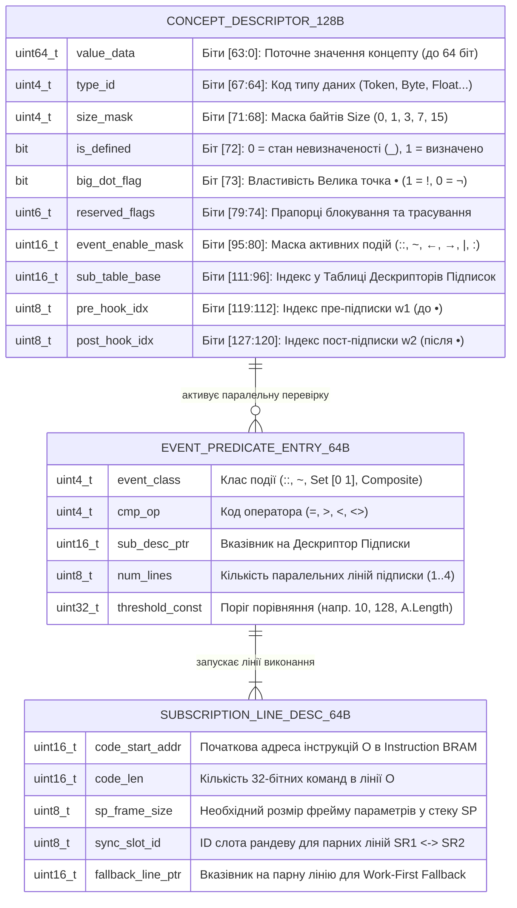
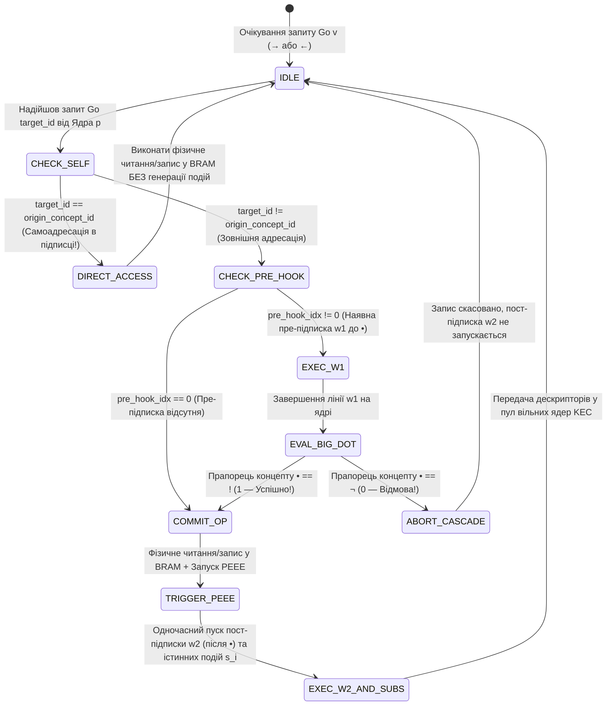
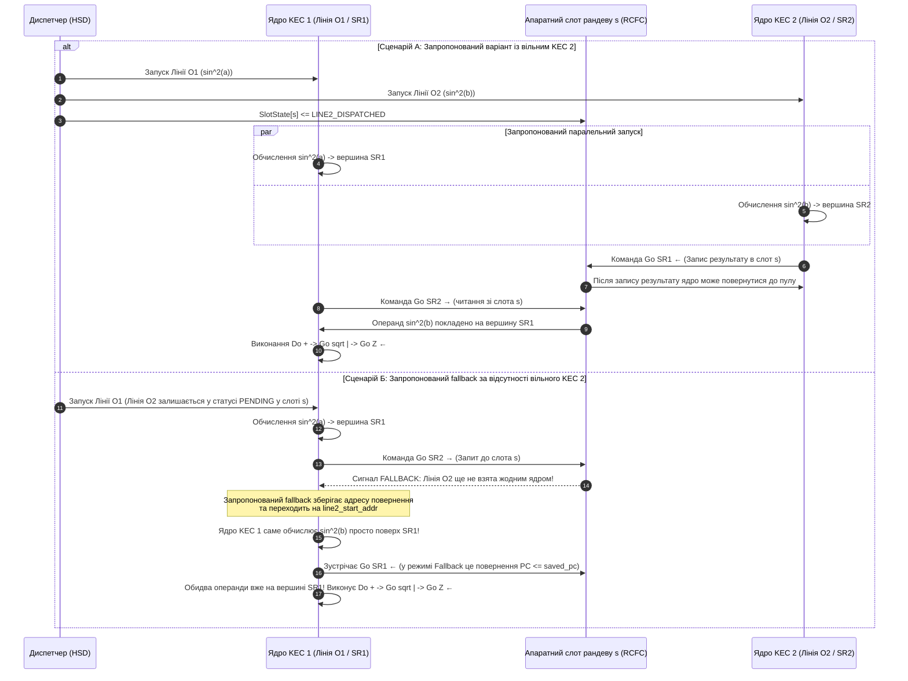
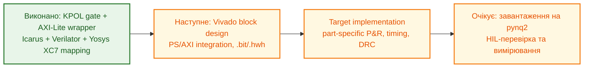

# Проєктна архітектура та план FPGA-експериментів Машини Кузьміна (ціль: Digilent PYNQ-Z1 / Xilinx Zynq-7020)

> **Внутрішня робоча копія, не публікація; міграція не є науковим прийняттям.** Перенесено з `drafts@774d575:KuzminMachine/02-engineering-hardware/Kuzmin-Machine-FPGA-PYNQ-Z1-Architecture-UA.md` 2026-11-10, Issue #84. Міграція не підтверджує тверджень, прогнозів чи самоприсвоєних статусів. Незмінний оригінал і SHA-256 — у реєстрі міграції.


> **Призначення:** цільова апаратна архітектура та план перевірок МК на FPGA. Розділи 1–6 переважно описують пропозиції й ескізи; виняток — §6.3, що документує реалізований прототипний AXI4-Lite інтерфейс.
>
> **Стан на 2026-11-07:** у репозиторії є [`kpol_txn_gate.sv`](../../../hw/rtl/core/kpol_txn_gate.sv) та PYNQ-керований прототип [`kpol_txn_gate_axi_lite.sv`](../../../hw/rtl/bus/kpol_txn_gate_axi_lite.sv) з тестбенчами. Обидва симулюються; AXI wrapper проходить Verilator lint, Yosys structural check і попередній XC7 family mapping. Це не повне ядро МК та не target-specific реалізація: немає власного `.bit`/`.hwh`, P&R/STA-звітів чи HIL-перевірки МК. Користувач підтвердив PYNQ-Z1 для `pynq1` і `pynq2`; на обох є базовий PYNQ overlay, але це не завантаження RTL МК.
>
> **Зв'язок із KPOL:** KPOL v0.1 визначає послідовну логічну транзакцію; він не задає циклової семантики чи фізичного часу. Перенесення його правил у синхронний RTL є окремою апаратною гіпотезою, не автоматичною властивістю мови.

Документ пов'язаний зі [специфікацією високорівневої мови МК](../software/Kuzmin-Machine-High-Level-Language-Specification-UA.md) та [науково-інженерним досьє](../theory/Kuzmin-Machine-Scientific-and-Engineering-Dossier-UA.md).

---

## Зміст

1. [Обґрунтування вибору FPGA та архітектура гетерогенної системи на PYNQ-Z1](#1-обґрунтування-вибору-fpga-та-архітектура-гетерогенної-системи-на-pynq-z1)
2. [Апаратний бюджет ресурсів Zynq-7020 та масштабування багатопроцесорного кластера МК](#2-апаратний-бюджет-ресурсів-zynq-7020-та-масштабування-багатопроцесорного-кластера-мк)
3. [Бінарне кодування низькорівневих інструкцій (ISA МК) та структур пам'яті](#3-бінарне-кодування-низькорівневих-інструкцій-isa-мк-та-структур-памяті)
   - [3.1. Апаратне відображення типів `Type` та 4-бітної маски `Size`](#31-апаратне-відображення-типів-type-та-4-бітної-маски-size)
   - [3.2. Формат 32-бітного слова команди послідовності $O$ (`Go` / `Do` / `Push` / `Sys`)](#32-формат-32-бітного-слова-команди-послідовності-o-go--do--push--sys)
   - [3.3. Структура 128-бітного Дескриптора Концепту ($\text{¤}$) у BRAM](#33-структура-128-бітного-дескриптора-концепту--у-bram)
4. [Апаратна логіка та RTL-архітектура вузлів Машини Кузьміна (SystemVerilog)](#4-апаратна-логіка-та-rtl-архітектура-вузлів-машини-кузьміна-systemverilog)
   - [4.1. Ескіз блоку аналізу подій (PEEE)](#41-ескіз-блоку-аналізу-подій-peee)
   - [4.2. Проєктний автомат фазового оператора та запобігання зацикленню](#42-проєктний-автомат-фазового-оператора-та-запобігання-зацикленню)
   - [4.3. Проєктне стекове ядро (KEC)](#43-проєктне-стекове-ядро-kec-стек-регістр-sr-стек-параметрів-sp-та-алп-do)
   - [4.4. Пропонований комутатор міжстекової синхронізації та fallback](#44-пропонований-комутатор-міжстекової-синхронізації-та-fallback)
5. [Апаратне відображення портів (`"0p0"`, `"0p1"`, `"0x128AF"`) на периферію PYNQ-Z1](#5-апаратне-відображення-портів-0p0-0p1-0x128af-на-периферію-pynq-z1)
6. [Програмно-апаратний інтерфейс PYNQ Overlay (AXI4-Lite + Python Driver)](#6-програмно-апаратний-інтерфейс-pynq-overlay-axi4-lite--python-driver)
7. [План, інструменти та статус верифікації](#7-план-інструменти-та-статус-верифікації)

---

## 1. Обґрунтування вибору FPGA та архітектура гетерогенної системи на PYNQ-Z1

### 1.1. Гіпотези щодо відображення МК на FPGA

У програмній реалізації обробка подій може виконуватися послідовно або пакетно; FPGA дає змогу дослідити альтернативне просторове відображення частини перевірок. Це не доводить переваги над CPU чи мікроконтролером: їх треба вимірювати на однаковій семантиці та навантаженні.

Наведені нижче пункти — проєктні гіпотези, не результати синтезу або вимірювань:

1. **Комбінаційне обчислення предикатів:** частину предикатів можна спробувати обчислювати паралельними схемами. Латентність, максимальна частота й ресурси залежать від ширини даних, логіки, обмежень і результатів реалізації.
2. **Відображення `Size` на дозволи запису:** маски розміру можуть бути зіставлені з `WSTRB` або byte-enable пам'яті лише після узгодження кодування типів і ширини відповідної шини.
3. **Кількість виконавчих ядер:** сценарії на 8/16/32 ядра нижче є аналітичними оцінками; допустимий розмір і затримки визначатимуть синтез, розміщення, трасування та вимірювання.
4. **Поділ PS/PL:** ARM/Linux/PYNQ може бути хостом керування, а PL — апаратним прискорювачем. Сам цей поділ не гарантує жорсткого реального часу, детермінізму чи відсутності накладних витрат.



---

## 2. Апаратний бюджет ресурсів Zynq-7020 та масштабування багатопроцесорного кластера МК

Наведені далі характеристики кристала — довідкові; оцінки для ядер, таблиця використання ресурсів, тактові частоти та GOPS є неперевіреними розрахунковими сценаріями. Для них немає звітів синтезу, розміщення/трасування або STA. Назви «оптимальна» й «максимальна» нижче не є висновками вимірювань.

Плата **Digilent PYNQ-Z1** побудована на кристалі **Xilinx Zynq-7000 XC7Z020-1CLG400C**, програмована частина якого (Artix-7) містить такі фізичні ресурси:
* **Таблиці істинності (6-input LUTs):** $`53\,200`$ (з них $`17\,400`$ можуть працювати як розподілена пам'ять LUTRAM);
* **Тригери (Flip-Flops):** $`106\,400`$;
* **Блочна пам'ять (Block RAM):** $`140`$ блоків **RAMB36E1** (по 36 Кбіт кожен) або $`280`$ блоків **RAMB18E1** (по 18 Кбіт) — сумарно $`4{,}9 \text{ Мбіт}`$ ($`630 \text{ КБ}`$);
* **Апаратні блоки ЦОС (DSP48E1):** $`220`$ слайсів (кожен містить помножувач $`25 \times 18`$ біт, пре-суматор та 48-бітний АЛП-акумулятор);
* **Аналого-цифровий перетворювач (XADC):** подвійний 12-бітний АЦП на $`1 \text{ MSPS}`$.

### 2.1. Оцінка вартості одного Стекового Виконавчого Ядра (KEC) та інфраструктури

На відміну від RISC-процесорів (MicroBlaze або RISC-V), ядро Машини Кузьміна (**KEC**) не потребує великого регістрового файлу на 32 регістри, декодера складних інструкцій чи кешу переходів. Його основу складає стек-регістр $`SR`$ (глибиною 64 слова по 64 біти, що реалізується всього на **1 блоці RAMB18E1** або 128 LUTRAM) та компактний АЛП `Do`.

$$
\begin{aligned}
\mathrm{LUT}_{\mathrm{total}}(P) &= \mathrm{LUT}_{\mathrm{AXI+CMS}} + \mathrm{LUT}_{\mathrm{PEEE+HSD}} + P \cdot \mathrm{LUT}_{\mathrm{KEC}} + P^2 \cdot \mathrm{LUT}_{\mathrm{RCFC}} \\
&\approx 4\,200 + 3\,800 + 950 \cdot P + 18 \cdot P^2
\end{aligned}
$$

| Розрахунковий сценарій для PYNQ-Z1 | 8 ядер KEC | 16 ядер KEC | 32 ядра KEC | Доступно в Zynq-7020 |
| :--- | :---: | :---: | :---: | :---: |
| **Кількість паралельних процесорів ($P$)** | **8** | **16** | **32** | — |
| **Використання 6-input LUT** | $`16\,952`$ ($`31{,}8\%`$) | $`27\,808`$ ($`52{,}3\%`$) | $`53\,024`$ ($`99{,}6\%`$) | $`53\,200`$ ($`100\%`$) |
| **Використання Flip-Flops (FF)** | $`21\,400`$ ($`20{,}1\%`$) | $`36\,800`$ ($`34{,}6\%`$) | $`68\,200`$ ($`64{,}1\%`$) | $`106\,400`$ ($`100\%`$) |
| **Блоки RAMB36E1 (Пам'ять концептів + Стеки)** | $`48`$ ($`34{,}3\%`$) | $`64`$ ($`45{,}7\%`$) | $`96`$ ($`68{,}6\%`$) | $`140`$ ($`100\%`$) |
| **Блоки DSP48E1 (Арифметика `Do *`, `Do +`, Float)** | $`32`$ ($`14{,}5\%`$) | $`64`$ ($`29{,}1\%`$) | $`128`$ ($`58{,}2\%`$) | $`220`$ ($`100\%`$) |
| **Цільова тактова частота $`F_{\mathrm{clk}}`$** | **150 МГц** | **125 МГц** | **100 МГц** | До 200 МГц |
| **Пікова пропускна здатність операцій** | **1,2 GOPS** | **2,0 GOPS** | **3,2 GOPS** | — |



> [!TIP]
> **Конфігурація 16 KEC / 125 МГц — лише один сценарій для майбутньої перевірки, а не рекомендація.** Залишок LUT/BRAM та досяжна частота невідомі до реалізації й звітів цільового інструментарію. Значення таблиці не підтверджують можливість розміщення ILA, DMA чи арифметики IEEE-754.

---

## 3. Бінарне кодування низькорівневих інструкцій (ISA МК) та структур пам'яті

Для того щоб високорівневий компілятор на боці ARM/Python генерував виконуваний код для FPGA, зафіксуємо строгий двійковий формат типів даних, інструкцій послідовності $`O`$ та дескрипторів концептів.

### 3.1. Апаратне відображення типів `Type` та 4-бітної маски `Size`

У специфікації МК кожному типу зіставлено 4-бітний токен `Type_ID` та 4-бітне поле `Size` ($`0, 1, 3, 7, 15`$). В апаратній реалізації на PYNQ-Z1 поле `Size` безпосередньо керує мультиплексором розширення знака (Sign Extension) та лініями байтового запису BRAM `we_byte[7:0]`:

$$
\mathrm{WE}_{\mathrm{byte}}[7:0] = \begin{cases}
\mathtt{00000001_2}, & \text{якщо } \mathrm{Size} \in \lbrace 0, 1 \rbrace \quad (\texttt{Token}, \texttt{Byte}, \texttt{Int8}, \texttt{Chr}) \\
\mathtt{00000011_2}, & \text{якщо } \mathrm{Size} = 3 \quad (\texttt{U16}, \texttt{Int16}) \\
\mathtt{00001111_2}, & \text{якщо } \mathrm{Size} = 7 \quad (\texttt{U32}, \texttt{Int32}, \texttt{Float}, \texttt{Uni}) \\
\mathtt{11111111_2}, & \text{якщо } \mathrm{Size} = 15 \quad (\texttt{U64}, \texttt{Int64}, \texttt{Double})
\end{cases}
$$

| Код типу `Type_ID` (`[3:0]`) | Назва типу МК | Поле `Size` (`[3:0]`) | Ознака знаковості (`is_signed`) | Ознака Float (`is_fp`) | Маска запису BRAM `we_byte[7:0]` |
| :---: | :--- | :---: | :---: | :---: | :---: |
| `4'h0` | `_` (Void / Any) | `4'd0` (`0000`) | `0` | `0` | `8'h00` (лише прапорець стану `_`) |
| `4'h1` | `Token` (4 біти) | `4'd0` (`0000`) | `0` | `0` | `8'h01` (молодший нібл `[3:0]`) |
| `4'h2` | `?` (Boolean: `!`/`¬`) | `4'd0` (`0000`) | `0` | `0` | `8'h01` (молодший біт `[0]`) |
| `4'h3` | `Byte` | `4'd1` (`0001`) | `0` | `0` | `8'h01` |
| `4'h4` | `Int8` | `4'd1` (`0001`) | `1` | `0` | `8'h01` |
| `4'h5` | `Chr` | `4'd1` (`0001`) | `0` | `0` | `8'h01` |
| `4'h6` | `U16` | `4'd3` (`0011`) | `0` | `0` | `8'h03` |
| `4'h7` | `Int16` | `4'd3` (`0011`) | `1` | `0` | `8'h03` |
| `4'h8` | `U32` | `4'd7` (`0111`) | `0` | `0` | `8'h0F` |
| `4'h9` | `Int32` | `4'd7` (`0111`) | `1` | `0` | `8'h0F` |
| `4'hA` | `Float` (IEEE-754) | `4'd7` (`0111`) | `1` | `1` | `8'h0F` |
| `4'hB` | `Uni` (UTF-32) | `4'd7` (`0111`) | `0` | `0` | `8'h0F` |
| `4'hC` | `U64` | `4'd15` (`1111`) | `0` | `0` | `8'hFF` |
| `4'hD` | `Int64` | `4'd15` (`1111`) | `1` | `0` | `8'hFF` |
| `4'hE` | `Double` (IEEE-754) | `4'd15` (`1111`) | `1` | `1` | `8'hFF` |

---

### 3.2. Формат 32-бітного слова команди послідовності $O$ (`Go` / `Do` / `Push` / `Sys`)

Кожна лінія підписки виконує скомпільований масив 32-бітних слів команд $`O[0 \dots N-1]`$ із пам'яті інструкцій (`Instruction BRAM`). Усі низькорівневі команди МК кодуються фіксованим 32-бітним словом:

```text
 31  30  29  28  27      24  23      20  19                                    0
+---+---+---+---+-----------+-----------+---------------------------------------+
| 0   0 |  Dir  | Addr_Mode | Type_ID   |         Target_ID / Offset (20b)      |  <-- Команда Go
+---+---+---+---+-----------+-----------+---------------------------------------+
| 0   1 |   Do_Opcode (4b)  | Type_ID   |         Immediate_Arg / Unused (20b)  |  <-- Команда Do
+---+---+-------------------+-----------+---------------------------------------+
| 1   0 |Lit_Mod| Type_ID   |             24-bit Signed/Unsigned Literal        |  <-- Константа у стек SR
+---+---+-------+-----------+---------------------------------------------------+
| 1   1 |  Sys_Opcode (4b)  |             System / Sync / Meta Parameter (24b)  |  <-- Службова команда
+---+---+-------------------+---------------------------------------------------+
```

#### Деталізація полів інструкцій:

1. **Клас `00` — Оператор адресації `Go`:**
   - `Dir [29:28]` — Вид адресації за таблицею `Operation.Go` автора:
     - `2'b00` (`0`) = **`|`** (Виконання / Виклик методу або функції);
     - `2'b01` (`1`) = **`←`** (Запис зі стека $`SR`$ у цільовий концепт);
     - `2'b10` (`2`) = **`→`** (Читання з цільового концепту на вершину стека $`SR`$);
     - `2'b11` (`3`) = **`:`** (Ініціалізація / Створення нового динамічного концепту).
   - `Addr_Mode [27:24]` — Режим адресації:
     - `4'h0` (`ABS_CONCEPT`): `Target_ID` — абсолютний індекс концепту в таблиці пам'яті концептів;
     - `4'h1` (`REL_CURRENT`): відносна адресація сусіда поточного концепту $`\text{¤} + \mathrm{signed}(\text{Offset})`$, наприклад `Go ¤-1 →` або `Go (¤+d).Q ←` для машини Тюрінга;
     - `4'h2` (`PARAM_SP`): звернення до параметра або локальної змінної у стеку параметрів $`SP[\text{Offset}]`$;
     - `4'h3` (`SYNC_SR`): **міжстекова синхронізація ліній підписок** (`Go SR2 →` при `Dir = 10` або `Go SR1 ←` при `Dir = 01`), де `Target_ID` вказує номер слота рандеву та індекс парної лінії;
     - `4'h4` (`HW_PORT`): пряме звернення до апаратного порту PYNQ-Z1 (`"0p0"`, `"0p1"`, `"0x128AF"`).

2. **Клас `01` — Арифметично-логічний оператор `Do`:**
   - `Do_Opcode [29:26]` — 4-бітний код операції за таблицею `Operation.Do` автора:
     - `4'd0` (`0000`): **`Do +`** — додавання ($`\mathrm{NOS} + \mathrm{TOS}`$);
     - `4'd1` (`0001`): **`Do -`** — віднімання ($`\mathrm{NOS} - \mathrm{TOS}`$);
     - `4'd2` (`0010`): **`Do *`** — множення ($`\mathrm{NOS} \times \mathrm{TOS}`$);
     - `4'd3` (`0011`): **`Do /`** — ділення ($`\mathrm{NOS} / \mathrm{TOS}`$);
     - `4'd4` (`0100`): **`Do ^`** — піднесення до цілого степеня ($`\mathrm{NOS}^{\mathrm{TOS}}`$);
     - `4'd5` (`0101`): **`Do '`** — унарний інкремент вершини стека ($`\mathrm{TOS} + 1`$);
     - `4'd6` (`0110`): **`Do &`** — побітове І ($`\mathrm{NOS} \;\land\; \mathrm{TOS}`$);
     - `4'd7` (`0111`): **`Do Or`** — побітове АБО ($`\mathrm{NOS} \;\lor\; \mathrm{TOS}`$);
     - `4'd8` (`1000`): **`Do ¬`** — логічна/побітова інверсія ($`\lnot \mathrm{TOS}`$);
     - `4'd9` (`1001`): **`Do #`** — унарна зміна знака ($`-\mathrm{TOS}`$);
     - `4'd10` (`1010`): **`Do <`** — побітовий зсув вліво ($`\mathrm{NOS} \ll \mathrm{TOS}`$);
     - `4'd11` (`1011`): **`Do >`** — побітовий зсув вправо ($`\mathrm{NOS} \gg \mathrm{TOS}`$);
     - `4'd12` (`1100`): **`Do ~`** — оператор порівняння (формує токен `=`, `>`, `<`).

3. **Клас `10` — Завантаження літерала у стек (`Push Literal`):**
   - За пропонованим форматом кладе 24-бітну константу на вершину стек-регістра $`SR`$; для 32/64-бітних констант передбачена спарена інструкція `Lit_Mod = 2'b01` (`LUI`). Кількість тактів не визначена й має бути виміряна після реалізації.

4. **Клас `11` — Службові мета-інструкції (`Operation` Meta):**
   - `4'd0`: **`Exit`** — негайне завершення поточної лінії/групи підписок і звільнення процесора;
   - `4'd1`: **`Convert`** — апаратне приведення типу на вершині стека $`SR`$ (наприклад, `Int32` $\leftrightarrow$ `Float`);
   - `4'd2`: **`Processor`** — явний запит на виділення паралельного ядра для дочірньої лінії підписки $`O_2`$;
   - `4'd3`: **`SetBigDot`** — встановлення прапорця властивості `•` поточного концепту (`• = !` або `• = ¬`).

---

### 3.3. Структура 128-бітного Дескриптора Концепту ($\text{¤}$) у BRAM

У цій пропозиції дескриптор концепту має формат **128 біт (16 байтів)** і може бути відображений у BRAM. Режим RAM, фізична ширина, конфлікти портів та латентність читання/запису залежать від реалізації й потребують синтезу та перевірки; однотактове читання не підтверджено.



---

## 4. Апаратна логіка та RTL-архітектура вузлів Машини Кузьміна (SystemVerilog)

> У цьому розділі кодові фрагменти є ескізами запропонованої архітектури. Вони не відповідають окремим RTL-файлам у репозиторії й не пройшли спільну компіляцію або цільовий синтез. Перевірений початковий RTL обмежується `rtl/kpol_txn_gate.sv` і його тестбенчем; цей блок не реалізує PEEE, KEC чи RCFC.

### 4.1. Ескіз блоку аналізу подій (PEEE)

У наведеній концептуальній моделі подія задається логічним висловлюванням $`w_i(U) \in \{0, 1\}`$ над станом концепту. Комбінаційне паралельне обчислення є одним із можливих RTL-відображень, а не вимогою KPOL v0.1 чи підтвердженою властивістю FPGA-реалізації.

Вхідними даними блоку **PEEE** є старе значення концепту `old_val`, нове значення `new_val`, біт визначеності `is_defined`, а також масив констант-порогів `threshold[0..K-1]` з таблиці предикатів концепту:

$$
\begin{aligned}
E_{\mathrm{undef}} &= \lnot \mathrm{isDefined} & \text{(код 0: Відсутнє значення)} \\
E_{\mathrm{Null}} &= \mathrm{isDefined} \land (\mathrm{val}_{\mathrm{new}} == 0) & \text{(код 1: Нуль)} \\
E_{\mathrm{Positive}} &= \mathrm{isDefined} \land (\mathrm{signed}(\mathrm{val}_{\mathrm{new}}) > 0) & \text{(код 2: Додатне)} \\
E_{\mathrm{Negative}} &= \mathrm{isDefined} \land (\mathrm{signed}(\mathrm{val}_{\mathrm{new}}) < 0) & \text{(код 3: Від'ємне)} \\
E_{\mathrm{Even}} &= \mathrm{isDefined} \land (\mathrm{val}_{\mathrm{new}}[0] == 0) & \text{(код 4: Парне)} \\
E_{\mathrm{Uneven}} &= \mathrm{isDefined} \land (\mathrm{val}_{\mathrm{new}}[0] == 1) & \text{(код 5: Непарне)} \\
E_{\mathrm{changed}} &= \mathrm{isWrite} \land (\mathrm{val}_{\mathrm{new}} \neq \mathrm{val}_{\mathrm{old}}) & \text{(код 6: Факт зміни значення)}
\end{aligned}
$$

Нижче наведено ескіз RTL-модуля мовою **SystemVerilog**. Його логіка та заявлена латентність потребують уточнення семантики, тестування й вимірювання після синтезу:

```systemverilog
// =============================================================================
// Модуль: kuzmin_event_evaluator.sv
// Призначення: Кандидатний паралельний аналізатор подій концепту (:: та ~)
// Цільова ПЛІС: Xilinx Zynq-7020 (Digilent PYNQ-Z1)
// =============================================================================
`timescale 1ns / 1ps

module kuzmin_event_evaluator #(
    parameter int NUM_CMP_SLOTS = 4   // Кількість паралельних компараторів порогів на концепт
) (
    input  logic        is_defined_i, // 0 = стан невизначеності '_', 1 = визначено
    input  logic        is_write_op_i,// Факт операції запису (←)
    input  logic        is_signed_i,  // Знаковість типу концепту
    input  logic [63:0] old_val_i,    // Попереднє значення концепту в BRAM
    input  logic [63:0] new_val_i,    // Нове значення концепту
    input  logic [15:0] event_mask_i, // Маска активних підписок концепту

    // Параметри слотів порівняння (~ : =, >, <, <>, [set])
    input  logic [NUM_CMP_SLOTS-1:0][2:0]  cmp_mode_i,   // 0:=, 1:>, 2:<, 3:<>, 4:[0 1], 5:{[_ ~]<T}
    input  logic [NUM_CMP_SLOTS-1:0][63:0] threshold_i,  // Константа порівняння або межа Length

    // Вихідні вектори істинності подій (1 = Подія ІСТИННА -> запустити підписки)
    output logic [6:0]                 data_events_o,    // Клас "::" (коди 0..6)
    output logic [NUM_CMP_SLOTS-1:0]   cmp_events_o,     // Клас "~" та комбіновані події
    output logic                       any_event_fired_o // Загальний строб активації диспетчера
);

    // 1. Комбінаційне обчислення 7 базових подій даних класу "::"
    logic ev_undef, ev_null, ev_pos, ev_neg, ev_even, ev_uneven, ev_changed;

    assign ev_undef   = ~is_defined_i;
    assign ev_null    = is_defined_i && (new_val_i == 64'd0);
    assign ev_pos     = is_defined_i && (is_signed_i ? ($signed(new_val_i) > 0) : (new_val_i > 64'd0));
    assign ev_neg     = is_defined_i && is_signed_i && ($signed(new_val_i) < 0);
    assign ev_even    = is_defined_i && (new_val_i[0] == 1'b0);
    assign ev_uneven  = is_defined_i && (new_val_i[0] == 1'b1);
    assign ev_changed = is_write_op_i && ((new_val_i != old_val_i) || ~is_defined_i);

    assign data_events_o = {
        ev_changed, // Код 6: "~" (Зміна значення)
        ev_uneven,  // Код 5: "Uneven" (Непарне)
        ev_even,    // Код 4: "Even" (Парне)
        ev_neg,     // Код 3: "Negative" (< 0)
        ev_pos,     // Код 2: "Positive" (> 0)
        ev_null,    // Код 1: "Null" (== 0)
        ev_undef    // Код 0: "_" (Відсутнє значення / Ініціалізація)
    } & event_mask_i[6:0];

    // 2. Паралельна матриця компараторів для подій "=", ">", "<", "<>", "[0 1]", "{[_ ~] < N}"
    genvar s;
    generate
        for (s = 0; s < NUM_CMP_SLOTS; s++) begin : gen_cmp_slots
            logic eq_match, gt_match, lt_match;
            assign eq_match = (new_val_i == threshold_i[s]);
            assign gt_match = is_signed_i ? ($signed(new_val_i) > $signed(threshold_i[s]))
                                          : (new_val_i > threshold_i[s]);
            assign lt_match = is_signed_i ? ($signed(new_val_i) < $signed(threshold_i[s]))
                                          : (new_val_i < threshold_i[s]);

            always_comb begin
                case (cmp_mode_i[s])
                    3'd0: cmp_events_o[s] = is_defined_i && eq_match;                  // "= C" (напр. = 10)
                    3'd1: cmp_events_o[s] = is_defined_i && gt_match;                  // "> C" (напр. > 128)
                    3'd2: cmp_events_o[s] = is_defined_i && lt_match;                  // "< C"
                    3'd3: cmp_events_o[s] = is_defined_i && ~eq_match;                 // "<> A.Length"
                    3'd4: cmp_events_o[s] = is_defined_i && (new_val_i <= 64'd1);      // "[0 1]" (Factorial base)
                    3'd5: cmp_events_o[s] = (ev_undef || ev_changed) && lt_match;      // "{[ _ ~ ] < A.Length}"
                    default: cmp_events_o[s] = 1'b0;
                endcase
                cmp_events_o[s] = cmp_events_o[s] & event_mask_i[7 + s];
            end
        end
    endgenerate

    assign any_event_fired_o = (|data_events_o) | (|cmp_events_o);

endmodule
```

---

### 4.2. Проєктний автомат фазового оператора та запобігання зацикленню

Для можливої реалізації оператора **`•`** ($`w_1 \bullet w_2`$) пропонується скінченний автомат доступу до концепту та компаратор джерела активації. Кількість фаз, порядок читань/записів і взаємодія з конкурентними подіями ще мають бути визначені.

#### Кандидатна умова придушення самоповтору
Одна з гіпотез — зберігати для лінії підписки ідентифікатор концепту-ініціатора `origin_concept_id` і перевіряти його при записі. Така перевірка сама по собі не визначає поведінку вкладених подій, повторного запуску з іншого джерела чи конкурентних записів:

$$
\mathrm{allowTrigger} = \mathrm{eventEnableGlobal} \land \big(\mathrm{targetId}[19:0] \neq \mathrm{coreCtx}[p].\mathrm{originConceptId}[19:0]\big)
$$

Для прикладу `Distance` умова може придушити повторне породження події від самозапису. Вона не доводить відсутність циклів у всьому графі підписок і не задає кількість тактів; обидва твердження потребують формальної моделі та перевірок.



---

### 4.3. Проєктне стекове ядро (KEC): стек-регістр $SR$, стек параметрів $SP$ та АЛП `Do`

У проєктному варіанті кожне з $`P`$ ядер (**KEC**) розглядається як 64-бітний стековий виконавець. Кешування двох верхніх комірок у тригерах є гіпотезою для вимірювання, а не реалізованою оптимізацією:
* **`sr_tos_q [63:0]`** — вершина стека (*Top of Stack*);
* **`sr_nos_q [63:0]`** — підвершина стека (*Next on Stack*);
* Глибші елементи стека $`SR[2 \dots 63]`$ зберігаються у блоці Distributed LUTRAM або RAMB18E1.

У разі такого кешування операнди можуть бути доступні без читання глибоких елементів стека; фактична затримка залежатиме від RTL, синтезу та реалізації пам'яті.

Нижче наведено ескіз арифметично-логічного пристрою **`kuzmin_alu_do.sv`**. Повноту операцій і синтезовану вартість ще не перевірено:

```systemverilog
// =============================================================================
// Модуль: kuzmin_alu_do.sv
// Призначення: Апаратний виконавець елементарних операцій "Do" Машини Кузьміна
// Коди операцій строго відповідають специфікації Operation.Do (0..12)
// =============================================================================
`timescale 1ns / 1ps

module kuzmin_alu_do (
    input  logic [3:0]  do_opcode_i,  // Код операції Do (0..12)
    input  logic [63:0] nos_i,        // Другий операнд у стеку SR (Next on Stack)
    input  logic [63:0] tos_i,        // Верхній операнд у стеку SR (Top of Stack)
    output logic [63:0] result_o,     // Результат на вершину стека SR
    output logic        pop_one_o,    // 1 = бінарна операція (зменшити глибину SR на 1)
    output logic [1:0]  cmp_token_o,  // Результат оператора Do ~ (0:"=", 1:">", 2:"<")
    output logic        div_zero_err_o// Прапорець помилки ділення на нуль (скидає • = ¬)
);

    // Коди операцій за таблицею Operation.Do автора:
    localparam logic [3:0]
        DO_ADD = 4'd0,  // "+"  Додавання
        DO_SUB = 4'd1,  // "-"  Віднімання
        DO_MUL = 4'd2,  // "*"  Множення (синтезується в DSP48E1)
        DO_DIV = 4'd3,  // "/"  Ділення
        DO_POW = 4'd4,  // "^"  Степінь (швидке піднесення до квадрата/куба або цикл)
        DO_INC = 4'd5,  // "'"  Додавання 1 (унарний інкремент)
        DO_AND = 4'd6,  // "&"  Побітове І
        DO_OR  = 4'd7,  // "Or" Побітове АБО
        DO_NOT = 4'd8,  // "¬"  Логічна/побітова інверсія (унарна)
        DO_NEG = 4'd9,  // "#"  Арифметична інверсія знака (унарна)
        DO_SHL = 4'd10, // "<"  Зсув вліво
        DO_SHR = 4'd11, // ">"  Зсув вправо
        DO_CMP = 4'd12; // "~"  Порівняння (формує токен =, >, <)

    always_comb begin
        result_o       = tos_i;
        pop_one_o      = 1'b1; // За замовчуванням бінарна операція споживає 2 операнди і кладе 1
        cmp_token_o    = 2'd0;
        div_zero_err_o = 1'b0;

        case (do_opcode_i)
            DO_ADD: result_o = nos_i + tos_i;
            DO_SUB: result_o = nos_i - tos_i;
            DO_MUL: result_o = nos_i * tos_i;
            DO_DIV: begin
                if (tos_i == 64'd0) begin
                    result_o       = 64'd0;
                    div_zero_err_o = 1'b1; // Аварія: встановлює властивість концепту • = ¬
                end else begin
                    result_o = $signed(nos_i) / $signed(tos_i);
                end
            end
            DO_POW: begin
                // Апаратна оптимізація для найчастіших степенів ^2 (sin^2, Tick^2) та ^3
                if (tos_i == 64'd0)      result_o = 64'd1;
                else if (tos_i == 64'd1) result_o = nos_i;
                else if (tos_i == 64'd2) result_o = nos_i * nos_i;
                else if (tos_i == 64'd3) result_o = nos_i * nos_i * nos_i;
                else                     result_o = nos_i << tos_i[5:0];
            end
            DO_INC: begin
                result_o  = tos_i + 64'd1;
                pop_one_o = 1'b0; // Унарна операція: глибина стека SR не змінюється
            end
            DO_AND: result_o = nos_i & tos_i;
            DO_OR:  result_o = nos_i | tos_i;
            DO_NOT: begin
                result_o  = ~tos_i;
                pop_one_o = 1'b0; // Унарна операція
            end
            DO_NEG: begin
                result_o  = -$signed(tos_i);
                pop_one_o = 1'b0; // Унарна операція
            end
            DO_SHL: result_o = nos_i << tos_i[5:0];
            DO_SHR: result_o = nos_i >> tos_i[5:0];
            DO_CMP: begin
                if (nos_i == tos_i) begin
                    cmp_token_o = 2'd0; // "=" (Код 0)
                    result_o    = 64'd0;
                end else if ($signed(nos_i) > $signed(tos_i)) begin
                    cmp_token_o = 2'd1; // ">" (Код 1)
                    result_o    = 64'd1;
                end else begin
                    cmp_token_o = 2'd2; // "<" (Код 2)
                    result_o    = 64'd2;
                end
            end
            default: begin
                result_o  = tos_i;
                pop_one_o = 1'b0;
            end
        endcase
    end

endmodule
```

---

### 4.4. Пропонований комутатор міжстекової синхронізації та fallback

При виконанні розпаралеленого виразу (наприклад, $`Z = \sqrt{\sin^2(a) + \sin^2(b)}`$) Лінія 1 виконує `Go SR2 →` (очікування та читання результату з другого стека), а Лінія 2 завершується командою `Go SR1 ←` (запис результату в перший стек і звільнення другого процесора).

У цьому проєктному варіанті **RCFC (Rendezvous Crossbar & Fallback Controller)** має 64 кандидатні слоти рандеву. Кількість слотів, стани й переходи ще треба узгодити із семантикою паралельності та перевірити в RTL:

Наступна діаграма і код — поведінкова гіпотеза для майбутнього експерименту, а не підтверджена модель тактів чи реалізації.

$$
\mathrm{SlotState}[s] \in \lbrace \texttt{IDLE}, \quad \texttt{DISPATCHED}, \quad \texttt{DONE}, \quad \texttt{WAITING} \rbrace
$$



> **Властивість fallback, яку належить перевірити:** якщо стек і домовленість про збереження операндів визначені саме так, лінія O2 може працювати поверх стану стека O1. Потрібно перевірити коректність стека, адреси повернення, вкладених викликів, переривань і відсутності слота; копіювання даних або однотактовість не виключені наперед.

Нижче наведено фрагмент пропонованого RTL-автомата ядра **KEC** (`kuzmin_core_sr.sv`); механізм не реалізовано чи перевірено за тактами:

```systemverilog
// Фрагмент обробки команд міжстекової синхронізації Go SR2 → / Go SR1 ← у ядрі KEC
if (instr_class == 2'b00 && addr_mode == 4'h3) begin // Go SR_sync
    if (go_dir == 2'b10) begin // Команда "Go SR2 →" в основній лінії O1
        if (rcfc_slot_done_i[sync_slot]) begin
            // Сценарій А1: Ядро 2 вже завершило роботу; забираємо готовий операнд
            sr_push(rcfc_slot_data_i[sync_slot]);
            pc_q <= pc_q + 16'd1;
        end else if (!rcfc_slot_dispatched_i[sync_slot]) begin
            // Сценарій Б (Work-First Fallback за правилом Кузьміна):
            // Вільного другого процесора не було -> Ядро 1 саме виконує Лінію 2 на своєму стеку SR1!
            rcfc_claim_fallback_o[sync_slot] <= 1'b1;
            saved_pc_q      <= pc_q + 16'd1;
            in_fallback_q   <= 1'b1;
            pc_q            <= rcfc_line2_start_addr_i[sync_slot];
        end else begin
            // Сценарій А2: Ядро 2 зараз рахує Лінію 2 -> чекаємо на сигнал rcfc_slot_done_i
            core_state_q <= CORE_WAIT_SYNC;
        end
    end else if (go_dir == 2'b01) begin // Команда "Go SR1 ←" наприкінці допоміжної лінії O2
        if (in_fallback_q) begin
            // Ми виконували Лінію 2 в режимі Fallback на стеку SR1:
            // Операнд ВЖЕ лежить на вершині SR1 (TOS), повертаємось у Лінію 1 до команди "Do +"!
            in_fallback_q <= 1'b0;
            pc_q          <= saved_pc_q;
        end else begin
            // Ми працювали на окремому Ядрі 2: передаємо TOS у слот рандеву і звільняємо Ядро 2
            rcfc_write_slot_o[sync_slot] <= 1'b1;
            rcfc_write_data_o            <= sr_tos_q;
            core_state_q                 <= CORE_IDLE; // Ядро 2 вільне!
        end
    end
end
```

---

## 5. Апаратне відображення портів (`"0p0"`, `"0p1"`, `"0x128AF"`) на периферію PYNQ-Z1

Наведена таблиця — кандидатне відображення, а не підтверджена розводка для поточного RTL. Перед створенням XDC необхідно звірити точну модель і ревізію плати, Master XDC, банк I/O, електричні рівні та межі XADC. Підключення датчиків до МК цим документом не перевірено.

| Літерал мови МК | Роль у програмах МК (`Class Example`) | Фізичне відображення на платі Digilent PYNQ-Z1 | Піни кристала Zynq-7020 (XDC) |
| :--- | :--- | :--- | :--- |
| **`"0p0"`** | Вхід датчика струму (`Electricity = "0p0"`) | Аналоговий вхід **XADC Канал `Vaux0`** (роз'єм ChipKIT/Arduino `A0`) або цифровий вхід Pmod JA Pin 1 | `E17` / `D18` (`Vaux0_p/n`) або `Y18` (`JA[0]`) |
| **`"0p1"`** | Вхід датчика напруги (`Voltage = "0p1"`) | Аналоговий вхід **XADC Канал `Vaux1`** (роз'єм ChipKIT/Arduino `A1`) або цифровий вхід Pmod JA Pin 2 | `E18` / `E19` (`Vaux1_p/n`) або `Y19` (`JA[1]`) |
| **`"0x128AF"`** | Вектор переривання геркона (`"0x128AF" = Tick\|`) | Апаратний детектор фронту з антидребезгом на кнопці **`BTN0`** плати PYNQ-Z1 або вході Pmod JB Pin 1 | `D19` (`BTN0`) або `W14` (`JB[0]`) |
| **`Timer(Interval, Tick\|)`** | Періодичний таймер виклику підписки `Tick \|` | 32-бітний апаратний лічильник-дільник тактової частоти PL ($`125 \text{ МГц} \to 1 \text{ кГц}`$), що генерує імпульс активації `Go Tick \|` | Внутрішній таймер у PL |
| **Індикація станів `!` / `¬`** | Візуалізація подій `? Change`, `< Up`, `> Down` | Чотири світлодіоди **`LD0..LD3`** та два триколірні **RGB-світлодіоди `LD4, LD5`** на платі PYNQ-Z1 | `R14, P14, N16, M14` (`LD0..3`) |

---

## 6. Програмно-апаратний інтерфейс PYNQ Overlay (AXI4-Lite + Python Driver)

Карта й приклад у §6.1–6.2 — пропозиція для майбутнього повного MK Overlay; вони не є реалізованими регістрами кластера. §6.3 описує окремий, значно менший AXI4-Lite інтерфейс саме для тестування `kpol_txn_gate`. Його можна включити до PYNQ block design, але готового `.bit`/`.hwh` ще немає.

### 6.1. Кандидатна карта регістрів майбутнього повного MK Overlay

| Зміщення адреси | Назва регістра / вікна пам'яті | Доступ | Опис призначення |
| :---: | :--- | :---: | :--- |
| `0x0000` | `MK_CTRL_STATUS` | `R/W` | Біт `0`: `RUN_EN`, Біт `1`: `SOFT_RESET`, Біти `[15:8]`: маска зайнятості ядер `KEC_BUSY` |
| `0x0004` | `MK_DIRECT_GO_CMD` | `W` | Запис 32-бітної команди `Go` від хост-процесора ARM для запуску або віддаленої модифікації концепту |
| `0x0008` | `MK_DIRECT_GO_DATA_LO` | `R/W` | Молодші 32 біти даних для прямого читання/запису концепту з Python |
| `0x000C` | `MK_DIRECT_GO_DATA_HI` | `R/W` | Старші 32 біти даних концепту |
| `0x0010` | `MK_PERF_CYCLES` | `R` | 32-бітний апаратний лічильник тактів виконання останньої каскадної реакції |
| `0x0014` | `MK_PERF_EVENTS_CNT` | `R` | Лічильник загальної кількості спрацювань подій та запущених підписок |
| `0x1000..0x1FFF` | `MK_CONCEPT_BRAM_WIN` | `R/W` | Вікно прямого доступу до таблиці 128-бітних дескрипторів концептів у BRAM |
| `0x2000..0x3FFF` | `MK_INSTR_O_BRAM_WIN` | `R/W` | Вікно завантаження скомпільованих 32-бітних інструкцій $`O`$ ліній підписок |

### 6.2. Ескіз API майбутнього повного MK Overlay

```python
from pynq import Overlay, MMIO
import time

class KuzminMachineDriver:
    """Драйвер апаратного оверлею Машини Кузьміна для плати Digilent PYNQ-Z1."""

    def __init__(self, bitfile_path="kuzmin_machine_16core.bit"):
        self.overlay = Overlay(bitfile_path)
        self.mmio = self.overlay.kuzmin_cluster_0.mmio

    def load_instruction_line(self, start_addr: int, opcodes: list[int]):
        """Завантажує послідовність 32-бітних команд O (Go / Do) в Instruction BRAM."""
        for idx, word in enumerate(opcodes):
            self.mmio.write(0x2000 + (start_addr + idx) * 4, word)

    def define_concept(self, concept_id: int, type_id: int, size_mask: int, init_val: int, event_mask: int = 0):
        """Ініціалізує 128-бітний дескриптор концепту (¤) у пам'яті BRAM ПЛІС."""
        base = 0x1000 + concept_id * 16
        self.mmio.write(base + 0x0, init_val & 0xFFFFFFFF)
        self.mmio.write(base + 0x4, (init_val >> 32) & 0xFFFFFFFF)
        meta_word = (type_id & 0xF) | ((size_mask & 0xF) << 4) | (1 << 8) | (1 << 9) | ((event_mask & 0xFFFF) << 16)
        self.mmio.write(base + 0x8, meta_word)

    def go_write(self, concept_id: int, value: int):
        """Виконує апаратну адресацію запису: Go <concept_id> ← value."""
        self.mmio.write(0x0008, value & 0xFFFFFFFF)
        self.mmio.write(0x000C, (value >> 32) & 0xFFFFFFFF)
        # Клас 00 (Go), Dir 01 (← Запис), Addr_Mode 0 (ABS)
        cmd_word = (0b00 << 30) | (0b01 << 28) | (concept_id & 0xFFFFF)
        self.mmio.write(0x0004, cmd_word)

    def go_read(self, concept_id: int) -> int:
        """Виконує апаратну адресацію читання: Go <concept_id> → (з урахуванням пре/пост-фаз •)."""
        cmd_word = (0b00 << 30) | (0b10 << 28) | (concept_id & 0xFFFFF)
        self.mmio.write(0x0004, cmd_word)
        lo = self.mmio.read(0x0008)
        hi = self.mmio.read(0x000C)
        return (hi << 32) | lo
```

### 6.3. Реалізований прототипний інтерфейс транзакційного шлюзу

RTL-модуль [`kpol_txn_gate_axi_lite.sv`](../../../hw/rtl/bus/kpol_txn_gate_axi_lite.sv) надає 32-бітний AXI4-Lite data bus та 6-бітний адресний offset. AXI write address і write data приймаються незалежно; результати транзакції зберігаються у статусі до наступної команди. Умови передумови, інваріанта та `Hazard` програмно подаються через регістр, тому цей блок перевіряє інтерфейс і атомарний шлюз, а не обчислює повну семантику KPOL.

| Offset | Назва | Доступ | Значення |
| :---: | :--- | :---: | :--- |
| `0x00` | `CANDIDATE_VALUE` | R/W | Кандидатне 32-бітне значення; byte strobes підтримуються |
| `0x04` | `CONDITIONS` | R/W | Біти: `[0]` candidate known, `[1]` assumption known, `[2]` assumption true, `[3]` invariant known, `[4]` invariant true, `[5]` hazard known, `[6]` hazard true |
| `0x08` | `COMMAND` | W | Запис `1` у біт `[0]` запускає транзакцію; інші встановлені біти дають `SLVERR` |
| `0x0C` | `STATUS` | R | `[0]` done, `[1]` committed, `[2]` rejected, `[3]` rejected input, `[4]` rejected invariant, `[5]` changed, `[6]` hazard observed, `[7]` unknown hazard, `[8]` busy |
| `0x10` | `STATE` | R | Поточний committed state |
| `0x14` | `IDENTIFICATION` | R | Постійне значення `0x4B504F4C` (`KPOL`) |

Після reset candidate, conditions і status нульові: невідомі умови блокують commit (fail-closed). Запис у candidate/conditions під час `busy` відхиляється; невідомі або вирівнювально некоректні адреси повертають AXI error response. `tb/kpol_txn_gate_axi_lite_tb.sv` перевіряє незалежні AW/W handshakes, byte strobes, commit/reject, утримання стану, hazard status та помилкові адреси/команди. Це симуляційний контракт, а не гарантія сумісності Vivado block design до створення й перевірки справжнього overlay.

---

## 7. План, інструменти та статус верифікації

### 7.1. Ролі інструментів і поточні докази

| Етап | Інструменти / маршрут | Що це підтверджує | Поточний стан |
|---|---|---|---|
| RTL-симуляція | Icarus Verilog (`iverilog`/`vvp`) | Функціональну поведінку тестованого RTL у тестбенчі | Core та AXI4-Lite testbench проходять; це не тест повного ядра МК |
| Швидкий lint/симуляція | Verilator | Синтаксичні, типові й частину структурних помилок RTL | Core та AXI wrapper проходять lint |
| Загальна перевірка синтезованості | Yosys (`read_verilog`, `proc`, `opt`, `check`) | Розбір RTL і базову структурну коректність | Ієрархія wrapper/core: `check` повідомляє 0 проблем; це не реалізація на XC7Z020 і не таймінг |
| Попередній XC7 mapping | Yosys `synth_xilinx -family xc7` | Мапінг RTL у клітини сімейства 7-series | Для wrapper/core завершився; без точного part, I/O pads, P&R та STA |
| Реалізація для PYNQ-Z1 | AMD/Xilinx Vivado: synthesis, place/route, STA, bitstream; для PYNQ — узгоджені `.bit`/`.hwh` | Цільовий netlist, використання ресурсів, часові звіти й бітстрім конкретної плати | Ще не виконано для RTL МК |
| Відкрита реалізація для XC7 | Yosys плюс F4PGA/Project X-Ray — кандидатний маршрут | Може бути альтернативою для окремих Xilinx 7-series конфігурацій | Не перевірено для цього top-level, обмежень плати та PYNQ Overlay; потребує окремого proof-of-flow |
| Відкрита реалізація для iCE40 | Yosys `synth_ice40` + nextpnr-ice40 + IceStorm | Синтез, P&R і бітстрім для сумісних Lattice iCE40 | Не є маршрутом для Zynq-7020 |
| Завантаження готового бітстріму | PYNQ `Overlay`/FPGA Manager або JTAG-програматор на кшталт `openFPGALoader` | Конфігурацію PL готовим артефактом | Не замінює синтез, place/route або створення бітстріму |

Vivado — рекомендований вендорний маршрут для цільового XC7Z020, але не передумова для написання RTL, симуляції чи початкового Yosys-проходу. Quartus призначений для FPGA Intel, а Radiant/Diamond — для Lattice; самі по собі вони не генерують бітстрім для PYNQ-Z1. `nextpnr-ice40` із попередніх відкритих експериментів також не застосовується до Zynq-7000.

Огляд інструментарію звірено з `~/vida/tlumach/docs/research/MEMO-068-LINUX-FPGA-TOOLCHAIN-AND-EVM-HARDWARE-SYNTHESIS-PROOF.md`; його відкритий P&R-приклад використовує iCE40, а не PYNQ. Скрипти з `~/vida/tlumach` — лише приклади, не готовий flow для цієї плати: `synth/vivado_build.tcl` задає `xc7a100tcsg324-1`, а `synth/quartus_build.tcl` — родину Cyclone V. Цільовий PYNQ-Z1 у лабораторній документації — `XC7Z020-1CLG400C` (`xc7z020clg400-1`); part, XDC, PS/PL інтеграцію та вихідні файли треба налаштувати окремо.

Лабораторний запис `~/vida/tlumach/docs/research/MEMO-099-PYNQ-Z1-FPGA-PHYSICAL-STAND-COMMISSIONING-AND-EVM-BENCH-RUNBOOK.md` фіксує завантаження базового `BaseOverlay("base.bit")` і перевірку LED/AXI. Це підтверджує роботу стенда, але не прошивання чи вимірювання RTL Машини Кузьміна.

### 7.2. Статус і наступні етапи



Поточний перевірений зріз — однословна логічна транзакція з AXI4-Lite керуванням: commit, відхилення невідомого/неприйнятного входу, відхилення інваріанта, збереження стану й незалежне спостереження `Hazard`. Умови подаються через MMIO, а не обчислюються в PL. Зріз не реалізує чергу KPOL, семантичний обчислювач умов, багатозмінні атомарні записи, процесор KEC чи паралельне виконання.

Для фізичного експерименту на PYNQ-Z1 потрібно зафіксувати точний part/revision, створити Vivado block design із Zynq PS та AXI connection до wrapper, призначити base address і згенерувати узгоджені `.bit`/`.hwh`. Для внутрішнього AXI прототипу зовнішні I/O pins не потрібні; XDC потрібен лише для додаткової фізичної периферії. Після implementation потрібні utilization, timing і DRC звіти; альтернативний XC7 flow вважається придатним лише після перевірки сумісного бітстріму та PYNQ metadata.

### 7.3. Майбутні тести повного ядра (ще не виконані)

1. **Евклідів алгоритм:** перевірити узгодженість моделі подій і виконавчого ядра; латентність не задавати до вимірювань.
2. **Рандеву та fallback:** додати лише після формального визначення слотів, завершення, відмов і моделі конкурентності.
3. **Атомарність і `Hazard`:** перевірити відхилення кандидата, відсутність часткових записів та спостереження `Hazard` на відхиленій події.
4. **Фізичний I/O:** після перевірки XDC та електричних рівнів подати контрольовані сигнали, захопити трасу ILA й оприлюднити виміряні, а не очікувані, затримки.

---

## Джерела та пов'язані документи проєкту

1. [Kuzmin-Machine-High-Level-Language-Specification-UA.md](../software/Kuzmin-Machine-High-Level-Language-Specification-UA.md) — Проєктна специфікація високорівневої мови Машини Кузьміна.
2. [Kuzmin-Machine-Scientific-and-Engineering-Dossier-UA.md](../theory/Kuzmin-Machine-Scientific-and-Engineering-Dossier-UA.md) — Науково-інженерне досьє на Машину Кузьміна.
3. [Kuzmin-Machine-Formal-Analysis-UA.md](../../theory/formal-analysis.md) — Формальний аналіз архітектури виконання та конструктивних доказів.
4. *Digilent PYNQ-Z1 Board Reference Manual* & *Xilinx Zynq-7000 SoC Technical Reference Manual (UG585)*, *7 Series FPGAs Memory Resources (UG473)*, *7 Series DSP48E1 Slice (UG479)*.
