# План розбудови проблемно-орієнтованої мови KPOL (v0.2 ... v1.0)

> **Внутрішня робоча копія, не публікація; міграція не є науковим прийняттям.** Перенесено з `drafts@774d575:KuzminMachine/03-engineering-software/KPOL-Language-Evolution-and-Roadmap-Plan-UA.md` 2026-11-10, Issue #84. Міграція не підтверджує тверджень, прогнозів чи самоприсвоєних статусів. Незмінний оригінал і SHA-256 — у реєстрі міграції.

* **Дата затвердження:** 2026-11-08 
* **Статус:** Офіційна інженерна програма розвитку мови KPOL 
* **Призначення:** Структурований план еволюції мови від експериментальної чернетки (v0.1) до стабільного стандарту (v1.0), придатного для майбутньої кваліфікації, адаптованого до архітектури Машини Кузьміна (МК) та механізмів обробки асинхронних подій.

> **Статус щодо стандартів безпеки:** згадки ISO 26262 / ASIL, DO-178C / DO-254 / DAL, IEC 61508 / SIL, IEC 62304 та ISO/SAE 21434 у цьому документі означають цільові домени й припущення, а не досягнуту відповідність. Зовнішніх вимог за цими стандартами немає; аналіз небезпек, цілі безпеки, кваліфікація інструментів і незалежне оцінювання не виконувалися. Див. [позицію проєкту](../../../process/standards-position.md).

---

## 1. Концептуальні засади та опритаманні абстракції МК

KPOL (Kuzmin Problem-Oriented Language) не є імперативною чи класичною функціональною мовою. Її семантика будується на принципах, закладених у кремнієву архітектуру МК:

1. **Концепт як базова сутність даних і стану (`Concept`):**
   * Концепт — це не просто комірка пам'яті, а активний елемент із вбудованими предикатами самоаналізу (7 предикатів МК: `Null`, `Positive`, `Negative`, `Even`, `Uneven`, `Active !`, `Inactive ¬`).
2. **Фазовий транзакційний вентиль Великої Крапки (`•` / `Big Dot`):**
   * Пре-фаза `[• : ...]` — перевірка передумов (`Assumptions`), інваріантів безпеки (`Invariants`) та аварійних небезпек (`Hazards`). Будь-яке порушення або невизначеність (`Unknown`) призводить до `• = ¬` (апаратний відкат, Fail-Closed Abort).
   * Пост-фаза `[: • ...]` — атомарна фіксація узгоджених змін у таблиці BRAM та породження каскадних подій.
3. **Механізм рандеву (RCFC — Rendezvous Concept Flow Controller):**
   * Двостороння синхронізація без проміжної буферизації. Транзакція фіксується лише тоді, коли обидва концепти підтверджують сумісність умов.
4. **Контрактна демаркація безпеки (Contract Demarcation):**
   * `Assumption` — фізичні межі вхідного середовища (відхиляє невалідні входи `RejectedInput`);
   * `Invariant` — непорушна властивість системи (відхиляє некоректні стани `RejectedInvariant`);
   * `Hazard` — апаратний аварійний замок (`Fail-Closed Interlock`): блокує коміт при виявленні загрози;
   * `Alert` — діагностична телеметрія: сигналізує про подію без переривання транзакції (пасивне спостереження).

---

## 2. Модель розгортання: Фіксований кремній проти реконфігурації FPGA

Ключовим архітектурним інваріантом KPOL є **відмова від потреби пересинтезу бітстріму FPGA при зміні програми**:
1. **Фіксований апаратний рушій (Fixed Engine):** Апаратні модулі ядра (`km_concept_bram`, `kpol_txn_gate_v2`, `km_cascade_arbiter_engine`, `km_rcfc_engine`) синтезуються один раз або реалізуються у кремнії ASIC.
2. **Дескрипторне оновлення:** Програма KPOL компілюється в компактну таблицю дескрипторів BRAM (1024 байти), яка завантажується за $50\text{ мкс}$ через SPI/AXI без перезавантаження кристала.
3. **Апаратні профілі ядра (Core Profiles):**
   * **MK-Nano (M-64):** 64 концепти (1 КБ BRAM), 1 такт ($10\text{ нс}$), цілочисельний фіксований формат для простих вузлів ($1–$3 CPLD);
   * **MK-Safety (R-256):** 256 концептів, дубльоване lockstep-ядро, апаратні таймери (цільові домени ASIL D / DAL A — гіпотеза, не підтверджено);
   * **MK-PureSoft (MCU Target):** чистий C-код для STM32, RISC-V або ESP32 без використання FPGA взагалі (рішення за $50\text{–}150\text{ нс}$).

---

## 3. Етапи розбудови мови (Фази v0.2 ... v1.0)

```mermaid
flowchart TD
    V01["KPOL v0.1 (Legacy Draft)<br/>Послідовна чернетка, розкол специфікацій"] --> V02["KPOL v0.2: Синхронізація ядра<br/>• Уніфікована специфікація<br/>• Розділення Hazard (замок) vs Alert (телеметрія)<br/>• Концептні блоки та предикати ::"]
    V02 --> V03["KPOL v0.3: Час і фізичний I/O<br/>• Семантика часу: every, within, timeout<br/>• Апаратні виводи Pin @ Addr<br/>• Дерева нагляду при відмові"]
    V03 --> V04["KPOL v0.4: Конкурентність і RCFC<br/>• Апаратне CSP-рандеву в синтаксисі<br/>• Зворотний тиск (Backpressure / Credit)<br/>• Модель власності (Linear Types)"]
    V04 --> V05["KPOL v0.5: Перший компілятор<br/>• Генератор образів BRAM (дескриптори)<br/>• Синтез RTL Verilog для зв'язків<br/>• C-заголовки для MCU / RTOS"]
    V05 --> V06["KPOL v0.6: CyberSecurity & Secure Boot<br/>• Підпис BRAM образу (HMAC/Ed25519)<br/>• Hardware Capabilities ACL для пінів<br/>• Zero-Trust валідація MMIO"]
    V06 --> V07["KPOL v0.7: Попперівська фальсифікація<br/>• Авто-мутаційний фаззер (M=1.0)<br/>• SMT/Z3 генерація контрприкладів<br/>• Метрика підкріплення C(h, e)"]
    V07 --> V08["KPOL v0.8: Фіксований кремній & STM32<br/>• Bare-Metal рантайм libkpol<br/>• Vivado AXI4-Lite IP-ядро<br/>• Hardware-in-the-Loop стенд затримок"]
    V08 --> V09["KPOL v0.9: Файли-заголовки & Лінкер<br/>• Роздільні .kproblem/.ksolution/.kproof<br/>• Простори імен (namespaces)<br/>• Розділення ролей (за зразком DO-178C)"]
    V09 --> V10["KPOL v1.0: Офіційний стандарт<br/>• Заморожений синтаксис і ABI<br/>• Conformance Test Suite (200+ тестів)<br/>• Формальна SOS-семантика"]
```

### Порівняльна таблиця розширеної дорожньої карти

| Версія | Статус | Головний фокус | Ключовий результат |
| :--- | :--- | :--- | :--- |
| **v0.2** | *Виконано* | **Синхронізація ядра** | Розділення `Hazard` (Fail-Closed) vs `Alert` (телеметрія); Тріада `Problem-Solution-Proof` |
| **v0.3** | *Виконано* | **Час і надійність** | Фізичний час (`every`/`within`/`timeout`), піни `Pin`, Дерева нагляду (*Supervision*), Профілі ядра |
| **v0.4** | *Виконано* | **Конкурентність і залізо** | CSP-рандеву, монопольна власність пам'яті BRAM, зворотний тиск (*Backpressure* / DoS-захист), Deadlock-Free |
| **v0.5** | *Виконано* | **Перший компілятор** | 1024-байтний BRAM бінарник, C99 заголовки для STM32, Verilog обв'язка, RTM-матриця трасування вимог (відповідність ISO 26262 не заявляється) |
| **v0.6** | *Виконано* | **CyberSecurity & Secure Boot** | Криптографічний підпис BRAM образу (HMAC/Ed25519), Hardware ACL маски, Zero-Trust валідація MMIO |
| **v0.7** | *Виконано* | **Попперівська фальсифікація** | Вбудований авто-мутаційний фаззер, Z3 SMT контрприклади, офіційний ступінь підкріплення $C(h, e)$ |
| **v0.8** | *Виконано* | **Фіксований кремній & STM32** | Готовий Bare-Metal рантайм `libkpol`, Vivado AXI4-Lite IP-ядро, Hardware-in-the-Loop стенд вимірювання затримок |
| **v0.9** | *Виконано* | **Файли-заголовки & Лінкер** | Роздільні файли `.kproblem` / `.ksolution` / `.kproof`, простори імен (`namespaces`), розділення ролей за зразком DO-178C |
| **v1.0** | *Фінал* | **Стандартизація та CTS** | Формальна операційна семантика (SOS), заморожений ABI v1.0, Conformance Test Suite ($\ge 200$ тестів) |

---

## 4. Деталізація етапів та критерії приймання (DoD)

### Етап 1: KPOL v0.2 — Синхронізація ядра, апаратні замки та Тріада Docs-as-Code (Виконано)
* **Задачі:**
  1. Об'єднати розрізнені чернетки в єдину нормативну специфікацію [`Kuzmin-Machine-KPOL-Language-v0.2-Specification-UA.md`](../../../specs/kpol/kpol-0.2.0.md).
  2. Ввести строге розділення: `Hazard` (блокує коміт fail-closed) vs `Alert` (лише телеметрія спостереження).
  3. Формалізувати тріаду верифікації Docs-as-Code: `Problem` (контракти/вимоги) — `Solution` (детерміністичний код) — `Proof` (доказ/тести).
  4. Оновити еталонний інтерпретатор [`kpol_reference.py`](../../../sw/kpol-ref/kpol_reference.py) (парсинг `Proof`, твердження `assert`, сценарії `scenario` та метод `verify_module()`).
  5. Розробити апаратний транзакційний шлюз [`kpol_txn_gate_v2.sv`](../../../hw/rtl/core/kpol_txn_gate_v2.sv) та тестбенч [`kpol_txn_gate_v2_tb.sv`](../../../hw/tb/kpol_txn_gate_v2_tb.sv) для підтримки апаратного блокування при небезпеці (`FAIL_CLOSED_HAZARDS = 1`).
* **Критерій прийомки (DoD):**
  * 100% тестів `pytest` (104/104) проходять успішно;
  * Симуляція Verilog підтверджує: при активному `hazard` або `unknown` транзакція відхиляється (`committed_o = 0, rejected_o = 1`), а при `alert` — успішно фіксується;
  * Тріада Docs-as-Code перевірена на детектування розбіжностей між доказом і кодом та статичних помилок типів.

### Етап 2: KPOL v0.3 — Модель фізичного часу, надійність та апаратні профілі (Виконано)
* **Задачі:**
  1. Розробити офіційну специфікацію [`Kuzmin-Machine-KPOL-Language-v0.3-Specification-UA.md`](../../../specs/kpol/kpol-0.3.0.md).
  2. Семантика фізичного часу: одиниці `<ns>`, `<us>`, `<ms>`, `<s>` та конструкції `on every <Duration>`, `within <Duration> ... else ...`, `timeout <Duration> -> Trigger`.
  3. Семантика фізичних пінів (`Pin` Binding): опис напрямку (`In`/`Out`), активного рівня (`ActiveHigh`/`ActiveLow`), апаратного антидребезгу (`GlitchFilter`) та захисту від обриву дроту.
  4. Дерева детерміністичного нагляду (Supervision Trees): політики `RestartConcept`, `IsolateChannel`, `FallbackDegraded`, `EmergencyHalt` при спрацьовуванні `Hazard` або `Unknown`.
  5. Специфікація апаратних профілів (Fixed Silicon vs Descriptor Engine):
     - **Профіль MK-Nano (M-64):** 64 концепти (1 КБ BRAM), $10\text{ нс}$, цілочисельний;
     - **Профіль MK-Safety (R-256):** 256 концептів (4 КБ BRAM), Lockstep, апаратні дедлайни;
     - **Профіль MK-PureSoft:** чистий C-код для STM32/RISC-V без потреби у FPGA;
     - Регістр можливостей ядра `CAP_REG` (адреса `0x00`) та гарантія прямої сумісності дескрипторів.
* **Критерій прийомки (DoD):**
  * Специфікація v0.3 затверджена;
  * Еталонний інтерпретатор [`kpol_reference.py`](../../../sw/kpol-ref/kpol_reference.py) підтримує нові одиниці часу, типізацію пінів та моделювання нагляду;
  * 100% тестів `pytest` проходять успішно.

### Етап 3: KPOL v0.4 — Конкурентність, RCFC-рандеву, зворотний тиск та ізоляція власності (Виконано)
* **Задачі:**
  1. Розробити нормативну специфікацію [`Kuzmin-Machine-KPOL-Language-v0.4-Specification-UA.md`](../../../specs/kpol/kpol-0.4.0.md).
  2. Модель власності станів (*No-Aliasing Memory Ownership*): монопольне володіння концептом власним `CID`, заборона прямих трансконцептних мутацій.
  3. Канали строгого CSP-рандеву: синтаксис `channel Name : Rendezvous<Type>`, оператори `send` та `on receive`, зв'язок зі слотами `km_rcfc_engine.sv`.
  4. Апаратний зворотний тиск (Credit-based Backpressure / Anti-DoS): `stall_o` при заповненні $\ge 56/64$, захист від переповнення з генерацією `Alert: EventDropped`.
  5. Статична перевірка відсутності взаємних блокувань (*Deadlock-Free Check*) за графом $G=(V, E)$.
* **Критерій прийомки (DoD):**
  * Специфікація v0.4 затверджена;
  * Референсний парсер розпізнає канали `Rendezvous` / `Stream` та оператори `send`/`receive`;
  * Усі 105+ тестів `pytest` проходять успішно.

### Етап 4: KPOL v0.5 — Перший інженерний компілятор та мультипроєкційні бекенди (Виконано)
* **Задачі:**
  1. Розробити нормативну специфікацію [`Kuzmin-Machine-KPOL-Language-v0.5-Specification-UA.md`](../../../specs/kpol/kpol-0.5.0.md).
  2. Фронтенд компілятора: розбір синтаксису $\to$ типізоване AST $\to$ перевірка інваріантів і безпеки.
  3. **Бекенд 1 (BRAM Image):** Генерація 1024-байтного двійкового образу дескрипторів BRAM (64 концепти $\times$ 16 байтів у форматі Little-Endian, `compile_bram_image`).
  4. **Бекенд 2 (C99 Headers):** Генерація C-заголовків дескрипторів та MMIO-масивів ініціалізації для STM32 / RISC-V (`compile_c_header`).
  5. **Бекенд 3 (Verilog RTL):** Синтез апаратної обв'язки інтерконекту `km_<module>_interconnect.sv` для зв'язку шлюзів `kpol_txn_gate_v2` (`compile_verilog_interconnect`).
  6. **Бекенд 4 (Compliance RTM):** Автоматична генерація матриці трасування вимог як допоміжного артефакту для можливого майбутнього аудиту (ISO 26262 / DO-178C) (`compile_compliance_rtm`). Відповідність стандартам не заявляється.
* **Критерій прийомки (DoD):**
  * Специфікація v0.5 затверджена;
  * Реалізовано функції `compile_bram_image`, `compile_c_header`, `compile_verilog_interconnect`, `compile_compliance_rtm` у `kpol_reference.py`;
  * Усі 107 тестів `pytest` проходять успішно (100%).

### Етап 5: KPOL v0.6 — CyberSecurity, Hardware Capabilities (ACL) та Secure Boot (Виконано)
* **Задачі:**
  1. Розробити нормативну специфікацію [`Kuzmin-Machine-KPOL-Language-v0.6-Specification-UA.md`](../../../specs/kpol/kpol-0.6.0.md).
  2. Формат безпечного завантаження (Secure Boot Image): криптографічний блок заголовка/підпису (64 байти) з підтримкою HMAC-SHA256 та Ed25519; захист від підробки конфігурації BRAM.
  3. Апаратні списки контролю доступу (Hardware Capabilities ACL): маска дозволених фізичних операцій введення/виведення (`Pin<Out>`) на рівні кожного `CID`, апаратний Lockout при спробі несанкціонованого запису.
  4. Zero-Trust валідація на межі MMIO: апаратна перевірка діапазонів і типів сигналів перед транзакційним шлюзом.
  5. Реалізація функцій `compile_signed_bram_image` та `verify_bram_signature` у `kpol_reference.py`.
* **Критерій прийомки (DoD):**
  * Специфікація v0.6 затверджена;
  * Реалізовано генерацію та верифікацію підписаного образу (1088 байтів = 64 байти заголовок/підпис + 1024 байти дескрипторів);
  * 100% тестів `pytest` проходять успішно, включаючи тести захисту від модифікації 1 біта (Tamper Resistance) та невалідного ключа.

### Етап 6: KPOL v0.7 — Попперівська фальсифікація, авто-мутаційний фаззер та SMT/Z3 (Виконано)
* **Задачі:**
  1. Розробити нормативну специфікацію [`Kuzmin-Machine-KPOL-Language-v0.7-Specification-UA.md`](../../../specs/kpol/kpol-0.7.0.md).
  2. Вбудований мутаційний фаззер: автоматична генерація граничних мутацій предикатів оператора `•` та станів (Mutation Score $M = 1.0$).
  3. Інтеграція формального SMT-верифкатора (Z3): символьне виконання умов та синтез контрприкладів порушення інваріантів.
  4. Автоматичний розрахунок метрики підкріплення Карла Поппера $C(h, e)$ для звіту верифікації.
* **Критерій прийомки (DoD):**
  * Специфікація v0.7 затверджена;
  * Компілятор блокує генерацію релізного бінарника, якщо хоча б один мутант залишається «живим» ($M < 1.0$);
  * Усі тести SMT-верифікації проходять успішно.

### Етап 7: KPOL v0.8 — Фіксований кремній, Bare-Metal C-рантайм (libkpol) та STM32 HIL (Виконано)
* **Задачі:**
  1. Розробити нормативну специфікацію [`Kuzmin-Machine-KPOL-Language-v0.8-Specification-UA.md`](../../../specs/kpol/kpol-0.8.0.md).
  2. Реалізація самодостатньої бібліотеки `libkpol` для STM32 / RISC-V без динамічної пам'яті (MISRA C:2012 Compliance).
  3. Параметризоване AXI4-Lite IP-ядро МК для Xilinx Vivado / openXC7.
  4. Hardware-in-the-Loop (HIL) випробувальний стенд: пряме вимірювання затримок обробки подій між STM32 та FPGA.
* **Критерій прийомки (DoD):**
  * Специфікація v0.8 затверджена;
  * Рантайм `libkpol` успішно збирається arm-none-eabi-gcc під STM32F4/G4/H7;
  * Затримка обробки події в HIL стенді задокументована і не перевищує ліміт профілю.

### Етап 8: KPOL v0.9 — Роздільні файли-заголовки, простори імен та розділення ролей за зразком DO-178C (Виконано)
* **Задачі:**
  1. Розробити нормативну специфікацію [`Kuzmin-Machine-KPOL-Language-v0.9-Specification-UA.md`](../../../specs/kpol/kpol-0.9.0.md).
  2. Розділення тріади на окремі файли: `.kproblem` (Safety-вимоги), `.ksolution` (Алгоритм), `.kproof` (Верифікаційні сценарії Red-Team).
  3. Підтримка просторів імен (`namespace`) та ієрархічного імпорту модулів.
  4. Статичний лінкер KPOL (`kpol-ld`): перевірка крос-модульної узгодженості типів і контрактів.
* **Критерій прийомки (DoD):**
  * Специфікація v0.9 затверджена;
  * Успішна лінковка багатомодульних систем з гарантією відсутності колізій і циклічних залежностей;
  * Формат файлів технічно підтримує розділення ролей розробника й верифікатора — передумова, а не виконання вимог незалежності DO-178C DAL A (організаційної незалежності, процесу й кваліфікації інструментів немає; відповідність не оцінювалася).

### Етап 9: KPOL v1.0 — Стандартизація та Conformance Test Suite (CTS)
* **Задачі:**
  1. Повна формальна операційна семантика (Structural Operational Semantics, SOS).
  2. Заморожування синтаксису, стандартної бібліотеки та двійкового ABI v1.0.
  3. Conformance Test Suite (CTS) з $\ge 200$ тестів, що покривають 100% конструкцій мови.
* **Критерій прийомки (DoD):**
  * Офіційне проходження всіх тестів CTS еталонним компілятором і кремнієвим процесором МК;
  * Публікація офіційного стандарту KPOL v1.0.
