# Теоретичні засади, канонічні постаті та доказові напрямки розвитку мови KPOL

> **Внутрішня робоча копія, не публікація; міграція не є науковим прийняттям.** Перенесено з `drafts@774d575:KuzminMachine/03-engineering-software/KPOL-Theoretical-Foundations-and-Canon-Pillars-UA.md` 2026-11-10, Issue #84. Міграція не підтверджує тверджень, прогнозів чи самоприсвоєних статусів. Незмінний оригінал і SHA-256 — у реєстрі міграції.


* **Статус документа:** Нормативна концептуальна база для подальшого аналізу та критичного огляду
* **Призначення:** Систематизація наукових і практичних шкіл інженерії програмного забезпечення, комп'ютерних наук та теорії пізнання, на яких базується тріада KPOL:<br/>
  $$\text{Тріада} = \langle \text{Проблема (Problem)} \longrightarrow \text{Вирішення (Solution)} \longrightarrow \text{Доказ (Proof)} \rangle$$
* **Масштаб застосування:** Концептуальні абстракції розглядаються **як універсальні доказові напрямки розвитку мов програмування критичних систем** (незалежно від конкретної апаратури), але **включно з апаратними механізмами Машини Кузьміна (МК)**.

> **Статус щодо стандартів безпеки:** згадки ISO 26262 / ASIL, DO-178C / DO-254 / DAL, IEC 61508 / SIL, IEC 62304 та ISO/SAE 21434 у цьому документі означають цільові домени й припущення, а не досягнуту відповідність. Зовнішніх вимог за цими стандартами немає; аналіз небезпек, цілі безпеки, кваліфікація інструментів і незалежне оцінювання не виконувалися. Див. [позицію проєкту](../../../process/standards-position.md).

---

## 1. Архітектурна тріада та філософський контекст

Розвиток мови KPOL будується на подоланні «семантичного розриву» між специфікацією, реалізацією та тестуванням. Традиційний підхід розриває ці етапи між різними інструментами, що неминуче породжує семантичний дрейф (*Semantic Drift*).

```mermaid
flowchart TD
    subgraph Layer1["1. ПРОБЛЕМА (Вимоги, Домен, Межі)"]
        W["Карл Вігерс<br/>(Інженерія вимог)"]
        UML["Буч, Рамбо, Якобсон<br/>(UML & Statecharts)"]
        MJ["Майкл Джексон<br/>(Problem Frames: Світ vs Машина)"]
        BM["Бертран Мейєр<br/>(Design by Contract / DbC)"]
        NL["Ненсі Левесон<br/>(STPA / Системна безпека)"]
        AK["Ентоні ван Ламсверде<br/>(Цільове моделювання KAOS)"]
        EE["Ерік Еванс<br/>(Domain-Driven Design / DDD)"]
    end

    subgraph Layer2["2. ВИРІШЕННЯ (Код, Архітектура, Детермінізм)"]
        DK["Дональд Кнут<br/>(Literate Code / Складність)"]
        UB["Роберт Мартін<br/>(Clean Code / SOLID)"]
        EWD["Едсгер Дейкстра<br/>(Guarded Commands / Структура)"]
        CAR["Чарльз Гоар<br/>(CSP / Трійки {P} C {Q})"]
        NW["Ніклаус Вірт<br/>(Stepwise Refinement / Лаконічність)"]
        LL["Леслі Лампорт<br/>(TLA+ / Темпоральні переходи)"]
        KF["Кент Бек & Мартін Фаулер<br/>(TDD / Рефакторинг)"]
    end

    subgraph Layer3["3. ДОКАЗ (Тести, Фальсифікація, Верифікація)"]
        KP["Сер Карл Поппер<br/>(Критичний раціоналізм / Фальсифікація)"]
        GM["Гленфорд Маєрс<br/>(Тест як намір знайти баг)"]
        BB["Борис Бейзер<br/>(Пестицидний парадокс)"]
        MUT["Річард Гемлет & Тімоті Бадд<br/>(Мутаційне тестування)"]
        QC["Джон Г'юз & Коен Классен<br/>(Property-Based / QuickCheck)"]
        MC["Едмунд Кларк & Аллен Емерсон<br/>(Model Checking / SMT)"]
        BB2["Джеймс Бах & Майкл Болтон<br/>(Exploratory Testing / Експеримент)"]
    end

    Layer1 -->|"Формує інваріанти та контракти"| Layer2
    Layer2 -->|"Піддається агресивній фальсифікації"| Layer3
    Layer3 -->|"Спростовує гіпотези й породжує нові вимоги"| Layer1

    style Layer1 fill:#e1f5fe,stroke:#0288d1,stroke-width:2px
    style Layer2 fill:#e8f5e9,stroke:#388e3c,stroke-width:2px
    style Layer3 fill:#fff3e0,stroke:#f57c00,stroke-width:2px
```



---

## 2. Шар 1: ПРОБЛЕМА (Requirements, Domain Boundaries & Safety Invariants)

Цей шар відповідає за формалізацію вимог, межі фізичного світу, аварійні замки та цільові стани системи.

### 2.1. Карл Вігерс (Karl Wiegers) — Інженерія вимог
* **Ключовий внесок:** Чітка стратифікація вимог: *Бізнес-вимоги $\to$ Користувацькі вимоги $\to$ Функціональні вимоги $\to$ Нефункціональні обмеження (Quality Attributes)*. Введення метрик однозначності, верифіковності та повноти.
* **Втілення у KPOL:** Структура блоку `Problem`:
  * Розділення обов'язкових інваріантів (`Invariants`), допущень на зовнішнє середовище (`Assumptions`) та критеріїв успіху (`Goals`).
  * Ліквідація двозначності природної мови через обов'язкову компільованість вимоги в булевий або реляційний вираз.

### 2.2. «Троє Аміго» UML (Грейді Буч, Джеймс Рамбо, Івар Якобсон)
* **Ключовий внесок:** Уніфікована мова візуального та семантичного моделювання. Концепція прецедентів (Use Cases), діаграми взаємодій та інтеграція машин станів Девіда Гарела (*Harel Statecharts*).
* **Втілення у KPOL:**
  * Подієво-орієнтовані переходи станів (`event Trigger(params)` та правила обробки).
  * Пряма проєкція на таблицю концептів (CID) і детерміністичні скінченні автомати.

### 2.3. Майкл Джексон (Michael A. Jackson) — Problem Frames & Світ vs Машина
* **Ключовий внесок:** Фундаментальне онтологічне розмежування:
  * **Світ ($W$, Problem Domain):** фізична реальність, датчики, труби, двигуни, людські дії.
  * **Машина ($M$, Machine Domain):** процесор, пам'ять, біти, регістри.
  * **Вимога ($R$, Requirement):** твердження про бажаний стан Світу.
  * **Основне рівняння Джексона:**
    $$M \land W \vdash R$$
    *(Поведінка Машини за умови властивостей Світу гарантує виконання Вимоги).*
* **Втілення у KPOL:**
  * Блок `Problem` описує суто $W$ та $R$ (фізичні обмеження величин `Float<bar>`, `Float<degC>`);
  * Блок `Solution` реалізує внутрішню логіку $M$;
  * Компілятор перевіряє задоволення рівняння Джексона на кожному такті.

### 2.4. Бертран Мейєр (Bertrand Meyer) — Design by Contract (DbC)
* **Ключовий внесок:** Мова Eiffel. Формалізація контрактного програмування:
  * **Preconditions:** зобов'язання того, хто викликає;
  * **Postconditions:** зобов'язання того, хто виконує;
  * **Invariants:** непорушні межі стану об'єкта до і після виконання.
* **Втілення у KPOL:**
  * `Assumption` на подію — це Precondition вхідного каналу;
  * `Invariant` модуля — непорушний стан BRAM до і після такту коміту;
  * Порушення контракту — це не «мовчазне падіння», а детерміністичне спрацьовування апаратного стробу `rejected_o`.

### 2.5. Ненсі Левесон (Nancy Leveson, MIT) — STAMP / STPA (Системна функціональна безпека)
* **Ключовий внесок:** Критика класичного компонентного підходу до надійності (FMEA). Доведено: в сучасних програмно-апаратних комплексах катастрофи стаються без жодної відмови «заліза» — через **порушення контрольних обмежень безпеки (Safety Constraints)** та неправильні ментальні моделі процесу.
* **Втілення у KPOL:**
  * Конструкція **`Hazard`**: спеціалізований замок безпеки, що контролює небезпечні стани;
  * Розділення інформаційних попереджень (`Alert`) та критичних блокувань (`Hazard Fail-Closed`);
  * Апаратний контроль цілісності сигналів зворотного зв'язку за 1 такт.

### 2.6. Ентоні ван Ламсверде (Axel van Lamsweerde) — Goal-Oriented Requirements (KAOS)
* **Ключовий внесок:** Метод інженерії вимог від цілей (*Goal-Driven*). Декомпозиція високорівневих цілей (`Goals`) до операційних правил та моделювання анти-цілей/перешкод (*Obstacles*).
* **Втілення у KPOL:**
  * Секція `Goals` у блоці `Problem`: перевірка того, що система після серії транзакцій досягає стабільного цільового стану спокою;
  * Анти-цілі прямо відображаються на аварійні замки `Hazards`.

### 2.7. Ерік Еванс (Eric Evans) — Domain-Driven Design (DDD)
* **Ключовий внесок:** Єдина мова домену (*Ubiquitous Language*), обмежені контексти (*Bounded Contexts*) та сутності (*Entities/Value Objects*).
* **Втілення у KPOL:**
  * Модулі KPOL створюються в термінах домену, де одиниці вимірювання (SI) є частиною системи типів: `Float<bar>`, `Float<V>`, `Float<ms>`;
  * Заборона неявних перетворень між несумісними фізичними величинами на рівні компілятора.

---

## 3. Шар 2: ВИРІШЕННЯ (Code, Determinism, Concurrency & Microarchitecture)

Цей шар відповідає за детерміністичну реалізацію алгоритму, реакцію на події, переходи станів та взаємодію з апаратурою.

### 3.1. Дональд Кнут (Donald E. Knuth) — Аналіз алгоритмів та Literate Programming
* **Ключовий внесок:** Творець фундаментальної теорії складності алгоритмів (*TAOCP*) та концепції **Грамотного програмування (Literate Programming)**. Програма — це літературний твір, призначений насамперед для сприйняття людиною, і лише в другу чергу — для трансляції машиною.
* **Втілення у KPOL:**
  * Концепція **Docs-as-Code**: вимоги, код та пояснення поєднані в одній синтаксичній моделі;
  * Детерміністична часова складність: у KPOL кожне правило має гарантований час виконання за фіксовану кількість тактів (WCET = $\mathcal{O}(1)$ на кремнії).

### 3.2. Роберт Мартін (Robert C. Martin / Uncle Bob) — Clean Code & SOLID
* **Ключовий внесок:** Систематизація принципів об'єктно-орієнтованого та компонентного проектування:
  * **Single Responsibility (SRP):** одна причина для зміни;
  * **Open/Closed (OCP):** відкритий для розширення, закритий для модифікації;
  * **Dependency Inversion (DIP):** високорівневі модулі не залежать від низькорівневих, обидва залежать від абстракцій.
* **Втілення у KPOL:**
  * Ізоляція концептів: кожен концепт у BRAM керує лише власним станом;
  * Відокремлення інтерфейсів подій (`EventDecl`) від апаратної комутації пінів (`Pin Binding`).

### 3.3. Едсгер Дейкстра (Edsger W. Dijkstra) — Охоронні команди та структурний детермінізм
* **Ключовий внесок:** Математична дисципліна програмування, викорінення `goto`, концепція **Guarded Commands** (охоронних команд), розрахунок найслабших передумов (*Weakest Preconditions*).
* **Втілення у KPOL:**
  * Синтаксис правил KPOL побудований прямо на охоронних командах:
    $$\text{rule}\; R \;\text{on}\; E \;\mathbf{when}\; G \;\mathbf{set}\; S := V$$
  * Дія над станом можлива лише за умови істинності варти $G$. Якщо варта повертає `false` або `Unknown`, правило детерміністично блокується.

### 3.4. Чарльз Ентоні Річард Гоар (C.A.R. Hoare) — Трійки Гоара та модель CSP
* **Ключовий внесок:**
  * **Логіка Гоара:** $\{P\}\;C\;\{Q\}$ — математична основа доказу програм;
  * **Communicating Sequential Processes (CSP):** модель незалежних процесів, що взаємодіють через строге рандеву (*rendezvous*) без спільного некерованого стану.
* **Втілення у KPOL:**
  * Фазовий вентиль Великої Крапки `•` — це апаратна трійка Гоара за 1 такт ($10\text{ нс}$):
    $$\{\text{Assumption} \land \text{Invariant} \land \neg\text{Hazard}\}\;\;[\bullet]\;\;\{\text{State}' = \text{Candidate}\}$$
  * Апаратний рушій **RCFC (Rendezvous Concept-Flow Controller)** у Машині Кузьміна — пряме втілення каналів CSP.

### 3.5. Ніклаус Вірт (Niklaus Wirth) — Покрокова деталізація та інженерна лаконічність
* **Ключовий внесок:** Мови Pascal, Modula-2, Oberon. Принцип **Stepwise Refinement** (покрокова деталізація). Безжальна боротьба зі складною надмірністю мовних конструкцій. Довів: чим простіша граматика, тим надійніший компілятор.
* **Втілення у KPOL:**
  * Суворе обмеження кількості ключових слів;
  * Однопрохідний статичний аналіз без циклічних нерозв'язних залежностей;
  * Повна трансляція у кремнієві структури без потреби у важкому рантаймі та складальнику сміття (Zero Garbage Collection).

### 3.6. Леслі Лампорт (Leslie Lamport) — TLA+ та темпоральні переходи
* **Ключовий внесок:** Лауреат премії Тюрінга, творець мови специфікації **TLA+ (Temporal Logic of Actions)** та годинників Лампорта (*Lamport Clocks*). Довів: будь-яка асинхронна система описується предикатом відношення між поточним і наступним станами.
* **Втілення у KPOL:**
  * Правила зміни станів через внутрішню подію `change(WatchedState)`;
  * Детерміністичне визначення послідовності кроків без гонок сигналів (Race Condition Free).

### 3.7. Кент Бек (Kent Beck) та Мартін Фаулер (Martin Fowler) — TDD та безпечний рефакторинг
* **Ключовий внесок:** Методологія **Test-Driven Development (TDD)** та каталогізація патернів рефакторингу. Довели: код без тестів є «мертвим за замовчуванням», оскільки його неможливо безпечно змінити.
* **Втілення у KPOL:**
  * Злиття тестів із кодом у тріаді: рефакторинг блоку `Solution` негайно верифікується внутрішнім блоком `Proof`.

---

## 4. Шар 3: ДОКАЗ (Verification, Falsification & Critical Testing)

Цей шар відповідає за критичну перевірку, спростування гіпотез коду, мутаційний аналіз та формальну верифікацію.

### 4.1. Сер Карл Поппер (Sir Karl Popper) — Критичний раціоналізм та асиметрія фальсифікації
* **Ключовий внесок:** Філософське обґрунтування науки через **критерій фальсифіковності (демаркації)** та формулу пізнання:
  $$P_1 \longrightarrow TT \longrightarrow EE \longrightarrow P_2$$
  * *Асиметрія:* Жодна кількість позитивних спостережень не доводить гіпотезу, але один контрприклад її спростовує.
  * *Поняття підкріплення ($C(h, e)$):* Гіпотеза вважається надійною лише тоді, коли вона витримала найжорстокіші спроби її знищення.
* **Втілення у KPOL:**
  * Блок `Proof` розглядається не як пасивне погодження, а як **Error Elimination (EE)**;
  * Заборона нефальсифіковних тавтологій у коді компілятором;
  * Fail-Closed реакція на стан `Unknown` як контрприклад безпеки.

### 4.2. Гленфорд Маєрс (Glenford Myers) — Канонічна філософія тестування
* **Ключовий внесок:** Книга *«The Art of Software Testing» (1979)*. Сформулював аксіому інженерного тестування:
  > *«Тестування — це не спроба довести, що програма працює. Тестування — це виконання програми з **наміром знайти в ній помилку**. Успішний тест — це тест, який виявив дефект».*
* **Втілення у KPOL:**
  * Сценарії `scenario` пишуться для атаки на граничні значення параметрів подій;
  * Тест вважається корисним, якщо він здатний змусити спрацювати `Hazard` або зафіксувати відхилення транзакції `rejected_o`.

### 4.3. Борис Бейзер (Boris Beizer) — Пестицидний парадокс та чорноящиковий аналіз
* **Ключовий внесок:** Класичні посібники з тестування ПЗ. Автор концепції **Пестицидного парадоксу (Pesticide Paradox)**: «Якщо систему обробляти одними й тими самими тестами знову і знову, вона виробляє імунітет, і тести перестають знаходити дефекти».
* **Втілення у KPOL:**
  * Необхідність використання динамічного фаззінгу та псевдовипадкових стимулів поверх статичних сценаріїв;
  * Перевірка поведінки коду за межами допустимих діапазонів `Assumptions`.

### 4.4. Річард Гемлет (Richard Hamlet) та Тімоті Бадд (Timothy Budd) — Мутаційне тестування
* **Ключовий внесок:** Винайдення **Mutation Testing (1970-ті)**. Спосіб вимірювання якості самих тестів: якщо внести в код штучну помилку (мутанта), а тест цього не помітив (мутант вижив), — тест бракований.
* **Втілення у KPOL:**
  * Експериментальна верифікація тестових наборів за метрикою **Mutation Kill Ratio** ($M = K/T$);
  * Результат бенчмарку AV-07: підтверджено, що тести з внутрішніми прапорцями (`pass_o`) пропускають мутантів, тоді як незалежні зовнішні асерти досягають 100% знищення дефектів.

### 4.5. Джон Г'юз (John Hughes) та Коен Классен (Koen Claessen) — Property-Based Testing (QuickCheck)
* **Ключовий внесок:** Створення концепції тестування властивостей (*Property-Based Testing*). Замість одиничних прикладів інженер декларує інваріант для всього класу входів ($\forall x \in T: P(x)$), а комп'ютер шукає контрприклади і автоматично мінімізує їх (*shrinking*).
* **Втілення у KPOL:**
  * Конструкції тверджень:
    $$\mathbf{assert}\;\text{Name}\;\mathbf{on}\;\text{Event}\;\{\;\mathbf{when}\; G \;\mathbf{expect}\; E\;\};$$
  * Автоматична генерація тисяч випадкових стимулів під час валідації модуля (`pytest / Hypothesis`).

### 4.6. Едмунд Кларк, Аллен Емерсон, Йосиф Сіфакіс — Model Checking (Премія Тюрінга 2007)
* **Ключовий внесок:** Винайдення **Model Checking** — автоматичної алгоритмічної перевірки скінченно-автоматних моделей на відповідність формулам темпоральної логіки (LTL / CTL). Не потребує запуску тестів — вичерпно аналізує весь простір станів.
* **Втілення у KPOL:**
  * Синтезовані твердження з блоку `Proof` транслюються у **SystemVerilog Assertions (SVA)**;
  * Математичний доказ відсутності тупиків (*deadlock-free*) та недосяжних станів у таблиці концептів BRAM.

### 4.7. Джеймс Бах (James Bach) та Майкл Болтон (Michael Bolton) — Exploratory Testing
* **Ключовий внесок:** Школа *Context-Driven Testing*. Сприйняття тестування як живого наукового дослідження та експерименту над незнайомою системою.
* **Втілення у KPOL:**
  * Відкритість до діагностичної телеметрії через строби `Alerts` та логування невизначеності `Unknown`.

---

## 5. Шар DSL-інженерії: Канони предметно-орієнтованих мов та конкретні пропозиції для KPOL

Розвиток проблемно-орієнтованих мов (DSL) у критичних галузях створив власні непорушні канони, які прямо формують архітектуру компілятора та рантайму KPOL.

```mermaid
flowchart LR
    subgraph DSLCycles["Канони інженерії предметно-орієнтованих мов"]
        direction TB
        Esterel["Жерар Беррі: Esterel<br/>(Синхронна гіпотеза / dt = 0)"]
        Lustre["Казен & Халбвакс: Lustre/SCADE<br/>(Кваліфікований компілятор)"]
        SPARK["Бернард Карре: SPARK Ada<br/>(Zero UB & нуль динамічної пам'яті)"]
        Parnas["Девід Парнас: Parnas Tables<br/>(Повнота матриць переходів)"]
        BSV["Арвінд & Ніхіл: Bluespec<br/>(Atomic Guarded Rules на кремнії)"]
        Fowler["Мартін Фаулер: DSL Theory<br/>(Первинність Семантичної Моделі)"]
        Naur["Петер Наур: Theory Building<br/>(Мова як формалізація теорії світу)"]
    end

    DSLCycles --> CoreKPOL["Ядро KPOL v0.2+ & Машина Кузьміна"]

    style DSLCycles fill:#f3e5f5,stroke:#7b1fa2,stroke-width:2px
    style CoreKPOL fill:#e0f2f1,stroke:#00796b,stroke-width:2px
```



### 5.1. Жерар Беррі (Gérard Berry) — Синхронна реактивна парадигма (Esterel)
* **Канон / Постулат:**
  * **Синхронна гіпотеза (The Synchronous Hypothesis):** Логічний час квантується дискретними тактами. Реакція системи на подію вважається **миттєвою ($dt = 0$)**. Подія або строго присутня в даному такті, або відсутня. Не існує «проміжних» нестабільних станів між тактами.
* **Конкретні пропозиції для KPOL:**
  1. **Семантика строгого такту (Zero In-Flight Drift):**
     Кожна транзакція в ядрі `kpol_txn_gate` виконується рівно за $1$ такт ($10.0\text{ нс}$ при $100\text{ МГц}$). Будь-яка ланцюгова реакція (`change`) має детерміністичний WCET, виражений у цілому числі тактів.
  2. **Заборона необмежених циклів:**
     У тілі правил (`rule`) повністю заборонено цикли `while` та `for` невідомої глибини. Усі перетворення мають розгортатися у комбінаторну логіку фіксованої глибини без затримки конвеєра.

### 5.2. Поль Казен та Нікола Халбвакс (Caspi & Halbwachs) — Lustre та SCADE
* **Канон / Постулат:**
  * **Кваліфікований компілятор (DO-178C TQL-1 Qualified Tool):** Якщо сам транслятор DSL кваліфіковано (DO-330, TQL-1), частину верифікації згенерованого коду (C/Verilog) можна зарахувати на основі кваліфікації — обсяг такого зарахування погоджується з органом сертифікації. Це довгострокова перспектива: KPOL не кваліфіковано. Мова потоків даних (*dataflow*) виключає побічні ефекти.
* **Конкретні пропозиції для KPOL:**
  1. **Темпоральний оператор попереднього такту (`prev` / `last`):**
     Введення оператора `prev(State)` у правила KPOL:
     ```kpol
     rule CalcDerivative on ClockTick {
         set RateOfChange := (Pressure - prev(Pressure)) / DeltaT;
     }
     ```
     Це дозволяє формулювати цифрові фільтри та диференційні захисти без введення штучних проміжних змінних.
  2. **Формальна кваліфікація бекенду:**
     Розробка математичної специфікації трансляції KPOL AST $\to$ BRAM Image/Verilog, що може стати однією з передумов майбутньої кваліфікації кодогенератора (DO-330) для застосування на рівні DAL A — перспектива, а не план.

### 5.3. Бернард Карре (Bernard Carré) — SPARK Ada
* **Канон / Постулат:**
  * **Zero Undefined Behavior & Доведення відсутності рантайм-помилок (DoNoRE):** Мова повинна відсікати будь-які конструкції, що не піддаються автоматичному доведенню.
* **Конкретні пропозиції для KPOL:**
  1. **Заборона динамічної пам'яті (Zero Heap / No Allocs):**
     Уся пам'ять KPOL статично зв'язана з таблицею 64 дескрипторів BRAM на етапі компіляції. Операції виділення динамічної пам'яті (`malloc`, `new`) відсутні на рівні граматики.
  2. **Статичний інтервальний аналіз (Range Propagation):**
     Компілятор KPOL зобов'язаний ще під час перевірки типів доводити відсутність ділення на нуль (`/ 0`) та переповнення розрядності `Int32`/`U64` на основі діапазонів `Assumptions`. Якщо можливе ділення на нуль — збірка блокується з вимогою додати `Assumption: Divisor != 0`.

### 5.4. Девід Парнас (David Parnas) — SCR та табличні специфікації (Parnas Tables)
* **Канон / Постулат:**
  * **Матрична повнота вимог (Exhaustive Decision Tables):** Специфікація реакцій на події має записуватися у формі ортогональних таблиць, де математично неможливо залишити неперевірені комбінації входів.
* **Конкретні пропозиції для KPOL:**
  1. **Табличний синтаксис правил (`table` decision matrix):**
     Введення альтернативного компактного табличного синтаксису для складних матриць захисту:
     ```kpol
     table CoolingProtection on SensorSample {
         // [ Умова 1  |  Умова 2  ] -> [ Дія над станом ]
         [ P > 250   ,  T > 85   ] -> EmergencyTrip = true, PumpActive = false;
         [ P > 250   ,  T <= 85  ] -> PressureTrip = true,  PumpActive = false;
         [ P <= 250  ,  T > 85   ] -> CoolingBypass = true, PumpActive = true;
         [ P <= 250  ,  T <= 85  ] -> PumpActive = true;
     }
     ```
  2. **Автоматична перевірка ортогональності:**
     Компілятор KPOL перевіряє таблиці на дві аномалії:
     - **Неповнота (Gaps):** є комбінація сигналів, для якої стан не визначено;
     - **Конфлікт (Overlap):** дві або більше рядків одночасно істинні, але вимагають різних значень стану.

### 5.5. Арвінд та Рішиюр Ніхіл (Arvind & Nikhil, MIT) — Bluespec (BSV)
* **Канон / Постулат:**
  * **Atomic Guarded Rules у кремнії:** Поведінка апаратури описується множиною незалежних правил з вартами. Компілятор самостійно синтезує арбітраж та взаємні блокування між правилами, що звертаються до спільного стану.
* **Конкретні пропозиції для KPOL:**
  1. **Синтез апаратного арбітражу конфліктних записів:**
     Якщо два незалежні правила KPOL підписані на різні події, але можуть одночасно записати стан $S$, компілятор KPOL не викликає рантайм-паніку, а автоматично синтезує пріоритетну логіку для каскадного арбітра МК (`km_cascade_arbiter_engine.sv`).
  2. **Апаратна транзакційна ізоляція:**
     Неможливість часткового коміту: якщо правило змінює 3 стани концепту, і хоча б один блокується інваріантом — відкочуються всі 3 (All-or-Nothing Commit).

### 5.6. Мартін Фаулер та Ребекка Парсонс — Теорія DSL
* **Канон / Постулат:**
  * **Первинність Семантичної Моделі (Semantic Model First):** Текстовий синтаксис — це лише інтерфейс введення. Справжнє серце DSL — абстрактна семантична модель предметної області, від якої відокремлені кодогенератори.
* **Конкретні пропозиції для KPOL:**
  1. **Єдина AST із множинними бекендами (One Model, Multiple Projections):**
     Семантична модель KPOL транслюється у 4 ортогональні артефакти без зміни вихідного файлу:
     - **Hardware Backend:** SystemVerilog RTL + BRAM Descriptors;
     - **Software Backend:** C/C++ Header structures + MMIO drivers для MCU;
     - **Compliance Backend:** Матриця трасування вимог (RTM) у Markdown/ReqIF для ISO 26262;
     - **Verification Backend:** Python test harness (`pytest`) + SystemVerilog Assertions (SVA).

### 5.7. Петер Наур (Peter Naur) — Programming as Theory Building
* **Канон / Постулат:**
  * **Програмування як побудова теорії світу:** Код — це формалізована ментальна модель процесів реального світу.
* **Конкретні пропозиції для KPOL:**
  1. **Семантична розмірність типів SI (Dimensional Analysis):**
     Типи KPOL повинні знати закони фізики на рівні компілятора:
     $$\text{Float}\langle\text{V}\rangle \times \text{Float}\langle\text{A}\rangle = \text{Float}\langle\text{W}\rangle$$
     $$\text{Float}\langle\text{bar}\rangle / \text{Float}\langle\text{m}^2\rangle = \text{Помилка типізації}$$
     Спроба присвоїти напругу у змінну тиску блокується компілятором без потреби писати юніт-тести.

---

## 6. Зведена матриця: Канонічні концепції у мові KPOL та архітектурі МК

| Постать / Школа | Ключовий концепт | Відображення в синтаксисі KPOL | Апаратна реалізація в Машині Кузьміна (МК) |
| :--- | :--- | :--- | :--- |
| **Карл Вігерс** | Структура вимог | Блок `Problem { Invariants, Hazards, Goals }` | Статичний аналіз AST перед завантаженням у BRAM |
| **Майкл Джексон** | Світ vs Машина ($M \land W \vdash R$) | Фізичні одиниці `Float<Unit>`, `Assumption` | Калібрування АЦП, ізоляція вхідних тригерів |
| **Бертран Мейєр** | Design by Contract | `Assumption` (входи), `Invariant` (стан) | Вхідний фільтр `input_ok` та інваріант `invariant_ok` |
| **Ненсі Левесон** | Безпека STPA / Hazards | `Hazard ... to LockState` (Fail-Closed) | Строби блокування `hazard_blocked_o`, замок транзакції |
| **Дональд Кнут** | Literate Code / Складність | Тріада Docs-as-Code в одному модулі | Детерміністичний WCET = $\mathcal{O}(1)$ тактів |
| **Роберт Мартін** | SRP, Clean Architecture | Ізоляція правил концептів `rule` | 64 незалежні дескриптори BRAM (CID[0..63]) |
| **Едсгер Дейкстра**| Guarded Commands | `when Guard set State := Expr;` | Обчислення предикатів ядра за 1 такт ($10\text{ нс}$) |
| **Чарльз Гоар** | CSP & Трійки $\{P\} C \{Q\}$ | Фазовий вентиль `•`, рандеву подій | Апаратний CSP-рандеву контролер **RCFC** |
| **Ніклаус Вірт** | Stepwise Refinement | Лаконічна LL(1)-граматика KPOL | Однопрохідний компілятор без вантажу рантайму |
| **Леслі Лампорт** | Темпоральні дії TLA+ | Події зміни стану `change(State)` | Каскадний арбітр переривань, годинники шини |
| **Сер Карл Поппер**| Фальсифікація, асиметрія | Блок `Proof`, відхилення при `Unknown` | Апаратний вентиль `•` (1 біт спростування блокує коміт) |
| **Гленфорд Маєрс**| Тест як пошук багів | Сценарії `scenario` з атакою на межі | Тестбенчі аварійних сценаріїв (AV-03, AV-07) |
| **Гемлет & Бадд** | Мутаційне тестування | Контроль `Mutation Kill Ratio` | Автоматизований мутаційний стенд RTL |
| **Джон Г'юз** | Property-Based Testing | `assert Name on Event { when G expect E }` | Генеративні тести збурень у `pytest / Hypothesis` |
| **Едмунд Кларк** | Model Checking | Формальні специфікації SVA | Формальна SMT-верифікація (Z3 / SymbiYosys) |
| **Жерар Беррі** | Синхронна гіпотеза ($dt=0$) | Фіксація стану за 1 такт, заборона циклів | Транзакційний шлюз `kpol_txn_gate_v2` ($10\text{ нс}$) |
| **Казен & Халбвакс**| Lustre / Кваліфікований компілятор | Оператор попереднього стану `prev(State)` | Пряма генерація бітстріму без проміжного тестування C |
| **Бернард Карре** | SPARK / Zero UB | Статичний контроль діапазонів, без heap | Статична прив'язка до BRAM без динамічної пам'яті |
| **Девід Парнас** | SCR Таблиці рішень | Конструкція `table` з контролем прогалин | Апаратні матриці предикатів CID[0..63] |
| **Арвінд & Ніхіл**| Bluespec / Guarded Rules | Авто-арбітраж конфліктних правил | Синтез пріоритетів каскадного арбітра FPGA |
| **Мартін Фаулер** | Теорія DSL / Семантична модель | Єдиний AST для RTL, C-заголовків і тестів | Мультипроєкційний генератор (FPGA/MCU/Docs/Tests) |
| **Петер Наур** | Theory Building & Фізика | Контроль фізичних розмірностей (SI Types) | Типізовані апаратні регістри датчиків |

---

## 7. Базові суперечності для подальшого критичного огляду

Цей документ формує теоретичний базис, проте поєднання цих канонів містить **глибокі внутрішні суперечності**, які мають стати предметом безкомпромісної критики на наступних етапах:

1. **Дейкстра проти Маєрса та Поппера:**<br/>
   Дейкстра відкидав емпіричне тестування, вважаючи його «інженерним ерзацом», і вимагав виключно математичного доказу коректності програми. Поппер, навпаки, наполягав, що будь-який математичний доказ у реальному світі є гіпотезою, яка може розбитися об фізичний дефект кремнію чи збій сенсора.
2. **Роберт Мартін (ООП-гнучкість) проти Ніклауса Вірта (аскетизм) та Дейкстри:**<br/>
   Патерни чистого коду дядька Боба вимагають шарів абстракцій, інтерфейсів та динамічного поліморфізму, що в критичних системах реального часу роздуває накладні витрати пам'яті та WCET. Вірт і апаратна модель МК вимагають максимального спрощення і прямої близькості до регістрів.
3. **Бертран Мейєр (Внутрішній контракт) проти принципу незалежності верифікації DO-178C:**<br/>
   Якщо автор алгоритму сам пише контракт у своєму класі/модулі, виникає небезпека «кругової поруки» (автор пише контракт під свій код). Нормативні стандарти вимагають відчуження тестів від автора.
4. **Синхронна гіпотеза Беррі ($dt=0$) проти фізичної реальності кремнію:**<br/>
   Ідеалізація нульового часу реакції розбивається об час розповсюдження сигналів (Propagation Delay), метрики Setup/Hold у тригерах та метастабільність при асинхронних входах.
5. **Попперівська нескінченність проти промислових дедлайнів (Stopping Rule Problem):**<br/>
   Якщо ми ніколи не можемо остаточно довести правильність системи, а лише спростовувати її, то в який саме момент інженер має право сказати: *«Система готова до запуску на реальному реакторі/літаку»*?

Ці суперечності виносяться на наступну фазу детального критичного аналізу.
