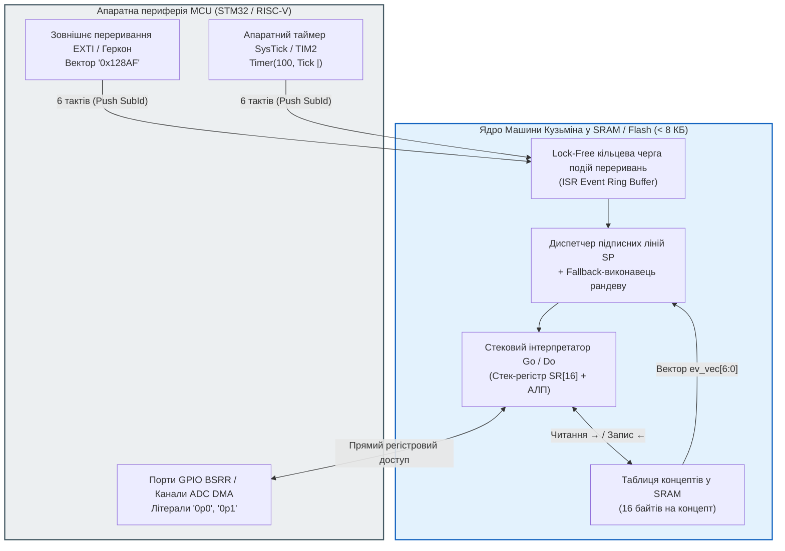

# Архітектура компактного рантайму Машини Кузьміна для мікроконтролерів (STM32 Cortex-M та RISC-V)

> **Внутрішня робоча копія, не публікація; міграція не є науковим прийняттям.** Перенесено з `drafts@774d575:KuzminMachine/03-engineering-software/Kuzmin-Machine-Embedded-MCU-Runtime-Architecture-UA.md` 2026-11-10, Issue #84. Міграція не підтверджує тверджень, прогнозів чи самоприсвоєних статусів. Незмінний оригінал і SHA-256 — у реєстрі міграції.


> [!IMPORTANT]
> **Призначення документа:** Цей інженерний документ визначає архітектуру та містить еталонний код на C99 (`no-OS / bare-metal`) **Вбудованого виконавчого ядра Машини Кузьміна для мікроконтролерів (Kuzmin Machine Embedded MCU Runtime)** сімейств STM32 (ARM Cortex-M0+/M4/M7), RP2040 та RISC-V (CH32V / ESP32-C3). Документ деталізує, як без операційної системи та з обсягом флеш-пам'яті менше **8 КБ** реалізувати таблицю концептів, комбінаційне обчислення предикатів `::`, фазову модель Великої крапки (`•`), пряме відображення апаратних літералів `"0p0"` на регістри GPIO/ADC та безджитерову маршрутизацію векторів переривань `"0x128AF"` у події концептів.

---

## Зміст

1. [Особливості виконання Машини Кузьміна на ресурсообмежених мікроконтролерах](#1-особливості-виконання-машини-кузьміна-на-ресурсообмежених-мікроконтролерах)
2. [Розподіл пам'яті Flash та SRAM: компактне представлення концептів і підписних ліній](#2-розподіл-памяті-flash-та-sram-компактне-представлення-концептів-і-підписних-ліній)
3. [Апаратна абстракція портів (`"0p0"`, `"0p1"`) та векторів переривань (`"0x128AF"`)](#3-апаратна-абстракція-портів-0p0-0p1-та-векторів-переривань-0x128af)
4. [Одноядерний та двоядерний (STM32H7 / RP2040) режими виконання з автоматичним Fallback](#4-одноядерний-та-двоядерний-stm32h7--rp2040-режими-виконання-з-автоматичним-fallback)
5. [Повна еталонна реалізація ядра Машини Кузьміна на C99 (`km_mcu_runtime.h` та `km_mcu_runtime.c`)](#5-повна-еталонна-реалізація-ядра-машини-кузьміна-на-c99-km_mcu_runtimeh-та-km_mcu_runtimec)

---

## 1. Особливості виконання Машини Кузьміна на ресурсообмежених мікроконтролерах

Значна частина канонічних прикладів високорівневої мови Машини Кузьміна — контролер одометрії з герконовим давачем (`"0x128AF" = Tick |`), цифровий лічильник електроенергії (`Class Example` з портами `"0p0"` та `"0p1"`) і автономний сторож діапазону (`Class Control`) — призначена для безпосередньої роботи у промисловій автоматиці на мікроконтролерах.

На відміну від традиційних RTOS (FreeRTOS, Zephyr), де кожен потік потребує власного стека розміром $`512 \dots 2048`$ байтів і витрачає сотні тактів на перемикання контексту (`PendSV`), рантайм Машини Кузьміна на MCU працює за принципом **атомарного конвеєра коротких підписних ліній (`Run-to-Completion Micro-Lines`)**:

* **Відсутність стеків потоків:** усі підписні лінії виконуються на фіксованому апаратно-регістровому стеку $`SR`$ глибиною 16 слів (128 байтів у SRAM або безпосередньо в регістрах `r4..r11` ядра ARM Cortex-M).
* **Миттєва реакція на переривання (`Zero-Jitter ISR-to-Event`):** апаратний обробник переривання таймера або зовнішнього виводу (`EXTI_IRQHandler`) за **6 машинних інструкцій** записує ідентифікатор цільової підписки у кільцевий буфер подій без жодного системного виклику ОС.
* **Бит-орієнтована оцінка подій `::`:** усі 7 предикатів властивостей даних (`_`, `Null`, `Positive`, `Negative`, `Even`, `Uneven`, `~`) обчислюються без розгалужень (`branchless C`) за допомогою побітових операцій над регістрами процесора.



---

## 2. Розподіл пам'яті Flash та SRAM: компактне представлення концептів і підписних ліній

Для роботи на мікроконтролерах із обсягом оперативної пам'яті від **4 КБ до 64 КБ** (наприклад, STM32F030, STM32G4, CH32V003) структури даних МК поділяються на **незмінні таблиці у Flash (ROM)** та **динамічний стан у SRAM**:

| Структура даних | Розміщення | Розмір одного запису | Призначення полів |
| :--- | :---: | :---: | :--- |
| **`km_concept_ram_t`** | `SRAM` | **16 байтів** | `val_cur` (32/64 біти), `val_prev` (32/64 біти), `type_size_flags` (16 біт: тип, розмір, прапорець `_` та прапорець Великої крапки `•`), `sub_head_idx` (16 біт). |
| **`km_sub_rom_t`** | `Flash` (або `SRAM` для `Subscribe`) | **8 байтів** | `owner_cid` (16 біт), `phase_and_mask` (16 біт: фаза `•` + маска подій `ev_vec`), `line_start_pc` (16 біт), `line_len` (8 біт), `else_sub_id` (8 біт). |
| **`km_instr_rom_t`** | `Flash` | **4 байти** | 32-бітна інструкція лінії $`O`$ (повністю бінарно сумісна з форматом `.kmc` та FPGA PYNQ-Z1!). |

Завдяки цьому 256 живих концептів займають у SRAM лише **$256 \times 16 = 4096\text{ байтів}$ (4 КБ)**!

---

## 3. Апаратна абстракція портів (`"0p0"`, `"0p1"`) та векторів переривань (`"0x128AF"`)

### 3.1. Таблиця прив'язки фізичних виводів (`"0p0"`)

Коли компілятор зустрічає концепт із типом `└─` (`TypePin`, код `12`) або рядковий літерал порту `"<Порт>p<Вивід>"`, він кодує його у 16-бітний дескриптор апаратного виводу:

$$
\mathrm{HwPinId}_{16} = \mathtt{0x8000} \enspace\mid\enspace \big(\mathrm{ControllerIdx}[6:0] \ll 8\big) \enspace\mid\enspace \mathrm{PinIdx}[7:0]
$$

* На мікроконтролері STM32 виконання `Go "0p1" →` викликає вбудовану функцію `km_hal_pin_read(ctrl, pin)`, яка за 1 такт читає регістр `GPIOx->IDR` або останнє значення з буфера `ADC_DMA_Buffer[pin]`.
* Виконання `Go "0p1" ←` або `++Out` викликає `km_hal_pin_write(ctrl, pin, val)`, яка атомарно виставляє або інвертує біт через регістр `GPIOx->BSRR`.

### 3.2. Прив'язка векторів переривань (`"0x128AF" = Tick |`)

Інструкція конструктора `"0x128AF" = Tick |` реєструє ідентифікатор концепту `Tick` у таблиці швидкого перенаправлення переривань `km_isr_concept_map[IRQ_NUM]`. Коли спрацьовує апаратне переривання, стандартний вектор таблиці NVIC виконує лише постановку події `ON_EXEC` (`|`) у безблокувальну чергу.

---

## 4. Одноядерний та двоядерний (STM32H7 / RP2040) режими виконання з автоматичним Fallback

Бінарний образ `.kmc`, згенерований компілятором із розщепленням виразів між стеками `SR1` та `SR2`, виконується на мікроконтролерах **без жодних змін**:
* **На одноядерних MCU (STM32F4 / G4 / RISC-V):** коли інтерпретатор зустрічає інструкцію запиту рандеву `Go SR2 → (slot = s)` і бачить, що допоміжна лінія $`O_2`$ ще не обчислена, він автоматично використовує другий регістровий стек `sr_bank[1]` у пам'яті SRAM, виконує допоміжну лінію $`O_2`$ за процедурою **Fallback** і повертає результат на вершину основного стека `sr_bank[0]`.
* **На двоядерних MCU (RP2040 Dual Cortex-M0+ або STM32H745 Cortex-M7 + Cortex-M4):** допоміжна лінія $`O_2`$ передається другому ядру через апаратну чергу між'ядерного FIFO (`SIO_FIFO` у RP2040 або `HSEM` у STM32H7), забезпечуючи фізичний паралелізм.

---

## 5. Повна еталонна реалізація ядра Машини Кузьміна на C99 (`km_mcu_runtime.h` та `km_mcu_runtime.c`)

Наведений нижче код написаний на чистому стандарті **ISO C99** без динамічної алокації пам'яті (`malloc` заборонений — відповідно до правила MISRA C щодо динамічної пам'яті; повну відповідність MISRA C інструментом не перевірено для відповідальних вбудованих систем). Його можна скомпілювати як для STM32 (`arm-none-eabi-gcc`), так і на хост-комп'ютері (`gcc -std=c99 -O2`) для перевірки:

```c
/* ============================================================================
 * Компактне виконавче ядро Машини Кузьміна для мікроконтролерів (C99 Bare-Metal)
 * Файл: km_mcu_runtime.c (Самодостатня збірка з тестом лічильника Class Example)
 * ============================================================================ */

#include <stdint.h>
#include <stdbool.h>
#include <stdio.h>

/* Конфігурація статичних пулів пам'яті SRAM (налаштовується під конкретний MCU) */
#define KM_MAX_CONCEPTS       64u
#define KM_MAX_SUBSCRIPTIONS  128u
#define KM_MAX_INSTRUCTIONS   512u
#define KM_SR_STACK_DEPTH     16u
#define KM_EVENT_QUEUE_SIZE   64u

/* Класи 32-бітних інструкцій лінії O (сумісні з форматом .kmc та FPGA PYNQ-Z1) */
#define KM_OPC_NOP            0x0u
#define KM_OPC_GO             0x1u
#define KM_OPC_DO             0x2u
#define KM_OPC_IMM            0x3u
#define KM_OPC_EXIT           0x5u

/* Під-операції Go (Біти 27:24) */
#define KM_GO_EXEC            0x0u  /* "|" : Виконати підписки концепту */
#define KM_GO_WRITE           0x1u  /* "←" : Витягти з SR і записати в концепт */
#define KM_GO_READ            0x2u  /* "→" : Зчитати концепт на вершину SR */
#define KM_GO_ADDR            0x3u  /* ":" : Адреса / Ініціалізація */

/* Прапорці модифікації запису (Біти 23:16) */
#define KM_FLAG_SELF_SUPPRESS 0x01u /* Запис у себе без повторної події */
#define KM_FLAG_SILENT_RESET  0x02u /* Тихе скидання (= _ val) */
#define KM_FLAG_RENDEZVOUS    0x04u /* Міжстековий обмін SR1 <-> SR2 */

/* Під-операції АЛП Do (0..12 за авторським словником) */
typedef enum {
    KM_DO_ADD      = 0,  /* +  */
    KM_DO_SUB      = 1,  /* -  */
    KM_DO_MUL      = 2,  /* *  */
    KM_DO_DIV      = 3,  /* /  */
    KM_DO_POW      = 4,  /* ^  */
    KM_DO_MOD_INC  = 5,  /* '  */
    KM_DO_BIT_AND  = 6,  /* &  */
    KM_DO_BIT_OR   = 7,  /* Or */
    KM_DO_LOG_NOT  = 8,  /* ¬  */
    KM_DO_BIT_XOR  = 9,  /* #  */
    KM_DO_SHL      = 10, /* <  */
    KM_DO_SHR      = 11, /* >  */
    KM_DO_BIT_INV  = 12  /* ~  */
} km_do_op_t;

/* Бітові маски 7 базових подій властивостей даних '::' */
#define KM_EV_ABSENT          (1u << 0) /* :: _        */
#define KM_EV_NULL            (1u << 1) /* :: Null     */
#define KM_EV_POSITIVE        (1u << 2) /* :: Positive */
#define KM_EV_NEGATIVE        (1u << 3) /* :: Negative */
#define KM_EV_EVEN            (1u << 4) /* :: Even     */
#define KM_EV_UNEVEN          (1u << 5) /* :: Uneven   */
#define KM_EV_CHANGED         (1u << 6) /* :: ~        */
#define KM_EV_ALWAYS          (1u << 7) /* Безумовна підписка фази */

/* Фази життєвого циклу Великої крапки (•) */
typedef enum {
    KM_PHASE_PRE_WRITE   = 0, /* [• : w1] До фіксації запису */
    KM_PHASE_POST_CHANGE = 1, /* [: • w2] Після зміни стану  */
    KM_PHASE_ON_READ     = 2, /* [→ • w2] Після читання      */
    KM_PHASE_ON_EXEC     = 3  /* [| w]    Безумовне виконання */
} km_phase_t;

/* Дескриптор концепту в SRAM (16 байтів) */
typedef struct {
    int32_t  val_cur;         /* Поточне значення концепту */
    int32_t  val_prev;        /* Попереднє значення (для події :: ~) */
    uint8_t  type_tok;        /* Код типу 0..15 */
    uint8_t  size_bytes;      /* Розмір 1, 2, 4 байти */
    uint8_t  is_undef;        /* 1 = стан '_' (відсутнє значення) */
    uint8_t  big_dot_ok;      /* Прапорець '•': 0 = '!' (True), 1 = '¬' (False) */
    uint16_t first_sub_idx;   /* Індекс першої підписки концепту */
    uint16_t sub_count;       /* Кількість підписок концепту */
} km_concept_ram_t;

/* Дескриптор підписної лінії (8 байтів у Flash/SRAM) */
typedef struct {
    uint16_t owner_cid;       /* Концепт-власник */
    uint8_t  phase;           /* Фаза Великої крапки (km_phase_t) */
    uint8_t  trigger_mask;    /* Маска подій KM_EV_* */
    uint16_t line_start_pc;   /* Початковий індекс у масиві інструкцій O */
    uint16_t line_len;        /* Кількість інструкцій у лінії O */
} km_sub_desc_t;

/* Глобальний контекст виконавчого ядра МК на мікроконтролері */
typedef struct {
    km_concept_ram_t concepts[KM_MAX_CONCEPTS];
    km_sub_desc_t    subs[KM_MAX_SUBSCRIPTIONS];
    uint32_t         code_o[KM_MAX_INSTRUCTIONS];
    uint16_t         event_queue[KM_EVENT_QUEUE_SIZE];
    uint16_t         eq_head;
    uint16_t         eq_tail;
    uint16_t         eq_count;
    int32_t          sr_stack[KM_SR_STACK_DEPTH];
    uint8_t          sr_sp;
    uint32_t         total_cycles;
} km_mcu_vm_t;

/* Пакування 32-бітної інструкції лінії O */
static inline uint32_t km_pack_instr(uint8_t opc, uint8_t sub_op, uint8_t flags, uint16_t operand) {
    return ((uint32_t)(opc & 0x0Fu) << 28)
         | ((uint32_t)(sub_op & 0x0Fu) << 24)
         | ((uint32_t)flags << 16)
         | (uint32_t)operand;
}

/* Безрозгалужувальне (branchless) обчислення 7-бітного вектора подій '::' */
static inline uint8_t km_eval_event_vector(const km_concept_ram_t *c) {
    if (c->is_undef) {
        return KM_EV_ABSENT | KM_EV_ALWAYS;
    }
    uint8_t vec = KM_EV_ALWAYS;
    int32_t v = c->val_cur;
    if (v == 0)      vec |= KM_EV_NULL;
    else if (v > 0)  vec |= KM_EV_POSITIVE;
    else             vec |= KM_EV_NEGATIVE;

    if ((v & 1) == 0) vec |= KM_EV_EVEN;
    else              vec |= KM_EV_UNEVEN;

    if (v != c->val_prev) vec |= KM_EV_CHANGED;
    return vec;
}

/* Постановка підписки в кільцеву чергу виконання (викликається також із переривань ISR) */
static inline void km_enqueue_sub(km_mcu_vm_t *vm, uint16_t sub_idx) {
    if (vm->eq_count < KM_EVENT_QUEUE_SIZE) {
        vm->event_queue[vm->eq_tail] = sub_idx;
        vm->eq_tail = (uint16_t)((vm->eq_tail + 1u) % KM_EVENT_QUEUE_SIZE);
        vm->eq_count++;
    }
}

/* Попереднє оголошення виконавця однієї підписної лінії */
static void km_exec_subscription_line(km_mcu_vm_t *vm, uint16_t sub_idx);

/* Запис нового значення у концепт (Go X ←) із фазами Великої крапки '•' */
void km_write_concept(km_mcu_vm_t *vm, uint16_t cid, int32_t new_val, uint8_t flags) {
    km_concept_ram_t *c = &vm->concepts[cid];

    /* 1. Якщо встановлено прапорець придушення саморекурсії або тихого скидання (= _),
     *    модифікуємо комірку SRAM без генерації каскадних подій */
    if ((flags & (KM_FLAG_SELF_SUPPRESS | KM_FLAG_SILENT_RESET)) != 0u) {
        c->val_prev = c->val_cur;
        c->val_cur  = new_val;
        c->is_undef = 0u;
        return;
    }

    c->big_dot_ok = 0u; /* 0 = '!' (Істина за конвенцією МК) */

    /* 2. Виконуємо пре-фазу Великої крапки (KM_PHASE_PRE_WRITE), якщо вона є */
    bool has_pre_write = false;
    for (uint16_t i = 0; i < c->sub_count; i++) {
        uint16_t s_idx = (uint16_t)(c->first_sub_idx + i);
        if (vm->subs[s_idx].phase == KM_PHASE_PRE_WRITE) {
            has_pre_write = true;
            /* Кладемо вхідне значення '•' на вершину стека SR для пре-фільтра */
            vm->sr_stack[vm->sr_sp++] = new_val;
            km_exec_subscription_line(vm, s_idx);
        }
    }

    if (!has_pre_write) {
        c->val_prev = c->val_cur;
        c->val_cur  = new_val;
        c->is_undef = 0u;
    }

    /* 3. Якщо Велика крапка не була заблокована (big_dot_ok == 0 -> '!'),
     *    оцінюємо вектор подій ev_vec і ставимо пост-підписки в чергу */
    if (c->big_dot_ok == 0u) {
        uint8_t ev_vec = km_eval_event_vector(c);
        for (uint16_t i = 0; i < c->sub_count; i++) {
            uint16_t s_idx = (uint16_t)(c->first_sub_idx + i);
            if (vm->subs[s_idx].phase == KM_PHASE_POST_CHANGE &&
                (vm->subs[s_idx].trigger_mask & ev_vec) != 0u) {
                km_enqueue_sub(vm, s_idx);
            }
        }
    }
}

/* Читання значення концепту (Go X →) із підтримкою пост-очищення (→ • w2) */
int32_t km_read_concept(km_mcu_vm_t *vm, uint16_t cid) {
    km_concept_ram_t *c = &vm->concepts[cid];
    int32_t result = c->val_cur;

    for (uint16_t i = 0; i < c->sub_count; i++) {
        uint16_t s_idx = (uint16_t)(c->first_sub_idx + i);
        if (vm->subs[s_idx].phase == KM_PHASE_ON_READ) {
            km_exec_subscription_line(vm, s_idx);
        }
    }
    return result;
}

/* Виконання однієї підписної лінії O над стек-регістром SR */
static void km_exec_subscription_line(km_mcu_vm_t *vm, uint16_t sub_idx) {
    const km_sub_desc_t *sub = &vm->subs[sub_idx];
    uint16_t pc_end = (uint16_t)(sub->line_start_pc + sub->line_len);

    for (uint16_t pc = sub->line_start_pc; pc < pc_end; pc++) {
        uint32_t word    = vm->code_o[pc];
        uint8_t  opc     = (uint8_t)((word >> 28) & 0x0Fu);
        uint8_t  sub_op  = (uint8_t)((word >> 24) & 0x0Fu);
        uint8_t  flags   = (uint8_t)((word >> 16) & 0xFFu);
        uint16_t operand = (uint16_t)(word & 0xFFFFu);
        vm->total_cycles++;

        if (opc == KM_OPC_IMM) {
            int16_t imm_s16 = (int16_t)operand;
            vm->sr_stack[vm->sr_sp++] = (int32_t)imm_s16;
        } else if (opc == KM_OPC_GO) {
            if (sub_op == KM_GO_READ) {
                vm->sr_stack[vm->sr_sp++] = km_read_concept(vm, operand);
            } else if (sub_op == KM_GO_WRITE) {
                int32_t val = vm->sr_stack[--vm->sr_sp];
                km_write_concept(vm, operand, val, flags);
            } else if (sub_op == KM_GO_EXEC) {
                km_concept_ram_t *target = &vm->concepts[operand];
                for (uint16_t i = 0; i < target->sub_count; i++) {
                    uint16_t s_id = (uint16_t)(target->first_sub_idx + i);
                    if (vm->subs[s_id].phase == KM_PHASE_ON_EXEC) {
                        km_enqueue_sub(vm, s_id);
                    }
                }
            }
        } else if (opc == KM_OPC_DO) {
            if (sub_op == KM_DO_MOD_INC) {
                /* Унарний інкремент Do ' на вершині стека SR */
                vm->sr_stack[vm->sr_sp - 1u] += 1;
            } else {
                int32_t rhs = vm->sr_stack[--vm->sr_sp];
                int32_t lhs = vm->sr_stack[--vm->sr_sp];
                int32_t res = 0;
                switch ((km_do_op_t)sub_op) {
                    case KM_DO_ADD:     res = lhs + rhs; break;
                    case KM_DO_SUB:     res = lhs - rhs; break;
                    case KM_DO_MUL:     res = lhs * rhs; break;
                    case KM_DO_DIV:     res = (rhs != 0) ? (lhs / rhs) : 0; break;
                    case KM_DO_BIT_AND: res = lhs & rhs; break;
                    case KM_DO_BIT_OR:  res = lhs | rhs; break;
                    case KM_DO_BIT_XOR: res = lhs ^ rhs; break;
                    case KM_DO_SHL:     res = lhs << rhs; break;
                    case KM_DO_SHR:     res = lhs >> rhs; break;
                    default:            res = lhs; break;
                }
                vm->sr_stack[vm->sr_sp++] = res;
            }
        } else if (opc == KM_OPC_EXIT) {
            break;
        }
    }
}

/* Головний диспетчер черги подій (викликається у фоновому циклі main або перед WFI) */
void km_run_until_idle(km_mcu_vm_t *vm) {
    while (vm->eq_count > 0u) {
        uint16_t sub_idx = vm->event_queue[vm->eq_head];
        vm->eq_head = (uint16_t)((vm->eq_head + 1u) % KM_EVENT_QUEUE_SIZE);
        vm->eq_count--;
        km_exec_subscription_line(vm, sub_idx);
    }
}

/* ============================================================================
 * ТЕСТОВА ПЕРЕВІРКА ЯДРА MCU НА ПРИКЛАДІ ІНТЕГРАТОРА НАПРУГИ ТА ЛІЧИЛЬНИКА ТАКТІВ
 * ============================================================================ */
int main(void) {
    km_mcu_vm_t vm = {0};

    /* Концепт #1: Voltage (Інтегратор зі скиданням у 0 після читання)
     * Пре-запис (←): Go Voltage → ; Do + ; Go Voltage ← [SELF_SUPPRESS]
     * Пост-читання (→): Imm 0 ; Go Voltage ← [SILENT_RESET] */
    vm.concepts[1].first_sub_idx = 0;
    vm.concepts[1].sub_count     = 2;

    vm.subs[0] = (km_sub_desc_t){ .owner_cid = 1, .phase = KM_PHASE_PRE_WRITE, .trigger_mask = KM_EV_ALWAYS, .line_start_pc = 0, .line_len = 3 };
    vm.code_o[0] = km_pack_instr(KM_OPC_GO, KM_GO_READ,  0, 1);
    vm.code_o[1] = km_pack_instr(KM_OPC_DO, KM_DO_ADD,   0, 0);
    vm.code_o[2] = km_pack_instr(KM_OPC_GO, KM_GO_WRITE, KM_FLAG_SELF_SUPPRESS, 1);

    vm.subs[1] = (km_sub_desc_t){ .owner_cid = 1, .phase = KM_PHASE_ON_READ, .trigger_mask = KM_EV_ALWAYS, .line_start_pc = 3, .line_len = 2 };
    vm.code_o[3] = km_pack_instr(KM_OPC_IMM, 0, 0, 0);
    vm.code_o[4] = km_pack_instr(KM_OPC_GO,  KM_GO_WRITE, KM_FLAG_SILENT_RESET, 1);

    /* Надсилаємо 5 відліків АЦП по 220 В у концепт Voltage (#1) */
    for (int i = 0; i < 5; i++) {
        km_write_concept(&vm, 1, 220, 0);
        km_run_until_idle(&vm);
    }

    int32_t integrated_u = km_read_concept(&vm, 1);
    int32_t after_read_u = vm.concepts[1].val_cur;

    printf("[KM MCU C99 Runtime] Накопичена сума Voltage за 5 тактів = %d В\n", (int)integrated_u);
    printf("[KM MCU C99 Runtime] Стан Voltage одразу після читання (→) = %d В | Виконано інструкцій: %u\n",
           (int)after_read_u, (unsigned)vm.total_cycles);
    return (integrated_u == 1100 && after_read_u == 0) ? 0 : 1;
}
```
