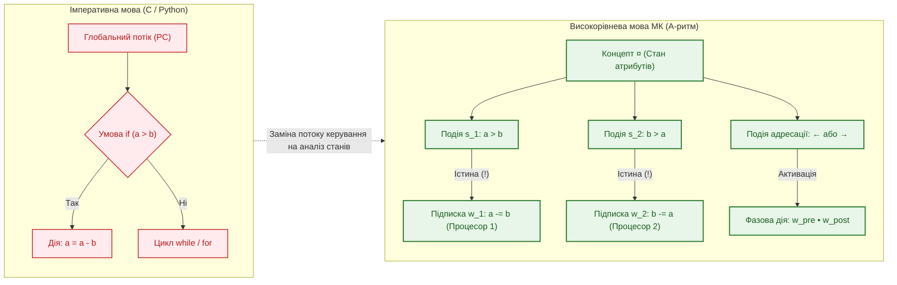
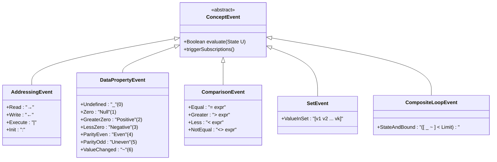
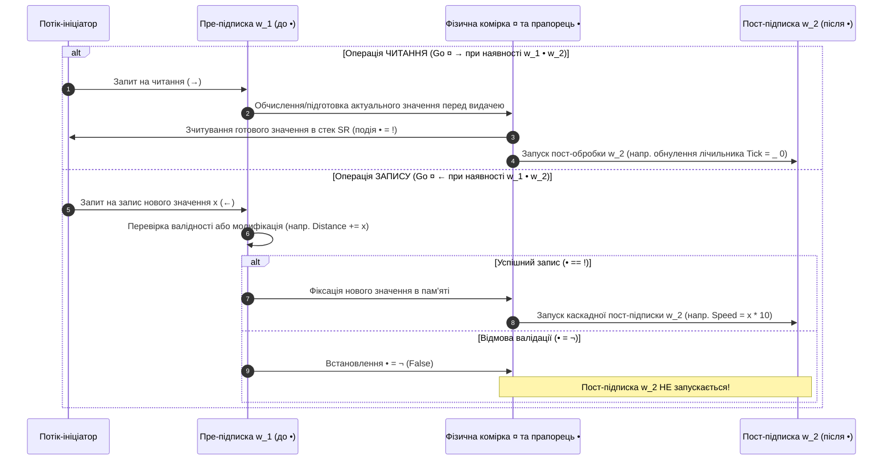
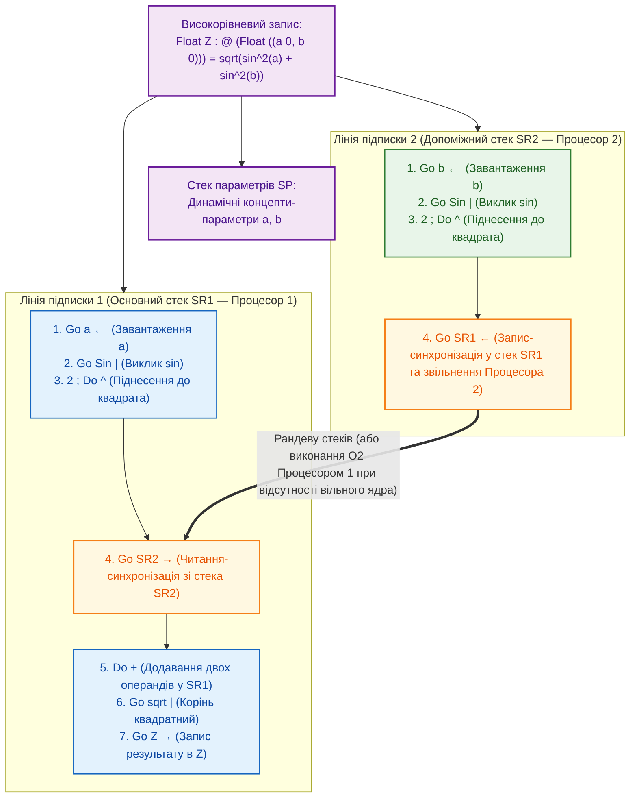

# Високорівнева мова програмування Машини Кузьміна: формальна специфікація синтаксису, семантики та правил трансляції

> **Внутрішня робоча копія, не публікація; міграція не є науковим прийняттям.** Перенесено з `drafts@774d575:KuzminMachine/03-engineering-software/Kuzmin-Machine-High-Level-Language-Specification-UA.md` 2026-11-10, Issue #84. Міграція не підтверджує тверджень, прогнозів чи самоприсвоєних статусів. Незмінний оригінал і SHA-256 — у реєстрі міграції.


> **Предмет документа:** повний науково-інженерний опис високорівневої мови програмування **Машини Кузьміна (МК)** (автор концепції та мови — Михайло Кузьмін). Документ систематизує філософію мови, лексичний алфавіт, систему типів, мета-визначення мови самої в собі, формальну граматику EBNF, семантику подій і підписок, правила трансляції у низькорівневий стековий код (`Go` / `Do`), а також містить анотований корпус еталонних програм. Канонічний опис абстрактного синтаксису компілятора (ASDL) та бінарного протоколу в міжнародному стандарті ITU-T X.680 (ASN.1) наведено у парному документі: [Формальна специфікація мови та протоколу Машини Кузьміна в нотації абстрактного синтаксису (ASN / ASDL та ITU-T X.680 ASN.1)](../../theory/asn.md).

---

## Зміст

1. [Філософія та обчислювальна парадигма мови](#1-філософія-та-обчислювальна-парадигма-мови)
2. [Лексична структура, алфавіт та система позначень](#2-лексична-структура-алфавіт-та-система-позначень)
3. [Система типів даних та самовизначення мови (Meta-Model)](#3-система-типів-даних-та-самовизначення-мови-meta-model)
4. [Формальна синтаксична граматика (EBNF)](#4-формальна-синтаксична-граматика-ebnf)
5. [Семантика конструкцій високорівневої мови](#5-семантика-конструкцій-високорівневої-мови)
   - [5.1. Оголошення концептів та групування за типами](#51-оголошення-концептів-та-групування-за-типами)
   - [5.2. Параметри (`@`), методи (`|`) та повернення значень](#52-параметри--методи--та-повернення-значень)
   - [5.3. Система подій: адресаційні, предикатні та групові тригери](#53-система-подій-адресаційні-предикатні-та-групові-тригери)
   - [5.4. Фазовий оператор «Велика крапка» (`•`) та захист від зациклення](#54-фазовий-оператор-велика-крапка--та-захист-від-зациклення)
   - [5.5. Групи, масиви, колекції та функції вищого порядку](#55-групи-масиви-колекції-та-функції-вищого-порядку)
   - [5.6. Класи (`Class`), конструктори та автономне середовище виконання](#56-класи-class-конструктори-та-автономне-середовище-виконання)
6. [Трансляція високорівневої мови у стековий асемблер МК (`Go` / `Do`)](#6-трансляція-високорівневої-мови-у-стековий-асемблер-мк-go--do)
7. [Еталонний корпус програм високорівневою мовою МК](#7-еталонний-корпус-програм-високорівневою-мовою-мк)
8. [Порівняльний аналіз із відомими мовами програмування](#8-порівняльний-аналіз-із-відомими-мовами-програмування)
9. [Невизначеності синтаксису та відкриті питання до автора мови](#9-невизначеності-синтаксису-та-відкриті-питання-до-автора-мови)

---

## 1. Філософія та обчислювальна парадигма мови

Високорівнева мова Машини Кузьміна — це **подієво-реактивна, концептно-орієнтована мова паралельного програмування**, спроєктована спеціально для багатопроцесорного виконання без традиційного імперативного лічильника команд глобального потоку.

### 1.1. Відмова від імперативного потоку керування («А-ритм» проти алгоритму)

У класичних фоннейманівських мовах (C, Pascal, Java, Python) програма задає **лінійну послідовність інструкцій**, де переходи здійснюються умовними операторами (`if-else`, `switch`) та циклами (`for`, `while`).

У мові Машини Кузьміна **немає операторів `if`, `else`, `for`, `while`, `switch` або `goto`**. Замість них програма описується як статично або динамічно сформований простір **концептів** (активних комірок пам'яті та об'єктів), кожен з яких містить:
1. **Власний стан** (множину значень атрибутів);
2. **Декларації подій** (логічні предикати нульового порядку над станом концепту або фактами звернення до нього);
3. **Підписки** (дії та вирази, що автоматично й паралельно запускаються на вільних процесорах щоразу, коли відповідна подія стає істинною).



### 1.2. Ключові принципи дизайну мови

1. **Тотальна концептна уніфікація (Гомоіконічність станів):**
   Усе в мові — примітивний тип даних (`Byte`, `Float`), арифметична операція (`Do +`), змінна, масив, функція, клас пристрою або апаратний вивід (контакт) мікроконтролера — є **Концептом** і описується за єдиним синтаксичним шаблоном.
2. **Активаційна семантика звернень:**
   Будь-яке звернення до концепту має один із чотирьох явних видів адресації:
   - читання (`→`);
   - запис (`←`);
   - виконання (`|`);
   - ініціалізація / створення екземпляра (`:`).
   Сам факт адресації є подією, на яку концепт може мати власні підписки (перехоплювачі).
3. **Неявний та явний паралелізм на рівні синтаксису:**
   - Усі події одного концепту при його активації перевіряються **одночасно** (оскільки перевірка предиката не змінює стан).
   - Усі підписки істинних подій та всі незалежні оператори в групових дужках `(...)`, `[...]`, `{...}` запускаються **паралельно** на вільних процесорах.
   - Складні алгебраїчні вирази (наприклад, $\sqrt{\sin^2(a) + \sin^2(b)}$) автоматично розбиваються компілятором на паралельні **лінії підписок** зі стековою синхронізацією.
4. **Дворівнева прозорість (HLL $\leftrightarrow$ Стековий Асемблер):**
   Мова поєднує високорівневу математичну нотацію (інфіксні вирази, функції вищого порядку, класи) з прямим відображенням у низькорівневі інструкції віртуальної/апаратної машини (`Go` та `Do`). Більше того, низькорівневі інструкції `Go` можуть використовуватися безпосередньо всередині високорівневого коду.

---

## 2. Лексична структура, алфавіт та система позначень

Мова Машини Кузьміна використовує компактний символьний алфавіт, де спеціальні математичні та типографські знаки виконують роль ключових слів.

### 2.1. Спеціальні символи та оператори мови

| Символ | Назва в термінології МК | Синтаксична роль у високорівневій мові | Семантика виконання |
| :---: | :--- | :--- | :--- |
| **`¤`** | Поточний концепт | Посилання на себе (`self` / `this`) або поточну комірку | Адресує активний концепт; допускає адресну арифметику: `¤ - 1`, `¤ + 1`, `¤ + d` |
| **`→`** | Адресація читання | Оператор читання (`Go x →`) або оголошення події читання в тілі концепту | Вичитує значення концепту в стек або запускає підписку при спробі читання |
| **`←`** | Адресація запису | Оператор запису (`Go x ←`) або оголошення події запису в тілі концепту | Записує значення в концепт або перехоплює запис підпискою |
| **`\|`** | Адресація виконання | Ознака методу/функції/конструктора або виклик на виконання (`Tick \|`) | Активує обчислювальну підписку концепту (аналог виклику функції) |
| **`:`** | Адресація ініціалізації | Ознака тіла класу/атрибутів або оператор створення екземпляра (`Example : (1)`) | Виділяє пам'ять у просторі концептів і клонує структуру прототипу/класу |
| **`•`** | Велика крапка (Big Dot) | Булева властивість концепту та фазовий роздільник підписок $`w_1 \bullet w_2`$ | Розділяє пре-підписку $`w_1`$ (до читання/запису) і пост-підписку $`w_2`$ (після факту `•`) |
| **`@`** | Маркер параметрів | Оголошення вхідних параметрів підписки, методу або конструктора | Виділяє кадр у стеку параметрів $`SP`$ для переданих аргументів |
| **`_`** | Невизначеність (Порожнеча) | Початкове невизначене значення, тип `Void`, або подія «відсутність значення / ініціалізація» | Позначає стан, коли концепт створено, але конкретне значення ще не присвоєно |
| **`~`** | Зміна / Порівняння | Унарний префікс події зміни значення (`~ Change`) або оператор порівняння | Генерує подію щоразу, коли значення концепту змінюється |
| **`?`** | Булевий тип / Подія | Ключовий символ логічного типу (`? Change`) або інверсії перевірки події | Приймає два стани: `!` (Істина) або `¬` (Хиба) |
| **`!`** | Істина | Булевий літерал істинності (код `0` у системі `Operation`) | Позначає активний/успішний стан булевого концепту чи властивості `•` |
| **`¬`** | Хиба / Заперечення | Булевий літерал хибності (код `1`) або унарний оператор логічного заперечення | Інвертує булевий вираз або скидає прапорець успішності (`• = ¬`) |
| **`'`** | Інкремент / Коментар | У системі `Do`: унарна операція додавання одиниці ($`+1`$). У тексті з `#`: початок коментаря | Збільшує значення в стеку на 1 (`Do '`) |
| **`#`** | Унарний мінус / Коментар | У системі `Do`: зміна знака числа. У парі `' # ... »`: маркер коментаря | Арифметична інверсія знака (`Do #`) |

### 2.2. Синтаксис коментарів

Авторська нотація мови використовує оригінальний формат однорядкових і вбудованих коментарів, що відкриваються комбінацією апострофа і знака решітки `' #` (або `# '`, `# «`) і закриваються правою кутовою лапкою `»` (або символом абзацу `¶`):

```text
Byte ThickNess _     ' # Стани від 0 до 255 »
Int32 A [ # 'Коментар» ]    ' # Визначення динамічного масиву A »
Int32 B [ # 'Коментар» 4] (2, 5, 4, 3)  ' # Визначення масиву B з чотирьох елементів »
```

> [!TIP]
> Завдяки наявності завершального маркера `»` коментарі в мові МК можуть безпечно вбудовуватися **всередину синтаксичних конструкцій** (наприклад, між дужками розмірності масиву `[ # 'Коментар» 4]`), не порушуючи синтаксичний розбір рядка аналізатором.

### 2.3. Літерали та апаратно-адресні рядки

У високорівневій мові розрізняються чотири класи літералів:

1. **Цілочислові та дійсні сталі (константи):** `0`, `1`, `10`, `600`, `-1`, `3.4*10^38`.
2. **Логічні та спеціальні сталі:** `!` (Істина), `¬` (Хиба), `_` (невизначено / порожньо).
3. **Апаратні адресні літерали в лапках (`"..."`):**
   - **Шістнадцяткові фізичні адреси пам'яті / векторів переривань:**
     `"0x128AF"` — пряма прив'язка концепту або методу до комірки фізичної пам'яті або лінії переривання мікроконтролера:
     ```text
     "0x128AF" = Tick |   ' # У комірку переривання виводу геркона заносимо адресу лічильника »
     ```
   - **Літерали апаратних портів введення-виведення:**
     Формат `"<НомерПорту>p<НомерВиводу>"`, наприклад `"0p1"` (Порт 0, Вивід 1) або `"0p0"` (Порт 0, Вивід 0):
     ```text
     Voltage = "0p1"      ' # Зчитування поточного значення з апаратного виводу 1 порту 0 »
     Electricity = "0p0"  ' # Зчитування поточного значення з апаратного виводу 0 порту 0 »
     ```
4. **Групові літерали (кортежі/масиви значень):**
   Перелік значень через кому в круглих, фігурних або квадратних дужках: `(2, 5, 4, 3)`.

---

## 3. Система типів даних та самовизначення мови (Мета-модель)

Однією з найоригінальніших рис високорівневої мови Машини Кузьміна є те, що **система типів даних і система інструкцій описуються цією ж самою мовою** через базовий мета-концепт `Concept`.

### 3.1. Самовизначення кореневих концептів `Concept`, `Type` та `Operation`

Нижче наведено канонічний мета-опис ядра мови:

```text
Concept {
    Type : Token Size _
    Operation
}

Type {
    "_"     # 'Відсутність або будь-яке значення.»          Size 0  : Token "" _
    Token   # 'Значення від 0 до 15.»                       Size 0  : Token "" _
    Byte    # 'Ціле значення без знака. Від 0 до 255.»      Size 1  : Byte  "" _
    Int8    # 'Ціле значення зі знаком. Від -128 до 127.»   Size 1  : Int8  "" _
    U16     # 'Ціле без знака. 2 байти (0 … 65 535).»       Size 3  : U16   "" _
    Int16   # 'Ціле зі знаком. 2 байти (-32768 … 32767).»   Size 3  : Int16 "" _
    U32     # 'Ціле без знака. 4 байти.»                    Size 7  : U32   "" _
    Int32   # 'Ціле зі знаком. 4 байти.»                    Size 7  : Int32 "" _
    Float   # '4 байти з рухомою комою.»                    Size 7  : Float "" _
    U64     # 'Ціле без знака. 8 байтів.»                   Size 15 : U64   "" _
    Int64   # 'Ціле зі знаком. 8 байтів.»                   Size 15 : Int64 "" _
    Double  # '8 байтів з рухомою комою.»                   Size 15 : Double "" _
    Chr     # 'Символи. 1 байт.»                            Size 1  : Chr   "" _
    Uni     # 'Символи Unicode. 4 байти.»                   Size 7  : Uni   "" _
}
```

Атрибут `Size` має тип `Token` ($`0 \dots 15`$) і задає 4-бітну апаратну маску байтових ліній шини пам'яті:

$$
\mathrm{Size}(\tau) = \begin{cases}
0 \quad (0000_2), & \text{якщо } \tau \in \lbrace \underline{\hspace{0.4em}}, \texttt{Token} \rbrace \\
2^{B(\tau)} - 1, & \text{де } B(\tau) \in \lbrace 1, 2, 4, 8 \rbrace \text{ — розмір типу в байтах } (0001_2, 0011_2, 0111_2, 1111_2)
\end{cases}
$$

### 3.2. Мета-визначення простору операцій `Operation`

Аналогічно в мові визначаються всі оператори, класи подій та керівні директиви:

```text
Operation {
    { "?"  # 'Логічний тип»    Token ( "!" # 'Істина» 0 , "¬" # 'Хиба» 1 ) } : ?  "" _
    { "::" # 'Події даних»     Token (
        "_"        # 'Відсутнє значення»                0 ,
        Null       # 'Нуль»                             1 ,
        Positive   # 'Додатне (більше нуля)»            2 ,
        Negative   # 'Від'ємне (менше нуля)»            3 ,
        Even       # 'Парне»                            4 ,
        Uneven     # 'Непарне»                          5 ,
        "~"        # 'Зміна значення»                   6
    ) } : :: "" _
    { "~"  # 'Порівняння»      Token {
        "="        # 'Дорівнює»                         0
        ">"        # 'Більше»                           1
        "<"        # 'Менше»                            2
    } } : ~ "" _ , ? "" !  # 'Інверсія результату події»
    { Go   Token {
        "|"        # 'Виконання»                        0
        "←"        # 'Запис»                            1
        "→"        # 'Читання»                          2
        ":"        # 'Ініціалізація»                    3
    } } : Go "" |  # 'Вид адресації»
    { Do   Token { # 'Перелік операцій»
        "+"        # 'Додавання»                        0
        "-"        # 'Віднімання»                       1
        "*"        # 'Множення»                         2
        "/"        # 'Ділення»                          3
        "^"        # 'Степінь»                          4
        "'"        # 'Додавання 1 (інкремент)»          5
        "&"        # 'Побітове І»                       6
        Or         # 'Побітове АБО»                     7
        "¬"        # 'Логічна інверсія»                 8
        "#"        # 'Арифметична інверсія (зміна знака)» 9
        "<"        # 'Зсув вліво»                       10
        ">"        # 'Зсув вправо»                      11
        "~"        # 'Порівняння»                       12
    } } : Do "" +
    Define      # 'Визначення понять»
    Convert     # 'Перетворення типів»
    Exit        # 'Вихід із групи виконання»
    Processor   # 'Додати процесор»
}
```

---

## 4. Формальна синтаксична граматика (EBNF)

На основі корпусу авторських програм і технічної специфікації реконструйовано формальну граматику високорівневої мови Машини Кузьміна в розширеній нотації Бекуса — Наура (EBNF):

```ebnf
(* ==================== СТРУКТУРА ПРОГРАМИ ТА КЛАСІВ ==================== *)
Program        = { Declaration | Statement } ;

Declaration    = ClassDecl
               | TypeBlockDecl
               | ConceptDecl ;

(* Оголошення класу: конструктор (|) та тіло атрибутів/підписок (:) *)
ClassDecl      = "Class" , Identifier ,
                 [ Constructor ] ,
                 [ ":" , "{" , { Declaration | SubscriptionRule } , "}" ] ;

Constructor    = "|" , [ ParamSpec ] , ActionBody ;

(* Групове оголошення однотипних концептів: напр. Float { Voltage ... Value 0 } *)
TypeBlockDecl  = TypeName , "{" , { ConceptBodyItem } , "}" ;

(* Оголошення окремого концепту (змінної, масиву, методу, події) *)
ConceptDecl    = [ TypeName ] , Identifier , [ ArraySpec ] , [ InitialValue ] ,
                 { SubscriptionRule } ;

ConceptBodyItem = Identifier , [ ArraySpec ] , [ InitialValue ] ,
                  { SubscriptionRule } ;

TypeName       = "_" | "Void" | "Token" | "?" | "Boolean"
               | "Byte" | "Int8" | "U16" | "Int16" | "U32" | "Int32"
               | "U64" | "Int64" | "Float" | "Double" | "Chr" | "Uni"
               | Identifier ;

ArraySpec      = "[" , [ Expression { "," , Expression } ] , "]"
               | "{" , [ Expression { "," , Expression } ] , "}"
               | "(" , [ Expression { "," , Expression } ] , ")" ;

InitialValue   = Literal | "_" | GroupLiteral ;

(* ==================== ПАРАМЕТРИ ТА ПІДПИСКИ ==================== *)
ParamSpec      = "@" , ( SingleParam | ParamGroup ) ;
SingleParam    = [ TypeName ] , Identifier , [ ArraySpec ] , [ InitialValue ] , [ "|" , ActionBody ] ;
ParamGroup     = [ TypeName ] , "(" , ParamItem , { "," , ParamItem } , ")"
               | [ TypeName ] , "{" , ParamItem , { ";" | "\n" , ParamItem } , "}" ;
ParamItem      = [ TypeName ] , Identifier , [ ArraySpec ] , [ InitialValue ] ,
                 [ EventSpec , ActionBody ] ;

SubscriptionRule = EventSpec , [ ParamSpec ] , PhaseAction ;

(* Розділення на пре-підписку та пост-підписку оператором Велика крапка (•) *)
PhaseAction    = ActionBody , [ "•" , ActionBody ]
               | "•" , ActionBody ;

(* ==================== СПЕЦИФІКАТОРИ ПОДІЙ ==================== *)
EventSpec      = AddressingEvent
               | DataStateEvent
               | ComparisonEvent
               | SetMembershipEvent
               | CompositeGroupEvent ;

AddressingEvent     = "←" | "→" | "|" | ":" ;
DataStateEvent      = "_" | "Null" | "Positive" | "Negative" | "Even" | "Uneven" | "~" | "!" | "¬" ;
ComparisonEvent     = ( "=" | ">" | "<" | "<>" ) , Expression , [ Identifier ] ;
SetMembershipEvent  = "[" , Literal , { [ "," ] , Literal } , "]" ;
CompositeGroupEvent = "{" , "[" , { DataStateEvent } , "]" , ComparisonEvent , "}" ;

(* ==================== ДІЇ, ВИРАЗИ ТА НИЗЬКОРІВНЕВІ КОМАНДИ ==================== *)
ActionBody     = Statement
               | "{" , { Statement } , "}"
               | "[" , { Statement } , "]"
               | "(" , { Statement } , ")" ;

Statement      = AssignmentStmt
               | CompoundAssignStmt
               | ReturnAssignStmt
               | GoInstruction
               | DoInstruction
               | MethodCall
               | "Exit"
               | "Processor" ;

AssignmentStmt     = Designator , "=" , [ "_" ] , Expression
                   | Designator , ":" , "(" , [ ArgList ] , ")" ;
CompoundAssignStmt = Designator , ( "+=" | "-=" | "*=" | "/=" ) , Expression
                   | ( "+=" | "-=" | "=" ) , Expression ;
ReturnAssignStmt   = "=" , Expression ;

GoInstruction  = "Go" , Designator , ( "→" | "←" | "|" | ":" ) ;
DoInstruction  = "Do" , ( "+" | "-" | "*" | "/" | "^" | "'" | "&" | "Or" | "¬" | "#" | "<" | ">" | "~" ) ;

Designator     = ( "¤" , [ ( "+" | "-" ) , Expression ] | Identifier | HardwareLiteral ) ,
                 { "." , Identifier | IndexAccess } ;
IndexAccess    = Identifier | Literal | "[" , Expression , "]" ;
```

---

## 5. Семантика конструкцій високорівневої мови

### 5.1. Оголошення концептів та групування за типами

У мові МК кожне оголошення створює **концепт**. Найпростіша форма має вигляд:

$$\langle\text{Тип}\rangle \enspace \langle\text{Ім'я концепту}\rangle \enspace \langle\text{Початкове значення}\rangle$$

Приклади базових оголошень:
```text
Byte Tick 0          ' # Концепт типу Byte з початковим значенням 0 »
Byte ThickNess _     ' # Концепт типу Byte з невизначеним початковим станом (_) »
? Change             ' # Булевий концепт-подія (тип ?) »
? If _               ' # Булева змінна без початкового значення при ініціалізації »
```

#### Блокове групування за типом (Type-Scoped Grouping)
Якщо в класі або модулі оголошується кілька концептів одного типу (наприклад, `Float`), мова дозволяє винести назву типу перед фігурними дужками `{ ... }`, щоб не дублювати її перед кожним атрибутом:

```text
Float {
    Distance 0
    Speed 0
    Accelleration 0
}
```
Цей запис семантично еквівалентний трьом окремим оголошенням `Float Distance 0`, `Float Speed 0`, `Float Accelleration 0`, але додатково об'єднує ці атрибути в спільну групу пам'яті.

---

### 5.2. Параметри (`@`), методи (`|`) та повернення значень

Функції та методи в мові МК — це концепти, що мають підписку на подію виконання **`|`**. Вхідні параметри позначаються префіксним оператором **`@`**.

#### 1. Скорочений запис однорядкових функцій
Якщо праворуч від оголошення функції стоїть `= <Вираз>` або `<Ім'яФункції> = <Вираз>`, результат обчислення записується як значення самого концепту-функції:

```text
Int32 Sum        | @ (Int32 x, Int32 y) Sum = x + y
Int32 Squaring   | @ (Int32 x)          Squaring = x * x
Int32 SquareRoot | @ (Int32 x)          SquareRoot = √x
```

Допускається також скорочене повернення без повторення імені концепту — просто через `= <Вираз>`:
```text
Float Sigmoid | @ Float x = 1 / (1 + e^(-x))
```

#### 2. Реактивні параметри з власними подіями
Параметри всередині блоку `@ (...)` самі є повноцінними локальними концептами (розміщеними у стеку параметрів $`SP`$). Тому **безпосередньо в оголошенні параметрів** до них можна прив'язувати події та підписки!

Класичний приклад — алгоритм Евкліда (`Nod`) в один рядок:
```text
U64 Nod | @ U64 ( a _ > b -=b , b _ > a -=a ) = a
Z = Nod(120, 6)
```
Тут:
- `@ U64 ( a _, b _ )` — виділяє в стеку $`SP`$ два 64-бітні параметри `a` і `b` (символ `_` означає, що їхні значення надходять від аргументів виклику `120` і `6`);
- `> b -=b` — подія параметра `a`: поки $`a > b`$, виконується підписка `a -= b`;
- `> a -=a` — подія параметра `b`: поки $`b > a`$, виконується підписка `b -= a`;
- `= a` — фінальне значення функції після завершення реактивних переходів (коли $`a = b`$).

---

### 5.3. Система подій: адресаційні, предикатні та групові тригери

Всередині опису концепту будь-який рядок, що починається зі специфікатора події, прив'язує підписку до цього концепту.



#### 1. Підписки на події адресації (`←`, `→`, `|`)
Кожен концепт може перехоплювати операції читання, запису та виконання над самим собою:
```text
Byte i 0
    ← = 0      ' # При спробі будь-якого запису в i — обнулити i »
    | += 1     ' # При виклику i на виконання (Go i |) — збільшити i на 1 »
```

Якщо підписка на запис `←` приймає вхідне значення через `@`, вона може модифікувати поточне значення концепту замість простого перезапису (патерн **Акумулятор**):
```text
Float Voltage
    ← @ Float x += x   ' # Запис нового значення x додає його до накопиченої суми Voltage »
    → Voltage = 0      ' # Читання Voltage повертає накопичену суму і після цього обнуляє її »
```

#### 2. Підписки на булеві стани (`!` та `¬`)
Приклад булевого тригера-інвертора, який не має початкового значення (`_`), але при встановленні в `!` (True) одразу перемикається в `¬` (False), і навпаки:
```text
? If _
    ! If = ¬
    ¬ = !
```

#### 3. Множинні події (`[0 1]`) та управління виходом (`Exit`)
Запис констант у квадратних дужках після параметра означає подію **належності значення множині** $`n \in \{0, 1\}`$. Це дозволяє елегантно описувати базові випадки рекурсії без оператора `if`:
```text
U64 Factorial | @ U64 n [0 1] { Factorial = 1  Exit }
                      = Factorial(n - 1) * n
```
Коли $`n = 0`$ або $`n = 1`$, спрацьовує подія `[0 1]`, концепту `Factorial` присвоюється `1`, а інструкція `Exit` припиняє виконання поточної групи підписок (блокуючи рекурсивну гілку).

#### 4. Комбіновані групові події (`{[ _ ~ ] < A.Length}`) — реактивна заміна циклів
Для ітерації по масивах без імперативного циклу `for` у мові МК використовується комбінована подія над концептом-індексом `i`:
```text
Token i 0
    {[ _ ~ ] < A.Length} {
        SumA i = A i + B i
        i += 1
    }
```
Розшифрування нотації `{[ _ ~ ] < A.Length}`:
- `[ _ ~ ]` — диз'юнкція подій стану: спрацьовує при **ініціалізації** лічильника (`_`, нульова ітерація $`i=0`$) **або** при **кожній зміні значення** лічильника (`~`, коли виконується `i += 1`);
- `< A.Length` — кон'юнктивна умова межі: подія істинна лише доти, доки $`i < \mathrm{Length}(A)`$.
Як тільки $`i`$ досягає `A.Length`, предикат стає хибним і каскад самостійно зупиняється!

---

### 5.4. Фазовий оператор «Велика крапка» (`•`) та захист від зациклення

Оскільки читання (`→`) та запис (`←`) у мові МК можуть мати власні підписки, виникає фундаментальне питання: **коли саме виконується підписка — ДО фізичного читання/запису комірки чи ПІСЛЯ нього?**

Для розв'язання цієї проблеми у високорівневу мову введено вбудовану булеву властивість-подію кожного концепту — **Велику крапку (`•`)**, яка за замовчуванням має значення `!` (Істина).

$$
\text{Синтаксис фазової підписки:} \quad \langle\text{Вид адресації}\rangle \quad w_{\mathrm{pre}} \enspace\bullet\enspace w_{\mathrm{post}}
$$



#### Приклад 1: Пост-обробка після читання (`→ • w_2`)
У тахометрі при читанні обертів потрібно спочатку обчислити оберти на основі накопичених імпульсів `Tick`, видати результат, а потім скинути `Tick` у нуль:
```text
→ • Revolutions = Tick * 600   Tick = _ 0
```

#### Приклад 2: Двофазний запис (`← w_1 • w_2`)
При надходженні приросту відстані `x` спочатку оновлюється сумарна дистанція $`w_1`$ (`Distance += x`), і лише після успішного оновлення (`•`) обчислюється миттєва швидкість $`w_2`$ (`Speed = x * 10`):
```text
Distance 0
    ← @ Float x 0  Distance += x  •  { Speed = x * 10 }
```

#### Семантичний інваріант анти-зациклення (Self-Addressing Suppression)
У наведеному вище рядку підписка на запис у `Distance` сама виконує операцію `Distance += x` (тобто знову пише в `Distance`). У наївній подієвій системі це викликало б нескінченну рекурсію. У мові Машини Кузьміна діє суворе правило:

> [!IMPORTANT]
> **Правило придушення рефлексивної рекурсії:** Звернення (адресація) до атрибута всередині підписки на подію **цього ж самого атрибута** виконує фізичну дію над пам'яттю, але **не генерує повторної події** цього атрибута.

---

### 5.5. Групи, масиви, колекції та функції вищого порядку

Мова використовує три види дужок для позначення структур даних та групових операцій:

| Вид дужок | Тип структури даних при оголошенні | Семантика в тілі підписки |
| :---: | :--- | :--- |
| **`[ ... ]`** | **Масив (Array):** фіксований `[4]` або динамічний `[]` | Група паралельних операторів або множинна подія `[0 1]` |
| **`{ ... }`** | **Колекція / Список (Collection / Block):** область видимості класу або типу | Блок інструкцій підписки (незалежні оператори виконуються паралельно) |
| **`( ... )`** | **Кортеж / Список значень (Tuple / List):** літерал `(2, 5, 4, 3)` або список параметрів | Групування підвиразів та списків аргументів |

#### 1. Оголошення та індексація масивів
Індексація всіх груп і масивів починається з **нуля (`0`)**. Звернення до $`i`$-го елемента масиву `A` записується без дужок через пробіл: **`A i`** (або `B i`, `w i`).
```text
Int32 A []                     ' # Динамічний масив A (розмір не вказано) »
Int32 B [4] (2, 5, 4, 3)       ' # Статичний масив B з 4 елементів з ініціалізацією »
```

#### 2. Функції вищого порядку (Higher-Order Functions) та параметри-функції за замовчуванням
Мова МК підтримує передачу функцій як параметрів до інших функцій, включно із заданням **функції за замовчуванням** безпосередньо в сигнатурі `@`:

```text
' # Узагальнене поелементне складання/обробка двох векторів w та z функцією F »
Int32 SumV [] | @ (
    Int32 w [],
    Int32 z [],
    Int32 F | @ (Int32 x, Int32 y) F = x + y   ' # Параметр-функція F (за замовчуванням x + y) »
) {
    Token i 0
    {[ _ ~ ] < A.Length} ArrOp i = F(w i, z i)
    <> A.Length i += 1
}
```

Аналогічно описується функція редукції (згортки) вектора `SumZ`, яка приймає вектор `z []` та унарну функцію перетворення елемента `F` (за замовчуванням — тотожна функція `F = x`):
```text
Int32 Squaring | @ (Int32 x) Squaring = x * x

Int32 SumZ 0 | @ (
    Int32 z [],
    Int32 F | @ Int32 x | F = x
) {
    Token i 0
    {[ _ ~ ] < z.Length} SumZ += F(z i)
    i += 1
}

' # Виклик редукції з передачею функції піднесення до квадрата Squaring: »
Int32 w = SumZ(A, Squaring)
```

---

### 5.6. Класи (`Class`), конструктори та автономне середовище виконання

Об'єктно-концептна модель мови базується на ключовому слові `Class`. Структура класу чітко розділена на дві секції за видами адресації:
1. **Секція `|` (Конструктор виконання):** приймає параметри `@` і виконує стартові дії (наприклад, прив'язку апаратних переривань, запуск таймерів, початкове копіювання меж `Up = PUp`, підписку зовнішніх подій `E.Subscribe(Value)`).
2. **Секція `: { ... }` (Тіло ініціалізації концепту):** містить оголошення внутрішніх атрибутів, локальних методів та їхніх реактивних підписок.

#### Створення екземпляра класу (Інстанціювання `:`)
Створення нового об'єкта виконується оператором адресації ініціалізації **`:`**:
```text
Elect = Example : (1)
NewControl = Control : (Up, Down)
```

> [!NOTE]
> **Двофазний протокол ініціалізації об'єкта:**
> При виконанні `NewControl = Control : (Up, Down)` машина:
> 1. Спочатку виконує адресацію **`:`** — виділяє пам'ять під новий екземпляр концепту і розгортає всі атрибути з секції `: { ... }`.
> 2. Одразу після завершення ініціалізації машина **автоматично генерує подію виконання `|`** для новоствореного концепту, передаючи їй параметри конструктора `(Up, Down)`.
> 3. Створений концепт надалі живе у середовищі машини **автономно**, реагуючи на зовнішні адресації вигляду `NewControl.Value = НовеЗначення` або на віддалене додавання нових підписок користувачем без перекомпіляції.

---

## 6. Трансляція високорівневої мови у стековий асемблер МК (`Go` / `Do`)

Кожна конструкція високорівневої мови МК взаємно-однозначно транслюється у послідовність команд $`O`$ для стек-регістра $`SR`$ та стека параметрів $`SP`$.

### 6.1. Таблиця правил кодогенерації (HLL $\to$ ISA МК)

| Конструкція високорівневої мови (HLL) | Згенерована послідовність інструкцій $`O`$ (ISA МК) | Пояснення роботи стек-регістра $`SR`$ |
| :--- | :--- | :--- |
| `Tick += 1` *(у підписці)* | `Go Tick → ; Do ' ; Go Tick ←` | Вичитати `Tick` у $`SR`$, виконати унарний інкремент `Do '`, записати результат назад у `Tick` |
| `Voltage ← @ Float x += x` | `Go Voltage → ; Go x → ; Do + ; Go Voltage ←` | Вичитати поточне поле `Voltage` та параметр `x` зі стека $`SP`$, скласти (`Do +`), оновити `Voltage` |
| `→ Voltage = 0` *(пост-очищення)* | `Go 0 → ; Go Voltage ←` | Покласти константу `0` у $`SR`$ і записати в `Voltage` після завершення читання |
| `[Tick = 0  Voltage = "0p1"  Electricity = "0p0"]` | `Collection { (0, Go Tick ←) (Go "0p1" →, Go Voltage ←) (Go "0p0" →, Go Electricity ←) }` | Три незалежні лінії підписки, що виконуються **паралельно** на трьох вільних процесорах |
| `Value = Voltage * Electricity / Tick^2` | `Go Voltage → ; Go Electricity → ; Do * ; Go Tick → ; Go 2 → ; Do ^ ; Do / ; Go Value ←` | Постфіксне (RPN) обчислення на стек-регістрі $`SR`$: $`(V \cdot E) / (\mathrm{Tick}^2)`$ |
| `Elect = Example : (1)` | `Go Example : 1` | Системний виклик ініціалізації екземпляра класу `Example` з аргументом конструктора `1` |

### 6.2. Автоматичне розпаралелювання дерева виразу між стеками (`SR1` $\leftrightarrow$ `SR2`)

Розглянемо високорівневу підписку обчислення функції двох змінних:
```text
Float Z : @ (Float ((a 0, b 0))) = sqrt(sin^2(a) + sin^2(b))
```

1. **При послідовній трансляції на один стек $`SR`$:**
   ```text
   Go a ← ; Go Sin | ; 2 ; Do ^ ; Go b ← ; Go Sin | ; 2 ; Do ^ ; Do + ; Go sqrt | ; Go Z → ;
   ```
2. **При паралельній трансляції на два процесори (Дескриптор підписки з двома лініями):**
   Компілятор виділяє бінарну інфіксну операцію `+`, залишає лівий операнд $\sin^2(a)$ в основній лінії $`O_1`$ (стек $`SR_1`$), а правий операнд $\sin^2(b)$ виносить у другу лінію $`O_2`$ (стек $`SR_2`$), вставляючи парні команди міжстекової синхронізації:



---

## 7. Еталонний корпус програм високорівневою мовою МК

Нижче зібрано повний анотований каталог програм високорівневою мовою Машини Кузьміна — від елементарних тригерів до промислових контролерів, нейронів та симулятора машини Тюрінга.

### 7.1. Реактивна арифметика та теорія чисел (`Nod`, `Factorial`)

```text
' # 1. Найбільший спільний дільник (Алгоритм Евкліда) »
U64 Nod | @ U64 ( a _ > b -=b , b _ > a -=a ) = a
Z = Nod(120, 6)

' # 2. Обчислення факторіала через подію належності множині [0 1] та вихід Exit »
U64 Factorial | @ U64 n [0 1] { Factorial = 1  Exit }
                      = Factorial(n - 1) * n
```

### 7.2. Векторні обчислення та функції вищого порядку (`SumA`, `SumV`, `SumZ`)

```text
' # Оголошення динамічного та статичного масивів »
Int32 A [ # 'Динамічний масив» ]
Int32 B [ # 'Масив з 4 елементів» 4] (2, 5, 4, 3)

' # Поелементне додавання двох масивів A і B через комбіновану подію лічильника i »
Int32 SumA [] | {
    Token i 0
    {[ _ ~ ] < A.Length} SumA i = A i + B i
    i += 1
}
Int32 C [4] = SumA(A, B)

' # Елементарні алгебраїчні функції »
Int32 Sum        | @ (Int32 x, Int32 y) Sum = x + y
Int32 Mult       | @ (Int32 x, Int32 y) Mult = x * y
Int32 Squaring   | @ (Int32 x)          Squaring = x * x
Int32 SquareRoot | @ (Int32 x)          SquareRoot = √x

' # Функція вищого порядку: сума перетворених елементів вектора z функцією F »
Int32 SumZ 0 | @ (Int32 z [], Int32 F | @ Int32 x | F = x) {
    Token i 0
    {[ _ ~ ] < z.Length} SumZ += F(z i)
    i += 1
}

' # Обчислення суми квадратів елементів вектора A: »
Int32 w = SumZ(A, Squaring)
```

### 7.3. Контролер одометрії, швидкості, прискорення та тахометра з фазовим оператором `•`

```text
Class Example
| {
    "0x128AF" = Tick |       ' # Прив'язка вектора переривання геркона до методу Tick »
    Timer(100, Tick |)       ' # Запуск таймера з інтервалом 100 мс »
}
: {
    Float {
        Distance 0           ' # Пройдена відстань (м) »
            ← @ Float x 0  Distance += x  •  { Speed = x * 10 }
        Speed 0              ' # Миттєва швидкість (м/с) »
            ← @ Float x    Accelleration = (x - Speed)   Speed = x
        Accelleration 0      ' # Прискорення (м/с^2) »
    }
    U32 Revolutions 0        ' # Оберти за хвилину (RPM) »
    Byte Tick 0              ' # Лічильник імпульсів геркона »
        | += 1               ' # Подія виконання: інкремент лічильника »
        → • Revolutions = Tick * 600   Tick = _ 0   ' # При читанні: обчислити RPM і скинути Tick »
    _ Tick | { Distance = Tick * k }
}
```

### 7.4. Промисловий лічильник електроенергії (`Class Example`)

```text
Class Example
| @ Byte Interval 1  Timer(Interval, Tick |)   ' # Конструктор запускає таймер опитування »
: {
    Float {
        Voltage
            ← @ Float x += x     ' # Інтегрування напруги: Go Voltage → Go x → Do+ Go Voltage ← »
            → Voltage = 0        ' # Скидання суми після вичитування: Go 0 → Go Voltage ← »
        Electricity
            ← @ Float x += x     ' # Інтегрування струму: Go Electricity → Go x → Do+ Go Electricity ← »
            → Electricity = 0    ' # Скидання суми після вичитування »
        Value 0                  ' # Накопичене значення спожитої електроенергії »
            ← @ Float x += x
            ~ Change |           ' # При зміні Value активувати подію Change »
    }
    Byte Tick 0
        = 10  Value = Voltage * Electricity / Tick^2   ' # Кожні 10 тактів усереднюємо потужність »
        ←     Tick += 1                                ' # При записі у Tick збільшуємо лічильник »
        →     Tick = _ 0                               ' # При читанні скидаємо лічильник »
    Void Tick | [ Tick = 0   Voltage = "0p1"   Electricity = "0p0" ]
    ? Change
}

' # Створення екземпляра лічильника з інтервалом опитування 1 мс: »
Elect = Example : (1)
```

### 7.5. Автономний контролер діапазону значень (`Class Control`)

```text
Class Control
| @ Float {
    PUp _           ' # Параметр конструктора: верхня межа »
    PDown _         ' # Параметр конструктора: нижня межа »
    _ Boolean E !   ' # Параметр зовнішньої події »
} {
    Up = PUp
    Down = PDown
    E.Subscribe(Value)
}
: {
    Float Up    ~ Up              ' # При зміні верхньої межі перевірити діапазон »
    Float Down  ~ Down            ' # При зміні нижньої межі перевірити діапазон »
    Float Value ~ [ Up Down ]     ' # При зміні Value паралельно перевірити обидві межі »

    Float Up    | Print(Timer & Value)   ' # Дія при виході за верхню межу »
    Float Down  | Print(Timer & Value)   ' # Дія при виході за нижню межу »

    > Down (Value, Down)  ? ¬ Down       ' # Подія порушення нижньої межі »
    < Up   (Value, Up)    ? ¬ Up         ' # Подія порушення верхньої межі »
}

' # Інстанціювання та автономна робота концепту: »
NewControl = Control : (Up, Down)
NewControl.Value = 42.5
```

### 7.6. Формальний симулятор клітини Машини Тюрінга (`Class MT`)

```text
Class MT {
    { Subscribe w1, w2, ... wn }
    Byte ( Ai a1 _, a2 _, ... an _ )
    Byte { ( Qi q1 _, q2 _, ... qm _ ) }
}
| @ Byte a _  Ai = a
: {
    Ai A _          ' # Поточний символ комірки стрічки ¤.A »
    Qi Q _          ' # Поточний стан головки над коміркою ¤.Q »
    → Subscribe
    ~ {
        si
        { s11  A = a1  Q = q1 }
        { s21  A = a2  Q = q1 }
        ...
        { snm  A = an  Q = qm }
    }
}
```
Де кожна підписка переходу $`w_i`$ має канонічний вигляд:

$$
w_i = s_i \Big( \text{Go } \text{¤}.A \leftarrow v_i \quad \text{Do } (\text{¤} + d).Q \leftarrow f_i \Big)
$$

---

## 8. Порівняльний аналіз із відомими мовами програмування

| Критерій порівняння | Високорівнева мова МК | C / C++ (Імперативні) | Erlang / Elixir (Актори) | Lustre / Esterel (Синхронні) | Verilog / SystemVerilog (HDL) | Forth (Стекові) |
| :--- | :--- | :--- | :--- | :--- | :--- | :--- |
| **Базова одиниця програми** | **Концепт (`¤`)** з подіями та підписками | Функція / Клас / Змінна | Процес-актор з ізольованим станом | Реактивний вузол потоку (Node) | Модуль (`module`) та регістри (`reg`/`wire`) | Слово (Word) над глобальним стеком |
| **Керування потоком (Control Flow)** | Подієві предикати (`~`, `=`, `>`, `{[_ ~] < N}`), без `if`/`for` | Лінійний PC (`if`, `for`, `while`, `switch`) | Pattern matching вхідних повідомлень `receive` | Тактована реакція на сигнали (`when`, `pre`) | Блоки чутливості `always @(posedge clk)` | Прямі переходи та цикли `BEGIN..UNTIL` |
| **Перехоплення читання і запису** | Вбудоване на рівні кожного концепту (`→`, `←`, фази `•`) | Лише через методи доступу (аксесори) або перевантаження `operator=` у C++ | Відсутнє (стан приватний, доступ лише через повідомлення) | Відсутнє (потоки даних незмінні в межах такту) | Безперервне присвоєння (`assign`) | Відсутнє (`@` та `!` звертаються до сирої пам'яті) |
| **Розпаралелювання виразів** | Автоматичне розбиття на лінії підписок (`SR1` $\leftrightarrow$ `SR2`) | Ручне (OpenMP, `std::async`, потоки ОС) | Ручне породження процесів `spawn` | Статична паралельна компіляція у скінченний автомат | Повністю паралельне в апаратурі (ПЛІС/ASIC) | Послідовне виконання на одному стеку (або багатоядерний GA144) |
| **Пряма робота з апаратними портами** | Вбудовані літерали `"0p1"`, `"0x128AF"` | Через вказівники `*(volatile uint32_t*)0x...` | Через зовнішні драйвери портів (NIF) | Через зовнішні C-обгортки | Пряма прив'язка до виводів ПЛІС | Пряма адресація портів пам'яті |

---

## 9. Невизначеності синтаксису та відкриті питання до автора мови

Попри високу деталізацію розглянутих конструкцій, для побудови промислового компілятора високорівневої мови Машини Кузьміна (наприклад, вхідного аналізатора на базі LLVM або транслятора в байткод віртуальної машини МК) залишаються відкритими такі питання синтаксичної та семантичної специфікації:

1. **Формальна таблиця пріоритетів і асоціативності операторів:**
   - Який точний порядок пріоритетів між унарними операторами (`¬`, `#`, `'`), бінарними арифметичними (`^`, `*`, `/`, `+`, `-`), побітовими (`&`, `Or`, `<`, `>`) та подієвими операторами порівняння (`~`, `=`, `>`, `<`, `<>`)?
2. **Розмежування лексеми `<` та `>` (порівняння проти побітового зсуву):**
   - У мета-концепті `Operation` символи `<` та `>` одночасно присутні у групі порівняння `~` (коди `1`, `2`) і в групі арифметичних дій `Do` як побітові зсуви вліво/вправо (коди `10`, `11`). Як саме лексичний і синтаксичний аналізатори високорівневої мови розрізняють їх у виразах?
3. **Семантика присвоєння з підкресленням `Tick = _ 0`:**
   - У кількох програмах автора зустрічається конструкція `Tick = _ 0` (поряд зі звичайним `Tick = 0`). Чи означає `_` перед `0` скидання в початковий (ініціалізаційний) стан без генерації події запису `←`, чи це специфічний модифікатор типу/стану?
4. **Правила лексичної області видимості:**
   - У прикладі функції `SumV` всередині комбінованої події `{[ _ ~ ] < A.Length}` використовується звернення до глобального масиву `A.Length` та зовнішнього імені `ArrOp i`, хоча параметром функції є `w []`. Які точні правила розв'язання імен між стеком параметрів $`SP`$, полями поточного класу `¤` та глобальним простором концептів?
5. **Точна семантика видів дужок `()`, `[]`, `{}` для групових підписок:**
   - Автор зазначає, що оператори у виразі `[Tick = 0  Voltage = "0p1"  Electricity = "0p0"]` виконуються паралельно «в будь-яких дужках як три підписки». Як тоді у високорівневій мові примусово задати **суворо послідовне** виконання кількох дій всередині однієї підписки без використання оператора `•` (наприклад, через крапку з комою `;`)?
6. **Синтаксис обробки помилок і переповнень:**
   - Що відбувається у високорівневій мові при діленні на нуль (наприклад, у виразі `Voltage * Electricity / Tick^2`, якщо `Tick == 0`) — чи виставляється булева властивість концепту `• = ¬`, і як підписатися на подію `• == ¬`?

---

## Джерела

1. М. Ю. Кузьмін. *Авторська технічна специфікація архітектури, системи команд та мови програмування Машини Кузьміна*. Київ / Харків, 2026.
2. Публікації М. Ю. Кузьміна на порталі DOU (2020–2026):
   - [«Програмування на подіях»](https://dou.ua/forums/topic/32325/) (2020);
   - [«Алгоритм і А-ритм»](https://dou.ua/forums/topic/33758/) (2021);
   - [«Машина Кузьміна. (Керована недетермінована машина Тюрінга.)»](https://dou.ua/forums/topic/35914/) (2021–2026);
   - [«Виконання груп у недетермінованій машині»](https://dou.ua/forums/topic/36556/) (2022);
   - [«Автоматика та пристрої»](https://dou.ua/forums/topic/38994/) (2022);
   - [«Опис недетермінованої машини Кузьміна на пальцях»](https://dou.ua/forums/topic/43177/) (2023).
3. Суміжні документи проєкту:
   - [Kuzmin-Machine-Scientific-and-Engineering-Dossier-UA.md](../theory/Kuzmin-Machine-Scientific-and-Engineering-Dossier-UA.md) — Науково-інженерне досьє на Машину Кузьміна;
   - [Kuzmin-Machine-Formal-Analysis-UA.md](../../theory/formal-analysis.md) — Формальний аналіз архітектури виконання та конструктивних доказів.
