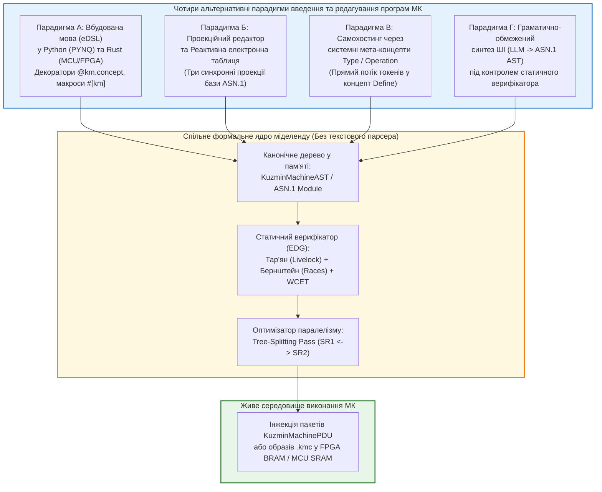

# Чи потрібен Машині Кузьміна окремий компілятор? Критичний аналіз інструментальних парадигм: від текстової трансляції до eDSL, проекційних таблиць та самохостингу

> **Внутрішня робоча копія, не публікація; міграція не є науковим прийняттям.** Перенесено з `drafts@774d575:KuzminMachine/03-engineering-software/Kuzmin-Machine-Innovative-Programming-Paradigms-and-Tooling-UA.md` 2026-11-10, Issue #84. Міграція не підтверджує тверджень, прогнозів чи самоприсвоєних статусів. Незмінний оригінал і SHA-256 — у реєстрі міграції.


> [!IMPORTANT]
> **Призначення та методологія документа:** Цей документ досліджує фундаментальне інженерне питання: чи доцільно створювати та підтримувати для Машини Кузьміна (МК) класичний автономний текстовий компілятор, чи нетрадиційна подієво-концептна архітектура МК потребує принципово інших засобів програмування. Документ побудовано за методологією **двосторонньої критичної експертизи**: спочатку обґрунтовуються чотири альтернативні інноваційні парадигми розробки (**Host-eDSL**, **Проекційна реактивна таблиця на базі ASN.1**, **Мета-концептний самохостинг** та **Структурний нейро-символьний синтез**), а потім кожна з них піддається жорсткій інженерній критиці з виявленням її вразливостей, меж масштабованості та прихованих витрат.

---

## Зміст

1. [Фундаментальне протиріччя: чому класичний текстовий компілятор конфліктує з архітектурою Машини Кузьміна](#1-фундаментальне-протиріччя-чому-класичний-текстовий-компілятор-конфліктує-з-архітектурою-машини-кузьміна)
2. [Чотири інноваційні парадигми програмування МК замість окремого текстового компілятора](#2-чотири-інноваційні-парадигми-програмування-мк-замість-окремого-текстового-компілятора)
3. [Жорстка критика та ахіллесові п'яти кожної з інноваційних парадигм (Матеріал для наукового опонування)](#3-жорстка-критика-та-ахіллесові-пяти-кожної-з-інноваційних-парадигм-матеріал-для-наукового-опонування)
4. [Порівняльна інженерно-економічна матриця інструментальних підходів](#4-порівняльна-інженерно-економічна-матриця-інструментальних-підходів)
5. [Еталонний прототип Python eDSL та односторонньої проекції МК (`km_edsl_and_projectional_prototype.py`)](#5-еталонний-прототип-python-edsl-та-односторонньої-проекції-мк-km_edsl_and_projectional_prototypepy)
6. [Відкриті питання для подальшої дискусії та критики](#6-відкриті-питання-для-подальшої-дискусії-та-критики)

---

## 1. Фундаментальне протиріччя: чому класичний текстовий компілятор конфліктує з архітектурою Машини Кузьміна

Класичний конвеєр компіляції (`Вихідний текстовий файл -> Лексер -> Парсер -> Оптимізатор -> Компонувальник -> Статичний бінарний образ`) історично сформувався для фон-нейманівських машин із послідовним потоком керування. У такій моделі програма є одновимірним текстом, який ізоморфно відображається на лінійний сегмент коду в пам'яті, індексований лічильником команд (`PC`).

Спроба застосувати цей самий підхід до високорівневої мови Машини Кузьміна ([див. Специфікацію мови в EBNF](Kuzmin-Machine-High-Level-Language-Specification-UA.md)) стикається з трьома об'єктивними інженерними суперечностями:

### 1.1. Суперечність форми: Багатовимірний реактивний граф проти Лінійного тексту
У Машині Кузьміна програма — це **статично-динамічна таблиця концептів (`¤`)**, кожен із яких має чотири фазові точки перехоплення Великої крапки (`PRE_WRITE`, `POST_CHANGE`, `ON_READ`, `ON_EXEC`), 7 апаратних ліній подій властивостей даних `::` та масив паралельних підписних ліній $`O + SR`$.
* Запис такої багатовимірної табличної структури у вигляді плоского тексту вимагає штучної лінеаризації за допомогою вкладених дужок `[]`, `{}`, `()` та позиційних префіксів.
* **Гіпотеза Г-1 (не підтверджена вимірюваннями):** зі зростанням кількості взаємопов'язаних концептів у класі відстежити у текстовому файлі, які саме концепти прокинуться у другій чи третій хвилі каскаду після зміни одного поля, стає когнітивно важко. Орієнтовний поріг ($`15 \dots 20`$ концептів) — експертна оцінка автора документа, а не результат експерименту; перевірка потребує вимірювання часу розуміння коду у контрольованій групі інженерів.

### 1.2. Лексично-ергономічний бар'єр (Unicode Friction та синтаксична омонімія)
Авторський синтаксис мови МК спирається на символи математичної логіки та псевдографіки, які **відсутні у стандартній розкладці клавіатури**:
* Стрілки адресації: `←` (`U+2190`), `→` (`U+2192`), `↑` (`U+2191`), `↓` (`U+2193`);
* Фазовий оператор Великої крапки: `•` (`U+2022`) та символ поточного концепту: `¤` (`U+00A4`);
* Логічне заперечення: `¬` (`U+00AC`) та квадратний корінь: `√` (`U+221A`);
* Символи апаратних типів: вивід `└─` (`U+2514 U+2500`), канал `⇄` (`U+21C4`), кадр `▭` (`U+25AD`);
* Коментарі з ялинковою лапкою: `' # ... »` (`U+00BB`).

Водночас ті символи, що взяті зі стандартної таблиці ASCII, мають **екстремальний рівень синтаксичної омонімії** (наприклад, символ `~` означає і подію зміни значення, і групу операторів порівняння, і побітову інверсію в `Do ~`; символи `<` та `>` означають і відношення порядку, і побітові зсуви, і межі локального циклу `<i = 0 < 5 ... >`; пробіл між `A` та `i` означає індексацію масиву `A[i]`). Це робить ручний набір коду в текстовому редакторі вразливим до друкарських помилок.

### 1.3. Суперечність часу життя: «Мертвий файл» проти «Живого середовища концептів»
За архітектурним задумом М. Кузьміна середовище МК є безперервно діючим простором понять: користувач або зовнішній вузол може у будь-який момент створити новий концепт (`Define`), змінити його тип (`Convert`) або підписати на події іншого концепту (`Subscribe`) без зупинки обчислень. Класичний пакетний компілятор руйнує цю модель, змушуючи перекомпільовувати та перезавантажувати весь образ при кожній зміні правила.

### 1.4. Застереження до власних аргументів розділу 1 (самокритика)

Розділ 1 у первинній редакції подавав три аргументи як рівноцінні. Після критичного перегляду їхній статус різний:

| Аргумент | Статус | Обґрунтування застереження |
| :--- | :---: | :--- |
| **1.1.** Граф проти лінійного тексту | Гіпотеза (не доведено) | Порогове значення когнітивної складності не виміряне; текстові мови успішно описують графи залежностей (Makefile, SQL-тригери, Verilog). |
| **1.2.** Unicode та омонімія токенів | Частково зняте | Ергономіку введення вирішують засоби редактора (digraph, compose-клавіша, шрифтові лігатури). Омонімія реальна, але усувається контекстним лексером ([таблиця розмежування лексем](../../../architecture/software/compiler.md)) зі скінченною вартістю реалізації. Це проблема інструментарію, а не принципова перешкода. |
| **1.3.** «Мертвий файл» проти живого середовища | Потребує звуження | Хибно ототожнювати «компілятор» із «пакетною компіляцією всього файлу». Smalltalk, Lisp та Erlang мають текстовий синтаксис і водночас підтримують гаряче оновлення визначень (*hot code loading*); можлива інкрементальна компіляція окремого концепту чи підписки. Суперечність стосується пакетного режиму, а не тексту чи компілятора як такого. |

> [!IMPORTANT]
> **Звужений висновок розділу 1:** обґрунтовано лише тезу «пакетний компілятор з монолітним образом погано узгоджується з живим середовищем концептів». Теза «текстова мова чи компілятор для МК непотрібні» **не випливає** з наведених аргументів. Крім того, ядро трансформації та верифікації (міделенд: Tree-Splitting, статичний аналіз, кодогенерація) потрібне за будь-якої парадигми, тобто «компілятор» як бібліотека існує завжди; питання стосується лише **фронтенду** (способу введення програми).

---

## 2. Чотири інноваційні парадигми програмування МК замість окремого текстового компілятора

Якщо відмовитися від ідеї монолітного текстового компілятора `.km`, то центральним ядром інструментарію стає не парсер тексту, а **Бібліотека трансформації та верифікації графа концептів (Graph Lowering & Verification Core)**, що працює безпосередньо над формальною моделлю [ASDL / ITU-T X.680 ASN.1](../../theory/asn.md). Тоді поверх цього ядра можуть працювати чотири спеціалізовані інтерфейси програмування:



### Парадигма А. Вбудована предметно-орієнтована мова (Host-Embedded DSL — eDSL у Python та Rust)
* **Суть підходу:** Мова МК реалізується не як окремий транслятор, а як бібліотека класів, дескрипторів та перевантажених операторів усередині Python (основної мови платформи PYNQ-Z1) або як набір процедурних макросів `#[kuzmin_class]` у Rust (для мікроконтролерів STM32/RISC-V).
* **Механізм роботи:** Коли розробник оголошує клас у Python/Rust, метаклас або макрос під час ініціалізації перехоплює оголошені поля-концепти, будує абстрактне синтаксичне дерево підписок за допомогою символьних об'єктів-виразів (*Symbolic Tracing / AST Capture*) і одразу викликає наш міделенд [`KuzminCompiler`](../../../architecture/software/compiler.md) для генерації 32-бітних інструкцій `Go`/`Do`.
* **Що це дає:** відмова від лексера та парсера *тексту МК* і від власного плагіна IDE для синтаксису. **Що це не усуває:** механізм захоплення виразів (символьні об'єкти, метакласи чи процедурні макроси) та міделенд лишаються потрібними. Автодоповнення працює лише для концептів, оголошених як атрибути класу; статична перевірка (`mypy` / `rustc`) не знає семантики `Type`/`Size` МК без власних узагальнених типів чи плагінів. Тому формулювання «безкоштовно від базової мови» у первинній редакції було завищеним.

### Парадигма Б. Проекційне редагування та Реактивна таблиця концептів (Projectional Editing & Reactive Spreadsheet)
* **Суть підходу:** Первинним джерелом істини (*Single Source of Truth*) є не текстовий файл, а структурована база даних концептів у форматі **ITU-T X.680 ASN.1** (у текстовому представленні JSON/YAML для Git або бінарному DER/UPER). Розробник працює з нею через **проекційний редактор**, який підтримує три взаємно-синхронізовані візуальні проекції:
  1. **Матрично-таблична проекція (Concept Spreadsheet):** кожен рядок — це концепт (`ConceptId`, Ім'я, Тип `0..15`, Розмір `1|2|4|8`, Поточне значення), а колонки відповідають фазам Великої крапки (`[• : Пре-запис]`, `[: • Пост-зміна]`, `[→ • Читання]`, `[| Виконання]`). Це перетворює програмування МК на інтуїтивне заповнення таблиці реактивних правил (подібно до таблиць рішень у промисловій автоматиці).
  2. **Канонічна символьна проекція Кузьміна (Read/Edit Symbolic View):** автоматично відмальовує ту саму структуру у компактній авторській нотації зі стрілками `←`, `→`, `•`, `└─`, де спецсимволи вставляються вибором зі спливаючого меню або гарячими клавішами (`<-` автоматично відображається як `←`, `.` після пробілу — як `•`).
  3. **Топологічна проекція хвильового фронту (Event Dependency Graph View):** візуалізує каскади подій між концептами і в реальному часі підсвічує результати роботи [Статичного аналізатора](../../../sw/tools/static-analyzer/README.md) (петлі Livelock, конфлікти паралельного запису, критичний шлях WCET).

### Парадигма В. Самохостинг через системні мета-концепти `Type` та `Operation` (Self-Hosted Meta-Concept Environment)
* **Суть підходу:** У першоджерелах М. Кузьміна словники `Type` та `Operation` описані не як зовнішня документація, а як **внутрішні концепти самої машини**. Це дозволяє перенести трансляцію всередину самої віртуальної або апаратної Машини Кузьміна:
  * Концепт `Define` приймає на вхід структурований потік токенів (уже розібраний на хості в компактні 4-бітні коди токенів ASN.1 UPER);
  * Підписки самого концепту `Define` реактивно алокують нові рядки у таблиці `BRAM_CONCEPTS` та записують 32-бітні слова в `BRAM_LINES`.

### Парадигма Г. Граматично-обмежений нейро-символьний синтез (Constrained LLM-to-ASN.1 Synthesis)
* **Суть підходу:** Замість навчання мовних моделей (LLM) генерувати нестабільний поверхневий синтаксис `.km`, модель використовується в режимі **структурно-обмеженої генерації (Structured Output / Grammar-Constrained Decoding за схемою ASDL або ASN.1)**.
* Інженер формулює специфікацію контролера або експертного правила природною мовою (або мовою C/Python), LLM генерує строго типізоване дерево `KuzminMachineModule`, а детермінований конвеєр (`KuzminStaticAnalyzer` + `KuzminReferenceVM`) автоматично перевіряє інваріанти безпеки перед дозволом на завантаження в апаратне ядро.

### 2.5. Допущення, на яких тримається кожна парадигма (умови фальсифікації)

Кожна з чотирьох парадигм чинна лише за певних допущень. Якщо допущення хибне, парадигма втрачає обґрунтування. Наведені умови спростування мають бути перевірені експериментально.

| Парадигма | Неявне допущення | Як це допущення спростувати |
| :--- | :--- | :--- |
| **А. eDSL** | Типові програми МК виражаються через обмежену множину конструкторів Python/Rust без втрати читабельності. | Перекласти весь [еталонний корпус](Kuzmin-Machine-High-Level-Language-Specification-UA.md) на eDSL і порівняти кількість токенів та кількість «обхідних» обгорток (`.when()`, `.pre_write()`) з оригіналом. Якщо eDSL-запис довший у кілька разів, допущення хибне. |
| **Б. Проекційна таблиця** | Первинне сховище в структурі ASN.1 не руйнує процес командної роботи. | ASN.1 має текстові правила кодування (value notation, XER, JER), тому канонічний текстовий дамп для Git технічно можливий. Допущення спростовується, якщо канонічна серіалізація нестабільна (нерегулярний порядок полів чи ідентифікаторів) і дає шум у `git diff`. Це перевіряється експериментом із двома гілками, що змінюють різні концепти одного класу. |
| **В. Самохостинг** | Вбудовування `Define` у виконавче ядро коштує менше за вигоду від гарячого завантаження. | Виміряти витрати BRAM та LUT на модуль розбору потоку `Define` у RTL. Якщо вони порівнянні з вартістю самого ядра `PE`, допущення хибне (див. розділ 6, питання 3). |
| **Г. LLM-синтез** | Статичний верифікатор відсікає більшість семантичних помилок згенерованого дерева. | Перевірити на мутаційному наборі: взяти правильні програми, внести типові семантичні помилки (`= 0` замість `= _ 0`, пропущений `_` в ітераторі) і виміряти частку помилок, яку верифікатор ловить. Помилки, що не порушують жодного інваріанта EDG, верифікатор не побачить за визначенням. |

---

## 3. Жорстка критика та ахіллесові п'яти кожної з інноваційних парадигм (Матеріал для наукового опонування)

Жодна з описаних вище чотирьох парадигм не є «срібною кулею». Під час науково-інженерної дискусії опонент має повне право висунути такі обґрунтовані контраргументи проти кожної з них:

### 3.1. Критика Парадигми А (Вбудовані мови eDSL у Python / Rust)

1. **Проблема «дірявих абстракцій» (Leaky Abstractions) та обмежень синтаксису мови-господаря:**
   * У Python **неможливо перевантажити** логічні оператори `and`, `or`, `not` та умовний оператор `if` (вони не делегують виклик методам об'єкта), а присвоєння змінній `x = expr` взагалі не перехоплюється. Для частини випадків існують обхідні шляхи: побітові `&`, `|`, `~` можна перевантажити для булевих виразів (з іншим пріоритетом операторів, що є джерелом помилок), а присвоєння *атрибуту* об'єкта перехоплюється через `__setattr__` або дескриптори `__set__`. Повне символьне трасування довільного коду потребує інспекції вихідного тексту (`inspect.getsource`, модуль `ast`), що вже є розбором тексту й зменшує вигоду від eDSL. *Уточнення до первинної редакції:* твердження «неможливо перевантажити `=`» було надто категоричним.
   * Як наслідок, замість лаконічного авторського запису:
     ```text
     Distance 0 ← @ Float x 0  Distance += x  •  { Speed = x * 10 }
     ```
     розробник на Python eDSL змушений писати громіздкі обгортки з методами `.when()`, `.pre_write()`, `.post_change()`, що втрачає лаконічність і наочність оригінальної нотації Кузьміна.
2. **Семантична шизофренія між кодом часу компіляції (Host) та кодом часу виконання (Target):**
   * Початківці у Python eDSL неминуче намагатимуться викликати всередині реактивної підписки звичайні функції Python (`time.sleep()`, `requests.get()`, спискові включення), не розуміючи, що цей код не виконується на інтерпретаторі Python, а лише один раз трасується для генерації 32-бітних інструкцій `Go`/`Do` для ПЛІС! Це класична хвороба всіх eDSL (відома за TensorFlow 1.x `tf.Session` та PyTorch JIT).

### 3.2. Критика Парадигми Б (Проекційні редактори та таблично-графові середовища)

1. **Катастрофа версіонування та командної роботи в Git (Diff & Merge Hell):**
   * Текстові файли коду залишаються стандартом індустрії вже 60 років з однієї головної причини: рядковий `git diff` та `git merge` працюють миттєво, надійно і читаються людиною у будь-якому веб-інтерфейсі (GitHub / GitLab).
   * Усі відомі проекційні та візуальні середовища (JetBrains MPS, LabVIEW, MATLAB Simulink, блок-схеми IEC 61131-3) зберігають код як складні дерева ID-вузлів (XML, JSON, ASN.1). При одночасній роботі двох інженерів над однією таблицею концептів виникають конфлікти злиття графа, які неможливо розв'язати у стандартному текстовому редакторі без спеціалізованого інструменту порівняння дерев.
2. **Втрата читабельності графів при масштабуванні («Проблема спагеті з дротів»):**
   * Візуальне представлення підписок у вигляді стрілок між блоками чудово виглядає для 5–10 концептів (як у прикладі одометра чи алгоритму Евкліда). Проте вже при $`N = 100`$ концептах і $`300`$ перехресних підписках двовимірна графова схема перетворюється на нечитабельне павутиння ліній, де текстовий пошук (`grep`) значно ефективніший.
3. **Висока вартість розробки самого проекційного GUI ($`C_{\mathrm{NRE}}^{\mathrm{GUI}}`$):**
   * Хоча ми економимо на написанні текстового парсера EBNF, створення зручного, стабільного кросплатформного графічного/табличного редактора (наприклад, як розширення Webview для VS Code або віджета JupyterLab) часто виявляється **дорожчим і складнішим у підтримці**, ніж написання класичного консольного компілятора на 2000 рядків коду!

### 3.3. Критика Парадигми В (Самохостинг через мета-концепти всередині МК)

1. **Неможливість глобальної статичної верифікації та оптимізації на цільовому кристалі:**
   * Якщо ми подаємо сирі команди створення концептів безпосередньо в мікроконтролер STM32 (із 4 КБ SRAM) або в апаратне ядро FPGA, саме виконавче ядро здатне лише механічно записати дескриптор у вільну комірку.
   * На цільовому кристалі **немає ресурсів**, щоб перед запуском побудувати повний граф залежностей подій EDG, знайти компоненти сильної зв'язності за алгоритмом Тар'яна (щоб захистити систему від нескінченного шторму `Livelock`), перевірити умови Бернштейна на гонитву даних і оптимально розщепити дерево виразів між стеками `SR1` та `SR2`. Отже, розумний міделенд-верифікатор все одно **мусить працювати на зовнішньому хост-комп'ютері**.

### 3.4. Критика Парадигми Г (Нейро-символьний синтез через LLM)

1. **Ілюзія надійності: граматична валідність ASN.1 НЕ гарантує семантичної правильності:**
   * Навчальний корпус у світовому інтернеті для мови Машини Кузьміна практично нульовий (на відміну від мільярдів рядків на C, Python чи Verilog). Тому LLM без ретельного промптингу та прикладів у контексті буде систематично припускатися семантичних помилок, специфічних для МК:
     * плутати звичайне присвоєння `= 0` (яке викликає рекурсивну подію запису) з тихим скиданням `= _ 0`;
     * забувати вказувати початковий стан `_` в ітераторі `{[ _ ~ ] < N}`;
     * неправильно розташовувати дії відносно фазового вентиля Великої крапки `•`.
   * Отже, LLM може бути лише допоміжним генератором чернеток, але **не замінює строгий детермінований інструмент розробника**.

### 3.5. Оцінка сили самої критики (критика критики)

Розділ 3 у первинній редакції подавав усі контраргументи як переконливі. Для чесної дискусії необхідно показати, де сама критика вразлива:

| Контраргумент розділу 3 | Чи вразливий він | Чому |
| :--- | :---: | :--- |
| 3.2 / Diff та merge на деревоподібних файлах | Частково | Структуру ASN.1 можна серіалізувати у канонічний текст (value notation, JER). Тоді `git diff` працює; проблема зводиться до стабільності серіалізації (див. [умову спростування Б](#25-допущення-на-яких-тримається-кожна-парадигма-умови-фальсифікації)). Критика сильна лише для бінарного формату. |
| 3.2 / «Спагеті з дротів» при $`N = 100`$ | Слабка | Граф залежностей існує незалежно від форми запису; текстовий запис його не спрощує, а лише приховує. Проекційний редактор може фільтрувати й згортати граф. Аргумент валідний тільки для наївного візуального редактора без фільтрації. |
| 3.2 / GUI дорожчий за консольний компілятор на 2000 рядків | Не доведена | Порівняння вартостей наведено без обліку LSP, підсвічування та форматера, які потрібні текстовій мові. Числа у документі є припущеннями. |
| 3.3 / Верифікація неможлива на кристалі | Слабка | Самохостинг можна обмежити тонким завантажувачем: верифікація й оптимізація виконуються на хості, на кристал надходить підписаний готовий образ, а вбудований `Define` лише записує дескриптори. Тоді суперечності з аргументом немає, але й «самохостинг» зводиться до завантажувача. |
| 3.4 / LLM помилятиметься в семантиці МК | Сильна, але не специфічна | Те саме вірно для будь-якої мови з малим корпусом. Аргумент про нульовий навчальний корпус є імовірним, але не виміряним. Контрзахід (приклади у контексті та верифікатор) описаний у [умові спростування Г](#25-допущення-на-яких-тримається-кожна-парадигма-умови-фальсифікації). |
| 3.1 / Дірявість eDSL | Сильна | Підтверджується досвідом TensorFlow 1.x та PyTorch JIT. Це найсильніший контраргумент розділу. |

> [!NOTE]
> **Підсумок:** із шести контраргументів неспростованими лишаються два: дірявість абстракції eDSL (3.1) та відсутність навчального корпусу для LLM (3.4). Решта залежать від вибору серіалізації та архітектури (тонкий завантажувач) і не є принциповими перешкодами.

---

## 4. Порівняльна інженерно-економічна матриця інструментальних підходів

Зведемо всі 5 можливих шляхів побудови інструментарію для Машини Кузьміна в єдину оціночну матрицю:

| Інженерний критерій | 1. Окремий текстовий компілятор (Unicode `.km`) | 2. Текстовий компілятор з ASCII-транслітерацією (`.kma`) | 3. Вбудована мова eDSL (Python / Rust) | 4. Проекційний таблично-графовий редактор (ASN.1 GUI) | 5. Гібридне рішення: **Python eDSL + Двосторонній текстово-табличний проектор** |
| :--- | :---: | :---: | :---: | :---: | :---: |
| **Зручність набору зі звичайної клавіатури** | Низька (потрібні спецсимволи `←`, `•`, `└─`) | **Висока** (`<-`, `->`, `(*)`, `pin`) | **Висока** (стандартний Python/Rust) | **Висока** (вибір зі списків і таблиць) | **Максимальна** (доступні обидва режими) |
| **Наочність та компактність авторської нотації МК** | **Висока** (оригінальний запис) | Середня (втрачається візуальна чистота) | Середня (шум синтаксису Python/Rust) | **Висока** (рендеринг символів у таблиці) | **Висока** (автоматичний рендеринг у нотацію МК) |
| **Сумісність із Git (`diff`, `merge`, Code Review)** | **Відмінна** | **Відмінна** | **Відмінна** | Погана (бінарні / деревоподібні файли) | **Відмінна** (у Git зберігається eDSL або канонічний текст) |
| **Виключення синтаксичних неоднозначностей (`~`, `<`, `_`)** | Низьке (складний контекстний парсер) | Середнє | **100% (типізовані конструктори AST)** | **100% (редагування комірок AST)** | **100% (пряма побудова ASDL / ASN.1)** |
| **Підтримка живого рантайму (`Define` / `Subscribe` на льоту)** | Відсутня (пакетний режим) | Відсутня | **Нативна** (інтерактивний REPL / Jupyter) | **Нативна** (гаряче редагування таблиці) | **Нативна** |
| **Вартість розробки та підтримки ($`C_{\mathrm{NRE}}`$)** | Висока (парсер + LSP + IDE) | Середня | **Мінімальна** (оцінка автора, не виміряно) | Висока (розробка UI/GUI) | **Низька** (використовує існуючу інфраструктуру Python/Jupyter) |

> [!TIP]
> **Синтетичний висновок з матриці:**
> **Робоча гіпотеза (не доведена):** найбільш прагматичною архітектурою для Машини Кузьміна може бути **Підхід №5 (Гібридне рішення)**:
> 1. **Ядром системи** є вже створений нами формальний міделенд на базі **ASDL / ITU-T X.680 ASN.1** + **Статичний аналізатор EDG** + **Tree-Splitter (`SR1` $\leftrightarrow$ `SR2`)**.
> 2. **Для написання коду та зберігання в Git** використовується **Python/Rust eDSL** у парі з **ASCII-сумісною канонічною нотацією** (де `<-` взаємно-однозначно відображається у `←`, `->` у `→`, `@dot` або `(*)` у `•`, `~!` у `¬`).
> 3. **Для візуального аналізу, проектування та налагодження на PYNQ-Z1** той самий об'єкт у пам'яті автоматично проектується у **Реактивну таблицю концептів (Spreadsheet View)** та **Канонічну символьну нотацію Кузьміна** без ручного набору Unicode-символів!

### 4.1. Статус матриці та слабкі місця підходу №5

1. **Оцінки матриці якісні.** Значення «висока», «низька», «максимальна» є експертними судженнями автора документа. Вони не відкалібровані й не підкріплені вимірюваннями. Матриця придатна як структура для дискусії, але не як доказ переваги підходу №5.
2. **Термін «двосторонній» у первинній редакції неточний.** Прототип з розділу 5 реалізує лише напрямок «модель $`\to`$ проекції» (генерація нотації, таблиці й `Go`/`Do`). Зворотного напрямку «редагування проекції $`\to`$ модель» немає. Без нього проектор лишається **односторонньою** візуалізацією. Двобічне редагування вимагає канонічної моделі та правил round-trip, а це відома тяжка задача в модельно-керованій інженерії (MDE).
3. **Оцінка NRE підходу №5 занижена.** Підхід складається з трьох підсистем: eDSL, проектор чи редактор і міделенд-ядро. Сумарні витрати не менші за витрати кожної окремої парадигми. Значення «Низька» враховує лише eDSL. Для підходу №5 чесніша оцінка — «Середня».
4. **Критерії порівняння мають бути вимірними.** Для заміни експертних суджень об'єктивними метриками пропонується:

| Критерій | Метрика | Спосіб вимірювання |
| :--- | :--- | :--- |
| Компактність запису | Кількість токенів на програму корпусу | Лексичний підрахунок для кожного варіанта запису |
| Схильність до помилок | Кількість дефектів у контрольному завданні | Група інженерів реалізує те саме завдання у різних підходах |
| Супровід у Git | Частка рядків `diff`, не пов'язаних зі змістом змін | Дві гілки, що змінюють різні концепти одного класу |
| Вартість розробки | Людино-дні до працездатного інструмента | Облік у процесі реалізації |

---

## 5. Еталонний прототип Python eDSL та односторонньої проекції МК (`km_edsl_and_projectional_prototype.py`)

Щоб довести життєздатність запропонованої гібридної концепції не лише теоретично, а й конструктивно, нижче наведено повністю робочий прототип `km_edsl_and_projectional_prototype.py`.

Він демонструє, як інженер описує промисловий контролер мовою **Python eDSL** (без жодного парсера тексту та без ручного вводу спецсимволів), а система **автоматично будує з нього три проекції**:
1. **Проекція 1 (Канонічна авторська нотація М. Кузьміна з Unicode-символами `←`, `→`, `•`, `└─`)** — генерується автоматично з моделі у пам'яті!
2. **Проекція 2 (Таблична матриця концептів і фаз Великої крапки — Reactive Spreadsheet View)** — для інженерного огляду та аудиту.
3. **Проекція 3 (Низькорівневий стековий код `Go` / `Do`)** — готовий до завантаження у FPGA PYNQ-Z1 або мікроконтролер STM32.

```python
#!/usr/bin/env python3
# -*- coding: utf-8 -*-
"""
Еталонний прототип вбудованої мови (Python eDSL) та односторонньої
проекції (генератора) (Kuzmin Notation View + Reactive Spreadsheet View + Go/Do ISA)
для Машини Кузьміна (km_edsl_and_projectional_prototype.py).
"""

from dataclasses import dataclass, field
from typing import Any, Dict, List, Optional, Tuple


# ============================================================================
# 1. СИМВОЛЬНІ ВУЗЛИ ВИРАЗІВ eDSL (AST CAPTURE БЕЗ ПАРСЕРА ТЕКСТУ)
# ============================================================================

class SymExpr:
    """Базовий клас символьного виразу, що перехоплює арифметичні оператори Python."""

    def __add__(self, other: Any) -> "SymBinary":
        return SymBinary("+", self, _ensure_expr(other))

    def __sub__(self, other: Any) -> "SymBinary":
        return SymBinary("-", self, _ensure_expr(other))

    def __mul__(self, other: Any) -> "SymBinary":
        return SymBinary("*", self, _ensure_expr(other))

    def __truediv__(self, other: Any) -> "SymBinary":
        return SymBinary("/", self, _ensure_expr(other))

    def __pow__(self, other: Any) -> "SymBinary":
        return SymBinary("^", self, _ensure_expr(other))

    def to_kuzmin_str(self) -> str:
        raise NotImplementedError

    def to_rpn_isa(self) -> List[str]:
        raise NotImplementedError


def _ensure_expr(val: Any) -> SymExpr:
    if isinstance(val, SymExpr):
        return val
    return SymLiteral(val)


def _bare(expr: SymExpr) -> str:
    """Запис виразу без зайвих зовнішніх дужок."""
    s = expr.to_kuzmin_str()
    if isinstance(expr, SymBinary) and s.startswith("(") and s.endswith(")"):
        return s[1:-1]
    return s


def _fmt_action(target: str, expr: SymExpr, silent: bool) -> str:
    """
    Форматує дію у канонічній нотації. Виразу виду `Target op expr`
    відповідає складене присвоєння `Target op= expr` (напр. Distance += x).
    """
    if silent:
        return f"{target} = _ {_bare(expr)}"
    if (
        isinstance(expr, SymBinary)
        and isinstance(expr.left, SymRef)
        and expr.left.concept_name == target
        and expr.op in ("+", "-", "*", "/")
    ):
        return f"{target} {expr.op}= {_bare(expr.right)}"
    return f"{target} = {_bare(expr)}"


@dataclass
class SymLiteral(SymExpr):
    value: Any

    def to_kuzmin_str(self) -> str:
        if isinstance(self.value, str):
            return f'"{self.value}"'
        return str(self.value)

    def to_rpn_isa(self) -> List[str]:
        if isinstance(self.value, str) and "p" in self.value:
            return [f'Go "{self.value}" →']
        return [f"Imm {self.value}"]


@dataclass
class SymRef(SymExpr):
    concept_name: str

    def to_kuzmin_str(self) -> str:
        return self.concept_name

    def to_rpn_isa(self) -> List[str]:
        return [f"Go {self.concept_name} →"]


@dataclass
class SymBinary(SymExpr):
    op: str
    left: SymExpr
    right: SymExpr

    def to_kuzmin_str(self) -> str:
        return f"({self.left.to_kuzmin_str()} {self.op} {self.right.to_kuzmin_str()})"

    def to_rpn_isa(self) -> List[str]:
        return self.left.to_rpn_isa() + self.right.to_rpn_isa() + [f"Do {self.op}"]


# ============================================================================
# 2. ДЕКЛАРАТИВНІ КОНЦЕПТИ ТА ФАЗОВІ ПІДПИСКИ ВЕЛИКОЇ КРАПКИ (•)
# ============================================================================

@dataclass
class PhaseRule:
    addressing: str            # "←", "→", "|", ":: ~", "= 10"
    param_decl: Optional[str]  # Напр. "@ Float x"
    pre_dot_actions: List[Tuple[str, SymExpr, bool]]   # (target, expr, is_silent) ДО '•'
    post_dot_actions: List[Tuple[str, SymExpr, bool]]  # (target, expr, is_silent) ПІСЛЯ '•'


@dataclass
class ConceptSpec:
    name: str
    km_type_sym: str           # "+", "+-", ".", "?", "└─"
    type_alias: str            # "Byte", "Int32", "Float", "Pin"
    initial_val: Any           # Значення або "_"
    rules: List[PhaseRule] = field(default_factory=list)

    def ref(self) -> SymRef:
        return SymRef(self.name)


class KmClassBuilder:
    """
    Конструктор класу Машини Кузьміна мовою Python eDSL.
    Дозволяє описувати концепти та двофазні транзакції Великої крапки (•),
    автоматично генеруючи:
      1) Канонічну символьну нотацію М. Кузьміна;
      2) Проекційну таблицю (Reactive Spreadsheet View);
      3) Стековий асемблер Go / Do.
    """

    def __init__(self, class_name: str) -> None:
        self.class_name = class_name
        self.concepts: Dict[str, ConceptSpec] = {}

    def define(self, name: str, km_type_sym: str, type_alias: str, initial_val: Any = "_") -> ConceptSpec:
        spec = ConceptSpec(name=name, km_type_sym=km_type_sym, type_alias=type_alias, initial_val=initial_val)
        self.concepts[name] = spec
        return spec

    def add_phase_rule(
        self,
        owner: ConceptSpec,
        addressing: str,
        param_decl: Optional[str] = None,
        pre_dot: Optional[List[Tuple[str, Any, bool]]] = None,
        post_dot: Optional[List[Tuple[str, Any, bool]]] = None,
    ) -> None:
        pre_list = [(t, _ensure_expr(e), s) for (t, e, s) in (pre_dot or [])]
        post_list = [(t, _ensure_expr(e), s) for (t, e, s) in (post_dot or [])]
        owner.rules.append(
            PhaseRule(
                addressing=addressing,
                param_decl=param_decl,
                pre_dot_actions=pre_list,
                post_dot_actions=post_list,
            )
        )

    def render_kuzmin_symbolic_projection(self) -> str:
        """
        ПРОЕКЦІЯ 1: Автоматично рендерить модель у канонічний символьний код
        високорівневої мови Машини Кузьміна (зі спецсимволами ←, →, •, └─).
        """
        lines = [f"Class {self.class_name}", ": {"]
        for c in self.concepts.values():
            init_str = f'"{c.initial_val}"' if c.km_type_sym == "└─" else str(c.initial_val)
            lines.append(f"    {c.type_alias} {c.name} {init_str}")
            for r in c.rules:
                param_str = f" {r.param_decl} " if r.param_decl else " "
                pre_str = "  ".join(
                    _fmt_action(t, e, s) for t, e, s in r.pre_dot_actions
                )
                post_str = "  ".join(
                    _fmt_action(t, e, s) for t, e, s in r.post_dot_actions
                )
                if pre_str and post_str:
                    lines.append(f"        {r.addressing}{param_str}{pre_str}  •  {{ {post_str} }}")
                elif pre_str:
                    lines.append(f"        {r.addressing}{param_str}{pre_str}")
                elif post_str:
                    lines.append(f"        {r.addressing}{param_str}•  {post_str}")
        lines.append("}")
        return "\n".join(lines)

    def render_spreadsheet_projection(self) -> str:
        """
        ПРОЕКЦІЯ 2: Рендерить ту саму програму як двовимірну Реактивну Таблицю Концептів
        (Projectional Spreadsheet View), де виключені синтаксичні помилки.
        """
        header = (
            f"{'Концепт (¤)':<14} | {'Тип (Токен)':<12} | {'Поч.':<6} | "
            f"{'Подія':<8} | {'Пре-фаза (w1 • ДО фіксації)':<38} | {'Пост-фаза (• w2 ПІСЛЯ фіксації)':<36}"
        )
        sep = "-" * len(header)
        rows = [header, sep]
        for c in self.concepts.values():
            t_label = f"{c.type_alias} ({c.km_type_sym})"
            if not c.rules:
                rows.append(f"{c.name:<14} | {t_label:<12} | {str(c.initial_val):<6} | {'—':<8} | {'—':<38} | {'—':<36}")
            for idx, r in enumerate(c.rules):
                c_col = c.name if idx == 0 else ""
                t_col = t_label if idx == 0 else ""
                i_col = str(c.initial_val) if idx == 0 else ""
                pre_s = "; ".join(_fmt_action(t, e, s) for t, e, s in r.pre_dot_actions) or "—"
                post_s = "; ".join(_fmt_action(t, e, s) for t, e, s in r.post_dot_actions) or "—"
                rows.append(f"{c_col:<14} | {t_col:<12} | {i_col:<6} | {r.addressing:<8} | {pre_s:<38} | {post_s:<36}")
        return "\n".join(rows)

    def compile_to_isa_projection(self) -> List[str]:
        """
        ПРОЕКЦІЯ 3: Пряма генерація стекових команд Go / Do з моделі без парсингу тексту.
        """
        isa_lines: List[str] = []
        for c in self.concepts.values():
            for r in c.rules:
                seq: List[str] = []
                for target, expr, is_silent in r.pre_dot_actions + r.post_dot_actions:
                    seq.extend(expr.to_rpn_isa())
                    flag = " [SILENT_RESET]" if is_silent else (" [SELF_SUPPRESS]" if target == c.name else "")
                    seq.append(f"Go {target} ←{flag}")
                isa_lines.append(f"Sub({c.name}, '{r.addressing}'):  " + " ; ".join(seq))
        return isa_lines


# ============================================================================
# 3. ДЕМОНСТРАЦІЯ ТРЬОХ СИНХРОННИХ ПРОЕКЦІЙ ОДНІЄЇ МОДЕЛІ (ОДОМЕТР + ТАХОМЕТР)
# ============================================================================

if __name__ == "__main__":
    # Інженер описує модель чистою Python eDSL (без набору спецсимволів з клавіатури):
    model = KmClassBuilder("OdometerAndTachometer")

    dist = model.define("Distance", ".", "Float", 0.0)
    speed = model.define("Speed", ".", "Float", 0.0)
    accel = model.define("Accelleration", ".", "Float", 0.0)
    rev = model.define("Revolutions", "+", "U32", 0)
    tick = model.define("Tick", "+", "Byte", 0)
    x_param = SymRef("x")

    # Двофазне правило для Distance: ← @ Float x 0  Distance += x  •  { Speed = x * 10 }
    model.add_phase_rule(
        owner=dist,
        addressing="←",
        param_decl="@ Float x 0",
        pre_dot=[("Distance", dist.ref() + x_param, False)],
        post_dot=[("Speed", x_param * 10, False)],
    )

    # Правило для Speed: ← @ Float x  Accelleration = (x - Speed)  Speed = x
    model.add_phase_rule(
        owner=speed,
        addressing="←",
        param_decl="@ Float x",
        pre_dot=[
            ("Accelleration", x_param - speed.ref(), False),
            ("Speed", x_param, False),
        ],
    )

    # Правило читання для Tick: → • Revolutions = Tick * 600  Tick = _ 0
    model.add_phase_rule(
        owner=tick,
        addressing="→",
        post_dot=[
            ("Revolutions", tick.ref() * 600, False),
            ("Tick", 0, True),
        ],
    )

    print("=" * 96)
    print("ПРОЕКЦІЯ 1: АВТОМАТИЧНО ЗГЕНЕРОВАНА КАНОНІЧНА НОТАЦІЯ М. КУЗЬМІНА (Unicode Symbolic View)")
    print("=" * 96)
    print(model.render_kuzmin_symbolic_projection())

    print("\n" + "=" * 96)
    print("ПРОЕКЦІЯ 2: ПРОЕКЦІЙНА РЕАКТИВНА ТАБЛИЦЯ КОНЦЕПТІВ (Spreadsheet View)")
    print("=" * 96)
    print(model.render_spreadsheet_projection())

    print("\n" + "=" * 96)
    print("ПРОЕКЦІЯ 3: НИЗЬКОРІВНЕВІ ЛІНІЇ ІНСТРУКЦІЙ СТЕКОВОЇ МАШИНИ (Go / Do ISA View)")
    print("=" * 96)
    for line in model.compile_to_isa_projection():
        print("  " + line)
    print("=" * 96)
```

### 5.1. Що прототип демонструє і чого не доводить

* **Демонструє:** модель, побудована засобами Python без розбору тексту МК, однозначно проектується у три вигляди (нотація, таблиця, `Go`/`Do`). Складене присвоєння `Distance += x` відновлюється з дерева виразу.
* **Не доводить двобічності:** зворотного шляху «редагування проекції $`\to`$ модель» немає (див. [4.1](#41-статус-матриці-та-слабкі-місця-підходу-5)).
* **Не доводить семантичної коректності:** згенеровані лінії `Go`/`Do` не виконувалися на [еталонній віртуальній машині](Kuzmin-Machine-Reference-VM-and-Cycle-Accurate-Simulator-UA.md), тому еквівалентність поведінки не перевірена.
* **Вибірка обмежена:** перевірено три правила з одного прикладу, підібраного автором. Це демонстрація можливості, а не оцінка покриття мови; еталонні ідіоми на кшталт `Nod` чи `{[ _ ~ ] < N}` прототип не виражає.
* **Не вимірює вигоди:** порівняння кількості токенів та складності запису з оригінальною нотацією (умова спростування парадигми А, [розділ 2.5](#25-допущення-на-яких-тримається-кожна-парадигма-умови-фальсифікації)) не проводилося.

---

## 6. Відкриті питання для подальшої дискусії та критики

Для критичного обговорення цього документа пропонуються чотири ключові питання, де інженерні рішення вступають у гострий компроміс:

1. **Питання ідентичності мови проти прагматизму впровадження:**
   * Якщо ми замінюємо пряме написання коду високорівневою символьною мовою Кузьміна на Python/Rust eDSL або табличний редактор, чи не втрачаємо ми ту саму унікальну лаконічність однорядкових конструкцій (як-от `U64 Nod | @ U64 ( a _ > b -=b , b _ > a -=a ) = a`), яку неможливо так само коротко записати засобами синтаксису Python чи Rust?
2. **Питання ASCII-канону (Транслітерований синтаксис `.kma`):**
   * Можливо, замість повної відмови від текстового компілятора на користь графічних таблиць чи eDSL, правильніше ввести **суворий двосторонній стандарт ASCII-транслітерації** для текстових файлів (наприклад: `<-` замість `←`, `->` замість `→`, `(*)` або `..` замість Великої крапки `•`, `~!` замість `¬`), де IDE на льоту підмінює ASCII-диграфи на красиві гліфи Кузьміна за допомогою шрифтових лігатур (як у шрифтах *Fira Code* або *JetBrains Mono*)?
3. **Питання межі розумності виконавчого ядра (`Thin Kernel vs Self-Hosted Kernel`):**
   * Чи виправдано тримати словники `Type` та `Operation` і логіку побудови підписок усередині самого мікроконтролера/ПЛІС (підхід самохостингу), якщо це ускладнює апаратне ядро і з'їдає дефіцитну блочну пам'ять BRAM, яку краще віддати під корисні робочі концепти та слоти рандеву?
4. **Питання формальної верифікації табличних змін «на льоту»:**
   * Якщо інженер у живому середовищі (через табличний редактор або REPL) під час роботи промислового контролера додає нову підписку `AttachSubscriptionReq`, яка випадково замикає цикл нескінченного реактивного шторму (`Livelock`), хто і в який момент має заблокувати цю інжекцію — зовнішній хост-інструмент чи апаратний сторожовий таймер глибини каскаду в самому ядрі МК?

### 6.1. Попередні позиції та перевірювані критерії

Нижче подано робочу позицію автора за кожним питанням. Це не остаточні висновки, а твердження, які опонент може спростувати вказаним способом.

**Питання 1. Лаконічність нотації проти eDSL.**
* *Позиція:* питання відкрите. Лаконічність запису `Nod` досягається перевантаженням токенів, яке водночас є джерелом синтаксичної неоднозначності (розділ 9 [специфікації мови](Kuzmin-Machine-High-Level-Language-Specification-UA.md)). Тому компактність не є однозначною перевагою.
* *Перевірка:* порівняти кількість токенів і кількість допоміжних обгорток для `Nod`, `Factorial`, `SumZ` у нотації та в eDSL. Очікується, що eDSL довший, але довжина не є єдиною метрикою (див. метрики [4.1](#41-статус-матриці-та-слабкі-місця-підходу-5)).

**Питання 2. ASCII-транслітерація з лігатурами.**
* *Позиція:* варіант потенційно **найдешевший** і не вимагає жодної з чотирьох парадигм, тому в первинній редакції документа його було недооцінено. Лігатури вирішують лише візуальне відображення; семантична омонімія `~`, `<`, `>` лишається.
* *Ризик:* ASCII-диграфи створюють нові колізії. Наприклад, у записі `a<-1` лексер має вирішити, це стрілка `←` чи порівняння «менше від мінус одиниці». Потрібні лексичні пріоритети або обов'язкові пробіли навколо диграфів.
* *Перевірка:* побудувати таблицю всіх диграфів і перевірити їх на неоднозначність щодо корпусу прикладів; цей варіант слід порівнювати першим.

**Питання 3. Межа розумності виконавчого ядра.**
* *Позиція:* за наявними аргументами обґрунтований лише тонкий завантажувач дескрипторів; повний самохостинг на кристалі не обґрунтований (див. [3.5](#35-оцінка-сили-самої-критики-критика-критики)).
* *Перевірка:* обсяг BRAM та LUT модуля розбору потоку `Define` **не оцінювався**; потрібен синтез у Vivado. До цього числових тверджень робити не слід.

**Питання 4. Хто блокує небезпечну інжекцію підписки.**
* *Позиція:* потрібні обидва рівні (багаторубіжний захист). Хост-аналіз раннього виявлення неповний: він не знає динамічного стану системи, а хост може бути несправним. Апаратний лічильник глибини каскаду $`D_{\max}`$ у ядрі дешевий (один лічильник на хвилю подій) і слугує останнім рубежем.
* *Обмеження:* лічильник не відрізняє легітимну глибоку збіжність (алгоритм Евкліда робить десятки кроків) від шторму; $`D_{\max}`$ потрібно задавати для кожного класу окремо, а хибні блокування неминучі.
* *Зв'язок:* узгоджується з типом точки зупину «сторож глибини каскаду» у [протоколі налагоджувача](Kuzmin-Machine-Live-Environment-and-Debugger-Protocol-UA.md).
