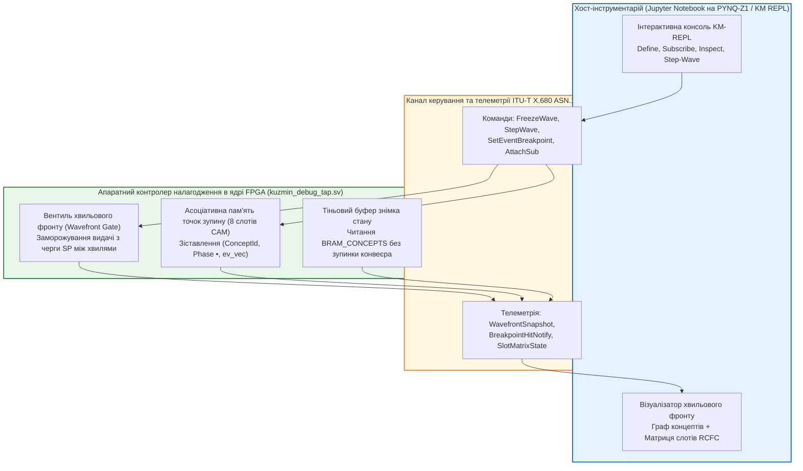

# Архітектура живого середовища концептів (REPL / Event Inspector) та протоколу хвильового налагоджувача Машини Кузьміна

> **Внутрішня робоча копія, не публікація; міграція не є науковим прийняттям.** Перенесено з `drafts@774d575:KuzminMachine/03-engineering-software/Kuzmin-Machine-Live-Environment-and-Debugger-Protocol-UA.md` 2026-11-10, Issue #84. Міграція не підтверджує тверджень, прогнозів чи самоприсвоєних статусів. Незмінний оригінал і SHA-256 — у реєстрі міграції.


> [!IMPORTANT]
> **Призначення документа:** Цей інженерний документ визначає архітектуру **Інтерактивного середовища живих концептів та хвильового налагоджувача Машини Кузьміна (Kuzmin Machine Live Concept Environment & Wavefront Debugger)**. Оскільки у Машині Кузьміна відсутній глобальний лічильник команд, а концепти та підписки можуть динамічно створюватися (`Define`) і приєднуватися (`Subscribe`) користувачем на льоту без зупинки обчислень, класичний покроковий дебагер типу GDB (`step into / step over`) є непридатним. Документ формалізує концепцію **Хвильового налагодження (Wavefront Debugging)**, точки зупину на подіях та фазах Великої крапки (`•`), інтеграцію зі стандартом [ITU-T X.680 ASN.1 (`KuzminMachinePDU`)](../../theory/asn.md) та інтерактивну панель моніторингу для плати [FPGA PYNQ-Z1](../hardware/Kuzmin-Machine-FPGA-PYNQ-Z1-Architecture-UA.md) у середовищі Jupyter Notebook.

---

## Зміст

1. [Чому класичний дебагер (GDB) не підходить для Машини Кузьміна: парадигма Wavefront Debugging](#1-чому-класичний-дебагер-gdb-не-підходить-для-машини-кузьміна-парадигма-wavefront-debugging)
2. [Архітектура живого середовища концептів (Live Concept Workspace & REPL)](#2-архітектура-живого-середовища-концептів-live-concept-workspace--repl)
3. [Чотири типи реактивних точок зупину (Event, Phase `•`, Rendezvous та Cascade Depth Breakpoints)](#3-чотири-типи-реактивних-точок-зупину-event-phase--rendezvous-та-cascade-depth-breakpoints)
4. [Розширення протоколу ASN.1 для телеметрії та керування хвильовим фронтом (`KmDebugPDU`)](#4-розширення-протоколу-asn1-для-телеметрії-та-керування-хвильовим-фронтом-kmdebugpdu)
5. [Еталонна реалізація інтерактивного REPL-інспектора та хвильового налагоджувача для PYNQ-Z1 на Python](#5-еталонна-реалізація-інтерактивного-repl-інспектора-та-хвильового-налагоджувача-для-pynq-z1-на-python)

---

## 1. Чому класичний дебагер (GDB) не підходить для Машини Кузьміна: парадигма Wavefront Debugging

У традиційній фон-нейманівській програмі виконання лінійно рухається вздовж інструкцій за адресою регістра `PC`. Налагоджувач зупиняє потік на рядку коду і показує стек викликів (`Call Stack`).

У Машині Кузьміна обчислення — це **розбіжна й збіжна хвиля подій (Event Wavefront)** у просторі концептів:
* один запис у концепт `Value` одночасно будить кілька підписок у паралельній групі `[ Up Down ]` на різних ядрах `PE0..PE7`;
* замість стека викликів діє **причинно-наслідкове дерево активацій (Causal Activation Tree)** та апаратна матриця слотів рандеву `RCFC`;
* під час роботи системи користувач може ззовні створити новий концепт `AlarmLogger` і командою `AlarmLogger.Subscribe(Up)` підписати його на події вже працюючого контролера без перезавантаження!

| Характеристика налагодження | Класичний імперативний дебагер (GDB / LLDB) | Хвильовий налагоджувач Машини Кузьміна (KM Wavefront Debugger) |
| :--- | :--- | :--- |
| **Одиниця покрокового руху** | Одна машинна інструкція (`stepi`) або рядок коду (`next`). | **Один мікрохвильовий фронт подій (`step-wave`)** або одна фаза Великої крапки (`step-phase •`). |
| **Точка зупину (Breakpoint)** | Адреса інструкції в сегменті `.text` (`PC == 0x08001234`). | **Умова події над концептом:** напр. `Break ON Concept(Tick) WHEN Event(= 10) AT Phase(• POST)`. |
| **Контекст при зупинці** | Стек кадрів викликів функцій (`backtrace`) та регістри `R0..R15`. | **Знімок дерева каскаду**, вектор активних предикатів `ev_vec[6:0]`, стан черги `SP` та 64 слотів рандеву `RCFC`. |
| **Гаряча модифікація (`Hot Patching`)** | Складна підміна машинного коду в пам'яті. | Нативна операція архітектури МК: відправка пакета ASN.1 `defineConceptReq` або `attachSubscriptionReq`. |



---

## 2. Архітектура живого середовища концептів (Live Concept Workspace & REPL)

Ключовий інженерний принцип живого середовища МК полягає в тому, що **компілятор і виконавче ядро працюють у спільному просторі ідентифікаторів концептів (`ConceptId`)**.

Коли розробник відкриває інтерактивну сесію `km-repl` (підключену до програмної віртуальної машини або до апаратного ядра на PYNQ-Z1), кожен введений рядок обробляється інкрементально:
1. Якщо введено оголошення нового концепту (наприклад, `Float FilteredSpeed 0`), середовище виділяє наступний вільний індекс у таблиці `BRAM_CONCEPTS` і відправляє пакет `defineConceptReq`.
2. Якщо введено нову підписку для вже існуючого концепту (наприклад, `Speed [ : • FilteredSpeed = FilteredSpeed * 0.9 + Speed * 0.1 ]`), компілятор на льоту генерує нову підписну лінію $`O`$ у вільній ділянці `BRAM_LINES` і атомарно додає її дескриптор у список пост-підписок концепту `Speed` (`attachSubscriptionReq`).
3. Поточні обчислення в інших концептах при цьому **не перериваються ні на жоден такт**!

---

## 3. Чотири типи реактивних точок зупину (Event, Phase `•`, Rendezvous та Cascade Depth Breakpoints)

В апаратному блоці `kuzmin_debug_tap.sv` (та програмному симуляторі) реалізовано **4 спеціалізовані типи точок зупину**, які неможливо виразити в класичних процесорах:

1. **Подієва точка зупину (`Event Breakpoint`):**
   Зупиняє просування черги підписок $`SP`$ у момент, коли на заданому концепті `ConceptId` після запису виставляється вказана маска у векторі `ev_vec[6:0]` (наприклад, зупинитися, коли `Accelleration` вперше стає від'ємним — `:: Negative`).
2. **Фазова точка зупину Великої крапки (`Big Dot Phase Breakpoint`):**
   Зупиняє виконання безпосередньо **в точці `•`** між пре-фазою $`w_1`$ та пост-фазою $`w_2`$, дозволяючи розробникові оглянути обчислене значення перед тим, як воно розішле каскад подій сусіднім концептам, або вручну скасувати транзакцію (`• = ¬`).
3. **Точка зупину на події рандеву (`Rendezvous Fallback Breakpoint`):**
   Спрацьовує, коли будь-який слот рандеву у блоці `RCFC` переходить у режим вимушеного одноядерного виконання **Fallback** (сигналізує про пікове перевантаження пулу обчислювальних ядер `PE`).
4. **Сторож глибини каскаду (`Cascade Depth Watchpoint`):**
   Автоматично заморожує хвильовий фронт, якщо кількість послідовних хвиль від одного зовнішнього стимулу перевищує заданий поріг $`D_{\max}`$ (миттєве перехоплення нескінченних циклів Livelock у живому середовищі).

---

## 4. Розширення протоколу ASN.1 для телеметрії та керування хвильовим фронтом (`KmDebugPDU`)

Нижче наведено формальну схему команд налагоджувача у нотації **ITU-T X.680 ASN.1**, яка безпосередньо доповнює основний модуль [`KuzminMachine-ASN1-Specification`](../../theory/asn.md):

```asn1
-- ============================================================================
-- Модуль розширення протоколу ASN.1 для хвильового налагоджувача МК
-- ============================================================================
KuzminMachine-Debugger-ASN1 DEFINITIONS AUTOMATIC TAGS ::= BEGIN

IMPORTS
    ConceptId, SubscriptionId, BigDotPhase, ConceptValue
    FROM KuzminMachine-ASN1-Specification;

KmDebugCommandPDU ::= CHOICE {
    -- Заморозити диспетчер черги SP після завершення поточної мікрохвилі
    freezeWavefront         NULL,
    -- Просунути обчислення рівно на N хвиль каскаду подій
    stepWavefront           INTEGER (1..1024),
    -- Встановити апаратну точку зупину в CAM-регістрі налагоджувача
    setEventBreakpoint      SEQUENCE {
        bpSlot              INTEGER (0..7),
        targetConcept       ConceptId,
        phaseFilter         BigDotPhase OPTIONAL,
        eventMask           BIT STRING (SIZE (8))
    },
    -- Інспектувати поточний стан концепту та його активні підписки без генерації події '→'
    silentInspectConcept    ConceptId,
    -- Примусово змінити прапорець Великої крапки концепту ('!' або '¬')
    overrideBigDotFlag      SEQUENCE {
        targetConcept       ConceptId,
        setToTrue           BOOLEAN
    }
}

KmDebugTelemetryPDU ::= CHOICE {
    wavefrontSnapshot       SEQUENCE {
        waveNumber          INTEGER (0..4294967295),
        cycleCount          INTEGER (0..18446744073709551615),
        activePeMask        BIT STRING (SIZE (8)),
        pendingQueueDepth   INTEGER (0..1024),
        modifiedConcepts    SEQUENCE OF SEQUENCE {
            cid             ConceptId,
            oldVal          ConceptValue,
            newVal          ConceptValue,
            evVecBits       BIT STRING (SIZE (7))
        }
    },
    breakpointHit           SEQUENCE {
        bpSlot              INTEGER (0..7),
        triggeredByConcept  ConceptId,
        currentPhase        BigDotPhase,
        activeSubId         SubscriptionId
    }
}

END
```

---

## 5. Еталонна реалізація інтерактивного REPL-інспектора та хвильового налагоджувача для PYNQ-Z1 на Python

Наведений нижче модуль `km_live_debugger.py` реалізує повнофункціональний **Хвильовий налагоджувач та живе середовище концептів**, де виконання розбите на дискретні хвилі (`Wave 0 -> Wave 1 -> Wave 2 ...`), підтримується встановлення подієвих точок зупину (`Event Breakpoints`), «тихий огляд» пам'яті без генерації події читання `→` та гаряче приєднання нових підписок `Subscribe` на льоту між хвилями:

```python
#!/usr/bin/env python3
# -*- coding: utf-8 -*-
"""
Інтерактивне живе середовище концептів (Live Concept Workspace) та
Хвильовий налагоджувач (Wavefront Debugger) Машини Кузьміна (km_live_debugger.py).
"""

from dataclasses import dataclass, field
from typing import Any, Callable, Dict, List, Optional, Set, Tuple


# ============================================================================
# 1. СТРУКТУРИ ХВИЛЬОВОГО НАЛАГОДЖУВАЧА ТА ТОЧОК ЗУПИНУ
# ============================================================================

@dataclass
class WaveActivationTask:
    """Активована підписка, що належить до поточного або наступного хвильового фронту."""
    wave_id: int
    source_concept: str
    target_concept: str
    trigger_event: str
    description: str
    callback: Callable[["KuzminWavefrontDebugger"], None]


@dataclass
class EventBreakpoint:
    """Реактивна точка зупину на події або фазі Великої крапки концепту."""
    bp_id: int
    concept_name: str
    event_filter: str  # Напр. ":: Negative", "= 10", ":: ~", "*" (будь-яка подія)
    enabled: bool = True
    hit_count: int = 0


@dataclass
class LiveConcept:
    name: str
    value: Any = None
    prev_value: Any = None
    is_undefined: bool = True
    subscribers: List[Tuple[str, str, str, Callable[["KuzminWavefrontDebugger", Any], None]]] = field(default_factory=list)

    def active_events(self) -> Set[str]:
        if self.is_undefined or self.value is None:
            return {":: _"}
        evs = {"*"}
        if self.value != self.prev_value:
            evs.add(":: ~")
        if isinstance(self.value, (int, float)):
            if self.value == 0:
                evs.add(":: Null")
            elif self.value > 0:
                evs.add(":: Positive")
            else:
                evs.add(":: Negative")
            evs.add(f"= {self.value}")
        return evs


# ============================================================================
# 2. РУШІЙ ХВИЛЬОВОГО НАЛАГОДЖЕННЯ (WAVEFRONT STEPPER & LIVE SUBSCRIBE)
# ============================================================================

class KuzminWavefrontDebugger:
    """
    Дозволяє виконувати програми Машини Кузьміна похвильово (step_wave),
    перехоплювати точки зупину на подіях та динамічно приєднувати нові концепти
    і підписки у вже працюючому середовищі без зупинки чи перекомпіляції.
    """

    def __init__(self) -> None:
        self.concepts: Dict[str, LiveConcept] = {}
        self.current_wave: int = 0
        self.wave_queue: List[WaveActivationTask] = []
        self.breakpoints: List[EventBreakpoint] = []
        self.halted_on_bp: Optional[EventBreakpoint] = None
        self.history_waves: Dict[int, List[str]] = {}
        self._next_bp_id: int = 1

    def define_live_concept(self, name: str, initial_val: Any = None, is_undef: bool = False) -> None:
        self.concepts[name] = LiveConcept(
            name=name,
            value=None if is_undef else initial_val,
            prev_value=None,
            is_undefined=is_undef,
        )

    def attach_live_subscription(
        self,
        source_concept: str,
        subscriber_concept: str,
        event_cond: str,
        action_desc: str,
        action_fn: Callable[["KuzminWavefrontDebugger", Any], None],
    ) -> None:
        """
        Динамічно приєднує нову реактивну підписку в живому середовищі
        (аналог відправки пакета ASN.1 attachSubscriptionReq / E.Subscribe(Value)).
        """
        src = self.concepts[source_concept]
        src.subscribers.append((subscriber_concept, event_cond, action_desc, action_fn))

    def set_breakpoint(self, concept_name: str, event_filter: str = "*") -> int:
        bp = EventBreakpoint(bp_id=self._next_bp_id, concept_name=concept_name, event_filter=event_filter)
        self._next_bp_id += 1
        self.breakpoints.append(bp)
        return bp.bp_id

    def inject_write(self, concept_name: str, new_val: Any, wave_tag: Optional[int] = None) -> None:
        """Зовнішній або каскадний запис у концепт із перевіркою точок зупину та породженням наступної хвилі."""
        w_id = self.current_wave if wave_tag is None else wave_tag
        c = self.concepts[concept_name]
        c.prev_value = c.value
        c.value = new_val
        c.is_undefined = False

        evs = c.active_events()
        self.history_waves.setdefault(w_id, []).append(
            f"{concept_name} <- {new_val} (активні події: {sorted(e for e in evs if e != '*')})"
        )

        # 1. Перевірка апаратних/програмних точок зупину на подіях
        for bp in self.breakpoints:
            if bp.enabled and bp.concept_name == concept_name and (bp.event_filter in evs):
                bp.hit_count += 1
                self.halted_on_bp = bp

        # 2. Постановка всіх розбуджених підписок у наступний хвильовий фронт (w_id + 1)
        for sub_name, ev_cond, desc, fn in c.subscribers:
            if ev_cond in evs:
                val_snapshot = c.value
                self.wave_queue.append(
                    WaveActivationTask(
                        wave_id=w_id + 1,
                        source_concept=concept_name,
                        target_concept=sub_name,
                        trigger_event=ev_cond,
                        description=desc,
                        callback=lambda dbg, v=val_snapshot, f=fn: f(dbg, v),
                    )
                )

    def step_wave(self) -> Tuple[int, List[str]]:
        """
        Виконує рівно ОДИН хвильовий фронт каскаду подій (усі паралельні задачі поточної хвилі)
        і зупиняється перед початком наступної хвилі.
        """
        self.halted_on_bp = None
        if not self.wave_queue:
            return self.current_wave, []

        next_w = min(t.wave_id for t in self.wave_queue)
        self.current_wave = next_w
        current_tasks = [t for t in self.wave_queue if t.wave_id == next_w]
        self.wave_queue = [t for t in self.wave_queue if t.wave_id != next_w]

        executed_descriptions: List[str] = []
        for task in current_tasks:
            executed_descriptions.append(
                f"[{task.source_concept} ({task.trigger_event}) ==> {task.target_concept}]: {task.description}"
            )
            task.callback(self)

        return self.current_wave, executed_descriptions

    def silent_inspect_all(self) -> Dict[str, Any]:
        """Тихий огляд значень усіх концептів (без активації подій читання '→')."""
        return {name: ("_" if c.is_undefined else c.value) for name, c in self.concepts.items()}


# ============================================================================
# 3. ДЕМОНСТРАЦІЯ ПОХВИЛЬОВОГО НАЛАГОДЖЕННЯ ТА ГАРЯЧОЇ ПІДПИСКИ НА ЛЬОТУ
# ============================================================================

if __name__ == "__main__":
    print("=" * 84)
    print("ДЕМОНСТРАЦІЯ ХВИЛЬОВОГО НАЛАГОДЖУВАЧА (Wavefront Debugger) ТА ГАРЯЧОЇ ПІДПИСКИ МК")
    print("=" * 84)

    dbg = KuzminWavefrontDebugger()

    # Створюємо живі концепти у середовищі: Distance, Speed, Accelleration
    dbg.define_live_concept("Distance", 0.0)
    dbg.define_live_concept("Speed", 0.0)
    dbg.define_live_concept("Accelleration", 0.0)

    # Прив'язуємо підписки: Distance (~) -> Speed -> Accelleration
    dbg.attach_live_subscription(
        "Distance", "Speed", ":: ~", "Speed = dx * 10",
        lambda d, val: d.inject_write("Speed", val * 10.0)
    )
    dbg.attach_live_subscription(
        "Speed", "Accelleration", ":: ~", "Accelleration = Speed - 5.0",
        lambda d, val: d.inject_write("Accelleration", val - 5.0)
    )

    # Встановлюємо реактивну точку зупину: зупинитися, коли Accelleration стане від'ємним (:: Negative)!
    bp_id = dbg.set_breakpoint("Accelleration", ":: Negative")
    print(f"[Debugger] Встановлено подієву точку зупину #{bp_id}: ON Concept(Accelleration) WHEN (:: Negative)")

    # ГАРЯЧА МОДИФІКАЦІЯ (Hot-Patching): створюємо новий концепт TelemetryAlert прямо в рантаймі
    # і підписуємо його на подію від'ємного прискорення (гальмування) без зупинки системи!
    dbg.define_live_concept("BrakeAlert", "OK")
    dbg.attach_live_subscription(
        "Accelleration", "BrakeAlert", ":: Negative", "BrakeAlert = 'EMERGENCY_BRAKING!'",
        lambda d, val: d.inject_write("BrakeAlert", f"EMERGENCY_BRAKING ({val} m/s^2)")
    )
    print("[Live REPL] На льоту додано концепт 'BrakeAlert' і підписано на Accelleration (:: Negative)\n")

    # Подаємо зовнішній стимул (Хвиля 0): Distance = 0.2 м -> очікуємо Speed = 2.0, Accel = -3.0 (< 0)
    print(">>> Ініціюємо Хвилю 0: зовнішній запис Distance = 0.2")
    dbg.inject_write("Distance", 0.2, wave_tag=0)
    print(f"    Знімок пам'яті після Хвилі 0: {dbg.silent_inspect_all()}")

    while dbg.wave_queue:
        w_num, actions = dbg.step_wave()
        print(f"\n>>> Покрокове виконання Хвилі #{w_num} (step-wave):")
        for act in actions:
            print(f"    * {act}")
        print(f"    Знімок пам'яті після Хвилі #{w_num}: {dbg.silent_inspect_all()}")
        if dbg.halted_on_bp:
            print(
                f"    [BREAKPOINT HIT!] Спрацювала точка зупину #{dbg.halted_on_bp.bp_id} "
                f"на концепті '{dbg.halted_on_bp.concept_name}' за подією '{dbg.halted_on_bp.event_filter}'!"
            )
    print("=" * 84)
```
