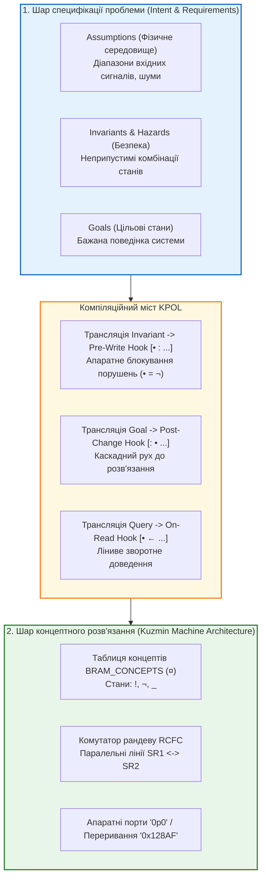

# Мова специфікації проблем та концептного розв'язання Машини Кузьміна (Kuzmin Problem-Oriented Language — KPOL)

> **Внутрішня робоча копія, не публікація; міграція не є науковим прийняттям.** Перенесено з `drafts@774d575:KuzminMachine/03-engineering-software/Kuzmin-Machine-Problem-Oriented-Language-Specification-UA.md` 2026-11-10, Issue #84. Міграція не підтверджує тверджень, прогнозів чи самоприсвоєних статусів. Незмінний оригінал і SHA-256 — у реєстрі міграції.


> [!IMPORTANT]
> **Призначення документа:** Цей документ визначає архітектуру та повну специфікацію гібридної людино-машинної мови програмування **KPOL (Kuzmin Problem-Oriented Language)**. Мова спроєктована як строгий інженерний компроміс між людиною-інженером, великими мовними моделями (ШІ) та апаратною архітектурою [Машини Кузьміна на FPGA](../hardware/Kuzmin-Machine-FPGA-PYNQ-Z1-Architecture-UA.md). KPOL усуває розрив між формальним описом проблемної області (вимоги, фізичні допущення, інваріанти безпеки, цільові стани) та подієвою алгоритмікою її розв'язання на МК (концепти, події `::`, фазовий вентиль Великої крапки `•` та лінії $`O + SR`$).

---

## Зміст

1. [Філософія KPOL: подолання розриву між описом проблеми та алгоритмом](#1-філософія-kpol-подолання-розриву-між-описом-проблеми-та-алгоритмом)
2. [Дворівнева архітектура мови: Шар специфікації (Intent) та Шар реалізації (Concepts)](#2-дворівнева-архітектура-мови-шар-специфікації-intent-та-шар-реалізації-concepts)
3. [Синтаксис та семантика шару вимог (Problem & Invariant Domain)](#3-синтаксис-та-семантика-шару-вимог-problem--invariant-domain)
4. [Проекція вимог на подієву модель Машини Кузьміна](#4-проекція-вимог-на-подієву-модель-машини-кузьміна)
5. [ASCII- та Unicode-еквівалентність для людей і ШІ (Незламний синтаксис)](#5-ascii--та-unicode-еквівалентність-для-людей-і-ші-незламний-синтаксис)
6. [Наскрізні інженерні приклади на мові KPOL](#6-наскрізні-інженерні-приклади-на-мові-kpol)
7. [Еталонний синтаксичний парсер та верифікатор контрактів KPOL на Python](#7-еталонний-синтаксичний-парсер-та-верифікатор-контрактів-kpol-на-python)

---

## 1. Філософія KPOL: подолання розриву між описом проблеми та алгоритмом

У традиційній інженерії програмного забезпечення існує глибока прірва між **постановкою завдання** (вимоги у Jira/Word, моделі SysML, темпоральна логіка TLA+/LTL) та **кодом реалізації** (C, C++, Rust). Програміст або ШІ змушені вручну транслювати абстрактні інваріанти («тиск не повинен перевищувати 15 бар за будь-яких умов») в імперативні перевірки `if (p > 15) abort();`, розкидані по різних підсистемах. Якщо вимоги змінюються або розробник пропускає перевірку в одному з потоків, виникає критичний дефект.

У Машині Кузьміна є унікальна апаратна основа для вирішення цієї проблеми:
1. **Концепти є живими сутностями**, які моніторять власний стан через 7 предикатів даних `::` (`Null`, `Positive`, `Negative`, `Even`, `Uneven`, `~`).
2. **Фазовий оператор Великої крапки (`•`)** діє як вбудований транзакційний вентиль, здатний скасувати будь-яку дію (`• = ¬`) до її фіксації в пам'яті.

**Мова KPOL (Kuzmin Problem-Oriented Language)** інтегрує опис вимог безпосередньо в структуру концептів:
* **Для людини:** мова дає кришталеву декларативну ясність — інженер бачить мету системи (`Goal`), межі фізичного середовища (`Assumption`), неприпустимі аварійні стани (`Hazard`) та алгоритм їх опрацювання в єдиному блоці.
* **Для ШІ (LLM):** усуваються синтаксичні галюцинації завдяки явній структурі контрактів (Pre/Post/Invariant), сумісній з механізмами структурованого виводу (Constrained Decoding).
* **Для Машини Кузьміна:** кожна вимога безпосередньо транслюється у пре-фази `[• :]` (запобіжники) та пост-фази `[: •]` (цільові реакції) без накладних витрат часу виконання.



---

## 2. Дворівнева архітектура мови: Шар специфікації (Intent) та Шар реалізації (Concepts)

Кожен модуль KPOL складається з двох узгоджених секцій:

$$
\mathbf{KpolModule} ::= \mathbf{ProblemSpec} \quad\parallel\quad \mathbf{ConceptSolution}
$$

### 2.1. Секція `Problem` (Декларація задачі та контракту)
У цій секції інженер або ШІ описує **що** має виконувати система і в яких межах:
* `Assumptions`: допущення про фізичне середовище (наприклад, розрядність АЦП, діапазон допустимих температур давача).
* `Invariants`: математичні твердження, які зобов'язані виконуватися на кожному такті функціонування.
* `Hazards`: критичні небезпечні стани, потрапляння в які апаратно заборонено.
* `Goals`: цільові критерії збіжності алгоритму або умови успішного розв'язання задачі.

### 2.2. Секція `Solution` (Концептна алгоритміка МК)
У цій секції описується **як** задача розв'язується через парадигму Машини Кузьміна:
* Оголошення концептів із типами (`Byte`, `Int32`, `Float`, `Pin`) та початковими станами (число, `!`, `¬` або `_`).
* Реактивні підписки на події адресації (`←`, `→`, `|`) та події властивостей даних `::`.
* Фазовий поділ дій Великою крапкою (`•`).

---

## 3. Синтаксис та семантика шару вимог (Problem & Invariant Domain)

Для забезпечення легкого парсингу як компілятором, так і мовними моделями, секція вимог використовує чітко типізовані ключові слова:

| Ключове слово вимоги | Семантичне значення | Як компілюється в ядро Машини Кузьміна |
| :--- | :--- | :--- |
| **`Assumption`** | Передумова валідності входу | Пре-фільтр на запис у концепт: відсікає некоректні дані давачів до потрапляння в пам'ять. |
| **`Invariant`** | Стан, істинний на кожному такті | Пре-фазовий запобіжник Великої крапки: якщо дія порушує інваріант, прапорець `• = ¬`, а стан відкочується. |
| **`Hazard`** | Аварійний стан (анти-вимога) | Прямий тригер на аварійний вивід (`Pin`) та аварійний перехід у безпечний режим (`SafeState`). |
| **`Goal`** | Цільовий результат або постумова | Пост-фаза або пре-підписка читання `→ :: _`, яка генерує результат для зовнішнього спостерігача. |

---

## 4. Проекція вимог на подієву модель Машини Кузьміна

Найсильніша сторона KPOL полягає в тому, що **вимоги не є пасивними коментарями** — вони компілюються в активну логіку захисту:

### 4.1. Автоматична генерація апаратних запобіжників (Invariant $\to$ Pre-Write Hook)
Якщо у вимогах вказано:
```kpol
Invariant PressureSafe: Pressure <= 15.0
```
Компілятор автоматично синтезує пре-фазу Великої крапки концепту `Pressure`:
```text
Pressure [• : > 15.0  • = ¬   else  Commit ]
```
Якщо зовнішній процес, збійний давач або неперевірена нейромережа спробує записати в `Pressure` значення `16.2`, апаратний вентиль `• = ¬` миттєво відхилить цей запис за 1 такт.

### 4.2. Автоматична генерація цільових реакцій (Goal $\to$ Post-Change / Lazy Read)
Якщо у вимогах вказано:
```kpol
Goal Converged: (a == b) => Result = a
```
Компілятор зв'язує цю мету з завершенням реактивних переходів параметрів у стеку $`SP`$, повертаючи результат лише тоді, коли нерівності перестали генерувати нові події.

---

## 5. ASCII- та Unicode-еквівалентність для людей і ШІ (Незламний синтаксис)

Щоб усунути конфлікти при введенні зі стандартної клавіатури та запобігти галюцинаціям мовних моделей, KPOL встановлює **строгу, канонічну двосторонню таблицю ізоморфізму**:

| Сутність МК | Unicode-гліф (Для читання та документації) | ASCII-еквівалент (Для набору та ШІ) | Опис семантики |
| :---: | :---: | :---: | :--- |
| **Запис зі стека** | `←` | `<-` | Витягти зі стека $`SR`$ і записати в концепт |
| **Читання у стек** | `→` | `->` | Прочитати концепт на вершину стека $`SR`$ |
| **Велика крапка** | `•` | `(*)` або `@dot` | Фазовий вентиль транзакції (до/після) |
| **Власний концепт** | `.` або `¤` | `self` | Поточний збережений стан концепту |
| **Хибність** | `¬` | `~!` | Булева хибність (False, код 1) |
| **Істина** | `!` | `!` | Булева істина (True, код 0) |
| **Невизначено** | `_` | `_` | Відсутнє значення / Невідомо |
| **Апаратний вивід** | `└─` | `pin` | Фізичний порт мікроконтролера / ПЛІС |
| **Зміна значення** | `:: ~` | `:: ~` або `:: changed` | Подія оновлення значення концепту |
| **Коментарі** | `' # ... »` | `# ...` або `/* ... */` | Довільні коментарі інженера |

Компілятор KPOL однаково надійно сприймає обидва варіанти запису.

---

## 6. Наскрізні інженерні приклади на мові KPOL

Нижче наведено три закінчені специфікації, що демонструють поєднання вимог та алгоритміки МК.

### 6.1. Приклад 1: Промисловий реактор із контролем безпеки (ілюстрація; відповідність IEC 61508 / ISO 26262 не заявляється)

```kpol
Problem ReactorThermalControl {
    Assumptions {
        RawTempSensor in [-50.0 .. 300.0]   # Допустимий діапазон робочого давача
        RawPressure in [0.0 .. 50.0]
    }

    Invariants {
        TemperatureLimit: Temp <= 120.0
        PressureLimit: Pressure <= 15.0
    }

    Hazards {
        CriticalExplosionRisk: (Temp > 120.0) and (Pressure > 15.0)
            Trigger: EmergencyValve = 1, AlarmLed = !
    }

    Goals {
        MaintainSafeOperatingZone: Temp in [60.0 .. 90.0]
    }
}

Solution ReactorThermalControl {
    # Фізичні концепти з вбудованими перевірками assumptions
    Float Temp 25.0 {
        [• : < -50.0 or > 300.0  • = ¬]   # Відсікання апаратного шуму
        [: •  Temp > 120.0  HighTemp = !  else HighTemp = ¬]
    }

    Float Pressure 1.0 {
        [• : < 0.0 or > 50.0  • = ¬]
        [: •  Pressure > 15.0  HighPressure = !  else HighPressure = ¬]
    }

    ? HighTemp ¬
    ? HighPressure ¬

    # Апаратні виводи керування
    pin EmergencyValve = "0p1"
    ? AlarmLed ¬

    # Автономна реакція на критичний стан
    ? HazardDetected ¬ {
        [• : HighTemp & HighPressure
            EmergencyValve = 1
            AlarmLed = !
            HazardDetected = !
        ]
    }
}
```

### 6.2. Приклад 2: Алгоритм Евкліда з формальним контрактом коректності

```kpol
Problem EuclidGCD {
    Assumptions {
        InputPositiveA: a > 0
        InputPositiveB: b > 0
    }

    Invariants {
        DivisorPreserved: gcd(a, b) == gcd(original_a, original_b)
    }

    Goals {
        TerminatedEquality: a == b
        ReturnResult: Result == a
    }
}

Solution EuclidGCD {
    # Реактивні параметри у стеку SP з покроковим сходженням
    U64 Nod | @ U64 (
        a _ > b  a -= b,
        b _ > a  b -= a
    ) = a
}
```

### 6.3. Приклад 3: Інтелектуальний електролічильник з автоскиданням

```kpol
Problem SmartEnergyMeter {
    Assumptions {
        SamplingIntervalMs: Interval == 100
    }

    Invariants {
        NonNegativeEnergy: EnergyTotal >= 0.0
    }

    Goals {
        PeriodicPowerIntegration: Every 10 ticks integrate (V * I)
        ZeroLeakageRead: Voltage reading resets buffer to 0.0
    }
}

Solution SmartEnergyMeter {
    Float Voltage 0.0 {
        <- @ Float x 0  Voltage += x
        -> •  Voltage = _ 0.0    # Тихе скидання після видачі читачеві
    }

    Float Electricity 0.0 {
        <- @ Float x 0  Electricity += x
        -> •  Electricity = _ 0.0
    }

    Float EnergyTotal 0.0

    Byte Tick 0 {
        <- Tick += 1
        = 10 {
            EnergyTotal += (Voltage * Electricity) / 100.0
            Tick = _ 0
        }
    }

    Void Pulse | {
        Voltage = "0p1"
        Electricity = "0p0"
        Tick = 1
    }
}
```

---

## 7. Еталонний синтаксичний парсер та верифікатор контрактів KPOL на Python

Нижче наведено самодостатній скрипт `kpol_parser.py`, який демонструє парсинг мови KPOL, перевірку узгодженості між шаром проблем (`Problem`) та шаром концептів (`Solution`), а також трансляцію контрактів у фазові інструкції Машини Кузьміна:

```python
#!/usr/bin/env python3
# -*- coding: utf-8 -*-
"""
Еталонний парсер та валідатор контрактів мови KPOL (Kuzmin Problem-Oriented Language).
Перевіряє сумісність вимог (Problem) із реактивними концептами (Solution).
"""

import re
from dataclasses import dataclass, field
from typing import Dict, List, Optional


@dataclass
class InvariantSpec:
    name: str
    target_concept: str
    condition: str


@dataclass
class ProblemContract:
    name: str
    assumptions: List[str] = field(default_factory=list)
    invariants: List[InvariantSpec] = field(default_factory=list)
    hazards: List[str] = field(default_factory=list)
    goals: List[str] = field(default_factory=list)


@dataclass
class ConceptNode:
    name: str
    type_name: str
    init_val: str
    pre_hooks: List[str] = field(default_factory=list)
    post_hooks: List[str] = field(default_factory=list)


class KpolParser:
    """Парсер та інструмент перевірки узгодженості специфікацій KPOL."""

    def __init__(self) -> None:
        self.problems: Dict[str, ProblemContract] = {}
        self.solutions: Dict[str, List[ConceptNode]] = {}

    def parse_source(self, text: str) -> None:
        # Нормалізація коментарів та ASCII-еквівалентів
        clean_text = re.sub(r"#.*", "", text)
        clean_text = clean_text.replace("<-", "←").replace("->", "→").replace("(*)", "•")

        # 1. Розбір блоків Problem (жадібний захват тіла до наступного Solution або кінця)
        prob_matches = re.finditer(r"Problem\s+(\w+)\s*\{([\s\S]*?)\}\s*(?=Solution|\Z)", clean_text)
        for pm in prob_matches:
            p_name = pm.group(1)
            p_body = pm.group(2)
            contract = ProblemContract(name=p_name)

            for inv in re.finditer(r"Invariant\s+(\w+)\s*:\s*(\w+)\s*([<>=!]+)\s*([0-9.]+)", p_body):
                contract.invariants.append(
                    InvariantSpec(
                        name=inv.group(1),
                        target_concept=inv.group(2),
                        condition=f"{inv.group(3)} {inv.group(4)}"
                    )
                )
            # Також парсимо скорочений синтаксис Invariants { Name: Concept Cond }
            for inv_blk in re.finditer(r"Invariants\s*\{([\s\S]*?)\}", p_body):
                for inv in re.finditer(r"(\w+)\s*:\s*(\w+)\s*([<>=!]+)\s*([0-9.]+)", inv_blk.group(1)):
                    contract.invariants.append(
                        InvariantSpec(
                            name=inv.group(1),
                            target_concept=inv.group(2),
                            condition=f"{inv.group(3)} {inv.group(4)}"
                        )
                    )
            self.problems[p_name] = contract

        # 2. Розбір блоків Solution
        sol_matches = re.finditer(r"Solution\s+(\w+)\s*\{([\s\S]*?)\}\s*(?=Problem|\Z)", clean_text)
        for sm in sol_matches:
            s_name = sm.group(1)
            s_body = sm.group(2)
            concepts: List[ConceptNode] = []

            for c_match in re.finditer(r"(Float|Int32|Byte|U64|\?|pin)\s+(\w+)\s+([^\s{]+)", s_body):
                concepts.append(
                    ConceptNode(
                        type_name=c_match.group(1),
                        name=c_match.group(2),
                        init_val=c_match.group(3)
                    )
                )
            self.solutions[s_name] = concepts

    def verify_consistency(self, module_name: str) -> List[str]:
        """Перевіряє, чи всі інваріанти із Problem підтримуються концептами у Solution."""
        reports: List[str] = []
        if module_name not in self.problems or module_name not in self.solutions:
            return ["Помилка: відсутній відповідний парний блок Problem або Solution!"]

        prob = self.problems[module_name]
        sol_concepts = {c.name: c for c in self.solutions[module_name]}

        for inv in prob.invariants:
            if inv.target_concept not in sol_concepts:
                reports.append(
                    f"КРИТИЧНО: Інваріант '{inv.name}' посилається на неіснуючий концепт '{inv.target_concept}'!"
                )
            else:
                reports.append(
                    f"[OK] Інваріант безпеки '{inv.name}' успішно закріплено за концептом '{inv.target_concept}' ({inv.condition})"
                )
        return reports


if __name__ == "__main__":
    sample_kpol = """
    Problem ReactorCore {
        Invariants {
            MaxTemp: Temp <= 120.0
            MaxPressure: Pressure <= 15.0
        }
        Hazards {
            Meltdown: Temp > 150.0
        }
    }

    Solution ReactorCore {
        Float Temp 20.0
        Float Pressure 1.0
        pin EmergencyValve "0p1"
    }
    """

    parser = KpolParser()
    parser.parse_source(sample_kpol)
    results = parser.verify_consistency("ReactorCore")
    print("=" * 80)
    print("РЕЗУЛЬТАТИ ВЕРИФІКАЦІЇ СПЕЦИФІКАЦІЇ KPOL:")
    print("=" * 80)
    for r in results:
        print(r)
    print("=" * 80)
```
